# DOBOT CRA Series Hardware User Guide

### DOBOT CRA Series Collaborative Robots (CR3A, CR5A, CR7A, CR10A, CR12A, CR16A, CR20A, CR5AF, CR10AF, CR20AF)





















### Contents

* Preface
* 1\. Safety
* 2\. Product Introduction
* 3\. Product Features
* 4\. Mechanical Specifications
* 5\. Electrical Characteristics
* 6\. Transportation
* 7\. Installation and Use
* 8\. Maintenance
* 9\. Disposal and Environmental Protection
* 10\. Warranty
* 11\. Compliance Statements
* Appendix

### Safety

* The robot is a semi-finished machine; a complete risk assessment must be performed by the integrator before use.
* Use the robot only for its intended purpose, within the specified environmental range.
* Only trained and qualified personnel may install, operate, and maintain the robot.
* Set up safety guards and keep personnel out of the robot workspace.
* Use the emergency stop device in emergencies; do not dismantle, modify, or repair the robot without authorization.

### Key Specifications

| Parameter        | CR3A     | CR5A     | CR7A     | CR10A    | CR12A    | CR16A    | CR20A    | CR5AF    | CR10AF   | CR20AF   |
| ---------------- | -------- | -------- | -------- | -------- | -------- | -------- | -------- | -------- | -------- | -------- |
| Weight           | 17.5 kg  | 25 kg    | 24 kg    | 40 kg    | 38.5 kg  | 38 kg    | 73 kg    | 25.5 kg  | 40.5 kg  | 74 kg    |
| Max payload      | 3 kg     | 5 kg     | 7 kg     | 10 kg    | 12 kg    | 16 kg    | 20 kg    | 5 kg     | 10 kg    | 20 kg    |
| Working radius   | 620 mm   | 900 mm   | 800 mm   | 1300 mm  | 1200 mm  | 1000 mm  | 1700 mm  | 900 mm   | 1300 mm  | 1700 mm  |
| Repeatability    | ±0.02 mm | ±0.02 mm | ±0.02 mm | ±0.03 mm | ±0.03 mm | ±0.03 mm | ±0.05 mm | ±0.02 mm | ±0.03 mm | ±0.05 mm |
| Max linear speed | 2 m/s    | 2 m/s    | 2 m/s    | 2 m/s    | 2 m/s    | 2 m/s    | 2 m/s    | 2 m/s    | 2 m/s    | 2 m/s    |
| IP rating        | IP54     | IP54     | IP54     | IP54     | IP54     | IP54     | IP54     | IP54     | IP54     | IP54     |

### Preface

This document describes the functions, technical specifications, installation guide of DOBOT CRA/CRAF series robot, making it easy for users to fully understand and use it.

#### Scope of application

**Robot arm:** DOBOT CR3A, DOBOT CR5A, DOBOT CR7A, DOBOT CR10A, DOBOT CR12A, DOBOT CR16A, DOBOT CR20A, DOBOT CR5AF, DOBOT CR10AF, DOBOT CR20AF, DOBOT CR6AL, DOBOT CR16AL, DOBOT CR30A. You can find the model of robot arm on the right-top corner of the nameplate on the robot base. The figure below takes CR5A as an example.

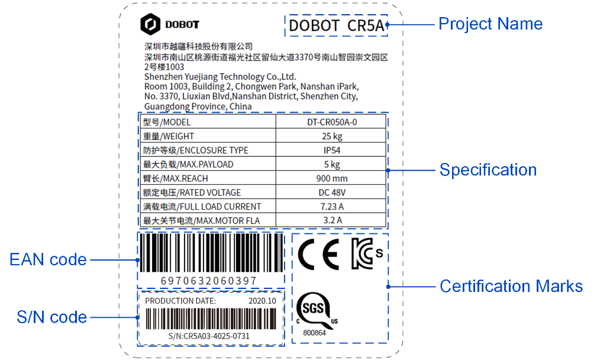

**Controller:**

* DOBOT CC262
* DOBOT CC263 You can find the controller information on the nameplate. The figure below takes CC262 as an example.

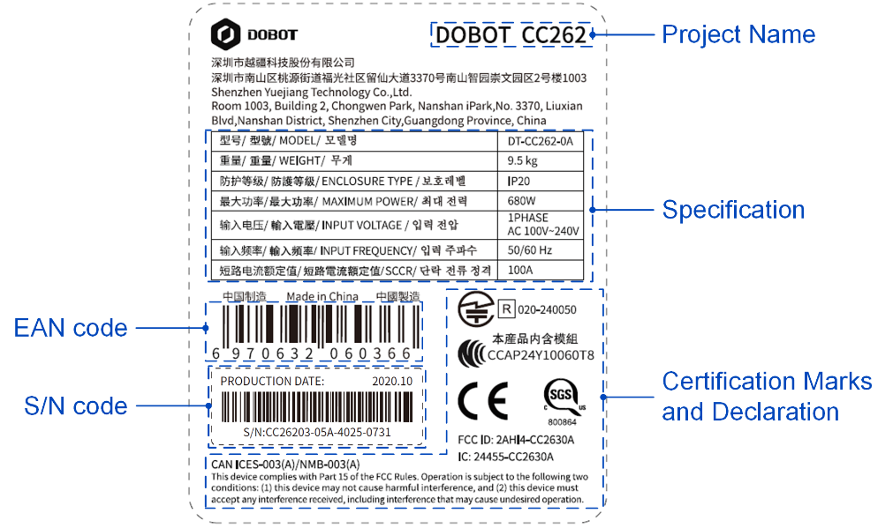

#### Important safety notice

The robot is a **semi-finished machinery**, so a risk assessment must be conducted after each installation. Please strictly adhere to all safety regulations outlined in Chapter 1.

#### Intended audience

This document is intended for:

* Customer
* Sales Engineer
* Installation and Commissioning Engineer
* Technical Support Engineer

#### Related documents

| Document                                                     | Description                                                                                                                                                                       | Download link                                                                   |
| ------------------------------------------------------------ | --------------------------------------------------------------------------------------------------------------------------------------------------------------------------------- | ------------------------------------------------------------------------------- |
| DobotStudio Pro User Guide                                   | Explains how to use the robot control software, DobotStudio Pro.                                                                                                                  | Click Download Center, and search by document name or filter by product series. |
| DOBOT TCP/IP Remote Control Interface Guide                  | Describes how to use the secondary development interface based on TCP/IP protocol. In addition to the document, you can also access multi-language development DEMOs from Github. |                                                                                 |
| DOBOT Bus Communication Protocol Guide (EtherNetIP/Profinet) | Introduces the usage of the robot's bus communication functions (EtherNetIP/Profinet).                                                                                            |                                                                                 |

| Document                             | Description                                                                       | Download link |
| ------------------------------------ | --------------------------------------------------------------------------------- | ------------- |
| DOBOT Cobot Teach Pendant User Guide | Explains how to use the Teach Pendant that accompanies the collaborative robot.   |               |
| DOBOT VX500 Smart Camera User Guide  | Explains how to use the VX500 Smart Camera that accompanies the CRA series robot. |               |

#### Revision history

| Date       | Version | Revised content                                                                                                                                                                                                                                                                                                                                                                                                                                   |
| ---------- | ------- | ------------------------------------------------------------------------------------------------------------------------------------------------------------------------------------------------------------------------------------------------------------------------------------------------------------------------------------------------------------------------------------------------------------------------------------------------- |
| 2026-09-02 | V3.3    | 
• Added descriptions regarding functional safety and applicable standards. • Other content optimization.
                                                                                                                                                                                                                                                                                                                                |
| 2026-03-04 | V3.2    | 
• Added new robot arm models: CR6AL, CR16AL, CR30A and related descriptions. • Enhanced descriptions of diodes. • Other content optimization.
                                                                                                                                                                                                                                                                                        |
| 2025-09-12 | V3.1    | • Added DC Version Controller CC263 Technical Specifications.                                                                                                                                                                                                                                                                                                                                                                                     |
| 2025-05-19 | V3.0    | 
• Added CRAF series robot. • Added residual risk alert. • Optimized descriptions related to electrical interfaces and added a table of electrical specifications for each interface. • Added a description of the robot mounting plane. • Updated remote switch interface wiring diagram. • Other content optimization.
                                                                                                     |
| 2024-05-11 | V1.8    | 
• Added a new section "Personnel rescue in emergency situations". • Added a new section "Disposal and Environment". • Added teach pendant related content in the "Operation terminal" section. • Added a description of the dimensions of the tool I/O interface in the "Tool I/O interface" section. • Optimized the descriptions in the "Robot maintenance" section. • Deleted the content about "Forced joint movement".
 |

| Date       | Version | Revised content                                                                                                                                                                                               |
| ---------- | ------- | ------------------------------------------------------------------------------------------------------------------------------------------------------------------------------------------------------------- |
| 2024-03-25 | V1.7    | 
• Added a note in "Technical Specifications" that a warm-up is required for operation in a low-temperature environment. • Added flange side view to flange dimensions. • Added CR20A load curve.
 |
| 2024-01-22 | V1.6    | 
• Added instructions for unlocking the heavy-duty connector. • Modified the contents in the "Emergency stop switch" and "Installation environment" sections.
                                        |

#### Symbol conventions

The symbols that may be found in this document are defined as follows.

| Symbol  | Description                                                                                                                                    |
| ------- | ---------------------------------------------------------------------------------------------------------------------------------------------- |
| DANGER  | Indicates a hazard with a high level of risk which, if not avoided, could result in death or serious injury.                                   |
| WARNING | Indicates a hazard with a medium level or low level of risk which, if not avoided, could result in minor or moderate injury, robot arm damage. |
| NOTICE  | Indicates a potentially hazardous situation which, if not avoided, could result in robot arm damage, data loss, or unanticipated result.       |
| NOTE    | Provides additional information to emphasize or supplement important points in the main text.                                                  |

#### How to use this guide

| Phase                 | Description                                                                                                                                                                                                                                          | Reference section                                                |
| --------------------- | ---------------------------------------------------------------------------------------------------------------------------------------------------------------------------------------------------------------------------------------------------- | ---------------------------------------------------------------- |
| Safety Learning       | Before installing and using the robot, read the safety section thoroughly and strictly follow the safety guidelines provided.                                                                                                                        | Safety                                                           |
| Product Understanding | Understand the components, features, and detailed technical specifications of the product.                                                                                                                                                           | Product Introduction; Product Features; Technical Specifications |
| Planning              | Space planning: Understand the mechanical specifications and installation environment requirements of the robot arm and controller, and plan the installation space by considering the end tool's mechanical specifications and installation method. | Mechanical Specifications; Installation environment              |
|                       | Electrical planning: Read the relevant sections to understand the function and location of the robot's electrical interfaces, and plan the electrical connections and wiring.                                                                        | Electrical Features                                              |
| Installation          | Unpack the robot.                                                                                                                                                                                                                                    | Unpacking                                                        |
|                       | Transport the robot arm and controller to their respective installation locations.                                                                                                                                                                   | Transportation                                                   |
|                       | Install the robot arm, controller, and end tools in place.                                                                                                                                                                                           | Mechanical Specifications; Robot installation                    |
|                       | Connect to the robot.                                                                                                                                                                                                                                | Electrical Features; Cable connection                            |
| Power-on and Use      | Power on the robot, then refer to DobotStudio Pro User Guide to configure and use the robot.                                                                                                                                                         | Power-on and debugging                                           |
| Maintenance           | Perform routine maintenance and care of the robot while strictly following the safety instructions.                                                                                                                                                  | Maintenance                                                      |
| Disposal              | Follow the instructions in this document for deactivating and disposing of the robot.                                                                                                                                                                | Disposal and Environmental Protection                            |

### 1. Safety

#### 1.1 Responsibility

**1.1.1 Responsibility and norms** The information in this document does not cover designing, installing and operating a complete robot system, nor does it cover all peripheral equipment that may affect the safety of the complete system. The complete system must be designed and installed in accordance with the safety requirements set forth in the standards and regulations of the country where the robot is installed. The integrators of DOBOT are responsible for ensuring that the applicable safety laws and regulations in the country concerned are observed and that any significant hazards in the complete robot application are eliminated. This includes, but is not limited to:

* Performing a risk assessment for the complete robot system.
* Adding safety machines and mechanisms based on the risk assessment, including but not limited to building a proper safety circuit to achieve safe stop.
* Setting up the appropriate safety settings in the software.
* Ensuring that the user will not modify any safety measures.
* Validating that the total robot system is designed and installed correctly.
* Specifying instructions for use.
* Marking relevant signs and contact information of the integrators on the robot.
* Archiving relevant technical files.

**1.1.2 Limitation of liability** Any safety information provided in this document should not be considered as a warranty from DOBOT. The robot may cause injury or damage even if all safety instructions are observed.

#### 1.2 Intended use

DOBOT CRA/CRAF series robots are collaborative robots only for general industrial use, such as processing or delivering products or parts through end tools. DOBOT CRA/CRAF series robots are equipped with special safety mechanisms including collision detection. These mechanisms are purposely designed for human-robot collaboration, but only intended for non-hazardous applications after risk assessment, where tools, products, environment and other machines have been demonstrated to be incapable of significant risk through application-specific risk assessments. Any use or application deviating from intended use is deemed to be impermissible misuse, including, but is not limited to:

* Do not use in potentially explosive environments.
* Do not use in vacuum environments.
* Do not use for transporting people or animals.
* Do not use in life-critical applications.
* Do not use before performing a risk assessment.
* Do not use over-stated specifications.
* Do not use as a climbing aid.
* Do not use underwater.

#### 1.3 Risk assessment

As the robot is a **semi-finished machinery**, the integrator is responsible for conducting a risk assessment of the overall system after integration. It is recommended that integrators perform a risk assessment based on ISO 12100 and ISO 10218-2 and refer to the Technical Specification ISO/TS 15066 for integration guidance. The risk assessment should consider all workflows during the robot’s entire lifecycle, including but not limited to:

* Teaching the robot during the setup and development process.
* Maintenance and repairs.
* Robot installation. The risk assessment must be completed **before the robot is powered on for the first** **time**, including but not limited to confirming the safety function settings and evaluating whether additional emergency stop buttons or other protective measures are required. When performing the risk assessment, the integrator should focus on the following safety functions:
* Collision detection sensitivity settings: Limiting the force applied during a collision between the robot and the operator.
* Robot and tool pose limitations: Reducing the risk of the robot and tools colliding with the operator, especially in specific body areas such as the head and neck.
* Speed limit: Limiting the robot’s operating speed to reduce safety risks. The integrator must set permissions and passwords to prevent unauthorized personnel from modifying the safety function configurations. When conducting a risk assessment for collaborative robot applications, the integrator must consider potential collision risks caused by human error, including:
* The severity of potential collisions.
* The probability of potential collisions.
* The likelihood of avoiding potential collisions. If the robot is installed in a non-collaborative application where its built-in safety functions cannot effectively eliminate safety risks (e.g., using hazardous tools), the integrator must consider adding additional protective measures (e.g., safety barriers or safety lasers) during the risk assessment. The integrator must consider potential risks including but not limited to:

1. Cuts from sharp edges and points on the end tools or end effector connectors.
2. Cuts from sharp edges and points on obstacles in or near the robot’s workspace.
3. Scrapes caused by contact with the robot.
4. Sprains or fractures resulting from collisions between heavy payloads on the robot’s end and hard surfaces.
5. Consequences of loose bolts securing the robot or end tool.
6. Consequences of items falling off the end tool.
7. Consequences of incorrectly pressing the emergency stop button of other equipment.
8. Consequences of unauthorized changes to the safety function configurations. For information on emergency stop time and distance, please refer to the Emergency stop time and distance section.

#### 1.4 Pre-use assessment

Before using the robot for the first time or after any modifications are made, testing must be conducted to ensure that all safety inputs and outputs are correctly connected and functioning properly:

1. Test whether the emergency stop button and user emergency stop input can trigger an emergency stop.
2. Test whether the protective stop input can halt the robot’s motion. If a protective stop reset input is configured, test whether this input must be activated before the robot can resume operation.
3. If a reduced mode input is configured, test whether this input can switch the robot to reduced mode (reduced-speed operation).
4. If a teach pendant is optionally equipped and the three-position enabling switch is configured, test whether the robot can only be enabled when the three-position switch is in the center position in manual mode.
5. Test whether the system connected to the emergency stop status output can detect the output change and respond accordingly.
6. If other safety outputs are configured, test whether the system connected to the corresponding output can detect the output change and respond accordingly.

#### 1.5 Safety warning sign

The following safety warning signs may appear on the product, and their meanings are as follows:

| Sign        | Description                                                                                                                                                                                                                                   |
| ----------- | --------------------------------------------------------------------------------------------------------------------------------------------------------------------------------------------------------------------------------------------- |
| DANGER      | Indicates a high potential hazard that, if not avoided, could result in death or serious injury.                                                                                                                                              |
| ELECTRICITY | Indicates a potentially dangerous electrical situation that, if not avoided, could result in injury, death, or serious damage to the equipment.                                                                                               |
| HOT         | Indicates a potentially dangerous hot surface that, if touched, could result in personnel injury.                                                                                                                                             |
| WARNING     | Indicates a moderate or low potential hazard that, if not avoided, could result in minor personal injury and damage to the equipment.                                                                                                         |
| NOTICE      | Indicates a potential risk that, if ignored, could result in robot arm damage, data loss, or unpredictable result.                                                                                                                            |
| NOTICE      | Indicates a situation that, if not avoided, could result in personnel injury or damage to the equipment. For items marked with such signs, depending on the specific situation, there is sometimes a possibility of significant consequences. |

#### 1.6 General safety

Follow the safety instructions below when starting and using the robot for the first time.

**DANGER**

* The robot control system is an electrically powered device. Non-professionals should not modify the circuit, otherwise, it may result in robot damage or personal injury.
* Strictly comply with local laws and regulations when operating the robot. The safety precautions described in this document serve only as a supplement to local safety standards.
* Use the robot within the specified environmental conditions. Operating beyond the rated specifications and load conditions may shorten the robot's lifespan or even damage it.
* Ensure that the robot is operated under safe conditions and there is no harmful object around the robot.
* Avoid frequently powering the robot on and off, as this may degrade the performance of the main circuit components inside. If repeated power cycling is necessary, limit it to no more than once per minute.

**HOT** The robot and controller generate heat during operation. Do not operate or touch the robot while it is running or immediately after it stops.

* Turn off the power and wait one hour for the robot to cool down.
* Do not place your fingers on the heat generating area of the controller.

**NOTICE**

* Personnel responsible for installing, operating, and maintaining the equipment must undergo rigorous training, fully understand all safety precautions, and master proper operation and maintenance procedures before handling the equipment.
* Unauthorized personnel without professional training must not disassemble or repair the equipment. In case of a malfunction, contact Dobot's technical support engineer in time.
* Perform daily inspections and periodic maintenance, replacing faulty components promptly to ensure the safe operation of the equipment.
* If the equipment is scrapped, please comply with the relevant laws for the proper disposal of industrial waste to protect the environment.
* Establish safety measures (e.g., fences, ropes, or warning lines) near the robot’s operating area to ensure that personnel stay out of the robot's reach while it is in operation or about to start.
* Do not enter the robot’s safety zone defined by the risk assessment or touch the robot while the system is running.
* Do not expose the robot to a permanent magnetic field, as strong magnetic fields can cause damage.
* Dobot assumes no responsibility for robot damage or personal injury caused by improper operation or failure to follow the product’s instructions for use.
* Handling operations using lifting rings, cranes, or similar equipment must be conducted using appropriate and reliable lifting devices, and must be carried out by qualified personnel or those authorized by the company in accordance with local regulations.
* Make sure that there are no obstacles within 2 meters of the robot during the transportation, and personnel should stay away from the suspended robot.
* Dobot is not responsible for any damage caused during the transportation and handling of the equipment.
* Make sure that the robot is in the packing posture before packaging, and the brakes on each axis are normal.
* Make sure that the packing area is free of obstacles to allow staff to evacuate quickly in case of emergencies.
* Secure the packaging firmly during transport to keep the robot stable.
* After removing the outer packaging, make sure that the robot maintains its original packing posture and the brakes on each axis are normal.
* Make sure that the unpacking area is free of obstacles to allow staff to evacuate quickly in case of emergencies.
* During debugging, make sure that no personnel or other equipment (including computer used for debugging) is present in the hazardous area of the machine.
* Wear appropriate personal protective equipment when necessary, such as safety helmets, safety shoes (with non-slip soles), face shields, safety goggles, and gloves. Inappropriate clothing may cause personal injury.

**NOTICE**

* Do not enter the robot’s workspace while the robot is operating, as this may result in injury to the robot or operator.
* If an abnormality occurs with the robot, ensure that the system is stopped before conducting an inspection.
* After debugging, operators must first test the system in manual mode. Once this is confirmed to be correct, switch to automatic operation.
* All suspended safety configurations should be restored to their full functionality before selecting the automatic operation mode.
* If the controller needs to be restarted due to a power failure, the robot must be manually returned to the initial position of the automatic operation program before restarting automatic operation.
* Before performing maintenance, inspection, or wiring work, the power supply must be completely cut off, and a "No power supply" sign must be posted. Failure to do so may result in electric shock or personal injury.
* Observe ESD (Electrostatic Discharge) regulations when disassembling the robot or controller.
* Avoid disassembling the power supply system inside the controller. Even after the controller is turned off, high voltage may remain for several hours.
* For disassembly and repair of the robot, contact Dobot's technical support engineer.
* Maintenance and repair work must be carried out by designated personnel, otherwise electric shock or personal injury may result.
* If the brake is manually released, the robot may move due to gravity. Therefore, when manually releasing the brake, ensure proper support for the robot and any attached tools or workpieces.
* If the power supply must be turned on while the controller door is open for maintenance or inspection, avoid direct exposure of the controller interior to strong light sources such as sunlight or spotlights, as this may cause malfunctions or errors.
* To prevent electric shock, turn off the circuit breaker and disconnect the main power before replacing any components.
* Wait at least five minutes after disconnecting the main power before replacing components.
* Component replacement must be performed by authorized personnel.
* The robot is designed and tested according to industrial, scientific, and medical (ISM) equipment standards. In household and light industrial environments, the robot may cause radio interference, requiring protective measures.
* Do not operate the robot near strong radiation sources (e.g., unshielded RF sources), as this may interfere with normal operation.
* The maximum operating speed of the robot is set to an optimal value at the factory. If an increase in speed is required, contact Dobot's technical support engineer for consultation. Unauthorized modification of the maximum speed limit may result in excessive joint torque and other operational issues.

**WARNING**

* Wear anti-static clothing and anti-static gloves before operating the equipment.
* It is prohibited to modify or remove the nameplate, instructions, icons, or labels on the equipment.
* Before operating the equipment, locate and be familiar with the emergency stop function to ensure that the robot can be stopped urgently in case of an emergency. The emergency stop function is classified as a Stop Category 1.
* Be careful when handling or installing the robot. Follow the instructions on the packaging box, place the robot gently, and position it according to the arrow markings to prevent damage.
* To ensure device and personal safety, use supplied cables.
* Make sure that both the robot and the tools are correctly and securely installed.
* Make sure that the robot has sufficient space to move freely.
* Do not continue using the robot if it is damaged.
* Any impact will release a large amount of kinetic energy, which can be much higher than during high-speed or high-load operations.

#### 1.7 Personal safety

When operating the robot system, please strictly follow the general precautions listed below to ensure the personal safety.

**WARNING**

* Comply with local laws or regulations with regard to the maximum weight one person is permitted to carry.
* Do not touch the wiring terminals or disassemble the equipment while it is powered on, as this may result in electric shock.
* Make sure that the equipment is properly grounded, otherwise, it may endanger personal safety.
* Do not touch the power terminals or disassemble internal components within 10 minutes of disconnecting the robot from the power supply, as residual voltage in the internal capacitors may cause electric shock.
* Even if the controller's power switch is already in the "OFF" status, do not touch or disassemble internal components, as residual voltage in the internal capacitors may cause electric shock.
* Do not wear loose clothing or jewelry when working with the robot. Tie your long hair back behind your head.
* If the robot appears to be stationary while the equipment is running, it may be in a standby state, waiting for a start signal. In such cases, the robot should still be considered active. Do not approach the robot.

#### 1.8 Residual risks

DOBOT have undergone rigorous safety design and testing, and a series of safety measures have been implemented to minimize risks during installation, commissioning, operation, and maintenance. However, certain **residual risks** may remain and should be handled with caution during operation:

* **Mechanical collision or pinching:** Unexpected collisions of mechanical components or abnormal gripping may occur during the robot's operation.
* **Electrical hazards:** Risks such as accidental electrical leakage may arise due to cable aging or improper installation environments.
* **Programming errors or loss of control:** Communication interference, incorrect parameter settings, or improper integration with other equipment could result in deviations from the intended robot actions.
* **Human operational errors:** Risks caused by failure to strictly adhere to operational requirements, unauthorized parameter adjustments, or untrained personnel entering the robot's motion area. **To reduce residual risks, follow these recommended practices during use:**
* **Wear protective equipment:** Always wear safety gear such as hard hats, safety glasses, and insulated gloves, especially when entering the robot's motion area.
* **Isolate the workspace:** Use barriers or warning signs to prevent unauthorized personnel from entering the robot's operating range.
* **Familiarize yourself with the emergency stop button:** Ensure the emergency stop button is always easily accessible and press it immediately in case of emergencies.
* **Perform regular maintenance:** Conduct routine inspections of all robot components as specified in the manual to ensure proper functioning.
* **Authorized use only:** Robots should only be operated by trained and qualified personnel. Unauthorized modification of parameters or disassembly of components is strictly prohibited. When using the robot, always operate it in strict accordance with the operational instructions and safety guidelines. DOBOT assumes no responsibility for any losses incurred due to failure to comply with these regulations.

#### 1.9 Emergencies

**1.9.1 Emergency stop device** In an emergency, pressing the emergency stop button will immediately halt all robot motions. According to IEC 60204-1 and ISO 13850, emergency stop devices are not safeguards. They serve as supplementary protective measures and are not intended to prevent injuries. Based on the results of the risk assessment for the robot system, additional emergency stop buttons may be connected. The emergency stop button must comply with the IEC 60947-5-5 standard.

**1.9.2 Emergency recovery** The emergency stop button locks when pressed and must be rotated as indicated on the button to unlock it. After unlocking, the alarm can be cleared and the robot can be re- enabled via DobotStudio Pro to recover from the emergency status.

**WARNING** Operate the robot arm to recover from emergency status only after the danger to the robot system has been completely eliminated.

**1.9.3 Personnel rescue in emergency situations** In rare emergency cases, you may need to move the robot arm while in an emergency stop status to rescue a trapped person. In such cases, you can:

**Manually releasing the brakes** Open DobotStudio Pro and navigate to **"Settings > Safety > Joint brake"** page, click **"Edit"**, hold the joint with your hand and turn on the switch of the joint you want to move, then click **"Save"**. Once the brake is ON, you can drag the joint to rescue the trapped person.

**WARNING** When switching on the "Joint brake" function, be sure to hold the joint with your hand to prevent it from falling.

**NOTICE**

* The robot arm's axis limits are set via software.
* When the brake is ON, the drop distance of the robot arm during the closing process is less than 1 mm.

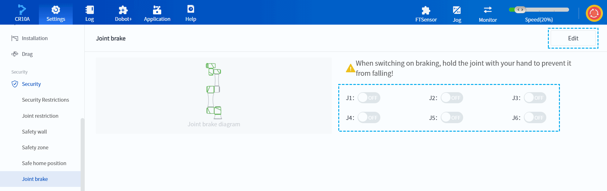

**Removing the fixing screws from robot base** Refer to Robot arm installation. After removing the fixing screws from the robot base, you can move the robot arm to free the trapped person.

**WARNING**

* Disconnect the robot arm from the power before removing the screws.
* Hold the robot throughout the process of removing the screws and moving the robot arm.

### 2. Product Introduction

#### 2.1 Overview

The main components of the robot system include:

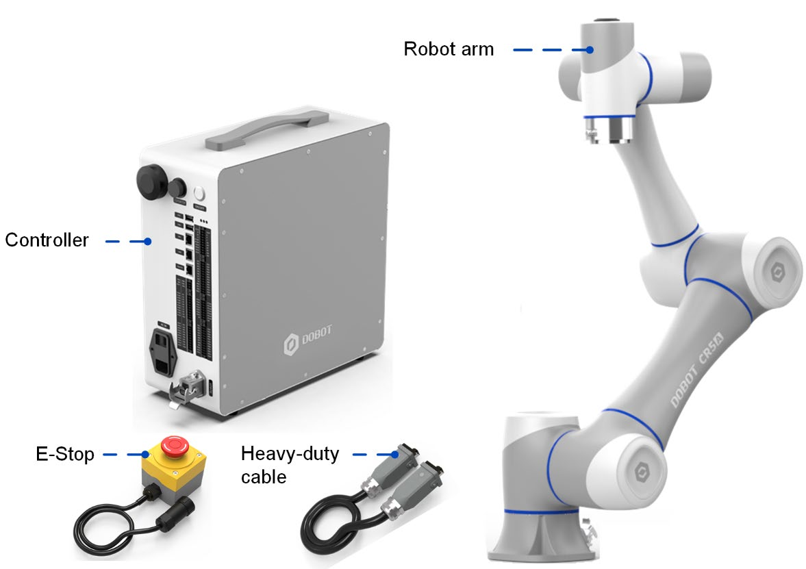

**Robot arm** Six-axis robot arm (CRA/CRAF series), main moving parts. Compared to the CRA series, the CRAF series is equipped with a high-precision six-axis force/torque sensor integrated within the tool flange. This allows users to perform intuitive drag- teaching operations simply by lightly touching the robot's end- effector. The robot will automatically follow the direction of the applied force, with its motion speed being proportional to the magnitude of the force within a specified range. Additionally, it supports motion restriction along specific directions, such as the X, Y, or Z axes. The CRAF series is ideal for high-precision applications requiring "tactile interaction", such as precision assembly, surgical assistance, and flexible polishing.

**Controller** Core computing and electrical components. An optional IP54 protective cover is available.

**E-Stop** Connected to the controller to enable the emergency stop function.

**Heavy-duty cable** Used to connect the robot arm to the controller. Additionally, you can opt for an operation terminal (e.g., PC, tablet, or teach pendant) to install and run the robot's control software.

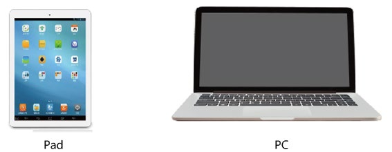

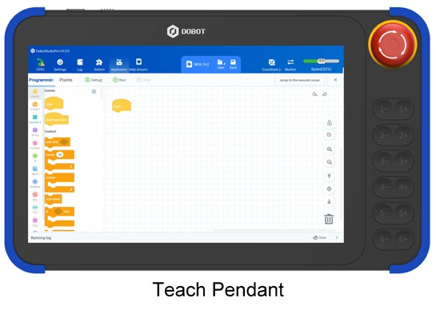

#### 2.2 Robot arm

**2.2.1 Composition** The CRA/CRAF series robot arm includes 6 rotary motion joints, and 2 connecting rods (upper arm and forearm). The robot base is equipped with a heavy-duty interface. The main differences between the series lie in the placement and function of end buttons and indicators. **CRA series (excluding CR20A\&CR30A, e.g., CR5A):** Equipped with end buttons and indicators. Additionally, the tool flange includes an aviation connector on its side.

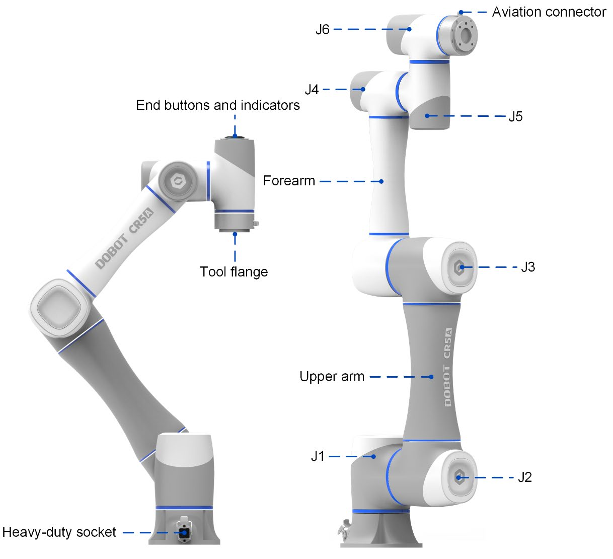

**CRAF series (excluding CR20AF, e.g., CR5AF):** Equipped with end buttons and indicators. This series integrates a force sensor within the tool flange, which also features a ring-shaped indicator light, an aviation connector, and a hand-guiding button on the side.

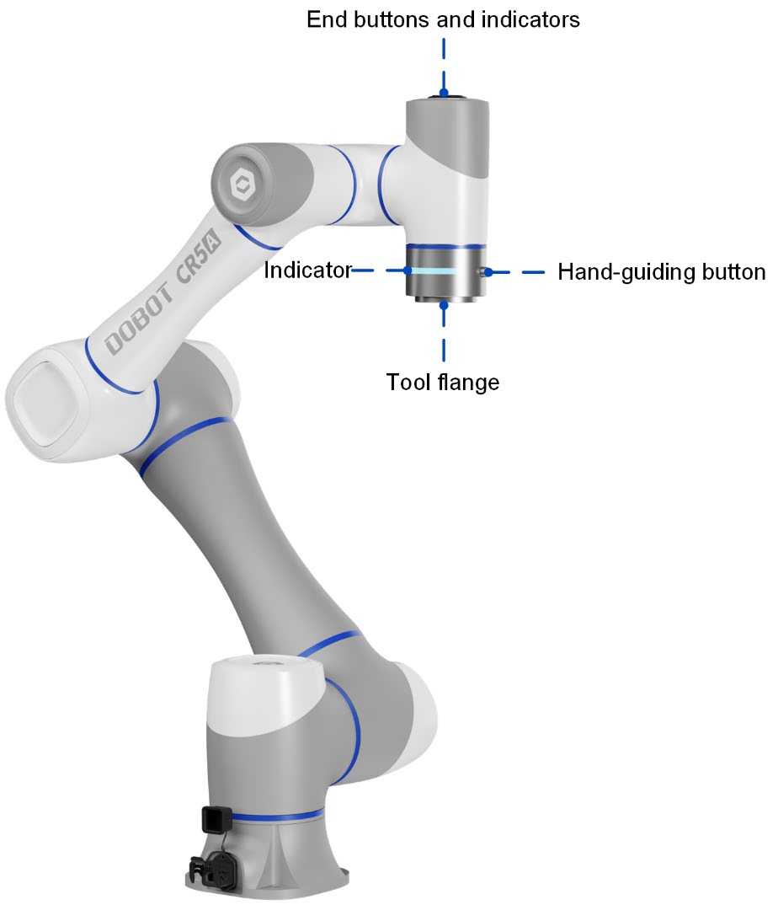

**CR20A/CR20AF/CR30A series (e.g., CR20A):** Equipped with two ring-shaped indicators: one located on the J1 rear cover and the other on the side of the tool flange. The rear cover of J6 does not have a button panel, but the side of the tool flange is equipped with two buttons and two aviation connectors.

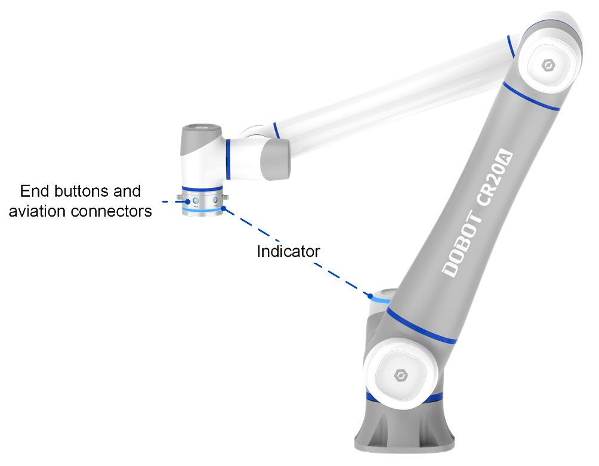

**2.2.2 End buttons and indicators** For the CRA series (excluding CR20A\&CR30A) / CRAF series (excluding CR20AF) robot arms, the configuration of the end buttons and indicators is illustrated in the figure below.

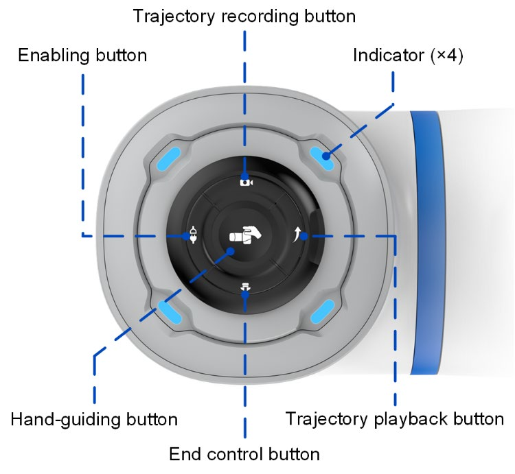

**Indicator meanings:**

| Indicator color | Status        | Description                                                                                                          |
| --------------- | ------------- | -------------------------------------------------------------------------------------------------------------------- |
| Blue            | Fast flashing | The robot is starting up                                                                                             |
| Blue            | Steady on     | The robot is powered on but not enabled                                                                              |
| Green           | Steady on     | The robot is enabled but not running                                                                                 |
| Green           | Slow flashing | Automatic running status (project debugging/running/pause, motion commands except TCP jog mode, trajectory playback) |
| Green           | Fast flashing | Single running status (Jog / "RunTo" function in software); Drag mode; Trajectory recording status                   |
| Red             | Slow flashing | Joint brake switched on in disabled status                                                                           |
| Red             | Steady on     | The robot is in alarm status                                                                                         |
| Yellow          | Steady on     | Collision detected                                                                                                   |

**NOTE** The quick flashing frequency is 5Hz (0.2s per cycle), and the slow flashing frequency is 1.25Hz (0.8s per cycle).

**End button function:**

| Button name                 | Button functions                                                                                                                                                                                                                                                                                                                                                                               |
| --------------------------- | ---------------------------------------------------------------------------------------------------------------------------------------------------------------------------------------------------------------------------------------------------------------------------------------------------------------------------------------------------------------------------------------------- |
| Hand-guiding button         | When the robot arm is enabled, long-press the hand-guiding button to enter the drag-teaching mode. After dragging the robot arm to the teaching point, short-press the hand-guiding button to exit the drag-teaching mode. If a collision occurs while the robot is in motion, short-pressing this button can reset the collision or the SafeSkin, allowing the robot arm to resume operation. |
| End control button          | Short-press the button to control the end tool. For specific functions, you need to configure in "DOBOT+" page of DobotStudio Pro.                                                                                                                                                                                                                                                             |
| Enabling button             | When the robot arm is powered on and in the disabled status, long-press this button to enter the enabled status. Then short-press this button to disable robot arm.                                                                                                                                                                                                                            |
| Trajectory recording button | When the robot arm is enabled, long-press this button to enter the trajectory recording status. After recording the trajectory, short-press this button to exit the trajectory recording status.                                                                                                                                                                                               |
| Trajectory playback button  | When the robot arm is enabled, long-press this button to enter the trajectory playback status, which replays the last trajectory recorded by the trajectory recording button. Then short-press this button to exit the trajectory playback status.                                                                                                                                             |

**NOTE**

* Releasing the button within 1.5 seconds is considered a short press, while holding it for more than 1.5 seconds is considered a long press.
* Some of the button functions may be affected by the controller's manual/automatic mode. For details, see the instructions on mode switching in the DobotStudio Pro User Guide.

**2.2.3 Tool flange buttons and indicator** The J6 rear cover of the CRAF series (except CR20AF) is equipped with a button panel. For details, see the End buttons and indicators section. In addition, tool flanges are equipped with both buttons and indicator, as shown in the figure below.

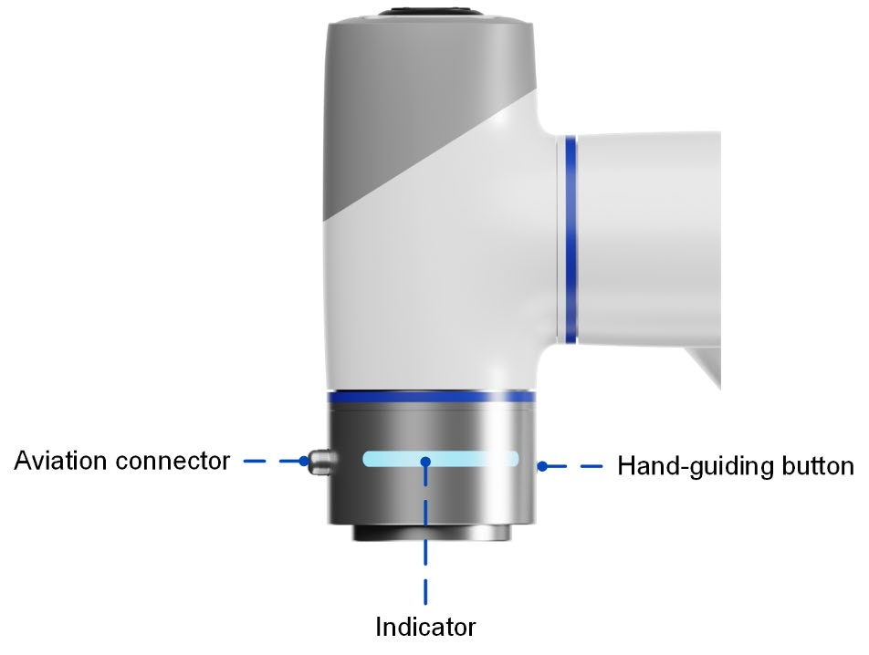

**CRAF indicator:** The meanings of the indicator are the same as those for other CRA series robots. See the "Indicator meanings" section for details.

**Hand-guiding button:** When the robot arm is enabled, long-press this button to enter force-control drag mode. Release the button to exit force-control drag mode. For further information about this mode, see the CRAF ForceControl Plugin User Guide. If a collision occurs while the robot is in motion, short-pressing this button can reset the collision or the SafeSkin, allowing the robot arm to resume operation. The button and indicator configurations for the CR20A/CR20AF/CR30A series tool flanges are as follows.

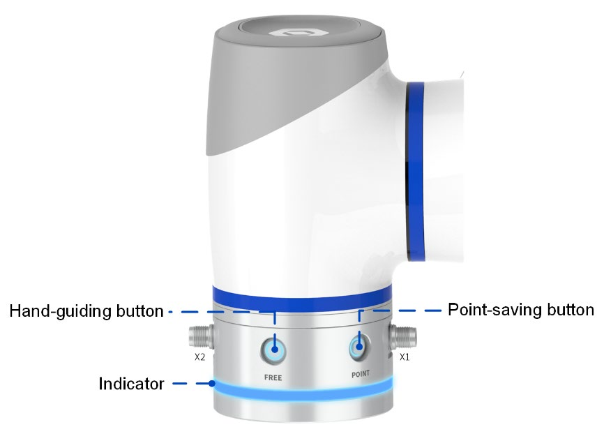

**Indicator:** The meanings of the indicator are the same as those for other CRA series robots. See the section "Indicator meanings" for details.

**Button functions:**

| Button name         | Button functions                                                                                                                                                                                                                                                                                                                                        |
| ------------------- | ------------------------------------------------------------------------------------------------------------------------------------------------------------------------------------------------------------------------------------------------------------------------------------------------------------------------------------------------------- |
| Hand-guiding button | Silkscreen: FREE. When the robot arm is enabled, long-press this button to enter the drag-teaching mode. Release this button to exit the drag-teaching mode. For CR20A and CR30A, it triggers joint drag mode. For CR20AF, it triggers force sensor drag mode. For detailed information about these modes, see the CRAF ForceControl Plugin User Guide. |
| Point-saving button | Silkscreen: POINT. When the robot arm is enabled, and DobotStudio is connected to the robot arm with the point list open, short-press this button to save the robot's current point.                                                                                                                                                                    |

**2.2.4 Force sensor detection area** Tool flanges in the CRAF series are equipped with high-precision force sensors. The detection area for force-control drag is the entire surface below the sensor's sealing ring. As shown in the figure below, during force-control drag operations, force/torque should be applied to the sensor's detection area to measure the drag force/torque in real-time. If force/torque is applied above the sensor's sealing ring, the sensor will be unable to accurately detect the applied force/torque.

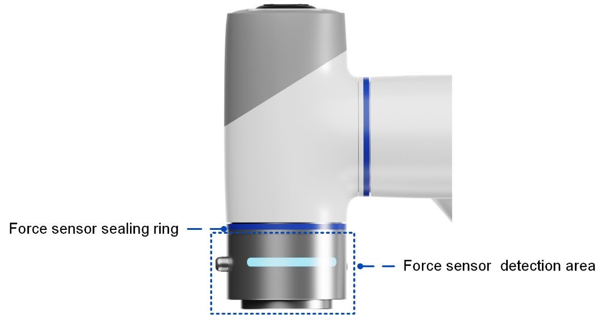

#### 2.3 Controller

The CRA/CRAF series robot arms need to be used with a controller. The controller model for CR20A/CR20AF/CR30A robot arm is CC263. The controller model for other CRA/CRAF series robot arms is CC262, which includes two versions: AC power input and DC power input. They are common in the dimensions and functions, except for differences in power input components. For details on its electrical interfaces and switches, see Electrical Characteristics.

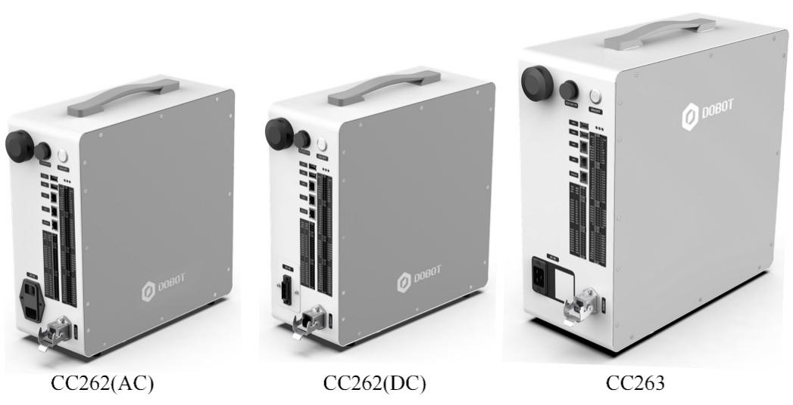

#### 2.4 Operation terminal

The CRA/CRAF series robot arms can be optionally equipped with a teach pendant for control. For more information, please refer to DOBOT Cobot Teach Pendant User Guide. Additionally, the CRA/CRAF series robot arms support control via PC and mobile devices, as shown in Table 2.1.

| Terminal type             | PC                                                                                                                                                                                                                                      | Tablet (Android)                                                   |
| ------------------------- | --------------------------------------------------------------------------------------------------------------------------------------------------------------------------------------------------------------------------------------- | ------------------------------------------------------------------ |
| Operating system          | Windows 10 (64-bit) 1809 or above                                                                                                                                                                                                       | Android 10 and above                                               |
| Control software          | DobotStudio Pro (V4.0 and above)                                                                                                                                                                                                        |                                                                    |
| Recommended configuration | CPU: 64-bit Intel or AMD processor (SSE4.2 or later, 2.9GHz or higher); Memory: 16G; Storage: 128GB (at least 4GB available); Network card: Gigabit-NIC; Graphics card: 4GB, DirectX12 support; Display: 1920x1080 or higher resolution | CPU: 4-core, above 2.0GHz; RAM: 4GB; Storage: 32GB; Screen: 8-inch |
| Communication mode        | LAN/WiFi                                                                                                                                                                                                                                | WiFi                                                               |

When purchasing a CRA/CRAF series robot arm, you can request an optional Android tablet, or use self-prepared operation terminal as long as it meets or exceeds the recommended specifications in Table 2.1.

### 3. Product Features

#### 3.1 Coordinate system

**3.1.1 Joint coordinate system** The joint coordinate system is determined based on all motion joints. All joints are rotational joints, as shown in Figure 3.1.

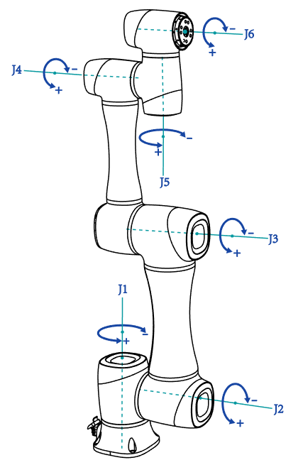

**3.1.2 User coordinate system** The user coordinate system is a user-defined coordinate system based on the workbench or workpiece. The origin and axis directions can be defined as needed to measure points within the workspace and arrange tasks conveniently. The default user coordinate system is determined based on the center point of the robot base, and Y+ direction is the direction that the heavy-duty socket faces, as shown in Figure 3.2.

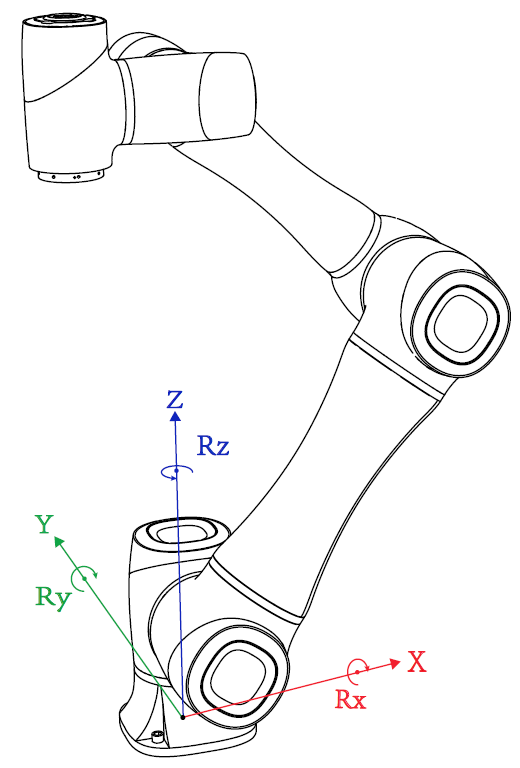

**3.1.3 Tool coordinate system** The tool coordinate system defines the position and posture of the Tool Center Point (TCP). Its origin and direction change dynamically based on the position and angle of the end tool. The default tool coordinate system is determined based on the center point of the end flange, with the Y+ direction facing opposite to the aviation connector (for CR20A\&CR30A, it is opposite to the X1 aviation connector), as shown in Figure 3.3.

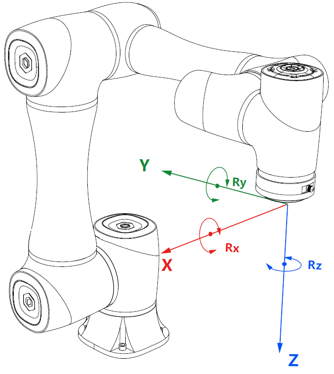

**3.1.4 Six-dimensional force coordinate system** The six-dimensional force coordinate system is exclusively applicable to the CRAF series robot arms. This coordinate system coincides with the TCP, with its origin located at the center point of the TCP flange surface. The directions of forces and torques follow the right-hand rule, as shown in Figure 3.5.

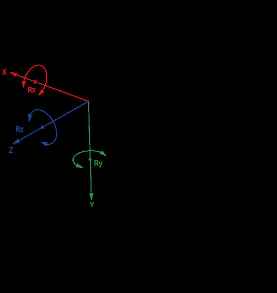

#### 3.2 Home posture

When the robot arm is in the upright position as shown in Figure 3.1, all joint angles are set to 0 degrees. This posture is called the home posture. Each joint of the robot arm is marked with a home-posture sticker (transparent, with a blue alignment line), as shown in the figure below. When a joint is at 0 degrees, the stickers on both sides of the joint will be perfectly aligned.

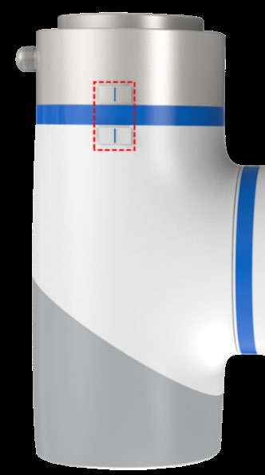

If the home posture changes due to component replacement or collision, you can move the robot arm to a state where all the home-posture stickers of each joint are aligned. Then calibrate the home posture through DobotStudio Pro.

#### 3.3 Singularities

When the robot moves in a linear or arc trajectory and approaches certain specific postures, an alarm will be triggered, and the robot will stop movement. These postures are referred to as singular positions or singular points.

**NOTICE**

* Joint motion is not affected by singular positions.
* Avoid stopping the robot near a singularity using drag mode or joint motion and then attempting linear or arc motion. The CRA/CRAF series robot arms have three types of singularities, as described below.

**3.3.1 Shoulder singularity** The singularity occurs when the intersection of the J5 and J6 axes is located in the plane formed by the J1 and J2 axes. This typically happens in the cylindrical space directly above or below the robot. Refer to the motion range in the Mechanical Specifications chapter for details about each model. As shown in the figure below.

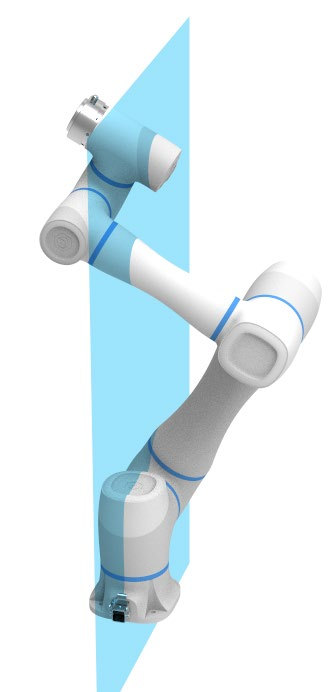

**3.3.2 Elbow singularity** The singularity occurs when J3=0°±2°, where the upper arm and forearm are parallel. As shown in the figure below.

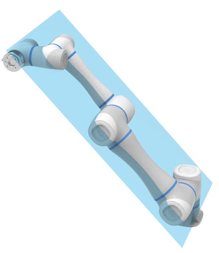

**3.3.3 Wrist singularity** The singularity occurs when J5=0°±2°, where the J4 axis and J6 axis are parallel. As shown in the figure below.

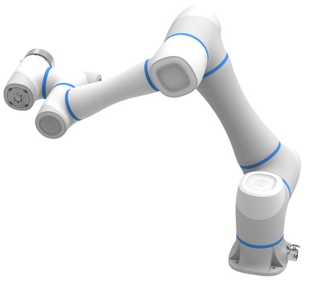

**3.3.4 Recommendations for avoiding singularities**

* Switch the motion type to joint motion when near a singularity.
* Add transition points in the trajectory to bypass the singularity.
* Adjust the installation posture of the robot to avoid singularities in the path. For example, switch from standard-angle mounting to hoisting or side mounting.
* Modify the length of the end tool.
* Adjust the installation angle of the end tool to bypass singularities in the path.

#### 3.4 Emergency stop time and distance

When J1 to J3 axes operate at 100% speed, with maximum payload and maximum reach, the stop time and stop distance for each joint upon triggering an emergency stop are listed in the table below. For the J1 axis, testing is conducted by moving horizontally, meaning the rotational axis is perpendicular to the ground.

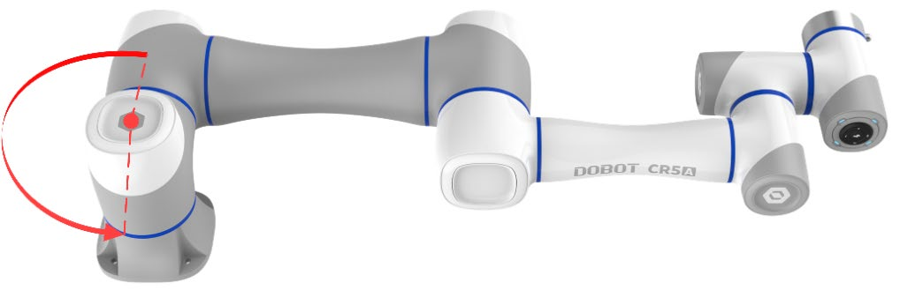

For the J2 and J3 axes, testing follows a vertical trajectory, meaning the rotational axis is parallel to the ground. The emergency stop is triggered while the robot is moving downward.

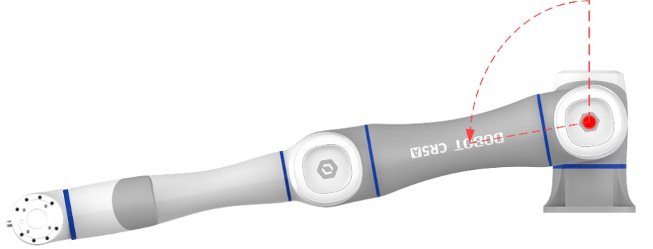

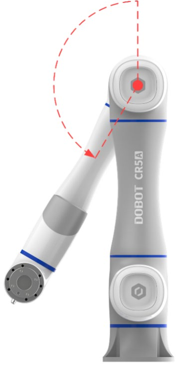

The table below provides reference data for selected models.

| Robot arm      | J1 (Emergency stop time / distance) | J2 (Emergency stop time / distance) | J3 (Emergency stop time / distance) |
| -------------- | ----------------------------------- | ----------------------------------- | ----------------------------------- |
| CR3A           | 209 ms / 160.58 mm                  | 257 ms / 259.44 mm                  | 270 ms / 187.42 mm                  |
| CR5A / CR5AF   | 351 ms / 389.94 mm                  | 239 ms / 366.58 mm                  | 248 ms / 205.14 mm                  |
| CR7A           | 216 ms / 315.87 mm                  | 286 ms / 406.61 mm                  | 156 ms / 130.16 mm                  |
| CR6AL          | 325 ms / 736 mm                     | 349 ms / 799 mm                     | 495 ms / 738 mm                     |
| CR10A / CR10AF | 306 ms / 420.46 mm                  | 242 ms / 411.42 mm                  | 252 ms / 293.75 mm                  |
| CR12A          | 236 ms / 420.51 mm                  | 417 ms / 675.29 mm                  | 364 ms / 404.82 mm                  |
| CR16A          | 217 ms / 329.97 mm                  | 316 ms / 475.09 mm                  | 268 ms / 238.51 mm                  |
| CR16AL         | 217 ms / 429 mm                     | 316 ms / 618 mm                     | 268 ms / 337 mm                     |
| CR20A / CR20AF | 448 ms / 836.23 mm                  | 456 ms / 835.95 mm                  | 272 ms / 338.54 mm                  |
| CR30A          | 362 ms / 646 mm                     | 328 ms / 259 mm                     | 328 ms / 217 mm                     |

### 4. Mechanical Specifications

All dimensions in this chapter are in millimeters (mm).

#### 4.1 CR3A mechanical specifications

**4.1.1 CR3A dimensions and workspace** When selecting the installation position for the robot, you must consider the cylindrical space directly above and below the robot, and try to avoid moving the tool into this cylindrical space. As doing so may cause the joints to rotate too fast even when the tool moves slowly, resulting in low work efficiency and making risk assessment more difficult.

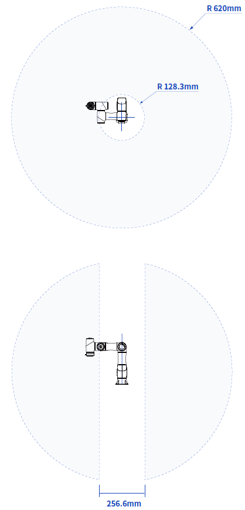

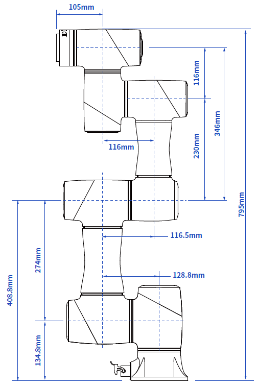

**4.1.2 CR3A base mounting dimensions**

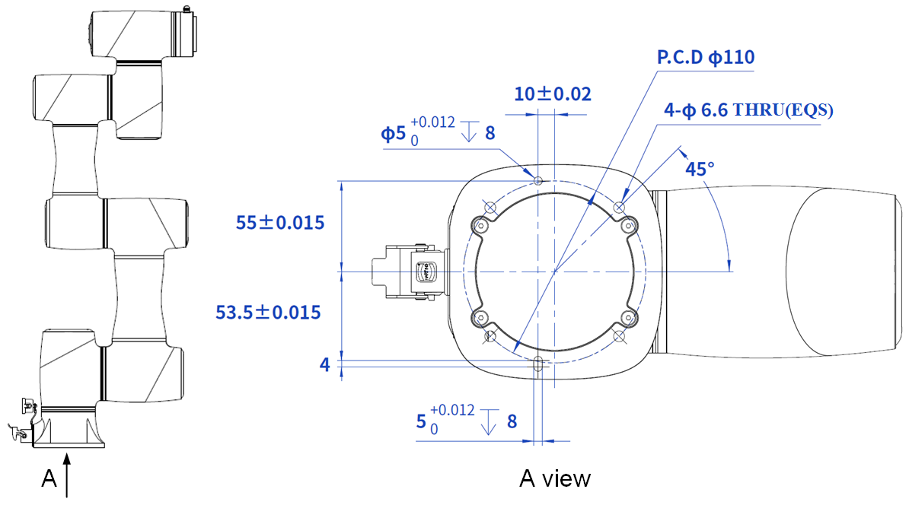

**4.1.3 CR3A end flange dimensions** The flange design conforms to ISO 9409-1-50-4-M6.

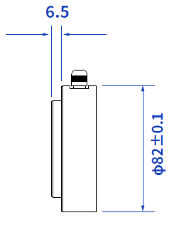

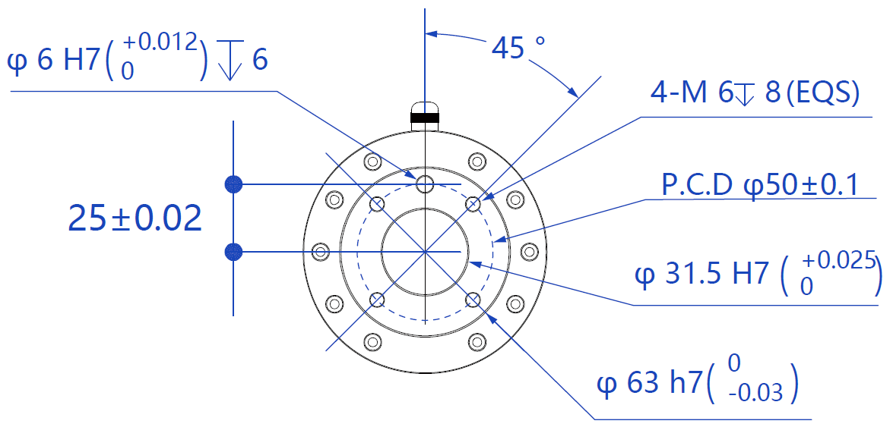

**4.1.4 CR3A end load curve** The origin of the coordinate system for the end load curve is the center of the robot's end center along the X and Y axes. The radial distance (r) is calculated as: r = √𝑋𝑋2+ 𝑌𝑌2. This flange. X and Y represent the offset distance of the load’s center of mass from the flange r-value corresponds to the vertical axis (Y-axis) in the load curve graph, labeled as X, Y \[cm]. The horizontal axis (X-axis) represents Z \[cm], which is the distance from the load’s center of mass to the flange along the Z direction. You can evaluate the working condition of the robot according to the statistical results. For example, if the load is 2.8kg, X = 6cm, According to r = √𝑋𝑋2+ 𝑌𝑌2, calculate r = 10cm. Y = 8cm, Z = 5cm, and you can get r = 10cm. The judgment steps are as follows:

* Select the appropriate curve based on the load weight. Since 2.8kg is close to 3kg, use the 4kg curve as a reference.
* Locate the (r, Z) = (10cm, 5cm) point in the load curve graph and compare it with the 3kg curve. If the point is below the curve, the load is within the robot’s operational range (selection valid). If the point is above the curve, the load exceeds the robot’s limit (selection invalid). In this example, the point is below the curve, indicating that the selected load is acceptable, and the robot can operate safely under this condition.

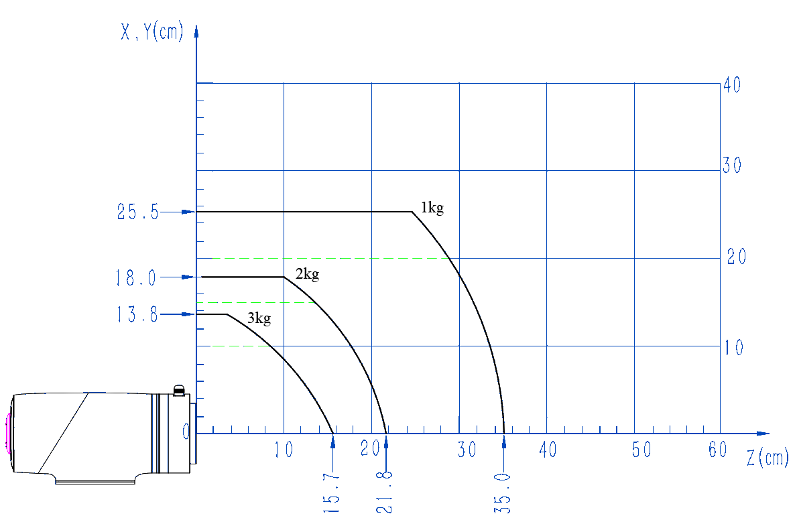

#### 4.2 CR5A mechanical specifications

**4.2.1 CR5A dimensions and workspace** When selecting the installation position for the robot, you must consider the cylindrical space directly above and below the robot, and try to avoid moving the tool into this cylindrical space. As doing so may cause the joints to rotate too fast even when the tool moves slowly, resulting in low work efficiency and making risk assessment more difficult.

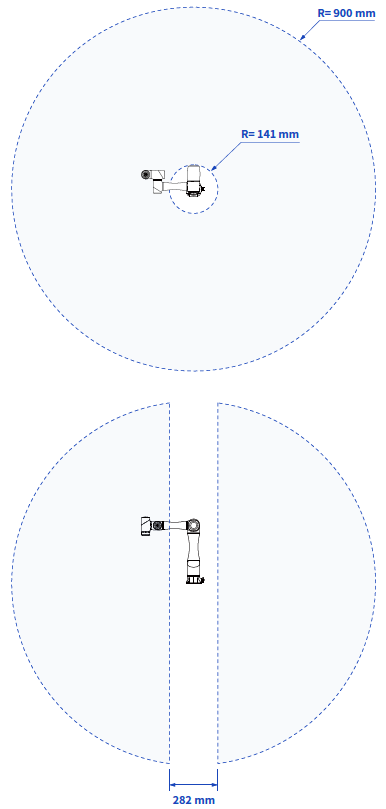

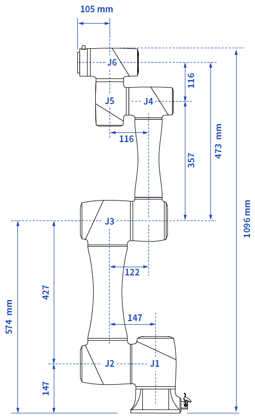

**4.2.2 CR5A base mounting dimensions**

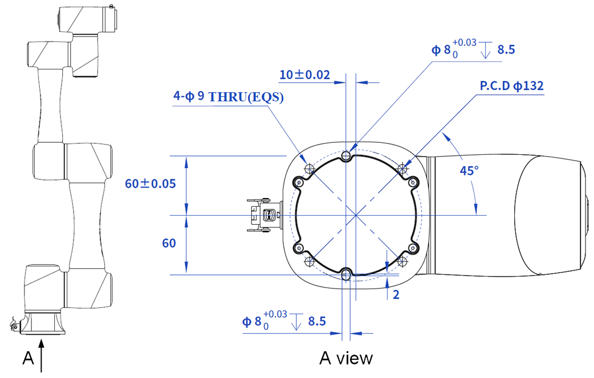

**4.2.3 CR5A end flange dimensions** The flange design conforms to ISO 9409-1-50-4-M6.

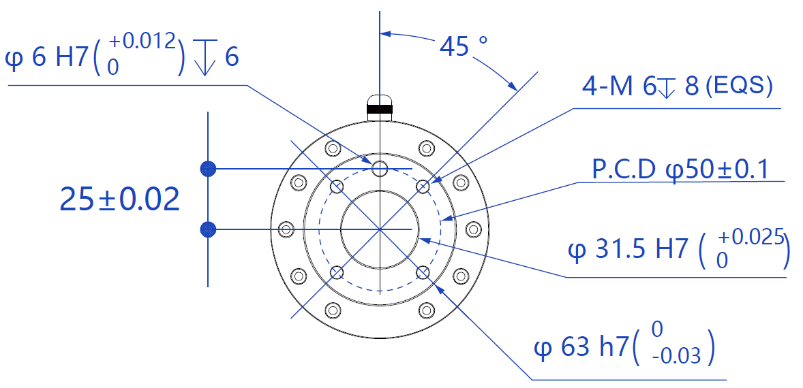

**4.2.4 CR5A end load curve** The origin of the coordinate system for the end load curve is the center of the robot's end center along the X and Y axes. The radial distance (r) is calculated as: r = √𝑋𝑋2+ 𝑌𝑌2. This flange. X and Y represent the offset distance of the load’s center of mass from the flange r-value corresponds to the vertical axis (Y-axis) in the load curve graph, labeled as X, Y \[cm]. The horizontal axis (X-axis) represents Z \[cm], which is the distance from the load’s center of mass to the flange along the Z direction. You can evaluate the working condition of the robot according to the statistical results. For example, if the load is 2.8kg, X = 6cm, According to r = √𝑋𝑋2+ 𝑌𝑌2, calculate r = 10cm. Y = 8cm, Z = 5cm, and you can get r = 10cm. The judgment steps are as follows:

* Select the appropriate curve based on the load weight. Since 2.8kg is close to 3kg, use the 4kg curve as a reference.
* Locate the (r, Z) = (10cm, 5cm) point in the load curve graph and compare it with the 3kg curve. If the point is below the curve, the load is within the robot’s operational range (selection valid). If the point is above the curve, the load exceeds the robot’s limit (selection invalid). In this example, the point is below the curve, indicating that the selected load is acceptable, and the robot can operate safely under this condition.

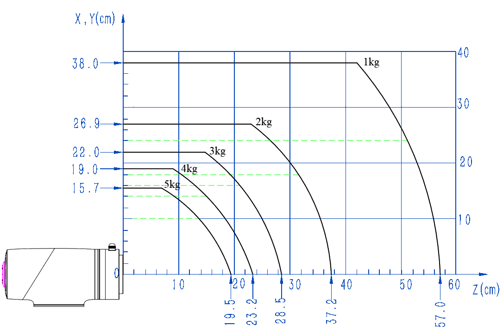

#### 4.3 CR7A mechanical specifications

**4.3.1 CR7A dimensions and workspace** When selecting the installation position for the robot, you must consider the cylindrical space directly above and below the robot, and try to avoid moving the tool into this cylindrical space. As doing so may cause the joints to rotate too fast even when the tool moves slowly, resulting in low work efficiency and making risk assessment more difficult.

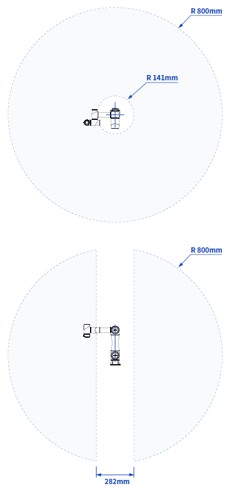

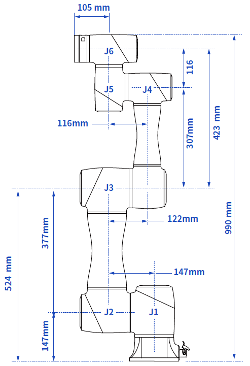

**4.3.2 CR7A base mounting dimensions**

**4.3.3 CR7A end flange dimensions** The flange design conforms to ISO 9409-1-50-4-M6.

**4.3.4 CR7A end load curve** The origin of the coordinate system for the end load curve is the center of the robot's end center along the X and Y axes. The radial distance (r) is calculated as: r = √𝑋𝑋2+ 𝑌𝑌2. This flange. X and Y represent the offset distance of the load’s center of mass from the flange r-value corresponds to the vertical axis (Y-axis) in the load curve graph, labeled as X, Y \[cm]. The horizontal axis (X-axis) represents Z \[cm], which is the distance from the load’s center of mass to the flange along the Z direction. You can evaluate the working condition of the robot according to the statistical results. For example, if the load is 2.8kg, X = 6cm, According to r = √𝑋𝑋2+ 𝑌𝑌2, calculate r = 10cm. Y = 8cm, Z = 5cm, and you can get r = 10cm. The judgment steps are as follows:

* Select the appropriate curve based on the load weight. Since 2.8kg is close to 3kg, use the 4kg curve as a reference.
* Locate the (r, Z) = (10cm, 5cm) point in the load curve graph and compare it with the 3kg curve. If the point is below the curve, the load is within the robot’s operational range (selection valid). If the point is above the curve, the load exceeds the robot’s limit (selection invalid). In this example, the point is below the curve, indicating that the selected load is acceptable, and the robot can operate safely under this condition.

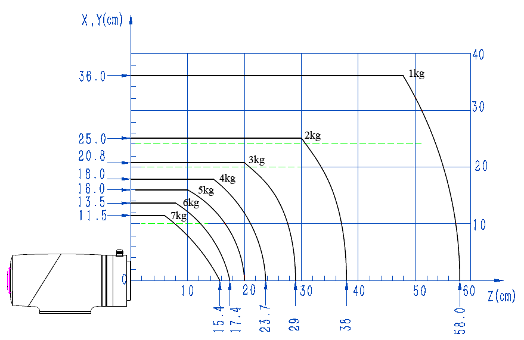

#### 4.4 CR6AL mechanical specifications

**4.4.1 CR6AL dimensions and workspace** When selecting the installation position for the robot, you must consider the cylindrical space directly above and below the robot, and try to avoid moving the tool into this cylindrical space. As doing so may cause the joints to rotate too fast even when the tool moves slowly, resulting in low work efficiency and making risk assessment more difficult.

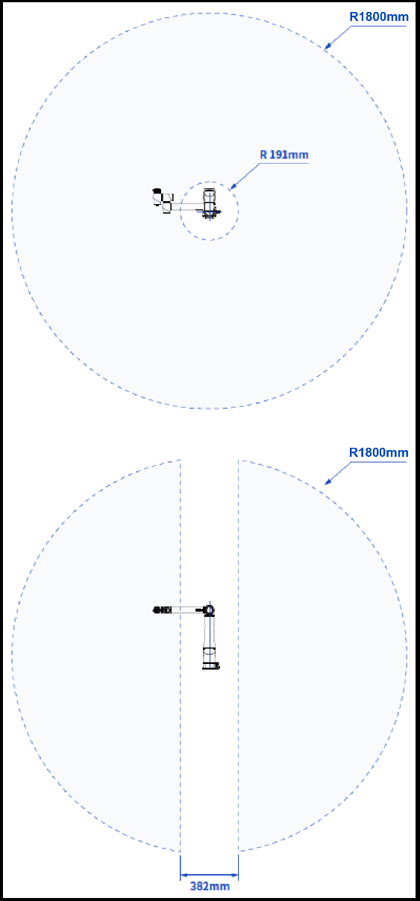

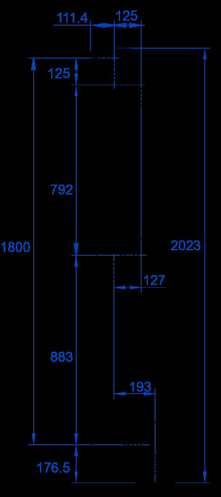

**4.4.2 CR6AL base mounting dimensions**

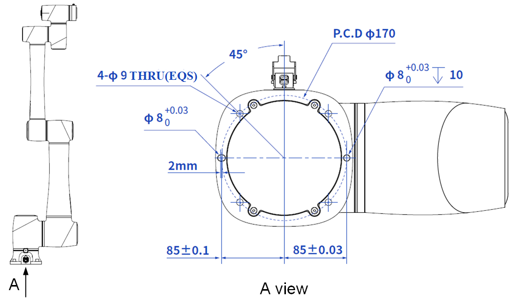

**4.4.3 CR6AL end flange dimensions** The flange design conforms to ISO 9409-1-50-4-M6.

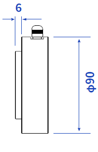

**4.4.4 CR6AL end load curve** The figure below illustrates the load curve for CR6AL when installed at the standard mounting angle. The horizontal axis represents the offset distance (eccentricity), which is the distance from the load’s center of mass to the center of the CR6AL end flange, measured in millimeters (mm). The vertical axis represents the load weight, measured in kilograms (kg).

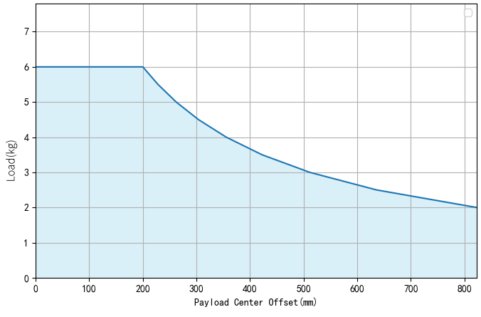

#### 4.5 CR10A mechanical specifications

**4.5.1 CR10A dimensions and workspace** When selecting the installation position for the robot, you must consider the cylindrical space directly above and below the robot, and try to avoid moving the tool into this cylindrical space. As doing so may cause the joints to rotate too fast even when the tool moves slowly, resulting in low work efficiency and making risk assessment more difficult.

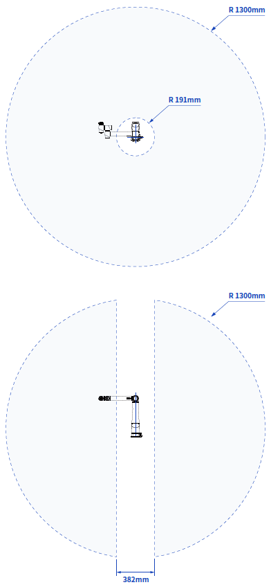

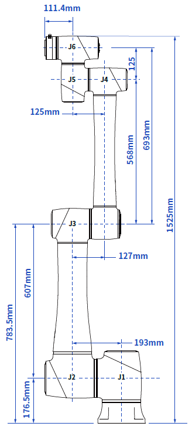

**4.5.2 CR10A base mounting dimensions**

**4.5.3 CR10A end flange dimensions** The flange design conforms to ISO 9409-1-50-4-M6.

**4.5.4 CR10A end load curve** The origin of the coordinate system for the end load curve is the center of the robot's end center along the X and Y axes. The radial distance (r) is calculated as: r = √𝑋𝑋2+ 𝑌𝑌2. This flange. X and Y represent the offset distance of the load’s center of mass from the flange r-value corresponds to the vertical axis (Y-axis) in the load curve graph, labeled as X, Y \[cm]. The horizontal axis (X-axis) represents Z \[cm], which is the distance from the load’s center of mass to the flange along the Z direction. You can evaluate the working condition of the robot according to the statistical results. For example, if the load is 3.8kg, X = 6cm, According to r = √𝑋𝑋2+ 𝑌𝑌2, calculate r = 10cm. Y = 8cm, Z = 5cm, and you can get r = 10cm. The judgment steps are as follows:

* Select the appropriate curve based on the load weight. Since 3.8kg is close to 4kg, use the 4kg curve as a reference.
* Locate the (r, Z) = (10cm, 5cm) point in the load curve graph and compare it with the 4kg curve. If the point is below the curve, the load is within the robot’s operational range (selection valid). If the point is above the curve, the load exceeds the robot’s limit (selection invalid). In this example, the point is below the curve, indicating that the selected load is acceptable, and the robot can operate safely under this condition.

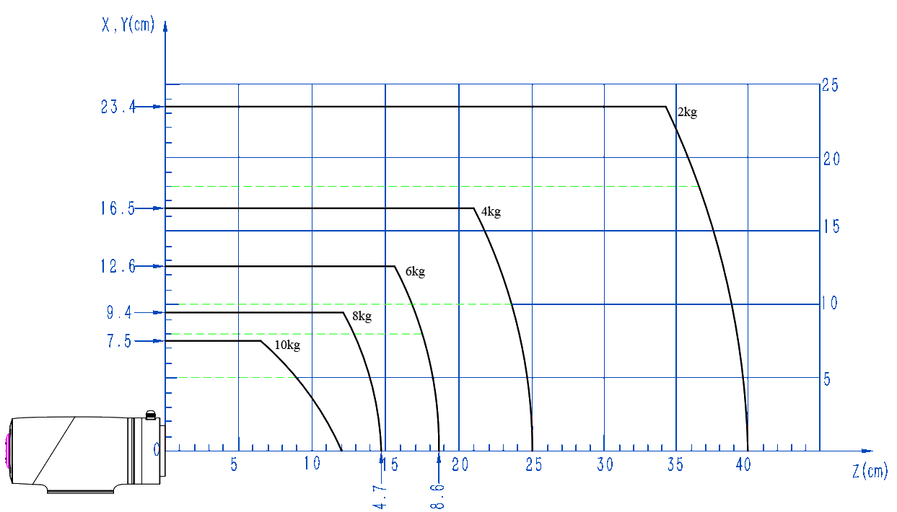

#### 4.6 CR12A mechanical specifications

**4.6.1 CR12A dimensions and workspace** When selecting the installation position for the robot, you must consider the cylindrical space directly above and below the robot, and try to avoid moving the tool into this cylindrical space. As doing so may cause the joints to rotate too fast even when the tool moves slowly, resulting in low work efficiency and making risk assessment more difficult.

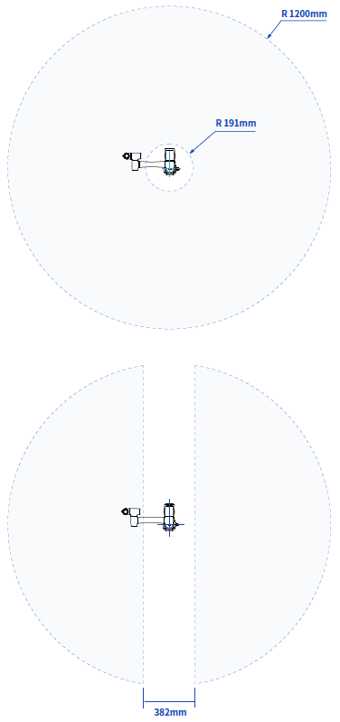

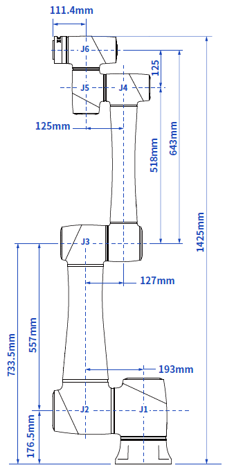

**4.6.2 CR12A base mounting dimensions**

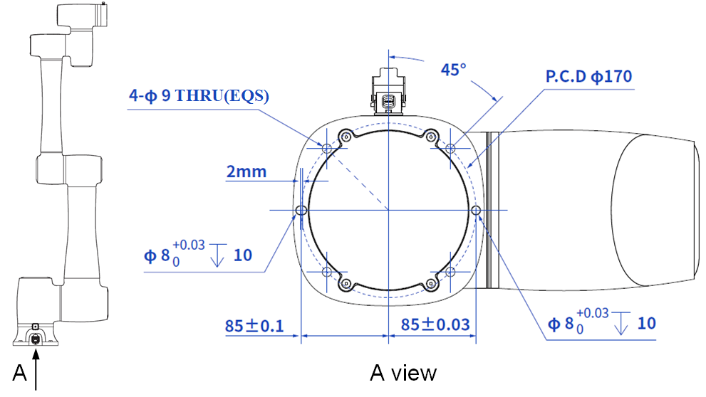

**4.6.3 CR12A end flange dimensions** The flange design conforms to ISO 9409-1-50-4-M6.

**4.6.4 CR12A end load curve** The origin of the coordinate system for the end load curve is the center of the robot's end center along the X and Y axes. The radial distance (r) is calculated as: r = √𝑋𝑋2+ 𝑌𝑌2. This flange. X and Y represent the offset distance of the load’s center of mass from the flange r-value corresponds to the vertical axis (Y-axis) in the load curve graph, labeled as X, Y \[cm]. The horizontal axis (X-axis) represents Z \[cm], which is the distance from the load’s center of mass to the flange along the Z direction. You can evaluate the working condition of the robot according to the statistical results. For example, if the load is 3.8kg, X = 6cm, According to r = √𝑋𝑋2+ 𝑌𝑌2, calculate r = 10cm. Y = 8cm, Z = 5cm, and you can get r = 10cm. The judgment steps are as follows:

* Select the appropriate curve based on the load weight. Since 3.8kg is close to 4kg, use the 4kg curve as a reference.
* Locate the (r, Z) = (10cm, 5cm) point in the load curve graph and compare it with the 4kg curve. If the point is below the curve, the load is within the robot’s operational range (selection valid). If the point is above the curve, the load exceeds the robot’s limit (selection invalid). In this example, the point is below the curve, indicating that the selected load is acceptable, and the robot can operate safely under this condition.

#### 4.7 CR16A mechanical specifications

**4.7.1 CR16A dimensions and workspace** When selecting the installation position for the robot, you must consider the cylindrical space directly above and below the robot, and try to avoid moving the tool into this cylindrical space. As doing so may cause the joints to rotate too fast even when the tool moves slowly, resulting in low work efficiency and making risk assessment more difficult.

**4.7.2 CR16A base mounting dimensions**

**4.7.3 CR16A end flange dimensions** The flange design conforms to ISO 9409-1-50-4-M6.

**4.7.4 CR16A end load curve** The origin of the coordinate system for the end load curve is the center of the robot's end center along the X and Y axes. The radial distance (r) is calculated as: r = √𝑋𝑋2+ 𝑌𝑌2. This flange. X and Y represent the offset distance of the load’s center of mass from the flange r-value corresponds to the vertical axis (Y-axis) in the load curve graph, labeled as X, Y \[cm]. The horizontal axis (X-axis) represents Z \[cm], which is the distance from the load’s center of mass to the flange along the Z direction. You can evaluate the working condition of the robot according to the statistical results. For example, if the load is 3.8kg, X = 6cm, According to r = √𝑋𝑋2+ 𝑌𝑌2, calculate r = 10cm. Y = 8cm, Z = 5cm, and you can get r = 10cm. The judgment steps are as follows:

* Select the appropriate curve based on the load weight. Since 3.8kg is close to 4kg, use the 4kg curve as a reference. Locate the (r, Z) = (10cm, 5cm) point in the load curve graph and compare it with the 4kg curve. If the point is below the curve, the load is within the robot’s operational range (selection valid). If the point is above the curve, the load exceeds the robot’s limit (selection invalid). In this example, the point is below the curve, indicating that the selected load is acceptable, and the robot can operate safely under this condition.

#### 4.8 CR16AL mechanical specifications

**4.8.1 CR16AL dimensions and workspace** When selecting the installation position for the robot, you must consider the cylindrical space directly above and below the robot, and try to avoid moving the tool into this cylindrical space. As doing so may cause the joints to rotate too fast even when the tool moves slowly, resulting in low work efficiency and making risk assessment more difficult.

**4.8.2 CR16AL base mounting dimensions**

**4.8.3 CR16AL end flange dimensions** The flange design conforms to ISO 9409-1-50-4-M6.

**4.8.4 CR16AL end load curve** The figure below illustrates the load curve for CR16AL when installed at the standard mounting angle. The horizontal axis represents the offset distance (eccentricity), which is the distance from the load’s center of mass to the center of the CR16AL end flange, measured in millimeters (mm). The vertical axis represents the load weight, measured in kilograms (kg).

#### 4.9 CR20A mechanical specifications

**4.9.1 CR20A dimensions and workspace** When selecting the installation position for the robot, you must consider the cylindrical space directly above and below the robot, and try to avoid moving the tool into this cylindrical space. As doing so may cause the joints to rotate too fast even when the tool moves slowly, resulting in low work efficiency and making risk assessment more difficult.

**4.9.2 CR20A base mounting dimensions**

**4.9.3 CR20A end flange dimensions** The flange design conforms to ISO 9409-1-50-4-M6.

**4.9.4 CR20A end load curve** The figure below illustrates the load curve for CR20A when installed at the standard mounting angle. The horizontal axis represents the offset distance (eccentricity), which is the distance from the load’s center of mass to the center of the CR20A end flange, measured in millimeters (mm). The vertical axis represents the load weight, measured in kilograms (kg). The blue line indicates the maximum allowable load for CR20A at different offset distances:

* When the offset distance is less than 131mm, the maximum load is 20kg.
* When the offset distance is greater than 131mm, the maximum load decreases as the distance increases.
* When the offset distance is 623mm, the maximum load is 6.7kg.

#### 4.10 CR30A mechanical specifications

**4.10.1 CR30A dimensions and workspace** When selecting the installation position for the robot, you must consider the cylindrical space directly above and below the robot, and try to avoid moving the tool into this cylindrical space. As doing so may cause the joints to rotate too fast even when the tool moves slowly, resulting in low work efficiency and making risk assessment more difficult.

**4.10.2 CR30A base mounting dimensions**

**4.10.3 CR30A end flange dimensions** The flange design conforms to ISO 9409-1-50-4-M6.

**4.10.4 CR30A end load curve** The figure below illustrates the load curve for CR30A when installed at the standard mounting angle. The horizontal axis represents the offset distance (eccentricity), which is the distance from the load’s center of mass to the center of the CR30A end flange, measured in millimeters (mm). The vertical axis represents the load weight, measured in kilograms (kg).

#### 4.11 CR5AF mechanical specifications

**4.11.1 CR5AF dimensions and workspace** When selecting the installation position for the robot, you must consider the cylindrical space directly above and below the robot, and try to avoid moving the tool into this cylindrical space. As doing so may cause the joints to rotate too fast even when the tool moves slowly, resulting in low work efficiency and making risk assessment more difficult.

**4.11.2 CR5AF base mounting dimensions**

**4.11.3 CR5AF end flange dimensions** The flange design conforms to ISO 9409-1-50-4-M6.

**4.11.4 CR5AF end load curve** The origin of the coordinate system for the end load curve is the center of the robot's end center along the X and Y axes. The radial distance (r) is calculated as: r = √𝑋𝑋2+ 𝑌𝑌2. This flange. X and Y represent the offset distance of the load’s center of mass from the flange r-value corresponds to the vertical axis (Y-axis) in the load curve graph, labeled as X, Y \[cm]. The horizontal axis (X-axis) represents Z \[cm], which is the distance from the load’s center of mass to the flange along the Z direction. You can evaluate the working condition of the robot according to the statistical results. For example, if the load is 2.8kg, X = 6cm, According to r = √𝑋𝑋2+ 𝑌𝑌2, calculate r = 10cm. Y = 8cm, Z = 5cm, and you can get r = 10cm. The judgment steps are as follows:

* Select the appropriate curve based on the load weight. Since 2.8kg is close to 3kg, use the 4kg curve as a reference.
* Locate the (r, Z) = (10cm, 5cm) point in the load curve graph and compare it with the 3kg curve. If the point is below the curve, the load is within the robot’s operational range (selection valid). If the point is above the curve, the load exceeds the robot’s limit (selection invalid). In this example, the point is below the curve, indicating that the selected load is acceptable, and the robot can operate safely under this condition.

#### 4.12 CR10AF mechanical specifications

**4.12.1 CR10AF dimensions and workspace** When selecting the installation position for the robot, you must consider the cylindrical space directly above and below the robot, and try to avoid moving the tool into this cylindrical space. As doing so may cause the joints to rotate too fast even when the tool moves slowly, resulting in low work efficiency and making risk assessment more difficult.

**4.12.2 CR10AF base mounting dimensions**

**4.12.3 CR10AF end flange dimensions** The flange design conforms to ISO 9409-1-50-4-M6.

**4.12.4 CR10AF end load curve** The origin of the coordinate system for the end load curve is the center of the robot's end center along the X and Y axes. The radial distance (r) is calculated as: r = √𝑋𝑋2+ 𝑌𝑌2. This flange. X and Y represent the offset distance of the load’s center of mass from the flange r-value corresponds to the vertical axis (Y-axis) in the load curve graph, labeled as X, Y \[cm]. The horizontal axis (X-axis) represents Z \[cm], which is the distance from the load’s center of mass to the flange along the Z direction. You can evaluate the working condition of the robot according to the statistical results. For example, if the load is 3.8kg, X = 6cm, According to r = √𝑋𝑋2+ 𝑌𝑌2, calculate r = 10cm. Y = 8cm, Z = 5cm, and you can get r = 10cm. The judgment steps are as follows:

* Select the appropriate curve based on the load weight. Since 3.8kg is close to 4kg, use the 4kg curve as a reference.
* Locate the (r, Z) = (10cm, 5cm) point in the load curve graph and compare it with the 4kg curve. If the point is below the curve, the load is within the robot’s operational range (selection valid). If the point is above the curve, the load exceeds the robot’s limit (selection invalid). In this example, the point is below the curve, indicating that the selected load is acceptable, and the robot can operate safely under this condition.

#### 4.13 CR20AF mechanical specifications

**4.13.1 CR20AF dimensions and workspace** When selecting the installation position for the robot, you must consider the cylindrical space directly above and below the robot, and try to avoid moving the tool into this cylindrical space. As doing so may cause the joints to rotate too fast even when the tool moves slowly, resulting in low work efficiency and making risk assessment more difficult.

**4.13.2 CR20AF base mounting dimensions**

**4.13.3 CR20AF end flange dimensions** The flange design conforms to ISO 9409-1-50-4-M6.

**4.13.4 CR20AF end load curve** The figure below illustrates the load curve for CR20AF when installed at the standard mounting angle. The horizontal axis represents the offset distance (eccentricity), which is the distance from the load’s center of mass to the center of the CR20AF end flange, measured in millimeters (mm). The vertical axis represents the load weight, measured in kilograms (kg). The blue line indicates the maximum allowable load for CR20AF at different offset distances:

* When the offset distance is less than 131mm, the maximum load is 20kg.
* When the offset distance is greater than 131mm, the maximum load decreases as the distance increases.
* When the offset distance is 623mm, the maximum load is 6.7kg.

#### 4.14 Controller dimensions

**4.14.1 CC262 dimensions** The right figure shows the length after the optional protective cover is installed. Dimensions not labeled remain the same as when the protective cover is not installed.

**4.14.2 CC263 dimensions**

**AC version** The right figure shows the length after the optional protective cover is installed. Dimensions not labeled remain the same as when the protective cover is not installed.

**DC version** The right figure shows the length after the optional protective cover is installed. Dimensions not labeled remain the same as when the protective cover is not installed.

### 5. Electrical Characteristics

#### 5.1 Electrical warnings and precautions

When designing and installing robot applications, please strictly follow the warnings and precautions listed below.

**WARNING** The following warnings must be observed when designing and installing safety signal-related functions, as failure to do so may result in the loss of safety functions and cause injury or death.

* Never connect safety signals to a non-safety PLC with an inappropriate safety level. Always separate safety signals from regular I/O signals.
* All safety signals must use a dual-channel redundant design, with both channels remaining independent. This ensures that if one channel fails, the safety function will still be maintained.

**WARNING: ELECTRICITY**

* Make sure that the equipment is protected from water ingress. If water gets into the equipment, disconnect the power and contact technical support. Do not reconnect the power until the issue is resolved.
* Only use the robot's original cables and avoid bending the cables.
* Make sure that the power supply connected to the controller is properly grounded and avoid leaving the grounding prong of the power plug floating.

**NOTICE**

* The robot has passed electromagnetic compatibility (EMC) tests according to relevant standards. Electromagnetic interference exceeding these standards may affect the robot's behavior. Extremely high signal levels or excessive exposure to electromagnetic fields may cause permanent damage to the robot. Dobot assumes no responsibility for any damage caused by EMC issues beyond the standards.
* The length of I/O cables used to connect the controller to other machinery or equipment should not exceed 30 meters unless confirmed feasible through on-site testing. If necessary, use shielded cables.

#### 5.2 Controller interface

**5.2.1 Overview** The electrical interfaces of the controller are all on the front panel, as shown in the figure below (CC262 as an example, Left: AC version, Right: DC version). CC263 interface layout is mostly identical to the CC262, except for differences in the power interface and switch design.

| No. | Description                                                                                                                                                                                                                                                                                                                                                                                                                                                                                                      |
| --- | ---------------------------------------------------------------------------------------------------------------------------------------------------------------------------------------------------------------------------------------------------------------------------------------------------------------------------------------------------------------------------------------------------------------------------------------------------------------------------------------------------------------- |
| 1   | 
Controller switch. After the controller is powered on, press the button for 0.5s and release it, the controller will be turned on. When the controller is started, press the button for 3s and release it, the controller will be turned off and the robot arm will be powered off. NOTE: This is a self-resetting switch and does not support automatic startup when the controller is powered on. However, you can use the remote switch interface to realize remote control of startup or shutdown.
 |
| 2   | Teach Pendant and E-Stop interface. See Teach Pendant and E-Stop interface for details.                                                                                                                                                                                                                                                                                                                                                                                                                          |

| No. | Description                                                                                                                                                                                                                                     |
| --- | ----------------------------------------------------------------------------------------------------------------------------------------------------------------------------------------------------------------------------------------------- |
| 3   | WiFi antenna. For wireless connection to a PC or tablet for debugging.                                                                                                                                                                          |
| 4   | USB interface. For importing/exporting files.                                                                                                                                                                                                   |
| 5   | LAN interface, default IP address: LAN1: 192.168.5.1; LAN2: 192.168.200.1. For connecting to a PC for debugging or to external devices that support TCP/IP or Modbus TCP protocols. Only LAN1's IP address can be modified via DobotStudio Pro. |
| 6   | EtherCAT interface (Internally reserved, not open for external use).                                                                                                                                                                            |
| 7   | I/O interface panel. Used for connecting external devices. See I/O interface panel for details.                                                                                                                                                 |
| 8   | Heavy-duty interface. For connecting to the robot, providing power and enabling communication with the robot.                                                                                                                                   |
| 9   | AC power switch. For powering on/off the controller.                                                                                                                                                                                            |
| 10  | AC power interface. For details on input power, see corresponding Controller technical specifications.                                                                                                                                          |
| 11  | DC power interface. For details on input power, see corresponding Controller technical specifications.                                                                                                                                          |

**5.2.2 Teach Pendant and E-Stop interface** This interface is used to connect to the dedicated teach pendant (optional) or an emergency stop switch. The pin definitions are as follows.

| Pin    | Definition                                         |
| ------ | -------------------------------------------------- |
| 1      | DC 24V                                             |
| 2      | DC 0V                                              |
| 3      | DC 24V                                             |
| 4      | Emergency stop circuit 1 input (normally closed)   |
| 5      | DC 24V                                             |
| 6      | Emergency stop circuit 2 input (normally closed)   |
| 7 – 15 | Dedicated for communication with the Teach Pendant |

**5.2.3 I/O interface panel** The controller contains an I/O interface panel for connecting to external devices such as air pump, PLC, etc. The I/O interface panel supports: 24 digital inputs, 24 digital outputs, 2 analog outputs, 2 analog inputs, 1 incremental encoder input, 1 RS485 interface, 1 CAN interface, 10 safety inputs, and 10 safety outputs. All interfaces with the same silkscreen label have common functions, so any available interface with the same label can be used for wiring. The interfaces connected by green lines in the figure below are factory short-circuited by default.

| Silkscreen | Definition                                                          |
| ---------- | ------------------------------------------------------------------- |
| I/O 5V     | Internal power +5V and 0V, mainly used for powering pulse encoders. |
| I/O 0V     |                                                                     |

| Silkscreen  | Definition                                                                                                                                                    |
| ----------- | ------------------------------------------------------------------------------------------------------------------------------------------------------------- |
| A+/A-       | Pulse encoder interface, used for receiving encoder signals. See Encoder interface for details.                                                               |
| B+/B-       |                                                                                                                                                               |
| Z+/Z-       |                                                                                                                                                               |
| RP 24V      | Remote switch interface, used for remote power on/off. See Remote switch interface for details.                                                               |
| ON          |                                                                                                                                                               |
| OFF         |                                                                                                                                                               |
| I/O 24V     | I/O power +24V and 0V. The power source can be configured for internal or external power supply based on wiring methods. See I/O interface power for details. |
| I/O 0V      |                                                                                                                                                               |
| AI1 – AI2   | Analog input/output interface, used for connecting external devices that operate with analog signals. See Analog I/O interface for details.                   |
| AO1 – AO2   |                                                                                                                                                               |
| DI1 – DI24  | Digital input/output interface, used for connecting external devices that operate with digital signals. See Digital I/O interface for details.                |
| DO1 – DO24  |                                                                                                                                                               |
| COM1 – COM2 | Digital input common terminal interface, used to switch DI signal types.                                                                                      |
| 24V         | Internal power +24V and 0V, used for powering I/O interfaces or external devices.                                                                             |
| 0V          |                                                                                                                                                               |
| 485A        | RS485 interface, mainly used for Modbus RTU communication. See RS485 interface for details.                                                                   |
| 485B        |                                                                                                                                                               |
| FG          | Used for grounding encoders or RS485, and CAN interfaces.                                                                                                     |
| CAN H       | CAN bus interface (Internally reserved, not open for external use).                                                                                           |
| CAN L       |                                                                                                                                                               |
| SI 24V      | Safety I/O power +24V and 0V, used for powering external safety devices.                                                                                      |
| SO 0V       |                                                                                                                                                               |
| SI1 – SI10  | Safety input/output interface, used for connecting external safety devices. See Safety I/O interface for details.                                             |
| SO1 – SO10  |                                                                                                                                                               |

**5.2.4 I/O interface power** The I/O interface can be powered by either an internal or an external 24V power supply.

| Interface                          | Parameter | Min value | Typical | Max value | Unit |
| ---------------------------------- | --------- | --------- | ------- | --------- | ---- |
| Internal 24V power supply (24V–0V) | Voltage   | 23        | 24      | 25        | V    |
|                                    | Current   | 0         | -       | 3         | A    |
| External 24V power supply          | Voltage   | 20        | 24      | 29        | V    |
|                                    | Current   | 0         | -       | 6         | A    |

When using the internal power supply, short-circuit the 0V and 24V terminals to the nearest I/O 0V and I/O 24V interfaces, as shown in the figure below.

If a higher total output current is required, an external 24V power supply can be connected, as shown in the figure below. The external and internal power supplies are isolated from each other and do not interfere with one another.

**NOTE** All subsequent sections assume that the I/O power supply is properly connected, and the wiring details for I/O power will not be repeated.

**5.2.5 Digital I/O interface**

| Interface            | Parameter          | Min value | Typical | Max value | Unit |
| -------------------- | ------------------ | --------- | ------- | --------- | ---- |
| Digital input (DIx)  | Voltage            | -3        | -       | 30        | V    |
|                      | OFF range          | -3        | -       | 5         | V    |
|                      | ON range           | 15        | -       | 30        | V    |
|                      | Current (ON range) | 4         | -       | 7         | mA   |
|                      | Type               | -         | NPN/PNP | -         | -    |
| Digital output (DOx) | Current            | 0         | -       | 0.5       | A    |
|                      | Voltage drop       | 0         | -       | 0.5       | V    |
|                      | Current leakage    | 0         | -       | 0.1       | mA   |
|                      | Type               | -         | NPN/PNP | -         | -    |

The DI interface must be connected to the COM interface, which can switch signal types (PNP or NPN). COM1 is used for DI1 – DI12. COM2 is used for DI13 – DI24. These configurations can be set independently. For **DI connected to a simple switch**, the wiring is shown below (left figure: PNP wiring, right figure: NPN wiring). You can choose the appropriate wiring method based on the on- site requirements.

For **DI connected to an external PNP three-wire sensor**, the wiring is shown below. If the sensor is powered by the controller, short-circuit the corresponding COM port to **I/O 0V** (left figure below). If the sensor is powered by an external supply, connect the COM port to **0V of the external power supply** (right figure below).

For **DI connected to an external NPN-type DO**, the wiring is shown below. If the external DO is powered by the controller, short-circuit the corresponding COM port to **I/O 24V** (left figure below). If the external DO is powered by an external supply, connect the COM port to **24V of the external power supply** (right figure below).

DO is set to PNP by default but can be configured to NPN via the software (DobotStudio Pro). If the software setting and the actual wiring method do not match (e.g., PNP is set in DobotStudio Pro, but the load wiring is NPN), the load will not work properly. When DO is set to PNP, the wiring for connecting to an external load is shown below.

When DO is set to NPN, the wiring for connecting to an external load is shown below.

To ensure stable operation, it is recommended to maintain a minimum interval of 15ms between two DI signals or two DO signals.

**NOTE** When driving inductive loads, a protection diode must be connected in parallel to prevent burnout of the output circuit.

**5.2.6 Analog I/O interface** The analog signal interface supports both Voltage (0V – 10V) and Current (4mA – 20Ma) signals. By default, it is set to "Voltage" mode, but it can be configured to "Current" mode via DobotStudio Pro. To improve the accuracy of analog signals, it is recommended to use shielded cables or twisted-pair wiring.

| Interface                         | Parameter  | Min value | Typical | Max value | Unit |
| --------------------------------- | ---------- | --------- | ------- | --------- | ---- |
| Analog input (Voltage mode, AIx)  | Voltage    | -10       | -       | 10        | V    |
|                                   | Resistance | -         | 6100    | -         | Ω    |
|                                   | Resolution | -         | 12      | -         | Bits |
| Analog input (Current mode, AIx)  | Current    | 4         | -       | 20        | mA   |
|                                   | Resistance | -         | 160     | -         | Ω    |
|                                   | Resolution | -         | 12      | -         | Bits |
| Analog output (Voltage mode, AOx) | Voltage    | -10       | -       | 10        | V    |
|                                   | Current    | -20       | -       | 20        | mA   |
|                                   | Resistance | -         | 100     | -         | Ω    |
|                                   | Resolution | -         | 12      | -         | Bits |
| Analog output (Current mode, AOx) | Current    | 4         | -       | 20        | mA   |
|                                   | Voltage    | 0         | -       | 12        | V    |
|                                   | Resolution | -         | 12      | -         | Bits |

For AI interface connected to the tested object, the wiring is shown below.

For AO interface connected to external load, the wiring is shown below.

**5.2.7 Remote switch interface** The remote switch interface is used to remotely control the on/off function of the controller. When the ON interface inputs are at high level for 0.5s or more, the controller will be turned on. In the power-on status, when the OFF interface inputs are at high level for 3s or more, the controller will be turned off. The wiring is shown below.

**5.2.8 Encoder interface** An encoder is a device that converts angular or linear displacement into electrical signals. It converts the displacement into periodic electrical signals, then converts these signals into counting pulses, so that the magnitude of the displacement can be measured by the number of pulses. The input signal in a specified format is supported. In this section, wiring is explained using the OMRON E6B2-CWZ1X encoder as an example. Based on the encoder's wiring colors, connect each signal cable to the controller. First, connect the power cables (5V and 0V) to the corresponding I/O 5V and I/O 0V interfaces. Then, connect the remaining encoder signal cables to their respective interfaces. If a ground wire is required, you can connect the shielded cable to the FG interface located under the RS485 interface. In most cases, the ground wire does not need to be connected unless there is strong magnetic interference.

| Color          | Corresponding interface |
| -------------- | ----------------------- |
| Brown          | I/O 5V                  |
| Blue           | I/O 0V                  |
| Black          | A+                      |
| White          | B+                      |
| Orange         | Z+                      |
| Black and Red  | A-                      |
| White and Red  | B-                      |
| Orange and Red | Z-                      |

**5.2.9 RS485 interface** The RS485 interface is mainly used for Modbus RTU communication. When connecting external devices (such as PLCs), connect the 485A (or 485+) and 485B (or 485-) interfaces of both devices correspondingly, and connect the ground wire according to the actual site conditions, as shown in the figure below (using dual-end grounding as an example).

**5.2.10 Safety I/O interface** The safety I/O includes 20 interfaces: SI1 – SI10 (input), SO1 – SO10 (output). The basic electrical specifications of the safety I/O are the same as those of the General digital I/O.

**Safety input**

| Silkscreen | Definition                                                                                                                                                           |
| ---------- | -------------------------------------------------------------------------------------------------------------------------------------------------------------------- |
| SI1, SI2   | User emergency stop input                                                                                                                                            |
| SI3, SI4   | Protective stop input                                                                                                                                                |
| SI5 – SI10 | No configuration by default, can be configured via DobotStudio Pro to: User emergency stop input (no status output); Protective stop reset input; Reduced mode input |

**User emergency stop input** The user emergency stop input is an emergency stop interface provided for users to connect to external emergency stop devices. By default, the user emergency stop input is a high-level, normally closed signal. Any low- level input will trigger the robot to enter emergency stop status. This function typically triggers the emergency stop output, which may cause self-locking in certain cases. To prevent this, you can configure the SI interface to "User E-Stop (no status output)" in the software, and use the corresponding interface for this purpose. SI1 and SI2 are user emergency stop inputs. The wiring for connecting one or more emergency stop switches is shown below.

**Protective stop input** The protective stop input is used for connecting external protective devices (e.g., safety door, safety light curtains). By default, the protective stop input is a high-level, normally closed signal. Any low-level input will trigger the robot to enter a protective stop (pause) status.

* When the protective stop reset input interface is configured, the protective stop status can be released only by restoring the protective stop input signal and triggering the protective stop reset input signal simultaneously. After confirming the continue operation in the software, the robot will resume operation.
* When the protective stop reset input interface is not configured, the protective stop status can be released by restoring the protective stop input signal, and the robot will resume operation. SI3 and SI4 are the protective stop inputs. The following are two typical cases where a protective stop reset input is not used:
* **Safety door:** When the door opens, the switch disconnects, triggering the protective stop. When the door closes, the robot resumes operation.

* \*\*Safety laser scanner:\*\*When an operator enters the safety zone set by the laser scanner, the protective stop is triggered. Once the operator leaves the safety zone, the robot resumes operation.

**Protective stop reset input** The protective stop reset input is used to reset the protective stop status. By default, the protective stop reset input is a high-level, normally open signal. The rising edge of both circuits triggers to reset the protective stop status. The protective stop reset switch must be a dual-channel switch and must be placed outside the protective zone. A typical example of using the protective stop input with the protective stop reset input is a safety light curtain: When the operator passes through the light curtain, the protective stop is triggered. When the operator leaves the protective zone, presses the reset switch, and then confirms the continue operation in the software, the robot will resume operation. Below is an example where SI9 and SI10 are configured as protective stop reset inputs.

**Reduced mode input** The reduced mode input is used to control the robot to enter reduced mode. In reduced mode, the robot’s motion parameters (joint speed, TCP speed) are limited within the reduced mode range. By default, the reduced mode input is a high-level, normally closed signal. Any low-level input will trigger the robot to enter reduced mode. If the high-level input is restored, the robot will exit the reduced mode and return to the normal mode. The wiring for connecting the reduced mode switch is the same as the wiring for connecting the user emergency stop switch or protective stop switch.

**Safety output**

| Silkscreen | Definition                                                                                                                                                                                                                                                                  |
| ---------- | --------------------------------------------------------------------------------------------------------------------------------------------------------------------------------------------------------------------------------------------------------------------------- |
| SO1, SO2   | Emergency stop status output                                                                                                                                                                                                                                                |
| SO3 – SO10 | No configuration by default, can be configured via DobotStudio Pro to: Protective stop status output; Reduced mode output; Non-stop status output; Running status output; Safety home status output; System emergency stop status output; User emergency stop status output |

**Emergency stop status output** When the robot is in emergency stop status, the output voltage is low-level; otherwise, the output voltage is high-level. Any emergency stop source will trigger this output. SO1 and SO2 are the emergency stop status outputs, and the wiring for connecting external loads (e.g., warning lights) is shown below.

By using this output and the user emergency stop input, emergency stop interlock can be implemented between multiple robots. In this case, when one robot triggers an emergency stop, the others will also trigger an emergency stop. The following figure shows how to configure the emergency stop interlock between two robots, where each robot's SO1/SO2 is connected to the other robot's SI1/SI2.

**Protective stop status output** When the robot is in protective stop status, the output voltage is low-level; otherwise, the output voltage is high-level.

**Reduced mode output** When the robot is in reduced mode, the output voltage is low-level; otherwise, the output voltage is high-level.

**Non-stop status output** When the robot is in automatic running (non-stop status), the output voltage is low-level; otherwise, the output voltage is high-level. This status indicates whether the robot is running a program, not whether the joints are moving. For example, while running a project, if the robot is waiting for a specified DI to turn ON and not moving, the robot is in non-stop status and outputs low-level voltage. If the project is paused, the robot is in stop status and outputs high-level voltage.

**Running status output** If one or more joints of the robot are moving at more than 1°/s (except drag mode), it is considered to be in running status, and the output voltage is low-level; otherwise, the output voltage is high-level.

**Safety home status output** When the robot is in safe home position, the output voltage is high-level; otherwise, the output voltage is low-level. The safe home position is a user-defined posture that can be set through the software.

**System emergency stop status output** When the robot is in emergency stop status triggered by the emergency stop button or software, the output voltage is high-level; otherwise, the output voltage is low-level.

**User emergency stop status output** When the robot is in user emergency stop status (triggered by SI1 / SI2), the output voltage is high-level; otherwise, the output voltage is low-level.

#### 5.3 Robot arm interface

**5.3.1 Heavy-duty interface** The heavy-duty interface, located on the robot base, is connected to the controller via a heavy-duty cable to provide power and control signals for the robot arm. The pin distribution and definitions for the heavy-duty interface of the CRA series (excluding CR20A\&CR30A) / CRAF series (excluding CR20AF) robot arms are as follows.

| Interface               | Pin  | Name  | Definition     |
| ----------------------- | ---- | ----- | -------------- |
| Power interface         | Pin1 | DC48V | DC 48V +       |
|                         | Pin2 | DC48V | DC 48V +       |
|                         | Pin3 | GND   | DC 48V -       |
|                         | Pin4 | GND   | DC 48V -       |
| Communication interface | Pin1 | TX+   | Send data +    |
|                         | Pin2 | TX-   | Send data -    |
|                         | Pin3 | RX+   | Receive data + |
|                         | Pin6 | RX-   | Receive data - |

One end of the CR20A/CR20AF/CR30A robot arm's heavy duty cable is fixed to the robot base, and the pin distribution and definitions for the interface at the other end are as follows.

| Pin | Name  | Definition           |
| --- | ----- | -------------------- |
| 1   | DC48V | DC 48V +             |
| 2   | DC48V | DC 48V +             |
| 7   | GND   | DC 48V -             |
| 9   | GND   | DC 48V -             |
| 3   | FG    | Functional grounding |
| -   | PE    | Protective earthing  |
| A   | TX+   | Send data +          |
| B   | TX-   | Send data -          |
| C   | RX+   | Receive data +       |
| D   | RX-   | Receive data -       |

**5.3.2 Tool I/O interface** The tool interface is located on the side of the end flange of the robot arm and uses an aviation connector. The pin layout and definitions for the connector are as follows.

| Pin | Name      | Definition             |
| --- | --------- | ---------------------- |
| 1   | 485A/AI 1 | 485A or analog input 1 |
| 2   | 485B/AI 2 | 485B or analog input 2 |
| 3   | DI 2      | Digital input 2        |
| 4   | DI 1      | Digital input 1        |
| 5   | 24V       | 24V output             |
| 6   | DO 2      | Digital output 2       |
| 7   | DO 1      | Digital output 1       |
| 8   | GND       | GND                    |

**NOTE**

* The specification of the aviation connector interface for CR20A/CR20AF/CR30A is M12, and M8 for other CRA/CRAF series robot arms.
* For CR20A/CR20AF/CR30A, the pin definitions for the X1 aviation connector are shown above. For the X2 aviation connector, the numbering for AI/DI/DO is shifted accordingly (e.g., DI1 becomes DI3, DI2 becomes DI4). The same logic applies for the cable pin definitions below.
* When driving inductive loads, a protection diode must be connected in parallel to prevent burnout of the output circuit. The cable used for the tool I/O is specified by DOBOT (model: SIGNAL 120108-06-014 (for CR20A/CR20AF/CR30A, equipped with M12 aviation connectors on both ends) / Lutronic FP-222460 (for other CRA/CRAF series robot arms, equipped with M8 aviation connectors on both ends). The pin layout and cable definitions for the connector are as follows.

| Pin | Cable color | Definition             |
| --- | ----------- | ---------------------- |
| 1   | White       | 485A or analog input 1 |
| 2   | Brown       | 485B or analog input 2 |
| 3   | Green       | Digital input 2        |
| 4   | Yellow      | Digital input 1        |
| 5   | Gray        | 24V output             |
| 6   | Pink        | Digital output 2       |
| 7   | Blue        | Digital output 1       |
| 8   | Red         | GND                    |

The tool I/O provides 24V power to the end tool. The electrical specifications are as follows.

| Interface                                                      | Parameter | Min value | Typical | Max value | Unit |
| -------------------------------------------------------------- | --------- | --------- | ------- | --------- | ---- |
| CR3A – CR16A (24V – GND)                                       | Voltage   | 23        | 24      | 25        | V    |
|                                                                | Current   | 0         | 1       | 2         | A    |
| CR20A/CR30A (24V – GND, combined current of the two tool I/Os) | Voltage   | 23        | 24      | 25        | V    |
|                                                                | Current   | 0         | 2       | 3         | A    |

**Digital input/output**

| Interface                                                                | Parameter        | Min value | Typical | Max value | Unit |
| ------------------------------------------------------------------------ | ---------------- | --------- | ------- | --------- | ---- |
| Digital input (PNP with pull-down resistor, reads low when floating) DIx | Voltage          | -0.5      | -       | 30        | V    |
|                                                                          | OFF range        | -0.5      | -       | 2         | V    |
|                                                                          | ON range         | 7         | -       | 30        | V    |
|                                                                          | Input resistance | -         | 57K     | -         | Ω    |
|                                                                          | Type             | -         | PNP     | -         | -    |
| Digital output (DOx)                                                     | Current          | 0         | -       | 0.5       | A    |
|                                                                          | Voltage drop     | 0         | -       | 0.5       | V    |
|                                                                          | Current leakage  | 0         | -       | 0.1       | mA   |
|                                                                          | Type             | -         | PNP     | -         | -    |

The tool digital input is PNP type. The wiring for connecting an external simple switch circuit is as follows.

.png>)

When using a PNP three-wire sensor as the DI input source, the wiring is shown below.

The tool digital output is PNP type, powered by the internal power supply, with the total output current at the end-effector not exceeding the maximum 24V output current as described before. The output current for a single DO channel should be ≤500mA. The wiring method is shown below.

**Analog input** The analog signal interface supports both Voltage (0V – 10V) and Current (4mA – 20Ma) signals. By default, it is set to "Voltage" mode, but it can be configured to "Current" mode via DobotStudio Pro.

| Interface                        | Parameter                     | Min value | Typical | Max value | Unit |
| -------------------------------- | ----------------------------- | --------- | ------- | --------- | ---- |
| Analog input (Voltage mode, AIx) | Voltage                       | -0.5      | -       | 12        | V    |
|                                  | Input resistance (0V – 10V)   | -         | 14800   | -         | Ω    |
|                                  | Resolution                    | -         | 12      | -         | Bits |
| Analog input (Current mode, AIx) | Current                       | -2.5      | -       | 25        | mA   |
|                                  | Input resistance (4mA – 20mA) | -         | 200     | 202       | Ω    |
|                                  | Resolution                    | -         | 12      | -         | Bits |

The wiring for tool analog input connected to the tested object is shown below.

### 6. Transportation

#### 6.1 Transportation precautions

* The robot arm should be restored to its packing posture before transportation. This can be set in DobotStudio Pro (refer to DobotStudio Pro User Guide for details). Use the original packaging for transportation.
* During transportation, ensure that the robot arm remains stable and is securely fastened.
* During transportation and long-term storage, maintain an ambient temperature range of -20°C to +55°C, with humidity ≤95% and no condensation.
* After transportation, store the original packaging in a dry place for future repacking and transportation.
* During transportation, unpacking, and handling, avoid any impact to the tool flange of the CRAF series (as it contains a high-precision force sensor) to prevent accidental drops and shocks.

**WARNING**

* Ensure that operators do not strain their backs or other body parts while lifting the equipment. Use appropriate lifting equipment if necessary.
* Dobot assumes no responsibility for any damage incurred during transportation.
* Strictly follow the installation instructions when installing the robot.

#### 6.2 Unpackaged handling

When moving the robot arm from its packaging to the installation position or relocating it, follow these handling guidelines:

* If the robot arm is not in the packing posture, restore it to the packing posture first.
* When handling and installing the robot, hold the robot arm with your hand until all base mounting bolts are fully tightened.
* For models other than CR20A/CR20AF/CR30A, it is recommended to hold the J1 joint and the upper part of the upper arm for handling (two people should carry it if necessary). **Do not lift the robot by grasping joints J3 – J6 or the forearm,** **and do not lift the tool flange of the CRAF series, as this may damage the**

**internal structure of the robot.**

* For CR20A/CR20AF/CR30A, use the factory-provided slings for hoisting. The hoisting position should be at the J1 joint and the upper part of the upper arm. **Do** **not attach the slings to joints J3 – J6 or the forearm to lift the robot, as this**

**may damage the internal structure.**

### 7. Installation and Use

#### 7.1 Installation environment

To maintain the performance of the controller and robot arm and ensure safe use, please place the controller and robot arm in an environment that meets the following conditions.

**NOTICE** Please make sure that the installation environment meets the following conditions to avoid potential damage.

* Install indoors with good ventilation.
* Keep away from excessive vibration and shock.
* Keep away from direct sunlight and radiant heat.
* Keep away from dust, oil mist, smoke, salinity, metal powder, corrosive gases, and other contaminants.
* Do not use in a closed environment. A closed environment may cause the controller to overheat and shorten its service life.
* Keep away from flammable.
* Keep away from cutting and grinding fluids.
* Do not use in high electromagnetic interference environments.

#### 7.2 Unpacking

Upon unpacking, check the attached shipping list to ensure that all items are included. If anything is missing, please contact your supplier.

#### 7.3 Robot installation

**7.3.1 Installation platform requirements**

* When installing the robot, it must be securely fixed to a stable base. The base should be able to withstand at least 10 times the maximum torque of the J1 joint and at least 5 times the weight of the robot arm. Maximum torque for J1 joint:
* CR3A: 102 Nm
* CR5A/CR5AF/CR7A: 194 Nm
* CR10A/CR10AF/CR12A/CR16A/CR6AL/CR16AL: 436 Nm
* CR20A/CR20AF/CR30A: 800 Nm
* If the robot arm is installed on a linear axis or a movable platform, the acceleration of the platform should be low, as high acceleration may trigger the robot's collision detection mechanism, causing it to stop.
* The robot arm is connected to the controller via a heavy-duty cable. If the heavy- duty cable needs to pass through a cable routing hole on the installation platform, the hole diameter should not be less than 40mm.
* The heavy-duty cables of CR20A/CR20AF/CR30A robot arm support both bottom cable routing and side cable routing, while other models only support side cable routing. For side cable routing, the recommended distance between the cable routing hole and the robot base should be no less than L+8D (L: the length after connecting the heavy-duty connector; D: the diameter of the heavy-duty cable):
* For CR20A/CR20AF/CR30A, L ≈ 150mm, D = 15.6mm, so the recommended distance between the cable routing hole and the robot base should be at least 280mm.
* For other models, L ≈ 100mm, D = 11.9mm, so the recommended distance between the cable routing hole and the robot base should be at least 200mm.

**7.3.2 Robot arm installation** The following figure illustrates several typical installation postures for robot arms, robot arms support 360° mounting at any angle.

**NOTE** The installation posture at the bottom of the figure is the standard mounting angle. When installing the robot in a non-standard mounting angle, you need to calibrate the mounting angle through DobotStudio Pro after power- on. For details, refer to DobotStudio Pro User Guide.

When installing the robot arm, position the mounting holes on the installation platform according to the base dimension. Then, secure the robot base to the platform using bolts. Be sure to observe the following during installation.

* During transportation, ensure that the robot is stable and properly secured in its position.
* When hoisting the robot (CR20A/CR20AF/CR30A comes with slings; if other models need to be hoisted, users must provide their own slings), properly position the moving parts to prevent accidental movement and damage during hoisting and transportation.
* When moving the robot arm from its packaging to the installation position, hold the robot with your hand until all bolts on the base are tightened.
* During installation, ensure the robot is properly aligned and positioned. The robot base must be secured to the platform using hex bolts (ISO898-1: 2013, property class: 12.9). CR3A requires 4 M6 bolts, CR20A/CR20AF/CR30A requires 6 M10 bolts, the other models require 4 M8 bolts.
* For wall-mounted or upside-down installations, safety measures must be taken to prevent the robot base from falling.

**7.3.3 Controller installation** Place the controller on a stable platform outside the robot's workspace, and reserve enough space for cable connections and operation. The controller supports both vertical and horizontal installation. Keep the air inlet and outlet unobstructed and leave at least 200mm space on the corresponding sides for proper heat dissipation. Leave 200mm space at the front of the controller for cable wiring.

**7.3.4 Protective cover installation (optional)** The controller can be equipped with a protective cover. After correct installation of the protective cover, the controller can achieve IP54 protection level. The figure below shows the components of the protective cover.

Before delivery, the cable entry plate (with modules and plugs) has been mounted on the protective cover frame.

1. Use an M4 hex wrench to remove 4 M4 bolts from the corners of the cable entry plate frame. Then remove the cable entry plate from the protective cover.
2. Use an M4 hex wrench to loosen 3 M4 bolts on the side of the cable entry plate frame. Disassemble the cable entry plate and remove the plate module.

3. Select the appropriate module according to the cable diameter connected to the controller (If no suitable module is already installed on the cable entry plate, select one from the separate modules shipped with the protective cover). Remove the plug from the module, then pass the cable through and embed it into the module.

4. Install the module back into the cable entry plate frame, and tighten 3 M4 bolts on the frame side.
5. Install the cable entry plate back into the protective cover frame, and fix it using four M4 bolts.
6. Connect the cables passing through the protective cover to the controller.
7. Use an M3 Phillips screwdriver, remove 5 screws corresponding to the protective cover mounting holes on both sides of the controller (3 screws on the left, 2 screws on the right). For the installation position of the protective cover, refer to the diagram at the beginning of this section.
8. Install the protective cover and secure it to the controller using 5 M3 screws delivered with the protective cover.

**7.3.5 Tool installation** The robot arm's end flange has 4 M6 threaded holes (6 M8 holes for CR20A/CR20AF/CR30A), which can fix the tool to the end of the robot arm. To ensure precise alignment of the tool, the reserved positioning holes can be used with pins for accurate positioning.

#### 7.4 Cable connection

1. Connect the controller to the robot arm using the heavy-duty cable. a. For CRA series (excluding CR20A\&CR30A) / CRAF series (excluding CR20AF), ensure the heavy-duty plug is securely latched to the heavy-duty socket. b. For CR20A / CR20AF / CR30A series, one end of the heavy-duty cable is pre- fixed to the robot base. Simply connect the other end of the heavy-duty cable to the controller.
2. Plug the emergency stop switch cable into the emergency stop switch interface. When connecting, align the white dot on the connector with the white dot on the interface, then rotate the blue plastic ring clockwise to secure the connection.
3. Plug one end of the power cable into the power interface of the controller, and the other end into the main power outlet (For DC controller, connect the other end to a 48V DC power. Terminal definitions are listed below).

| Cable color  | Label | Definition           |
| ------------ | ----- | -------------------- |
| Red          | V+    | 48V power supply (+) |
| Black        | V-    | Power supply (-)     |
| Yellow/Green | PE    | Protective earthing  |

**NOTICE**

* The specifications and installation method of the external cables should comply with local laws and regulations.
* Do not disassemble the robot by yourself, as this may result in electrical leakage.
* Make sure that the device is properly grounded.
* Do not bend the cable excessively, otherwise it may cause poor connections or cable breakage.
* Before connecting external devices, make sure the power outlet of the control system is disconnected. If not disconnected, may result in electric shock or device failure.
* To ensure device and personal safety, use supplied cables.
* After wiring, make sure that there are no loose screws or exposed cables inside the device.
* During normal operation, do not plug or remove the power cables and communication cables.
* The device must be fully wired before powering it on.
* Make sure that the cables are connected correctly to avoid damage to internal modules or external devices.
* Before connecting, check that the insulation and shielding of external cables are not damaged. When removing the heavy-duty cable, if the latch of the heavy-duty plug is too tight to release, refer to the figure below. Use a hex wrench to press against the latch and push it away.

#### 7.5 Power-on and debugging

After turning on the external power supply, press the switch above the power interface to "I", then press the round button on the top of the controller for 0.5s (if pressing the round button is inconvenient, you can use the Remote switch interface).

Once the indicator lights on both the robot arm's end-effector and the controller's round button turn solid blue, you can connect to the robot using the operation terminal, enable it, and jog it for debugging. When using the DC controller, you need to set the input voltage range in DobotStudio Pro. This voltage range is related to the energy regeneration function (used to release the electromotive force generated when the robot decelerates or brakes). Set the voltage according to the actual range of the input power to avoid overvoltage protection shutdown or damage to the controller. For detailed operation instructions, refer to DobotStudio Pro User Guide. Precautions for connecting to DobotStudio Pro are as follows:

* A wired connection is recommended for communication between the robot and the DobotStudio Pro software. Wired connections improve communication security, help reduce latency, prevent interference from other devices on the internal network, and ensure that data is not intercepted by unauthorized devices.
* If an internal network is used, keep only essential devices on that network and isolate the robot's network from office or home networks.

**NOTICE** If the network is not isolated, the robot will be exposed to a complex internal network environment, making it vulnerable to cyberattacks that could lead to data leaks or downtime.

* It is recommended to use a gateway with a firewall and configure it properly to restrict communication between external devices and the robot, ensuring that only whitelisted devices can communicate with the robot. This enhances the security of the robot's network environment.

**NOTICE** Without firewall protection, the robot will face a more complex network environment and greater security risks.

* Prevent password leaks. It is recommended to raise user awareness of network security through internal training sessions. Avoid transmitting or storing sensitive information such as SSH passwords or Wi-Fi credentials via social media or email.
* Improve users' ability to identify phishing attacks and suspicious links, establish an emergency response plan, and define a clear vulnerability reporting process. If a vulnerability is found, contact DOBOT technical support promptly, share the vulnerability details, and seek a solution. When the robot is not in use, long-press the round button on the top of the controller for 3s to power it off. Wait until the indicator lights on both the robot arm's end-effector and the controller's round button turn off. Then, press the switch above the power interface to "O" to disconnect the power supply.

**NOTICE** If the robot is being used for the first time or has been left idle for a long period of time, performing high-speed, high-load movements immediately after power-on may trigger false alarms. It is recommended to perform a few minutes of low-speed movements to warm up the robot before normal operation.

### 8. Maintenance

Maintenance and repairing must be performed in compliance with all safety instructions in this document. The purpose of maintenance and repairing is to ensure that the system is kept operational, or to return the system to an operational state in the event of a fault. Repairing includes troubleshooting in addition to the actual repair itself. Repairing must be performed by an authorized system integrator or DOBOT staff. Robots or parts returned to DOBOT should follow the instructions below:

* Remove all parts that do not belong to DOBOT.
* Before returning to DOBOT, please make a backup copy of the files. DOBOT will not be responsible for the loss of programs, data or files stored in robot.
* The robot should move to the package point before returning to DOBOT.

#### 8.1 Safety instructions

The following safety procedures and warnings must be observed when operating the robot or controller:

**NOTICE**

* Replace faulty components with new components of the same model or equivalent components approved by Dobot.
* Reactivate all deactivated safety measures immediately after completing maintenance work.
* Record all repairs and save them in the technical document associated with the robot system.
* Remove the main input cable from the back of the robot to ensure it is fully powered off. Take necessary precautions to prevent others from reconnecting the system power during maintenance.
* Observe ESD regulations when disassembling the robot.
* Prevent water or dust from entering the interior of the robot.

#### 8.2 Robot maintenance

To ensure the robot maintains high performance over the long term, regular maintenance checks must be conducted. The personnel in charge of the maintenance must develop a maintenance plan and carry out the necessary tasks. The inspection items are listed in the table below.

| Period   | Inspection item       | Inspection details                                                                                                                                                |
| -------- | --------------------- | ----------------------------------------------------------------------------------------------------------------------------------------------------------------- |
| Daily    | Robot cleaning        | Use a cloth dampened with water or 10% ethanol to wipe off any visible dust, dirt, or oil stains on the robot arm.                                                |
| 6 months | Joint bolts           | Refer to the bolt tightening torque table and check the torque of exposed bolts at each joint.                                                                    |
| 3 months | Tool mounting bolts   | Check that the tool is securely connected to the end flange.                                                                                                      |
| Daily    | Joint module          | Check that there is no abnormal noise or vibration from the joints when the robot is running. After running, touch the joint housing to check for excessive heat. |
| Daily    | Brake                 | Check that no part of the robot's joints or tool falls down when the robot is disabled.                                                                           |
| 6 months | Cables                | Inspect power cables, heavy-duty cables, and IO cables to ensure stable connections and check for wear or damage on the cable sheathing.                          |
| 3 months | Emergency stop switch | Press the emergency stop switch when the robot is running and observe whether the robot stops immediately.                                                        |
| 3 months | Controller cleaning   | Remove the side panel of the controller with the power disconnected, and clean any accumulated dust inside.                                                       |

The bolt tightening torques are shown in Table 8.2.

| Nominal thread diameter | Outer hex screw (joint) | Inner hex bolt (12.9) | Inner hex bolt (rear cover) |
| ----------------------- | ----------------------- | --------------------- | --------------------------- |
| 3 mm / 0.118 in         | 2 Nm                    | 2.4 Nm                | 0.7 Nm                      |
| 4 mm / 0.157 in         | 4 Nm                    | 4.5 Nm                | -                           |
| 5 mm / 0.197 in         | 7.5 Nm                  | 9 Nm                  | -                           |
| 6 mm / 0.236 in         | 15 Nm                   | 18 Nm                 | -                           |
| 8 mm / 0.32 in          | -                       | 37 Nm                 | -                           |

The tightening torques vary depending on the type of bolt or base material. If not listed in the table, please contact DOBOT technical support engineer.

**NOTICE** For a list of wearable parts, please contact DOBOT technical support.

### 9. Disposal and Environmental Protection

DOBOT robots must be disposed of in accordance with the applicable national laws, regulations and standards. The following symbol indicates that the product must not be disposed of as general waste.

### 10. Warranty

#### 10.1 Product warranty

Without prejudice to any claim agreement that the user (customer) may reach with the distributor or retailer, the manufacturer shall guarantee the quality of the products to the customer in accordance with the terms and conditions below: If defects caused by manufacturing and/or improper material occur in a new device and its components within 12 months (15 months at most if the shipping time is included) after the device is put into use, DOBOT shall provide the necessary spare part, and the user (customer) shall offer personnel to replace the spare part, using another part that represents the latest technology level to replace or repair the related part. If the device defects are caused by improper handling and/or failure to follow the relevant information set out in the User Guide, the warranty is invalid. This warranty does not apply to or extend to maintenance (e.g. installation, configuration, software download) performed by the authorized distributer or customer. The user (customer) must provide the purchase receipt and the purchase date as valid evidence for the warranty. Claims under this warranty must be made within two months of the apparent failure to perform the product warranty. The ownership of the device or components that are replaced or returned to DOBOT shall remain with DOBOT. Any other claims arising from or related to the device are not covered by this warranty. Any items in this product warranty do not intend to limit or exclude the legal rights of the customer or to limit or exclude the liability of the manufacturer for the personnel casualty resulting from its negligence. The duration of this product warranty shall not be extended due to the services provided under the product warranty terms. Under the principle of not violating the warranty, DOBOT reserves the right to charge customers for the replacement or maintenance. The foregoing does not imply a change in the burden of proof to the detriment of the client. If there are defects on the device, DOBOT shall not be liable for any damage or loss arising therefrom, including but not limited to loss of production or damage to other production device.

#### 10.2 Disclaimer

DOBOT is committed to improve the reliability and performance of its products, and as such reserves the right to upgrade products without prior notice. DOBOT strives to ensure the contents of the User Guide are precise and reliable, but takes no responsibility for any errors or missing information.

### 11. Compliance Statements

#### 11.1 FCC Compliance Statements

This device complies with Part 15 of the FCC Rules. Operation is subject to the following two conditions: (1) this device may not cause harmful interference, and (2) this device must accept any interference received, including interference that may cause undesired operation. Note: This equipment has been tested and found to comply with the limits for a Class B digital device, pursuant to Part 15 of the FCC Rules. These limits are designed to provide reasonable protection against harmful interference in a residential installation. This equipment generates, uses and can radiate radio frequency energy and, if not installed and used in accordance with the instructions, may cause harmful interference to radio communications. However, there is no guarantee that interference will not occur in a particular installation. If this equipment does cause harmful interference to radio or television reception, which can be determined by turning the equipment off and on, the user is encouraged to try to correct the interference by one or more of the following measures:

* Reorient or relocate the receiving antenna.
* Increase the separation between the equipment and receiver.
* Connect the equipment into an outlet on a circuit different from that to which the receiver is connected.
* Consult the dealer or an experienced radio/TV technician for help. Caution: Changes or modifications not expressly approved by the party responsible for compliance could void the user’s authority to operate the equipment. This transmitter must not be co-located or operating in conjunction with any other antenna or transmitter. This equipment should be installed and operated with minimum distance 20cm between the radiator and your body.

#### 11.2 ISED Compliance Statements

This device contains licence-exempt transmitter(s)/receiver(s) that comply with Innovation, Science and Economic Development Canada’s licence-exempt RSS(s). Operation is subject to the following two conditions: (1) This device may not cause interference. (2) This device must accept any interference, including interference that may cause undesired operation of the device. This equipment complies with IC RSS-102 radiation exposure limits set forth for an uncontrolled environment. This equipment should be installed and operated with minimum distance 20cm between the radiator and your body. L’émetteur/récepteur exempt de licence contenu dans le présent appareil est conforme aux CNR d’Innovation, Sciences et Développement économique Canada applicables aux appareils radio exempts de licence. L’exploitation est autorisée aux deux conditions suivantes : (1) L’appareil ne doit pas produire de brouillage; (2) L’appareil doit accepter tout brouillage radioélectrique subi, même si le brouillage est susceptible d’en compromettre le fonctionnement. Cet équipement est conforme aux limites d'exposition aux radiations IC CNR-102 établies pour un environnement non contrôlé. Haut - parleurs et subwoofer doit être installé et utilisé avec une distance minimale de 20cm entre le radiateur et votre corps.

### Appendix

#### Appendix A Robot technical specifications

**Table 1 CR3/5/7A**

| Parameter                             | DOBOT CR3A                   | DOBOT CR5A                   | DOBOT CR7A                   |
| ------------------------------------- | ---------------------------- | ---------------------------- | ---------------------------- |
| Weight                                | 17.5 kg (38.6 lb)            | 25 kg (55.1 lb)              | 24 kg (52.9 lb)              |
| Max payload                           | 3 kg (6.6 lb)                | 5 kg (11 lb)                 | 7 kg (15.4 lb)               |
| Working radius                        | 620 mm (24.4 inch)           | 900 mm (35.4 inch)           | 800 mm (31.5 inch)           |
| Max linear speed                      | 2 m/s (78.7 inch/s)          | 2 m/s (78.7 inch/s)          | 2 m/s (78.7 inch/s)          |
| Joint working range J1                | ±360°                        | ±360°                        | ±360°                        |
| Joint working range J2                | ±360°                        | ±360°                        | ±360°                        |
| Joint working range J3                | ±155°                        | ±160°                        | ±160°                        |
| Joint working range J4                | ±360°                        | ±360°                        | ±360°                        |
| Joint working range J5                | ±360°                        | ±360°                        | ±360°                        |
| Joint working range J6                | ±360°                        | ±360°                        | ±360°                        |
| Max joint speed J1                    | 180°/s                       | 180°/s                       | 180°/s                       |
| Max joint speed J2                    | 180°/s                       | 180°/s                       | 180°/s                       |
| Max joint speed J3                    | 223°/s                       | 180°/s                       | 180°/s                       |
| Max joint speed J4                    | 223°/s                       | 180°/s                       | 180°/s                       |
| Max joint speed J5                    | 223°/s                       | 180°/s                       | 180°/s                       |
| Max joint speed J6                    | 223°/s                       | 180°/s                       | 180°/s                       |
| Tool I/O DI                           | 2                            | 2                            | 2                            |
| Tool I/O DO                           | 2                            | 2                            | 2                            |
| Tool I/O AI                           | 2                            | 2                            | 2                            |
| Tool I/O RS485                        | Support (2 AIs multiplexing) | Support (2 AIs multiplexing) | Support (2 AIs multiplexing) |
| Repeatability                         | ±0.02 mm                     | ±0.02 mm                     | ±0.02 mm                     |
| IP rating                             | IP54                         | IP54                         | IP54                         |
| Noise                                 | 70 dB(A)                     | 70 dB(A)                     | 70 dB(A)                     |
| Temperature range                     | 0°C – 50°C                   | 0°C – 50°C                   | 0°C – 50°C                   |
| Humidity                              | ≤ 95%, no condensation       | ≤ 95%, no condensation       | ≤ 95%, no condensation       |
| Typical power consumption             | 120 W                        | 150 W                        | 150 W                        |
| Installation mode                     | Any angle                    | Any angle                    | Any angle                    |
| Cable length from robot to controller | 5 m (16.4 foot)              | 5 m (16.4 foot)              | 5 m (16.4 foot)              |
| Material                              | Aluminum alloy, ABS          | Aluminum alloy, ABS          | Aluminum alloy, ABS          |
| Service life                          | 5 years                      | 5 years                      | 5 years                      |

**Table 2 CR10/12/16A**

| Parameter                             | DOBOT CR10A                  | DOBOT CR12A                  | DOBOT CR16A                  |
| ------------------------------------- | ---------------------------- | ---------------------------- | ---------------------------- |
| Weight                                | 40 kg (88.2 lb)              | 38.5 kg (84.9 lb)            | 38 kg (83.8 lb)              |
| Max payload                           | 10 kg (22 lb)                | 12 kg (26.5 lb)              | 16 kg (35.3 lb)              |
| Working radius                        | 1300 mm (51.2 inch)          | 1200 mm (47.2 inch)          | 1000 mm (39.4 inch)          |
| Max linear speed                      | 2 m/s (78.7 inch/s)          | 2 m/s (78.7 inch/s)          | 2 m/s (78.7 inch/s)          |
| Joint working range J1                | ±360°                        | ±360°                        | ±360°                        |
| Joint working range J2                | ±360°                        | ±360°                        | ±360°                        |
| Joint working range J3                | ±160°                        | ±160°                        | ±160°                        |
| Joint working range J4                | ±360°                        | ±360°                        | ±360°                        |
| Joint working range J5                | ±360°                        | ±360°                        | ±360°                        |
| Joint working range J6                | ±360°                        | ±360°                        | ±360°                        |
| Max joint speed J1                    | 150°/s                       | 150°/s                       | 150°/s                       |
| Max joint speed J2                    | 150°/s                       | 150°/s                       | 150°/s                       |
| Max joint speed J3                    | 180°/s                       | 180°/s                       | 180°/s                       |
| Max joint speed J4                    | 223°/s                       | 223°/s                       | 223°/s                       |
| Max joint speed J5                    | 223°/s                       | 223°/s                       | 223°/s                       |
| Max joint speed J6                    | 223°/s                       | 223°/s                       | 223°/s                       |
| Tool I/O DI                           | 2                            | 2                            | 2                            |
| Tool I/O DO                           | 2                            | 2                            | 2                            |
| Tool I/O AI                           | 2                            | 2                            | 2                            |
| Tool I/O RS485                        | Support (2 AIs multiplexing) | Support (2 AIs multiplexing) | Support (2 AIs multiplexing) |
| Repeatability                         | ±0.03 mm                     | ±0.03 mm                     | ±0.03 mm                     |
| IP rating                             | IP54                         | IP54                         | IP54                         |
| Noise                                 | 70 dB(A)                     | 70 dB(A)                     | 70 dB(A)                     |
| Temperature range                     | 0°C – 50°C                   | 0°C – 50°C                   | 0°C – 50°C                   |
| Humidity                              | ≤ 95%, no condensation       | ≤ 95%, no condensation       | ≤ 95%, no condensation       |
| Typical power consumption             | 350 W                        | 350 W                        | 350 W                        |
| Installation mode                     | Any angle                    | Any angle                    | Any angle                    |
| Cable length from robot to controller | 5 m (16.4 foot)              | 5 m (16.4 foot)              | 5 m (16.4 foot)              |
| Material                              | Aluminum alloy, ABS          | Aluminum alloy, ABS          | Aluminum alloy, ABS          |
| Service life                          | 5 years                      | 5 years                      | 5 years                      |

**Table 3 CR6/16AL**

| Parameter                             | DOBOT CR6AL                  | DOBOT CR16AL                 |
| ------------------------------------- | ---------------------------- | ---------------------------- |
| Weight                                | 41.5 kg (91.5 lb)            | 40 kg (88.2 lb)              |
| Max payload                           | 6 kg (13.2 lb)               | 16 kg (35.3 lb)              |
| Working radius                        | 1800 mm (70.9 inch)          | 1300 mm (51.12 inch)         |
| Max linear speed                      | 2 m/s (78.7 inch/s)          | 2 m/s (78.7 inch/s)          |
| Joint working range J1                | ±360°                        | ±360°                        |
| Joint working range J2                | ±360°                        | ±360°                        |
| Joint working range J3                | ±170°                        | ±160°                        |
| Joint working range J4                | ±360°                        | ±360°                        |
| Joint working range J5                | ±360°                        | ±360°                        |
| Joint working range J6                | ±360°                        | ±360°                        |
| Max joint speed J1                    | 150°/s                       | 110°/s                       |
| Max joint speed J2                    | 150°/s                       | 110°/s                       |
| Max joint speed J3                    | 180°/s                       | 110°/s                       |
| Max joint speed J4                    | 223°/s                       | 180°/s                       |
| Max joint speed J5                    | 223°/s                       | 180°/s                       |
| Max joint speed J6                    | 223°/s                       | 180°/s                       |
| Tool I/O DI                           | 2                            | 2                            |
| Tool I/O DO                           | 2                            | 2                            |
| Tool I/O AI                           | 2                            | 2                            |
| Tool I/O RS485                        | Support (2 AIs multiplexing) | Support (2 AIs multiplexing) |
| Repeatability                         | ±0.05 mm                     | ±0.04 mm                     |
| IP rating                             | IP54                         | IP54                         |
| Noise                                 | 70 dB(A)                     | 70 dB(A)                     |
| Temperature range                     | 0°C – 50°C                   | 0°C – 50°C                   |
| Humidity                              | ≤ 95%, no condensation       | ≤ 95%, no condensation       |
| Typical power consumption             | 350 W                        | 350 W                        |
| Installation mode                     | Any angle                    | Any angle                    |
| Cable length from robot to controller | 5 m (16.4 foot)              | 5 m (16.4 foot)              |
| Material                              | Aluminum alloy, ABS          | Aluminum alloy, ABS          |
| Service life                          | 5 years                      | 5 years                      |

**Table 4 CR20/30A**

| Parameter                             | DOBOT CR20A                  | DOBOT CR30A                  |
| ------------------------------------- | ---------------------------- | ---------------------------- |
| Weight                                | 73 kg (160.9 lb)             | 70 kg (154.3 lb)             |
| Max payload                           | 20 kg (44.1 lb)              | 30 kg (66.1 lb)              |
| Working radius                        | 1700 mm (66.9 inch)          | 1300 mm (51.2 inch)          |
| Max linear speed                      | 2 m/s (78.7 inch/s)          | 2 m/s (78.7 inch/s)          |
| Joint working range J1                | ±360°                        | ±360°                        |
| Joint working range J2                | ±360°                        | ±360°                        |
| Joint working range J3                | ±168°                        | ±160°                        |
| Joint working range J4                | ±360°                        | ±360°                        |
| Joint working range J5                | ±360°                        | ±360°                        |
| Joint working range J6                | ±360°                        | ±360°                        |
| Max joint speed J1                    | 120°/s                       | 120°/s                       |
| Max joint speed J2                    | 120°/s                       | 120°/s                       |
| Max joint speed J3                    | 150°/s                       | 150°/s                       |
| Max joint speed J4                    | 180°/s                       | 180°/s                       |
| Max joint speed J5                    | 180°/s                       | 180°/s                       |
| Max joint speed J6                    | 180°/s                       | 180°/s                       |
| Tool I/O DI                           | 4                            | 4                            |
| Tool I/O DO                           | 4                            | 4                            |
| Tool I/O AI                           | 4                            | 4                            |
| Tool I/O RS485                        | Support (4 AIs multiplexing) | Support (4 AIs multiplexing) |
| Repeatability                         | ±0.05 mm                     | ±0.05 mm                     |
| IP rating                             | IP54                         | IP54                         |
| Noise                                 | 70 dB(A)                     | 70 dB(A)                     |
| Temperature range                     | 0°C – 50°C                   | 0°C – 50°C                   |
| Humidity                              | ≤ 95%, no condensation       | ≤ 95%, no condensation       |
| Typical power consumption             | 500 W                        | 500 W                        |
| Installation mode                     | Any angle                    | Any angle                    |
| Cable length from robot to controller | 6 m (19.7 foot)              | 6 m (19.7 foot)              |
| Material                              | Aluminum alloy, ABS          | Aluminum alloy, ABS          |
| Service life                          | 5 years                      | 5 years                      |

| Category        | Standards                                                                                                                                                                                                                                                                                                                                                                                                                                                                                                                                                                                                                                                                                                                                                             |
| --------------- | --------------------------------------------------------------------------------------------------------------------------------------------------------------------------------------------------------------------------------------------------------------------------------------------------------------------------------------------------------------------------------------------------------------------------------------------------------------------------------------------------------------------------------------------------------------------------------------------------------------------------------------------------------------------------------------------------------------------------------------------------------------------- |
| Safety standard | UL1740: 2018 UL Standard for Safety Robots and Robotic Equipment; CSA Z434-14 (R2019) Industrial robots and robot systems; CSA C22.2 NO. 14-13 Industrial Control Equipment; NFPA 79:2018 Electrical Standard for Industrial Machinery; EN ISO 10218-1:2011 Robots and robotic devices - Safety requirements for industrial robots - Part 1: Robots; EN 60204-1:2018 Safety of machinery - Electrical equipment of machines - Part 1: General requirements; EN ISO 12100:2010 Safety of machinery - General principles for design - Risk assessment and risk reduction; ISO/TS 15066:2016 Robot and Robotic Devices - Collaborative Robots; EN ISO 13849-1:2015 Safety of machinery - Safety-related parts of control systems - Part 1: General principles for design |
| EMC standard    | EN IEC 61000-6-2:2019 Electromagnetic compatibility (EMC) - Part 6-2: Generic standards - Immunity standard for industrial environments; EN IEC 61000-6-4:2019 Electromagnetic compatibility (EMC) - Part 6-4: Generic standards - Emission standard for industrial environments                                                                                                                                                                                                                                                                                                                                                                                                                                                                                      |

**Table 5 CR5/10/20AF**

| Parameter                              | DOBOT CR5AF                | DOBOT CR10AF               | DOBOT CR20AF               |
| -------------------------------------- | -------------------------- | -------------------------- | -------------------------- |
| Weight                                 | 25.5 kg (56.2 lb)          | 40.5 kg (89.3 lb)          | 74 kg (163.1 lb)           |
| Max payload                            | 5 kg (11 lb)               | 10 kg (22 lb)              | 20 kg (44.1 lb)            |
| Working radius                         | 900 mm (35.4 inch)         | 1300 mm (51.2 inch)        | 1700 mm (66.9 inch)        |
| Max linear speed                       | 2 m/s (78.7 inch/s)        | 2 m/s (78.7 inch/s)        | 2 m/s (78.7 inch/s)        |
| Joint working range J1                 | ±360°                      | ±360°                      | ±360°                      |
| Joint working range J2                 | ±360°                      | ±360°                      | ±360°                      |
| Joint working range J3                 | ±160°                      | ±160°                      | ±165°                      |
| Joint working range J4                 | ±360°                      | ±360°                      | ±360°                      |
| Joint working range J5                 | ±360°                      | ±360°                      | ±360°                      |
| Joint working range J6                 | ±360°                      | ±360°                      | ±360°                      |
| Max joint speed J1                     | 180°/s                     | 150°/s                     | 120°/s                     |
| Max joint speed J2                     | 180°/s                     | 150°/s                     | 120°/s                     |
| Max joint speed J3                     | 180°/s                     | 180°/s                     | 150°/s                     |
| Max joint speed J4                     | 223°/s                     | 223°/s                     | 180°/s                     |
| Max joint speed J5                     | 223°/s                     | 223°/s                     | 180°/s                     |
| Max joint speed J6                     | 223°/s                     | 223°/s                     | 180°/s                     |
| Force sensor range - Force (Fx/Fy/Fz)  | 150 N                      | 300 N                      | 500 N                      |
| Force sensor range - Torque (Mx/My/Mz) | 15 Nm                      | 30 Nm                      | 50 Nm                      |
| Force sensor overload capacity         | 500% F.S.                  | 500% F.S.                  | 500% F.S.                  |
| Force sensor accuracy                  | 1% F.S.                    | 1% F.S.                    | 1% F.S.                    |
| Force sensor precision                 | 0.5% F.S.                  | 0.5% F.S.                  | 0.5% F.S.                  |
| Tool I/O DI                            | 2                          | 2                          | 4                          |
| Tool I/O DO                            | 2                          | 2                          | 4                          |
| Tool I/O AI                            | 2 (multiplexed with RS485) | 2 (multiplexed with RS485) | 4 (multiplexed with RS485) |
| Tool I/O RS485                         | Support                    | Support                    | Support                    |
| Repeatability                          | ±0.02 mm                   | ±0.03 mm                   | ±0.05 mm                   |
| IP rating                              | IP54                       | IP54                       | IP54                       |
| Noise                                  | 70 dB(A)                   | 70 dB(A)                   | 70 dB(A)                   |
| Temperature range                      | 0°C – 50°C                 | 0°C – 50°C                 | 0°C – 50°C                 |
| Humidity                               | ≤ 95%, no condensation     | ≤ 95%, no condensation     | ≤ 95%, no condensation     |
| Typical power consumption              | 150 W                      | 350 W                      | 500 W                      |
| Installation mode                      | Standard mounting angle    | Standard mounting angle    | Standard mounting angle    |
| Cable length from robot to controller  | 5 m (16.4 foot)            | 5 m (16.4 foot)            | 6 m (19.7 foot)            |
| Material                               | Aluminum alloy, ABS        | Aluminum alloy, ABS        | Aluminum alloy, ABS        |
| Service life                           | 5 years                    | 5 years                    | 5 years                    |

#### Appendix B Controller technical specifications

| Parameter                             | DOBOT CC262 (AC version)                                       | DOBOT CC262 (DC version) |
| ------------------------------------- | -------------------------------------------------------------- | ------------------------ |
| Controller dimensions                 | 345 mm × 345 mm × 145 mm (13.6 × 13.6 × 5.7 inch)              |                          |
| Weight                                | 9.5 kg (20.9 lb)                                               | 8.5 kg (18.7 lb)         |
| Input power                           | 100 \~ 240V, 47 \~ 63Hz                                        | 30 \~ 60V                |
| IO power supply                       | 24V, Max 3A, Max 0.5A for each                                 |                          |
| Maximum power                         | 680W                                                           |                          |
| I/O interface DI                      | 24 (PNP or NPN)                                                |                          |
| I/O interface DO                      | 24 (PNP or NPN)                                                |                          |
| I/O interface AI                      | 2, Voltage/Current mode, 0V – 10V, 4mA – 20mA                  |                          |
| I/O interface AO                      | 2, Voltage/Current mode, 0V – 10V, 4mA – 20mA                  |                          |
| Communication interface Ethernet port | 2, for TCP/IP, Modbus TCP, Ethernet/IP, Profinet communication |                          |
| Communication interface USB           | 2, for importing/exporting files                               |                          |
| Communication interface RS485         | 1, for RS485, Modbus RTU communication                         |                          |
| Communication interface Encoder       | 1, for ABZ incremental encoder                                 |                          |
| Protection level                      | IP20 (IP54 optional)                                           |                          |
| Teaching method                       | PC, APP (Android), Teach Pendant                               |                          |
| Compatible models                     | CR3A – CR16A, CR5AF, CR10AF                                    |                          |

| Parameter                             | DOBOT CC263 (AC version)                                       | DOBOT CC263 (DC version)                          |
| ------------------------------------- | -------------------------------------------------------------- | ------------------------------------------------- |
| Controller dimensions                 | 400 mm × 400 mm × 175 mm (15.7 × 15.8 × 6.9 inch)              | 400 mm × 320 mm × 175 mm (15.7 × 12.6 × 6.9 inch) |
| Weight                                | 15.5 kg (34.2 lb)                                              | 11.5 kg (25.4 lb)                                 |
| Input power                           | 100 – 240V, 47 \~ 63Hz                                         | 40 – 60V                                          |
| IO power supply                       | 24V, Max 3A, Max 0.5A for each                                 |                                                   |
| Maximum power                         | 1330W                                                          |                                                   |
| I/O interface DI                      | 24 (PNP or NPN)                                                |                                                   |
| I/O interface DO                      | 24 (PNP or NPN)                                                |                                                   |
| I/O interface AI                      | 2, Voltage/Current mode, 0V – 10V, 4mA – 20mA                  |                                                   |
| I/O interface AO                      | 2, Voltage/Current mode, 0V – 10V, 4mA – 20mA                  |                                                   |
| Communication interface Ethernet port | 2, for TCP/IP, Modbus TCP, Ethernet/IP, Profinet communication |                                                   |
| Communication interface USB           | 2, for importing/exporting files                               |                                                   |
| Communication interface RS485         | 1, for RS485, Modbus RTU communication                         |                                                   |
| Communication interface Encoder       | 1, for ABZ incremental encoder                                 |                                                   |
| Protection level                      | IP20 (IP54 optional)                                           |                                                   |
| Teaching method                       | PC, APP (Android), Teach Pendant                               |                                                   |
| Compatible models                     | CR20A, CR20AF, CR30A                                           |                                                   |

#### Appendix C Functional Safety

**C.1 Safety requirements** The safety functions generally comply with EN ISO 10218-1 and specifically meet the following requirements. When a safety-related control system is required, the safety-related components shall be designed so that:

* A single fault in any component does not lead to the loss of the safety function.
* Where reasonably practicable, a single fault is detected at or before the next demand on the safety function.
* When a single fault occurs, the safety function remains operational, and the system remains in a safe state until the detected fault is rectified.
* All reasonably foreseeable faults shall be detected. This requirement is considered equivalent to Category 3 as described in ISO 13849-1. Category 3 is typically achieved through redundant circuits, such as dual-channel. The safety functions and the robot controller comply with Performance Level d (PLd) according to ISO 13849-1.

**C.2 Stop categories** According to IEC 60204-1, the CRA series robots provide three stop categories: Stop Category 0, Stop Category 1, and Stop Category 2. Stop Category 0 is an uncontrolled stop, while Stop Category 1 and Stop Category 2 are controlled stops.

* When Stop Category 0 is triggered, the robot’s power is cut off immediately, and the robot stops instantaneously.
* When Stop Category 1 is triggered, the robot decelerates to a stop. After the robot stops, power to the robot is disconnected.
* When Stop Category 2 is triggered, the robot decelerates to a stop along its programmed trajectory. After stopping, the robot remains enabled.

**C.3 Overview** The CRA series robot system features 20 safety functions, designed and tested in accordance with the following standards:

* IEC 60204-1:2018+A1:2025
* ISO 13849-1: 2023
* ISO 13849-2:2012

| SF   | Name                                      | Stop Category       | Response Time  | Stop Distance | Assessment Result |
| ---- | ----------------------------------------- | ------------------- | -------------- | ------------- | ----------------- |
| SF1  | System Emergency Stop                     | Stop category 1     | 460 ms         | 840 mm        | PLd/Cat. 3        |
| SF2  | User Emergency Stop                       | Stop category 1     | 460 ms         | 840 mm        | PLd/Cat. 3        |
| SF3  | Estop Digital Output                      | Output a low signal | 460 ms         | 840 mm        | PLd/Cat. 3        |
| SF4  | Safeguard Stop                            | Stop category 2     | 460 ms         | 840 mm        | PLd/Cat. 3        |
| SF5  | Safeguard Reset Input                     | Output a low signal | 460 ms         | 840 mm        | PLd/Cat. 3        |
| SF6  | Safeguard Stop Status Output              | Output a low signal | 460 ms         | 840 mm        | PLd/Cat. 3        |
| SF7  | Joint Position Limit (soft axis limiting) | Stop category 1     | See Appendix A |               | PLd/Cat. 3        |
| SF8  | Joint Speed Limit                         | Stop category 1     | See Appendix A |               | PLd/Cat. 3        |
| SF9  | TCP Speed Limit                           | Stop category 1     | See Appendix A |               | PLd/Cat. 3        |
| SF10 | Joint Speed Limit in Teaching Mode        | Stop category 1     | See Appendix A |               | PLd/Cat. 3        |
| SF11 | TCP Speed Limit in Teaching Mode          | Stop category 1     | See Appendix A |               | PLd/Cat. 3        |
| SF12 | Force torque limit                        | Stop category 1     | See Appendix A |               | PLd/Cat. 3        |
| SF13 | TCP Force Limit                           | Stop category 1     | See Appendix A |               | PLd/Cat. 3        |
| SF14 | Pose Limit A (Safety Planes)              | Stop category 1     | 460 ms         | 840 mm        | PLd/Cat. 3        |
| SF15 | Pose Limit B (Safety Planes)              | Reduced mode        | 460 ms         | 840 mm        | PLd/Cat. 3        |
| SF16 | Reduced Mode Input                        | Reduced mode        | 460 ms         | 840 mm        | PLd/Cat. 3        |
| SF17 | Reduced Digital Output                    | Output a low signal | 460 ms         | 840 mm        | PLd/Cat. 3        |
| SF18 | Safe Home Position Output                 | Output a low signal | 460 ms         | 840 mm        | PLd/Cat. 3        |
| SF19 | Moving Digital Output                     | Output a low signal | 460 ms         | 840 mm        | PLd/Cat. 3        |
| SF20 | Not stopping Digital Output               | Output a low signal | 460 ms         | 840 mm        | PLd/Cat. 3        |

**C.4 Detailed description**

**SF1 System Emergency Stop** The robot can be triggered into an emergency stop status by the emergency stop switch on the SmartPendant (when wired) or the hardware emergency stop button. In this case the robot executes Category 1 Stop.

**SF2 User Emergency Stop** The robot can be triggered into the emergency stop status when the emergency stop input signal is low level. In this case the robot executes Category 1 Stop. The robot is disabled and the motor power supply is cut off.

**SF3 Estop Digital Output** When the robot is in the emergency stop status and it stops normally, the output signal of the emergency stop status is low level; otherwise, the output signal is high level.

**SF4 Safeguard Stop** When the safeguard stop input signal is low level, it triggers the robot to enter the safeguard stop status. In this case the robot executes Category 2 stop. When the safeguard stop reset interface is configured, the safeguard stop status can be released only by restoring the safeguard stop input signal and triggering the safeguard stop reset input simultaneously. Then the robot resumes operation after you confirm to continue the operation in the upper computer. If the safeguard stop reset input interface is not configured, restoring the safeguard stop input signal can release the safeguard stop status and resume the operation of the robot.

**SF5 Safeguard Reset Input** The safeguard stop reset input is an interface to reset the safeguard stop status. which is triggered by a rising edge.

**SF6 Safeguard Stop Status Output** When the robot is in the safeguard stop status and it stops normally, the output signal of the safeguard stop status is low level, otherwise, the output signal is high level.

**SF7 Joint Position Limit (soft axis limiting)** Set the safety position for the operation of each joint, and prohibit the robot from exceeding the safety position. If it exceeds, execute Category 1 Stop.

**SF8 Joint Speed Limit** Set the maximum speed of each joint, and prohibit any joint of the robot from exceeding the maximum speed. If it exceeds, execute Category 1 Stop.

**SF9 TCP Speed Limit** Set the maximum safety speed of the tool center point, and prohibit the robot from exceeding the maximum safety speed. If it exceeds, execute Category 1 Stop.

**SF10 Joint Speed Limit in Teaching Mode** Set the maximum speed of each joint in the teaching mode, and prohibit any joint of the robot from exceeding the maximum speed in the teaching mode. If it exceeds, execute Category 1 Stop.

**SF11 TCP Speed Limit in Teaching Mode** Set the maximum safety speed of the tool centre point in the teaching mode, and prohibit the robot from exceeding the maximum safety speed. If it exceeds, execute Category 1 Stop.

**SF12 Force torque limit** Set the maximum force torque of each joint, and prohibit any joint of the robot from exceeding the maximum force torque. If it exceeds, execute Category 1 Stop.

**SF13 TCP Force Limit** Set the maximum force torque of TCP, and prohibit the TCP of the robot from exceeding the maximum force torque. If it exceeds, execute Category 1 Stop.

**SF14 Pose Limit A (Safety Planes)** One of the functions of the safety wall. A safe working area for the robot can be established by the setting of safety walls, and the robot is not allowed to operate outside the safe working area. If the robot exceeds the safe working area, execute Category 1 Stop. You can set to detect only TCP or both TCP and elbow, and set the tool radius to change the sensitivity of detection.

**SF15 Pose Limit B (Safety Planes)** One of the functions of the safety wall. A safe working area for the robot can be established by the setting of safety walls. If the robot exceeds the safe working area, it enters the reduced mode. You can set the tool radius to change the sensitivity of detection.

**SF16 Reduced Mode Input** The reduced mode input is an interface to control the robot to enter the reduced mode. In the reduced mode, the motion parameters of the robot arm (joint speed, TCP speed) are limited within the range of the reduced mode. When the configured reduced mode input signal is low level, the robot is triggered to enter the reduced mode.

**SF17 Reduced Digital Output** When the robot is in the reduced mode, the output of reduced mode status is low level, otherwise, the output is high level.

**SF18 Safe Home Position Output** When the robot is in the initial posture, the initial posture output is high level, otherwise, the output is low level.

**SF19 Moving Digital Output** If one or more joints of the robot move more than 1°/s (except drag mode), it is in the running status, and the output is low level, otherwise the output is high level.

**SF20 Not stopping Digital Output** When the robot is in the non-stop status, the output of the non-stop status is low level, otherwise, the output is high level. When the robot is in the running status, including script running and trajectory playback, if there is Category 2 Stop and higher, the robot is in the stop status, otherwise, the robot is in the non-stop status.

#### Appendix D Applicable Standards

| Category         | Standards                                                                                                                                                                                                                                                                                                                                                                                                                                                                                                                                                                                                                                                                                                                                                                                                                                                                                                                                                                                                                                                                                                        |
| ---------------- | ---------------------------------------------------------------------------------------------------------------------------------------------------------------------------------------------------------------------------------------------------------------------------------------------------------------------------------------------------------------------------------------------------------------------------------------------------------------------------------------------------------------------------------------------------------------------------------------------------------------------------------------------------------------------------------------------------------------------------------------------------------------------------------------------------------------------------------------------------------------------------------------------------------------------------------------------------------------------------------------------------------------------------------------------------------------------------------------------------------------- |
| Safety Standards | UL 1740 4th Edition, Revised August 11, 2023: Standard for Safety for Robots and Robotic Equipment; NFPA 79-2024, Dated December 21, 2023: Electrical Standard for Industrial Machinery; CAN/CSA Z434-14 (R2019), Reaffirmed 2019: Industrial robots and robot systems; ANSI/RIA R15.06-2012: American National Standard for Industrial Robots and Robot Systems - Safety Requirements; CSA C22.2 No. 301:23, Rev. September 2023: Industrial electrical machinery; EN ISO 10218-1:2011 Robots and robotic devices - Safety requirements for industrial robots - Part 1: Robots; EN IEC 60204-1:2018+A1:2025 Safety of machinery - Electrical equipment of machines - Part 1: General requirements; EN ISO 12100:2010 Safety of machinery - General principles for design - Risk assessment and risk reduction; ISO/TS 15066:2016 Robot and Robotic Devices - Collaborative Robots; EN ISO 13849-1:2023 Safety of machinery - Safety-related parts of control systems - Part 1: General principles for design; ISO 13849-2:2012 Safety of machinery - Safety-related parts of control systems Part 2: Validation |
| EMC Standards    | EN IEC 61000-6-2:2019 Electromagnetic compatibility (EMC) - Part 6-2: Generic standards - Immunity standard for industrial environments; EN IEC 61000-6-4:2019 Electromagnetic compatibility (EMC) - Part 6-4: Generic standards - Emission standard for industrial environments; EN 55011:2016+A1:2017+A2:2021: Industrial, scientific and medical equipment - Radio-frequency disturbance characteristics - Limits and methods of measurement                                                                                                                                                                                                                                                                                                                                                                                                                                                                                                                                                                                                                                                                  |
