# DOBOT MG400 Hardware User Guide

### DOBOT MG400 Desktop Collaborative Robot



### Contents

* Preface
* 1\. Security Precautions
* 2\. Transportation
* 3\. Product Introduction
* 4\. Product Features
* 5\. Mechanical Specifications
* 6\. Electrical Specifications
* 7\. Installation
* 8\. Maintenance and Repair
* 9\. Disposal and Environment
* 10\. Certification
* 11\. Warranty
* Appendix A Technical Specifications
* Appendix B I/O Simple Circuit
* Appendix C Firmware Upgrade via USB
* Appendix D Differences in MG400 Hardware Versions

### Safety

* The robot system is electrical equipment; only professional technicians may modify the circuit.
* Comply with local laws and regulations when operating the robot.
* Use the robot only within the specified environment scope; exceeding the specifications or load conditions shortens service life or damages the robot.
* Personnel responsible for installation, operation and maintenance must receive strict training first.
* Establish safety measures (guardrails, ropes or warning lines) near the operating area and keep personnel out of the robot's reach.
* Do not enter the safety range determined by the risk assessment, or touch the robot while the system is running.
* Turning the power on/off repeatedly may degrade the main circuit components; keep the frequency below once per minute.

### Key Specifications

| Parameter       | DOBOT MG400                                           |
| --------------- | ----------------------------------------------------- |
| Weight          | 8 kg                                                  |
| Rated load      | 500 g                                                 |
| Maximum load    | 750 g                                                 |
| Reach           | 440 mm                                                |
| Repeatability   | ±0.05 mm                                              |
| Base size       | 190 mm × 190 mm                                       |
| Motion range    | J1 ±160°; J2 -25°\~85°; J3 -25°\~105°; J4 -360°\~360° |
| Max joint speed | 300°/s (all joints)                                   |
| Communication   | TCP/IP, Modbus TCP                                    |
| Rated power     | 150 W                                                 |
| Installation    | Table installation, indoor                            |

### Preface

**Purpose** This document describes the functions, technical specifications and installation procedure of DOBOT MG400 robot, which is convenient for users to understand and use the robot.

**Intended Audience** This document is intended for:

* Customer
* Sales Engineer
* Installation and Commissioning Engineer
* Technical Support Engineer

**Related Documents**

| Document                                    | Description                                                                                    | Download link                                                                   |
| ------------------------------------------- | ---------------------------------------------------------------------------------------------- | ------------------------------------------------------------------------------- |
| DobotStudio Pro User Guide                  | Explains how to use the robot control software, DobotStudio Pro (for PC).                      | Click Download Center, and search by document name or filter by product series. |
| Dobot CRStudio User Guide                   | Explains how to use the robot control software, Dobot CRStudio (for APP).                      |                                                                                 |
| Dobot TCP/IP Remote Control Interface Guide | In addition to the document, you can also access multi-language development DEMOs from Github. |                                                                                 |

**Revised History**

| Date       | Issue | Description                                                                   |
| ---------- | ----- | ----------------------------------------------------------------------------- |
| 2026/06/24 | V2.4  | Revised the description of backlash in Differences in MG400 Hardware Versions |
| 2024/12/09 | V2.3  | Translated from the Chinese version V2.3; content optimization                |
| 2024/05/13 | V1.9  | Added Chapter 9 Disposal and Environment                                      |
| 2024/02/26 | V1.8  | Added MTBF in Technical Specifications                                        |
| 2023/11/16 | V1.7  | Updated robot dimensions                                                      |
| 2023/07/19 | V1.6  | Updated notice of workspace; updated content styles                           |

| Date       | Issue | Description                                                                                          |
| ---------- | ----- | ---------------------------------------------------------------------------------------------------- |
| 2023/03/20 | V1.5  | Reconstructed and updated the document                                                               |
| 2022/03/03 | V1.4  | Updated the sequence of Section Electrical Specifications, and modified the motion range of J4 joint |
| 2021/08/23 | V1.3  | Updated the end-effector size, and added description on reserved mounting hole                       |
| 2021/07/26 | V1.2  | Added input and output circuit examples in different application scenarios                           |
| 2021/04/06 | V1.1  | Added description on hand-guiding button and diameter of the air interface                           |
| 2021/02/06 | V1.0  | The first releases                                                                                   |

**Symbol Conventions** The symbols that may be found in this document are defined as follows.

| Symbol  | Description                                                                                                                                |
| ------- | ------------------------------------------------------------------------------------------------------------------------------------------ |
| DANGER  | Indicates a hazard with a high level of risk which, if not avoided, could result in death or serious injury.                               |
| WARNING | Indicates a hazard with a medium level or low level of risk which, if not avoided, could result in minor or moderate injury, robot damage. |
| NOTICE  | Indicates a potentially hazardous situation which, if not avoided, can result in equipment damage, data loss, or unanticipated result.     |
| NOTE    | Provides additional information to emphasize or supplement important points in the main text.                                              |

### 1. Security Precautions

#### 1.1 Liability

**1.1.1 Validity and Responsibility** The information in this document does not cover designing, installing and operating a complete robot system, nor does it cover all peripheral equipment that can affect the safety of the complete system. The complete system must be designed and installed in accordance with the safety requirements set forth in the standards and regulations of the country where the robot is installed. The integrators of DOBOT are responsible for ensuring that the applicable safety laws and regulations in the country concerned are observed and that any significant hazards in the complete robot application are eliminated. This includes, but is not limited to:

* Performing a risk assessment for the complete robot system.
* Adding safety machines and mechanisms based on the risk assessment.
* Setting up the appropriate safety settings in the software.
* Ensuring that the user will not modify any safety measures.
* Validating that the total robot system is designed and installed correctly.
* Specifying instructions for use.
* Marking relevant signs and contact information of the integrators on the robot.
* Archiving relevant technical files.

**1.1.2 Limitation of Liability** Any safety information provided in this document should not be construed as a warranty by DOBOT. The robot may cause injury or damage even if all safety instructions are observed.

**1.1.3 Intended Use** DOBOT MG400 is a collaborative robot only for general industrial use, such as processing or delivering products or parts through end tools. DOBOT MG400 is equipped with special safety mechanisms including collision detection. These mechanisms are purposely designed for human-robot collaborative operation, but only intended for non-hazardous applications after risk assessment, where tools, commodities, environments and other machines have been demonstrated to be incapable of significant risk through application-specific risk assessments. Any use or application deviating from intended use is deemed to be impermissible misuse, including, but is not limited to:

* Use in potentially explosive environments.
* Use in life critical applications.
* Use before performing a risk assessment.
* Use over-stated specifications.

#### 1.2 Safety warning signs

The following safety warning signs may appear in the products, and their meanings are described as follows.

| Sign        | Description                                                                                                                                                                                                                  |
| ----------- | ---------------------------------------------------------------------------------------------------------------------------------------------------------------------------------------------------------------------------- |
| DANGER      | Indicates a high degree of potential danger, which, if not avoided, will result in death or serious injury.                                                                                                                  |
| ELECTRICITY | May cause dangerous power consumption soon, which, if not avoided, will cause personal injury or serious damage to the equipment.                                                                                            |
| HOT         | May cause dangerous hot surfaces, which, if touched, may cause personal injury.                                                                                                                                              |
| WARNING     | Indicates a moderate or low potential hazard, which, if not avoided, may cause minor personal injury and damage to the equipment.                                                                                            |
| ATTENTION   | Indicates a potential risk, which, if ignored, may result in damage to the robot arm, loss of data or unpredictable results.                                                                                                 |
| NOTICE      | A situation that, if not avoided, can cause personal injury or damage to the equipment. For items marked with such signs, depending on the specific situation, there is sometimes a possibility of significant consequences. |

#### 1.3 General safety

Follow the safety instructions below when starting and using the robot for the first time. DANGER

* The robot system is electrical equipment. Non-professional technicians should not modify the circuit, otherwise, it may cause damage to devices or personal injury.
* Comply with the local laws and regulations when operating the robot. The security precautions in this document are only supplemental to the local laws and regulations.
* Use the robot in the specified environment scope. Exceeding the specifications or load conditions will shorten the service life of the robot, even damage it.
* Ensure that the robot is operated under the security conditions and there is no harmful object around the robot.
* Turning on or off the power continually may result in degraded performance of the main circuit components inside the controller. If turning on or off the power continually is required, please keep the frequency less than once per minute.

**NOTICE**

* The personnel responsible for installation, operation and maintenance of equipment must first receive strict training, understand various safety precautions, and master correct operation and maintenance methods before they can operate and maintain equipment.
* Personnel without professional training shall not disassemble and repair the equipment without authorization. If the device fails, please contact DOBOT technical support engineer in time.
* Be sure to carry out daily inspections and regular maintenance, and replace faulty components in time to ensure the safe operation of the equipment.
* If the equipment is scrapped, please comply with relevant laws to properly handle industrial waste and protect the environment.
* Please establish safety measures (such as guardrails, ropes or warning lines) near the operating area of the robot to ensure that personnel remain out of reach of the robot being operated or the robot about to start operation.
* Do not enter the safety range of the robot as determined by the risk assessment or touch the robot while the system is in operation.
* Do not expose the robot to permanent magnetic fields all the time. Strong magnetic fields can cause damage to the robot.
* DOBOT assumes no responsibility for robot damage or personal injury caused by failure to follow product instructions or other improper operations.
* Use appropriate and reliable lifting equipment during handling operations such as lifting rings and bridge crane. According to the relevant regulations of various countries, it must be carried out by personnel with operating qualification certificates or personnel authorized by the company.

**NOTICE**

* Make sure that there are no obstacles within 2 meters of the robot during transportation. Relevant personnel should stay away from the suspended robot.
* DOBOT is not responsible for any damage caused during the transportation and handling of equipment.
* Make sure that the robot is in the packing posture before packaging, and the brakes on each axis are normal.
* Make sure that there are no obstacles around the packing area, so that the staff can leave in a timely manner in case of an emergency.
* When the robot is transported, the packaging needs to be fixed to ensure that the robot is stable.
* After removing the outer packaging, make sure that the robot maintains the original packing posture and the brakes of each axis are normal.
* During the commissioning process, make sure that no relevant personnel and equipment (include computer used for debugging) stay in the dangerous area of the machine.
* If necessary, wear corresponding safety protective equipment, such as safety helmets, safety shoes (with non-slip soles), face shields, protective glasses and gloves. Inappropriate clothing may cause personal injury.
* In order to prevent personnel from entering the working space of the robot arm by mistake, please set up safety barriers to prevent personnel from entering the hazardous area.
* Do not enter the working space of the manipulator at will during operating the robot, otherwise cause injury to the robot or yourself.

**WARNING**

* Before the operation, please wear protective clothing, such as antistatic uniform, protective gloves, and protective shoes.
* It is prohibited to modify or remove the nameplates, instructions, icons and marks on the robot and the related equipment.
* Before operating the equipment, please find and be familiar with the operation method of the emergency stop function to ensure that the robot arm can be stopped urgently in the case of sudden stress. The emergency stop function is Stop Category 1.
* Be careful when carrying or installing the robot. Please follow the instructions on the packing box to put down the robot gently and place it correctly in the direction of the arrow.
* The personnel responsible for installation, operation, and maintenance of the equipment must first undergo strict training, understand various safety precautions, and master the correct operation and maintenance methods before operating and maintaining the equipment.
* When an abnormality occurs in the mechanical arm, it is necessary to ensure that the machine is stopped and then checked.
* After the commissioning of the operator is completed, the test needs to be performed in the Manual mode first, and then it is automatically run after it is confirmed to be correct.
* If the controller needs to be restarted due to power failure, when restarting, the robot must be manually returned to the initial position of the automatic operation program before restarting the automatic operation.
* Before maintenance and wiring work, the power supply must be cut off, and the sign **No power supply** must be put on. Otherwise, electric shock and personal injury may result.
* Please observe the ESD regulations when disassembling the robot or controller.
* Avoid dismantling the power supply system in the controller. After the controller is turned off, its power supply system may still have high voltage for several hours.
* Please contact our technical support staff for the disassembly and repair of the robot.
* Maintenance and repair work must be carried out by designated personnel, otherwise electric shock and personal injury may result.
* If the brake is manually released, the robot may move because of the action of gravity. So, when manually releasing the brake, please ensure that the robot body and the tools or workpieces installed on the robot are effectively supported.
* In order to prevent electric shock, when replacing parts, please turn off the circuit breaker in advance and cut off the main power before proceeding.
* Turn off the main power supply for 5 minutes before replacing parts.
* The replacement operation must be performed by the specified operator.
* The robot is designed and tested according to the group I class A engineering medical robot standard. In order to reduce the radio interference in in light industry or family environment, please take protective measures.
* It is prohibited to operate the robot in strong radiation environment (such as RF source without shielding), otherwise, it could interference robot work.
* Please use the matched cables when connecting a robot to internal or external equipment for personal security and equipment protection.
* Please ensure that the robot and tools are installed correctly.
* Please ensure that the robot has enough space to move freely.
* If the robot is damaged, do not continue to use it.
* Any impact will release a lot of kinetic energy, which is much higher than that under high speed and high load.

#### 1.4 Personal safety

When operating the robot system, please strictly follow the general precautions listed below to ensure the personal safety of the operator.

**WARNING**

* Please comply with local laws or regulations with regard to the maximum weight one person is permitted to carry.
* Do not touch the terminal blocks or disassemble the equipment with the power ON. Otherwise, it may result in an electric shock.
* Please confirm that the equipment is well grounded, otherwise it will endanger personal safety.
* Do not touch the terminal blocks or remove the interval circuit components within 10 minutes after the power is shut off, so as to avoid an electric shock since there is residual capacitance inside the controller.
* Even if the power switch of the controller is already in the OFF status, touching the terminal blocks or removing the interval circuit components is not allowed, so as to avoid an electric shock since there is residual capacitance inside the controller.
* When working with robots, do not wear loose clothing or jewelry. When operating the robot, make sure that you have bundle your hair behind your head.
* If the robot appears to have stopped during the operation of the equipment, it may be because the robot is waiting for the start signal and is in the state of being about to move. In this case, the robot should also be considered to be in motion. Do not approach the robot.

#### 1.5 Emergency

**1.5.1 Emergency stop switch** After you press the emergency stop switch in emergency, the robot will immediately stop all motions and be locked. According to IEC 60204-1 and ISO 13850, the emergency stop switch is not a safeguard. It is a complimentary protective measure and not intended to prevent injury.

**1.5.2 Emergency recovery** The emergency stop switch will be locked after you press it. To unlock the switch, you need to rotate the switch according to the mark on the switch. The alarm can be cleared through the software only after the emergency stop switch is unlocked. Then the robot arm can be enabled and resumed

**WARNING** Please operate the robot to recover from the emergency only after the danger of the robot system is completely removed. from the emergency status.

**1.5.3 Forced joint movement** In the unlikely event of an emergency, you may need to move the robot joint(s) when the robot power is either impossible or unwanted. In this case, you must push or pull the robot arm hard to move the joint(s).

**WARNING** Moving the locked joints forcefully may cause joint damage. Please operate only in emergencies.

### 2. Transportation

The robot should be restored to its packaging posture during transportation, as shown below, and transported with its original packaging. The robot arm has four joints: J1, J2, J3 and J4, and the corresponding joint angles of the factory posture are: J1= 0°, J2= 0°, J3= 60°, J4= 0°. You can adjust the joint angles through jogging or programming. See the corresponding software guide for details.

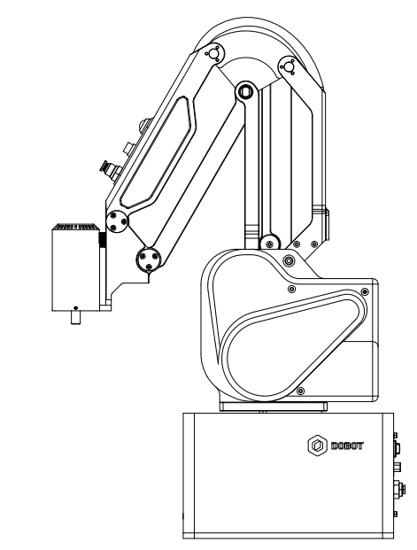

During transportation, ensure that the robot arm is stable and fixed by corresponding measures. During transportation and long-term storage, ensure that the ambient temperature ranges from -20 °C to +55 °C, and the ambient humidity is no more than 95% without condensation. When moving the robot from its packaging to the installation space, hold the robot arm in place until all mounting bolts are securely tightened at the base of the robot. After transportation, store the original package in a dry place for repacking and transporting it in the future.

**WARNING**

* Ensure that the operator is not unduly stressed on their back or other body parts when lifting the equipment, and use appropriate lifting equipment if necessary.
* DOBOT shall not be held responsible for any damage caused by transportation of the equipment.
* Be sure to follow all installation instructions when installing the robot.

### 3. Product Introduction

#### 3.1 Overview

MG400 is an ultra-compact desktop robot arm. It is designed integrating the controller and the robot arm body. The controller is installed in the base. MG400 robot arm includes 4 rotating joints, and two connecting rods (upper arm and forearm), as shown in Figure 3.1.

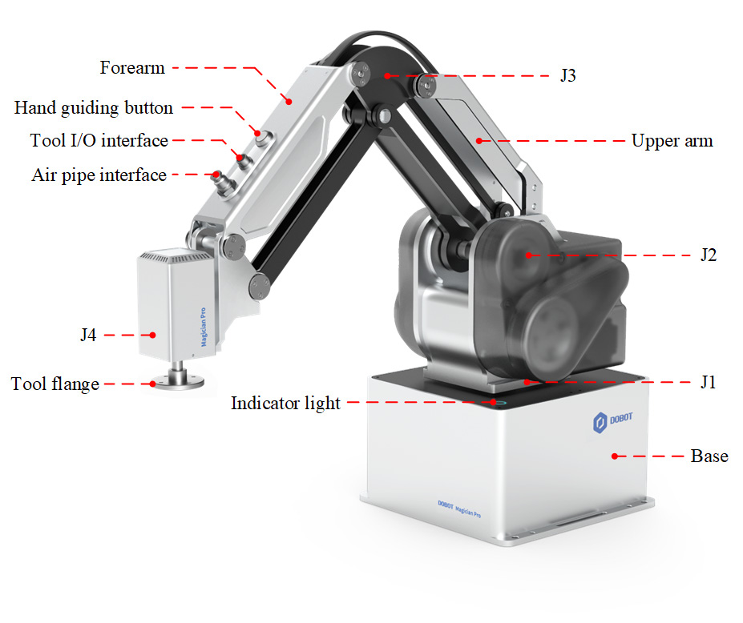

#### 3.2 Robot base

The base is equipped with core computing and electrical components of MG400. The electrical interface board is on the back of the base, and a circular indicator light button is on the base, as described below.

| Color       | Status    | Definition                                      |
| ----------- | --------- | ----------------------------------------------- |
| White light | Flash     | System is starting                              |
| Blue light  | Steady on | The robot arm has been started but not enabled  |
| Blue light  | Flash     | Hand-guiding status                             |
| Green light | Steady on | The robot arm is enabled (not running projects) |
| Green light | Flash     | Automatic running (project is running)          |
| Red light   | Steady on | General alarm                                   |
| Red light   | Flash     | Position limit alarm                            |

#### 3.3 Buzzer

The **MG400** has a built-in buzzer that sounds when the robot triggers an alarm. The specific meanings are as follows:

* **One beep:** Joint limit alarm.
* **Three beeps:** Pause due to collision detection.
* **Five beeps:** Other alarms (including stop triggered by collision detection).

#### 3.4 End button and interface

MG400 is equipped with a button and two interfaces on its forearm.

* \*\*Hand-guiding button:\*\*When the robot arm is enabled and not running a program, long press the button and then you can drag the joints for teaching. After dragging the robot arm to the teaching point, press the end button again and the joints will be locked (cannot be dragged). In addition, when the machine is powered normally, this button can also release the motor brake in emergency stop or other alarm states to rescue trapped people. NOTE During the dragging process, you need to hold the robot arm with your hands, otherwise it may lift or fall slowly.
* **Tool I/O interface**: Aerial socket, which is used to connect the end tool. See 6.2Tool I/O interface for details.
* **Air pipe interface**: It is connected to the air source interface on the back of the base for supplying air for the tool. The corresponding diameter of the air pipe is 4mm.

#### 3.5 Operation terminal

MG400 robot supports control through PC and App, as shown in Table 3.2. If you need to use WiFi for control, you need to plug the WiFi module into the controller.

| Terminal type         | PC                                                    | Tablet (Android)                                    | iPad               |
| --------------------- | ----------------------------------------------------- | --------------------------------------------------- | ------------------ |
| Operation system      | Windows 7/10/11                                       | Android 10 and above                                | iOS 10 and above   |
| Control software      | DobotStudio Pro                                       | Dobot CRStudio                                      | Dobot CRStudio     |
| Minimum configuration | CPU: Intel Core i3; Memory: 4GB; Storage space: 256GB | CPU: 4-core; Running memory: 2G; Storage space: 32G | Storage space: 32G |
| Communication mode    | LAN/WiFi                                              | WiFi                                                | WiFi               |

### 4. Product Features

#### 4.1 Coordinate system

**4.1.1 Joint coordinate system** The joint coordinate system is determined based on all motion joints. All joints are rotating joints, and the positive rotating direction is shown in Figure 4.1.

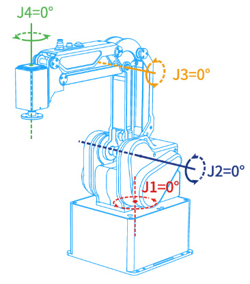

**4.1.2 User coordinate system** The user coordinate system is a movable coordinate system which is used for representing equipment like fixtures, workbenches. The origin and the orientations of axes can be defined based on the site requirements to measure point data within the workspace and arrange tasks conveniently. The default user coordinate system is determined based on the robot base, as shown in Figure 4.2.

* X-axis: perpendicular to the base (positive direction: forward).
* Y-axis: perpendicular to the base (positive direction: left).
* Z axis: vertical upward according to the right-hand rule.

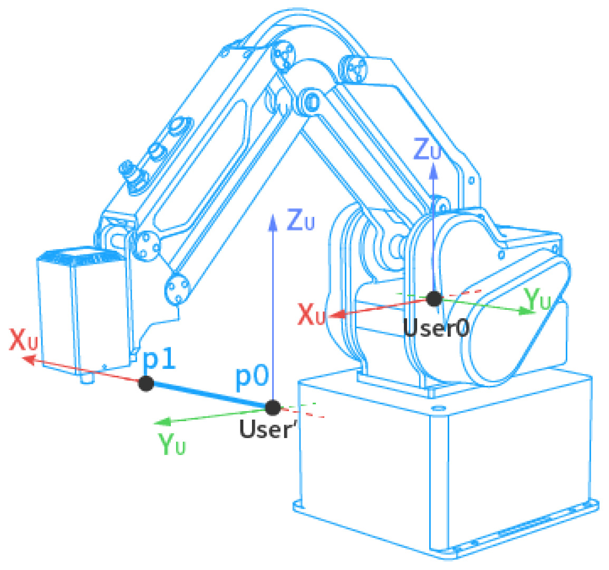

**4.1.3 Tool coordinate system** The tool coordinate system defines the tool center point (TCP) and tool posture, of which the origin and orientations vary with the position and angle of the workpiece at the end of robot. The default tool coordinate system is determined based on the end of the robot, as shown in Figure 4.3.

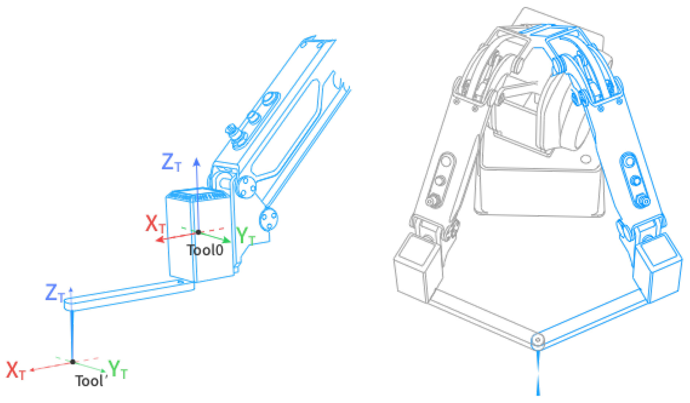

#### 4.2 Home posture

The posture when all joint angles of the robot are 0 degrees is called the home posture, as shown in Figure 4.4.

If the home point of the robot arm changes due to the replacement of the transmission parts or the collision, you can calibrate using the calibration block through the control software. See the corresponding software guide for details.

#### 4.3 Braking time and braking angle

When the J1\~J4 axes triggers an emergency stop at maximum speed, maximum load and maximum arm span, the maximum braking angle and braking time of each joint are shown in the table below.

| Axis | Maximum braking angle (°) | Maximum braking time (ms) |
| ---- | ------------------------- | ------------------------- |
| J1   | 63.391                    | 427                       |
| J2   | 16.13                     | 114                       |
| J3   | 17.951                    | 123                       |
| J4   | 22.027                    | 131                       |

### 5. Mechanical Specifications

#### 5.1 Dimensions

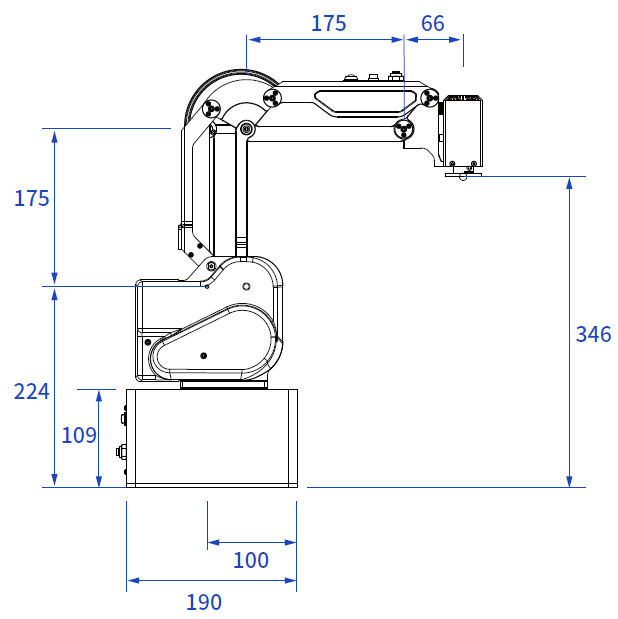

#### 5.2 Base installation dimensions

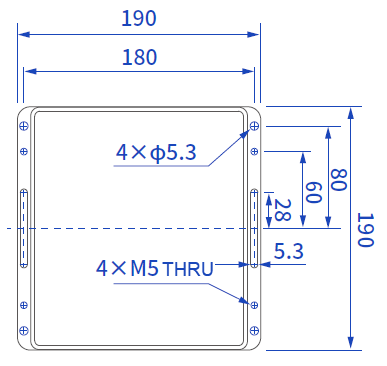

#### 5.3 End dimensions

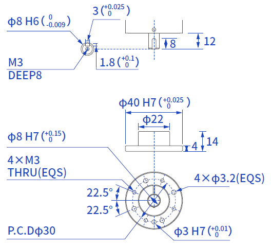

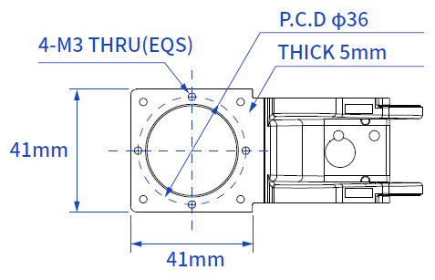

**WARNING**

* Make sure the tools are properly and safely installed in place.
* Ensure the safe architecture of tools to prevent accidental fall of any parts.

#### 5.4 Workspace

Figure 5.5 shows the workspace of MG400 robot.

**NOTICE** When operating the robot, be sure to operate within the workspace and minimize proximity to the working range boundary.

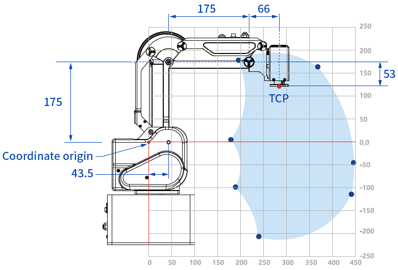

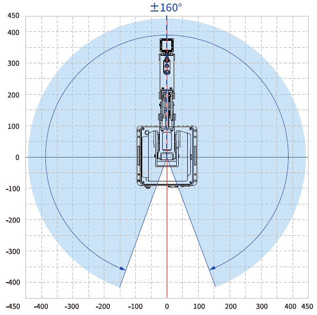

#### 5.5 Load curve

The load capacity of the robot is inversely related to the eccentric distance of the load mass center. The load curve is shown below.

**NOTE** The MG400 has two versions: the standard version and the reducer version. The load curves differ between the two versions, with the reducer version supporting a greater eccentric distance for the same load weight. For more details on the differences between the two versions, refer to Appendix D Differences in MG400 Hardware Versions.

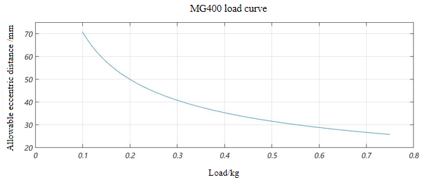

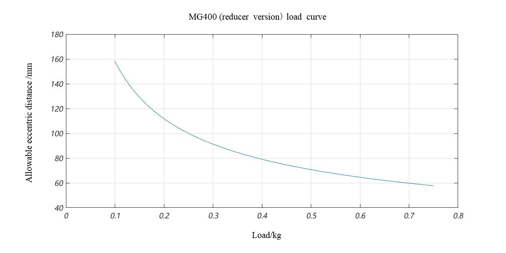

Figure 5.7 Load Curve for MG400 Reducer Version

### 6. Electrical Specifications

#### 6.1 Base Interface

**6.1.1 Interface overview** The base interface board is shown in Figure 6.1 and described in Table 6.1.

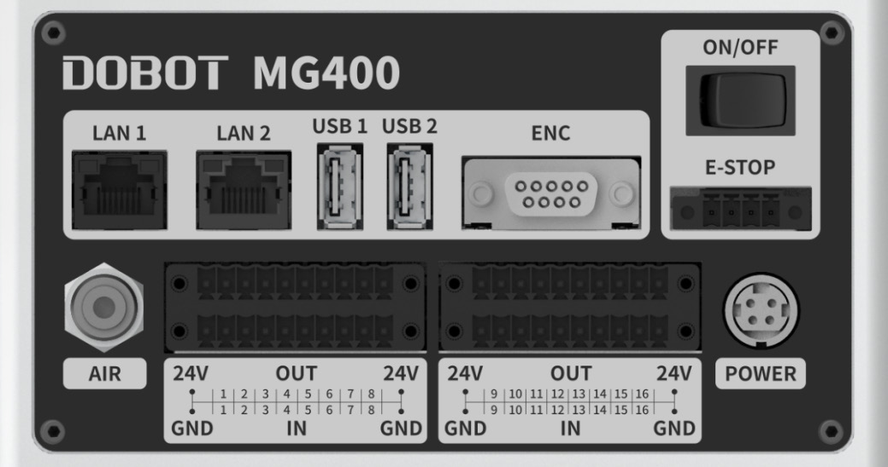

| Screen printing | Description                                                                                                            |
| --------------- | ---------------------------------------------------------------------------------------------------------------------- |
| LAN1            | LAN interface. The default IP address is 192.168.1.6, which cannot be modified. It can be used for software debugging. |
| LAN2            | LAN interface. For connecting to external equipment. The default IP address is 192.168.2.6, which can be modified.     |
| USB1            | USB interface. For connecting WiFi module, updating firmware, etc.                                                     |
| USB2            | USB interface. For connecting WiFi module, updating firmware, etc.                                                     |
| ENC             | Encoder interface. For connecting to the conveyor belt for dynamic tracking.                                           |
| ON/OFF          | Power switch. For power on/off the robot.                                                                              |
| E-Stop          | Emergency stop interface.                                                                                              |
| Power           | Power interface. For connecting to DC 48V power supply.                                                                |
| I/O             | I/O interface.                                                                                                         |
| AIR             | Air source interface. The corresponding air pipe diameter is 4 mm.                                                     |

The ENC interface of the MG400 is shown in Figure 6.2, and described in Table 6.2.

.png>)

| Pin | Description |
| --- | ----------- |
| 1   | ABZ A+      |
| 2   | ABZ A-      |
| 3   | ABZ B+      |
| 4   | ABZ B-      |
| 5   | ABZ Z+      |
| 6   | ABZ Z-      |
| 7   | 5V          |
| 8   | 0V          |
| 9   | Reserved    |

**6.1.2 Base I/O interface** The MG400 base contains an I/O board, for connecting to external equipment, such as air pump, PLC, etc. The I/O board provides 16 digital inputs and 16 digital outputs, as shown in Figure 6.3.

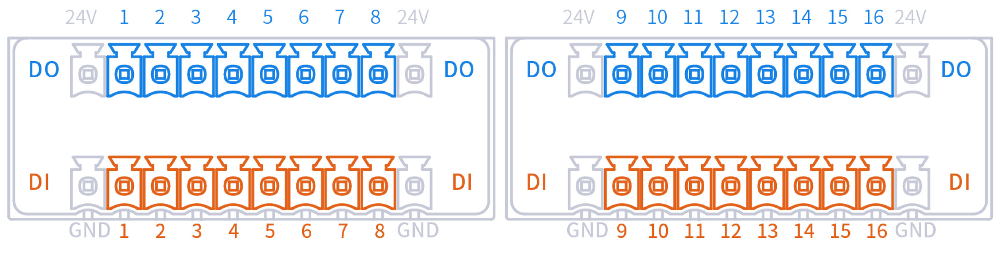

NOTE

* The digital I/O is powered by the internal 24V power supply, the total current can’t exceed 2A.
* The output current of every I/O can’t exceed 500mA.

**DI wiring** The wiring of DI connected to a simple switch (relay contact, button, switch, etc.) is shown below.

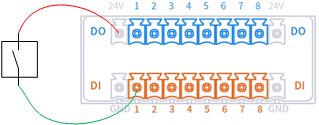

The wiring of DI connected to PNP-type 3-wire sensor is shown in Figure 6.5.

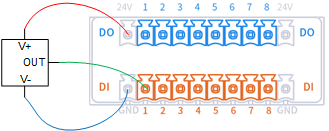

**DO wiring** The wiring of DO connected to external load (without external power supply) is shown in Figure 6.6.

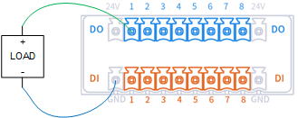

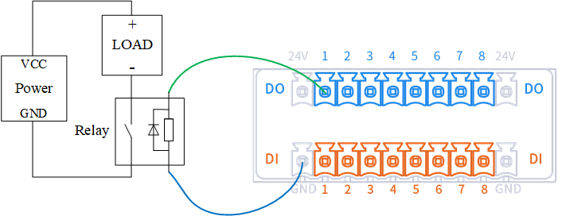

**6.1.3 Safety DI Interface** The **User Emergency Stop Input** is an emergency stop interface provided for the user to connect external emergency stop devices. **By default, the User Emergency Stop Input is a normally closed, high-level** **signal. If any input goes low, the robot will enter an emergency stop status.**

* When the user emergency stop signal (DI) is at a high level, the robot operates normally.
* When the user emergency stop signal (DI) is at a low level, the robot will perform an emergency stop, trigger an alarm, and disable itself. To clear the alarm, the user emergency stop signal (DI) must be restored to a high level. The **Protective Stop Input** is an interface for connecting external protective devices. **By default, the protective stop input is a normally closed, high-level signal. If** **any input goes low, the robot will enter a protective stop status (Pause).**
* **In idle status:** When the protective stop signal is at a high level, the robot operates normally. When the protective stop signal is at a low level, the robot cannot start running scripts.
* **While running scripts:** When the protective stop signal is at a high level, the robot operates normally. When the protective stop signal is at a low level, the robot pauses operation without triggering an alarm. When the protective stop signal switches from low to high, the robot resumes script execution. Users can configure the general IO terminals to function as safety IO based on their actual needs through the control software (as shown in the figure below). Click “Modify,” edit the settings, and then click “Save.” Use the corresponding physical interfaces for user emergency stop input/protective stop input.

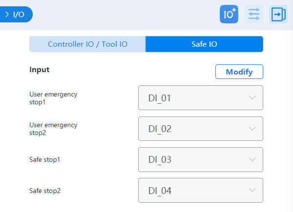

The configuration of **protective stop** and **user emergency stop** is done through the HTTP interface. After configuration, a restart is required for the changes to take effect. Once the configuration is active, the controller will periodically check the DI input signal. If a low-level signal is detected, the robot will perform a protective action and enter the protective status, preventing further operation. The controller's status will only reset and allow the robot to resume operation when a high-level signal is detected again.

#### 6.2 Tool I/O interface

The tool I/O needs to be used with an aerial plug (WEIPU: SF810/P6). The tool DI and DO are PNP type.

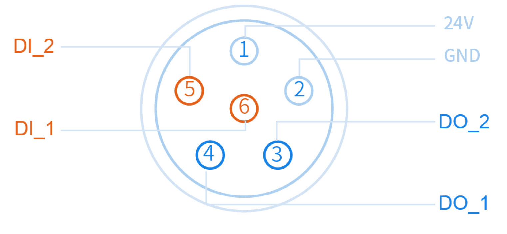

**WARNING** When connecting end tools, ensure that power interruptions do not cause any hazards, such as a workpiece falling off the tool.

### 7. Installation

#### 7.1 Installation Environment

To maintain the robot performance and ensure safety, please place them in an environment with the following conditions.

**NOTICE**

* Install indoors with good ventilation.
* Keep away from excessive and shock.
* Keep away from direct sunlight.
* Keep away from dust, oily smoke, salinity, metal powder, corrosive gases, and other contaminants.
* Do not use in a closed environment. A closed environment may cause high temperature of the robot and shorten its service life.
* Keep away from flammable.
* Keep away from cutting and grinding fluids.
* Keep away from sources of electromagnetic interference, including large transformer, large electromagnetic contactor, welding machine, etc.

#### 7.2 Unpacking

When unpacking, please check the attached shipping list to ensure that there are no contents missing. If any contents are missing, please contact your supplier.

#### 7.3 Robot Installation

After taking the robot from its packaging, tighten the robot base using four M5 (ISO 898-1-1999) hexagonal bolts with a torque of 9 Nm. The installation of the robot directly affects the stability of robot operation. You can design and select the platform according to the size of the hole of the base and the real environment for mounting a robot. The installation height of the robot should be above 0.6 meters. The platform needs to bear not only the weight of the robot arm but also the dynamic force in the maximum acceleration. Please note the following when fixing the robot.

* Design the platform according to the robot’s workspace, and ensure that the robot moves without interference.
* Keep the platform level which is used to mount a robot.

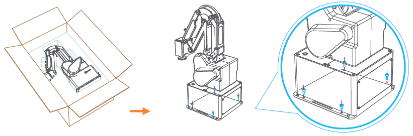

#### 7.4 Wiring and powering on

1. Connect the emergency stop switch cable using wiring terminals, as shown below.
2. Connect the power cable. The other end of the power cable is connected to an external power supply via a power adapter.
3. Connect the base LAN1 interface using a network cable to the computer for debugging. If you have purchased a WiFi module, you can also plug the WiFi module into the base USB interface and connect wirelessly.
4. Press the power switch. After the robot is turned on, you can debug the robot arm using the control software (DobotStudio Pro or Dobot CRStudio). See the corresponding user guide for details.

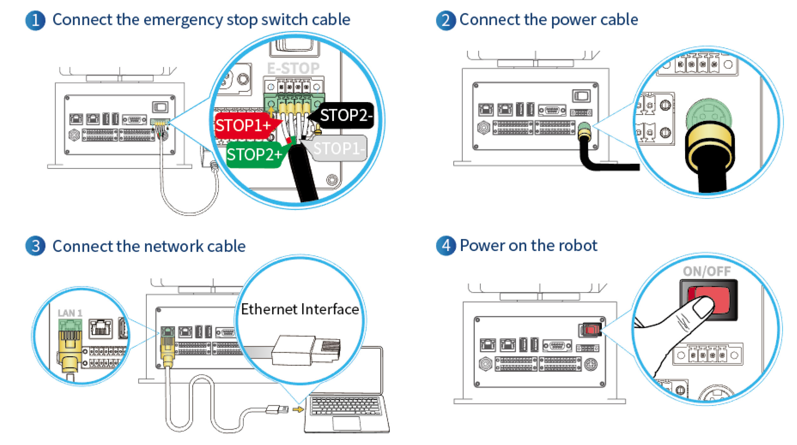

**NOTICE**

* Set the specifications and installation method of external cables in compliance with local power distribution laws and regulations.
* Do not disassemble the robot by yourself, otherwise it may cause electricity leakage.
* Make sure the device is grounded.
* Do not bend the cable excessively, otherwise it may cause poor contact or cable breakage.
* Make sure the power outlet for the control system is disconnected when connecting an external device, otherwise it may cause an electric shock or device failure.
* Use supporting cables to protect device and personal safety.
* After wiring, ensure that there are no fallen screws or exposed cables in the device.
* Do not plug or remove the power cable or communication cable when the device is running normally.
* Power on the device only after connecting all the cables required.
* Ensure that the cables are connected correctly, otherwise, it may cause fault in internal modules or external devices.
* Before connecting, check whether there is breakage in the insulation and shield of the external cables.

### 8. Maintenance and Repair

Maintenance and repairing must be performed in compliance with all safety instructions in this manual. The purpose of maintenance and repairing is to ensure that the system is kept operational, or to return the system to an operational state in the event of a fault. Repairing includes troubleshooting in addition to the actual repair itself. Repairing must be performed by an authorized system integrator or DOBOT technical engineers. Before returning robots or parts to DOBOT, please follow the instructions below:

* Remove all parts that do not belong to DOBOT.
* Make a backup copy of the files. DOBOT shall not be responsible for the loss of programs, data or files stored in the robot.
* Restore the robot to the packaging posture.

#### 8.1 Safety Instructions

The following safety procedures and warnings must be observed during the operation of the robot or controller:

**NOTICE**

* Replace faulty components using new components with the same model or equivalent components approved by DOBOT.
* Reactivate all deactivated safety measures immediately after the repairing is completed.
* Record all repairs and save them in the technical document with the robot system.
* Remove the main input cables from the back of the controller to ensure that it is completely unpowered. Cut off any other power source connected to the robot or controller. Take necessary precautions to prevent other people from powering on the system during the repair period.
* Observe ESD regulations during the disassembly of the parts of the robot arm or controller.
* Prevent water and dust from entering the robot arm or controller.

#### 8.2 Body Maintenance

In order for the robot to maintain high performance for a long time, a maintenance inspection must be carried out. The personnel in charge of the maintenance must prepare a maintenance plan and carry out the maintenance. The maintenance items are shown below.

| Cycle    | Maintenance item                           | Maintenance essential                                                                                                                                                                                                                           |
| -------- | ------------------------------------------ | ----------------------------------------------------------------------------------------------------------------------------------------------------------------------------------------------------------------------------------------------- |
| Daily    | Robot clean                                | Wipe off dirt, dust, cutting residue on the body with water or 10% alcohol                                                                                                                                                                      |
| Daily    | Cable, cable protective cover and air pipe | Observe the moving part of the cable, check whether the cable is damaged, whether there is local bending or distortion; check whether the cable protective cover is damaged; check whether the air pipe is locally bent, twisted, damaged, etc. |
| 6 months | Joint bolts                                | Check the torque of exposed bolts based on Table 8.2                                                                                                                                                                                            |
| 3 months | Tool mounting bolts                        | Check the torque based on Table 8.2                                                                                                                                                                                                             |
| Daily    | Motor                                      | Abnormal heating or sound confirmation                                                                                                                                                                                                          |
| Daily    | Brake                                      | Check whether the robot arm or end-effector will fall when the servo is powered off                                                                                                                                                             |
| 3 months | Synchronous belt                           | Check whether the synchronous belt is worn out, elongated, broken, etc.                                                                                                                                                                         |

Table 8.2 lists the bolted tightening torque table.

| Nominal diameter of screw thread | Countersunk head hexagon socket screw | Hexagon socket button head screws | Hexagon socket cap screws |
| -------------------------------- | ------------------------------------- | --------------------------------- | ------------------------- |
| 2.5 mm                           | 0.3 Nm                                | 0.3 Nm                            | 0.5 Nm                    |
| 3 mm                             | 0.5 Nm                                | 0.6 Nm                            | 2 Nm                      |
| 4 mm                             | -                                     | 2 Nm                              | -                         |
| 5 mm                             | -                                     | -                                 | 7.5 Nm                    |

The tightening torque varies depending on the type of base metal or bolt. When it is not specified, please contact DOBOT technical engineers. In addition, overall maintenance is required every 20,000 hours of operation time or every 4 years (select the shorter of the two periods for maintenance). If you are not clear about the maintenance processes, please contact DOBOT technical engineer.

### 9. Disposal and Environment

DOBOT robots must be disposed of in accordance with the applicable national laws, regulations and standards. The following symbol indicate that disposal of the product as ordinary trash is prohibited.

### 10. Certification

#### 10.1 Collaborative robot certification

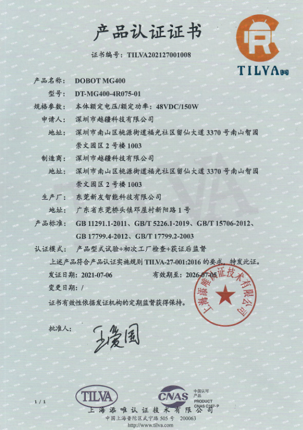

#### 10.2 Robot reliability certification

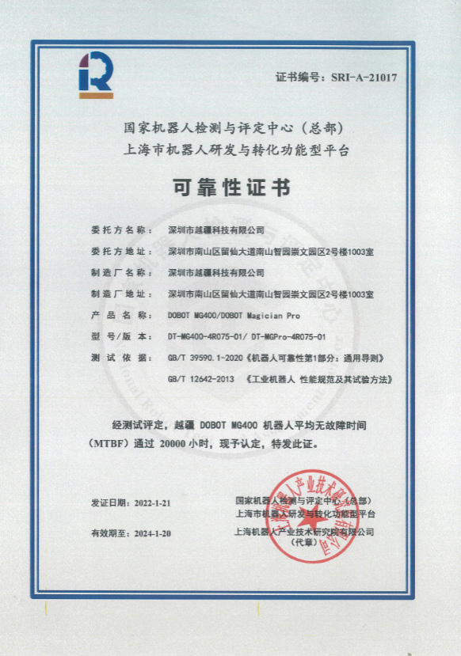

#### 10.3 FCC SDoC certification

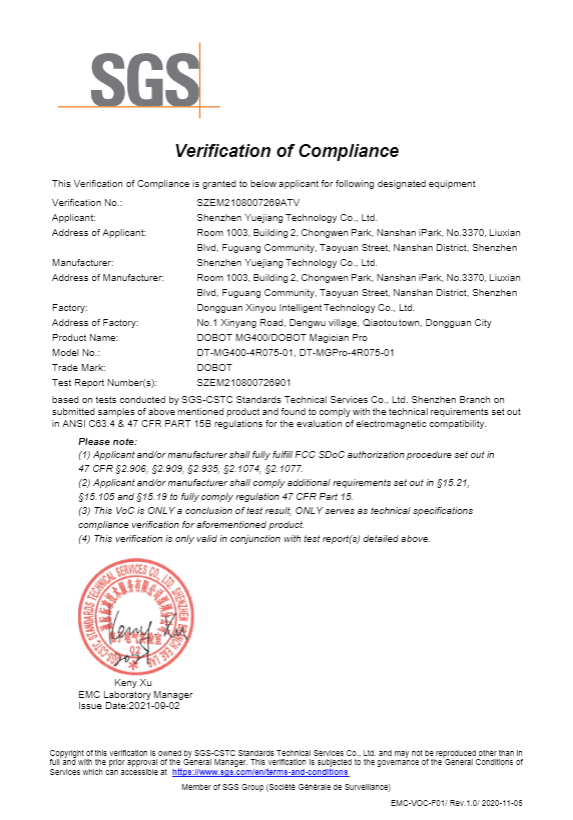

#### 10.4 CE-MD certification

#### 10.5 CE-EMC certification

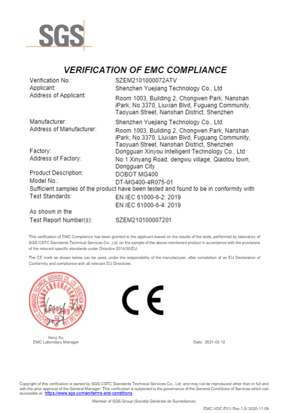

#### 10.6 RoHS

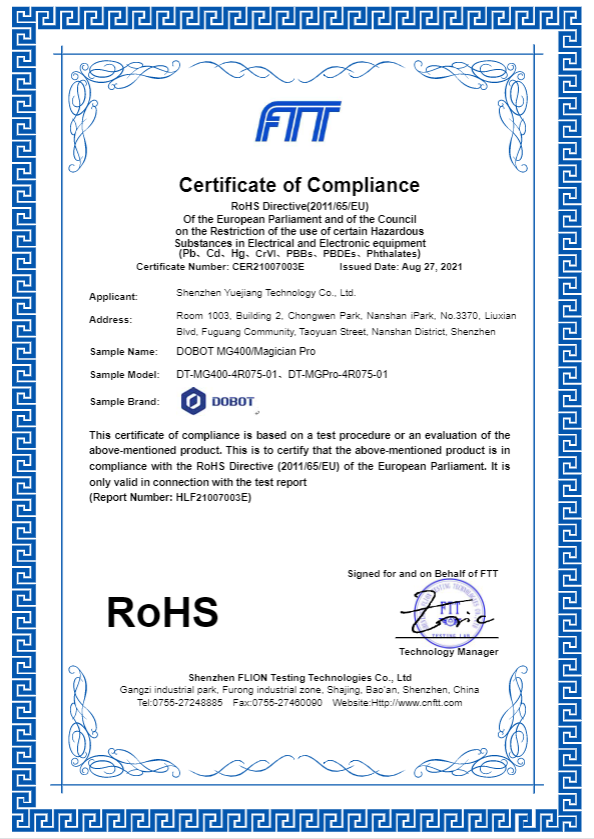

#### 10.7 RCM certification

#### 10.8 KCs certification

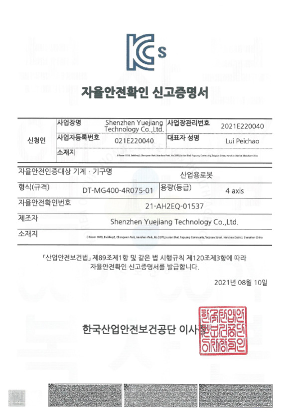

### 11. Warranty

#### 11.1 Product warranty

Without prejudice to any claim agreement that the user (customer) may reach with the distributor or retailer, the manufacturer shall guarantee the quality of the products to the customer in accordance with the terms and conditions below: If defects caused by manufacturing and/or improper material occur in a new device and its components within 12 months (15 months at most if the shipping time is included) after the device is put into use, DOBOT shall provide the necessary spare part, and the user (customer) shall offer personnel to replace the spare part, using another part that represents the latest technology level to replace or repairing the related part. If the device defects are caused by improper handling and/or failure to follow the relevant information set out in the User Guide, the warranty is invalid. This warranty does not apply to or extend to maintenance (e.g. installation, configuration, software download) performed by the authorized distributer or customer. The user (customer) must provide the purchase receipt and the purchase date as valid evidence for the warranty. Claims under this warranty must be made within two months of the apparent failure to perform the product warranty. The ownership of the equipment or components that are replaced or returned to DOBOT shall remain with DOBOT. Any other claims arising from or related to the equipment are not covered by this warranty. Any items in this product warranty do not intend to limit or exclude the legal rights of the customer or to limit or exclude the liability of the manufacturer for the personnel casualty resulting from its negligence. The duration of this product warranty shall not be extended due to the services provided under the product warranty terms. Under the principle of not violating the warranty, DOBOT reserves the right to charge customers for the replacement or maintenance. The foregoing does not imply a change in the burden of proof to the detriment of the client. If there are defects on the equipment, DOBOT shall not be liable for any damage or loss arising therefrom, including but not limited to loss of production or damage to other production equipment.

#### 11.2 Disclaimer

DOBOT is committed to improve the reliability and performance of its products, and as such reserves the right to upgrade products without prior notice. DOBOT strives to ensure the contents of the User Guide are precise and reliable, but takes no responsibility for any errors or missing information.

### Appendix A Technical Specifications

| Parameter                                             | DOBOT MG400                                                                                                                                                                                                                                                                                                                                                                                        |
| ----------------------------------------------------- | -------------------------------------------------------------------------------------------------------------------------------------------------------------------------------------------------------------------------------------------------------------------------------------------------------------------------------------------------------------------------------------------------- |
| Product                                               | DOBOT MG400                                                                                                                                                                                                                                                                                                                                                                                        |
| Model                                                 | DT-MG400-4R075-01                                                                                                                                                                                                                                                                                                                                                                                  |
| Weight                                                | 8 kg                                                                                                                                                                                                                                                                                                                                                                                               |
| Rated load                                            | 500 g                                                                                                                                                                                                                                                                                                                                                                                              |
| Maximum load                                          | 750 g                                                                                                                                                                                                                                                                                                                                                                                              |
| Reach                                                 | 440 mm                                                                                                                                                                                                                                                                                                                                                                                             |
| Power adapter                                         | 100V\~240V AC, 50/60Hz, Max. 240W                                                                                                                                                                                                                                                                                                                                                                  |
| Rated voltage                                         | DC48V                                                                                                                                                                                                                                                                                                                                                                                              |
| Short-circuit current                                 | 50 A                                                                                                                                                                                                                                                                                                                                                                                               |
| Installation                                          | Table installation, indoor                                                                                                                                                                                                                                                                                                                                                                         |
| Rated power                                           | 150 W                                                                                                                                                                                                                                                                                                                                                                                              |
| Single joint motor power                              | Actual operating power < 80 W                                                                                                                                                                                                                                                                                                                                                                      |
| Repeatability                                         | ±0.05 mm                                                                                                                                                                                                                                                                                                                                                                                           |
| Base size                                             | 190 mm × 190 mm                                                                                                                                                                                                                                                                                                                                                                                    |
| Operation software                                    | DobotStudio Pro, CRStudio                                                                                                                                                                                                                                                                                                                                                                          |
| Motion range J1                                       | ±160°                                                                                                                                                                                                                                                                                                                                                                                              |
| Motion range J2                                       | -25°\~85°                                                                                                                                                                                                                                                                                                                                                                                          |
| Motion range J3                                       | -25°\~105°                                                                                                                                                                                                                                                                                                                                                                                         |
| Motion range J4                                       | -360°\~360°                                                                                                                                                                                                                                                                                                                                                                                        |
| Joint maximum speed J1                                | 300°/s                                                                                                                                                                                                                                                                                                                                                                                             |
| Joint maximum speed J2                                | 300°/s                                                                                                                                                                                                                                                                                                                                                                                             |
| Joint maximum speed J3                                | 300°/s                                                                                                                                                                                                                                                                                                                                                                                             |
| Joint maximum speed J4                                | 300°/s                                                                                                                                                                                                                                                                                                                                                                                             |
| End-effector I/O interface DI                         | 2                                                                                                                                                                                                                                                                                                                                                                                                  |
| End-effector I/O interface DO                         | 2                                                                                                                                                                                                                                                                                                                                                                                                  |
| Base interface DI                                     | 16                                                                                                                                                                                                                                                                                                                                                                                                 |
| Base interface DO                                     | 16                                                                                                                                                                                                                                                                                                                                                                                                 |
| Base interface ABZ incremental encoder (differential) | 1                                                                                                                                                                                                                                                                                                                                                                                                  |
| Base interface Ethernet                               | 2                                                                                                                                                                                                                                                                                                                                                                                                  |
| Base interface USB 2.0                                | 2                                                                                                                                                                                                                                                                                                                                                                                                  |
| Base interface Air circuit                            | 1 (recommended air pressure range for connected air pump: -70 to 110 kPa)                                                                                                                                                                                                                                                                                                                          |
| Communication mode                                    | TCP/IP, Modbus TCP                                                                                                                                                                                                                                                                                                                                                                                 |
| Built-in disk capacity                                | 8 GB                                                                                                                                                                                                                                                                                                                                                                                               |
| RAM                                                   | 1 GB                                                                                                                                                                                                                                                                                                                                                                                               |
| Temperature range                                     | Storage: -25°C~~55°C; Working: 0°C~~40°C                                                                                                                                                                                                                                                                                                                                                           |
| Operating altitude range                              | ≤ 1000 m                                                                                                                                                                                                                                                                                                                                                                                           |
| MTBF                                                  | 20000 hours                                                                                                                                                                                                                                                                                                                                                                                        |
| Safety standard                                       | EN ISO 10218-1:2011 Robots and robotic devices - Safety requirements for industrial robots - Part 1: Robots; EN 60204-1:2018 Safety of machinery - Electrical equipment of machines - Part 1: General requirements; EN ISO 12100:2010 Safety of machinery - General principles for design - Risk assessment and risk reduction; ISO/TS 15066:2016 Robot and Robotic Devices - Collaborative Robots |
| EMC standard                                          | EN IEC 61000-6-2:2019 Electromagnetic compatibility (EMC) - Part 6-2: Generic standards - Immunity standard for industrial environments; EN IEC 61000-6-4:2019 Electromagnetic compatibility (EMC) - Part 6-4: Generic standards - Emission standard for industrial environments                                                                                                                   |

### Appendix B I/O Simple Circuit

**Digital Input** The figure below shows the simple digital input circuit and the table below lists the technical specifications.

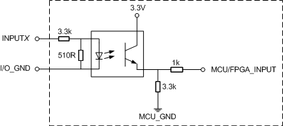

| Item               | Specification              |
| ------------------ | -------------------------- |
| Input channel      | 16 channels                |
| Connection method  | Crimping terminal          |
| Input type         | PNP                        |
| Input voltage (DC) | 24V±10%                    |
| Isolation method   | Optical coupling isolation |

**Digital Output** The figure below shows the simple digital output circuit and the table below lists the technical specifications.

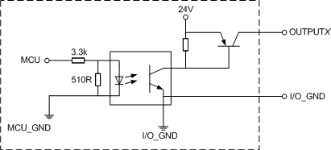

| Item                           | Specification      |
| ------------------------------ | ------------------ |
| Output channel                 | 16 channels        |
| Connection method              | Crimping terminal  |
| Output type                    | PNP                |
| Power supply (DC)              | 24V±10%            |
| Load current of single channel | 500mA              |
| Output current                 | 2A                 |
| Isolation method               | Magnetic isolation |

### Appendix C Firmware Upgrade via USB

1. Please contact DOBOT technical support to obtain the **MG400 controller** **firmware upgrade package** (supports both **update** and **cover** packages), and rename the upgrade package to **MagicianPro\_Controller.tar.gz**.
2. Place the upgrade package on a USB drive.
3. Insert the USB drive into any USB port on the MG400 base. Once the MG400 detects the upgrade package, it will automatically execute the upgrade process.
4. Turn off the MG400 and wait for 1 minute before turning it back on.
5. After restarting, attempt to connect the MG400 using **DobotStudio Pro**. Once connected, go to **Settings > Basic Settings** and check the firmware version. If the version matches the upgraded version, the upgrade has been successful. If the previous version is displayed or the MG400 cannot be connected, the upgrade has failed. In this case, please contact DOBOT technical support.

### Appendix D Differences in MG400 Hardware Versions

**Model Selection Recommendations** **MG400 Standard Version**: Suitable for scenarios where the load is concentric with the robotic arm’s end or where the eccentric distance is small.

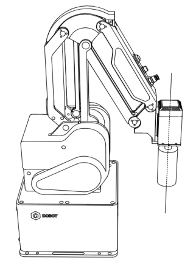

**MG400 Reducer Version**: Suitable for scenarios where the load has a large eccentric distance from the robotic arm’s end or where the load distribution is more dispersed.

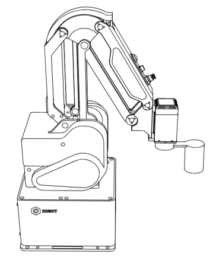

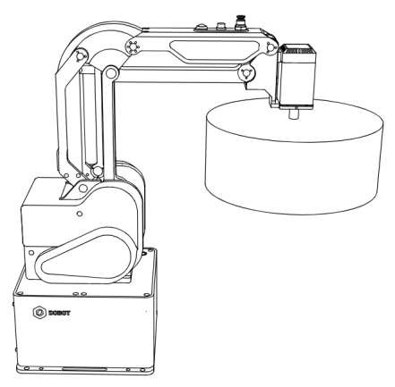

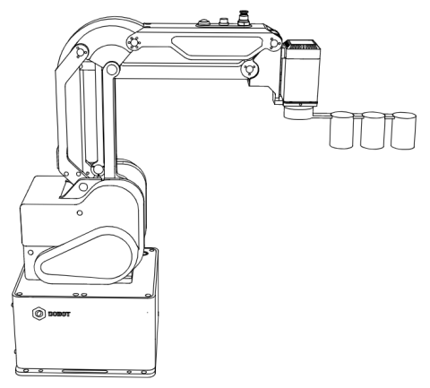

For more precise model selection, refer to the differences in parameters and load curves.

**Parameter Differences**

| Model                     | MG400 Standard Version | MG400 Reducer Version         |
| ------------------------- | ---------------------- | ----------------------------- |
| J4 Joint                  | Servo motor            | Integrated motor with reducer |
| Gear Ratio                | None                   | 6.75 : 1                      |
| Load Inertia Reference\*1 | 500 kg\*mm²            | 2500 kg\*mm²                  |
| Backlash\*2               | None                   | 40 arc-minutes                |

_1: Rotational inertia is calculated based on the **mass** and **geometry** of the load. Use a 3D simulation model to calculate the actual rotational inertia of the load (k&#x67;_&#x6D;m²) for model selection. \*2: Adding a gearbox introduces backlash. When the J4 is enabled and stationary, a slight play can be felt when manually rotating the end flange or when the end cable is tugged. This play is a normal mechanical characteristic of gearbox transmission and **is not a** **product defect or assembly issue**. This characteristic primarily affects **rotational** **positioning accuracy under eccentric loads**. When the center of gravity of the end-effector or workpiece is significantly offset from the J4 axis rotation center, gravity generates a continuously alternating torque that amplifies the play and positioning error caused by backlash. Therefore, this model is better suited for concentric fixture applications. **For eccentric applications that require high rotational accuracy**, careful evaluation is recommended, or priority should be given to other models.

**Appearance Differences** The MG400 reducer version has the letter R marked on the top of the end, while the standard version has no markings.

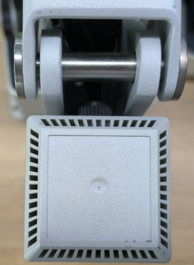

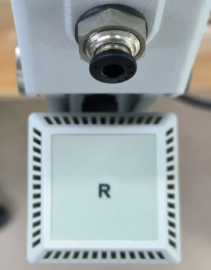
