# DOBOT ROVER X1 User Manual

### DOBOT ROVER X1 Quadruped Robot for Education and AI Development



### Contents

* Safety precautions and operating environment
* Product introduction and technical specifications
* Quick start (unpacking, powering on, App binding, charging)
* Controlling the robot (App, voice, and remote controller)
* Blockly programming
* Common issues and solutions
* Maintenance

### Key Troubleshooting Index

* Power-on failure (red light slowly flashing)
* App connection failure
* Abnormal standing posture
* Battery level shown on the App does not match the robot
* Communication failure (flashing red leg indicator)
* Low battery (flashing yellow leg indicator)

### Safety and Operating Environment

* ROVER X1 is an all-around intelligent quadruped companion robot, strictly prohibited for military use. It is only suitable for individuals aged 14 or older.
* Operate only in a recommended environment: 5°C to 35°C under clear weather, on a hard, flat, obstacle-free surface.
* Do not operate in strong wind, rain, snow, fog, humid, dusty, or chemically corrosive environments, or in areas with electromagnetic or Wi-Fi signal interference.
* Keep the robot within sight and maintain at least 2 meters from obstacles or crowds.
* Use the emergency stop only in emergencies: press LB + B on the remote controller, or tap E-Stop in the App.
* Never disassemble, modify, or perform unauthorized repairs on the robot.

### Product Specifications

| Parameter                    | Value                                     |
| ---------------------------- | ----------------------------------------- |
| Product models               | ROVER X1 Air / Standard / Pro             |
| Battery capacity             | 4000 mAh (Air, Standard) / 8000 mAh (Pro) |
| Battery life                 | 1–3 h (Air, Standard) / 2–4 h (Pro)       |
| Maximum speed (Point-foot)   | 1.8 m/s                                   |
| Maximum speed (Wheeled-foot) | 3 m/s                                     |
| Gradeability                 | 30°–35°                                   |
| Step climbing height         | 16 cm                                     |
| Payload                      | 3–7 kg                                    |
| Imaging system               | Dual 1080p cameras (front and rear)       |
| Size (Point-foot)            | 761 × 372 × 428 mm                        |
| Size (Wheeled-foot)          | 761 × 440 × 516 mm                        |
| Weight (Point-foot)          | 15.5 kg                                   |
| Weight (Wheeled-foot)        | 18.5 kg                                   |

### Battery and Charging

* When the leg indicator light flashes yellow, the battery is low (about 20 minutes of runtime remaining).
* Power off the robot and lay it down (prone) before charging. Use only the original DOBOT charger.
* The 8000 mAh long-endurance battery takes about 4–5 hours to fully charge. When all four battery indicator lights are steadily lit, the battery is fully charged.
* For long-term storage, keep the battery level at about 60%, power off the device, and recharge once every 3 months.

### Preface

This document describes the functions, technical specifications, installation guide of the quadruped robot ROVER X1, making it easy for users to fully understand and use ROVER X1.

#### Scope of application

* ROVER X1 Air (Point-foot / Wheeled-foot)
* ROVER X1 Standard (Point-foot / Wheeled-foot)
* ROVER X1 Pro (Point-foot / Wheeled-foot)

#### Intended audience

This document is intended for:

* Customer
* Sales Engineer
* Installation and Commissioning Engineer
* Technical Support Engineer

#### Revision history

| Date       | Version | Revision history                                                                                                                                                                                                                                |
| ---------- | ------- | ----------------------------------------------------------------------------------------------------------------------------------------------------------------------------------------------------------------------------------------------- |
| 2026/06/05 | V1.3    | 
• Added Rover X1 Air, Standard, and Pro models along with Version difference; updated technical specifications. • Added version difference descriptions related to 4G and remote controller. • Removed the 4G data module section.
 |
| 2026/05/15 | V1.2    | 
• New App and firmware upgrade, Audio playback, Blockly programming are introduced. • Added a description of the effective control distance (10 meters) for the remote controller. • Compatible with App version 1.1.0 and above.
  |
| 2026/03/23 | V1.1    | Updated the description related to the remote controller.                                                                                                                                                                                       |
| 2026/02/12 | V1.0    | The first release.                                                                                                                                                                                                                              |

#### Symbol conventions

The symbols that may be found in this document are defined as follows.

| Symbol  | Description                                                                                                                                |
| ------- | ------------------------------------------------------------------------------------------------------------------------------------------ |
| DANGER  | Indicates a hazard with a high level of risk which, if not avoided, could result in death or serious injury.                               |
| WARNING | Indicates a hazard with a medium level or low level of risk which, if not avoided, could result in minor or moderate injury, robot damage. |
| NOTICE  | Indicates a potentially hazardous situation which, if not avoided, could result in robot damage, data loss, or unanticipated result.       |
| NOTE    | Provides additional information to emphasize or supplement important points in the main text.                                              |

### 1. Safety Precautions

#### 1.1 Disclaimer

ROVER X1 is an all-around intelligent quadruped companion robot (strictly prohibited for military use). However, as robotics technology has not yet reached full maturity, special attention must be paid to the safety-related instructions described in this document during actual operation. Any safety information provided in this document should not be considered as a warranty from SHENZHEN DOBOT CORP LTD (hereinafter referred to as “DOBOT”). The robot may cause injury or damage even if all safety instructions are observed.

* DOBOT is not responsible for any damage incurred during the transportation and handling of the robot.
* Natural wear and tear of components and battery aging are considered normal risks. DOBOT assumes no liability for such risks.
* It is strictly prohibited to disassemble, modify, or perform unauthorized repairs on the robot. DOBOT shall not be liable for any robot malfunctions or damages resulting from such actions.
* ROVER X1 is only suitable for individuals aged 14 or older who possess the corresponding cognitive and behavioral capabilities. Individuals who do not meet these requirements must use the robot under the guidance and supervision of a guardian and must read this document carefully before use. DOBOT assumes no responsibility for any robot damage or personal injury resulting from failure to follow the product instructions or from other improper operations.
* The robot's default maximum walking speed ranges from 1.8 m/s to 3 m/s. If a higher walking speed is required, please contact technical support. When operating the robot at high speed, you must exercise extreme caution. DOBOT shall not bear any responsibility for damage to the robot or personal injuries resulting from improper operation.
* It is strictly prohibited to operate the robot under unrecommended environmental conditions. DOBOT shall not be liable for any robot damage caused by inappropriate operating environments.
* The obstacle avoidance function is enabled by default when the robot leaves the factory. DOBOT shall not assume any responsibility for risks arising from the user's decision to deactivate this function.
* DOBOT reserves the final right of interpretation and the right to update the terms regarding ROVER X1.

#### 1.2 Operating environment

**Recommended environment**

* 5°C to 35°C, under clear weather conditions.
* An open area spacious enough for the robot to move freely, and it must not be operated in crowded locations.
* Hard, flat, and obstacle-free ground surface.

**Unsuitable environments** Do not operate the robot in the following environments!

* Strong wind, rain, snow, fog, lightning, extreme heat, cold, or other severe weather conditions.
* Humid, dusty, or chemically corrosive environments.
* Environments with electromagnetic interference or Wi-Fi signal interference.
* Complex, slippery, or cluttered environments, or areas with sharp objects.
* Ice or soft ground (such as thick sponge). On smooth surfaces like tiles, the robot's walking speed must be reduced.

#### 1.3 Usage instructions

**Before use**

* The operator must ensure they are in good physical and mental condition.
* The operator should be familiar with the robot's various gait modes and emergency stop procedures.
* Only original parts of the robot should be used, and all parts must be in proper appearance and functional condition.
* Check whether the battery pack and the remote control have sufficient charge.
* Check whether the robot's exterior is intact, if all limbs can move flexibly, and if there is any wear on the foot ends. Note that the foot ends are consumables and should be replaced promptly if worn.
* Check that there are no foreign objects (e.g., water, oil, sand) inside the robot.
* Check the surfaces of the robot’s camera and depth camera to ensure they are unobstructed.
* Confirm that the robot's firmware has been updated to the latest version.

**During use**

* Ensure the robot remains within sight and maintains a distance of at least 2 meters from obstacles or crowds.
* Do not touch the robot while it is in operation. **NOTICE** The robot's body is labeled with warning stickers indicating pinch and high-temperature hazards. Contact with these areas may result in pinching or burns due to high heat. Please exercise extreme caution.

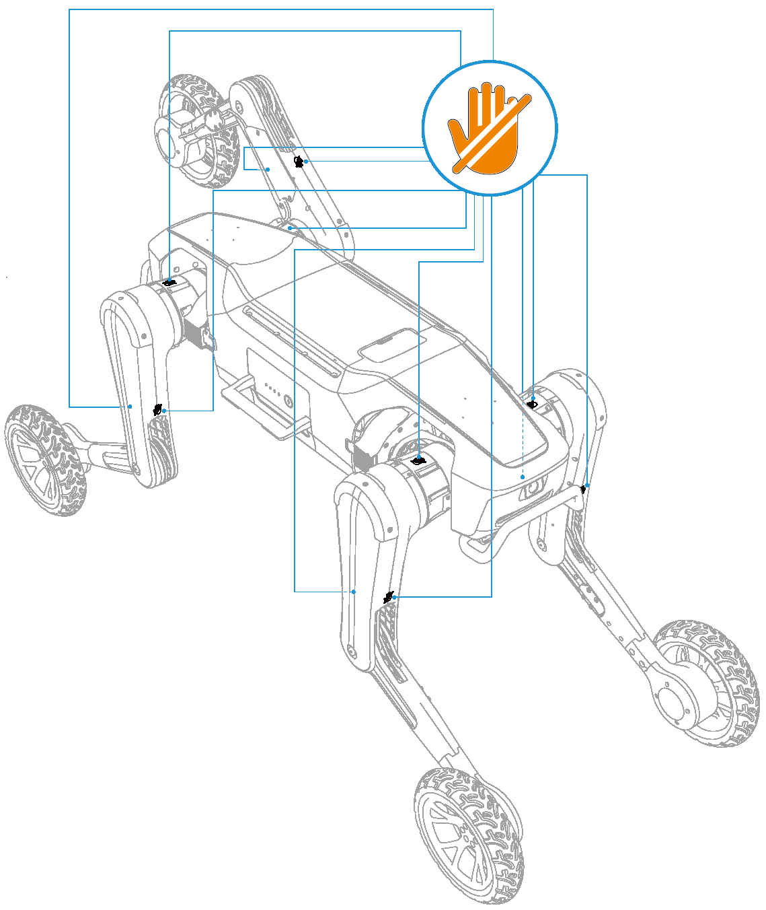

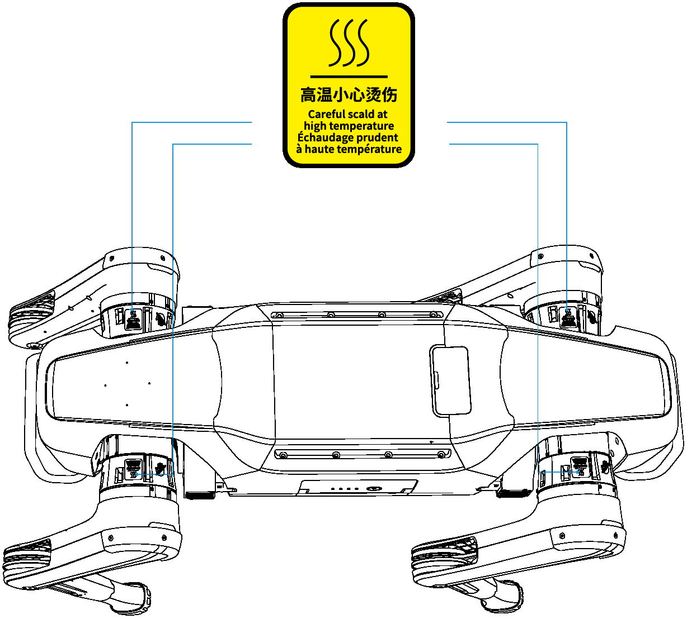

* Do not continue using the robot if it is damaged.
* Avoid making drastic adjustments to the robot's posture on surfaces with insufficient friction.
* The robot's runtime is affected by movement speed, load, and terrain.
* The robot’s rated battery life is 1.5 to 2.5 hours (actual duration varies based on movement speed, load, and terrain).
* The robot can step over obstacles up to 16 cm high and climb slopes not exceeding 30° to 35°. When operating on uneven terrain or steeper slopes, please control the robot carefully to prevent loss of balance and falls.
* If the usage area has a certain slope, the wheeled-foot robot's obstacle avoidance function will be triggered. It is recommended that users switch off the obstacle avoidance function and exercise caution when operating the wheeled-foot robot on sloped terrain.
* If the robot accidentally falls into water during operation, disconnect the power immediately.
* In case of a malfunction, contact DOBOT's technical support engineer in time.

**After use**

* Power off the robot immediately after use.

### 2. Product Introduction

#### 2.1 Product overview

ROVER X1 is an all-in-one intelligent quadruped companion robot that integrates features such as motion tracking, entertainment interaction, contextual load handling, and safety protection, specifically designed for modern households and outdoor enthusiasts. By utilizing advanced technologies including intelligent motion control, multi-sensor fusion, and multimodal interaction, ROVER X1 delivers automated services across three core scenarios: fitness logging, travel assistance, and child companionship. This enables the robot to serve as a user's "fitness partner", "camping assistant" and "family helper".

#### 2.2 Core function

**Intelligent motion**

* **Active following:** Based on visual lock and tracking of the target person.\
  Maximum following speed: 1.2 m/s (for the point-foot robot) and 2 m/s (for the wheeled robot).
* \*\*Obstacle avoidance:\*\*Omni-directional perception for both forward and\
  reverse movement, with dynamic planning of safe paths.
* \*\*Intelligent navigation:\*\*mapping/location/navigation/patrolling in complex\
  environments (future OTA upgrade)
* \*\*Point-foot/Wheeled-foot:\*\*A single device supports convenient switching\
  between point-foot and wheeled-foot modes.

**Intelligent interaction**

* \*\*Intelligent recognition:\*\*Gesture/human/scene recognition
* **Voice:** Supports voice interaction and sound source localization
* \*\*App:\*\*Functional control and real-time video transmission

**Intelligent upgrade**

* Supports remote OTA updates.

#### 2.3 Version difference

#### 2.4 Core components of the product

* **ROVER X1 (Point-foot)**

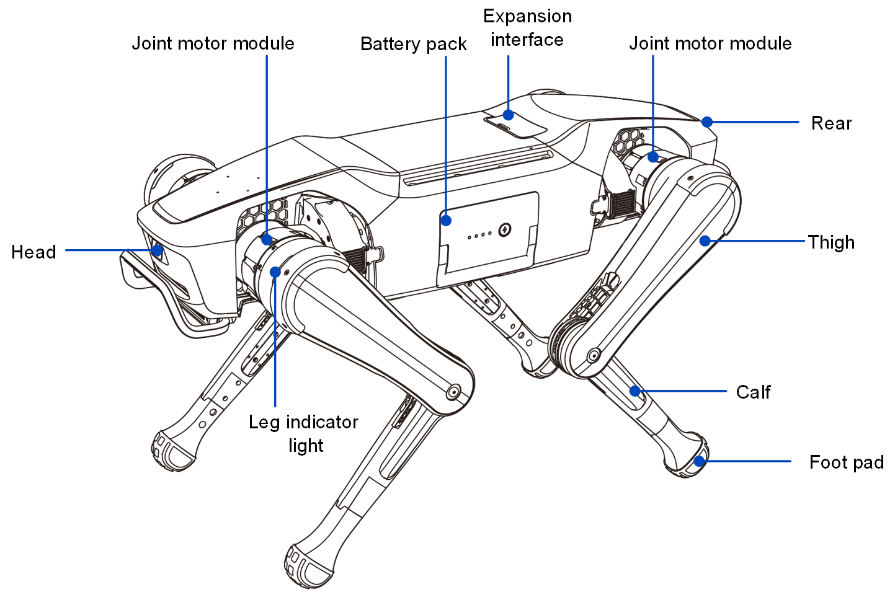

| Feature                               | ROVER X1 Air  | ROVER X1 Standard | ROVER X1 Pro |
| ------------------------------------- | ------------- | ----------------- | ------------ |
| Remote controller                     | Optional      | Standard          | Standard     |
| 4G data module                        | Not supported | Supported         | Supported    |
| Battery capacity                      | 4000 mAh      | 4000 mAh          | 8000 mAh     |
| UWB high-precision positioning module | Not supported | Not supported     | Supported    |

* **ROVER X1 (Wheeled-foot)**

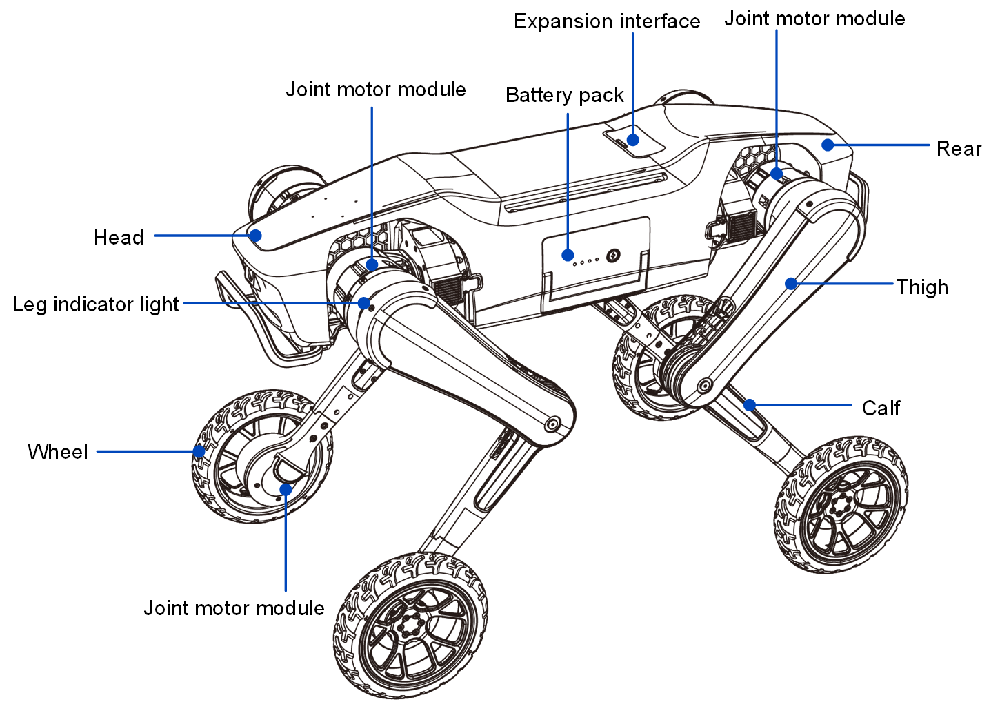

* **Robot Head View**

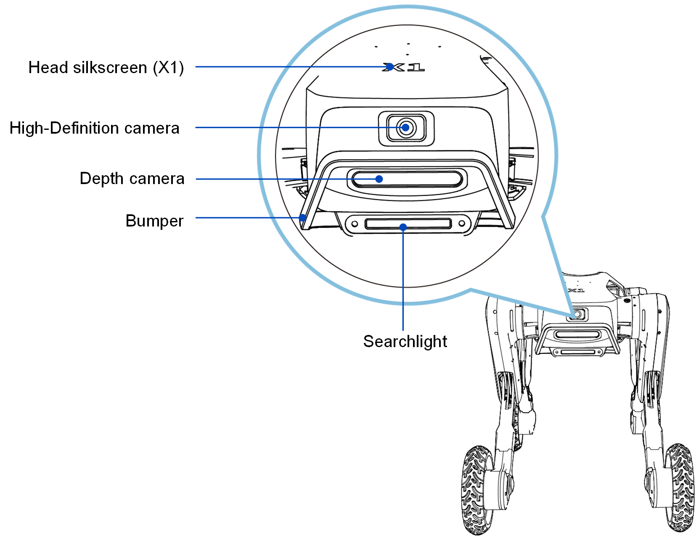

* **Robot Rear View**

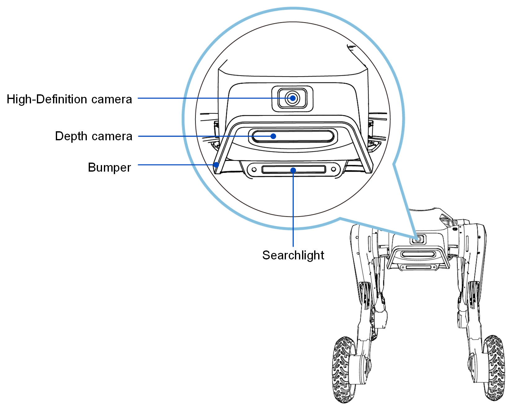

#### 2.5 Leg indicator light status

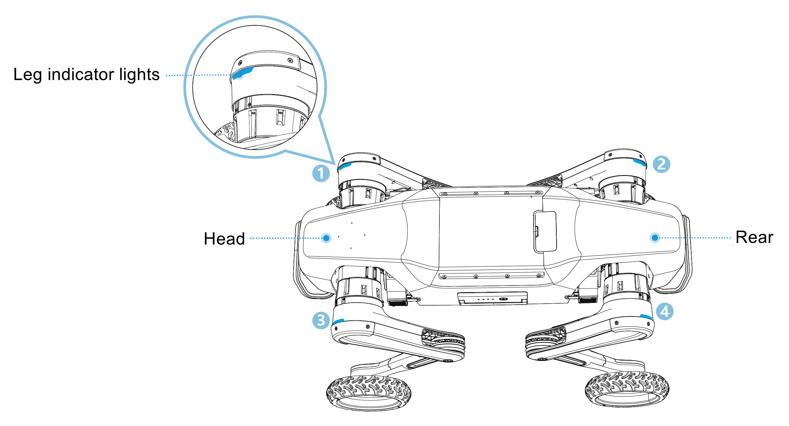

| Status                                     | Duration                                            | Description                                                  |
| ------------------------------------------ | --------------------------------------------------- | ------------------------------------------------------------ |
| Solid White                                | Continues until the robot completes startup         | Powering on                                                  |
| Solid Blue                                 | Continues indefinitely if no operation is performed | After a successful startup, the robot enters the ready state |
| Flashing Green (Front Legs)                | Continues as long as not occupied by other modes    | After successful startup, the robot is in motion             |
| Alternating Flashing Green/Red (Rear Legs) | —                                                   | —                                                            |
| Solid Green                                | Continues as long as not occupied by other modes    | After successful startup, the robot is in a non-motion state |
| Solid Purple                               | Continuous                                          | Robot in following mode                                      |
| Flashing Purple                            | Continuous                                          | Robot detects the OK gesture                                 |
| Flashing Green                             | 2 s                                                 | Robot activated by voice command                             |
| --                                         | --                                                  | Obstacle detected; light signal aborted                      |
| Flashing Red                               | Continuous                                          | Communication failure                                        |
| Solid Yellow                               | Continues until completely powered off              | Powering off                                                 |
| Flashing Yellow                            | Continuous                                          | Low battery                                                  |

#### 2.6 Technical specifications

| Parameter                    | ROVER X1 Air                        | ROVER X1 Standard                     | ROVER X1 Pro                                                         |
| ---------------------------- | ----------------------------------- | ------------------------------------- | -------------------------------------------------------------------- |
| Battery capacity             | 4000 mAh (Standard endurance)       | 4000 mAh (Standard endurance)         | 8000 mAh (Long-endurance model)                                      |
| Battery life                 | 1–3 h                               | 1–3 h                                 | 2–4 h                                                                |
| Maximum speed (Point-foot)   | 1.8 m/s                             | 1.8 m/s                               | 1.8 m/s                                                              |
| Maximum speed (Wheeled-foot) | 3 m/s                               | 3 m/s                                 | 3 m/s                                                                |
| Gradeability                 | 30°–35°                             | 30°–35°                               | 30°–35°                                                              |
| Step climbing height         | 16 cm                               | 16 cm                                 | 16 cm                                                                |
| Payload                      | 3–7 kg                              | 3–7 kg                                | 3–7 kg                                                               |
| Imaging system               | Dual 1080p cameras (front and rear) | Dual 1080p cameras (front and rear)   | Dual 1080p cameras (front and rear)                                  |
| AI voice                     | Supported (WiFi required)           | Supported (WiFi/4G required)          | Supported (WiFi/4G required)                                         |
| Remote control               | App: Wi-Fi control                  | App: Wi-Fi control, 4G remote control | App: Wi-Fi control, 4G remote control, UWB positioning and following |
| Following function           | Visual following                    | Visual following                      | Visual following + UWB positioning following                         |
| Bionic actions               | Handshake, dancing, jumping, bowing | Handshake, dancing, jumping, bowing   | Handshake, dancing, jumping, bowing                                  |
| Obstacle avoidance           | Front and rear obstacle avoidance   | Front and rear obstacle avoidance     | Front and rear obstacle avoidance                                    |
| Size (Point-foot)            | 761 × 372 × 428 mm                  | 761 × 372 × 428 mm                    | 761 × 372 × 428 mm                                                   |
| Size (Wheeled-foot)          | 761 × 440 × 516 mm                  | 761 × 440 × 516 mm                    | 761 × 440 × 516 mm                                                   |
| Weight (Point-foot)          | 15.5 kg                             | 15.5 kg                               | 15.5 kg                                                              |
| Weight (Wheeled-foot)        | 18.5 kg                             | 18.5 kg                               | 18.5 kg                                                              |

### 3. Quick Start

#### 3.1 Unpacking

**NOTE** Subsequent related images will use the ROVER X1 (wheeled-foot) as an example. The ROVER X1 (Point-foot) differs only in product appearance, while the operating procedures remain the same. Please refer to the product you received for accurate appearance details.

1. Upon receiving the robot, please check the outer packaging to ensure it is in good condition. If any damage is found, promptly contact the logistics company and your local supplier.
2. After opening the outer packaging, please verify the items against the unpacking checklist included with the product shipment. If any items are missing, promptly contact after-sales support for a replacement.

#### 3.2 Powering on

1. Gently lift the robot's bumper and remove the battery pack from the packaging box underneath the robot.

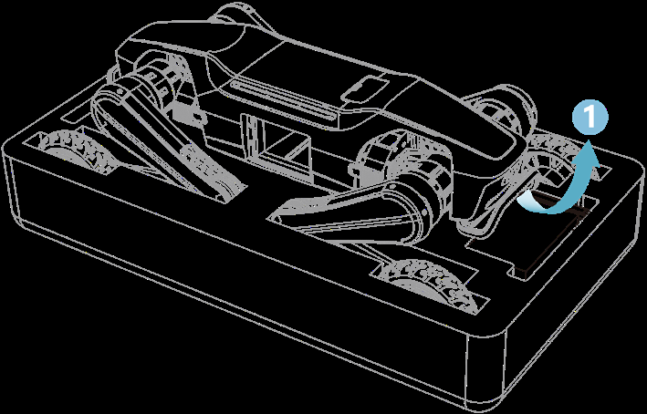

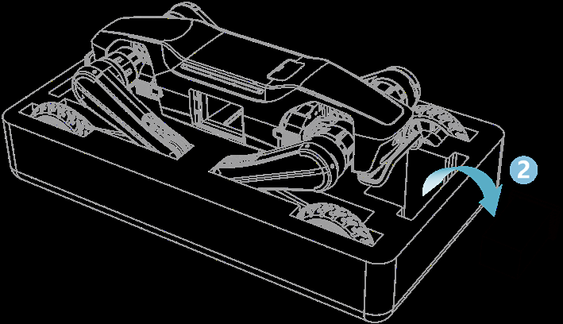

2. Briefly press the power button on the battery pack to check its power level (the number of illuminated indicator bars represents the remaining battery charge). If the battery charge is insufficient, please refer to the instructions in the Battery pack charging section to fully charge the battery pack first.
3. Keep the handle vertical and insert it laterally into the bottom of the battery pack panel until it is flush with the side surface of the robot. Then lower the handle and snap it into the battery panel to complete the installation.

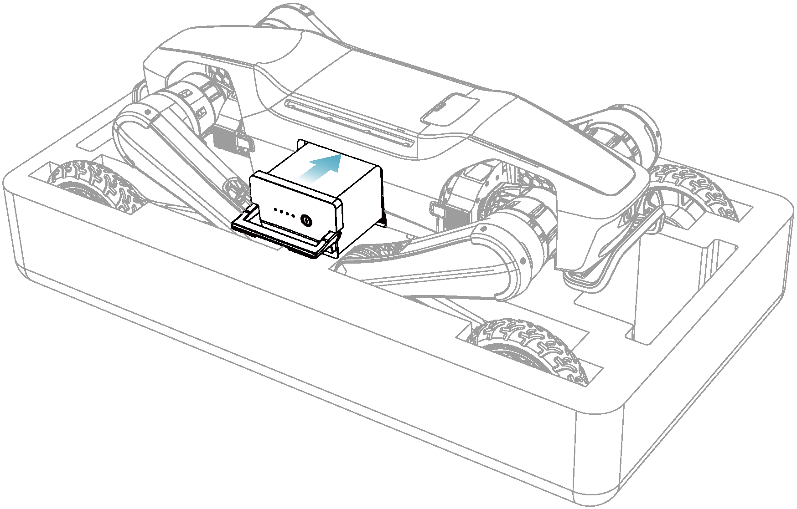

4. To activate the robot, first briefly press the battery pack power button once, then long-press the power button for over 2 seconds.

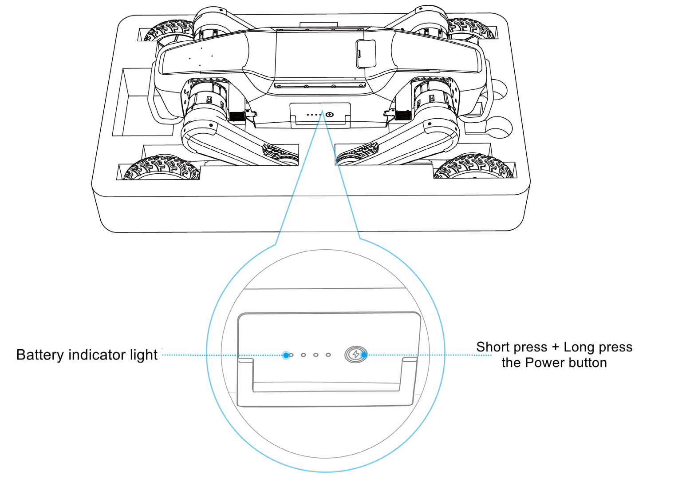

5. A steady blue light on the robot's leg indicates that the robot has successfully powered on, and then the robot's joints will exert force to automatically stand up.

6. Carefully lift the robot out of the packaging box and place it on a hard, flat, and debris-free surface.

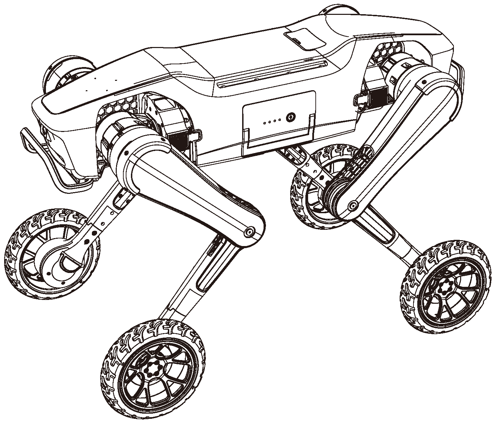

**NOTICE**

* Handle with care to avoid any scratches or damage to the robot's exterior.
* Clear all obstacles around the robot, ensuring it has ample space to move freely. Maintain an area with a diameter of at least two meters centered on the robot, free from obvious obstructions or blockages.

#### 3.3 App binding

**NOTICE**

* First-time use of the robot requires pairing with the App.
* Due to differences between Android devices and iOS devices, if you switch platforms and log in with your account, you need to re-add the robot. **Download App:** Android devices can scan the QR code, while IOS devices can

1.

either scan to download or search “INFFNI ROVER” in the App Store to download the app.

**Register and log in to the App:** You can create a new account using either your 2. mobile number or email address.

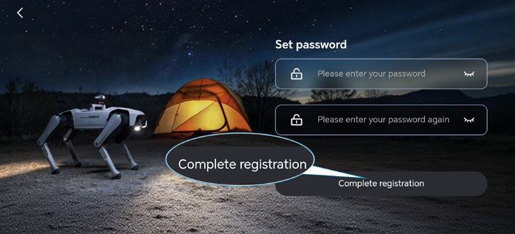

① After opening the App, tap ② Enter your mobile number or **"Register Account"**. email address to receive a verification code, then tap\*\*"Next"\*\*. Set up your account password, **"Complete**then tap **registration"**. **Add robot:** After powering on the robot, first enable Bluetooth on your mobile 3. device to detect nearby robots via Bluetooth.

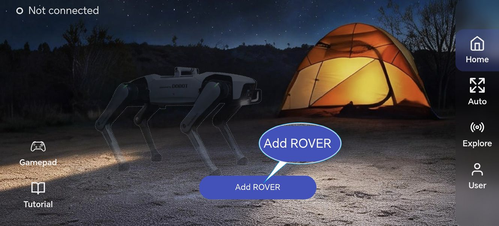

①. Log in to the App and click **"Add ROVER**".

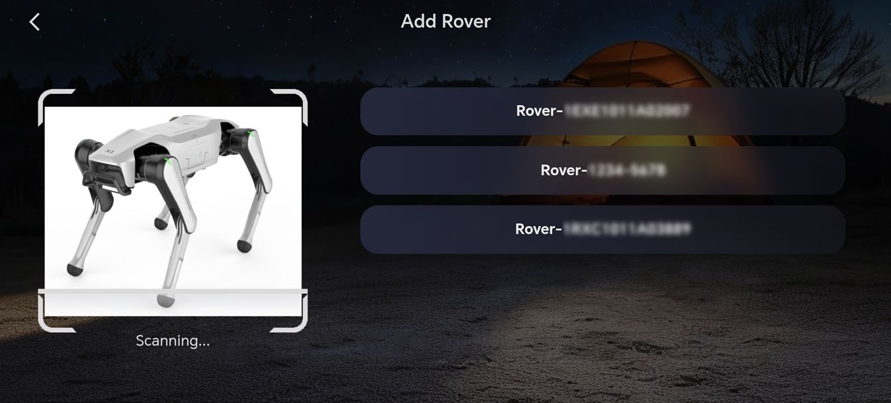

②. The App starts scanning for nearby robots. Once the scan is complete, tap the robot you want to connect to.

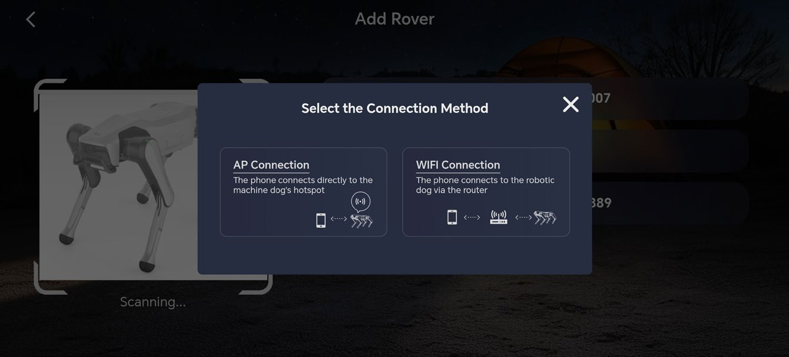

③. Connect to the robot via AP or WiFi. \*\*Binding the robot:\*\*The robot can be bound via either Wi-Fi mode or AP mode. 4.

* \*\*Wi-Fi mode:\*\*Ensure both the mobile device and the robot are connected to\
  the same Wi-Fi network, or connect the mobile device to the robot over the internet if the Wi-Fi supports internet access.

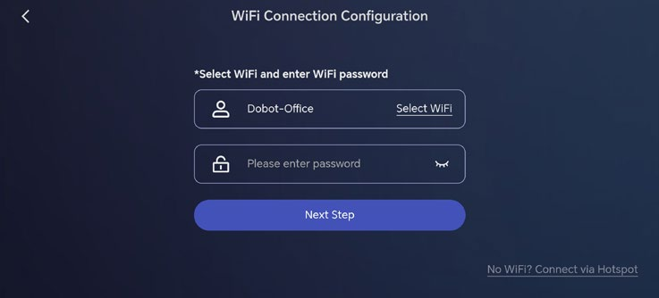

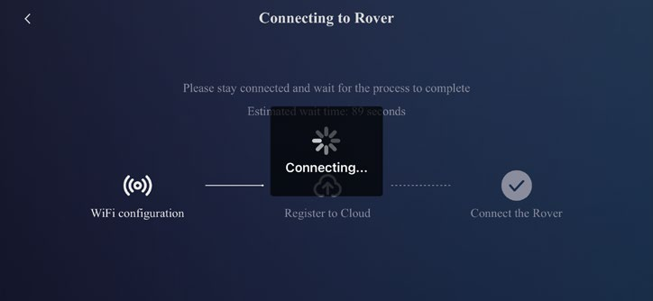

① Tap **"WiFi Connection"**, enter ② Robot is connecting. Please wait the WiFi account and password patiently. that both your phone and the robot are connected to, then tap "Next".

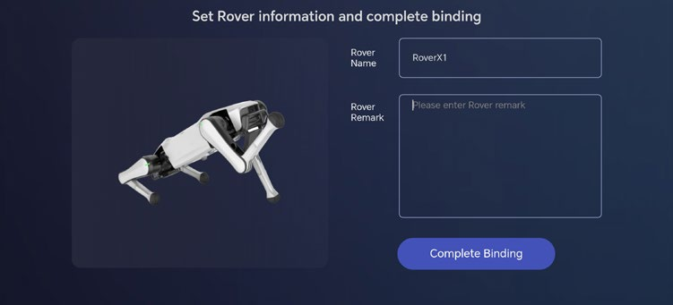

④ Set the robot name and optional ③ Connection successful. **"Complete**notes, then tap **Binding"**.

* \*\*AP mode:\*\*Connect your mobile device to the robot’s hotspot. The hotspot\
  name begins with “Rover-xx (Robot SN)”.

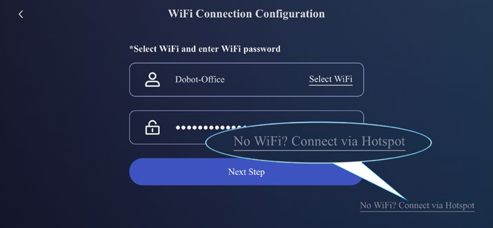

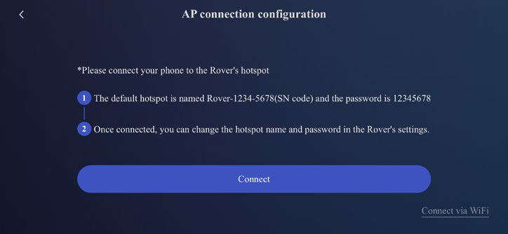

① On ② Then tap **“Connect”to link your the “Wi-Fi Connection Wi-Fi? Connect via hotspot” in Rover-xx, Configuration” page, tap “Nophone to the robot’s hotspot (name: password: 12345678). Return to the App. the lower-right corner. The robot will automatically connect successfully via the AP hotspot. NOTE If the robot has already been successfully bound via Wi-Fi, you can also switch to AP connection through the App by going to"User >** **Rover Settings > Switch Connection"**.

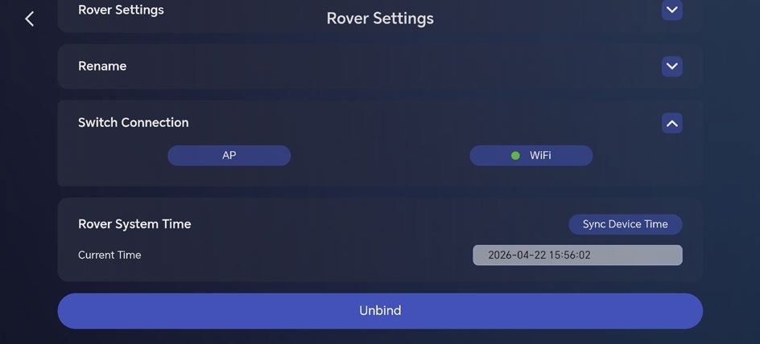

The ROVER X1 Air supports only Wi-Fi and AP connections and does not come with a 4G module. The ROVER X1 Standard and Pro support Wi-Fi, AP, and 4G connections, with Wi-Fi as the preferred option; if the Wi-Fi is unavailable, the robot will automatically switch to 4G connection. **Controlling the robot:** After binding, tap "**Remote**" to operate the robot. 5.

6. Change the bound device:

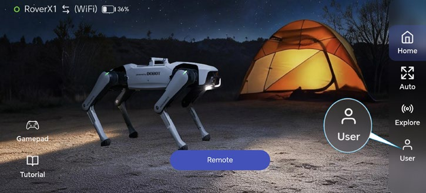

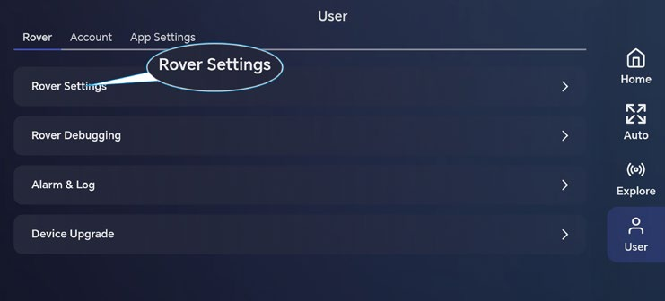

① After the robot is successfully ② Then tap "**Rover Settings**". connected, tap "**User**".

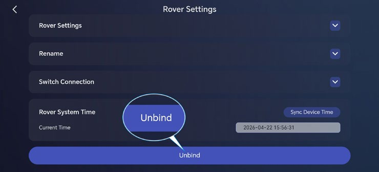

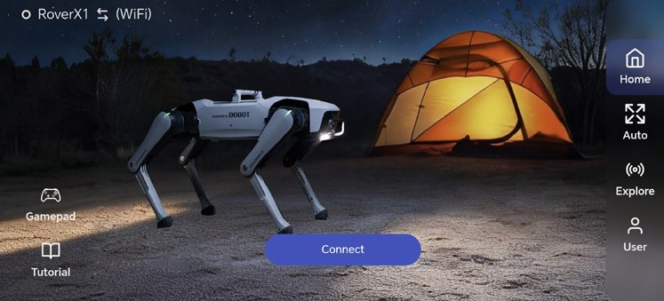

③ Tap "**Unbind**" to disconnect the ④ Tap "**Connect**" to bind a different current robot. robot.

#### 3.4 Upgrade the App and firmware

When a new App version is released, opening the app with an internet connection will show a pop-up notification. You can click to jump to the download page (Android users will be redirected to the web page for installation, while iOS users will be redirected to the App Store page for the App). You can also go to\*\*"User> App Settings > Check for Updates"\*\*in the App to check for new versions.

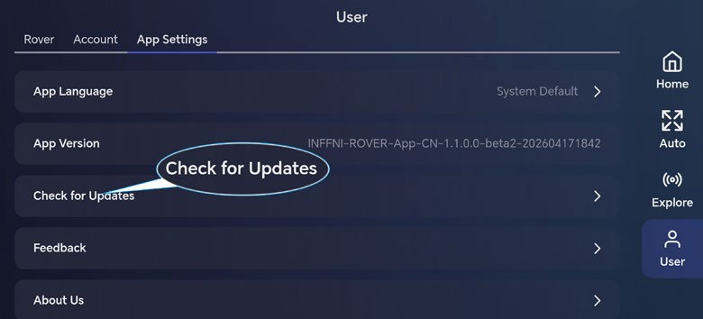

After the App is upgraded, connect to the robot, and it will automatically check whether the firmware version and App version of the current robot match.

* If the first three digits of the App and firmware version match, the software will work normally.
* If the first three digits of the App and firmware version do not match, the software will not function properly. You must upgrade the robot's firmware version.

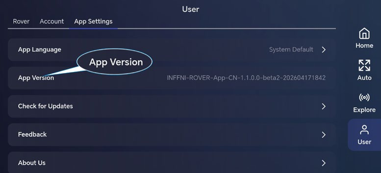

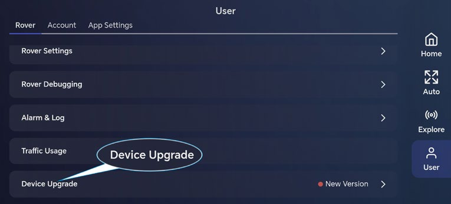

App version information Firmware upgrade access

#### 3.5 Abnormal stop

If an accident occurs while the robot is in use, the user can quickly stop the robot using the following methods. Before operating, please take care to protect the robot to avoid accidental damage. Under normal conditions, press **LT + B** buttons on the remote controller to switch the a) robot to a ready mode, where the robot will slowly lie down in a controlled manner. After the unexpected event is resolved, the robot can be controlled normally.

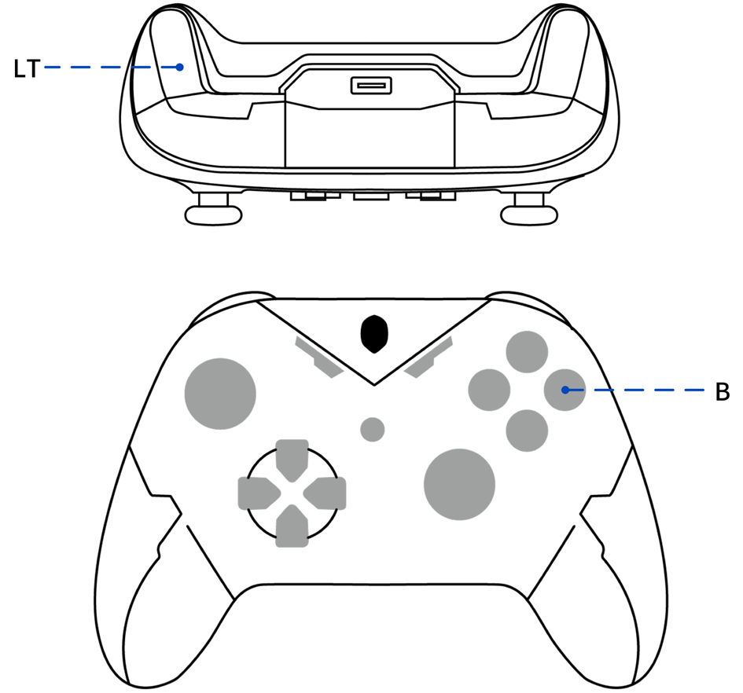

**NOTICE** In an emergency, press **LB + B** buttons to enter emergency stop. The robot's joints will immediately enter a damped state, and the robot will instantly collapse softly to the ground. This operation may damage the robot, so it should only be used in emergencies. Press **LB + B**again to release the emergency stop. On the "**Remote**" page in the App, tap the **"E-Stop"** button on the right side of the b) page to immediately halt the robot. The\*\*\*\*"E-Stop"\*\*\*\*button will then change to "**Restore**".

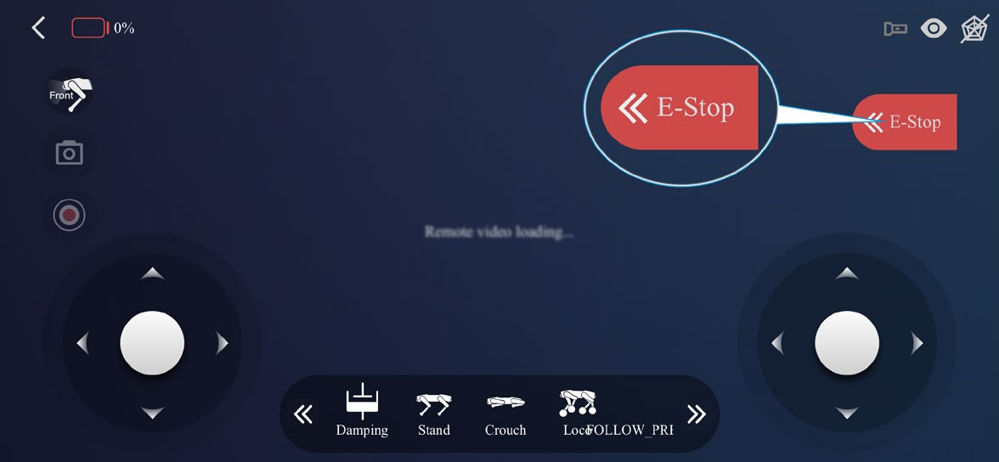

**NOTICE** After the unexpected event is resolved, you must go to the “Remote” page in the App and click the “Restore” button to release the emergency stop status before you can control the robot normally.

#### 3.6 Shutdown

1. Position the robot to stand statically on a flat surface.

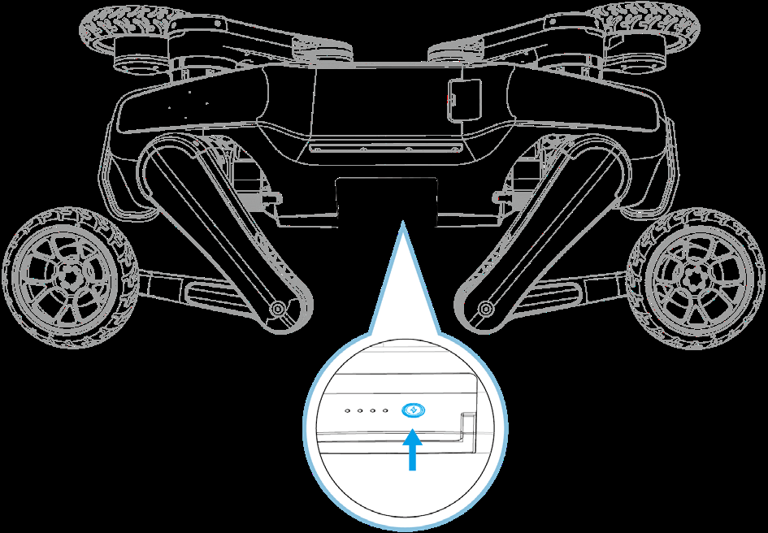

2. First, press the robot’s power button once briefly, then press and hold the power button for 2 seconds to turn it off.

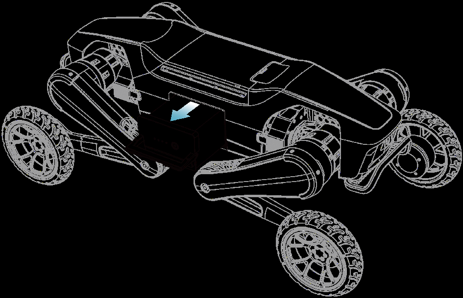

3. After the robot has completely powered off, arrange the positions of its thighs, calves, and hip joints for storage. If the robot will not be used for an extended period, it is recommended to remove the battery pack and store it properly.

#### 3.7 Battery pack charging

When the robot’s leg indicator light flashes yellow quickly, it indicates low battery power (remaining power is only sufficient for about 20 minutes of use). At this time, you can charge the battery pack using the original charger included in the shipping list. Before charging, first ensure the robot is statically standing on a flat surface, then control it to lie down (enter a prone state) via the App, voice, or remote controller. Next, briefly press the battery pack's power button once, then press and hold the power button for 2 seconds to turn off the battery pack.

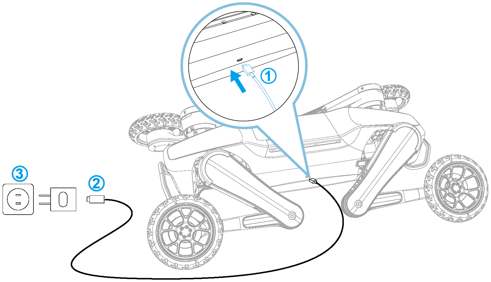

① Connect the Type-C charging port on the side of the robot to the USB charging cable. ② Connect the USB charging cable to the power adapter. ③ Plug the power adapter into an AC outlet and turn on the AC power to begin charging. When all 4 battery indicator lights remain steadily lit, it indicates that the battery is fully charged. Please disconnect the charger in time. **NOTICE**

* Please use the original charger provided by DOBOT. Non-official chargers are strictly prohibited for charging the battery pack.
* Before connecting to an AC power source, ensure that the voltage of the AC supply matches the charger's rated input voltage. Failure to do so may damage the charger.
* When all four battery indicator lights are steadily on, it indicates that the battery pack is fully charged. Please disconnect the battery pack from the charger promptly.
* The battery pack must cool down to room temperature before recharging.
* If smoke, unusual odor, overheating, or deformation occurs during charging, immediately disconnect the charger.
* If battery electrolyte accidentally gets into the eyes, immediately rinse thoroughly with plenty of clean water and seek medical attention without delay.
* The 8000mAh long-endurance battery takes about 4–5 hours to fully charge with the standard charger. When all battery indicator lights are on, the battery is fully charged. Please disconnect the charger promptly after charging is complete.
* Charge the battery promptly when the App triggers a low-battery alert, voice low-power reminder, or only one battery bar remains.
* Avoid stopping use when the battery is completely drained; long-term deep discharge will damage the battery.
* For long-term storage, keep the battery level at around 60% and power off the device.
* Recharge the battery once every 3 months if the device is not in use for a long time.
* Only use the matching original charging adapter and USB cable for charging.
* Insert the charging port gently. Do not apply excessive force, which may cause charging port malfunction.
* Do not step on or damage the battery.

#### 3.8 Point-foot/Wheeled-foot switching

If you have purchased the point-foot + wheeled-foot robot series, the wheels are pre- installed at the factory, and the packaging box includes four point-foot accessories. You can replace the wheeled-foot with point-foot according to the following instructions. **NOTICE** Before replacing the wheeled-foot or point-foot, you must first power off the robot.

1. As shown in the figure below, remove the fixing screws on the thighs and calves of the wheeled-foot, disconnect the wheeled-foot communication cable connector (located near the joint on the thigh), and store the removed wheeled-foot, screws, communication cable, etc., properly in the packaging box.

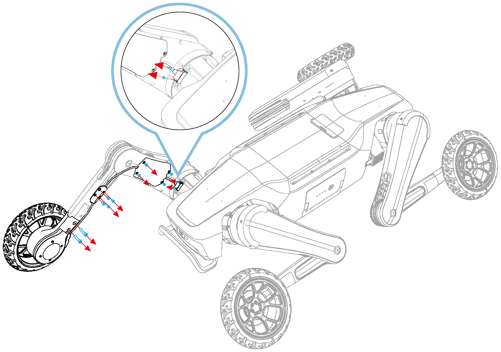

2. Take the point-foot accessory from the packaging box, align and insert the point-foot with the robot’s calf, then secure it with screws.

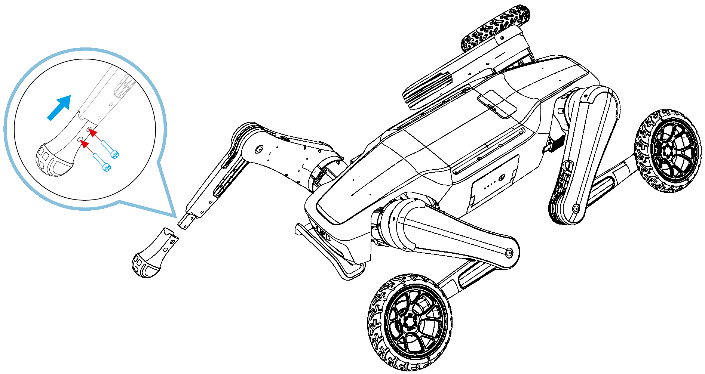

3. Follow the above steps to replace the remaining wheeled-foot units with point-foot units one by one.

#### 3.9 Packing

1. Refer to the instructions for controlling the robot, use the App, voice, or remote controller to control the robot to lie down.

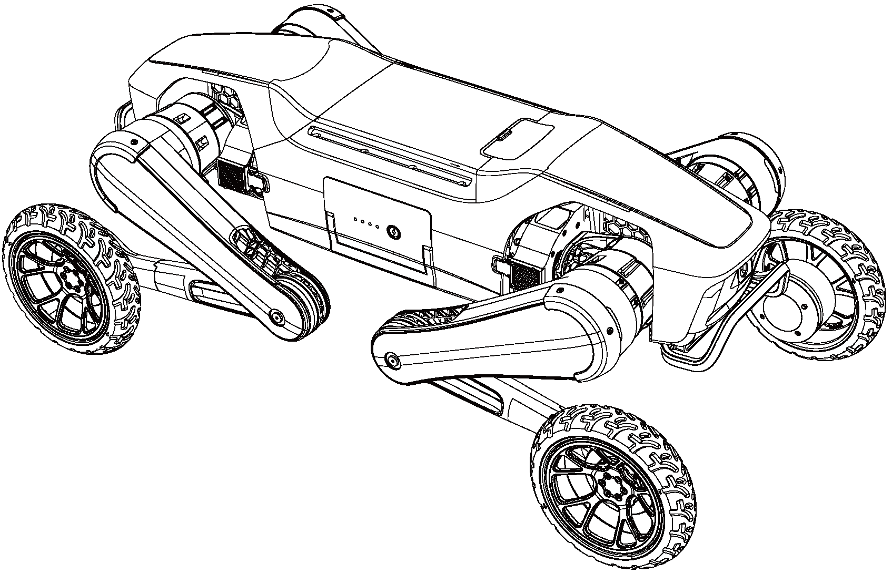

2. Lift the robot and place it into the designated position inside the packaging box.
3. Inside the packaging box, briefly press the robot’s power button once, then press and hold the power button for 2 seconds to turn off the robot.
4. Remove the battery pack, gently lift the robot’s bumper, and place the battery pack beneath the robot.
5. Place other accessories (remote controller, point-foot accessories, etc.) into their designated positions in the packaging box, then close the packaging box.

### 4. Controlling the Robot

#### 4.1 App control

**4.1.1 Access the App control interface** Once the robot is successfully bound to the App, tap "Remote" on the App home page to directly control the ROVER X1 robot.

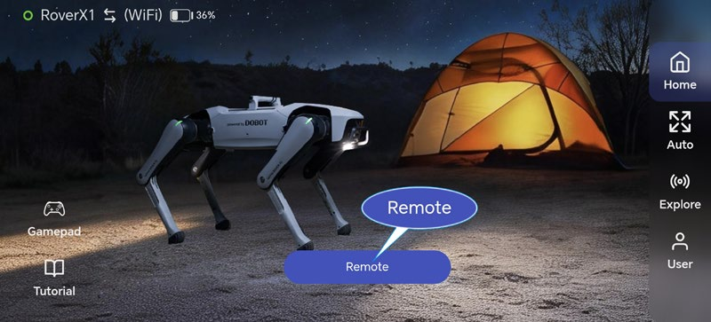

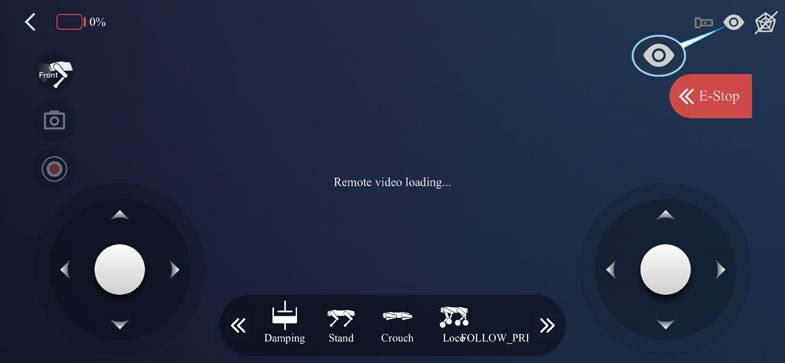

**4.1.2 Control for robot movement and steering** After the robot is bound to the App, on the "Remote" page of the App homepage:

* Tap the Up / Down arrow on the left directional pad to control the robot to move forward/backward.
* Tap the Left / Right arrow on the left directional pad to control the robot to rotate left/right.
* Tap the left / right arrow on the right directional pad to control the robot to strafe left/right.

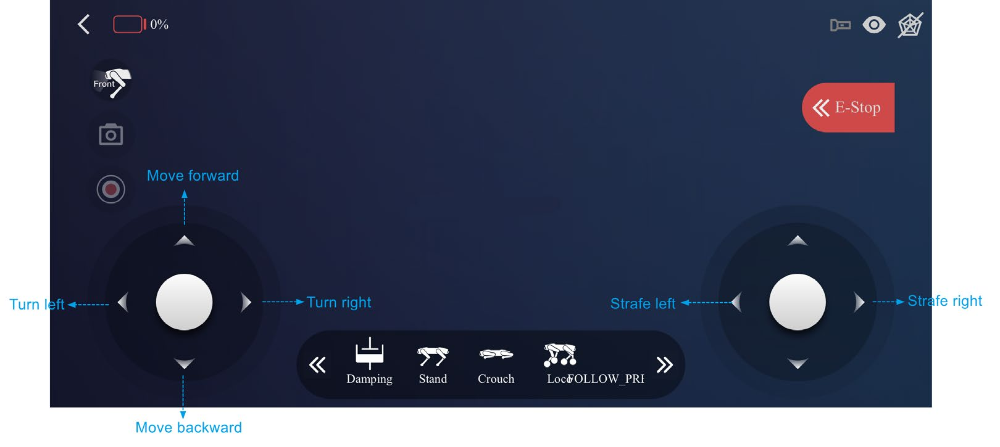

**4.1.3 App-controlled robot skill demonstrations** After the robot is bound to the App, on the "Remote" page of the App homepage: Tap the icons below to switch the robot into different postures or perform skill demonstrations. For details about each icon on the App, please refer to Posture illustrations and descriptions.

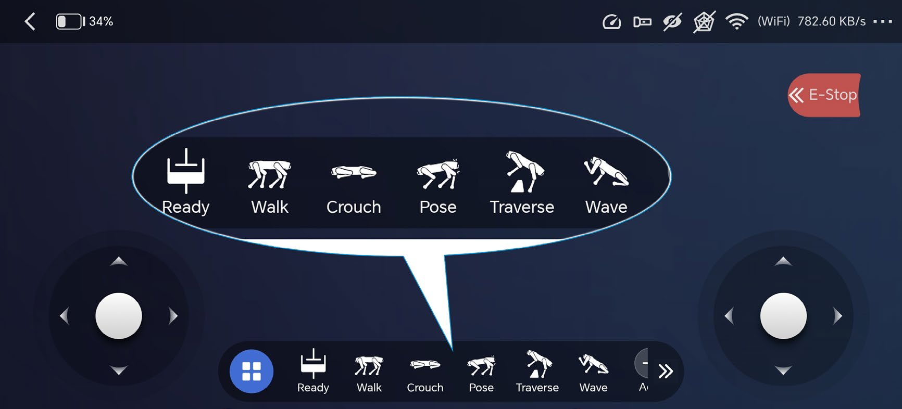

#### 4.2 Voice control and audio playback

**4.2.1 Voice control**

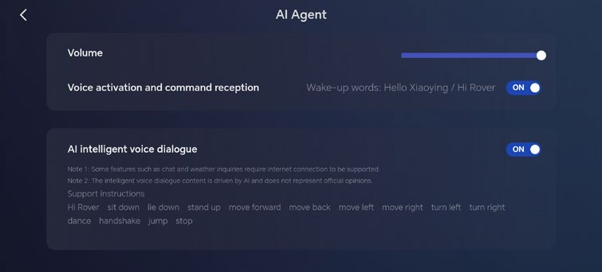

① Log in to the App and navigate to ② Enable voice conversation and **"Explore > Voice assistant"**. voice wake-up features (enabled by default), and adjust the volume.\
After completing the voice settings in the App, speak the wake word “Hi, Rover” clearly to the robot. The robot will respond with phrases such as “I'm here”, “what can I do for you”, “Good to see you”, “Hey, what do you need”, “Alright, I'm up”, “What's the plan”, “I'm ready”, and its leg indicator light will enter a breathing state. At this point, you can issue voice commands. The robot will respond verbally and execute the commands. The robot’s supported voice commands are listed in the table below.

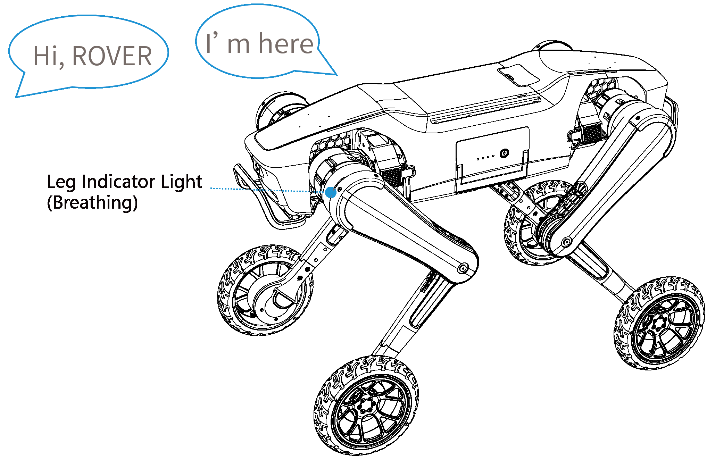

| Voice command | Robot response                                     | Robot action                                                                                                           |
| ------------- | -------------------------------------------------- | ---------------------------------------------------------------------------------------------------------------------- |
| Hi, Rover     | I'm here / What can I do for you / Good to see you | Wake up the robot                                                                                                      |
| Sit down      | I will remain on standby                           | The robot sits down in place                                                                                           |
| Lie down      | I'm here if you need me                            | The robot lies down in place and exits the voice conversation state. Wake the robot again to send more voice commands. |
| Stand up      | Standing by                                        | The robot stands up in place                                                                                           |
| Move forward  | Let's go                                           | The robot moves forward slowly                                                                                         |
| Move back     | I'm moving backward                                | The robot moves backward slowly                                                                                        |
| Move left     | Attention on the left                              | The robot moves to the left                                                                                            |
| Move right    | Be careful                                         | The robot moves to the right                                                                                           |
| Turn left     | Turning left                                       | The robot turns left                                                                                                   |
| Turn right    | Turning right                                      | The robot turns right                                                                                                  |
| Dance         | Watch my show                                      | The robot starts dancing                                                                                               |
| Handshake     | Rover is honored to be at your service             | The robot's front legs perform a waving motion                                                                         |
| Jump          | It's funny                                         | The robot instantly leaps up (all four feet off the ground)                                                            |
| Stop          | Task terminated                                    | Emergency stop                                                                                                         |
| Turn          | OK                                                 | The robot turns in place                                                                                               |

**NOTICE**

* It is recommended to interact with the robot in a quiet environment, as noisy surroundings may interfere with the accuracy of its speech recognition.
* If the robot fails to recognize commands, you can move closer and try again—for example, attempt voice dialogue at distances of 0.5 meters, 1 meter, and 3 meters respectively.
* After the robot is awakened, the voice dialogue remains active for 30 seconds.
* Speak with clear articulation, at a moderate pace, and with a volume above 60 dB.

**4.2.2 Audio playback**

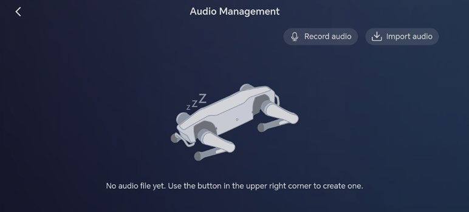

① Log in to the App and navigate to ② You can import audio files saved on **"Explore > Audio"**. your phone into the App or record audio directly within the App, then play it on the robot.

**Import audio**

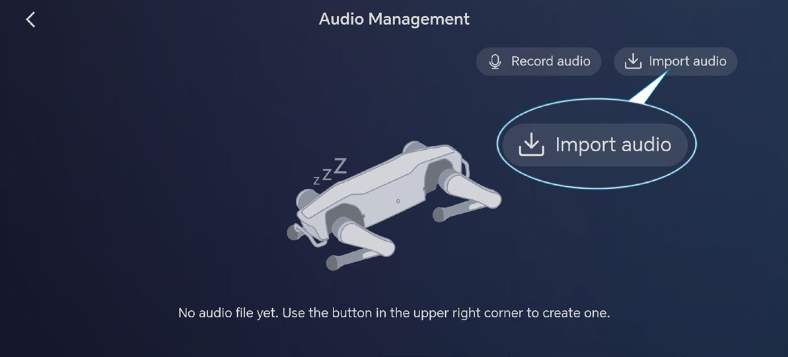

* The audio import option varies depending on the phone model. Please refer to the actual display for details.
* The suffix of the imported audio file must be "mp3, wav, m4a, amr, ogg, acc, flac, wma". Other formats will prompt "Unsupported file format" after being imported into the App.
* The size of the imported audio file cannot exceed 20MB.
* Duplicate audio files cannot be imported repeatedly.

**Record audio**

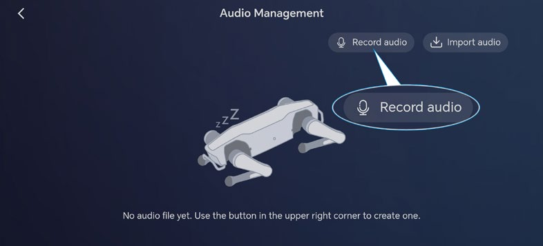

* The name of the recorded audio file cannot exceed 30 characters (special characters are not restricted).
* The file name cannot be empty or duplicate with other files in the list.
* The recording time cannot exceed 60s.

**Manage audio**

button to play the audio, and click the "**...**" after the file In the audio file list, click the name to rename or delete the file.

**Play audio**

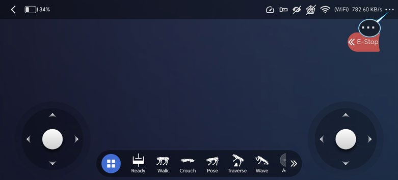

② ① Click the\*\*“...”\*\* button in the upper Enter the App's **“Remote”** page. right corner to enter the audio playback page.

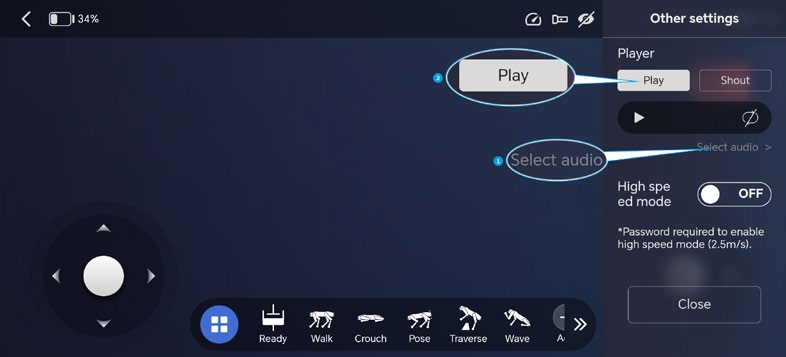

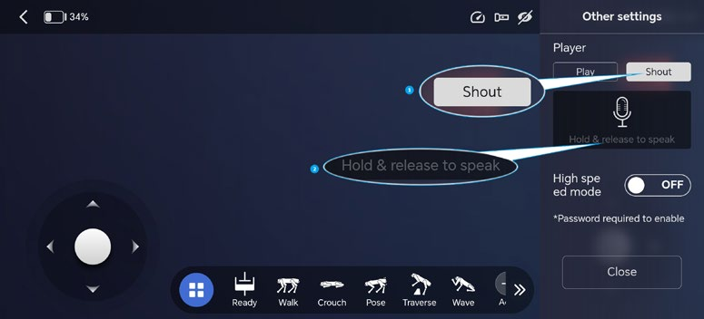

③ ④ Click\*\*"Shout"\*\*, then long-press Select an audio file first, then click \*\*"Play"\*\*to play the selected audio the button to record 1–60 on the robot. seconds of audio. When you release the button, the recorded audio will play on the robot. **NOTE**

* If no audio file is selected, clicking the button will also take you to the audio management list, where you can select the audio to play.
* During audio playback, you can stop it at any time or change the playback mode to either single playback or loop playback.

#### 4.3 Remote controller control

**NOTICE** The effective control range of the remote controller is only 10 meters. Please do not use it in areas with signal interference or beyond 10 meters. This section applies only to the ROVER X1 Standard and Pro. The ROVER X1 Air supports only App and voice control and does not include a remote controller.

**4.3.1 Remote controller button instructions**

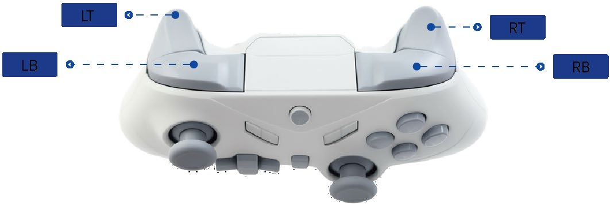

**4.3.2 Connect to remote controller** After taking the remote controller out of the packaging box, press the power button in the middle of the remote controller once. The remote controller will vibrate briefly, indicating that it has successfully connected to the robot.

**4.3.3 Remote controller control for robot movement and steering**

* Push the **left joystick** of the remote controller forward / backward to control the\
  robot to move forward / backward.

* Rotate the**left joystick** of the remote controller left to control the robot to turn\
  left.

Rotate the **left joystick** of the remote controller to the right to control the robot to turn right.

* Rotate the **right joystick**of the remote controller left to control the robot to turn\
  left.

* Rotate the**right joystick** of the remote controller to the right to control the robot\
  to turn right.

**4.3.4 Remote-controlled robot skill demonstrations**

**ROVER X1 (Point-foot)**

**NOTICE**

* After any of the above button commands are triggered, the robot will automatically complete the posture transition. Example: After powering on, the robot is in the ready state. You just need to press**LT + RT (Run)**, and it will automatically complete the transition from\*\*"Stand"\*\* to **"Run"**.
* After executing "Action" commands (such as dancing, jumping, greeting), the robot will automatically return to the "**Walk**" mode.
* Switching configurations: If the triggered action is not supported by the current configuration, the robot will automatically switch to a supported configuration and then execute the action. Example: When the robot is in the **"Folded Configuration"**, pressing LT
* RT (Running) will detect that the folded configuration cannot run, and it will automatically switch to the\*\*"Same-Direction Configuration"\*\*before running.
* Due to the limitations of the underlying algorithm, the robot cannot directly switch configurations from a standing posture. When you input a configuration switching command, you will see the robot first**Lie Down → Stand Up →** **Switch Joint Configuration**. This sequence is normal, not a malfunction. **NOTICE** \*\*Soft E-Stop:\*\*\*\*\*\*Press the LB + B buttons to enter emergency stop, and press the LB + B buttons again to deactivate the emergency stop. Only for emergency use. The robot will gently and smoothly stop all current actions in place.

**ROVER X1 (Wheeled-foot)**

**NOTICE** \*\*Soft E-Stop:\*\*\*\*\*\*Press the LB + B buttons to enter emergency stop, and press the LB

* B buttons again to deactivate the emergency stop. Only for emergency use. The robot will gently and smoothly stop the current action in place.

#### 4.4 Posture illustrations and descriptions

**4.4.1 Point-foot robot**

| Posture name                 | Description                                                                                                                                                                                                                                                                                                                                                     |
| ---------------------------- | --------------------------------------------------------------------------------------------------------------------------------------------------------------------------------------------------------------------------------------------------------------------------------------------------------------------------------------------------------------- |
| Ready                        | After powering on, the robot automatically enters the ready posture. In the ready posture of a point-foot robot, the motors are not completely unpowered. The robot switches to the ready posture when an abnormal situation occurs.                                                                                                                            |
| Crouch                       | A low, safe posture. Used as a ready posture before transport or storage, and for self-checking whether all joints of the robot are functioning properly.                                                                                                                                                                                                       |
| Same-Direction Configuration | Used to self-check whether all joints of the robot are functioning properly. There are two standing postures; the default is the Same-Direction Configuration (both legs in the same direction). Press LT+X to switch to the Folded Configuration (both legs reversed and tucked inward). The robot can be lifted while in either of the two standing postures. |
| Folded Configuration         | When the point-foot robot is in the standing posture, the visual following mode can be activated through gestures. First, make the OK gesture for over 2 seconds, then immediately switch to the following gesture for over 1 second to enter following mode (the two gestures must be performed consecutively). Make the gesture to exit following mode.       |
| Pose                         | The robot's posture and height can be adjusted using the remote controller's joysticks. It is not recommended to lift the robot in this mode (if the robot leaves the ground, leg balance compensation actions may occur).                                                                                                                                      |
| Walk                         | This gait can be used on regular flat ground. Control the robot's movement and turning using the remote controller's joystick or the App's direction keys.                                                                                                                                                                                                      |
| Obstacle Crossing            | This gait can be used on complex terrain to climb over high platforms; control the robot's movement and turning via the remote controller's joystick or the App's directional buttons.                                                                                                                                                                          |
| Run                          | The robot walks at high speed, controlled by the joystick on the remote controller or the directional keys in the App to move and turn.                                                                                                                                                                                                                         |
| Dance                        | Performance actions will not stop automatically. Switching to the "Pose" or "Ready" posture will stop the current action.                                                                                                                                                                                                                                       |
| Jump                         | Instant leap action (all four feet leave the ground). After the leap is completed, it automatically switches to Pose mode.                                                                                                                                                                                                                                      |
| Greet                        | A front leg waving motion that does not stop automatically. Press RT+UP and trigger a greeting action again to stop the current action, or switch to the "Pose" or "Ready" posture.                                                                                                                                                                             |
| Get Up from Fall             | When the robot falls over (e.g., lying on its side or on the ground), press RT+Y to stand up and reset automatically. RT+Y has no effect when the robot is in normal standing state; it only works when the robot detects that it has fallen.                                                                                                                   |

**4.4.2 Wheeled-foot robot**

| Posture name                 | Description                                                                                                                                                                                                                                                                                                                                                                              |
| ---------------------------- | ---------------------------------------------------------------------------------------------------------------------------------------------------------------------------------------------------------------------------------------------------------------------------------------------------------------------------------------------------------------------------------------- |
| Ready                        | After powering on, the robot automatically enters the ready posture. In the ready posture, the motors are not completely unpowered. The robot switches to the ready posture when an abnormal situation occurs.                                                                                                                                                                           |
| Crouch                       | A low, stable posture. Used as a preparatory stance before moving or storing the robot, and to self-check whether all joints are functioning properly.                                                                                                                                                                                                                                   |
| Same-Direction Configuration | Used to self-check whether all joints of the robot are functioning properly. There are two standing postures; the default is the Same-Direction Configuration (both legs in the same direction). Press LT+X to switch to the Folded Configuration.                                                                                                                                       |
| Folded Configuration         | Both legs reversed and tucked inward. The robot can be lifted while in either of the two standing postures. Only when the wheeled-foot robot is in the folded configuration can the joystick on the remote controller or the directional buttons in the App be used to control forward/backward movement and left/right turns.                                                           |
| Wheeled Obstacle Crossing    | Visual following mode: first, make the OK gesture for more than 2 seconds, then immediately switch to the following gesture for more than 1 second to enter following mode (the two gestures must be performed consecutively). Make the gesture to exit following mode. Control the robot's movement and steering through the remote controller's joystick or App's directional buttons. |
| Drift Car                    | Control the robot to move forward, backward, and turn left/right like driving a car using the joystick on the remote controller or the directional buttons in the App.                                                                                                                                                                                                                   |

### 5. Blockly Programming

① Log in to the App and enter the ② Supports creating and running \*\*"Explore > Programming"\*\*page. blockly projects. **NOTE** Currently, only point-foot robots with App version 1.0.0 or above support graphical programming.

#### 5.1 Block description

**5.1.1 Logic block**

**Repeat n times**

**Description:** Nest other blocks inside this block. The nested block commands will be repeated a specified number of times. **Parameter:** The number of times the command is repeated, range \[1, 30].

**Wait**

\*\*Description:\*\*Wait for a specified time before executing the next command. \*\*Parameter:\*\*The delay time for the command to be issued, click to open the horizontal slider and set the wait time, unit: seconds, range \[0, 60], supports decimals; The command will not be executed if the specified value exceeds the maximum limit.

**5.1.2 Motion control block**

**Move n meters in a specified direction**

\*\*Description:\*\*Move the specified distance in the specified direction. **Parameter:**

* Direction: Select "Forward, Backward, Left, Right" from the drop-down list
* Distance: Click to open the horizontal slider to set the moving distance, unit: meters, range \[0, 3].

**Set robot speed**

\*\*Description:\*\*Set the robot's speed. \*\*Parameter:\*\*Speed percentage, range \[0, 100%].

**Rotate n degrees in a specified direction**

**Description:** Rotate the specified angle in the specified direction. **Parameter:**

* Rotation direction: Select "Left" or "Right" from the dropdown menu.
* Rotation angle: Click to open the horizontal slider and set the rotation angle, unit: ° (degrees), range \[0, 360].

**Rotate n circles in a specified direction**

**Description:** Rotate in a specified direction. **Parameter:**

* Rotation direction: Select "Left" or "Right" from the dropdown menu.
* Number of circles: range \[1, 10].

**Rotate and move**

\*\*Description:\*\*The robot rotates to the set angle and then moves forward at that angle. **Parameter:**

* Rotation angle: range \[-180, 180], negative value for left rotation, positive value for right rotation.
* Moving distance: range \[0, 3].

**Enable/Disable obstacle avoidance**

\*\*Description:\*\*Enable or disable the robot's obstacle avoidance function. **Parameter:** Select "ON" or "OFF" from the drop-down box.

**5.1.3 Action execution block**

**Pose and hold dynamically/statically**

\*\*Description:\*\*Set the robot to pose and hold dynamically or statically. **Parameter:**

* Pose dynamically/statically for ... seconds: The time to hold a pose dynamically or statically after it is set. Range \[1, 4].
* Roll: Angle of left/right roll, negative value for left roll. Range: \[-17, 17].
* Pitch: Angle of pitch, negative value for upward. Range \[-11.5, 11.5].
* Yaw: Angle of left/right yaw, negative value for left yaw. Range \[-11.5, 11.5].
* Height: Initial standing height of the robot is 0, negative value for lowering the posture. Range \[-0.08, 0].

**Dance/Jump/Greet** Set the action the robot performs. See Robot posture description for details.

**5.1.4 Mode setting block** Set the robot's current mode. For details on each mode, see Robot mode description.

**5.1.5 Function** A function is a fixed segment of code that allows you to define a group of blocks that perform a specific task. Once defined, you can simply call the function whenever needed, avoiding the need to repeatedly build the same blocks. You need to define the function before calling it.

1. On the left **"Functions"** block box, click to open the "Define function" pop-up window. Enter a function name (e.g., "aa") and click "Confirm". A block will appear on the canvas, and a block will appear in the "Function" block box on the left.

2. Define function: Long-press a block in the block box on the left and drag it into the canvas. Click this block to move it. Drag the blocks that perform a specific function below the block. Then, drag the function to the designated position in the project, and the project can directly call the defined function.

#### 5.2 Project management

1. On the "Programming" page, click \*\*"New"\*\*to enter the project creation page.

2. Long-press a block in the block box on the left and drag it into the canvas, then release it. You can perform the following operations on the blocks in the canvas:

* Long-press any block (except the "Start" block) to copy, paste, add a comment, or delete it.
* Click a block to move it.
* Click a block and drag it into the block box on the left to delete it.

3. After completing the project editing, click **"Save"** to enter the project name and save the project, then return to the project management page.
4. On the Project Management page, projects are automatically sorted by creation time. Click the "..." at the bottom right corner of a project to delete or rename the current project.

**NOTE** A sample program is preloaded in the Project Management page and can be edited or used as a normal project.

### 6. Common Issues and Solutions

**NOTE** If you encounter any other abnormal issues during the use of the robot, please contact technical support promptly.

| Issue                                                                                  | Solution                                                                                                                       |
| -------------------------------------------------------------------------------------- | ------------------------------------------------------------------------------------------------------------------------------ |
| Power-on failure (red light slowly flashing)                                           | Check the robot's placement and restart, or contact technical support.                                                         |
| App connection failure                                                                 | Check the network (AP hotspot, connection status corresponding to Wi-Fi mode).                                                 |
| Abnormal standing posture                                                              | Contact technical support (do not calibrate the robot yourself).                                                               |
| The remaining battery shown on the App does not match the robot's actual battery level | Fully charge the robot to 100%, then use it until the battery drops to 10%. Fully charge it again to complete the calibration. |

### 7. Maintenance

Maintenance and repairing must be performed in compliance with all safety instructions in this document. The purpose of maintenance and repairing is to ensure that the system is kept operational, or to return the system to an operational state in the event of a fault. Repairing includes troubleshooting in addition to the actual repair itself. Repairing must be performed by an authorized system integrator or DOBOT staff. Robots or parts returned to DOBOT should follow the instructions below:

* Remove all parts that do not belong to DOBOT.
* Before returning to DOBOT, please make a backup copy of the files. DOBOT will not be responsible for the loss of programs, data or files stored in robot.
* The robot should be restored to its unpacked posture before returning to DOBOT.

#### 7.1 Safety instructions

The following safety procedures and warnings must be observed when operating the robot: **NOTICE**

* Replace faulty components with new components of the same model or equivalent components approved by DOBOT.
* Reactivate all deactivated safety measures immediately after completing maintenance work.
* Record all repairs and save them in the technical document associated with the robot system.
* Take necessary precautions to prevent others from re-powering on the robot during maintenance.
* Prevent water or dust from entering the interior of the robot.

#### 7.2 Robot maintenance

To ensure the robot maintains high performance over the long term, regular maintenance checks must be conducted. The personnel in charge of the maintenance must develop a maintenance plan and carry out the necessary tasks. The inspection items are listed in the table below.\*\*\*\*

| Inspection item   | Inspection details                                                                                                                                                                                                                                                                                                     |
| ----------------- | ---------------------------------------------------------------------------------------------------------------------------------------------------------------------------------------------------------------------------------------------------------------------------------------------------------------------- |
| Robot storage     | Store in a dry and cool indoor area, avoiding exposure to sunlight and rain. For long-term storage, remove the battery pack.                                                                                                                                                                                           |
| Robot appearance  | Check if the body is clean, undamaged, or deformed. Focus on checking whether the camera and radar are dirty or obstructed.                                                                                                                                                                                            |
| Robot cleaning    | Wipe the robot with a dry and clean soft cloth. Focus on checking whether the camera and radar are wiped clean.                                                                                                                                                                                                        |
| Joint             | Check that there is no abnormal noise or vibration from the joints when the robot is running. After running, touch the joint housing to check for excessive heat.                                                                                                                                                      |
| Foot end parts    | Check for obvious wear on the foot pads. If damage is found, replace them promptly.                                                                                                                                                                                                                                    |
| Battery pack      | Check if the battery pack is securely installed without looseness; check for visible damage or swelling on the battery pack casing; check if the power indicator light displays normally; check if the battery is sufficiently charged (for long-term storage, maintain a 50% charge and recharge every three months). |
| Remote controller | Check if the buttons and joystick of the remote controller are functioning properly.                                                                                                                                                                                                                                   |
