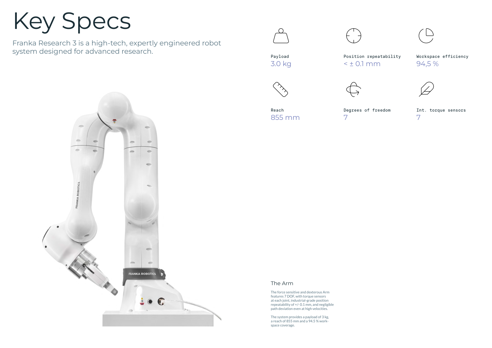

# Franka Research 3: Arm v2.1 hardware and first connection


[**View Franka Research 3 on OpenELAB**](https://openelab.io/products/franka-research-fr3-force-sensitive-robotic-arm)

**Model:** Franka Research 3 · **SKU:** `Franka-FR3`

**Scope:** Supplied Arm v2.1 hardware manual; verify actual Arm, Control and System Image labels.


## Product overview

Franka Research 3 (FR3) is a seven-axis force-sensitive research robot consisting of an **Arm and a separate Control**. The supplied October 2025 brochure explains the research platform; the supplied R02210/1.2/EN hardware manual specifically applies to Arm v2.1. Match the actual Arm and Control labels before using installation, mounting or software instructions. Franka Hand, cameras, compute accessories and development features depend on the order.

_Source: supplied FR3 brochure, October 2025; illustrative configuration, not a bill of materials._

## Applications

Robot-control research, manipulation, hand-guided teaching, teleoperation and learning experiments. The workcell must account for tool/workpiece geometry, payload and stopping envelope. Torque sensing and collision information are not an independent guarantee of safe contact with people.

## Specifications

| Parameter                      | Value and scope                                                                                                       |
| ------------------------------ | --------------------------------------------------------------------------------------------------------------------- |
| Axes / internal torque sensors | 7 / 7                                                                                                                 |
| Rated payload / maximum reach  | 3 kg / 855 mm                                                                                                         |
| Position repeatability         | Brochure: <±0.1 mm; keep test conditions and revision with the manufacturer datasheet                                 |
| FCI arm control/state exchange | 1 kHz; requires compatible host/software and wired FCI network                                                        |
| Arm protection / installation  | IP20; indoor fixed upright installation in the supplied standalone-arm manual                                         |
| Temperature                    | Normal +15 to +25 °C; extended +5 to +45 °C with possible performance derating                                        |
| Typical electrical consumption | 140–350 W average, temporarily up to 600 W in supplied hardware manual; use the approved Control and its mains rating |

Sources: [FR3 brochure, October 2025, PDF pp. 4–6](source-library/); [FR3 Arm v2.1 hardware manual R02210/1.2/EN, PDF pp. 53–56, 73](source-library/). The arm load assessment must include the end effector and workpiece. Use the full load/center-of-mass and inertia configuration rather than treating 3 kg as a limit independent of geometry.

## Hardware and connections

Standalone mounting requires a stable, level, non-vibrating base. The supplied manual specifies a maximum 0.1° tilt and a mounting table for the actual substrate: M8 fastener length/thread engagement differs for aluminum, steel and ITEM profiles; the stated fastening torque is 30 N·m. Two people are required for mounting. Use the exact drilling template, reaction-load requirements and fastener table in hardware PDF pp. 56–60; do not use a photo as a mounting drawing. Duo assemblies have separate approved mounting/orientation instructions.

| Connector           | Role                                                                         |
| ------------------- | ---------------------------------------------------------------------------- |
| Arm X1 / Control C1 | Supplied Arm–Control cable; never swap or unplug a live arm                  |
| Arm X3              | Dual-channel safety inputs, including emergency stop X3.1                    |
| Arm X4              | External enabling device; distinct from the emergency stop                   |
| Arm X5              | Browser/UI robot network with DHCP server                                    |
| Arm X6              | Franka-specific end-effector connection; not a generic accessory port        |
| Control C2          | Shop-floor Ethernet and FCI workstation network                              |
| Control C3          | Mains input through the supplied country-specific cable and approved Control |

Source: [FR3 Arm v2.1 hardware manual R02210/1.2/EN, PDF pp. 40–43, 62–70](source-library/). Qualified personnel must verify grounding, wiring, the stop chain and the installed safety configuration. Do not bridge X3 inputs or alter Watchman rules to bypass a blocked movement.

## Software and development resources

The hardware manual states Arm v2.1 supports System Image 5.8 onward and notes full functionality without degradation from 5.9.1. The [current compatibility matrix](https://franka.de/fr3-compatibility-matrix) governs the exact Arm/Control/System Image/libfranka/ROS combination. The hardware manual is separate from the **System Image-specific operating manual**; the current [document portal](https://franka.de/documents) lists 5.8, 5.9 and 5.10 editions. An upgrade is not required merely to read this wiki.

Use [FCI and ROS 2 version selection](development/fci-ros2.md) for SDK compatibility and a state-reading example. Franka's public SDKs are not interchangeable with Agile Robots Diana 7 software or an older Panda controller.

## Complete source coverage and engineering details

The supplied material is now readable inside the wiki. The complete readers retain every original page, drawing, table, example and notice; the guidance below explains how to use them for this model or workflow.

| Complete in-wiki source                                                          | Coverage      |
| -------------------------------------------------------------------------------- | ------------- |
| [FR3 Arm v2.1 hardware manual R02210/1.2](source-library/complete-fr3-hardware/) | 118 PDF pages |
| [Franka Research 3 brochure](source-library/complete-fr3-brochure.md)            | 13 PDF pages  |

### Complete installation and safety scope

The full hardware manual includes the declaration of incorporation, equipment labels, intended use/misuse, fail-safe locking, manual arm movement, safety functions and the installation-planning requirements. The declaration for a robot component does not validate the completed research cell, attached equipment or a mobile base. Use the applicable operating manual in addition to this hardware manual.

The supplied R02210/1.2 text states that Arm v2.1 was released with System Image 5.8 and describes full functionality from 5.9.1 onward. Treat that as the supplied revision's statement, then check the actual Arm/Control pairing and System Image in the [manufacturer compatibility matrix](https://franka.de/fr3-compatibility-matrix). A newer SDK or a newer hardware PDF does not by itself update a delivered robot's compatibility.

### Mechanical, electrical and workspace planning

The equipment, delivery and mounting chapters retain the full component drawings, installation-site requirements, Arm and Control ambient conditions, base preparation, mounting procedure, Control placement, wiring sequence and end-effector installation. Keep the maximum space and safeguarded space distinct. Allow for the arm, tool, workpiece, cables, peripherals and all permitted orientations when planning clearance.

The Arm X5 browser connection and the Control-side FCI connection serve different purposes. Record which physical port and network are being tested. Keep external enabling/emergency-stop devices and the end-effector supply in the wiring plan; ordinary network connectivity is not a safety-circuit check. Use source drawings for connector orientation, cable routing and mounting dimensions.

### Stopping, indicators and service

The appendix retains the complete stopping-time/distance tables and curves with their joint, extension, velocity, load and stop-category context. Do not replace that data with one universal clearance value. The supplied contents page labels section 14.2 as Category 1, while the actual page 98 heading and table identify Category 0; the original statements are retained and the body heading governs that navigation note.

The usage chapters cover startup, the robot self-test, scheduled safety-function checks, emergency-stop testing and shutdown/restart. The complete LED chapter distinguishes activation, flashing patterns, priority and color meanings. An illuminated status ring or a passed communication check does not complete those tests. Maintenance, cleaning, Control exchange, troubleshooting, handling and repacking are also retained. The supplied repacking pages contain preliminary illustration notes; no replacement drawing has been invented.

For a lab acceptance record, retain hardware labels, the selected manual/System Image, mounting and tool configuration, the installed safety peripherals, the applicable stop-data conditions, configuration backup and actual acceptance results. Source review in this wiki is separate from an executed safety or hardware test.

### Source chapter map

| Source section                                | Full detail                                                               |
| --------------------------------------------- | ------------------------------------------------------------------------- |
| ABOUT HARDWARE MANUAL                         | [PDF 6](source-library/complete-fr3-hardware/pages-001-072.md#pdf-page-6) |
| Software and hardware version                 | [PDF 6](source-library/complete-fr3-hardware/pages-001-072.md#pdf-page-6) |
| 1.2 Applicable document                       | [PDF 6](source-library/complete-fr3-hardware/pages-001-072.md#pdf-page-6) |
| 1.3 Before you begin                          | [PDF 6](source-library/complete-fr3-hardware/pages-001-072.md#pdf-page-6) |
| RIGHTS OF USE AND PROPERTY RIGHTS             | [PDF 7](source-library/complete-fr3-hardware/pages-001-072.md#pdf-page-7) |
| General                                       | [PDF 7](source-library/complete-fr3-hardware/pages-001-072.md#pdf-page-7) |
| Identification                                | [PDF 7](source-library/complete-fr3-hardware/pages-001-072.md#pdf-page-7) |
| DECLARATION OF INCORPORATION AND CERTIFICATES | [PDF 8](source-library/complete-fr3-hardware/pages-001-072.md#pdf-page-8) |

## Getting started

1. Have the responsible integrator finish and document mounting, approved wiring, stop verification and tool configuration before power-on. Keep the arm workspace clear and the emergency stop accessible. Leave motion, brake-opening and task controls inactive.
2. Record the Arm and Control serial/hardware versions. Connect a browser computer to **X5 on the arm base** and enable DHCP on that computer's wired interface.
3. Follow the delivered startup procedure and open `https://robot.franka.de`. The factory robot-network address is `192.168.0.1`; DHCP clients normally receive `192.168.0.100–150`. Changed delivery settings take precedence.
4. On a commissioned system, sign in with the assigned local account and open **Settings → Dashboard**. Record the System Image, identity and reported status. On a new system, complete the [first-start checklist](development/system-startup.md) using its matching operating manual before treating it as commissioned.
5. Confirm the installed end effector matches Settings. Do not start a task, jog, unlock brakes, home the gripper or activate FCI as the initial UI connectivity test.

**Expected result:** the correct robot's UI and version/status information are visible without commanded arm movement. Tool homing may occur when its power is restored, so keep the gripper travel clear even during startup. Sources: [System Startup training, 21 October 2025, slides 3–8](source-library/), [FR3 Arm v2.1 hardware manual R02210/1.2/EN, PDF p. 64](source-library/), [Operating Manual 5.10](https://franka.de/hubfs/Operating%20Manual%20Franka%20Research%203_5.10_R02216_1.3_EN.pdf), §§3 and 6.

## Troubleshooting and FAQs

**The browser cannot reach the robot:** check X5, DHCP/address, link state and local VPN/proxy/DNS interference, then the delivered network configuration. Do not assign the robot's own address to the computer.

**The UI works but FCI does not:** X5 UI access is a different path from **C2** FCI access. Check the installed feature/license, mode, compatible library/server version, wired routing and exclusive control source. See the FCI guide; a successful ping is insufficient evidence of a real-time link.

**The robot drifts during guiding:** stop the activity and check the exact end-effector mass, center of mass, inertia, attached load and calibration procedure. Do not compensate by changing safety limits.

## Downloads and technical documents

| Resource                                                                                                                                      | Purpose                                           |
| --------------------------------------------------------------------------------------------------------------------------------------------- | ------------------------------------------------- |
| [Supplied brochure and Arm v2.1 hardware manual](source-library/)                                                                             | Original supplied revision and PDF page citations |
| [Current hardware manuals/datasheets](https://franka.de/documents)                                                                            | Match Arm version, not just product name          |
| [Current Arm v2.1 hardware manual R02210/1.3](https://franka.de/hubfs/Hardware%20Manual%20Franka%20Research%203_Arm%20v2.1_R02210_1.3_EN.pdf) | Later edition, separate from supplied 1.2         |
| [Operating Manual 5.10, R02216/1.3](https://franka.de/hubfs/Operating%20Manual%20Franka%20Research%203_5.10_R02216_1.3_EN.pdf)                | Use only for that installed System Image          |
| [Models, CAD and simulation](https://franka.de/models-and-simulation)                                                                         | Select exact arm and end-effector revision        |

## References and validation

Supplied sources and official resources above. Reviewed 22 November 2026. Documentation and source checks only. Software installation, compilation, live robot communication, calibration and physical tests: **not run**. Physical installation and safety acceptance remain the integrator's responsibility.
