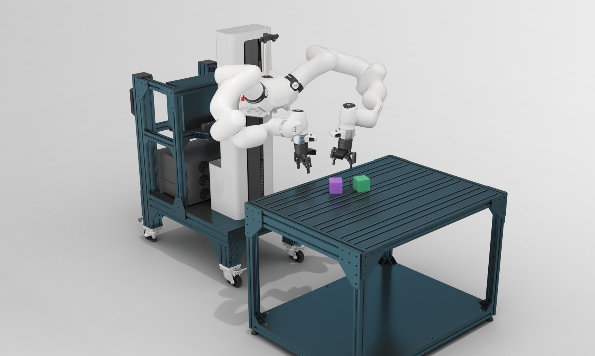

# FR3 Duo: bimanual research configuration


**Model:** FR3 Duo · **Scope:** Supplied prototype brochure and version-specific manufacturer resources

This manufacturer-source reference has no verified separate current OpenELAB product/SKU match. Confirm the delivered configuration before ordering accessories or applying setup instructions; no substitute store listing is asserted.


## Product overview

FR3 Duo integrates two FR3 arms on a common mount for bimanual work. It is the stationary dual-arm embodiment; Mobile FR3 Duo adds a mobile platform and optionally a lifting mechanism. The two arms remain distinct physical/controller identities in software.

_Source: supplied FR3 Duo brochure; illustrative configuration, not a bill of materials._


**Prototype scope:** the supplied brochure and manufacturer installation guide describe research hardware. Use the delivered revision in a controlled laboratory with trained personnel, verified stop functions and an application-specific risk assessment. A certified component does not certify the integrated prototype.


## Applications

Supervised teleoperation, manipulation and embodied-AI research within the delivered platform's operating envelope. A demonstration configuration is not a production workcell or a certified mobile safety application.

## Specifications

| Parameter                       | Value and scope                                                                                    |
| ------------------------------- | -------------------------------------------------------------------------------------------------- |
| Arms                            | Two FR3 arms; 7 axes and 7 torque sensors **per arm**                                              |
| Payload / reach                 | 3 kg / 855 mm **per arm**; not one 6 kg free-space handling guarantee                              |
| Control frequency               | Arm FCI interface 1 kHz                                                                            |
| Perception in supplied brochure | Head, torso and two wrist views; actual camera BOM is configuration-specific                       |
| Degree-of-freedom wording       | Brochure: 17 total; two arm chains alone have 14. Do not infer extra axes from the brochure count. |

Source: [FR3 Duo brochure, PDF pp. 1–2](source-library/). Ratings are reference values for the supplied brochure's scope, not first-run motion settings.

The later [prototype manual R04245](https://franka.de/hubfs/Prototype%20Manual%20and%20Datasheets%20_Mobile%20FR3%20Duo_R04245_EN.pdf), §6, lists 14 arm DOF. Preserve the distinction between two seven-axis arm chains and any additional configured mechanisms; use the delivered URDF/joint list for algorithms.

## Hardware and connections

The [FR3 Duo installation guide R04240/1.3](https://franka.de/hubfs/Quick%20Installation%20Guide%20FR3%20Duo_R04240_1.3_EN-1.pdf) applies to prototype hardware and states compatibility with FR3 Arm v2.0 and later. Select the exact pedestal or Franka Spine assembly chapter. Mounting orientation and gravity configuration for the integrated Duo are **not** established by the standalone upright-arm instructions. Chapter 9 covers mounting orientation for regular arms. A qualified integrator must apply the exact delivered procedure and verify both arm frames before enabling motion.

The current reference setup listed on the [manufacturer model page](https://franka.de/models-and-simulation) uses Robotiq 2F-85 grippers, D405 wrist cameras and a ZED Mini head camera. That is a named reference setup, not a promise that every FR3 Duo includes Franka Hand or identical camera hardware.

## Software and development resources

Use the official `franka_description` **fr3\_duo** model and the matching ROS 2 branch, FCI feature and System Image. Verify both controller identities, left/right mapping, tool models and base-to-arm transforms. See [FCI/ROS compatibility](development/fci-ros2.md) and [the explicit Duo simulation path](development/simulation-data.md). [Installation guide](https://franka.de/hubfs/Quick%20Installation%20Guide%20FR3%20Duo_R04240_1.3_EN-1.pdf), §§8–9, provides the reference geometry context.

## Complete source coverage and engineering details

The supplied material is now readable inside the wiki. The complete readers retain every original page, drawing, table, example and notice; the guidance below explains how to use them for this model or workflow.

| Complete in-wiki source                            | Coverage    |
| -------------------------------------------------- | ----------- |
| [FR3 Duo brochure](source-library/complete-duo.md) | 2 PDF pages |

### Two-arm system integration

Keep each arm's seven-axis model, Control, serial, network endpoint, payload and tool transform separate. A brochure's total degree-of-freedom figure is not a command-vector definition. A bimanual application additionally needs a calibrated transform between the two arm bases and a common representation of the shared work area.

Plan the combined swept volume, arm-to-arm and tool/workpiece clearances, routed cables and operator access. Include the dual-arm mounting structure, attached tooling, compute and optional accessories in the delivered configuration record. Do not infer synchronized stopping or one common safety circuit merely because the arms share a frame.

Accept each arm's identity/status path before a coordinated application. Record clock/time synchronization, left/right joint names, coordinate frames, software versions and control ownership. A working two-camera or two-robot visualization does not establish coordinated motion or a validated combined stop behavior. The complete supplied brochure is retained alongside the applicable single-arm and Hand hardware references.

## Getting started

1. Keep arm motion disabled. Record the complete mount/pedestal/Spine revision, both Arm/Control labels and the actual gripper/camera BOM.
2. Compare the assembly with the exact R04240 chapter; have the integrator verify mounting, orientation/gravity settings and both stop paths before powering or unlocking.
3. On an already commissioned setup, access each controller's Desk using the delivered network map. Identify left and right by physical label, not a guessed `.11/.12` convention.
4. Record both System Images and tool profiles, then load the matching **offline** Duo model and compare joint names, fixed transforms and end effectors before any synchronized command.

**Expected result:** a two-controller identity/configuration record and a model that matches the delivered assembly, without commanded arm motion.

## Troubleshooting and FAQs

**Only one arm appears:** check the separate controller/network identities and ROS prefixes. Do not launch two connections against the same controller address.

**The model has 14 joints but the brochure says 17 DOF:** report the arm-chain count separately from end-effectors, mobile/base or lift mechanisms. The later prototype manual states 14 for the Duo arms; do not invent a universal 17-joint control vector.

**Arms can reach the same point:** reach overlap does not establish collision-free coordination. Validate inter-arm, tool, cable and workcell collisions plus stop behavior.

## Downloads and technical documents

| Resource                                                                | Purpose                                                            |
| ----------------------------------------------------------------------- | ------------------------------------------------------------------ |
| [Supplied source documents](source-library/)                            | Brochure identity, page citations and revision notes               |
| [Manufacturer documentation portal](https://franka.de/documents)        | Exact prototype installation guide and current operating documents |
| [Official model/CAD resources](https://franka.de/models-and-simulation) | Match robot, mount, end effectors, sensors and revision            |
| [Simulation and data acceptance](development/simulation-data.md)        | Keep offline model validation separate from physical commissioning |

## References and validation

Supplied brochure and official resources linked in this guide. Reviewed 22 November 2026. Documentation and source checks only. Software installation, compilation, live robot communication, calibration and physical tests: **not run**. Unresolved delivery-specific limits, mount/stop configuration or software compatibility block the corresponding powered/motion procedure.
