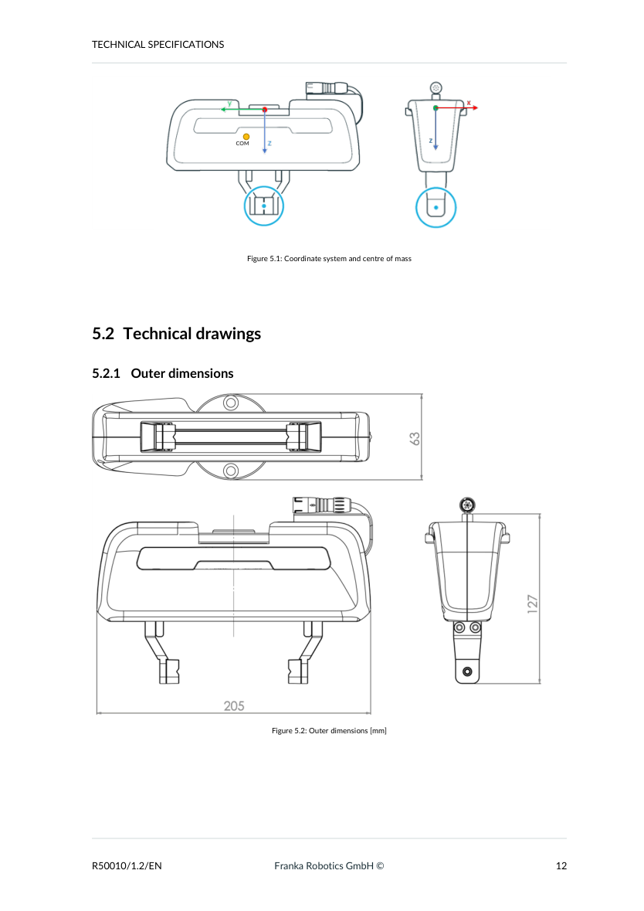

# Franka Hand: installation, configuration and control


**Model:** Franka Hand · **Scope:** R50010/1.2/EN electrical parallel gripper; distinct from the newly announced Franka Gripper

This manufacturer-source reference has no verified separate current OpenELAB product/SKU match. Confirm the delivered configuration before ordering accessories or applying setup instructions; no substitute store listing is asserted.


## Product overview

Franka Hand is the electrical two-finger parallel gripper in the supplied 36-page manual. Its approved power and communications connection is the arm's **X6** flange interface. Do not transfer this guide to Robotiq 2F-85, to a custom CAN device, or to another similarly named gripper.

_Source: supplied Franka Hand R50010/1.2/EN; illustrative configuration, not a bill of materials._

## Applications

Manipulation, pick-and-place research and Franka task integration after validating object retention, finger geometry and the complete arm payload. Gripping force does not by itself establish a safe handled mass or safe human interaction.

## Specifications

| Parameter                            | Value and scope                                                                                           |
| ------------------------------------ | --------------------------------------------------------------------------------------------------------- |
| Outer size, width × length × height  | 63 × 205 × 127 mm                                                                                         |
| Weight                               | 730 g, before application-specific finger/load changes                                                    |
| Adjustable continuous grasping force | 30–70 N                                                                                                   |
| Travel range                         | 80 mm                                                                                                     |
| Travel speed                         | 50 mm/s **per finger**, not a stated full-gripper closing time                                            |
| Mechanical flange                    | DIN ISO 9409-1-A50                                                                                        |
| Connection                           | Arm X6 power and communications; no independent external cable installation in the standard configuration |

Source: [Franka Hand R50010/1.2/EN, PDF pp. 6, 11–15](source-library/). Include the gripper mass, custom fingertips and workpiece in the robot load/inertia assessment. Use the source's coordinate system for center-of-mass/inertia data.

## Hardware and connections

Disconnect the robot safely from the mains before mounting or unplugging Hand. The manual specifies two **DIN 7984 M6×12 class 8.8 screws**, a **Ø6 h8×10 alignment pin**, a maximum **8 mm screw-in depth**, and **5 N·m tightening torque**. Use the orientation/connector illustrations in PDF pp. 18–20. Longer screws or higher torque can damage the Hand.

The arm's X6 is a Franka-specific connection. The supplied arm manual specifies 48±3 V DC and 0.5 A nominal hold current at 25 °C, but this does not authorize attaching an arbitrary accessory or external supply. X6 carries no safety-rated data and has no earthing connection. Source: [FR3 Arm v2.1 hardware manual R02210/1.2/EN, PDF pp. 64–65](source-library/).


**Loss of gripping power can release the object.** Account for normal shutdown, faults, emergency stop and SEEPO (Safe End Effector Power Off) behavior. Keep the jaw travel clear during power restoration because homing may occur automatically. Do not use a loaded grasp as the first test.


## Software and development resources

Select the correct Hand profile in **Settings → End Effector**. For custom fingers or changed mechanics, use measured manufacturer-consistent mass/inertia and geometry; a copied task's configuration may no longer be valid. Safety-operator review of the end-effector geometry and SEEPO behavior is separate from local administrator settings.

`libfranka` provides a gripper interface, but the Hand manual explicitly says the Hand **does not accept real-time commands** in the arm's FCI torque-control sense. The arm's 1 kHz interface is not a 1 kHz finger-force-control guarantee. See the [official gripper package](https://frankarobotics.github.io/docs/doc/franka_ros2_jazzy/franka_gripper/doc/index.html) for the selected ROS branch and [SDK compatibility](development/fci-ros2.md).

## Complete source coverage and engineering details

The supplied material is now readable inside the wiki. The complete readers retain every original page, drawing, table, example and notice; the guidance below explains how to use them for this model or workflow.

| Complete in-wiki source                                          | Coverage     |
| ---------------------------------------------------------------- | ------------ |
| [Franka Hand manual R50010/1.2](source-library/complete-hand.md) | 36 PDF pages |

### Mechanical parameters and configuration retained in full

The manual includes outer and flange dimensions, travel range, finger-adaptation/fingertip interfaces, mass, center of gravity, the flange-to-Hand transformation and open/closed inertia tensors. Its base Hand mass is 730 g; continuous adjustable grasping force is 30–70 N, travel range 80 mm and travel speed 50 mm/s **per finger**. These values do not automatically describe a modified finger, adapter or grasped workpiece.

| Parameter                                      | Source-specific detail                                                                         |
| ---------------------------------------------- | ---------------------------------------------------------------------------------------------- |
| Outer dimensions                               | 63 mm width × 205 mm length × 127 mm height                                                    |
| Center of mass relative to end-effector flange | X = 0 mm; Y = 9.3 mm; Z = 30.2 mm                                                              |
| Closed Hand inertia diagonal                   | 0.0027 / 0.0011 / 0.0018 kg·m², source flange frame                                            |
| Open Hand inertia diagonal                     | 0.0030 / 0.0011 / 0.0021 kg·m², source flange frame                                            |
| Mounting in this revision                      | Two DIN 7984 M6×12 screws, 5 N·m; source says 8 mm screw-in depth must not be exceeded         |
| Extension connector                            | Binder 8-pin male/female, Snap-in IP67 Series 620, as specified in the cable-extension chapter |

The original tensor matrices, transform and drawings remain in the reader; preserve axes and units when entering them. Check the model after adding fingers, adapters, cables or a payload. Unexpected drift during guiding, changed collision sensitivity or tracking problems can result from incorrect end-effector mass/inertia data.

### Power, Watchman and object retention

Mount and connect only with the robot safely disconnected from mains as specified. The manual describes X6 power/communication and prohibits live connection/disconnection. A mechanical DIN ISO 9409 flange match does not establish an arbitrary tool's electrical compatibility.

Watchman end-effector configuration includes SEEPO shutdown behavior, power-on behavior and a sphere model for the tool and grasped object. The source describes up to five spheres; their outer surfaces and centers serve different monitoring purposes. A long workpiece needs its actual contour and extremity speeds considered. Selecting a default Hand entry does not cover every custom tool or gripping situation.

The Hand can release a load after malfunction, a power loss or a safety-related end-effector shutdown. Plan retention and exclusion zones accordingly. Homing, grasping, release and Pilot arrow controls move fingers; they are not read-only diagnostics. The manual also requires removing the end effector before moving the arm into its transport pose.

### Fault isolation

For a disconnected Hand, review the selected end-effector configuration, then follow the manual's shutdown and connector/cable inspection sequence if needed. For non-moving fingers, check SEEPO power status and the command/app configuration before assuming a mechanical fault. A correctly operating arm FCI loop does not provide real-time Hand finger commands; the manual explicitly distinguishes this interface. Preserve the actual fault and configuration evidence before a reset.

### Source chapter map

| Source section                                         | Full detail                                         |
| ------------------------------------------------------ | --------------------------------------------------- |
| ABOUT FRANKA ROBOTICS                                  | [PDF 5](source-library/complete-hand.md#pdf-page-5) |
| Enabling industrial automation                         | [PDF 5](source-library/complete-hand.md#pdf-page-5) |
| Introducing Franka World – a digital robotics platform | [PDF 5](source-library/complete-hand.md#pdf-page-5) |
| ABOUT FRANKA HAND                                      | [PDF 6](source-library/complete-hand.md#pdf-page-6) |
| RIGHTS OF USE AND PROPERTY RIGHTS                      | [PDF 7](source-library/complete-hand.md#pdf-page-7) |
| General                                                | [PDF 7](source-library/complete-hand.md#pdf-page-7) |
| Identification                                         | [PDF 7](source-library/complete-hand.md#pdf-page-7) |
| SAFETY                                                 | [PDF 8](source-library/complete-hand.md#pdf-page-8) |

## Getting started

1. With power isolated and no held workpiece, inspect the connector, fingers and approved mounting hardware. Mount to the correct flange using the source drawing and torque specification.
2. Have the responsible integrator verify mechanical retention and record Hand/custom-finger mass, center of mass, inertia and the application-specific stop/power behavior.
3. Follow the robot's approved startup procedure with the entire jaw travel clear. In **Settings → End Effector**, confirm/select **Franka Hand**; verify the selected profile is appropriate for the actual fingers.
4. Inspect the displayed Hand connection/power status and reconcile it with the configured SEEPO state. Do not open brakes, trigger homing or issue a grasp solely to establish that the profile exists.
5. Before a later supervised unloaded opening/closing check, confirm the documented SEEPO power-on state and pinch envelope. Keep hands out of the travel range and record the installed software version.

**Expected result:** the installed Hand and end-effector profile are correctly identified and its power/connection state is understood. A Hand whose power is intentionally gated off need not appear active. Source: [Franka Hand R50010/1.2/EN, PDF pp. 18–24, 30–32](source-library/).

## Troubleshooting and FAQs

**Desk shows disconnected:** first distinguish a deliberate power-off/SEEPO state from a fault. Check the selected profile. If the source recovery procedure requires connector inspection, shut down and disconnect mains before touching X6 or the Arm–Control cable. Do not repeatedly toggle power to force a connection.

**Fingers do not move:** verify the power state, expected control source and command parameters; inspect for damage only with power safely isolated. Do not change safety behavior merely to obtain movement.

**Can the arm enter transport pose with Hand attached?** The supplied Hand manual instructs removing the end effector before the arm's transport pose to avoid damage. Support the device and follow the exact demounting procedure.

## Downloads and technical documents

| Resource                                                                                                 | Use                                                                        |
| -------------------------------------------------------------------------------------------------------- | -------------------------------------------------------------------------- |
| [Supplied Hand manual, 36 pages](source-library/)                                                        | Mounting, mechanical data, configuration and troubleshooting               |
| [Official R50010/1.2/EN PDF](https://franka.de/hubfs/Product%20Manual%20Franka%20Hand_R50010_1.2_EN.pdf) | Same document number/revision as the supplied file                         |
| [Manufacturer CAD/downloads](https://franka.de/models-and-simulation)                                    | Select the Hand **for FR3**; a different host version is listed separately |
| [Desk/Watchman training guide](development/franka-desk.md)                                               | UI roles, end-effector and safety configuration boundaries                 |

## References and validation

[Franka Hand R50010/1.2/EN, PDF pp. 6–24, 30–32](source-library/) and the arm X6 source above. Reviewed 22 November 2026. Documentation and source checks only. Software installation, compilation, live robot communication, calibration and physical tests: **not run**. No gripping or power-loss retention test has been performed.
