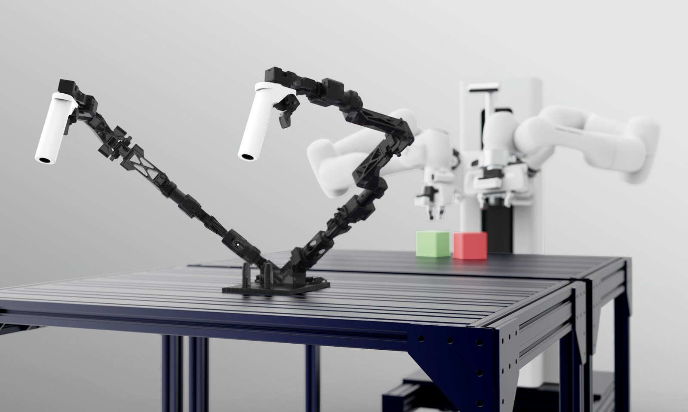

# Franka GELLO Duo: teleoperation hardware and setup


**Model:** Franka GELLO Duo · **Scope:** Supplied prototype brochure and version-specific manufacturer resources

This manufacturer-source reference has no verified separate current OpenELAB product/SKU match. Confirm the delivered configuration before ordering accessories or applying setup instructions; no substitute store listing is asserted.


## Product overview

Franka GELLO Duo is a scaled leader mechanism for bimanual teleoperation and demonstration collection. The supplied one-page brochure identifies the research use case. The current manufacturer guide and linked ROS 2 source provide the concrete hardware/configuration path; generic GELLO or single-arm defaults do not establish a Duo configuration.



_Source: supplied Franka GELLO Duo brochure; illustrative configuration, not a bill of materials._


**Prototype scope:** the supplied brochure and manufacturer installation guide describe research hardware. Use the delivered revision in a controlled laboratory with trained personnel, verified stop functions and an application-specific risk assessment. A certified component does not certify the integrated prototype.


## Applications

Supervised teleoperation, manipulation and embodied-AI research within the delivered platform's operating envelope. A demonstration configuration is not a production workcell or a certified mobile safety application.

## Specifications

| Parameter                  | Value and scope                                                                              |
| -------------------------- | -------------------------------------------------------------------------------------------- |
| Role                       | Two-arm leader/teleoperation device for FR3 Duo, not two additional payload-rated robot arms |
| Integration                | Franka-contributed ROS 2 implementation in the original GELLO repository                     |
| Supported gripper examples | Franka Hand and Robotiq paths have different configuration/client nodes                      |
| Current installation guide | GELLO Duo v0.5, R62040/1.2, 14 April 2026                                                    |
| Guide article number       | Duo 313686, revision 00-05; verify the actual delivered label                                |

Source: [Franka GELLO Duo brochure, PDF p. 1](source-library/). Ratings are reference values for the supplied brochure's scope, not first-run motion settings.

Official resource chain: [Franka GELLO page](https://franka.de/gello) → [R62040 installation guide](https://franka.de/hubfs/Quick%20Guide%20for%20Installation%20Franka%20GELLO%20DUO_0.5_R62040_1.2_EN.pdf) → [ROS 2 software](https://github.com/wuphilipp/gello_software/tree/main/ros2) and [mechanical files](https://github.com/wuphilipp/gello_mechanical/tree/main/franka_fr3). The prototype designation and exact open-source license must be checked for each repository component; a statement that files are open source does not replace their license terms.

## Hardware and connections

[R62040/1.2](https://franka.de/hubfs/Quick%20Guide%20for%20Installation%20Franka%20GELLO%20DUO_0.5_R62040_1.2_EN.pdf), pp. 6–11, lists two GELLO arms, a Duo table base, two OpenRB-150 controllers and two USB cables. The assembly uses three M4×12 screws per arm and four C2×8 screws per controller; follow the guide images for controller orientation and resting pose. The controller USB-C ports face outward. Keep the robot control process disconnected during initial leader identification.

The reviewed ROS 2 README warns that OpenRB-150 motor torque must not be enabled without its specified external 5 V supply and VIN(DXL) jumper configuration. A serial connection alone is not proof of a safe powered leader configuration.

## Software and development resources

The manufacturer links **wuphilipp/gello\_software/ros2** and **gello\_mechanical/franka\_fr3**; these are Franka-contributed resources hosted in the original author’s repositories. The reviewed software commit is `1b3fec5af2c0f6ea23efde888615da5871e6b6bb`. It targets ROS 2 Humble and recommends opening the **ros2 subfolder** in the VS Code devcontainer. Check the container’s pinned libfranka/ROS versions against the actual System Images. Per-device `com_port`, left/right mapping, joint signs, assembly offsets and gripper range must match the hardware.

## Complete source coverage and engineering details

The supplied material is now readable inside the wiki. The complete readers retain every original page, drawing, table, example and notice; the guidance below explains how to use them for this model or workflow.

| Complete in-wiki source                                       | Coverage    |
| ------------------------------------------------------------- | ----------- |
| [Franka GELLO Duo brochure](source-library/complete-gello.md) | 1 PDF pages |

### Leader/follower mapping and startup

The complete brochure retains the mechanical, sensing/control, teleoperation and research-use claims for GELLO Duo. Distinguish the two leader chains, their motors/encoders and computer connection from the two follower arms and their Controls. Do not use one overall DOF figure as a substitute for the exact per-side joint order and calibration.

Before an attended teleoperation test, reconcile handedness, joint signs, offsets, limits, base/tool frames, gripper mapping, update rate and stale-data behavior with the delivered implementation. Starting a leader publisher can configure motor torque; starting a follower process can synchronize immediately. Those launches are not passive connection checks.

Keep control enable, physical emergency stops, loss-of-command behavior and a deliberate restart sequence explicit. A recovered connection must not replay an old follower target. Preserve the exact repository/commit and compatible follower firmware from the linked development guide; a generic GELLO or ROS package name does not establish this Duo's hardware map.

## Getting started

1. Assemble and inspect the leader hardware with the robot control chain inactive. Use R62040's resting pose and identify which OpenRB-150 belongs to each side.
2. On the supported host, inspect connected serial identities:


```bash
ls /dev/serial/by-id
```


3. Record each stable device ID and update the corresponding `com_port` entries in `ros2/src/franka_gello_state_publisher/config/franka_gello_duo.yaml`. Do not copy another unit's serial identifier or a single-arm YAML.
4. Review `dynamixel_torque_enable`, current limit, damping and power/jumper requirements before starting even the leader publisher. The publisher can configure motor behavior, so it is not universally a passive read-only command.
5. Verify the delivered setup and joint/side mapping before proceeding to any leader-to-follower synchronization. The README's robot-controller launch can immediately synchronize the robot to the leader pose; it is intentionally excluded from this initial check.

**Expected result:** two identified serial devices and an audited Duo configuration, with no follower robot motion and no unintended leader motor torque. Source: R62040 pp. 8–11 and the linked ROS 2 README.

## Troubleshooting and FAQs

**The robot jumps when a controller starts:** the follower launch can synchronize directly to leader position. Stop the activity, inspect the prepared poses, calibration and mapping, and repeat supervised commissioning; do not retry a live synchronization blindly.

**Gripper control fails:** select the Franka Hand or Robotiq-specific client/configuration for the actual device. A gripper message for one model is not interchangeable with the other.

**A port name changes:** match stable `/dev/serial/by-id` entries to physical controllers. Verify permissions and cable connection before changing calibration.

## Downloads and technical documents

| Resource                                                                | Purpose                                                            |
| ----------------------------------------------------------------------- | ------------------------------------------------------------------ |
| [Supplied source documents](source-library/)                            | Brochure identity, page citations and revision notes               |
| [Manufacturer documentation portal](https://franka.de/documents)        | Exact prototype installation guide and current operating documents |
| [Official model/CAD resources](https://franka.de/models-and-simulation) | Match robot, mount, end effectors, sensors and revision            |
| [Simulation and data acceptance](development/simulation-data.md)        | Keep offline model validation separate from physical commissioning |

## References and validation

Supplied brochure and official resources linked in this guide. Reviewed 22 November 2026. Documentation and source checks only. Software installation, compilation, live robot communication, calibration and physical tests: **not run**. Unresolved delivery-specific limits, mount/stop configuration or software compatibility block the corresponding powered/motion procedure.
