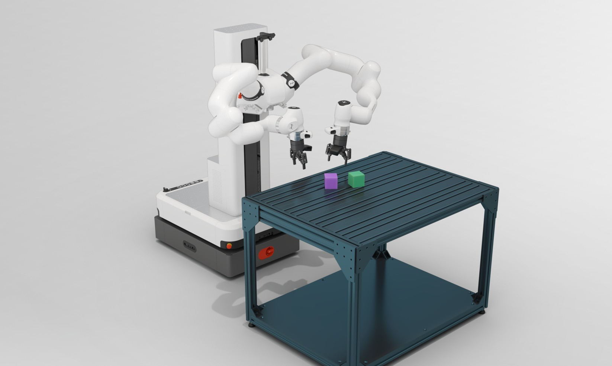

# Mobile FR3 Duo: mobile bimanual research platform


[**View Mobile FR3 Duo on OpenELAB**](https://openelab.io/products/franka-mobile-fr3-duo-vision-manipulation-kit)

**Model:** Mobile FR3 Duo · **SKU:** `Franka-MFR3D`

**Scope:** Prototype/early-access mobile system with the listed Vision & Manipulation Kit; exact delivered revision must be confirmed.


## Product overview

Mobile FR3 Duo combines FR3 Duo with TMR for mobile manipulation and demonstration collection. This page covers the supplied prototype/early-access context, not a guarantee of capabilities for every later-generation Mobile FR3 Duo. The OpenELAB product listing specifically includes a Vision & Manipulation Kit; accessories outside that confirmed list need separate verification.

_Source: supplied Mobile FR3 Duo brochure; illustrative configuration, not a bill of materials._


**Prototype scope:** the supplied brochure and manufacturer installation guide describe research hardware. Use the delivered revision in a controlled laboratory with trained personnel, verified stop functions and an application-specific risk assessment. A certified component does not certify the integrated prototype.


## Applications

Supervised teleoperation, manipulation and embodied-AI research within the delivered platform's operating envelope. A demonstration configuration is not a production workcell or a certified mobile safety application.

## Specifications

| Parameter               | Value and scope                                                                                  |
| ----------------------- | ------------------------------------------------------------------------------------------------ |
| Manipulator             | Two FR3 arms, each 7 DOF, 3 kg rated payload and 855 mm reach                                    |
| Brochure base data      | 800×580×294 mm; 100 kg base payload; 1.75 m/s reference maximum                                  |
| Brochure sensors        | 14 arm torque sensors, two LiDARs, eight cameras, one IMU; verify actual BOM                     |
| Compute / communication | Jetson AGX Orin; Wi-Fi, Ethernet, USB and Bluetooth as brochure interfaces                       |
| OpenELAB kit            | Two Robotiq 2F-85 grippers, two D405 wrist cameras/holders and ZED Mini head camera, per listing |

Source: [Mobile FR3 Duo brochure, PDF pp. 1–2](source-library/). Ratings are reference values for the supplied brochure's scope, not first-run motion settings.


**Keep brochure and prototype revisions separate.** The supplied Mobile brochure lists a 100 kg base payload, 1.75 m/s and a base envelope of 800×580×294 mm. The publicly linked R04245 v0.2 manual lists different ratings and a complete-system envelope. Do not combine these into one guaranteed specification or use their maximum speeds for commissioning.


The [v0.2 prototype manual](https://franka.de/hubfs/Prototype%20Manual%20and%20Datasheets%20_Mobile%20FR3%20Duo_R04245_EN.pdf), §§4–5, lists Mobile FR3 Duo at approximately 225 kg, 800×583×1461 mm and 1.5 m/s, and TMR at 125 kg maximum payload. These are a separate reference revision. The supplied brochure says eight cameras; the current OpenELAB listing describes a seven-camera reference suite. Inventory the delivered camera names and calibration files rather than allocating streams by either count. A brochure's 1 kHz arm FCI statement does not establish one synchronized whole-body/base control loop.

## Hardware and connections

Use the [manufacturer document portal](https://franka.de/documents) to obtain the exact Mobile installation quick guide R05240, the delivered TMR/Spine prototype manual and both arm manuals. A mobile robot adds load transfer, tipping, wheel paths, wireless-stop coverage and moving cable risks to the arm workcell assessment. Do not apply standalone FR3 mounting constraints as a complete mobile integration design.

Where the delivered system is the documented v0.2 prototype, its internal network map identifies separate right, left, TMR and companion endpoints. Treat those as revision-specific, not factory defaults for every Mobile FR3 Duo. **FCI over Wi-Fi is not supported** in that manual. Confirm the actual network and stop design before any control.

## Software and development resources

The delivered prototype companion is a separate environment from a generic desktop FR3 workstation. Use the provided System Image and matching mobile-capable `libfranka`, `franka_ros2`, robot descriptions and controller configuration. The public model is **mobile\_fr3\_duo\_v0\_2** for the v0.2 reference. Keep camera and tool packages matched. See [TMR-specific boundaries](tmr.md), [version selection](development/fci-ros2.md) and [mobile simulation/data validation](development/simulation-data.md).

## Complete source coverage and engineering details

The supplied material is now readable inside the wiki. The complete readers retain every original page, drawing, table, example and notice; the guidance below explains how to use them for this model or workflow.

| Complete in-wiki source                                      | Coverage    |
| ------------------------------------------------------------ | ----------- |
| [Mobile FR3 Duo brochure](source-library/complete-mobile.md) | 2 PDF pages |

### Mobile-base and manipulation configuration

The supplied two-page brochure retains its complete mechanical, mobility, compute/perception and application descriptions. Keep its base, arm, camera, battery and payload figures attached to that source configuration. Later prototype documents and OpenELAB kit options may describe different hardware; do not combine their maximum ratings.

A delivered system record should identify the mobile base and its operating manual, battery/charger, mounting structure, both arm/Control pairs, end effectors, compute, sensors and all power/network interfaces. Base carrying capacity, arm payload and workpiece load are different quantities. Use the actual system's load distribution and operating envelope.

For integration, keep map/odometry, base, both arm-base and tool frames explicit. Record time synchronization and the behavior of arm controllers, base controller and external control clients after a physical stop, communication loss or power restoration. Mobile docking, navigation and dual-arm operation require separate acceptance; the brochure alone does not define those procedures. The public later R04245 document is linked in the source library but its internal/preliminary content is not rehosted here.

## Getting started

1. Keep motion disabled. Record Mobile/TMR/Spine revisions, both arm/controller identities, battery/charger labels and every delivered end effector/camera.
2. Reconcile the product order's kit with the physical BOM. Resolve brochure/manual speed, payload, camera-count and dimensional differences against the delivered operating documents before motion testing.
3. Have the integrator verify mechanical stability, all subsystem stop paths, wireless-stop condition/range, charging restrictions and the approved network map.
4. On a previously commissioned and powered system, open the delivered TMR Dashboard in viewing mode and record base, lift and battery status; identify both arm Desk interfaces without enabling drives/lift or starting a gamepad demo.
5. Validate the corresponding mobile model and sensor frames offline before designing a staged physical acceptance.

**Expected result:** a revision/BOM/network/status baseline and an offline model match. No base, lift or arm motion is required. Source: [Mobile prototype document](https://franka.de/hubfs/Prototype%20Manual%20and%20Datasheets%20_Mobile%20FR3%20Duo_R04245_EN.pdf), §§4–5; obtain the exact delivered version before following its operational details.

## Troubleshooting and FAQs

**Can either arm lift the 100 kg base rating?** No. The arm rating remains 3 kg per arm; base/lift ratings describe different assemblies and do not guarantee stability at every pose.

**The UI reports a safety stop:** determine which subsystem and stop source is involved. A base, Spine and arm can have different stop behavior. Resolve the cause and follow the delivered recovery procedure; do not automatically replay old targets.

**Why does the brochure camera count differ?** Prototype and kit configurations change. Use a named camera inventory with actual topic, resolution, calibration and timestamp source.

## Downloads and technical documents

| Resource                                                                | Purpose                                                            |
| ----------------------------------------------------------------------- | ------------------------------------------------------------------ |
| [Supplied source documents](source-library/)                            | Brochure identity, page citations and revision notes               |
| [Manufacturer documentation portal](https://franka.de/documents)        | Exact prototype installation guide and current operating documents |
| [Official model/CAD resources](https://franka.de/models-and-simulation) | Match robot, mount, end effectors, sensors and revision            |
| [Simulation and data acceptance](development/simulation-data.md)        | Keep offline model validation separate from physical commissioning |

## References and validation

Supplied brochure and official resources linked in this guide. Reviewed 22 November 2026. Documentation and source checks only. Software installation, compilation, live robot communication, calibration and physical tests: **not run**. Unresolved delivery-specific limits, mount/stop configuration or software compatibility block the corresponding powered/motion procedure.
