# Franka training 2 — Franka Desk — complete reference


**Complete supplied source:** EN\_2\_Franka\_Desk.pptx · **Coverage:** 21 original slides. [Return to the Franka source library](./).


Every source page is retained in the original order. The **Original page** view preserves complete diagrams, photographs, tables, equations, connector orientation, notices and examples. The **Searchable text** view preserves native PDF text or the slide’s native text, embedded links and substantive speaker notes. Text extraction can retain reading-order/character defects; use the original image for exact layout, table columns and code indentation.


The slides refer to pages in an older combined product manual. Their Safety slide repeats a log-download reference, so that printed page reference is not a valid replacement for the actual Safety/Watchman section. Safety configuration, torque calibration and FCI activation need the authorized role and applicable operating procedure.


**Attribution:** the manufacturer and contributors identified in the supplied document. Original notices remain visible on every source page. Navigation, revision notes and the linked engineering explanations are OpenELAB editorial additions.

**Training-copy scope:** these images are rendered reading copies of the supplied PPTX slides. The native file remains authoritative for fonts, presentation effects and editable objects. All original slide numbers, including closing or hidden slides, are retained. Any embedded motion video is linked separately below.

## Document navigation

| Source section / function | Original page                         |
| ------------------------- | ------------------------------------- |
| Slide 1                   | [Slide 1](complete-desk.md#slide-1)   |
| Basic Training            | [Slide 2](complete-desk.md#slide-2)   |
| Franka Desk               | [Slide 3](complete-desk.md#slide-3)   |
| Franka Desk (2)           | [Slide 4](complete-desk.md#slide-4)   |
| Franka Desk (3)           | [Slide 5](complete-desk.md#slide-5)   |
| Franka Desk (4)           | [Slide 6](complete-desk.md#slide-6)   |
| Franka Desk (5)           | [Slide 7](complete-desk.md#slide-7)   |
| Franka Desk (6)           | [Slide 8](complete-desk.md#slide-8)   |
| Franka Desk (7)           | [Slide 9](complete-desk.md#slide-9)   |
| Franka Desk (8)           | [Slide 10](complete-desk.md#slide-10) |
| Franka Desk (9)           | [Slide 11](complete-desk.md#slide-11) |
| Franka Desk (10)          | [Slide 12](complete-desk.md#slide-12) |
| Franka Desk (11)          | [Slide 13](complete-desk.md#slide-13) |
| Franka Desk (12)          | [Slide 14](complete-desk.md#slide-14) |
| Franka Desk (13)          | [Slide 15](complete-desk.md#slide-15) |
| Franka Desk (14)          | [Slide 16](complete-desk.md#slide-16) |
| Franka Desk (15)          | [Slide 17](complete-desk.md#slide-17) |
| Franka Desk (16)          | [Slide 18](complete-desk.md#slide-18) |
| Franka Desk (17)          | [Slide 19](complete-desk.md#slide-19) |
| Franka Desk (18)          | [Slide 20](complete-desk.md#slide-20) |
| Diagnostics And Testing   | [Slide 21](complete-desk.md#slide-21) |

## Slide 1

**Source:** EN\_2\_Franka\_Desk.pptx, original slide 1. [Open the corresponding PDF reading-copy page](https://1292444914-files.gitbook.io/~/files/v0/b/gitbook-x-prod.appspot.com/o/spaces%2FtgOfPnscWebs1eh82EKq%2Fuploads%2F3VGxvULW6qHMCcvjmWUF%2FDESK-pages-001-019.pdf?alt=media#page=1).







```
Franka Desk
Basic Training
Marc Fuest
22.10.2025
© FRANKA ROBOTICS 2025
```



## Slide 2

**Source:** EN\_2\_Franka\_Desk.pptx, original slide 2. [Open the corresponding PDF reading-copy page](https://1292444914-files.gitbook.io/~/files/v0/b/gitbook-x-prod.appspot.com/o/spaces%2FtgOfPnscWebs1eh82EKq%2Fuploads%2F3VGxvULW6qHMCcvjmWUF%2FDESK-pages-001-019.pdf?alt=media#page=2).







```
Basic Training
Table of Contents
UI
Desk
Watchman
Settings
System Overview Dashboard
Network Settings
User Management
End Effector
Modbus TCP
System
Software Updates
Saftey
```



## Slide 3

**Source:** EN\_2\_Franka\_Desk.pptx, original slide 3. [Open the corresponding PDF reading-copy page](https://1292444914-files.gitbook.io/~/files/v0/b/gitbook-x-prod.appspot.com/o/spaces%2FtgOfPnscWebs1eh82EKq%2Fuploads%2F3VGxvULW6qHMCcvjmWUF%2FDESK-pages-001-019.pdf?alt=media#page=3).







```
Franka Desk
UI 
 
Product Manual
Login to Control via browser.
https://robot.franka.de/
The default setting is… 
192.168.0.1
The address range 
can be used from 100-150.
PAGE: 147
Chapter: 13.6 Franka UI

Embedded hyperlinks
https://robot.franka.de/
https://franka.de/hubfs/Product%20Manual%20Franka%20Research%203_R02210_1.5_EN-1.pdf?hsLang=en
```



**Embedded slide links:** [Source link 1](https://robot.franka.de/) · [Source link 2](https://franka.de/hubfs/Product%20Manual%20Franka%20Research%203_R02210_1.5_EN-1.pdf?hsLang=en)

## Slide 4

**Source:** EN\_2\_Franka\_Desk.pptx, original slide 4. [Open the corresponding PDF reading-copy page](https://1292444914-files.gitbook.io/~/files/v0/b/gitbook-x-prod.appspot.com/o/spaces%2FtgOfPnscWebs1eh82EKq%2Fuploads%2F3VGxvULW6qHMCcvjmWUF%2FDESK-pages-001-019.pdf?alt=media#page=4).



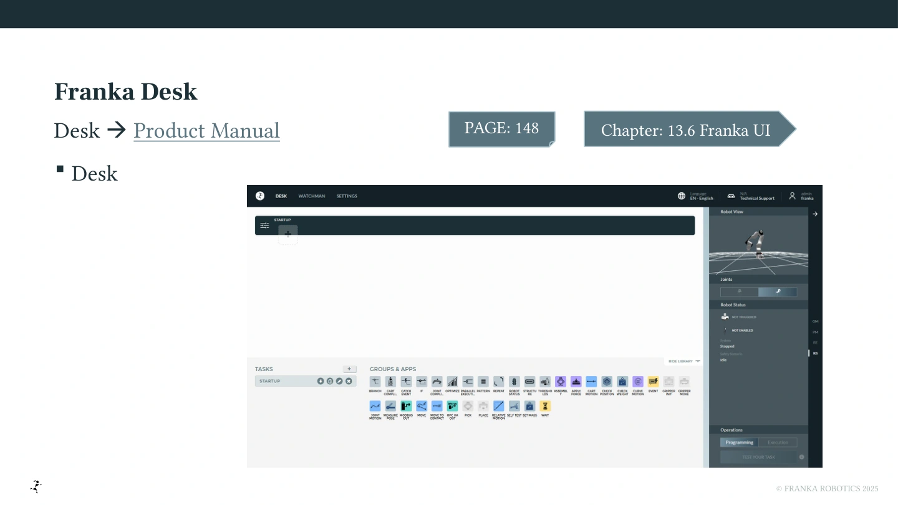



```
Franka Desk
Desk 
 
Product Manual
Desk
PAGE: 148
Chapter: 13.6 Franka UI

Embedded hyperlinks
https://franka.de/hubfs/Product%20Manual%20Franka%20Research%203_R02210_1.5_EN-1.pdf?hsLang=en
```



**Embedded slide links:** [Source link 1](https://franka.de/hubfs/Product%20Manual%20Franka%20Research%203_R02210_1.5_EN-1.pdf?hsLang=en)

## Slide 5

**Source:** EN\_2\_Franka\_Desk.pptx, original slide 5. [Open the corresponding PDF reading-copy page](https://1292444914-files.gitbook.io/~/files/v0/b/gitbook-x-prod.appspot.com/o/spaces%2FtgOfPnscWebs1eh82EKq%2Fuploads%2F3VGxvULW6qHMCcvjmWUF%2FDESK-pages-001-019.pdf?alt=media#page=5).



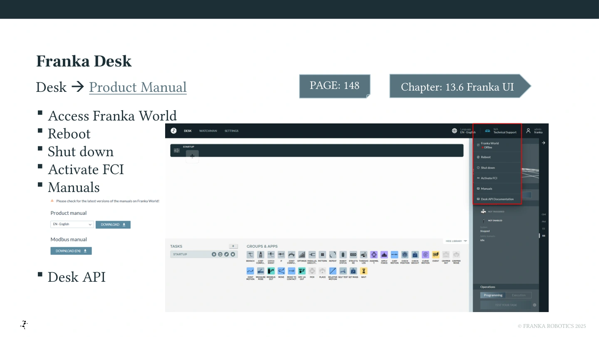



```
Franka Desk
Desk 
 
Product Manual
Access Franka World
Reboot
Shut down
Activate FCI
Manuals
Desk API
PAGE: 148
Chapter: 13.6 Franka UI

Embedded hyperlinks
https://franka.de/hubfs/Product%20Manual%20Franka%20Research%203_R02210_1.5_EN-1.pdf?hsLang=en
```



**Embedded slide links:** [Source link 1](https://franka.de/hubfs/Product%20Manual%20Franka%20Research%203_R02210_1.5_EN-1.pdf?hsLang=en)

## Slide 6

**Source:** EN\_2\_Franka\_Desk.pptx, original slide 6. [Open the corresponding PDF reading-copy page](https://1292444914-files.gitbook.io/~/files/v0/b/gitbook-x-prod.appspot.com/o/spaces%2FtgOfPnscWebs1eh82EKq%2Fuploads%2F3VGxvULW6qHMCcvjmWUF%2FDESK-pages-001-019.pdf?alt=media#page=6).



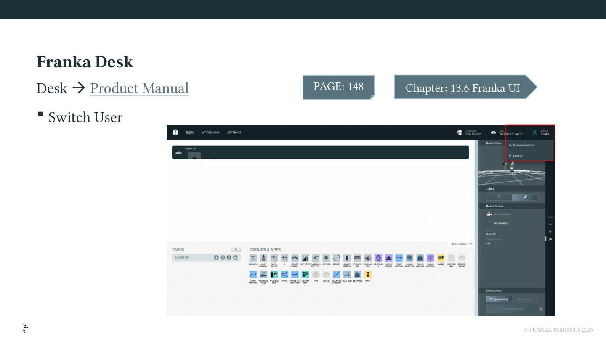



```
Franka Desk
Desk 
 
Product Manual
Switch User
PAGE: 148
Chapter: 13.6 Franka UI

Embedded hyperlinks
https://franka.de/hubfs/Product%20Manual%20Franka%20Research%203_R02210_1.5_EN-1.pdf?hsLang=en
```



**Embedded slide links:** [Source link 1](https://franka.de/hubfs/Product%20Manual%20Franka%20Research%203_R02210_1.5_EN-1.pdf?hsLang=en)

## Slide 7

**Source:** EN\_2\_Franka\_Desk.pptx, original slide 7. [Open the corresponding PDF reading-copy page](https://1292444914-files.gitbook.io/~/files/v0/b/gitbook-x-prod.appspot.com/o/spaces%2FtgOfPnscWebs1eh82EKq%2Fuploads%2F3VGxvULW6qHMCcvjmWUF%2FDESK-pages-001-019.pdf?alt=media#page=7).



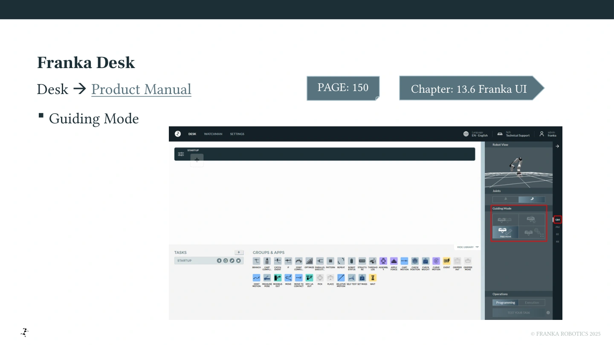



```
Franka Desk
Desk 
 
Product Manual
Guiding Mode
PAGE: 150
Chapter: 13.6 Franka UI

Embedded hyperlinks
https://franka.de/hubfs/Product%20Manual%20Franka%20Research%203_R02210_1.5_EN-1.pdf?hsLang=en
```



**Embedded slide links:** [Source link 1](https://franka.de/hubfs/Product%20Manual%20Franka%20Research%203_R02210_1.5_EN-1.pdf?hsLang=en)

## Slide 8

**Source:** EN\_2\_Franka\_Desk.pptx, original slide 8. [Open the corresponding PDF reading-copy page](https://1292444914-files.gitbook.io/~/files/v0/b/gitbook-x-prod.appspot.com/o/spaces%2FtgOfPnscWebs1eh82EKq%2Fuploads%2F3VGxvULW6qHMCcvjmWUF%2FDESK-pages-001-019.pdf?alt=media#page=8).



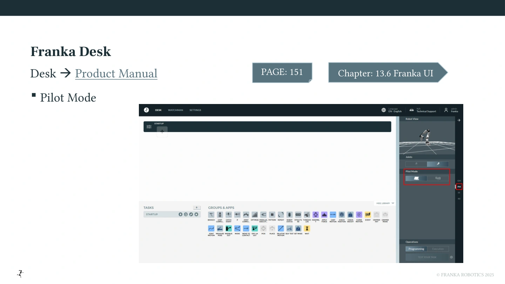



```
Franka Desk
Desk 
 
Product Manual
Pilot Mode
PAGE: 151
Chapter: 13.6 Franka UI

Embedded hyperlinks
https://franka.de/hubfs/Product%20Manual%20Franka%20Research%203_R02210_1.5_EN-1.pdf?hsLang=en
```



**Embedded slide links:** [Source link 1](https://franka.de/hubfs/Product%20Manual%20Franka%20Research%203_R02210_1.5_EN-1.pdf?hsLang=en)

## Slide 9

**Source:** EN\_2\_Franka\_Desk.pptx, original slide 9. [Open the corresponding PDF reading-copy page](https://1292444914-files.gitbook.io/~/files/v0/b/gitbook-x-prod.appspot.com/o/spaces%2FtgOfPnscWebs1eh82EKq%2Fuploads%2F3VGxvULW6qHMCcvjmWUF%2FDESK-pages-001-019.pdf?alt=media#page=9).



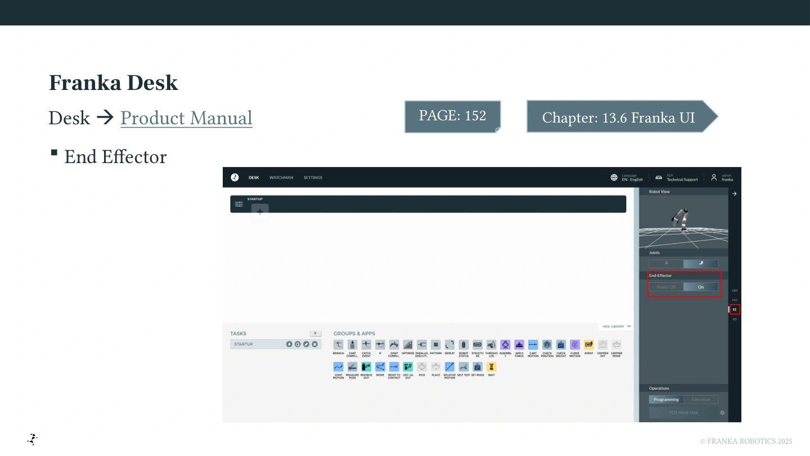



```
Franka Desk
Desk 
 
Product Manual
End Effector
PAGE: 152
Chapter: 13.6 Franka UI

Embedded hyperlinks
https://franka.de/hubfs/Product%20Manual%20Franka%20Research%203_R02210_1.5_EN-1.pdf?hsLang=en
```



**Embedded slide links:** [Source link 1](https://franka.de/hubfs/Product%20Manual%20Franka%20Research%203_R02210_1.5_EN-1.pdf?hsLang=en)

## Slide 10

**Source:** EN\_2\_Franka\_Desk.pptx, original slide 10. [Open the corresponding PDF reading-copy page](https://1292444914-files.gitbook.io/~/files/v0/b/gitbook-x-prod.appspot.com/o/spaces%2FtgOfPnscWebs1eh82EKq%2Fuploads%2F3VGxvULW6qHMCcvjmWUF%2FDESK-pages-001-019.pdf?alt=media#page=10).



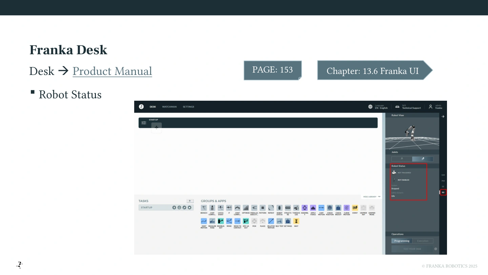



```
Franka Desk
Desk 
 
Product Manual
Robot Status
PAGE: 153
Chapter: 13.6 Franka UI

Embedded hyperlinks
https://franka.de/hubfs/Product%20Manual%20Franka%20Research%203_R02210_1.5_EN-1.pdf?hsLang=en
```



**Embedded slide links:** [Source link 1](https://franka.de/hubfs/Product%20Manual%20Franka%20Research%203_R02210_1.5_EN-1.pdf?hsLang=en)

## Slide 11

**Source:** EN\_2\_Franka\_Desk.pptx, original slide 11. [Open the corresponding PDF reading-copy page](https://1292444914-files.gitbook.io/~/files/v0/b/gitbook-x-prod.appspot.com/o/spaces%2FtgOfPnscWebs1eh82EKq%2Fuploads%2F3VGxvULW6qHMCcvjmWUF%2FDESK-pages-001-019.pdf?alt=media#page=11).



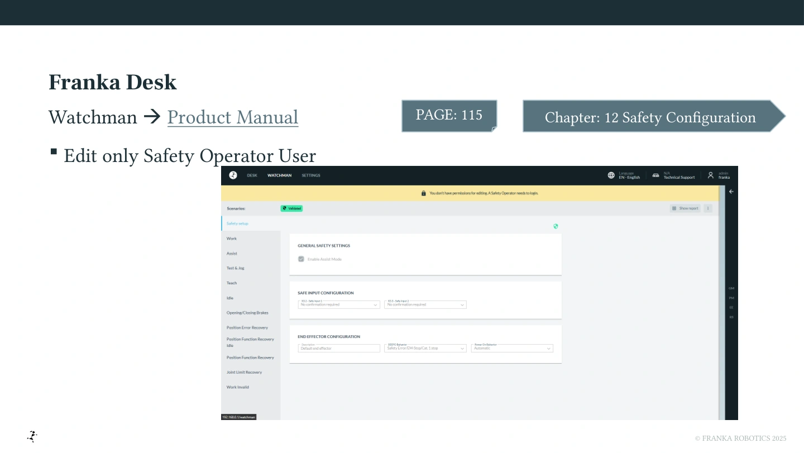



```
Franka Desk
Watchman 
 
Product Manual
Edit only Safety Operator User
PAGE: 115
Chapter: 12 Safety Configuration

Embedded hyperlinks
https://franka.de/hubfs/Product%20Manual%20Franka%20Research%203_R02210_1.5_EN-1.pdf?hsLang=en
```



**Embedded slide links:** [Source link 1](https://franka.de/hubfs/Product%20Manual%20Franka%20Research%203_R02210_1.5_EN-1.pdf?hsLang=en)

## Slide 12

**Source:** EN\_2\_Franka\_Desk.pptx, original slide 12. [Open the corresponding PDF reading-copy page](https://1292444914-files.gitbook.io/~/files/v0/b/gitbook-x-prod.appspot.com/o/spaces%2FtgOfPnscWebs1eh82EKq%2Fuploads%2F3VGxvULW6qHMCcvjmWUF%2FDESK-pages-001-019.pdf?alt=media#page=12).



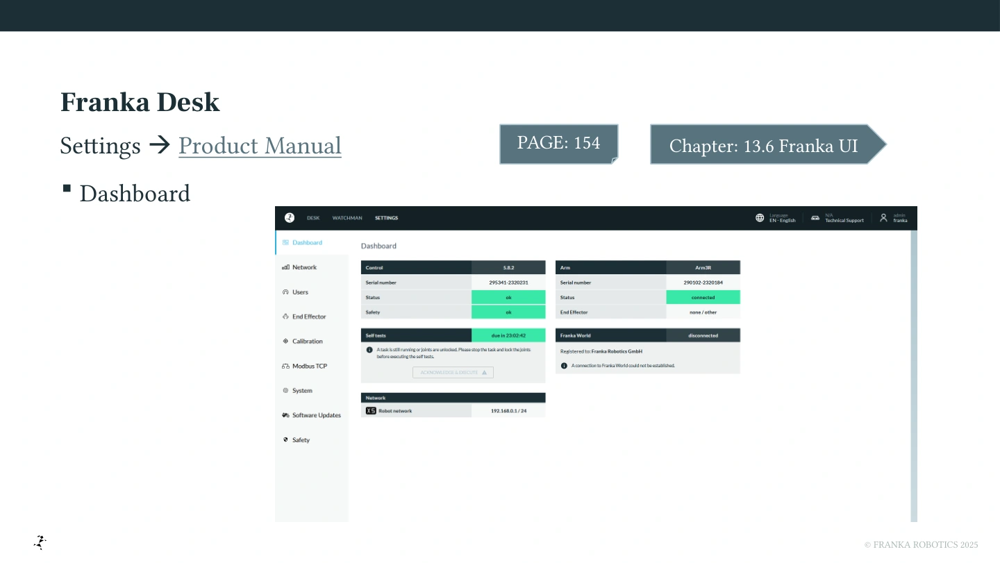



```
Franka Desk
Settings
 
 
Product Manual
Dashboard
PAGE: 154 
Chapter: 
13.6 Franka UI

Embedded hyperlinks
https://franka.de/hubfs/Product%20Manual%20Franka%20Research%203_R02210_1.5_EN-1.pdf?hsLang=en
```



**Embedded slide links:** [Source link 1](https://franka.de/hubfs/Product%20Manual%20Franka%20Research%203_R02210_1.5_EN-1.pdf?hsLang=en)

## Slide 13

**Source:** EN\_2\_Franka\_Desk.pptx, original slide 13. [Open the corresponding PDF reading-copy page](https://1292444914-files.gitbook.io/~/files/v0/b/gitbook-x-prod.appspot.com/o/spaces%2FtgOfPnscWebs1eh82EKq%2Fuploads%2F3VGxvULW6qHMCcvjmWUF%2FDESK-pages-001-019.pdf?alt=media#page=13).







```
Franka Desk
Settings
 
 
Product Manual
Network
PAGE: 186 
Chapter: 14.5.2 Network Setting

Embedded hyperlinks
https://franka.de/hubfs/Product%20Manual%20Franka%20Research%203_R02210_1.5_EN-1.pdf?hsLang=en
```



**Embedded slide links:** [Source link 1](https://franka.de/hubfs/Product%20Manual%20Franka%20Research%203_R02210_1.5_EN-1.pdf?hsLang=en)

## Slide 14

**Source:** EN\_2\_Franka\_Desk.pptx, original slide 14. [Open the corresponding PDF reading-copy page](https://1292444914-files.gitbook.io/~/files/v0/b/gitbook-x-prod.appspot.com/o/spaces%2FtgOfPnscWebs1eh82EKq%2Fuploads%2F3VGxvULW6qHMCcvjmWUF%2FDESK-pages-001-019.pdf?alt=media#page=14).



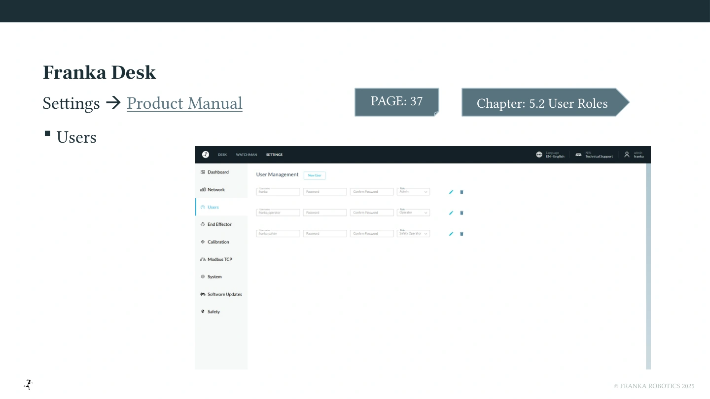



```
Franka Desk
Settings
 
 
Product Manual
Users
PAGE: 37 
Chapter: 5.2 User Roles

Embedded hyperlinks
https://franka.de/hubfs/Product%20Manual%20Franka%20Research%203_R02210_1.5_EN-1.pdf?hsLang=en
```



**Embedded slide links:** [Source link 1](https://franka.de/hubfs/Product%20Manual%20Franka%20Research%203_R02210_1.5_EN-1.pdf?hsLang=en)

## Slide 15

**Source:** EN\_2\_Franka\_Desk.pptx, original slide 15. [Open the corresponding PDF reading-copy page](https://1292444914-files.gitbook.io/~/files/v0/b/gitbook-x-prod.appspot.com/o/spaces%2FtgOfPnscWebs1eh82EKq%2Fuploads%2F3VGxvULW6qHMCcvjmWUF%2FDESK-pages-001-019.pdf?alt=media#page=15).



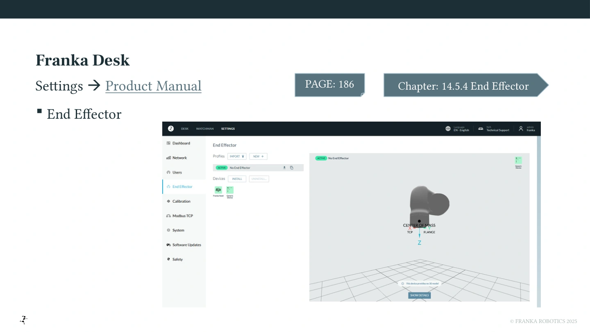



```
Franka Desk
Settings
 
 
Product Manual
End Effector
PAGE: 186 
Chapter: 14.5.4 End Effector

Embedded hyperlinks
https://franka.de/hubfs/Product%20Manual%20Franka%20Research%203_R02210_1.5_EN-1.pdf?hsLang=en
```



**Embedded slide links:** [Source link 1](https://franka.de/hubfs/Product%20Manual%20Franka%20Research%203_R02210_1.5_EN-1.pdf?hsLang=en)

## Slide 16

**Source:** EN\_2\_Franka\_Desk.pptx, original slide 16. [Open the corresponding PDF reading-copy page](https://1292444914-files.gitbook.io/~/files/v0/b/gitbook-x-prod.appspot.com/o/spaces%2FtgOfPnscWebs1eh82EKq%2Fuploads%2F3VGxvULW6qHMCcvjmWUF%2FDESK-pages-001-019.pdf?alt=media#page=16).



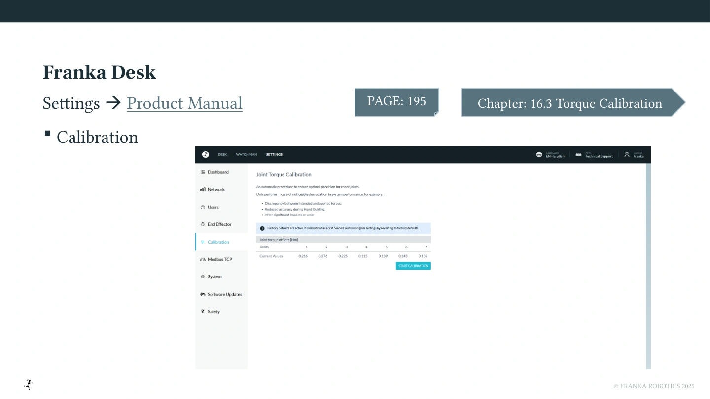



```
Franka Desk
Settings
 
 
Product Manual
Calibration
PAGE: 195 
Chapter: 16.3 Torque Calibration

Embedded hyperlinks
https://franka.de/hubfs/Product%20Manual%20Franka%20Research%203_R02210_1.5_EN-1.pdf?hsLang=en
```



**Embedded slide links:** [Source link 1](https://franka.de/hubfs/Product%20Manual%20Franka%20Research%203_R02210_1.5_EN-1.pdf?hsLang=en)

## Slide 17

**Source:** EN\_2\_Franka\_Desk.pptx, original slide 17. [Open the corresponding PDF reading-copy page](https://1292444914-files.gitbook.io/~/files/v0/b/gitbook-x-prod.appspot.com/o/spaces%2FtgOfPnscWebs1eh82EKq%2Fuploads%2F3VGxvULW6qHMCcvjmWUF%2FDESK-pages-001-019.pdf?alt=media#page=17).



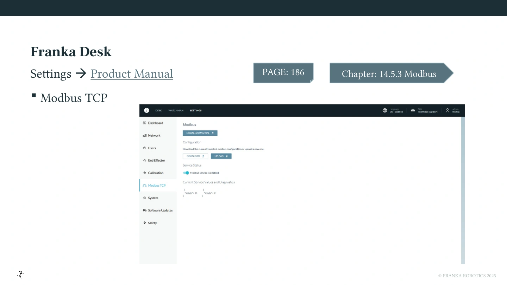



```
Franka Desk
Settings
 
 
Product Manual
Modbus TCP
PAGE: 186 
Chapter: 14.5.3 Modbus

Embedded hyperlinks
https://franka.de/hubfs/Product%20Manual%20Franka%20Research%203_R02210_1.5_EN-1.pdf?hsLang=en
```



**Embedded slide links:** [Source link 1](https://franka.de/hubfs/Product%20Manual%20Franka%20Research%203_R02210_1.5_EN-1.pdf?hsLang=en)

## Slide 18

**Source:** EN\_2\_Franka\_Desk.pptx, original slide 18. [Open the corresponding PDF reading-copy page](https://1292444914-files.gitbook.io/~/files/v0/b/gitbook-x-prod.appspot.com/o/spaces%2FtgOfPnscWebs1eh82EKq%2Fuploads%2F3VGxvULW6qHMCcvjmWUF%2FDESK-pages-001-019.pdf?alt=media#page=18).



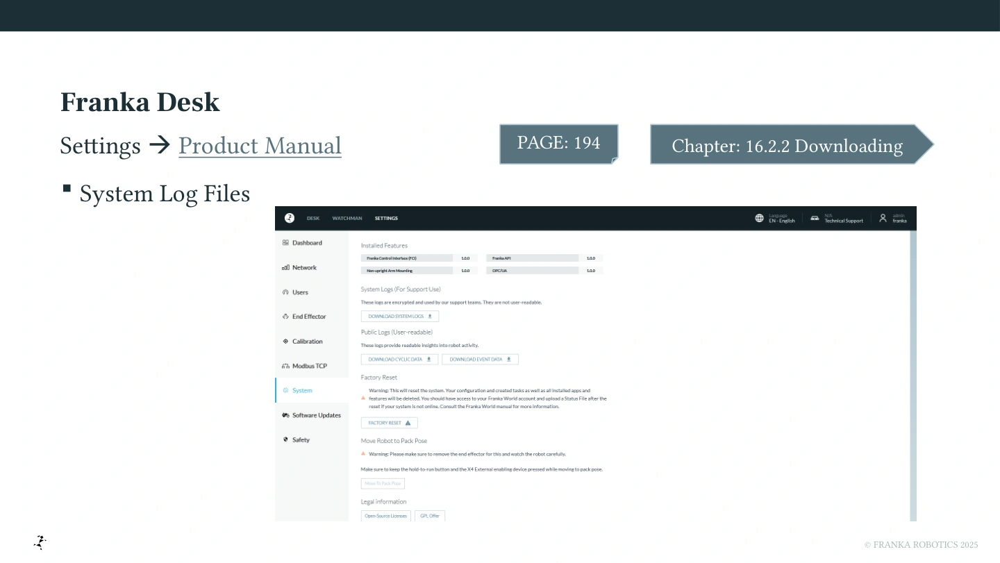



```
Franka Desk
Settings
 
 
Product Manual
System Log Files
PAGE: 194 
Chapter: 16.2.2 Downloading

Embedded hyperlinks
https://franka.de/hubfs/Product%20Manual%20Franka%20Research%203_R02210_1.5_EN-1.pdf?hsLang=en
```



**Embedded slide links:** [Source link 1](https://franka.de/hubfs/Product%20Manual%20Franka%20Research%203_R02210_1.5_EN-1.pdf?hsLang=en)

## Slide 19

**Source:** EN\_2\_Franka\_Desk.pptx, original slide 19. [Open the corresponding PDF reading-copy page](https://1292444914-files.gitbook.io/~/files/v0/b/gitbook-x-prod.appspot.com/o/spaces%2FtgOfPnscWebs1eh82EKq%2Fuploads%2F3VGxvULW6qHMCcvjmWUF%2FDESK-pages-001-019.pdf?alt=media#page=19).



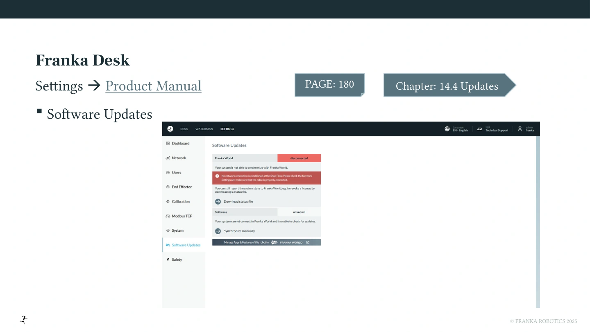



```
Franka Desk
Settings
 
 
Product Manual
Software Updates
PAGE: 180 
Chapter: 14.4 Updates

Embedded hyperlinks
https://franka.de/hubfs/Product%20Manual%20Franka%20Research%203_R02210_1.5_EN-1.pdf?hsLang=en
```



**Embedded slide links:** [Source link 1](https://franka.de/hubfs/Product%20Manual%20Franka%20Research%203_R02210_1.5_EN-1.pdf?hsLang=en)

## Slide 20

**Source:** EN\_2\_Franka\_Desk.pptx, original slide 20. [Open the corresponding PDF reading-copy page](https://1292444914-files.gitbook.io/~/files/v0/b/gitbook-x-prod.appspot.com/o/spaces%2FtgOfPnscWebs1eh82EKq%2Fuploads%2FgqjBsOrUPGezRk3Ro8cI%2FDESK-pages-020-021.pdf?alt=media#page=1).



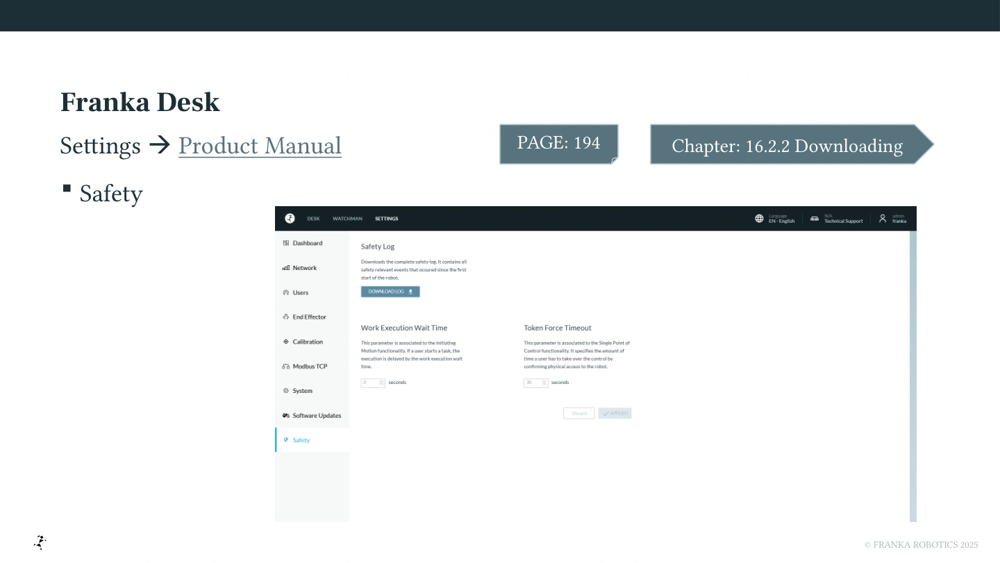



```
Franka Desk
Settings
 
 
Product Manual
Safety
PAGE: 194 
Chapter: 
16.2.2 Downloading

Embedded hyperlinks
https://franka.de/hubfs/Product%20Manual%20Franka%20Research%203_R02210_1.5_EN-1.pdf?hsLang=en
```



**Embedded slide links:** [Source link 1](https://franka.de/hubfs/Product%20Manual%20Franka%20Research%203_R02210_1.5_EN-1.pdf?hsLang=en)

## Slide 21

**Source:** EN\_2\_Franka\_Desk.pptx, original slide 21. [Open the corresponding PDF reading-copy page](https://1292444914-files.gitbook.io/~/files/v0/b/gitbook-x-prod.appspot.com/o/spaces%2FtgOfPnscWebs1eh82EKq%2Fuploads%2FgqjBsOrUPGezRk3Ro8cI%2FDESK-pages-020-021.pdf?alt=media#page=2).







```
Diagnostics And Testing
```


