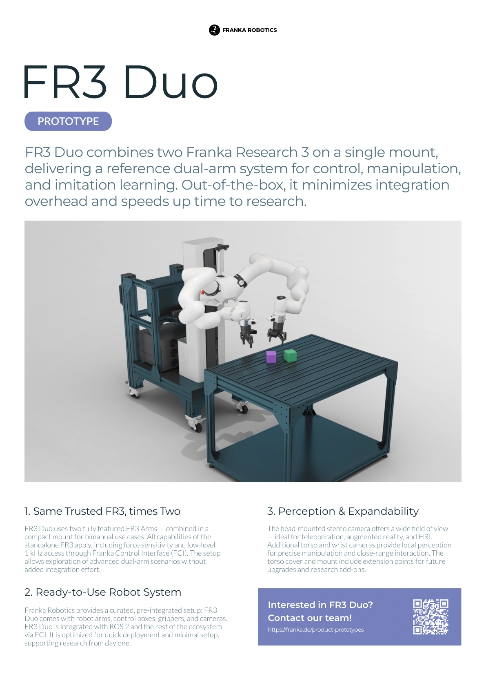
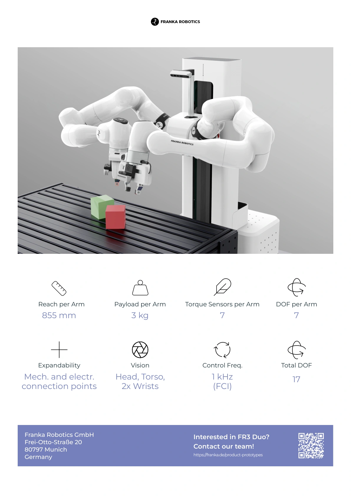

# FR3 Duo brochure — complete reference


**Complete supplied source:** FR3 Duo.pdf · **Coverage:** 2 original PDF pages. [Return to the Franka source library](./).


Every source page is retained in the original order. The **Original page** view preserves complete diagrams, photographs, tables, equations, connector orientation, notices and examples. The **Searchable text** view preserves native PDF text or the slide’s native text, embedded links and substantive speaker notes. Text extraction can retain reading-order/character defects; use the original image for exact layout, table columns and code indentation.


Use only the exact model, hardware/controller and software revision covered by the source. Manufacturer examples involving motion, enabling, safety configuration, I/O, calibration, updates or resets require the complete applicable procedure and qualified personnel. No robot, SDK or process-equipment test was run.


**Attribution:** the manufacturer and contributors identified in the supplied document. Original notices remain visible on every source page. Navigation, revision notes and the linked engineering explanations are OpenELAB editorial additions.

## Document navigation

| Source section / function                                           | Original page                       |
| ------------------------------------------------------------------- | ----------------------------------- |
| FR3 Duo / FR3 Duo combines two Franka Research 3 on a single mount, | [PDF 1](complete-duo.md#pdf-page-1) |
| 855 mm / Mech. and electr.                                          | [PDF 2](complete-duo.md#pdf-page-2) |

## PDF page 1

**Source:** FR3 Duo.pdf, original pdf page 1. [Open the corresponding PDF reading-copy page](https://1292444914-files.gitbook.io/~/files/v0/b/gitbook-x-prod.appspot.com/o/spaces%2FtgOfPnscWebs1eh82EKq%2Fuploads%2FEkaw5CT47KbdnVs0lU1x%2FDUO-pages-001-002.pdf?alt=media#page=1).







```
FR3 Duo
FR3 Duo combines two Franka Research 3 on a single mount, 
delivering a reference dual-arm system for control, manipulation, 
and imitation learning. Out-of-the-box, it minimizes integration 
overhead and speeds up time to research.
Franka Robotics provides a curated, pre-integrated setup: FR3 
Duo comes with robot arms, control boxes, grippers, and cameras. 
FR3 Duo is integrated with ROS 2 and the rest of the ecosystem 
via FCI. It is optimized for quick deployment and minimal setup, 
supporting research from day one.
2. Ready-to-Use Robot System
FR3 Duo uses two fully featured FR3 Arms — combined in a 
compact mount for bimanual use cases. All capabilities of the 
standalone FR3 apply, including force sensitivity and low-level  
1 kHz access through Franka Control Interface (FCI). The setup 
allows exploration of advanced dual-arm scenarios without  
added integration effort.
1. Same Trusted FR3, times Two
The head-mounted stereo camera offers a wide field of view 
— ideal for teleoperation, augmented reality, and HRI. 
Additional torso and wrist cameras provide local perception 
for precise manipulation and close-range interaction. The 
torso cover and mount include extension points for future 
upgrades and research add-ons.
3. Perception & Expandability
Interested in FR3 Duo? 
Contact our team! 
https://franka.de/product-prototypes
PROTOTYPE
```



**Original PDF links:** [Source link 1](https://franka.de/mobile-fr3-duo)

## PDF page 2

**Source:** FR3 Duo.pdf, original pdf page 2. [Open the corresponding PDF reading-copy page](https://1292444914-files.gitbook.io/~/files/v0/b/gitbook-x-prod.appspot.com/o/spaces%2FtgOfPnscWebs1eh82EKq%2Fuploads%2FEkaw5CT47KbdnVs0lU1x%2FDUO-pages-001-002.pdf?alt=media#page=2).







```
855 mm
Mech. and electr. 
connection points
3 kg
Head, Torso,  
2x Wrists
7
1 kHz 
(FCI)
Franka Robotics GmbH
Frei-Otto-Straße 20
80797 Munich
Germany
7
Payload per Arm
Reach per Arm
Torque Sensors per Arm
DOF per Arm
Expandability
Vision
Control Freq.
Interested in FR3 Duo? 
Contact our team! 
https://franka.de/product-prototypes
17
Total DOF
```



**Original PDF links:** [Source link 1](https://franka.de/mobile-fr3-duo)
