# Franka Research 3 brochure — complete reference


**Complete supplied source:** Franka Research 3 (1).pdf · **Coverage:** 13 original PDF pages. [Return to the Franka source library](./).


Every source page is retained in the original order. The **Original page** view preserves complete diagrams, photographs, tables, equations, connector orientation, notices and examples. The **Searchable text** view preserves native PDF text or the slide’s native text, embedded links and substantive speaker notes. Text extraction can retain reading-order/character defects; use the original image for exact layout, table columns and code indentation.


Use only the exact model, hardware/controller and software revision covered by the source. Manufacturer examples involving motion, enabling, safety configuration, I/O, calibration, updates or resets require the complete applicable procedure and qualified personnel. No robot, SDK or process-equipment test was run.


**Attribution:** the manufacturer and contributors identified in the supplied document. Original notices remain visible on every source page. Navigation, revision notes and the linked engineering explanations are OpenELAB editorial additions.

## Document navigation

| Source section / function                                                                                      | Original page                                  |
| -------------------------------------------------------------------------------------------------------------- | ---------------------------------------------- |
| The Reference Platform / for AI & Robotics                                                                     | [PDF 1](complete-fr3-brochure.md#pdf-page-1)   |
| October 2025 / Franka Robotics GmbH                                                                            | [PDF 2](complete-fr3-brochure.md#pdf-page-2)   |
| FRANKA / RESEARCH 3                                                                                            | [PDF 3](complete-fr3-brochure.md#pdf-page-3)   |
| Why FRANKA / RESEARCH 3?                                                                                       | [PDF 4](complete-fr3-brochure.md#pdf-page-4)   |
| Franka Research 3 is a high-tech, expertly engineered robot / system designed for advanced research.           | [PDF 5](complete-fr3-brochure.md#pdf-page-5)   |
| Franka Control Interface (FCI) is / designed for roboticists who require                                       | [PDF 6](complete-fr3-brochure.md#pdf-page-6)   |
| Targeted enhancements for optimized performance. / Discover the                                                | [PDF 7](complete-fr3-brochure.md#pdf-page-7)   |
| Franka AI Companion, and more! / Franka Robotics offers a variety of                                           | [PDF 8](complete-fr3-brochure.md#pdf-page-8)   |
| Franka Toolbox for MATLAB® provides all necessary control / options and signals from the FR3 robot, resulting  | [PDF 9](complete-fr3-brochure.md#pdf-page-9)   |
| A thriving / research                                                                                          | [PDF 10](complete-fr3-brochure.md#pdf-page-10) |
| Driving / Innovation                                                                                           | [PDF 11](complete-fr3-brochure.md#pdf-page-11) |
| USA, Canada, Europe / Asia, Middle East                                                                        | [PDF 12](complete-fr3-brochure.md#pdf-page-12) |
| Franka Robotics is a German, research-driven robotics / company headquartered in Munich and operating globally | [PDF 13](complete-fr3-brochure.md#pdf-page-13) |

## PDF page 1

**Source:** Franka Research 3 (1).pdf, original pdf page 1. [Open the corresponding PDF reading-copy page](https://1292444914-files.gitbook.io/~/files/v0/b/gitbook-x-prod.appspot.com/o/spaces%2FtgOfPnscWebs1eh82EKq%2Fuploads%2F0K0MtbGbXPXdklZSBJ8u%2FFR3_BROCHURE-pages-001-006.pdf?alt=media#page=1).



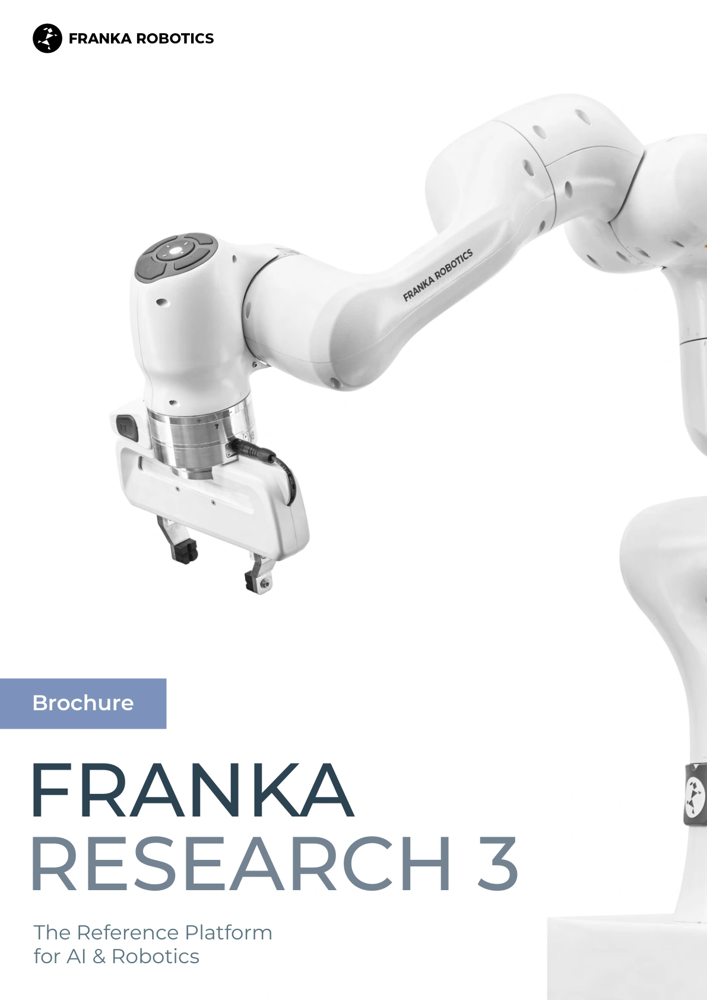



```
The Reference Platform  
for AI & Robotics
FRANKA
Brochure
RESEARCH 3
```



## PDF page 2

**Source:** Franka Research 3 (1).pdf, original pdf page 2. [Open the corresponding PDF reading-copy page](https://1292444914-files.gitbook.io/~/files/v0/b/gitbook-x-prod.appspot.com/o/spaces%2FtgOfPnscWebs1eh82EKq%2Fuploads%2F0K0MtbGbXPXdklZSBJ8u%2FFR3_BROCHURE-pages-001-006.pdf?alt=media#page=2).



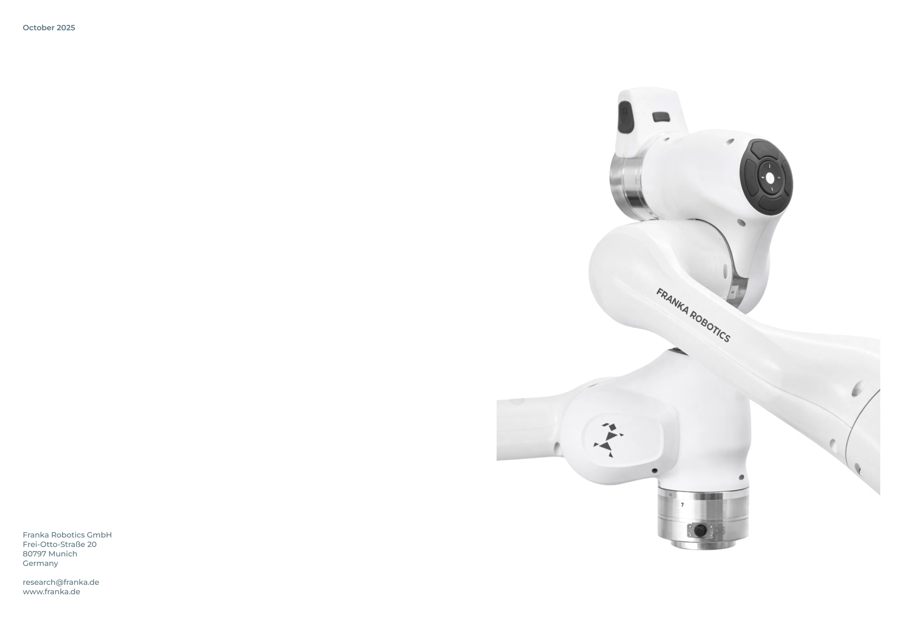



```
October 2025
Franka Robotics GmbH
Frei-Otto-Straße 20
80797 Munich
Germany 
 
research@franka.de
www.franka.de
```



## PDF page 3

**Source:** Franka Research 3 (1).pdf, original pdf page 3. [Open the corresponding PDF reading-copy page](https://1292444914-files.gitbook.io/~/files/v0/b/gitbook-x-prod.appspot.com/o/spaces%2FtgOfPnscWebs1eh82EKq%2Fuploads%2F0K0MtbGbXPXdklZSBJ8u%2FFR3_BROCHURE-pages-001-006.pdf?alt=media#page=3).



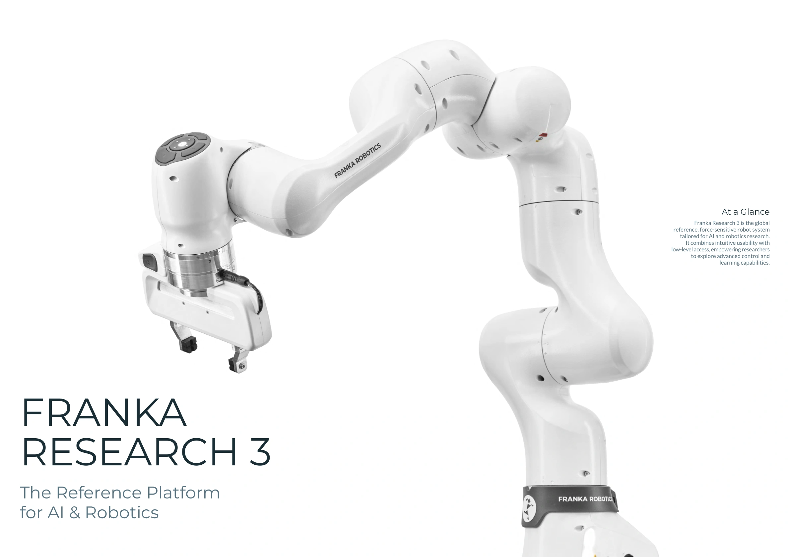



```
FRANKA  
RESEARCH 3
The Reference Platform  
for AI & Robotics
Franka Research 3 is the global 
reference, force-sensitive robot system 
tailored for AI and robotics research. 
It combines intuitive usability with 
low-level access, empowering researchers 
to explore advanced control and 
learning capabilities.
At a Glance
```



## PDF page 4

**Source:** Franka Research 3 (1).pdf, original pdf page 4. [Open the corresponding PDF reading-copy page](https://1292444914-files.gitbook.io/~/files/v0/b/gitbook-x-prod.appspot.com/o/spaces%2FtgOfPnscWebs1eh82EKq%2Fuploads%2F0K0MtbGbXPXdklZSBJ8u%2FFR3_BROCHURE-pages-001-006.pdf?alt=media#page=4).



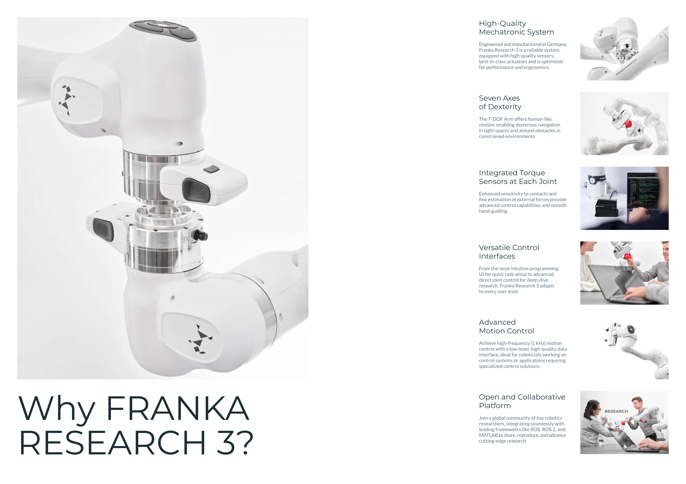



```
Why FRANKA  
RESEARCH 3?
Engineered and manufactured in Germany, 
Franka Research 3 is a reliable system, 
equipped with high-quality sensors, 
best-in-class actuators and is optimized 
for performance and ergonomics.
The 7-DOF Arm offers human-like 
motion, enabling dexterous navigation  
in tight spaces and around obstacles in 
constrained environments.
Enhanced sensitivity to contacts and  
fine estimation of external forces provide 
advanced control capabilities and smooth 
hand-guiding.
From the most intuitive programming 
UI for quick task setup to advanced  
direct joint control for deep-dive 
research, Franka Research 3 adapts 
to every user level.
Achieve high-frequency (1 kHz) motion 
control with a low-level, high-quality data 
interface, ideal for roboticists working on 
control systems or applications requiring 
specialized control solutions. 
Join a global community of top robotics 
researchers, integrating seamlessly with 
leading frameworks like ROS, ROS 2, and 
MATLAB to share, reproduce, and advance 
cutting-edge research.
High-Quality 
Mechatronic System
Seven Axes 
of Dexterity
Integrated Torque 
Sensors at Each Joint
Versatile Control 
Interfaces
Advanced 
Motion Control
Open and Collaborative 
Platform
```



## PDF page 5

**Source:** Franka Research 3 (1).pdf, original pdf page 5. [Open the corresponding PDF reading-copy page](https://1292444914-files.gitbook.io/~/files/v0/b/gitbook-x-prod.appspot.com/o/spaces%2FtgOfPnscWebs1eh82EKq%2Fuploads%2F0K0MtbGbXPXdklZSBJ8u%2FFR3_BROCHURE-pages-001-006.pdf?alt=media#page=5).



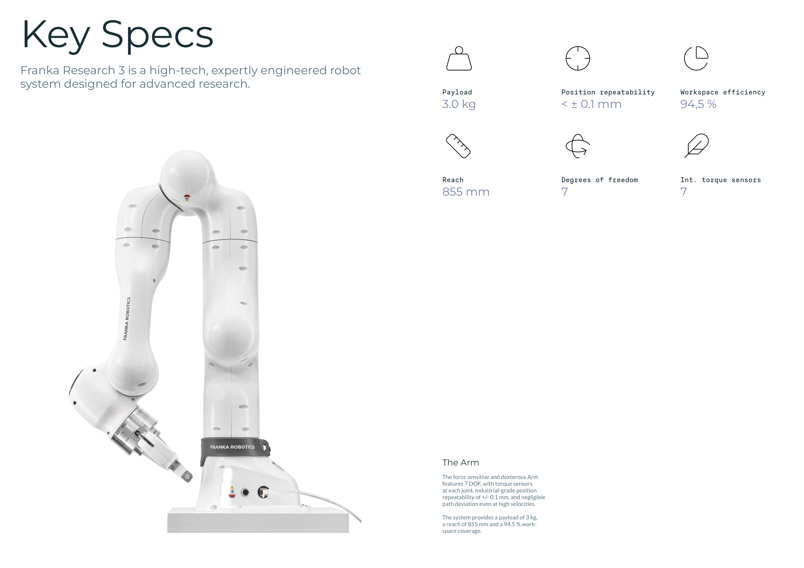



```
Franka Research 3 is a high-tech, expertly engineered robot 
system designed for advanced research.
Key Specs
Payload
Reach
Workspace efficiency
Position repeatability
Degrees of freedom
Int. torque sensors
3.0 kg
855 mm
94,5 %
< ± 0.1 mm
7
7
The force sensitive and dexterous Arm 
features 7 DOF, with torque sensors  
at each joint, industrial-grade position 
repeatability of +/- 0.1 mm, and negligible 
path deviation even at high velocities.  
 
The system provides a payload of 3 kg,  
a reach of 855 mm and a 94.5 % work-
space coverage.
The Arm
```



## PDF page 6

**Source:** Franka Research 3 (1).pdf, original pdf page 6. [Open the corresponding PDF reading-copy page](https://1292444914-files.gitbook.io/~/files/v0/b/gitbook-x-prod.appspot.com/o/spaces%2FtgOfPnscWebs1eh82EKq%2Fuploads%2F0K0MtbGbXPXdklZSBJ8u%2FFR3_BROCHURE-pages-001-006.pdf?alt=media#page=6).



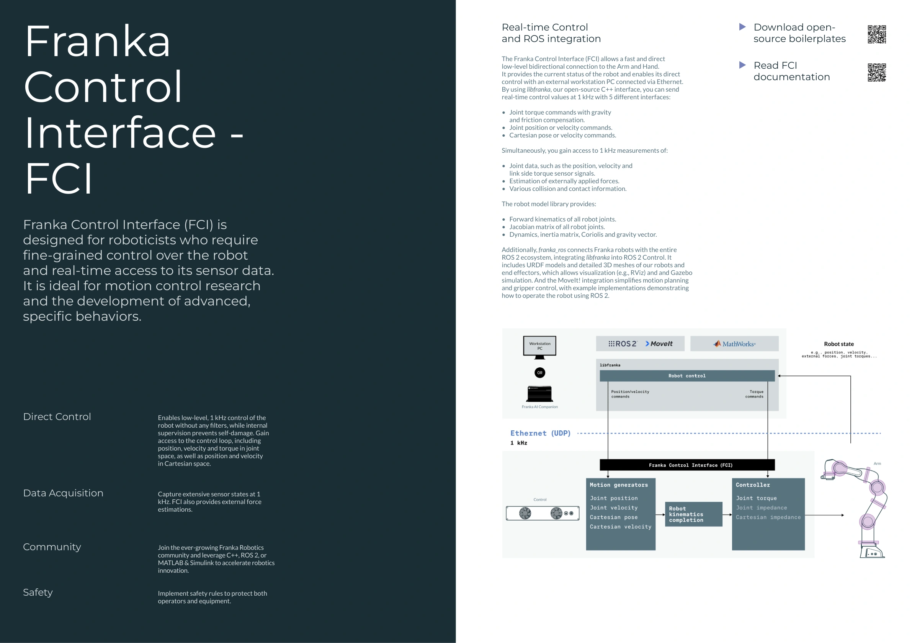



```
Franka Control Interface (FCI) is 
designed for roboticists who require 
fine-grained control over the robot 
and real-time access to its sensor data. 
It is ideal for motion control research 
and the development of advanced, 
specific behaviors.
Franka
Control
Interface - 
FCI
Enables low-level, 1 kHz control of the 
robot without any filters, while internal 
supervision prevents self-damage. Gain 
access to the control loop, including 
position, velocity and torque in joint 
space, as well as position and velocity  
in Cartesian space.
Direct Control
Capture extensive sensor states at 1 
kHz. FCI also provides external force 
estimations.
Data Acquisition
Join the ever-growing Franka Robotics 
community and leverage C++, ROS 2, or 
MATLAB & Simulink to accelerate robotics 
innovation.
Community
Implement safety rules to protect both 
operators and equipment.
Safety
The Franka Control Interface (FCI) allows a fast and direct 
low-level bidirectional connection to the Arm and Hand.  
It provides the current status of the robot and enables its direct 
control with an external workstation PC connected via Ethernet.  
By using libfranka, our open-source C++ interface, you can send 
real-time control values at 1 kHz with 5 different interfaces:
•	 Joint torque commands with gravity  
and friction compensation.
•	 Joint position or velocity commands.
•	 Cartesian pose or velocity commands. 
Simultaneously, you gain access to 1 kHz measurements of:
•	 Joint data, such as the position, velocity and  
link side torque sensor signals.
•	 Estimation of externally applied forces.
•	 Various collision and contact information.
The robot model library provides:
•	 Forward kinematics of all robot joints.
•	 Jacobian matrix of all robot joints.
•	 Dynamics, inertia matrix, Coriolis and gravity vector.
Additionally, franka_ros connects Franka robots with the entire  
ROS 2 ecosystem, integrating libfranka into ROS 2 Control. It 
includes URDF models and detailed 3D meshes of our robots and 
end effectors, which allows visualization (e.g., RViz) and and Gazebo 
simulation. And the MoveIt! integration simplifies motion planning 
and gripper control, with example implementations demonstrating 
how to operate the robot using ROS 2.
Download open-
source boilerplates
Real-time Control 
and ROS integration
Read FCI  
documentation
```



**Original PDF links:** [Source link 1](https://frankarobotics.github.io/docs) · [Source link 2](https://github.com/frankarobotics)

## PDF page 7

**Source:** Franka Research 3 (1).pdf, original pdf page 7. [Open the corresponding PDF reading-copy page](https://1292444914-files.gitbook.io/~/files/v0/b/gitbook-x-prod.appspot.com/o/spaces%2FtgOfPnscWebs1eh82EKq%2Fuploads%2Fx7W9Y3zA0ZKyJaPmfhEf%2FFR3_BROCHURE-pages-007-010.pdf?alt=media#page=1).



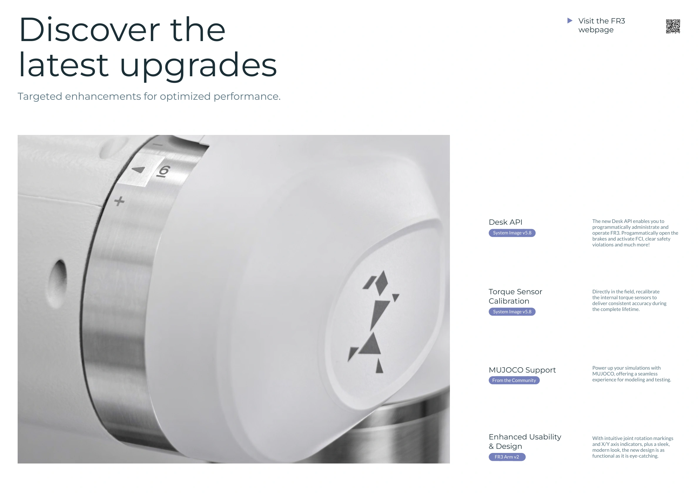



```
Targeted enhancements for optimized performance.
Discover the 
latest upgrades
The new Desk API enables you to 
programmatically administrate and 
operate FR3. Progammatically open the 
brakes and activate FCI, clear safety 
violations and much more!
Desk API
Directly in the field, recalibrate  
the internal torque sensors to  
deliver consistent accuracy during  
the complete lifetime.
Torque Sensor  
Calibration
Power up your simulations with 
MUJOCO, offering a seamless  
experience for modeling and testing.
MUJOCO Support
With intuitive joint rotation markings 
and X/Y axis indicators, plus a sleek, 
modern look, the new design is as 
functional as it is eye-catching.
Enhanced Usability  
& Design
Visit the FR3 
webpage
System Image v5.8
System Image v5.8
FR3 Arm v2
From the Community
```



**Original PDF links:** [Source link 1](https://franka.de/franka-research-3)

## PDF page 8

**Source:** Franka Research 3 (1).pdf, original pdf page 8. [Open the corresponding PDF reading-copy page](https://1292444914-files.gitbook.io/~/files/v0/b/gitbook-x-prod.appspot.com/o/spaces%2FtgOfPnscWebs1eh82EKq%2Fuploads%2Fx7W9Y3zA0ZKyJaPmfhEf%2FFR3_BROCHURE-pages-007-010.pdf?alt=media#page=2).



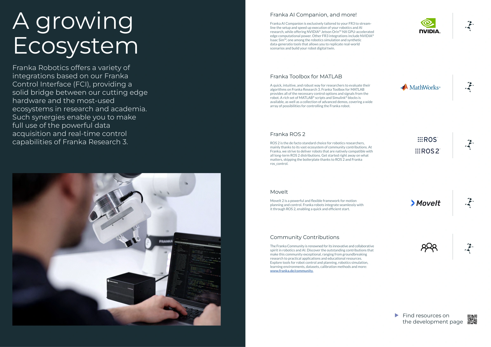



```
Franka AI Companion, and more!
Franka Robotics offers a variety of 
integrations based on our Franka 
Control Interface (FCI), providing a 
solid bridge between our cutting edge 
hardware and the most-used 
ecosystems in research and academia. 
Such synergies enable you to make 
full use of the powerful data 
acquisition and real-time control 
capabilities of Franka Research 3.
A growing 
Ecosystem
Franka AI Companion is exclusively tailored to your FR3 to stream-
line the setup and speed up execution of your robotics and AI 
research, while offering NVIDIA® Jetson Orin™ NX GPU-accelerated 
edge computational power. Other FR3 integrations include NVIDIA® 
Isaac Sim™, one among the robotics simulation and synthetic 
data-generatio tools that allows you to replicate real-world 
scenarios and build your robot digital twin.
Franka AI Companion, and more!
A quick, intuitive, and robust way for researchers to evaluate their 
algorithms on Franka Research 3. Franka Toolbox for MATLAB 
provides all of the necessary control options and signals from the 
robot. A rich set of MATLAB® scripts and Simulink® blocks is 
available, as well as a collection of advanced demos, covering a wide 
array of possibilities for controlling the Franka robot.
Franka Toolbox for MATLAB
ROS 2 is the de facto standard choice for robotics researchers, 
mainly thanks to its vast ecosystem of community contributions. At 
Franka, we strive to deliver robots that are natively compatible with 
all long-term ROS 2 distributions. Get started right away on what 
matters, skipping the boilerplate thanks to ROS 2 and Franka 
ros_control.
Franka ROS 2
MoveIt 2 is a powerful and flexible framework for motion  
planning and control. Franka robots integrate seamlessly with  
it through ROS 2, enabling a quick and efficient start.
MoveIt
The Franka Community is renowned for its innovative and collaborative 
spirit in robotics and AI. Discover the outstanding contributions that 
make this community exceptional, ranging from groundbreaking 
research to practical applications and educational resources. 
Explore tools for robot control and planning, robotics simulation, 
learning environments, datasets, calibration methods and more: 
www.franka.de/community.
Community Contributions
Find resources on 
the development page
```



**Original PDF links:** [Source link 1](http://www.franka.de/community.) · [Source link 2](https://franka.de/develop)

## PDF page 9

**Source:** Franka Research 3 (1).pdf, original pdf page 9. [Open the corresponding PDF reading-copy page](https://1292444914-files.gitbook.io/~/files/v0/b/gitbook-x-prod.appspot.com/o/spaces%2FtgOfPnscWebs1eh82EKq%2Fuploads%2Fx7W9Y3zA0ZKyJaPmfhEf%2FFR3_BROCHURE-pages-007-010.pdf?alt=media#page=3).



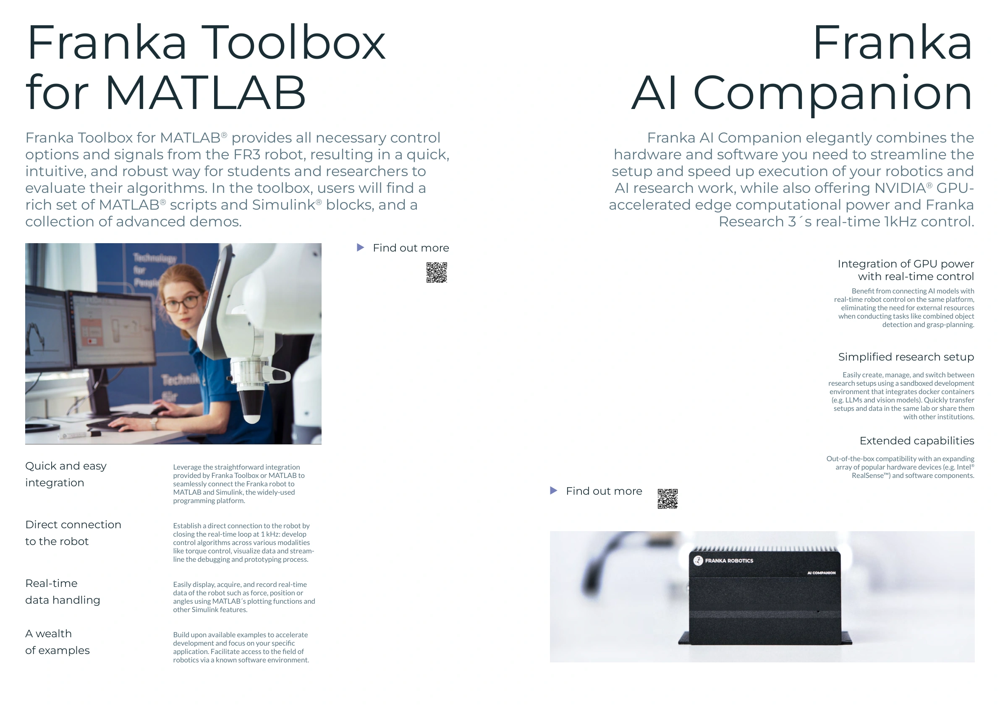



```
Franka Toolbox for MATLAB® provides all necessary control 
options and signals from the FR3 robot, resulting in a quick, 
intuitive, and robust way for students and researchers to 
evaluate their algorithms. In the toolbox, users will find a 
rich set of MATLAB® scripts and Simulink® blocks, and a 
collection of advanced demos.
Franka AI Companion elegantly combines the 
hardware and software you need to streamline the 
setup and speed up execution of your robotics and 
AI research work, while also offering NVIDIA® GPU-
accelerated edge computational power and Franka 
Research 3´s real-time 1kHz control.
Franka Toolbox 
for MATLAB
Franka 
AI Companion
Leverage the straightforward integration 
provided by Franka Toolbox or MATLAB to 
seamlessly connect the Franka robot to  
MATLAB and Simulink, the widely-used 
programming platform.
Quick and easy 
integration
Establish a direct connection to the robot by 
closing the real-time loop at 1 kHz: develop 
control algorithms across various modalities 
like torque control, visualize data and stream-
line the debugging and prototyping process.
Direct connection 
to the robot
Easily display, acquire, and record real-time 
data of the robot such as force, position or 
angles using MATLAB´s plotting functions and 
other Simulink features.
Real-time 
data handling
Build upon available examples to accelerate 
development and focus on your specific 
application. Facilitate access to the field of 
robotics via a known software environment.
A wealth 
of examples
Benefit from connecting AI models with 
real-time robot control on the same platform, 
eliminating the need for external resources 
when conducting tasks like combined object 
detection and grasp-planning.
Easily create, manage, and switch between 
research setups using a sandboxed development 
environment that integrates docker containers 
(e.g. LLMs and vision models). Quickly transfer 
setups and data in the same lab or share them 
with other institutions.
Out-of-the-box compatibility with an expanding 
array of popular hardware devices (e.g. Intel® 
RealSense™) and software components.
Integration of GPU power 
with real-time control
Simplified research setup
Extended capabilities
Find out more
Find out more
```



**Original PDF links:** [Source link 1](https://franka.de/franka-toolbox-for-matlab) · [Source link 2](https://franka.de/franka-ai-companion)

## PDF page 10

**Source:** Franka Research 3 (1).pdf, original pdf page 10. [Open the corresponding PDF reading-copy page](https://1292444914-files.gitbook.io/~/files/v0/b/gitbook-x-prod.appspot.com/o/spaces%2FtgOfPnscWebs1eh82EKq%2Fuploads%2Fx7W9Y3zA0ZKyJaPmfhEf%2FFR3_BROCHURE-pages-007-010.pdf?alt=media#page=4).







```
A thriving 
research 
Community, 
impactful 
applications
Franka Research 3 empowers visionary thinkers to explore, 
collaborate, create, and share – fostering advancements in 
robotics and AI, with impactful applications across diverse 
industries.
As the reference platform for AI & robotics research, Franka 
Research 3 has fostered a thriving, open, and global research 
ecosystem. In 2024 alone, nearly 1,400 research publications have 
featured Franka robots, underscoring its pivotal role in advancing the 
field. As the go-to platform for collaboration, it enables researchers 
to exchange ideas, share breakthroughs, and push the boundaries of 
robotics, ultimately giving AI a robot body.
Additionally, industries such as agriculture, healthcare, hospitality, 
and retail benefit from our robot system by automating routine tasks, 
boosting efficiency, and enhancing customer experiences. These 
impactful applications are transforming industries and unlocking new 
growth opportunities.
Academic and Corporate Research
Service Robotics by OEM Innovators
Discover the contributions 
from the Community
Check out our Applications
```



**Original PDF links:** [Source link 1](https://franka.de/community) · [Source link 2](https://franka.de/applications)

## PDF page 11

**Source:** Franka Research 3 (1).pdf, original pdf page 11. [Open the corresponding PDF reading-copy page](https://1292444914-files.gitbook.io/~/files/v0/b/gitbook-x-prod.appspot.com/o/spaces%2FtgOfPnscWebs1eh82EKq%2Fuploads%2FW98bOTNOa2XddXSXNawB%2FFR3_BROCHURE-pages-011-013.pdf?alt=media#page=1).



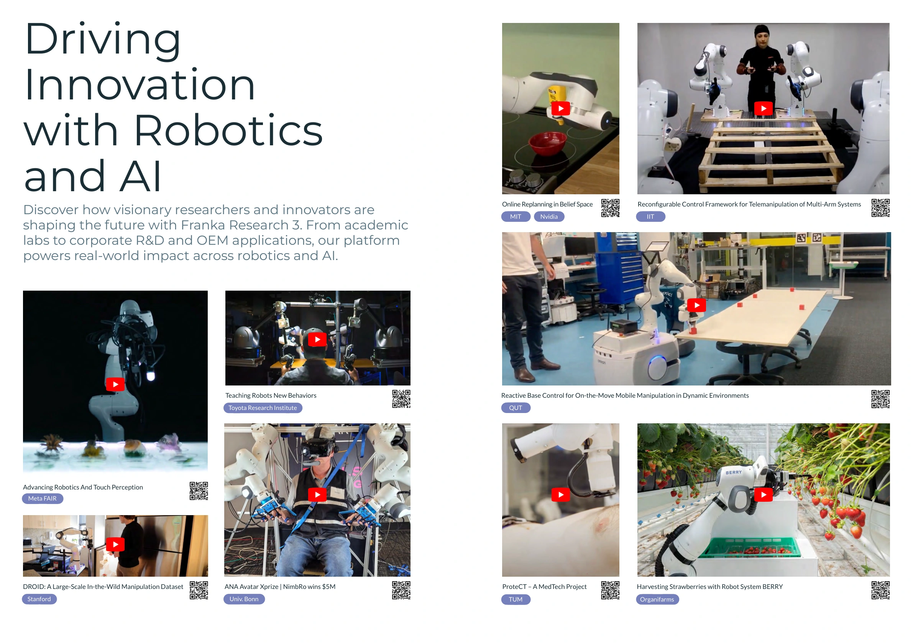



```
Driving 
Innovation
with Robotics 
and AI
Discover how visionary researchers and innovators are 
shaping the future with Franka Research 3. From academic 
labs to corporate R&D and OEM applications, our platform 
powers real-world impact across robotics and AI.
Teaching Robots New Behaviors
Reactive Base Control for On-the-Move Mobile Manipulation in Dynamic Environments
DROID: A Large-Scale In-the-Wild Manipulation Dataset
ANA Avatar Xprize | NimbRo wins $5M
Advancing Robotics And Touch Perception
Reconfigurable Control Framework for Telemanipulation of Multi-Arm Systems
ProteCT – A MedTech Project
Harvesting Strawberries with Robot System BERRY
Meta FAIR
Univ. Bonn
Stanford
Toyota Research Institute
Organifarms
TUM
QUT
IIT
MIT
Nvidia
Online Replanning in Belief Space
```



**Original PDF links:** [Source link 1](https://www.youtube.com/watch?v=eyUZX-lCj4M) · [Source link 2](https://youtu.be/rdVT3_yhdMc) · [Source link 3](https://www.youtube.com/watch?v=w-CGSQAO5-Q) · [Source link 4](https://youtu.be/xqCJkTjAXDE) · [Source link 5](https://www.youtube.com/watch?v=OD2UbZNw9sQ) · [Source link 6](https://youtu.be/IOtrO29DFUg) · [Source link 7](https://youtu.be/_Upnax8j7PQ) · [Source link 8](https://youtu.be/gvH-YbElZuc) · [Source link 9](https://www.youtube.com/watch?v=zBjNe_s3hys)

## PDF page 12

**Source:** Franka Research 3 (1).pdf, original pdf page 12. [Open the corresponding PDF reading-copy page](https://1292444914-files.gitbook.io/~/files/v0/b/gitbook-x-prod.appspot.com/o/spaces%2FtgOfPnscWebs1eh82EKq%2Fuploads%2FW98bOTNOa2XddXSXNawB%2FFR3_BROCHURE-pages-011-013.pdf?alt=media#page=2).







```
USA, Canada, Europe
Asia, Middle East
Veronika Diemientieieva
Partner / Channel Manager
Kilian Köppl
Partner / Channel Manager
Begin your 
journey,  
contact the 
Franka Team!
Address
Frei-Otto-Straße 20
80797 Munich
Germany
Website
www.franka.de
Email
info@franka.de
sales@franka.de
Phone
+49 89 2006069 20
Connect  
via LinkedIn
Connect  
via LinkedIn
```



**Original PDF links:** [Source link 1](https://www.linkedin.com/in/veronika-diemientieieva-743099250/) · [Source link 2](https://www.linkedin.com/in/kilian-koeppl-55384a160/)

## PDF page 13

**Source:** Franka Research 3 (1).pdf, original pdf page 13. [Open the corresponding PDF reading-copy page](https://1292444914-files.gitbook.io/~/files/v0/b/gitbook-x-prod.appspot.com/o/spaces%2FtgOfPnscWebs1eh82EKq%2Fuploads%2FW98bOTNOa2XddXSXNawB%2FFR3_BROCHURE-pages-011-013.pdf?alt=media#page=3).



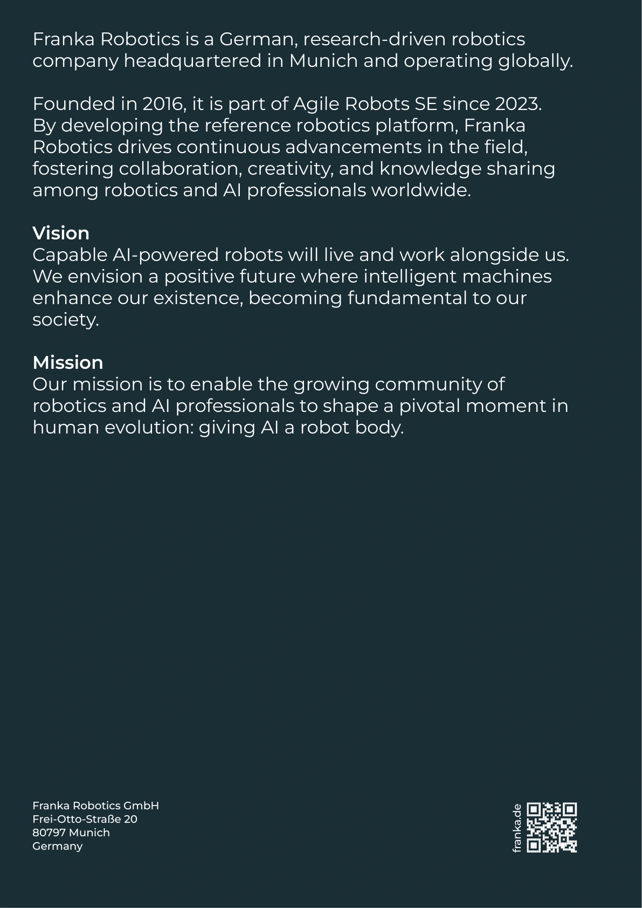



```
Franka Robotics is a German, research-driven robotics 
company headquartered in Munich and operating globally. 
Founded in 2016, it is part of Agile Robots SE since 2023.  
By developing the reference robotics platform, Franka 
Robotics drives continuous advancements in the field, 
fostering collaboration, creativity, and knowledge sharing 
among robotics and AI professionals worldwide.
Vision
Capable AI-powered robots will live and work alongside us. 
We envision a positive future where intelligent machines 
enhance our existence, becoming fundamental to our 
society.
Mission
Our mission is to enable the growing community of 
robotics and AI professionals to shape a pivotal moment in 
human evolution: giving AI a robot body.
Franka Robotics GmbH
Frei-Otto-Straße 20
80797 Munich
Germany
franka.de
```



**Original PDF links:** [Source link 1](https://franka.de/)
