# FR3 Arm v2.1 hardware manual R02210/1.2 — PDF pages 1–72


**Complete supplied source:** Hardware Manual Franka Research 3\_Arm v2.1\_R02210\_1.2\_EN.pdf · **Coverage:** 118 original PDF pages. [Return to the Franka source library](../).


Every source page is retained in the original order. The **Original page** view preserves complete diagrams, photographs, tables, equations, connector orientation, notices and examples. The **Searchable text** view preserves native PDF text or the slide’s native text, embedded links and substantive speaker notes. Text extraction can retain reading-order/character defects; use the original image for exact layout, table columns and code indentation.


This supplied R02210/1.2 hardware manual applies to Arm v2.1. Match Arm, Control and System Image using the manufacturer compatibility matrix; do not merge the supplied manual with newer R02210/1.3 or System Image-specific operating instructions. Mechanical installation, fail-safe locking, manual movement and safety tests require the complete applicable procedures and qualified personnel.


**Attribution:** the manufacturer and contributors identified in the supplied document. Original notices remain visible on every source page. Navigation, revision notes and the linked engineering explanations are OpenELAB editorial additions.

[Full document index](./) · This reading section contains original PDF pages **1–72**.

## Document navigation

| Source section / function                                                      | Original page                          |
| ------------------------------------------------------------------------------ | -------------------------------------- |
| ABOUT HARDWARE MANUAL                                                          | [PDF 6](pages-001-072.md#pdf-page-6)   |
| Software and hardware version                                                  | [PDF 6](pages-001-072.md#pdf-page-6)   |
| 1.2 Applicable document                                                        | [PDF 6](pages-001-072.md#pdf-page-6)   |
| 1.3 Before you begin                                                           | [PDF 6](pages-001-072.md#pdf-page-6)   |
| RIGHTS OF USE AND PROPERTY RIGHTS                                              | [PDF 7](pages-001-072.md#pdf-page-7)   |
| General                                                                        | [PDF 7](pages-001-072.md#pdf-page-7)   |
| Identification                                                                 | [PDF 7](pages-001-072.md#pdf-page-7)   |
| DECLARATION OF INCORPORATION AND CERTIFICATES                                  | [PDF 8](pages-001-072.md#pdf-page-8)   |
| Declaration of Incorporation                                                   | [PDF 8](pages-001-072.md#pdf-page-8)   |
| Further Statements                                                             | [PDF 10](pages-001-072.md#pdf-page-10) |
| RoHS / REACH / WEEE / Battery Directive                                        | [PDF 10](pages-001-072.md#pdf-page-10) |
| China RoHS 2                                                                   | [PDF 11](pages-001-072.md#pdf-page-11) |
| Labeling on the equipment                                                      | [PDF 12](pages-001-072.md#pdf-page-12) |
| Arm                                                                            | [PDF 12](pages-001-072.md#pdf-page-12) |
| External Enabling Device                                                       | [PDF 13](pages-001-072.md#pdf-page-13) |
| Emergency Stop Device                                                          | [PDF 14](pages-001-072.md#pdf-page-14) |
| SAFETY                                                                         | [PDF 14](pages-001-072.md#pdf-page-14) |
| Safety instructions and general instructions                                   | [PDF 14](pages-001-072.md#pdf-page-14) |
| Notice of Liability                                                            | [PDF 15](pages-001-072.md#pdf-page-15) |
| Intended use                                                                   | [PDF 15](pages-001-072.md#pdf-page-15) |
| Misuse                                                                         | [PDF 15](pages-001-072.md#pdf-page-15) |
| General possible dangers and safety measures when working with robots          | [PDF 16](pages-001-072.md#pdf-page-16) |
| Application related to possible dangers and safety measures                    | [PDF 19](pages-001-072.md#pdf-page-19) |
| Installation of safety peripherals                                             | [PDF 21](pages-001-072.md#pdf-page-21) |
| Fail-safe locking system                                                       | [PDF 22](pages-001-072.md#pdf-page-22) |
| Manually Moving the Arm                                                        | [PDF 23](pages-001-072.md#pdf-page-23) |
| Safety Functions                                                               | [PDF 25](pages-001-072.md#pdf-page-25) |
| Additional information for planning and initial installation of a robot system | [PDF 29](pages-001-072.md#pdf-page-29) |
| EQUIPMENT OVERVIEW                                                             | [PDF 33](pages-001-072.md#pdf-page-33) |
| The Arm                                                                        | [PDF 34](pages-001-072.md#pdf-page-34) |
| Control                                                                        | [PDF 42](pages-001-072.md#pdf-page-42) |
| SCOPE OF DELIVERY AND ADDITIONAL EQUIPMENT                                     | [PDF 43](pages-001-072.md#pdf-page-43) |
| Included in the box                                                            | [PDF 43](pages-001-072.md#pdf-page-43) |
| Not included in the box                                                        | [PDF 45](pages-001-072.md#pdf-page-45) |
| Available spare parts and accessories                                          | [PDF 45](pages-001-072.md#pdf-page-45) |
| MOUNTING AND INSTALLATION                                                      | [PDF 46](pages-001-072.md#pdf-page-46) |
| Unpacking the equipment                                                        | [PDF 47](pages-001-072.md#pdf-page-47) |
| Correct installation site                                                      | [PDF 52](pages-001-072.md#pdf-page-52) |
| Maximum-and safeguarded space                                                  | [PDF 52](pages-001-072.md#pdf-page-52) |
| Ambient conditions: Arm                                                        | [PDF 53](pages-001-072.md#pdf-page-53) |
| Ambient conditions: Control                                                    | [PDF 55](pages-001-072.md#pdf-page-55) |
| Preparing the Installation site                                                | [PDF 56](pages-001-072.md#pdf-page-56) |
| Arm                                                                            | [PDF 56](pages-001-072.md#pdf-page-56) |
| Control                                                                        | [PDF 58](pages-001-072.md#pdf-page-58) |
| Mounting the Arm                                                               | [PDF 59](pages-001-072.md#pdf-page-59) |
| Positioning the Control                                                        | [PDF 61](pages-001-072.md#pdf-page-61) |
| Wiring and Electrical installation                                             | [PDF 62](pages-001-072.md#pdf-page-62) |
| Connecting to the robot interface                                              | [PDF 63](pages-001-072.md#pdf-page-63) |
| Connection diagram                                                             | [PDF 63](pages-001-072.md#pdf-page-63) |
| Interfaces                                                                     | [PDF 63](pages-001-072.md#pdf-page-63) |
| Wiring                                                                         | [PDF 66](pages-001-072.md#pdf-page-66) |
| Mounting End Effectors                                                         | [PDF 71](pages-001-072.md#pdf-page-71) |

## PDF page 1

**Source:** Hardware Manual Franka Research 3\_Arm v2.1\_R02210\_1.2\_EN.pdf, original pdf page 1. [Open the corresponding PDF reading-copy page](https://1292444914-files.gitbook.io/~/files/v0/b/gitbook-x-prod.appspot.com/o/spaces%2FtgOfPnscWebs1eh82EKq%2Fuploads%2Fki28YBabSiu9HcAAoMRv%2FFR3_HARDWARE-pages-001-007.pdf?alt=media#page=1).







```
Hardware Manual 
FRANKA 
RESEARCH 3
```



## PDF page 2

**Source:** Hardware Manual Franka Research 3\_Arm v2.1\_R02210\_1.2\_EN.pdf, original pdf page 2. [Open the corresponding PDF reading-copy page](https://1292444914-files.gitbook.io/~/files/v0/b/gitbook-x-prod.appspot.com/o/spaces%2FtgOfPnscWebs1eh82EKq%2Fuploads%2Fki28YBabSiu9HcAAoMRv%2FFR3_HARDWARE-pages-001-007.pdf?alt=media#page=2).



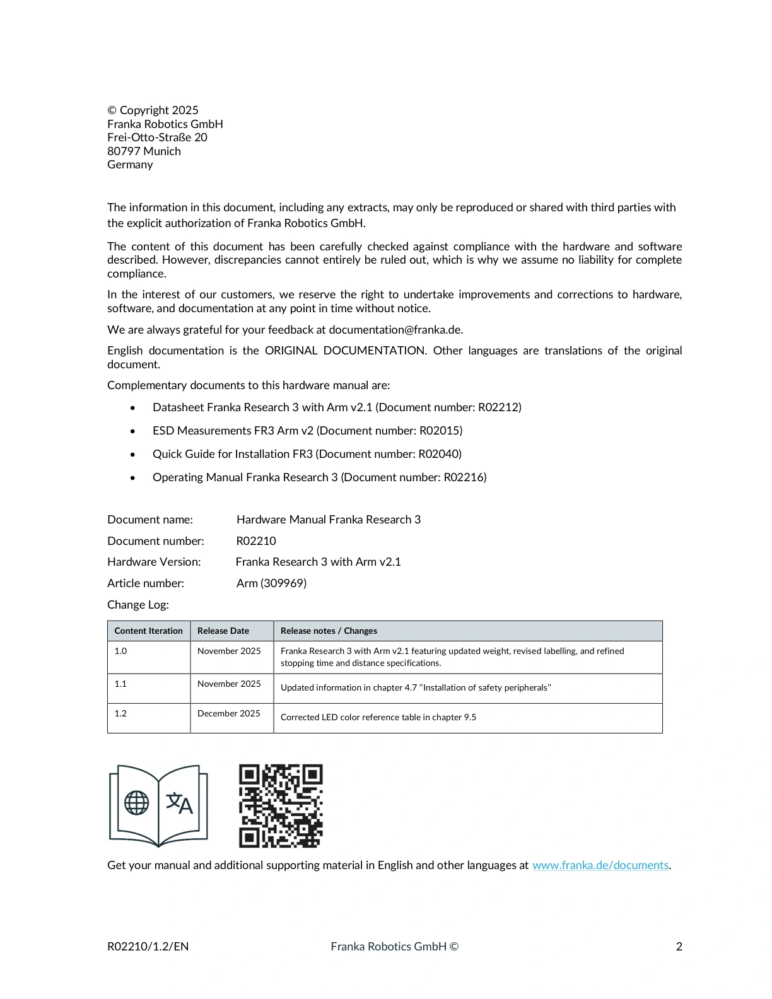



```
R02210/1.2/EN 
Franka Robotics GmbH ©  
2  
 
 
© Copyright 2025 
Franka Robotics GmbH 
Frei-Otto-Straße 20 
80797 Munich 
Germany 
 
The information in this document, including any extracts, may only be reproduced or shared with third parties with 
the explicit authorization of Franka Robotics GmbH. 
The content of this document has been carefully checked against compliance with the hardware and software 
described. However, discrepancies cannot entirely be ruled out, which is why we assume no liability for complete 
compliance. 
In the interest of our customers, we reserve the right to undertake improvements and corrections to hardware, 
software, and documentation at any point in time without notice. 
We are always grateful for your feedback at documentation@franka.de. 
English documentation is the ORIGINAL DOCUMENTATION. Other languages are translations of the original 
document. 
Complementary documents to this hardware manual are: 
• 
Datasheet Franka Research 3 with Arm v2.1 (Document number: R02212) 
• 
ESD Measurements FR3 Arm v2 (Document number: R02015) 
• 
Quick Guide for Installation FR3 (Document number: R02040) 
• 
Operating Manual Franka Research 3 (Document number: R02216) 
 
Document name:               Hardware Manual Franka Research 3 
Document number:           R02210 
Hardware Version:            Franka Research 3 with Arm v2.1 
Article number:                  Arm (309969) 
Change Log: 
Content Iteration  
Release Date 
Release notes / Changes 
1.0 
November 2025 
Franka Research 3 with Arm v2.1 featuring updated weight, revised labelling, and refined 
stopping time and distance specifications. 
1.1 
November 2025 
Updated information in chapter 4.7 ‘’Installation of safety peripherals’’ 
1.2 
December 2025 
Corrected LED color reference table in chapter 9.5 
 
 
Get your manual and additional supporting material in English and other languages at www.franka.de/documents.
```



**Original PDF links:** [Source link 1](http://www.franka.de/documents)

## PDF page 3

**Source:** Hardware Manual Franka Research 3\_Arm v2.1\_R02210\_1.2\_EN.pdf, original pdf page 3. [Open the corresponding PDF reading-copy page](https://1292444914-files.gitbook.io/~/files/v0/b/gitbook-x-prod.appspot.com/o/spaces%2FtgOfPnscWebs1eh82EKq%2Fuploads%2Fki28YBabSiu9HcAAoMRv%2FFR3_HARDWARE-pages-001-007.pdf?alt=media#page=3).



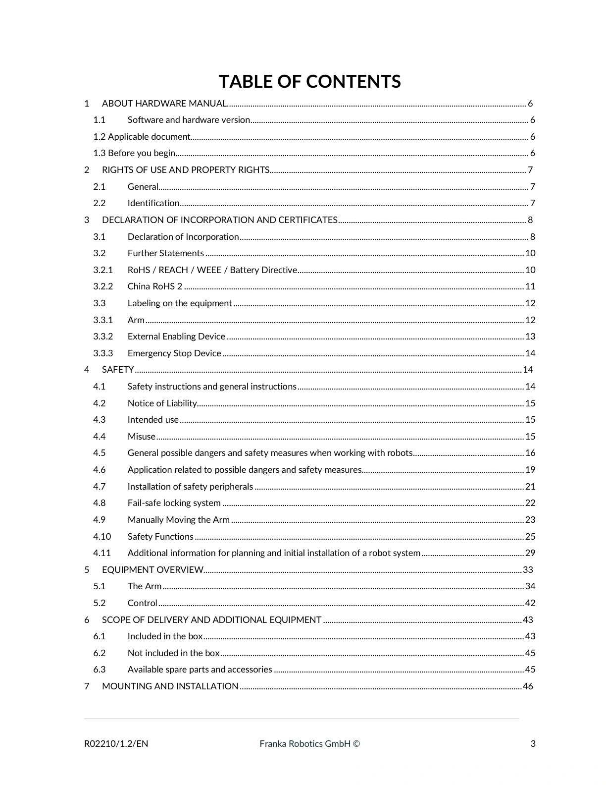



```
R02210/1.2/EN 
Franka Robotics GmbH ©  
3  
 
TABLE OF CONTENTS 
1 
ABOUT HARDWARE MANUAL............................................................................................................................................ 6 
1.1 
Software and hardware version .................................................................................................................................. 6 
1.2 Applicable document.............................................................................................................................................................. 6 
1.3 Before you begin ..................................................................................................................................................................... 6 
2 
RIGHTS OF USE AND PROPERTY RIGHTS........................................................................................................................ 7 
2.1 
General............................................................................................................................................................................. 7 
2.2 
Identification ................................................................................................................................................................... 7 
3 
DECLARATION OF INCORPORATION AND CERTIFICATES ........................................................................................ 8 
3.1 
Declaration of Incorporation ....................................................................................................................................... 8 
3.2 
Further Statements ..................................................................................................................................................... 10 
3.2.1 
RoHS / REACH / WEEE / Battery Directive .......................................................................................................... 10 
3.2.2 
China RoHS 2 ............................................................................................................................................................... 11 
3.3 
Labeling on the equipment ........................................................................................................................................ 12 
3.3.1 
Arm ................................................................................................................................................................................. 12 
3.3.2 
External Enabling Device ........................................................................................................................................... 13 
3.3.3 
Emergency Stop Device ............................................................................................................................................. 14 
4 
SAFETY ..................................................................................................................................................................................... 14 
4.1 
Safety instructions and general instructions .......................................................................................................... 14 
4.2 
Notice of Liability......................................................................................................................................................... 15 
4.3 
Intended use ................................................................................................................................................................. 15 
4.4 
Misuse ............................................................................................................................................................................ 15 
4.5 
General possible dangers and safety measures when working with robots .................................................... 16 
4.6 
Application related to possible dangers and safety measures............................................................................ 19 
4.7 
Installation of safety peripherals .............................................................................................................................. 21 
4.8 
Fail-safe locking system ............................................................................................................................................. 22 
4.9 
Manually Moving the Arm ......................................................................................................................................... 23 
4.10 
Safety Functions .......................................................................................................................................................... 25 
4.11 
Additional information for planning and initial installation of a robot system ................................................ 29 
5 
EQUIPMENT OVERVIEW..................................................................................................................................................... 33 
5.1 
The Arm ......................................................................................................................................................................... 34 
5.2 
Control ........................................................................................................................................................................... 42 
6 
SCOPE OF DELIVERY AND ADDITIONAL EQUIPMENT ............................................................................................. 43 
6.1 
Included in the box ...................................................................................................................................................... 43 
6.2 
Not included in the box .............................................................................................................................................. 45 
6.3 
Available spare parts and accessories ..................................................................................................................... 45 
7 
MOUNTING AND INSTALLATION .................................................................................................................................... 46
```



**Original document cross-references:** [PDF 6](pages-001-072.md#pdf-page-6) · [PDF 7](pages-001-072.md#pdf-page-7) · [PDF 8](pages-001-072.md#pdf-page-8) · [PDF 10](pages-001-072.md#pdf-page-10) · [PDF 11](pages-001-072.md#pdf-page-11) · [PDF 12](pages-001-072.md#pdf-page-12) · [PDF 13](pages-001-072.md#pdf-page-13) · [PDF 14](pages-001-072.md#pdf-page-14) · [PDF 15](pages-001-072.md#pdf-page-15) · [PDF 16](pages-001-072.md#pdf-page-16) · [PDF 19](pages-001-072.md#pdf-page-19) · [PDF 21](pages-001-072.md#pdf-page-21) · [PDF 22](pages-001-072.md#pdf-page-22) · [PDF 23](pages-001-072.md#pdf-page-23) · [PDF 25](pages-001-072.md#pdf-page-25) · [PDF 29](pages-001-072.md#pdf-page-29) · [PDF 33](pages-001-072.md#pdf-page-33) · [PDF 34](pages-001-072.md#pdf-page-34) · [PDF 42](pages-001-072.md#pdf-page-42) · [PDF 43](pages-001-072.md#pdf-page-43) · [PDF 45](pages-001-072.md#pdf-page-45) · [PDF 46](pages-001-072.md#pdf-page-46)

## PDF page 4

**Source:** Hardware Manual Franka Research 3\_Arm v2.1\_R02210\_1.2\_EN.pdf, original pdf page 4. [Open the corresponding PDF reading-copy page](https://1292444914-files.gitbook.io/~/files/v0/b/gitbook-x-prod.appspot.com/o/spaces%2FtgOfPnscWebs1eh82EKq%2Fuploads%2Fki28YBabSiu9HcAAoMRv%2FFR3_HARDWARE-pages-001-007.pdf?alt=media#page=4).



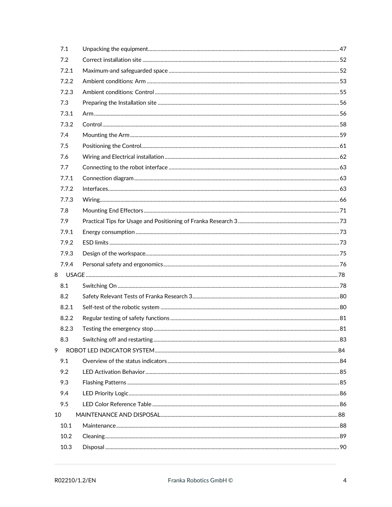



```
R02210/1.2/EN 
Franka Robotics GmbH ©  
4  
 
7.1 
Unpacking the equipment .......................................................................................................................................... 47 
7.2 
Correct installation site .............................................................................................................................................. 52 
7.2.1 
Maximum-and safeguarded space ........................................................................................................................... 52 
7.2.2 
Ambient conditions: Arm ........................................................................................................................................... 53 
7.2.3 
Ambient conditions: Control ..................................................................................................................................... 55 
7.3 
Preparing the Installation site ................................................................................................................................... 56 
7.3.1 
Arm ................................................................................................................................................................................. 56 
7.3.2 
Control ........................................................................................................................................................................... 58 
7.4 
Mounting the Arm ....................................................................................................................................................... 59 
7.5 
Positioning the Control............................................................................................................................................... 61 
7.6 
Wiring and Electrical installation .............................................................................................................................. 62 
7.7 
Connecting to the robot interface ........................................................................................................................... 63 
7.7.1 
Connection diagram .................................................................................................................................................... 63 
7.7.2 
Interfaces ....................................................................................................................................................................... 63 
7.7.3 
Wiring............................................................................................................................................................................. 66 
7.8 
Mounting End Effectors ............................................................................................................................................. 71 
7.9 
Practical Tips for Usage and Positioning of Franka Research 3 ......................................................................... 73 
7.9.1 
Energy consumption ................................................................................................................................................... 73 
7.9.2 
ESD limits ...................................................................................................................................................................... 73 
7.9.3 
Design of the workspace............................................................................................................................................ 75 
7.9.4 
Personal safety and ergonomics ............................................................................................................................... 76 
8 
USAGE ...................................................................................................................................................................................... 78 
8.1 
Switching On ................................................................................................................................................................ 78 
8.2 
Safety Relevant Tests of Franka Research 3 .......................................................................................................... 80 
8.2.1 
Self-test of the robotic system ................................................................................................................................. 80 
8.2.2 
Regular testing of safety functions .......................................................................................................................... 81 
8.2.3 
Testing the emergency stop ...................................................................................................................................... 81 
8.3 
Switching off and restarting ...................................................................................................................................... 83 
9 
ROBOT LED INDICATOR SYSTEM .................................................................................................................................... 84 
9.1 
Overview of the status indicators ............................................................................................................................ 84 
9.2 
LED Activation Behavior ............................................................................................................................................ 85 
9.3 
Flashing Patterns ......................................................................................................................................................... 85 
9.4 
LED Priority Logic ........................................................................................................................................................ 86 
9.5 
LED Color Reference Table ....................................................................................................................................... 86 
10 
MAINTENANCE AND DISPOSAL ................................................................................................................................ 88 
10.1 
Maintenance ................................................................................................................................................................. 88 
10.2 
Cleaning ......................................................................................................................................................................... 89 
10.3 
Disposal ......................................................................................................................................................................... 90
```



**Original document cross-references:** [PDF 47](pages-001-072.md#pdf-page-47) · [PDF 52](pages-001-072.md#pdf-page-52) · [PDF 53](pages-001-072.md#pdf-page-53) · [PDF 55](pages-001-072.md#pdf-page-55) · [PDF 56](pages-001-072.md#pdf-page-56) · [PDF 58](pages-001-072.md#pdf-page-58) · [PDF 59](pages-001-072.md#pdf-page-59) · [PDF 61](pages-001-072.md#pdf-page-61) · [PDF 62](pages-001-072.md#pdf-page-62) · [PDF 63](pages-001-072.md#pdf-page-63) · [PDF 66](pages-001-072.md#pdf-page-66) · [PDF 71](pages-001-072.md#pdf-page-71) · [PDF 73](pages-073-118.md#pdf-page-73) · [PDF 75](pages-073-118.md#pdf-page-75) · [PDF 76](pages-073-118.md#pdf-page-76) · [PDF 78](pages-073-118.md#pdf-page-78) · [PDF 80](pages-073-118.md#pdf-page-80) · [PDF 81](pages-073-118.md#pdf-page-81) · [PDF 83](pages-073-118.md#pdf-page-83) · [PDF 84](pages-073-118.md#pdf-page-84) · [PDF 85](pages-073-118.md#pdf-page-85) · [PDF 86](pages-073-118.md#pdf-page-86) · [PDF 88](pages-073-118.md#pdf-page-88) · [PDF 89](pages-073-118.md#pdf-page-89) · [PDF 90](pages-073-118.md#pdf-page-90)

## PDF page 5

**Source:** Hardware Manual Franka Research 3\_Arm v2.1\_R02210\_1.2\_EN.pdf, original pdf page 5. [Open the corresponding PDF reading-copy page](https://1292444914-files.gitbook.io/~/files/v0/b/gitbook-x-prod.appspot.com/o/spaces%2FtgOfPnscWebs1eh82EKq%2Fuploads%2Fki28YBabSiu9HcAAoMRv%2FFR3_HARDWARE-pages-001-007.pdf?alt=media#page=5).



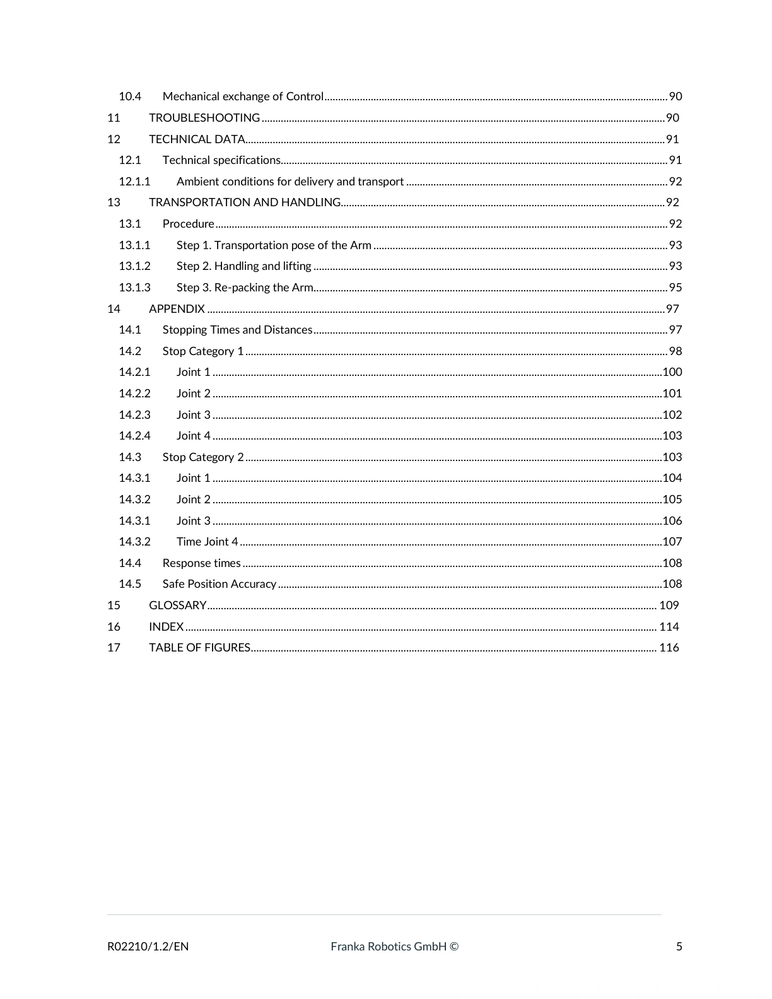



```
R02210/1.2/EN 
Franka Robotics GmbH ©  
5  
 
10.4 
Mechanical exchange of Control .............................................................................................................................. 90 
11 
TROUBLESHOOTING .................................................................................................................................................... 90 
12 
TECHNICAL DATA .......................................................................................................................................................... 91 
12.1 
Technical specifications .............................................................................................................................................. 91 
12.1.1 
Ambient conditions for delivery and transport ................................................................................................ 92 
13 
TRANSPORTATION AND HANDLING....................................................................................................................... 92 
13.1 
Procedure ...................................................................................................................................................................... 92 
13.1.1 
Step 1. Transportation pose of the Arm ............................................................................................................ 93 
13.1.2 
Step 2. Handling and lifting .................................................................................................................................. 93 
13.1.3 
Step 3. Re-packing the Arm .................................................................................................................................. 95 
14 
APPENDIX ........................................................................................................................................................................ 97 
14.1 
Stopping Times and Distances .................................................................................................................................. 97 
14.2 
Stop Category 1 ........................................................................................................................................................... 98 
14.2.1 
Joint 1 .....................................................................................................................................................................100 
14.2.2 
Joint 2 .....................................................................................................................................................................101 
14.2.3 
Joint 3 .....................................................................................................................................................................102 
14.2.4 
Joint 4 .....................................................................................................................................................................103 
14.3 
Stop Category 2 .........................................................................................................................................................103 
14.3.1 
Joint 1 .....................................................................................................................................................................104 
14.3.2 
Joint 2 .....................................................................................................................................................................105 
14.3.1 
Joint 3 .....................................................................................................................................................................106 
14.3.2 
Time Joint 4 ...........................................................................................................................................................107 
14.4 
Response times ..........................................................................................................................................................108 
14.5 
Safe Position Accuracy .............................................................................................................................................108 
15 
GLOSSARY ..................................................................................................................................................................... 109 
16 
INDEX ............................................................................................................................................................................. 114 
17 
TABLE OF FIGURES ..................................................................................................................................................... 116
```



**Original document cross-references:** [PDF 90](pages-073-118.md#pdf-page-90) · [PDF 91](pages-073-118.md#pdf-page-91) · [PDF 92](pages-073-118.md#pdf-page-92) · [PDF 93](pages-073-118.md#pdf-page-93) · [PDF 95](pages-073-118.md#pdf-page-95) · [PDF 97](pages-073-118.md#pdf-page-97) · [PDF 98](pages-073-118.md#pdf-page-98) · [PDF 100](pages-073-118.md#pdf-page-100) · [PDF 101](pages-073-118.md#pdf-page-101) · [PDF 102](pages-073-118.md#pdf-page-102) · [PDF 103](pages-073-118.md#pdf-page-103) · [PDF 104](pages-073-118.md#pdf-page-104) · [PDF 105](pages-073-118.md#pdf-page-105) · [PDF 106](pages-073-118.md#pdf-page-106) · [PDF 107](pages-073-118.md#pdf-page-107) · [PDF 108](pages-073-118.md#pdf-page-108) · [PDF 109](pages-073-118.md#pdf-page-109) · [PDF 114](pages-073-118.md#pdf-page-114) · [PDF 116](pages-073-118.md#pdf-page-116)

## PDF page 6

**Source:** Hardware Manual Franka Research 3\_Arm v2.1\_R02210\_1.2\_EN.pdf, original pdf page 6. [Open the corresponding PDF reading-copy page](https://1292444914-files.gitbook.io/~/files/v0/b/gitbook-x-prod.appspot.com/o/spaces%2FtgOfPnscWebs1eh82EKq%2Fuploads%2Fki28YBabSiu9HcAAoMRv%2FFR3_HARDWARE-pages-001-007.pdf?alt=media#page=6).



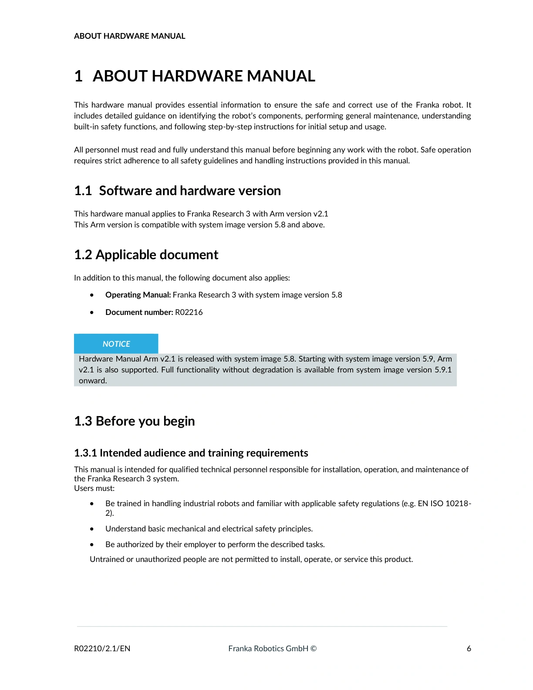



```
ABOUT HARDWARE MANUAL 
 
R02210/2.1/EN 
Franka Robotics GmbH ©  
6  
 
1 ABOUT HARDWARE MANUAL 
This hardware manual provides essential information to ensure the safe and correct use of the Franka robot. It 
includes detailed guidance on identifying the robot’s components, performing general maintenance, understanding 
built-in safety functions, and following step-by-step instructions for initial setup and usage. 
All personnel must read and fully understand this manual before beginning any work with the robot. Safe operation 
requires strict adherence to all safety guidelines and handling instructions provided in this manual. 
1.1 Software and hardware version 
This hardware manual applies to Franka Research 3 with Arm version v2.1 
This Arm version is compatible with system image version 5.8 and above. 
1.2 Applicable document 
In addition to this manual, the following document also applies: 
• 
Operating Manual: Franka Research 3 with system image version 5.8 
• 
Document number: R02216 
 
NOTICE 
 
Hardware Manual Arm v2.1 is released with system image 5.8. Starting with system image version 5.9, Arm 
v2.1 is also supported. Full functionality without degradation is available from system image version 5.9.1 
onward. 
 
1.3 Before you begin 
1.3.1 Intended audience and training requirements 
This manual is intended for qualified technical personnel responsible for installation, operation, and maintenance of 
the Franka Research 3 system. 
Users must: 
• 
Be trained in handling industrial robots and familiar with applicable safety regulations (e.g. EN ISO 10218-
2). 
• 
Understand basic mechanical and electrical safety principles. 
• 
Be authorized by their employer to perform the described tasks. 
Untrained or unauthorized people are not permitted to install, operate, or service this product.
```



## PDF page 7

**Source:** Hardware Manual Franka Research 3\_Arm v2.1\_R02210\_1.2\_EN.pdf, original pdf page 7. [Open the corresponding PDF reading-copy page](https://1292444914-files.gitbook.io/~/files/v0/b/gitbook-x-prod.appspot.com/o/spaces%2FtgOfPnscWebs1eh82EKq%2Fuploads%2Fki28YBabSiu9HcAAoMRv%2FFR3_HARDWARE-pages-001-007.pdf?alt=media#page=7).



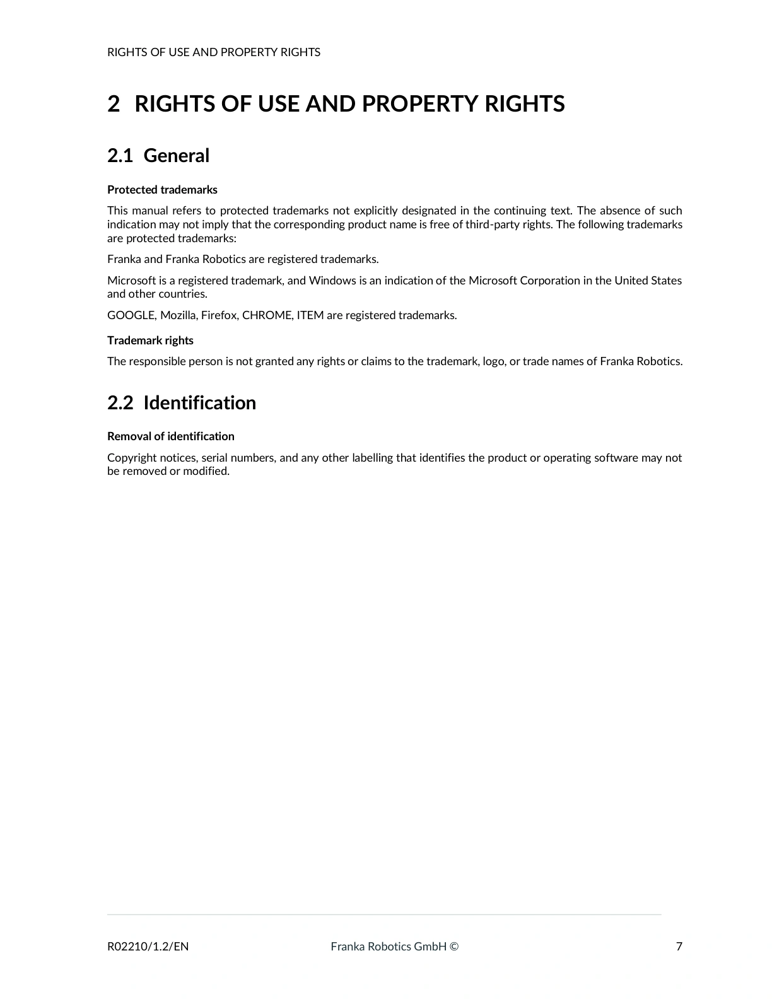



```
RIGHTS OF USE AND PROPERTY RIGHTS  
 
R02210/1.2/EN 
Franka Robotics GmbH ©  
7  
 
2 RIGHTS OF USE AND PROPERTY RIGHTS 
2.1 General 
Protected trademarks 
This manual refers to protected trademarks not explicitly designated in the continuing text. The absence of such 
indication may not imply that the corresponding product name is free of third-party rights. The following trademarks 
are protected trademarks: 
Franka and Franka Robotics are registered trademarks. 
Microsoft is a registered trademark, and Windows is an indication of the Microsoft Corporation in the United States 
and other countries. 
GOOGLE, Mozilla, Firefox, CHROME, ITEM are registered trademarks. 
Trademark rights 
The responsible person is not granted any rights or claims to the trademark, logo, or trade names of Franka Robotics. 
2.2 Identification 
Removal of identification 
Copyright notices, serial numbers, and any other labelling that identifies the product or operating software may not 
be removed or modified.
```



## PDF page 8

**Source:** Hardware Manual Franka Research 3\_Arm v2.1\_R02210\_1.2\_EN.pdf, original pdf page 8. [Open the corresponding PDF reading-copy page](https://1292444914-files.gitbook.io/~/files/v0/b/gitbook-x-prod.appspot.com/o/spaces%2FtgOfPnscWebs1eh82EKq%2Fuploads%2FJWKtINSVHfKJQwMY91k8%2FFR3_HARDWARE-pages-008-009.pdf?alt=media#page=1).



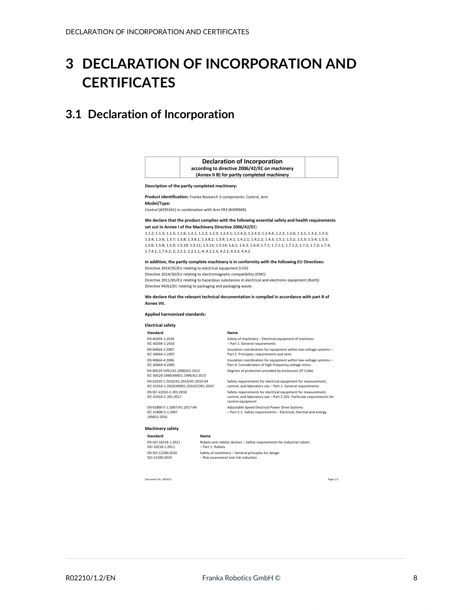



```
DECLARATION OF INCORPORATION AND CERTIFICATES  
 
R02210/1.2/EN 
Franka Robotics GmbH ©  
8  
 
3 DECLARATION OF INCORPORATION AND 
CERTIFICATES 
3.1 Declaration of Incorporation
```



## PDF page 9

**Source:** Hardware Manual Franka Research 3\_Arm v2.1\_R02210\_1.2\_EN.pdf, original pdf page 9. [Open the corresponding PDF reading-copy page](https://1292444914-files.gitbook.io/~/files/v0/b/gitbook-x-prod.appspot.com/o/spaces%2FtgOfPnscWebs1eh82EKq%2Fuploads%2FJWKtINSVHfKJQwMY91k8%2FFR3_HARDWARE-pages-008-009.pdf?alt=media#page=2).



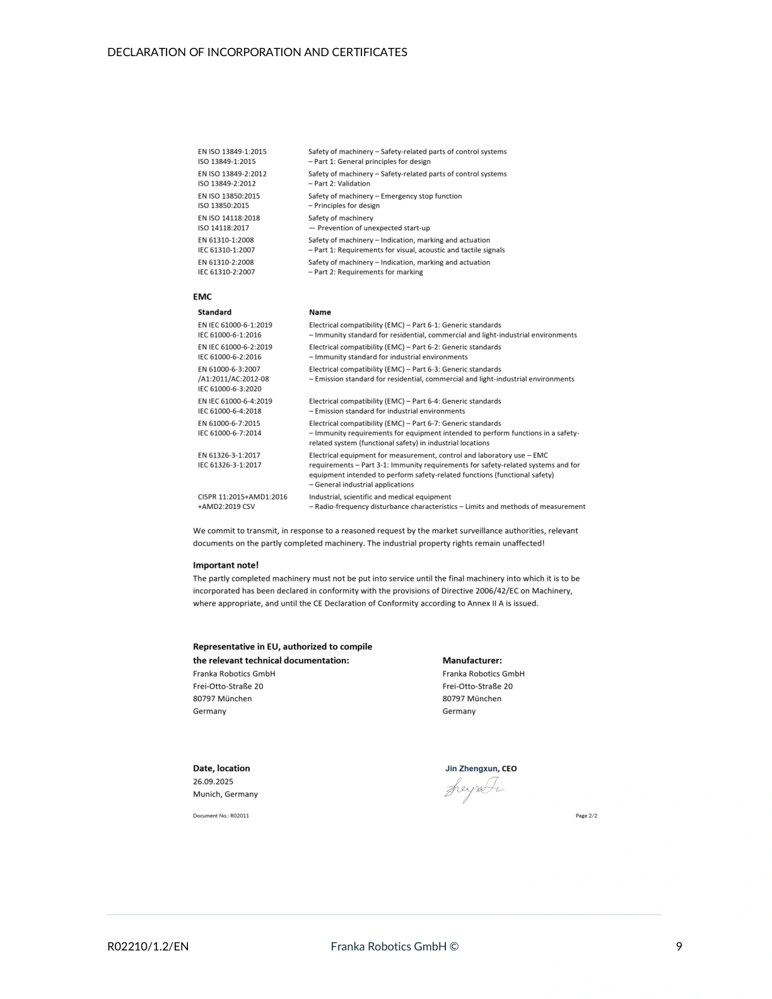



```
DECLARATION OF INCORPORATION AND CERTIFICATES  
 
R02210/1.2/EN 
Franka Robotics GmbH ©  
9
```



## PDF page 10

**Source:** Hardware Manual Franka Research 3\_Arm v2.1\_R02210\_1.2\_EN.pdf, original pdf page 10. [Open the corresponding PDF reading-copy page](https://1292444914-files.gitbook.io/~/files/v0/b/gitbook-x-prod.appspot.com/o/spaces%2FtgOfPnscWebs1eh82EKq%2Fuploads%2FbQAjVsBVe9tmqlGai6Cg%2FFR3_HARDWARE-pages-010-013.pdf?alt=media#page=1).



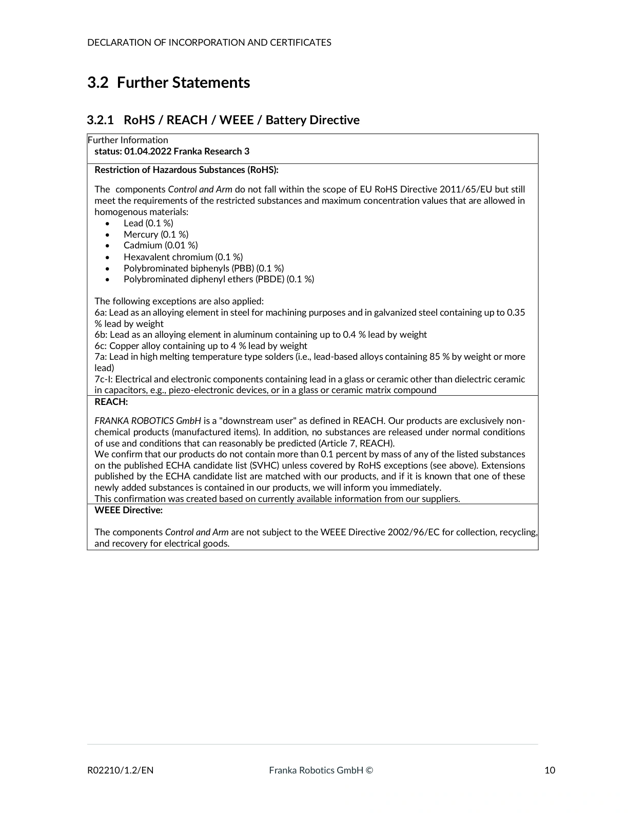



```
DECLARATION OF INCORPORATION AND CERTIFICATES  
 
R02210/1.2/EN 
Franka Robotics GmbH ©  
10  
 
3.2 Further Statements 
3.2.1 RoHS / REACH / WEEE / Battery Directive 
Further Information 
status: 01.04.2022 Franka Research 3 
Restriction of Hazardous Substances (RoHS): 
 
The  components Control and Arm do not fall within the scope of EU RoHS Directive 2011/65/EU but still 
meet the requirements of the restricted substances and maximum concentration values that are allowed in 
homogenous materials: 
• 
Lead (0.1 %) 
• 
Mercury (0.1 %) 
• 
Cadmium (0.01 %) 
• 
Hexavalent chromium (0.1 %) 
• 
Polybrominated biphenyls (PBB) (0.1 %) 
• 
Polybrominated diphenyl ethers (PBDE) (0.1 %) 
 
The following exceptions are also applied: 
6a: Lead as an alloying element in steel for machining purposes and in galvanized steel containing up to 0.35 
% lead by weight 
6b: Lead as an alloying element in aluminum containing up to 0.4 % lead by weight  
6c: Copper alloy containing up to 4 % lead by weight 
7a: Lead in high melting temperature type solders (i.e., lead-based alloys containing 85 % by weight or more 
lead) 
7c-I: Electrical and electronic components containing lead in a glass or ceramic other than dielectric ceramic 
in capacitors, e.g., piezo-electronic devices, or in a glass or ceramic matrix compound 
REACH: 
 
FRANKA ROBOTICS GmbH is a "downstream user" as defined in REACH. Our products are exclusively non-
chemical products (manufactured items). In addition, no substances are released under normal conditions 
of use and conditions that can reasonably be predicted (Article 7, REACH). 
We confirm that our products do not contain more than 0.1 percent by mass of any of the listed substances 
on the published ECHA candidate list (SVHC) unless covered by RoHS exceptions (see above). Extensions 
published by the ECHA candidate list are matched with our products, and if it is known that one of these 
newly added substances is contained in our products, we will inform you immediately. 
This confirmation was created based on currently available information from our suppliers. 
WEEE Directive: 
 
The components Control and Arm are not subject to the WEEE Directive 2002/96/EC for collection, recycling, 
and recovery for electrical goods.
```



## PDF page 11

**Source:** Hardware Manual Franka Research 3\_Arm v2.1\_R02210\_1.2\_EN.pdf, original pdf page 11. [Open the corresponding PDF reading-copy page](https://1292444914-files.gitbook.io/~/files/v0/b/gitbook-x-prod.appspot.com/o/spaces%2FtgOfPnscWebs1eh82EKq%2Fuploads%2FbQAjVsBVe9tmqlGai6Cg%2FFR3_HARDWARE-pages-010-013.pdf?alt=media#page=2).



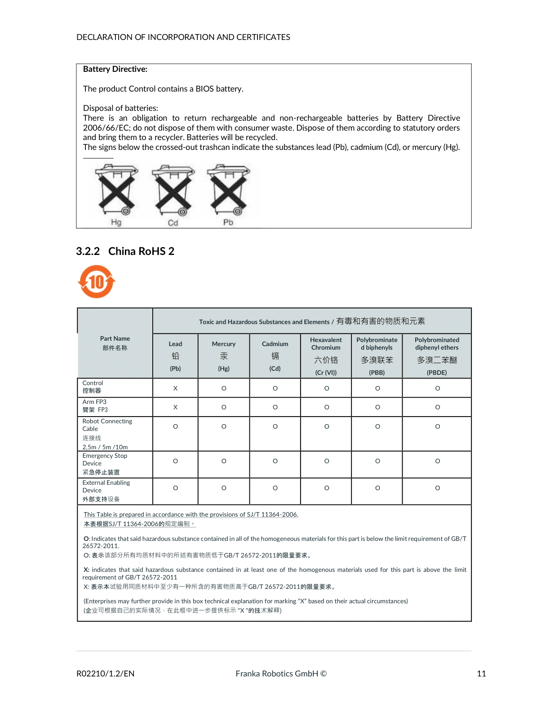



```
DECLARATION OF INCORPORATION AND CERTIFICATES  
 
R02210/1.2/EN 
Franka Robotics GmbH ©  
11  
 
Battery Directive: 
 
The product Control contains a BIOS battery.  
 
Disposal of batteries: 
There is an obligation to return rechargeable and non-rechargeable batteries by Battery Directive 
2006/66/EC; do not dispose of them with consumer waste. Dispose of them according to statutory orders 
and bring them to a recycler. Batteries will be recycled. 
The signs below the crossed-out trashcan indicate the substances lead (Pb), cadmium (Cd), or mercury (Hg). 
 
3.2.2 China RoHS 2 
 
Part Name 
部件名称 
Toxic and Hazardous Substances and Elements / 有毒和有害的物质和元素 
Lead  
铅 
(Pb) 
Mercury 
汞 
(Hg) 
Cadmium 
镉 
(Cd) 
Hexavalent 
Chromium 
六价铬 
(Cr (VI)) 
Polybrominate
d biphenyls 
多溴联苯 
(PBB) 
Polybrominated 
diphenyl ethers 
多溴二苯醚 
(PBDE) 
Control 
控制器 
X 
O 
O 
O 
O 
O 
Arm FP3 
臂架 FP3 
X 
O 
O 
O 
O 
O 
Robot Connecting 
Cable 
连接线 
2,5m / 5m /10m 
O 
O 
O 
O 
O 
O 
Emergency Stop 
Device 
紧急停止装置  
O 
O 
O 
O 
O 
O 
External Enabling 
Device 
外部支持设备 
O 
O 
O 
O 
O 
O 
This Table is prepared in accordance with the provisions of SJ/T 11364-2006. 
本表根据SJ/T 11364-2006的规定编制。 
O: Indicates that said hazardous substance contained in all of the homogeneous materials for this part is below the limit requirement of GB/T 
26572-2011. 
O: 表示该部分所有均质材料中的所述有害物质低于GB/T 26572-2011的限量要求。 
X: indicates that said hazardous substance contained in at least one of the homogenous materials used for this part is above the limit 
requirement of GB/T 26572-2011 
X: 表示本试验用同质材料中至少有一种所含的有害物质高于GB/T 26572-2011的限量要求。 
(Enterprises may further provide in this box technical explanation for marking “X” based on their actual circumstances) 
(企业可根据自己的实际情况，在此框中进一步提供标示 "X "的技术解释)
```



## PDF page 12

**Source:** Hardware Manual Franka Research 3\_Arm v2.1\_R02210\_1.2\_EN.pdf, original pdf page 12. [Open the corresponding PDF reading-copy page](https://1292444914-files.gitbook.io/~/files/v0/b/gitbook-x-prod.appspot.com/o/spaces%2FtgOfPnscWebs1eh82EKq%2Fuploads%2FbQAjVsBVe9tmqlGai6Cg%2FFR3_HARDWARE-pages-010-013.pdf?alt=media#page=3).



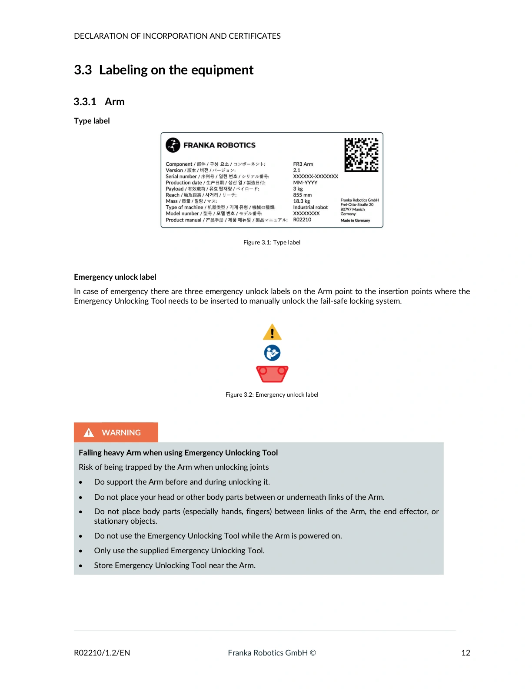



```
DECLARATION OF INCORPORATION AND CERTIFICATES  
 
R02210/1.2/EN 
Franka Robotics GmbH ©  
12  
 
3.3 Labeling on the equipment 
3.3.1 Arm 
Type label 
 
Figure 3.1: Type label 
 
Emergency unlock label 
In case of emergency there are three emergency unlock labels on the Arm point to the insertion points where the 
Emergency Unlocking Tool needs to be inserted to manually unlock the fail-safe locking system. 
 
Figure 3.2: Emergency unlock label 
 
WARNING 
  
Falling heavy Arm when using Emergency Unlocking Tool 
Risk of being trapped by the Arm when unlocking joints 
• 
Do support the Arm before and during unlocking it. 
• 
Do not place your head or other body parts between or underneath links of the Arm. 
• 
Do not place body parts (especially hands, fingers) between links of the Arm, the end effector, or 
stationary objects. 
• 
Do not use the Emergency Unlocking Tool while the Arm is powered on. 
• 
Only use the supplied Emergency Unlocking Tool. 
• 
Store Emergency Unlocking Tool near the Arm.
```



## PDF page 13

**Source:** Hardware Manual Franka Research 3\_Arm v2.1\_R02210\_1.2\_EN.pdf, original pdf page 13. [Open the corresponding PDF reading-copy page](https://1292444914-files.gitbook.io/~/files/v0/b/gitbook-x-prod.appspot.com/o/spaces%2FtgOfPnscWebs1eh82EKq%2Fuploads%2FbQAjVsBVe9tmqlGai6Cg%2FFR3_HARDWARE-pages-010-013.pdf?alt=media#page=4).



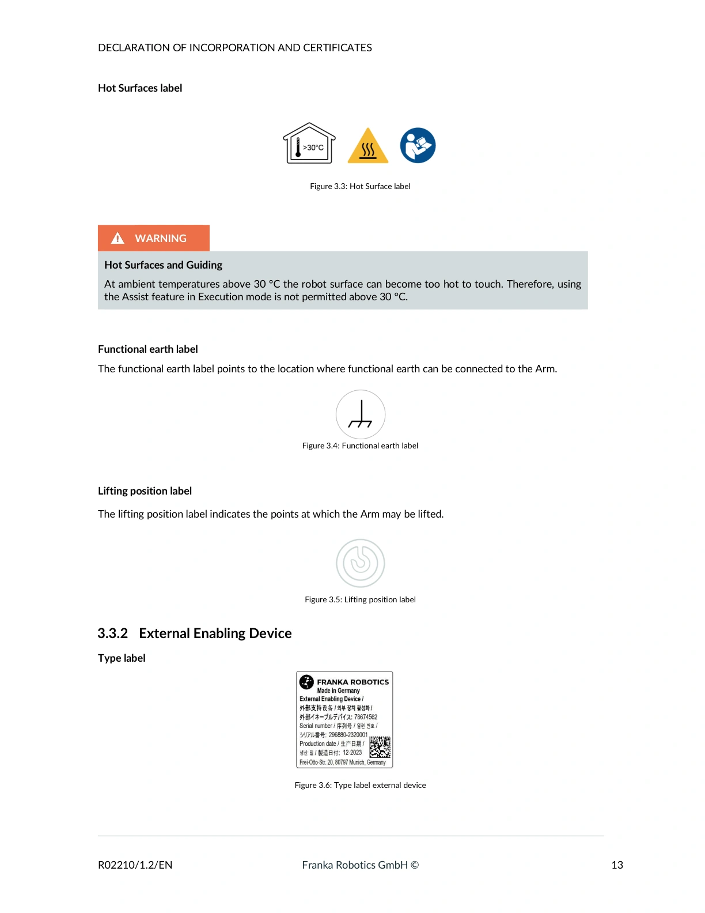



```
DECLARATION OF INCORPORATION AND CERTIFICATES  
 
R02210/1.2/EN 
Franka Robotics GmbH ©  
13  
 
Hot Surfaces label 
 
Figure 3.3: Hot Surface label 
 
WARNING 
  
Hot Surfaces and Guiding 
At ambient temperatures above 30 °C the robot surface can become too hot to touch. Therefore, using 
the Assist feature in Execution mode is not permitted above 30 °C. 
 
Functional earth label 
The functional earth label points to the location where functional earth can be connected to the Arm.  
 
Figure 3.4: Functional earth label 
 
Lifting position label 
The lifting position label indicates the points at which the Arm may be lifted. 
 
Figure 3.5: Lifting position label 
3.3.2 External Enabling Device 
Type label 
 
Figure 3.6: Type label external device
```



## PDF page 14

**Source:** Hardware Manual Franka Research 3\_Arm v2.1\_R02210\_1.2\_EN.pdf, original pdf page 14. [Open the corresponding PDF reading-copy page](https://1292444914-files.gitbook.io/~/files/v0/b/gitbook-x-prod.appspot.com/o/spaces%2FtgOfPnscWebs1eh82EKq%2Fuploads%2FQ9e59rNdN7imxT6dLmAH%2FFR3_HARDWARE-pages-014-027.pdf?alt=media#page=1).



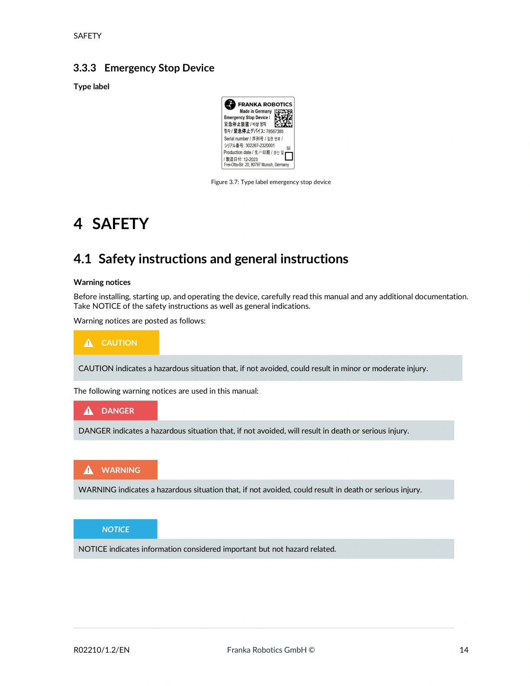



```
SAFETY  
 
R02210/1.2/EN 
Franka Robotics GmbH ©  
14  
 
3.3.3 Emergency Stop Device 
Type label 
 
Figure 3.7: Type label emergency stop device 
 
4 SAFETY 
4.1 Safety instructions and general instructions 
Warning notices 
Before installing, starting up, and operating the device, carefully read this manual and any additional documentation. 
Take NOTICE of the safety instructions as well as general indications. 
Warning notices are posted as follows: 
CAUTION 
  
CAUTION indicates a hazardous situation that, if not avoided, could result in minor or moderate injury. 
The following warning notices are used in this manual: 
DANGER 
  
DANGER indicates a hazardous situation that, if not avoided, will result in death or serious injury. 
 
WARNING 
  
WARNING indicates a hazardous situation that, if not avoided, could result in death or serious injury. 
 
NOTICE 
 
NOTICE indicates information considered important but not hazard related.
```



## PDF page 15

**Source:** Hardware Manual Franka Research 3\_Arm v2.1\_R02210\_1.2\_EN.pdf, original pdf page 15. [Open the corresponding PDF reading-copy page](https://1292444914-files.gitbook.io/~/files/v0/b/gitbook-x-prod.appspot.com/o/spaces%2FtgOfPnscWebs1eh82EKq%2Fuploads%2FQ9e59rNdN7imxT6dLmAH%2FFR3_HARDWARE-pages-014-027.pdf?alt=media#page=2).



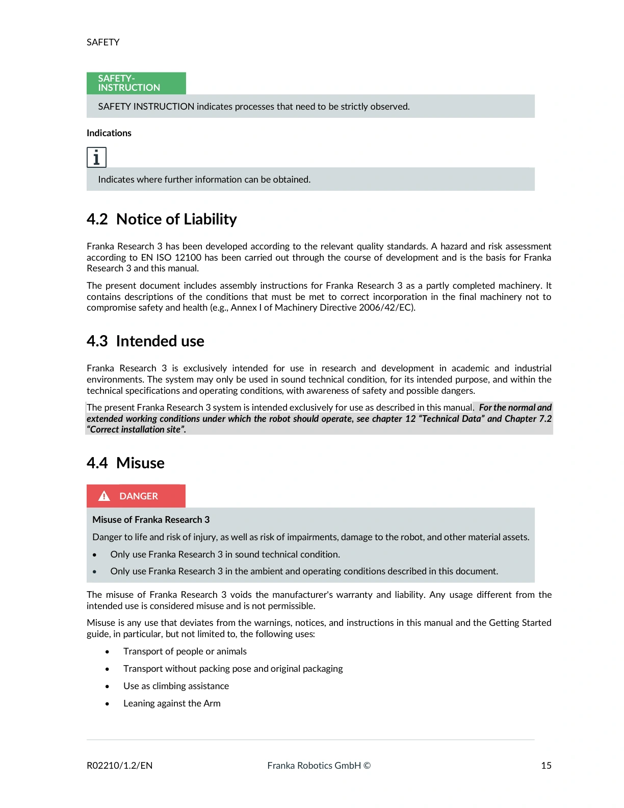



```
SAFETY  
 
R02210/1.2/EN 
Franka Robotics GmbH ©  
15  
 
SAFETY-
INSTRUCTION 
 
SAFETY INSTRUCTION indicates processes that need to be strictly observed.  
Indications 
 
 
Indicates where further information can be obtained. 
4.2 Notice of Liability 
Franka Research 3 has been developed according to the relevant quality standards. A hazard and risk assessment 
according to EN ISO 12100 has been carried out through the course of development and is the basis for Franka 
Research 3 and this manual. 
The present document includes assembly instructions for Franka Research 3 as a partly completed machinery. It 
contains descriptions of the conditions that must be met to correct incorporation in the final machinery not to 
compromise safety and health (e.g., Annex I of Machinery Directive 2006/42/EC). 
4.3 Intended use 
Franka Research 3 is exclusively intended for use in research and development in academic and industrial 
environments. The system may only be used in sound technical condition, for its intended purpose, and within the 
technical specifications and operating conditions, with awareness of safety and possible dangers. 
The present Franka Research 3 system is intended exclusively for use as described in this manual.  For the normal and 
extended working conditions under which the robot should operate, see chapter 12 “Technical Data” and Chapter 7.2 
“Correct installation site”.  
4.4 Misuse 
DANGER 
  
Misuse of Franka Research 3 
Danger to life and risk of injury, as well as risk of impairments, damage to the robot, and other material assets. 
• 
Only use Franka Research 3 in sound technical condition. 
• 
Only use Franka Research 3 in the ambient and operating conditions described in this document. 
The misuse of Franka Research 3 voids the manufacturer's warranty and liability. Any usage different from the 
intended use is considered misuse and is not permissible. 
Misuse is any use that deviates from the warnings, notices, and instructions in this manual and the Getting Started 
guide, in particular, but not limited to, the following uses: 
• 
Transport of people or animals 
• 
Transport without packing pose and original packaging 
• 
Use as climbing assistance 
• 
Leaning against the Arm
```



**Original document cross-references:** [PDF 91](pages-073-118.md#pdf-page-91) · [PDF 52](pages-001-072.md#pdf-page-52)

## PDF page 16

**Source:** Hardware Manual Franka Research 3\_Arm v2.1\_R02210\_1.2\_EN.pdf, original pdf page 16. [Open the corresponding PDF reading-copy page](https://1292444914-files.gitbook.io/~/files/v0/b/gitbook-x-prod.appspot.com/o/spaces%2FtgOfPnscWebs1eh82EKq%2Fuploads%2FQ9e59rNdN7imxT6dLmAH%2FFR3_HARDWARE-pages-014-027.pdf?alt=media#page=3).



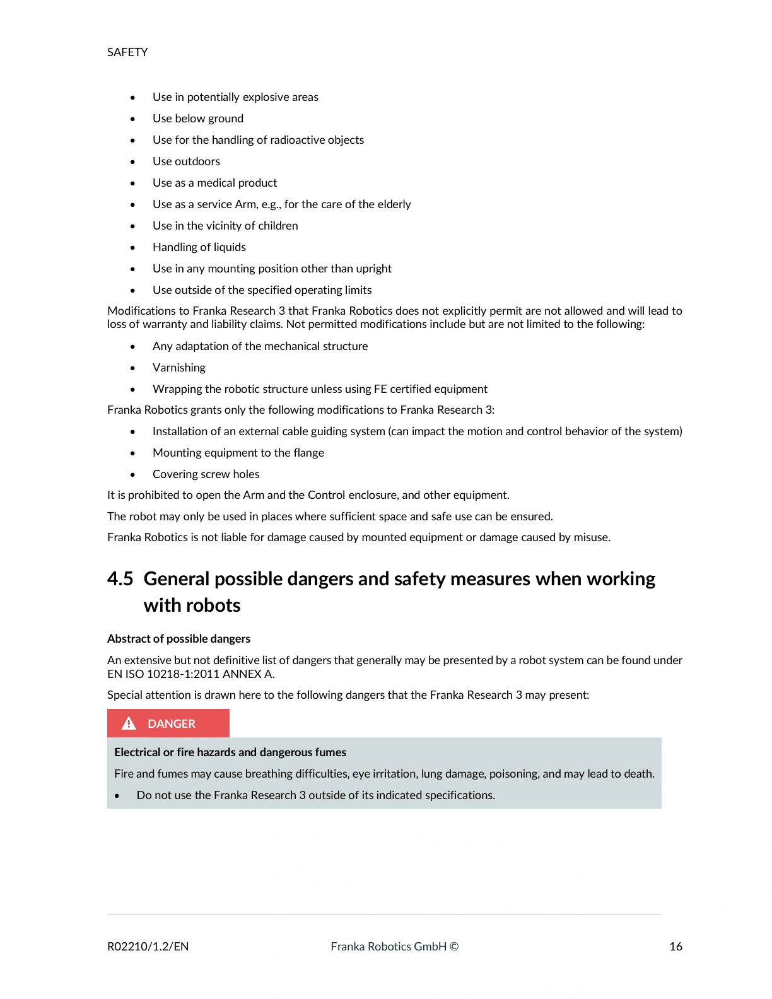



```
SAFETY  
 
R02210/1.2/EN 
Franka Robotics GmbH ©  
16  
 
• 
Use in potentially explosive areas 
• 
Use below ground 
• 
Use for the handling of radioactive objects 
• 
Use outdoors 
• 
Use as a medical product 
• 
Use as a service Arm, e.g., for the care of the elderly 
• 
Use in the vicinity of children 
• 
Handling of liquids 
• 
Use in any mounting position other than upright 
• 
Use outside of the specified operating limits 
Modifications to Franka Research 3 that Franka Robotics does not explicitly permit are not allowed and will lead to 
loss of warranty and liability claims. Not permitted modifications include but are not limited to the following: 
• 
Any adaptation of the mechanical structure 
• 
Varnishing 
• 
Wrapping the robotic structure unless using FE certified equipment 
Franka Robotics grants only the following modifications to Franka Research 3: 
• 
Installation of an external cable guiding system (can impact the motion and control behavior of the system) 
• 
Mounting equipment to the flange 
• 
Covering screw holes 
It is prohibited to open the Arm and the Control enclosure, and other equipment. 
The robot may only be used in places where sufficient space and safe use can be ensured. 
Franka Robotics is not liable for damage caused by mounted equipment or damage caused by misuse. 
4.5 General possible dangers and safety measures when working 
with robots 
Abstract of possible dangers 
An extensive but not definitive list of dangers that generally may be presented by a robot system can be found under 
EN ISO 10218-1:2011 ANNEX A. 
Special attention is drawn here to the following dangers that the Franka Research 3 may present:  
DANGER 
  
Electrical or fire hazards and dangerous fumes 
Fire and fumes may cause breathing difficulties, eye irritation, lung damage, poisoning, and may lead to death. 
• 
Do not use the Franka Research 3 outside of its indicated specifications.
```



## PDF page 17

**Source:** Hardware Manual Franka Research 3\_Arm v2.1\_R02210\_1.2\_EN.pdf, original pdf page 17. [Open the corresponding PDF reading-copy page](https://1292444914-files.gitbook.io/~/files/v0/b/gitbook-x-prod.appspot.com/o/spaces%2FtgOfPnscWebs1eh82EKq%2Fuploads%2FQ9e59rNdN7imxT6dLmAH%2FFR3_HARDWARE-pages-014-027.pdf?alt=media#page=4).



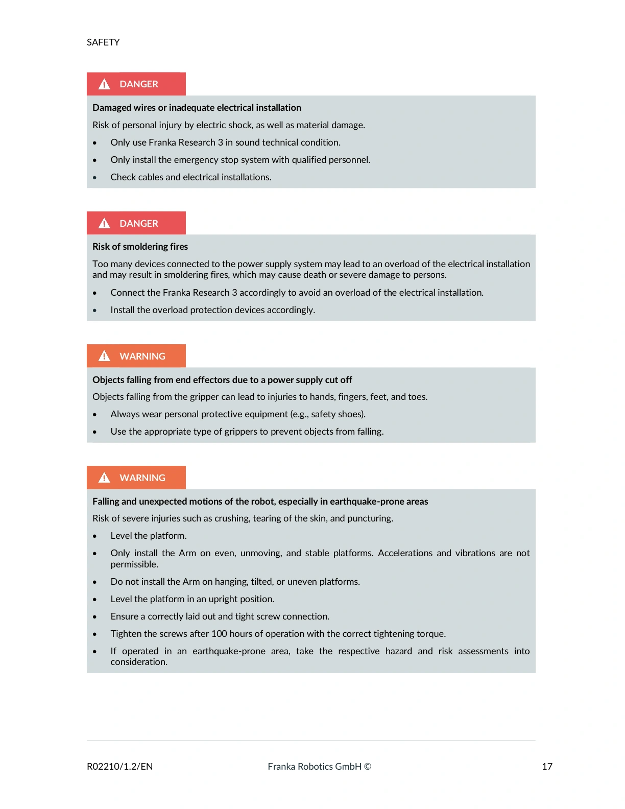



```
SAFETY  
 
R02210/1.2/EN 
Franka Robotics GmbH ©  
17  
 
DANGER 
  
Damaged wires or inadequate electrical installation 
Risk of personal injury by electric shock, as well as material damage. 
• 
Only use Franka Research 3 in sound technical condition. 
• 
Only install the emergency stop system with qualified personnel. 
• 
Check cables and electrical installations. 
 
DANGER 
  
Risk of smoldering fires 
Too many devices connected to the power supply system may lead to an overload of the electrical installation 
and may result in smoldering fires, which may cause death or severe damage to persons. 
• 
Connect the Franka Research 3 accordingly to avoid an overload of the electrical installation. 
• 
Install the overload protection devices accordingly. 
 
WARNING 
  
Objects falling from end effectors due to a power supply cut off 
Objects falling from the gripper can lead to injuries to hands, fingers, feet, and toes. 
• 
Always wear personal protective equipment (e.g., safety shoes). 
• 
Use the appropriate type of grippers to prevent objects from falling. 
 
WARNING 
  
Falling and unexpected motions of the robot, especially in earthquake-prone areas 
Risk of severe injuries such as crushing, tearing of the skin, and puncturing. 
• 
Level the platform. 
• 
Only install the Arm on even, unmoving, and stable platforms. Accelerations and vibrations are not 
permissible. 
• 
Do not install the Arm on hanging, tilted, or uneven platforms.  
• 
Level the platform in an upright position. 
• 
Ensure a correctly laid out and tight screw connection. 
• 
Tighten the screws after 100 hours of operation with the correct tightening torque. 
• 
If operated in an earthquake-prone area, take the respective hazard and risk assessments into 
consideration.
```



## PDF page 18

**Source:** Hardware Manual Franka Research 3\_Arm v2.1\_R02210\_1.2\_EN.pdf, original pdf page 18. [Open the corresponding PDF reading-copy page](https://1292444914-files.gitbook.io/~/files/v0/b/gitbook-x-prod.appspot.com/o/spaces%2FtgOfPnscWebs1eh82EKq%2Fuploads%2FQ9e59rNdN7imxT6dLmAH%2FFR3_HARDWARE-pages-014-027.pdf?alt=media#page=5).



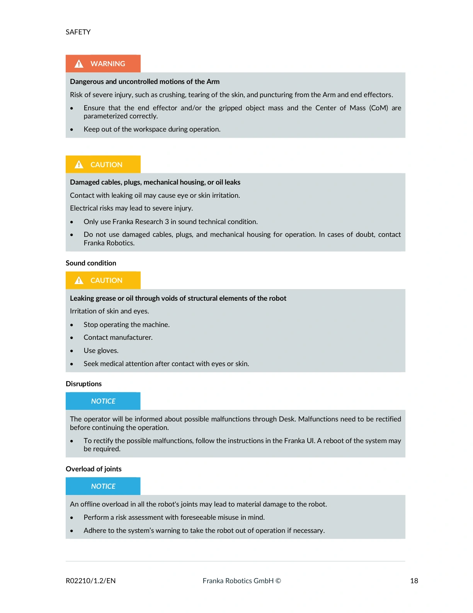



```
SAFETY  
 
R02210/1.2/EN 
Franka Robotics GmbH ©  
18  
 
WARNING 
  
Dangerous and uncontrolled motions of the Arm 
Risk of severe injury, such as crushing, tearing of the skin, and puncturing from the Arm and end effectors. 
• 
Ensure that the end effector and/or the gripped object mass and the Center of Mass (CoM) are 
parameterized correctly. 
• 
Keep out of the workspace during operation. 
 
CAUTION 
  
Damaged cables, plugs, mechanical housing, or oil leaks 
Contact with leaking oil may cause eye or skin irritation. 
Electrical risks may lead to severe injury. 
• 
Only use Franka Research 3 in sound technical condition. 
• 
Do not use damaged cables, plugs, and mechanical housing for operation. In cases of doubt, contact 
Franka Robotics. 
Sound condition 
CAUTION 
  
Leaking grease or oil through voids of structural elements of the robot 
Irritation of skin and eyes. 
• 
Stop operating the machine. 
• 
Contact manufacturer. 
• 
Use gloves. 
• 
Seek medical attention after contact with eyes or skin. 
Disruptions 
NOTICE 
 
The operator will be informed about possible malfunctions through Desk. Malfunctions need to be rectified 
before continuing the operation. 
• 
To rectify the possible malfunctions, follow the instructions in the Franka UI. A reboot of the system may 
be required. 
Overload of joints 
NOTICE 
 
An offline overload in all the robot's joints may lead to material damage to the robot. 
• 
Perform a risk assessment with foreseeable misuse in mind. 
• 
Adhere to the system’s warning to take the robot out of operation if necessary.
```



## PDF page 19

**Source:** Hardware Manual Franka Research 3\_Arm v2.1\_R02210\_1.2\_EN.pdf, original pdf page 19. [Open the corresponding PDF reading-copy page](https://1292444914-files.gitbook.io/~/files/v0/b/gitbook-x-prod.appspot.com/o/spaces%2FtgOfPnscWebs1eh82EKq%2Fuploads%2FQ9e59rNdN7imxT6dLmAH%2FFR3_HARDWARE-pages-014-027.pdf?alt=media#page=6).



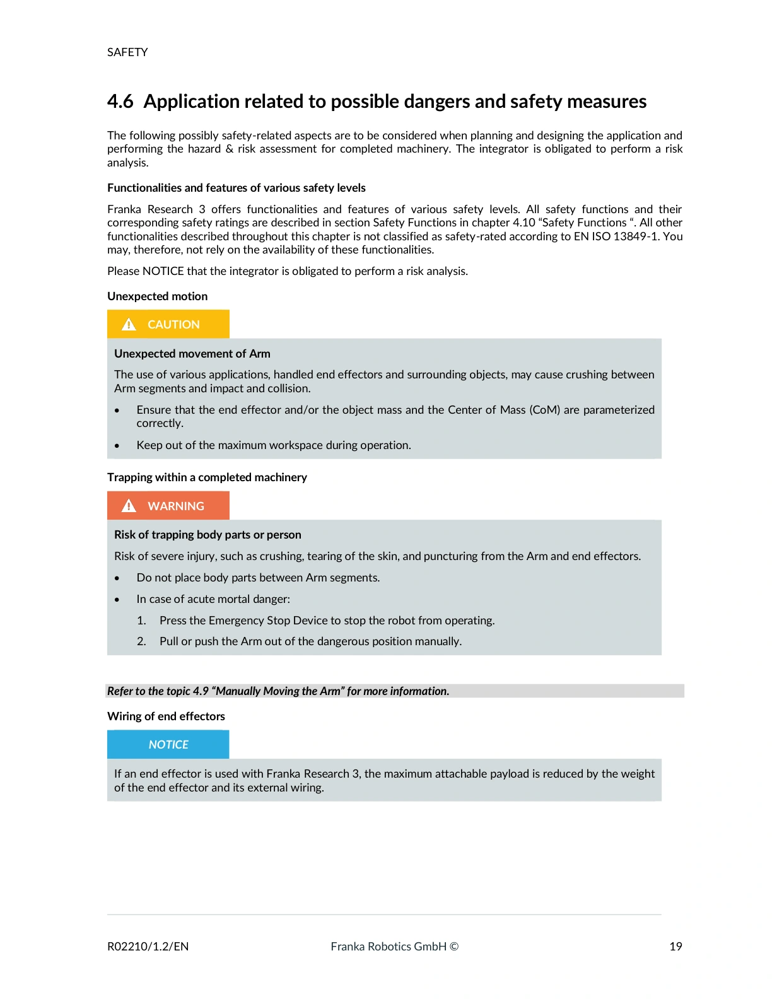



```
SAFETY  
 
R02210/1.2/EN 
Franka Robotics GmbH ©  
19  
 
4.6 Application related to possible dangers and safety measures 
The following possibly safety-related aspects are to be considered when planning and designing the application and 
performing the hazard & risk assessment for completed machinery. The integrator is obligated to perform a risk 
analysis. 
Functionalities and features of various safety levels 
Franka Research 3 offers functionalities and features of various safety levels. All safety functions and their 
corresponding safety ratings are described in section Safety Functions in chapter 4.10 “Safety Functions “. All other 
functionalities described throughout this chapter is not classified as safety-rated according to EN ISO 13849-1. You 
may, therefore, not rely on the availability of these functionalities. 
Please NOTICE that the integrator is obligated to perform a risk analysis. 
Unexpected motion 
CAUTION 
  
Unexpected movement of Arm 
The use of various applications, handled end effectors and surrounding objects, may cause crushing between 
Arm segments and impact and collision. 
• 
Ensure that the end effector and/or the object mass and the Center of Mass (CoM) are parameterized 
correctly. 
• 
Keep out of the maximum workspace during operation. 
Trapping within a completed machinery 
WARNING 
  
Risk of trapping body parts or person 
Risk of severe injury, such as crushing, tearing of the skin, and puncturing from the Arm and end effectors. 
• 
Do not place body parts between Arm segments. 
• 
In case of acute mortal danger: 
1. 
Press the Emergency Stop Device to stop the robot from operating. 
2. 
Pull or push the Arm out of the dangerous position manually. 
 
Refer to the topic 4.9 “Manually Moving the Arm” for more information. 
Wiring of end effectors 
NOTICE 
 
If an end effector is used with Franka Research 3, the maximum attachable payload is reduced by the weight 
of the end effector and its external wiring.
```



**Original document cross-references:** [PDF 23](pages-001-072.md#pdf-page-23)

## PDF page 20

**Source:** Hardware Manual Franka Research 3\_Arm v2.1\_R02210\_1.2\_EN.pdf, original pdf page 20. [Open the corresponding PDF reading-copy page](https://1292444914-files.gitbook.io/~/files/v0/b/gitbook-x-prod.appspot.com/o/spaces%2FtgOfPnscWebs1eh82EKq%2Fuploads%2FQ9e59rNdN7imxT6dLmAH%2FFR3_HARDWARE-pages-014-027.pdf?alt=media#page=7).



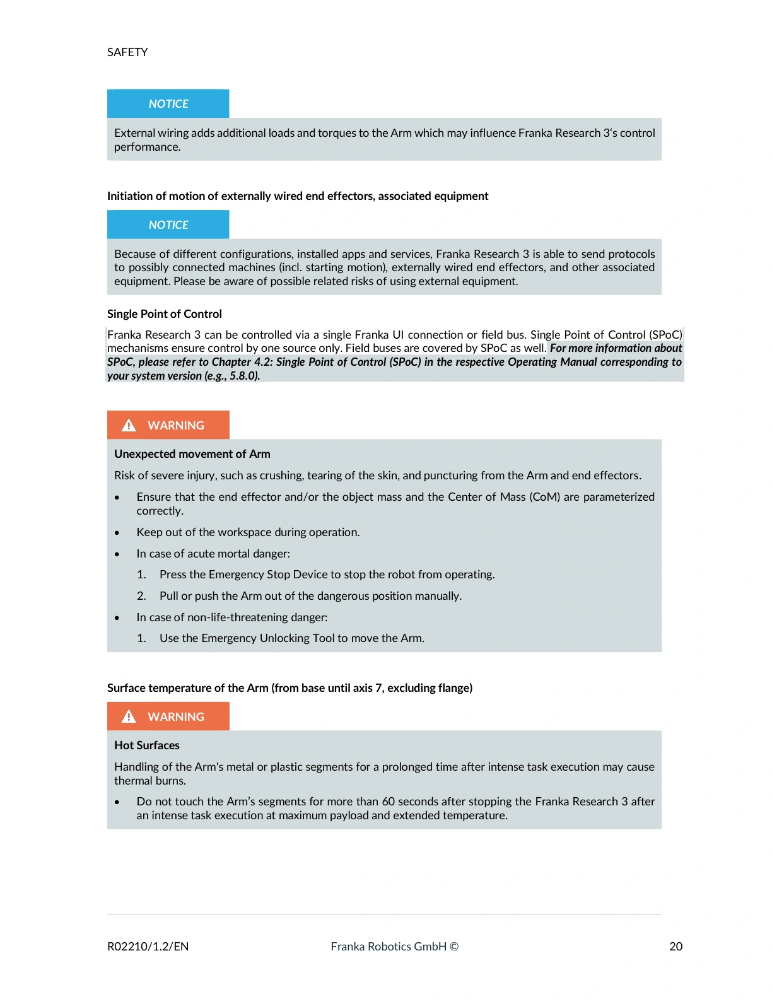



```
SAFETY  
 
R02210/1.2/EN 
Franka Robotics GmbH ©  
20  
 
NOTICE 
 
External wiring adds additional loads and torques to the Arm which may influence Franka Research 3‘s control 
performance. 
 
Initiation of motion of externally wired end effectors, associated equipment 
NOTICE 
 
Because of different configurations, installed apps and services, Franka Research 3 is able to send protocols 
to possibly connected machines (incl. starting motion), externally wired end effectors, and other associated 
equipment. Please be aware of possible related risks of using external equipment. 
Single Point of Control 
Franka Research 3 can be controlled via a single Franka UI connection or field bus. Single Point of Control (SPoC) 
mechanisms ensure control by one source only. Field buses are covered by SPoC as well. For more information about 
SPoC, please refer to Chapter 4.2: Single Point of Control (SPoC) in the respective Operating Manual corresponding to 
your system version (e.g., 5.8.0). 
 
WARNING 
  
Unexpected movement of Arm 
Risk of severe injury, such as crushing, tearing of the skin, and puncturing from the Arm and end effectors. 
• 
Ensure that the end effector and/or the object mass and the Center of Mass (CoM) are parameterized 
correctly. 
• 
Keep out of the workspace during operation. 
• 
In case of acute mortal danger: 
1. 
Press the Emergency Stop Device to stop the robot from operating. 
2. 
Pull or push the Arm out of the dangerous position manually. 
• 
In case of non-life-threatening danger: 
1. 
Use the Emergency Unlocking Tool to move the Arm. 
 
Surface temperature of the Arm (from base until axis 7, excluding flange) 
WARNING 
  
Hot Surfaces 
Handling of the Arm's metal or plastic segments for a prolonged time after intense task execution may cause 
thermal burns. 
• 
Do not touch the Arm’s segments for more than 60 seconds after stopping the Franka Research 3 after 
an intense task execution at maximum payload and extended temperature.
```



## PDF page 21

**Source:** Hardware Manual Franka Research 3\_Arm v2.1\_R02210\_1.2\_EN.pdf, original pdf page 21. [Open the corresponding PDF reading-copy page](https://1292444914-files.gitbook.io/~/files/v0/b/gitbook-x-prod.appspot.com/o/spaces%2FtgOfPnscWebs1eh82EKq%2Fuploads%2FQ9e59rNdN7imxT6dLmAH%2FFR3_HARDWARE-pages-014-027.pdf?alt=media#page=8).



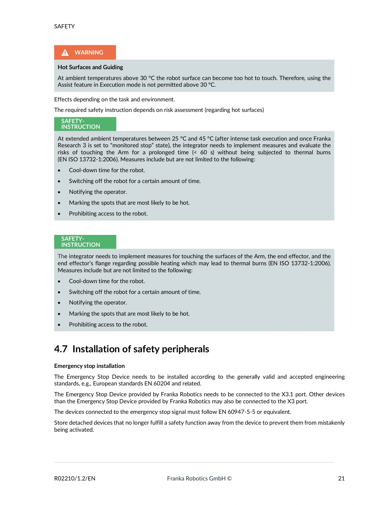



```
SAFETY  
 
R02210/1.2/EN 
Franka Robotics GmbH ©  
21  
 
WARNING 
  
Hot Surfaces and Guiding 
At ambient temperatures above 30 °C the robot surface can become too hot to touch. Therefore, using the 
Assist feature in Execution mode is not permitted above 30 °C. 
Effects depending on the task and environment. 
The required safety instruction depends on risk assessment (regarding hot surfaces) 
SAFETY-
INSTRUCTION 
 
At extended ambient temperatures between 25 °C and 45 °C (after intense task execution and once Franka 
Research 3 is set to “monitored stop” state), the integrator needs to implement measures and evaluate the 
risks of touching the Arm for a prolonged time (< 60 s) without being subjected to thermal burns 
(EN ISO 13732-1:2006). Measures include but are not limited to the following: 
• 
Cool-down time for the robot. 
• 
Switching off the robot for a certain amount of time. 
• 
Notifying the operator. 
• 
Marking the spots that are most likely to be hot. 
• 
Prohibiting access to the robot. 
 
SAFETY-
INSTRUCTION 
 
The integrator needs to implement measures for touching the surfaces of the Arm, the end effector, and the 
end effector’s flange regarding possible heating which may lead to thermal burns (EN ISO 13732-1:2006). 
Measures include but are not limited to the following: 
• 
Cool-down time for the robot. 
• 
Switching off the robot for a certain amount of time. 
• 
Notifying the operator. 
• 
Marking the spots that are most likely to be hot. 
• 
Prohibiting access to the robot. 
4.7 Installation of safety peripherals 
Emergency stop installation 
The Emergency Stop Device needs to be installed according to the generally valid and accepted engineering 
standards, e.g., European standards EN 60204 and related. 
The Emergency Stop Device provided by Franka Robotics needs to be connected to the X3.1 port. Other devices 
than the Emergency Stop Device provided by Franka Robotics may also be connected to the X3 port.  
The devices connected to the emergency stop signal must follow EN 60947-5-5 or equivalent. 
Store detached devices that no longer fulfill a safety function away from the device to prevent them from mistakenly 
being activated.
```



## PDF page 22

**Source:** Hardware Manual Franka Research 3\_Arm v2.1\_R02210\_1.2\_EN.pdf, original pdf page 22. [Open the corresponding PDF reading-copy page](https://1292444914-files.gitbook.io/~/files/v0/b/gitbook-x-prod.appspot.com/o/spaces%2FtgOfPnscWebs1eh82EKq%2Fuploads%2FQ9e59rNdN7imxT6dLmAH%2FFR3_HARDWARE-pages-014-027.pdf?alt=media#page=9).



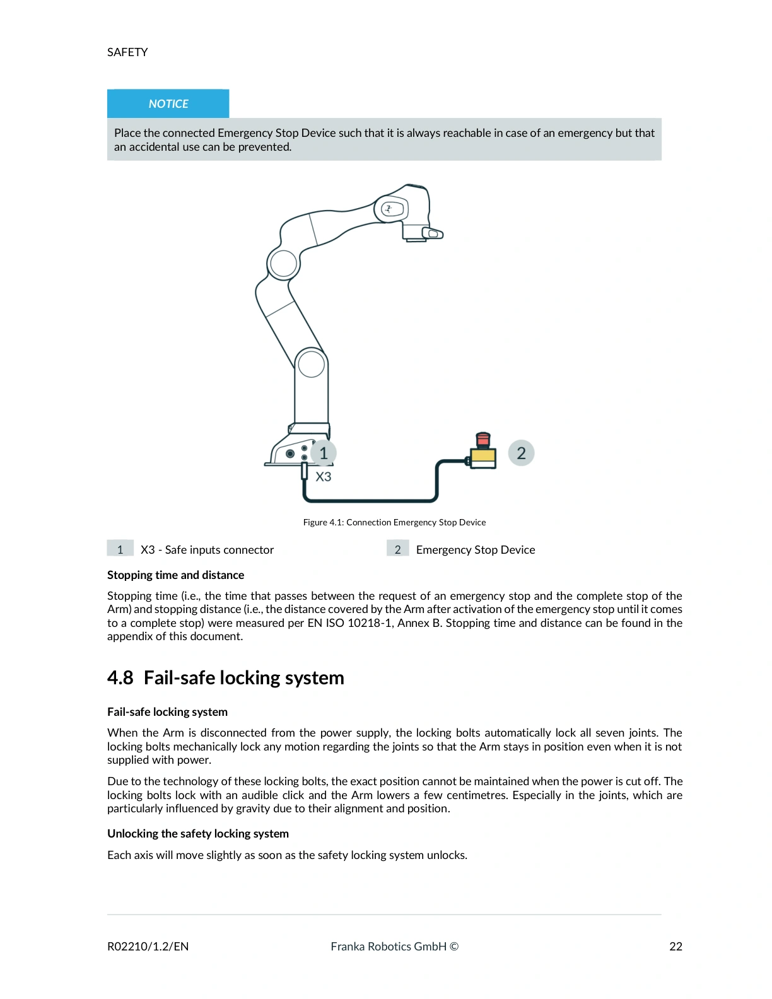



```
SAFETY  
 
R02210/1.2/EN 
Franka Robotics GmbH ©  
22  
 
NOTICE 
 
Place the connected Emergency Stop Device such that it is always reachable in case of an emergency but that 
an accidental use can be prevented. 
 
 
Figure 4.1: Connection Emergency Stop Device 
1 
X3 - Safe inputs connector 
2 
Emergency Stop Device 
Stopping time and distance 
Stopping time (i.e., the time that passes between the request of an emergency stop and the complete stop of the 
Arm) and stopping distance (i.e., the distance covered by the Arm after activation of the emergency stop until it comes 
to a complete stop) were measured per EN ISO 10218-1, Annex B. Stopping time and distance can be found in the 
appendix of this document. 
4.8 Fail-safe locking system  
Fail-safe locking system 
When the Arm is disconnected from the power supply, the locking bolts automatically lock all seven joints. The 
locking bolts mechanically lock any motion regarding the joints so that the Arm stays in position even when it is not 
supplied with power. 
Due to the technology of these locking bolts, the exact position cannot be maintained when the power is cut off. The 
locking bolts lock with an audible click and the Arm lowers a few centimetres. Especially in the joints, which are 
particularly influenced by gravity due to their alignment and position. 
Unlocking the safety locking system 
Each axis will move slightly as soon as the safety locking system unlocks.
```



## PDF page 23

**Source:** Hardware Manual Franka Research 3\_Arm v2.1\_R02210\_1.2\_EN.pdf, original pdf page 23. [Open the corresponding PDF reading-copy page](https://1292444914-files.gitbook.io/~/files/v0/b/gitbook-x-prod.appspot.com/o/spaces%2FtgOfPnscWebs1eh82EKq%2Fuploads%2FQ9e59rNdN7imxT6dLmAH%2FFR3_HARDWARE-pages-014-027.pdf?alt=media#page=10).



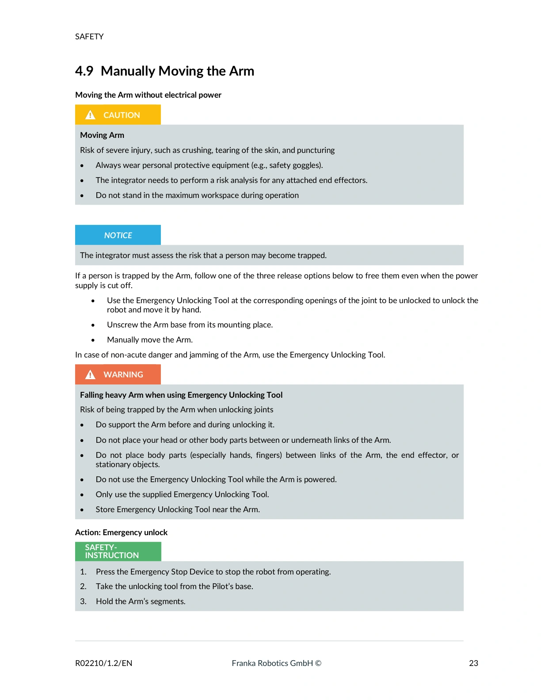



```
SAFETY  
 
R02210/1.2/EN 
Franka Robotics GmbH ©  
23  
 
4.9 Manually Moving the Arm 
Moving the Arm without electrical power 
CAUTION 
  
Moving Arm 
Risk of severe injury, such as crushing, tearing of the skin, and puncturing 
• 
Always wear personal protective equipment (e.g., safety goggles). 
• 
The integrator needs to perform a risk analysis for any attached end effectors. 
• 
Do not stand in the maximum workspace during operation 
 
NOTICE 
 
The integrator must assess the risk that a person may become trapped. 
If a person is trapped by the Arm, follow one of the three release options below to free them even when the power 
supply is cut off.  
• 
Use the Emergency Unlocking Tool at the corresponding openings of the joint to be unlocked to unlock the 
robot and move it by hand. 
• 
Unscrew the Arm base from its mounting place. 
• 
Manually move the Arm. 
In case of non-acute danger and jamming of the Arm, use the Emergency Unlocking Tool. 
WARNING 
  
Falling heavy Arm when using Emergency Unlocking Tool 
Risk of being trapped by the Arm when unlocking joints 
• 
Do support the Arm before and during unlocking it. 
• 
Do not place your head or other body parts between or underneath links of the Arm. 
• 
Do not place body parts (especially hands, fingers) between links of the Arm, the end effector, or 
stationary objects. 
• 
Do not use the Emergency Unlocking Tool while the Arm is powered. 
• 
Only use the supplied Emergency Unlocking Tool. 
• 
Store Emergency Unlocking Tool near the Arm. 
Action: Emergency unlock 
SAFETY-
INSTRUCTION 
 
1. 
Press the Emergency Stop Device to stop the robot from operating. 
2. 
Take the unlocking tool from the Pilot’s base. 
3. 
Hold the Arm’s segments.
```



## PDF page 24

**Source:** Hardware Manual Franka Research 3\_Arm v2.1\_R02210\_1.2\_EN.pdf, original pdf page 24. [Open the corresponding PDF reading-copy page](https://1292444914-files.gitbook.io/~/files/v0/b/gitbook-x-prod.appspot.com/o/spaces%2FtgOfPnscWebs1eh82EKq%2Fuploads%2FQ9e59rNdN7imxT6dLmAH%2FFR3_HARDWARE-pages-014-027.pdf?alt=media#page=11).



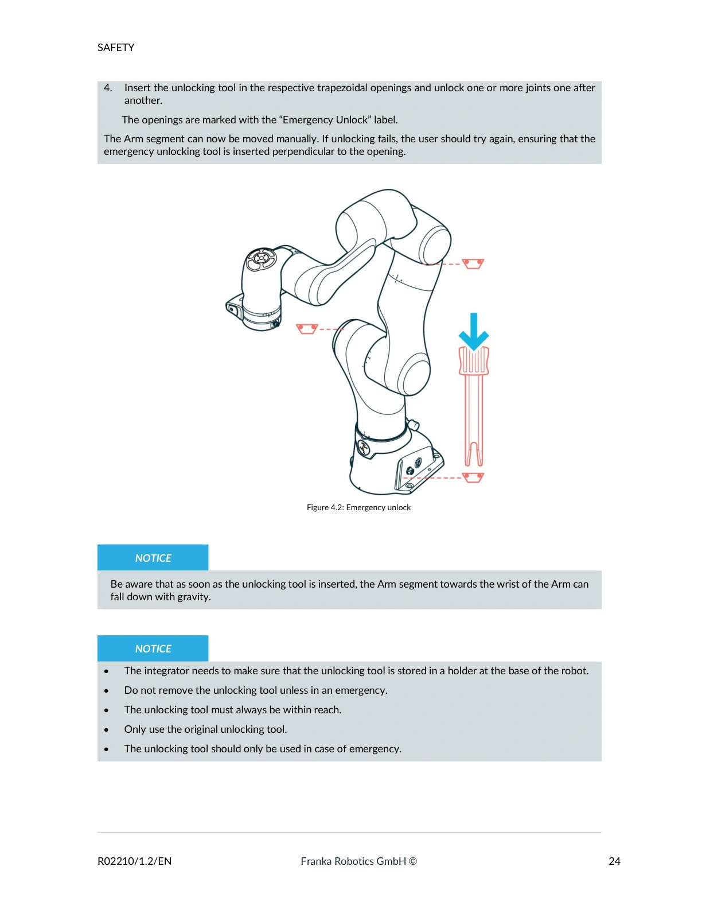



```
SAFETY  
 
R02210/1.2/EN 
Franka Robotics GmbH ©  
24  
 
 
 
Figure 4.2: Emergency unlock 
 
NOTICE 
 
Be aware that as soon as the unlocking tool is inserted, the Arm segment towards the wrist of the Arm can 
fall down with gravity. 
 
NOTICE 
 
• 
The integrator needs to make sure that the unlocking tool is stored in a holder at the base of the robot. 
• 
Do not remove the unlocking tool unless in an emergency. 
• 
The unlocking tool must always be within reach. 
• 
Only use the original unlocking tool. 
• 
The unlocking tool should only be used in case of emergency. 
 
 
4. 
Insert the unlocking tool in the respective trapezoidal openings and unlock one or more joints one after 
another. 
The openings are marked with the “Emergency Unlock” label. 
The Arm segment can now be moved manually. If unlocking fails, the user should try again, ensuring that the 
emergency unlocking tool is inserted perpendicular to the opening.
```



## PDF page 25

**Source:** Hardware Manual Franka Research 3\_Arm v2.1\_R02210\_1.2\_EN.pdf, original pdf page 25. [Open the corresponding PDF reading-copy page](https://1292444914-files.gitbook.io/~/files/v0/b/gitbook-x-prod.appspot.com/o/spaces%2FtgOfPnscWebs1eh82EKq%2Fuploads%2FQ9e59rNdN7imxT6dLmAH%2FFR3_HARDWARE-pages-014-027.pdf?alt=media#page=12).



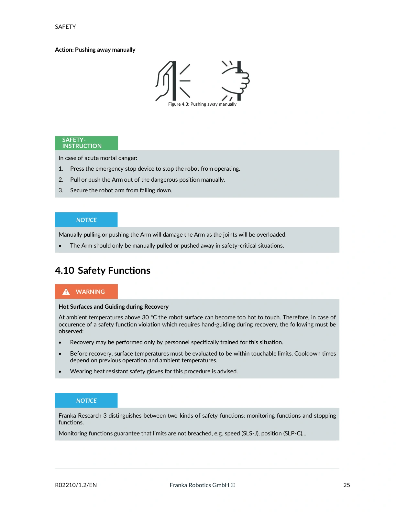



```
SAFETY  
 
R02210/1.2/EN 
Franka Robotics GmbH ©  
25  
 
Action: Pushing away manually 
 
Figure 4.3: Pushing away manually 
 
 
SAFETY-
INSTRUCTION 
 
In case of acute mortal danger: 
1. 
Press the emergency stop device to stop the robot from operating. 
2. 
Pull or push the Arm out of the dangerous position manually. 
3. 
Secure the robot arm from falling down. 
 
NOTICE 
 
Manually pulling or pushing the Arm will damage the Arm as the joints will be overloaded. 
• 
The Arm should only be manually pulled or pushed away in safety-critical situations. 
4.10 Safety Functions 
WARNING 
  
Hot Surfaces and Guiding during Recovery 
At ambient temperatures above 30 °C the robot surface can become too hot to touch. Therefore, in case of 
occurence of a safety function violation which requires hand-guiding during recovery, the following must be 
observed: 
• 
Recovery may be performed only by personnel specifically trained for this situation. 
• 
Before recovery, surface temperatures must be evaluated to be within touchable limits. Cooldown times 
depend on previous operation and ambient temperatures. 
• 
Wearing heat resistant safety gloves for this procedure is advised. 
 
NOTICE 
 
Franka Research 3 distinguishes between two kinds of safety functions: monitoring functions and stopping 
functions. 
Monitoring functions guarantee that limits are not breached, e.g. speed (SLS-J), position (SLP-C)…
```



## PDF page 26

**Source:** Hardware Manual Franka Research 3\_Arm v2.1\_R02210\_1.2\_EN.pdf, original pdf page 26. [Open the corresponding PDF reading-copy page](https://1292444914-files.gitbook.io/~/files/v0/b/gitbook-x-prod.appspot.com/o/spaces%2FtgOfPnscWebs1eh82EKq%2Fuploads%2FQ9e59rNdN7imxT6dLmAH%2FFR3_HARDWARE-pages-014-027.pdf?alt=media#page=13).



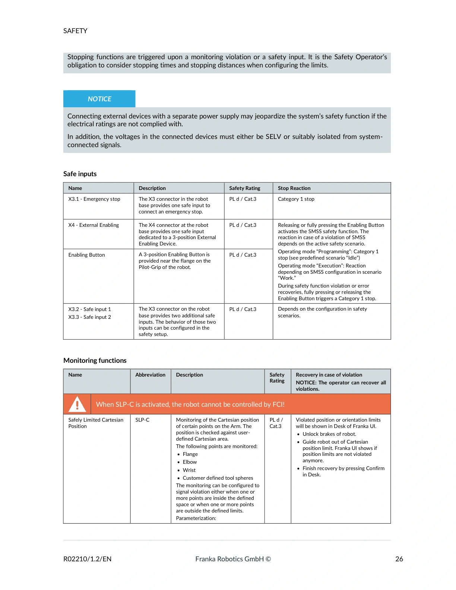



```
SAFETY  
 
R02210/1.2/EN 
Franka Robotics GmbH ©  
26  
 
Stopping functions are triggered upon a monitoring violation or a safety input. It is the Safety Operator’s 
obligation to consider stopping times and stopping distances when configuring the limits.  
 
NOTICE 
 
Connecting external devices with a separate power supply may jeopardize the system’s safety function if the 
electrical ratings are not complied with. 
In addition, the voltages in the connected devices must either be SELV or suitably isolated from system-
connected signals. 
 
Safe inputs 
Name 
Description 
Safety Rating 
Stop Reaction 
X3.1 - Emergency stop 
The X3 connector in the robot 
base provides one safe input to 
connect an emergency stop. 
PL d / Cat.3 
Category 1 stop 
X4 - External Enabling 
The X4 connector at the robot 
base provides one safe input 
dedicated to a 3-position External 
Enabling Device. 
PL d / Cat.3 
Releasing or fully pressing the Enabling Button 
activates the SMSS safety function. The 
reaction in case of a violation of SMSS 
depends on the active safety scenario. 
Operating mode “Programming”: Category 1 
stop (see predefined scenario “Idle”) 
Operating mode “Execution”: Reaction 
depending on SMSS configuration in scenario 
“Work.” 
During safety function violation or error 
recoveries, fully pressing or releasing the 
Enabling Button triggers a Category 1 stop.  
Enabling Button 
A 3-position Enabling Button is 
provided near the flange on the 
Pilot-Grip of the robot. 
PL d / Cat.3 
X3.2 - Safe input 1 
X3.3 - Safe input 2 
The X3 connector on the robot 
base provides two additional safe 
inputs. The behavior of those two 
inputs can be configured in the 
safety setup. 
PL d / Cat.3 
Depends on the configuration in safety 
scenarios. 
 
Monitoring functions 
Name 
Abbreviation 
Description 
Safety 
Rating 
Recovery in case of violation 
NOTICE: The operator can recover all 
violations. 
 
When SLP-C is activated, the robot cannot be controlled by FCI! 
Safely Limited Cartesian 
Position 
SLP-C 
Monitoring of the Cartesian position 
of certain points on the Arm. The 
position is checked against user-
defined Cartesian area. 
The following points are monitored: 
• Flange 
• Elbow 
• Wrist 
• Customer defined tool spheres 
The monitoring can be configured to 
signal violation either when one or 
more points are inside the defined 
space or when one or more points 
are outside the defined limits. 
Parameterization: 
PL d / 
Cat.3 
Violated position or orientation limits 
will be shown in Desk of Franka UI. 
• Unlock brakes of robot. 
• Guide robot out of Cartesian 
position limit. Franka UI shows if 
position limits are not violated 
anymore. 
• Finish recovery by pressing Confirm 
in Desk.
```



## PDF page 27

**Source:** Hardware Manual Franka Research 3\_Arm v2.1\_R02210\_1.2\_EN.pdf, original pdf page 27. [Open the corresponding PDF reading-copy page](https://1292444914-files.gitbook.io/~/files/v0/b/gitbook-x-prod.appspot.com/o/spaces%2FtgOfPnscWebs1eh82EKq%2Fuploads%2FQ9e59rNdN7imxT6dLmAH%2FFR3_HARDWARE-pages-014-027.pdf?alt=media#page=14).



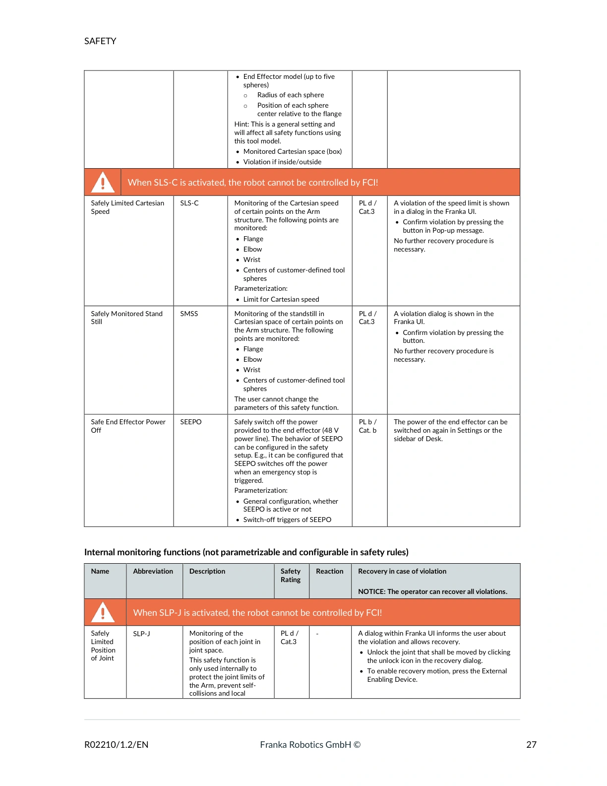



```
SAFETY  
 
R02210/1.2/EN 
Franka Robotics GmbH ©  
27  
 
 
Internal monitoring functions (not parametrizable and configurable in safety rules) 
Name 
Abbreviation 
Description 
Safety 
Rating 
Reaction 
Recovery in case of violation 
 
NOTICE: The operator can recover all violations. 
  
When SLP-J is activated, the robot cannot be controlled by FCI! 
Safely 
Limited 
Position 
of Joint  
SLP-J 
Monitoring of the 
position of each joint in 
joint space. 
This safety function is 
only used internally to 
protect the joint limits of 
the Arm, prevent self-
collisions and local 
PL d / 
Cat.3 
- 
A dialog within Franka UI informs the user about 
the violation and allows recovery. 
• Unlock the joint that shall be moved by clicking 
the unlock icon in the recovery dialog. 
• To enable recovery motion, press the External 
Enabling Device. 
• End Effector model (up to five 
spheres) 
o 
Radius of each sphere 
o 
Position of each sphere 
center relative to the flange 
Hint: This is a general setting and 
will affect all safety functions using 
this tool model. 
• Monitored Cartesian space (box) 
• Violation if inside/outside 
  
When SLS-C is activated, the robot cannot be controlled by FCI! 
Safely Limited Cartesian 
Speed 
SLS-C 
Monitoring of the Cartesian speed 
of certain points on the Arm 
structure. The following points are 
monitored: 
• Flange 
• Elbow 
• Wrist 
• Centers of customer-defined tool 
spheres  
Parameterization: 
• Limit for Cartesian speed 
PL d / 
Cat.3 
A violation of the speed limit is shown 
in a dialog in the Franka UI. 
• Confirm violation by pressing the 
button in Pop-up message. 
No further recovery procedure is 
necessary.  
Safely Monitored Stand 
Still 
SMSS  
Monitoring of the standstill in 
Cartesian space of certain points on 
the Arm structure. The following 
points are monitored:  
• Flange 
• Elbow 
• Wrist 
• Centers of customer-defined tool 
spheres 
The user cannot change the 
parameters of this safety function. 
PL d / 
Cat.3 
A violation dialog is shown in the 
Franka UI. 
• Confirm violation by pressing the 
button. 
No further recovery procedure is 
necessary. 
Safe End Effector Power 
Off 
SEEPO 
Safely switch off the power 
provided to the end effector (48 V 
power line). The behavior of SEEPO 
can be configured in the safety 
setup. E.g., it can be configured that 
SEEPO switches off the power 
when an emergency stop is 
triggered. 
Parameterization: 
• General configuration, whether 
SEEPO is active or not 
• Switch-off triggers of SEEPO 
PL b / 
Cat. b 
The power of the end effector can be 
switched on again in Settings or the 
sidebar of Desk.
```



## PDF page 28

**Source:** Hardware Manual Franka Research 3\_Arm v2.1\_R02210\_1.2\_EN.pdf, original pdf page 28. [Open the corresponding PDF reading-copy page](https://1292444914-files.gitbook.io/~/files/v0/b/gitbook-x-prod.appspot.com/o/spaces%2FtgOfPnscWebs1eh82EKq%2Fuploads%2FnqlLZUvfPTj9H5KsKII2%2FFR3_HARDWARE-pages-028-033.pdf?alt=media#page=1).



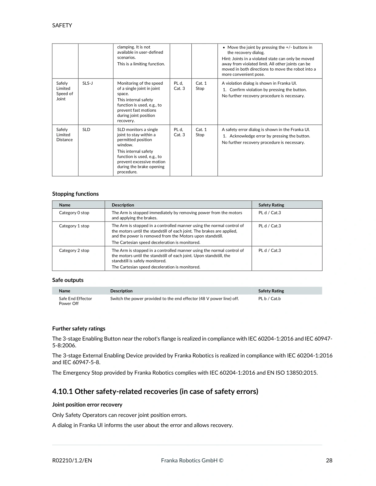



```
SAFETY  
 
R02210/1.2/EN 
Franka Robotics GmbH ©  
28  
 
clamping. It is not 
available in user-defined 
scenarios. 
This is a limiting function. 
• Move the joint by pressing the +/- buttons in 
the recovery dialog. 
Hint: Joints in a violated state can only be moved 
away from violated limit. All other joints can be 
moved in both directions to move the robot into a 
more convenient pose. 
Safely 
Limited 
Speed of 
Joint  
SLS-J 
Monitoring of the speed 
of a single joint in joint 
space. 
This internal safety 
function is used, e.g., to 
prevent fast motions 
during joint position 
recovery. 
PL d, 
Cat. 3 
Cat. 1 
Stop 
A violation dialog is shown in Franka UI. 
1. Confirm violation by pressing the button. 
No further recovery procedure is necessary. 
 
Safely 
Limited 
Distance 
SLD 
SLD monitors a single 
joint to stay within a 
permitted position 
window. 
This internal safety 
function is used, e.g., to 
prevent excessive motion 
during the brake opening 
procedure. 
PL d, 
Cat. 3 
Cat. 1 
Stop 
A safety error dialog is shown in the Franka UI. 
1. Acknowledge error by pressing the button. 
No further recovery procedure is necessary. 
 
 
Stopping functions 
Name 
Description 
Safety Rating 
Category 0 stop 
The Arm is stopped immediately by removing power from the motors 
and applying the brakes. 
PL d / Cat.3 
Category 1 stop 
The Arm is stopped in a controlled manner using the normal control of 
the motors until the standstill of each joint. The brakes are applied, 
and the power is removed from the Motors upon standstill. 
The Cartesian speed deceleration is monitored. 
PL d / Cat.3 
Category 2 stop 
The Arm is stopped in a controlled manner using the normal control of 
the motors until the standstill of each joint. Upon standstill, the 
standstill is safely monitored. 
The Cartesian speed deceleration is monitored. 
PL d / Cat.3 
Safe outputs 
Name 
Description 
Safety Rating 
Safe End Effector 
Power Off 
Switch the power provided to the end effector (48 V power line) off. 
PL b / Cat.b 
 
Further safety ratings 
The 3-stage Enabling Button near the robot's flange is realized in compliance with IEC 60204-1:2016 and IEC 60947-
5-8:2006. 
The 3-stage External Enabling Device provided by Franka Robotics is realized in compliance with IEC 60204-1:2016 
and IEC 60947-5-8. 
The Emergency Stop provided by Franka Robotics complies with IEC 60204-1:2016 and EN ISO 13850:2015. 
4.10.1 Other safety-related recoveries (in case of safety errors) 
Joint position error recovery 
Only Safety Operators can recover joint position errors. 
A dialog in Franka UI informs the user about the error and allows recovery.
```



## PDF page 29

**Source:** Hardware Manual Franka Research 3\_Arm v2.1\_R02210\_1.2\_EN.pdf, original pdf page 29. [Open the corresponding PDF reading-copy page](https://1292444914-files.gitbook.io/~/files/v0/b/gitbook-x-prod.appspot.com/o/spaces%2FtgOfPnscWebs1eh82EKq%2Fuploads%2FnqlLZUvfPTj9H5KsKII2%2FFR3_HARDWARE-pages-028-033.pdf?alt=media#page=2).



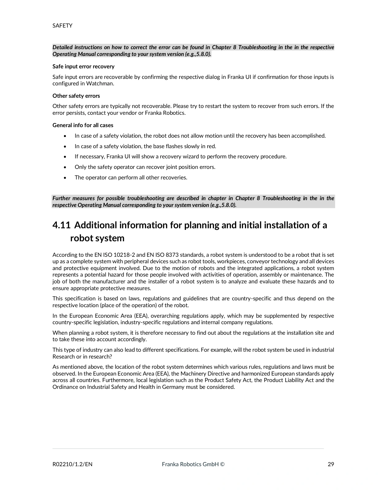



```
SAFETY  
 
R02210/1.2/EN 
Franka Robotics GmbH ©  
29  
 
Detailed instructions on how to correct the error can be found in Chapter 8 Troubleshooting in the in the respective 
Operating Manual corresponding to your system version (e.g.,5.8.0). 
Safe input error recovery 
Safe input errors are recoverable by confirming the respective dialog in Franka UI if confirmation for those inputs is 
configured in Watchman. 
Other safety errors 
Other safety errors are typically not recoverable. Please try to restart the system to recover from such errors. If the 
error persists, contact your vendor or Franka Robotics. 
General info for all cases 
• 
In case of a safety violation, the robot does not allow motion until the recovery has been accomplished. 
• 
In case of a safety violation, the base flashes slowly in red. 
• 
If necessary, Franka UI will show a recovery wizard to perform the recovery procedure. 
• 
Only the safety operator can recover joint position errors. 
• 
The operator can perform all other recoveries. 
 
Further measures for possible troubleshooting are described in chapter in Chapter 8 Troubleshooting in the in the 
respective Operating Manual corresponding to your system version (e.g.,5.8.0). 
4.11 Additional information for planning and initial installation of a 
robot system 
According to the EN ISO 10218-2 and EN ISO 8373 standards, a robot system is understood to be a robot that is set 
up as a complete system with peripheral devices such as robot tools, workpieces, conveyor technology and all devices 
and protective equipment involved. Due to the motion of robots and the integrated applications, a robot system 
represents a potential hazard for those people involved with activities of operation, assembly or maintenance. The 
job of both the manufacturer and the installer of a robot system is to analyze and evaluate these hazards and to 
ensure appropriate protective measures. 
This specification is based on laws, regulations and guidelines that are country-specific and thus depend on the 
respective location (place of the operation) of the robot. 
In the European Economic Area (EEA), overarching regulations apply, which may be supplemented by respective 
country-specific legislation, industry-specific regulations and internal company regulations. 
When planning a robot system, it is therefore necessary to find out about the regulations at the installation site and 
to take these into account accordingly. 
This type of industry can also lead to different specifications. For example, will the robot system be used in industrial 
Research or in research? 
As mentioned above, the location of the robot system determines which various rules, regulations and laws must be 
observed. In the European Economic Area (EEA), the Machinery Directive and harmonized European standards apply 
across all countries. Furthermore, local legislation such as the Product Safety Act, the Product Liability Act and the 
Ordinance on Industrial Safety and Health in Germany must be considered.
```



## PDF page 30

**Source:** Hardware Manual Franka Research 3\_Arm v2.1\_R02210\_1.2\_EN.pdf, original pdf page 30. [Open the corresponding PDF reading-copy page](https://1292444914-files.gitbook.io/~/files/v0/b/gitbook-x-prod.appspot.com/o/spaces%2FtgOfPnscWebs1eh82EKq%2Fuploads%2FnqlLZUvfPTj9H5KsKII2%2FFR3_HARDWARE-pages-028-033.pdf?alt=media#page=3).



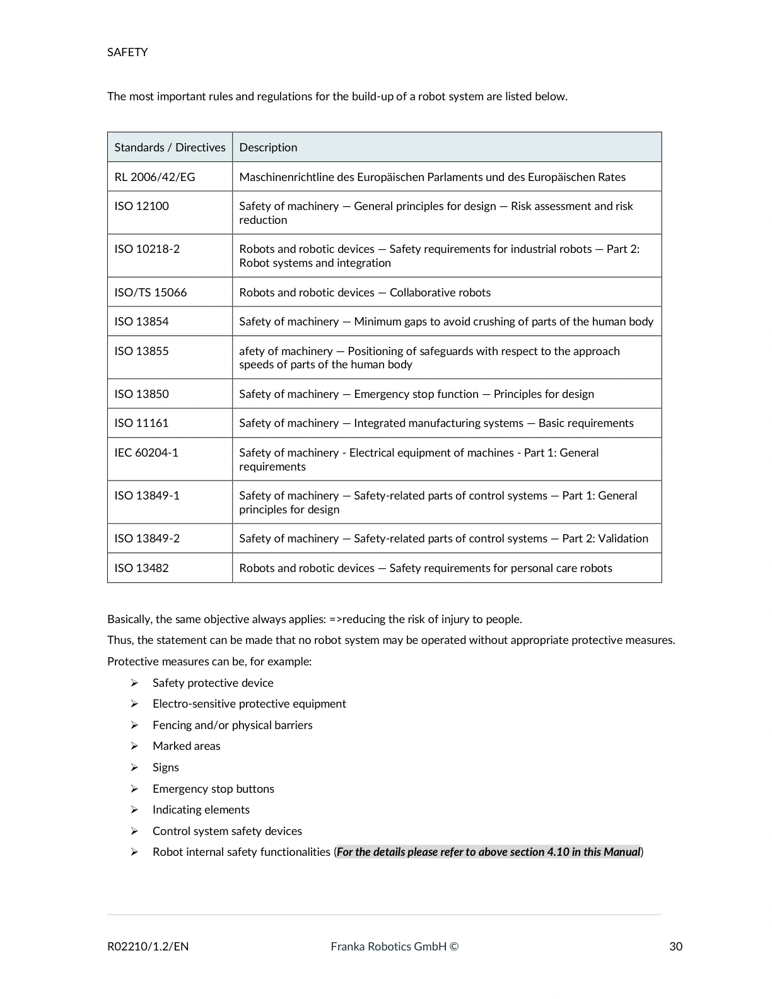



```
SAFETY  
 
R02210/1.2/EN 
Franka Robotics GmbH ©  
30  
 
The most important rules and regulations for the build-up of a robot system are listed below. 
 
Standards / Directives 
Description 
RL 2006/42/EG 
Maschinenrichtline des Europäischen Parlaments und des Europäischen Rates 
ISO 12100 
Safety of machinery — General principles for design — Risk assessment and risk 
reduction 
ISO 10218-2 
Robots and robotic devices — Safety requirements for industrial robots — Part 2: 
Robot systems and integration 
ISO/TS 15066 
Robots and robotic devices — Collaborative robots 
ISO 13854 
Safety of machinery — Minimum gaps to avoid crushing of parts of the human body 
ISO 13855 
afety of machinery — Positioning of safeguards with respect to the approach 
speeds of parts of the human body 
ISO 13850 
Safety of machinery — Emergency stop function — Principles for design 
ISO 11161 
Safety of machinery — Integrated manufacturing systems — Basic requirements 
IEC 60204-1 
Safety of machinery - Electrical equipment of machines - Part 1: General 
requirements 
ISO 13849-1 
Safety of machinery — Safety-related parts of control systems — Part 1: General 
principles for design 
ISO 13849-2 
Safety of machinery — Safety-related parts of control systems — Part 2: Validation 
ISO 13482 
Robots and robotic devices — Safety requirements for personal care robots 
 
Basically, the same objective always applies: =>reducing the risk of injury to people. 
Thus, the statement can be made that no robot system may be operated without appropriate protective measures. 
Protective measures can be, for example: 
➢ 
Safety protective device 
➢ 
Electro-sensitive protective equipment 
➢ 
Fencing and/or physical barriers 
➢ 
Marked areas 
➢ 
Signs 
➢ 
Emergency stop buttons 
➢ 
Indicating elements 
➢ 
Control system safety devices 
➢ 
Robot internal safety functionalities (For the details please refer to above section 4.10 in this Manual)
```



## PDF page 31

**Source:** Hardware Manual Franka Research 3\_Arm v2.1\_R02210\_1.2\_EN.pdf, original pdf page 31. [Open the corresponding PDF reading-copy page](https://1292444914-files.gitbook.io/~/files/v0/b/gitbook-x-prod.appspot.com/o/spaces%2FtgOfPnscWebs1eh82EKq%2Fuploads%2FnqlLZUvfPTj9H5KsKII2%2FFR3_HARDWARE-pages-028-033.pdf?alt=media#page=4).



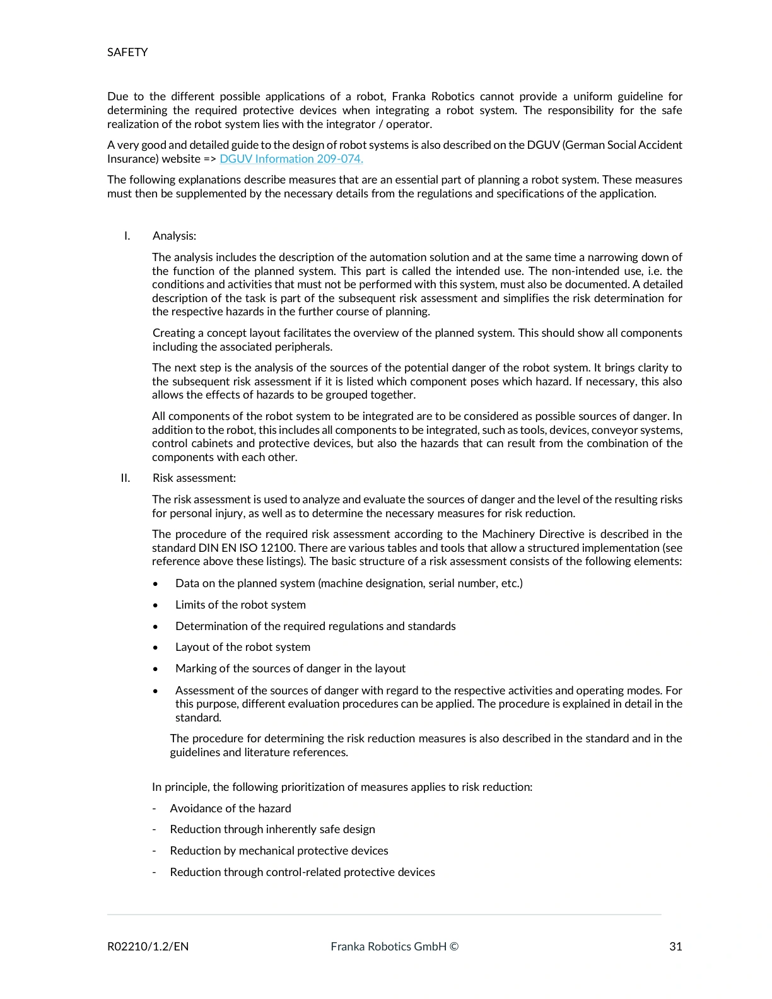



```
SAFETY  
 
R02210/1.2/EN 
Franka Robotics GmbH ©  
31  
 
Due to the different possible applications of a robot, Franka Robotics cannot provide a uniform guideline for 
determining the required protective devices when integrating a robot system. The responsibility for the safe 
realization of the robot system lies with the integrator / operator. 
A very good and detailed guide to the design of robot systems is also described on the DGUV (German Social Accident 
Insurance) website => DGUV Information 209-074. 
The following explanations describe measures that are an essential part of planning a robot system. These measures 
must then be supplemented by the necessary details from the regulations and specifications of the application. 
 
I. 
Analysis: 
The analysis includes the description of the automation solution and at the same time a narrowing down of 
the function of the planned system. This part is called the intended use. The non-intended use, i.e. the 
conditions and activities that must not be performed with this system, must also be documented. A detailed 
description of the task is part of the subsequent risk assessment and simplifies the risk determination for 
the respective hazards in the further course of planning. 
Creating a concept layout facilitates the overview of the planned system. This should show all components 
including the associated peripherals. 
The next step is the analysis of the sources of the potential danger of the robot system. It brings clarity to 
the subsequent risk assessment if it is listed which component poses which hazard. If necessary, this also 
allows the effects of hazards to be grouped together. 
All components of the robot system to be integrated are to be considered as possible sources of danger. In 
addition to the robot, this includes all components to be integrated, such as tools, devices, conveyor systems, 
control cabinets and protective devices, but also the hazards that can result from the combination of the 
components with each other. 
II. 
Risk assessment: 
The risk assessment is used to analyze and evaluate the sources of danger and the level of the resulting risks 
for personal injury, as well as to determine the necessary measures for risk reduction. 
The procedure of the required risk assessment according to the Machinery Directive is described in the 
standard DIN EN ISO 12100. There are various tables and tools that allow a structured implementation (see 
reference above these listings). The basic structure of a risk assessment consists of the following elements: 
• 
Data on the planned system (machine designation, serial number, etc.) 
• 
Limits of the robot system 
• 
Determination of the required regulations and standards 
• 
Layout of the robot system 
• 
Marking of the sources of danger in the layout 
• 
Assessment of the sources of danger with regard to the respective activities and operating modes. For 
this purpose, different evaluation procedures can be applied. The procedure is explained in detail in the 
standard. 
The procedure for determining the risk reduction measures is also described in the standard and in the 
guidelines and literature references. 
 
In principle, the following prioritization of measures applies to risk reduction: 
- 
Avoidance of the hazard 
- 
Reduction through inherently safe design 
- 
Reduction by mechanical protective devices 
- 
Reduction through control-related protective devices
```



**Original PDF links:** [Source link 1](https://publikationen.dguv.de/regelwerk/dguv-informationen/270/industrieroboter)

## PDF page 32

**Source:** Hardware Manual Franka Research 3\_Arm v2.1\_R02210\_1.2\_EN.pdf, original pdf page 32. [Open the corresponding PDF reading-copy page](https://1292444914-files.gitbook.io/~/files/v0/b/gitbook-x-prod.appspot.com/o/spaces%2FtgOfPnscWebs1eh82EKq%2Fuploads%2FnqlLZUvfPTj9H5KsKII2%2FFR3_HARDWARE-pages-028-033.pdf?alt=media#page=5).



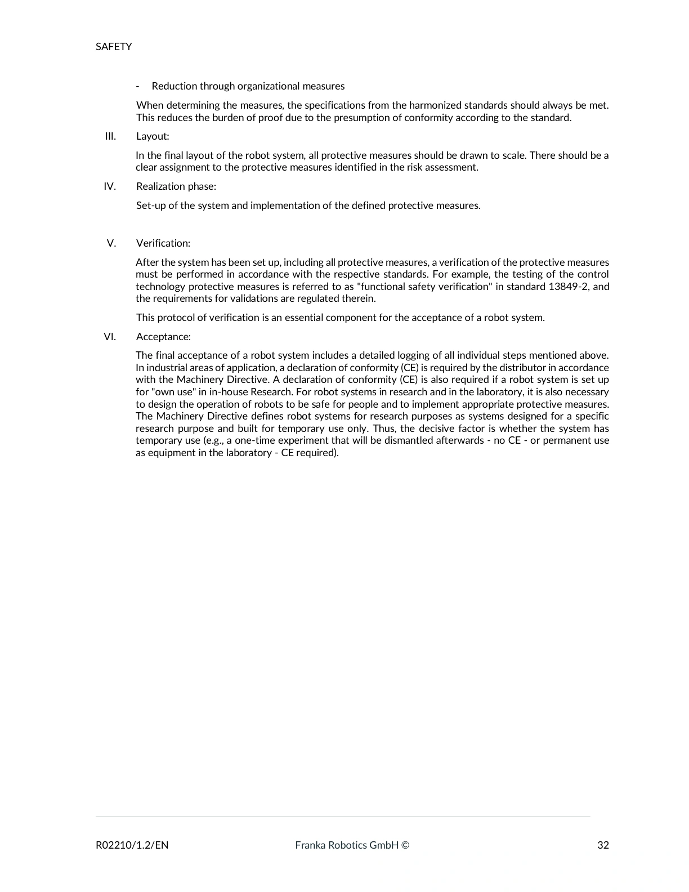



```
SAFETY  
 
R02210/1.2/EN 
Franka Robotics GmbH ©  
32  
 
- 
Reduction through organizational measures 
When determining the measures, the specifications from the harmonized standards should always be met. 
This reduces the burden of proof due to the presumption of conformity according to the standard. 
III. 
Layout: 
In the final layout of the robot system, all protective measures should be drawn to scale. There should be a 
clear assignment to the protective measures identified in the risk assessment. 
IV. 
Realization phase: 
Set-up of the system and implementation of the defined protective measures. 
 
V. 
Verification: 
After the system has been set up, including all protective measures, a verification of the protective measures 
must be performed in accordance with the respective standards. For example, the testing of the control 
technology protective measures is referred to as "functional safety verification" in standard 13849-2, and 
the requirements for validations are regulated therein. 
This protocol of verification is an essential component for the acceptance of a robot system. 
VI. 
Acceptance: 
The final acceptance of a robot system includes a detailed logging of all individual steps mentioned above. 
In industrial areas of application, a declaration of conformity (CE) is required by the distributor in accordance 
with the Machinery Directive. A declaration of conformity (CE) is also required if a robot system is set up 
for "own use" in in-house Research. For robot systems in research and in the laboratory, it is also necessary 
to design the operation of robots to be safe for people and to implement appropriate protective measures. 
The Machinery Directive defines robot systems for research purposes as systems designed for a specific 
research purpose and built for temporary use only. Thus, the decisive factor is whether the system has 
temporary use (e.g., a one-time experiment that will be dismantled afterwards - no CE - or permanent use 
as equipment in the laboratory - CE required).
```



## PDF page 33

**Source:** Hardware Manual Franka Research 3\_Arm v2.1\_R02210\_1.2\_EN.pdf, original pdf page 33. [Open the corresponding PDF reading-copy page](https://1292444914-files.gitbook.io/~/files/v0/b/gitbook-x-prod.appspot.com/o/spaces%2FtgOfPnscWebs1eh82EKq%2Fuploads%2FnqlLZUvfPTj9H5KsKII2%2FFR3_HARDWARE-pages-028-033.pdf?alt=media#page=6).



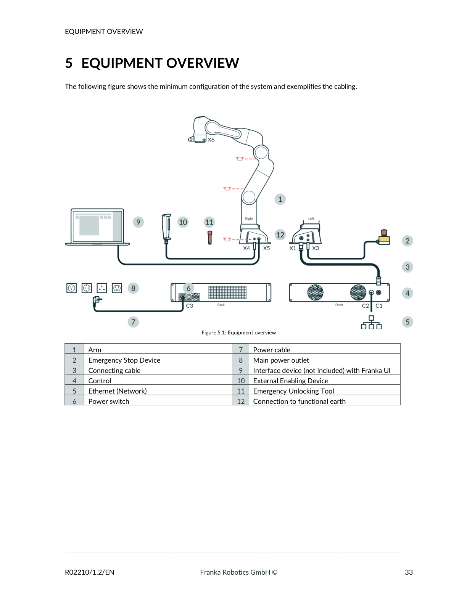



```
EQUIPMENT OVERVIEW  
 
R02210/1.2/EN 
Franka Robotics GmbH ©  
33  
 
5 EQUIPMENT OVERVIEW 
The following figure shows the minimum configuration of the system and exemplifies the cabling. 
 
  
Figure 5.1: Equipment overview 
1 
Arm 
7 
Power cable 
2 
Emergency Stop Device 
8 
Main power outlet 
3 
Connecting cable 
9 
Interface device (not included) with Franka UI 
4 
Control 
10 
External Enabling Device 
5 
Ethernet (Network) 
11 
Emergency Unlocking Tool 
6 
Power switch 
12 
Connection to functional earth
```



## PDF page 34

**Source:** Hardware Manual Franka Research 3\_Arm v2.1\_R02210\_1.2\_EN.pdf, original pdf page 34. [Open the corresponding PDF reading-copy page](https://1292444914-files.gitbook.io/~/files/v0/b/gitbook-x-prod.appspot.com/o/spaces%2FtgOfPnscWebs1eh82EKq%2Fuploads%2FtEQkDaW2vAvSdYPxFlpg%2FFR3_HARDWARE-pages-034-040.pdf?alt=media#page=1).



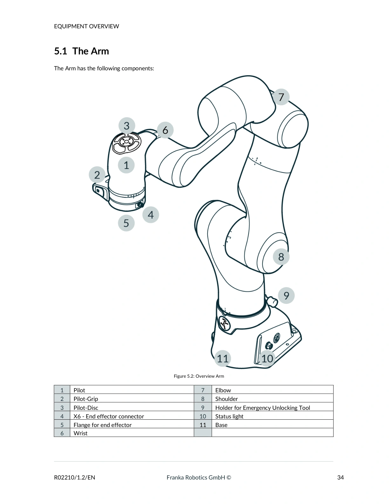



```
EQUIPMENT OVERVIEW  
 
R02210/1.2/EN 
Franka Robotics GmbH ©  
34  
 
5.1 The Arm 
The Arm has the following components: 
 
 
Figure 5.2: Overview Arm 
1 
Pilot 
7 
Elbow 
2 
Pilot-Grip 
8 
Shoulder 
3 
Pilot-Disc 
9 
Holder for Emergency Unlocking Tool 
4 
X6 - End effector connector 
10 
Status light 
5 
Flange for end effector 
11 
Base 
6 
Wrist
```



## PDF page 35

**Source:** Hardware Manual Franka Research 3\_Arm v2.1\_R02210\_1.2\_EN.pdf, original pdf page 35. [Open the corresponding PDF reading-copy page](https://1292444914-files.gitbook.io/~/files/v0/b/gitbook-x-prod.appspot.com/o/spaces%2FtgOfPnscWebs1eh82EKq%2Fuploads%2FtEQkDaW2vAvSdYPxFlpg%2FFR3_HARDWARE-pages-034-040.pdf?alt=media#page=2).



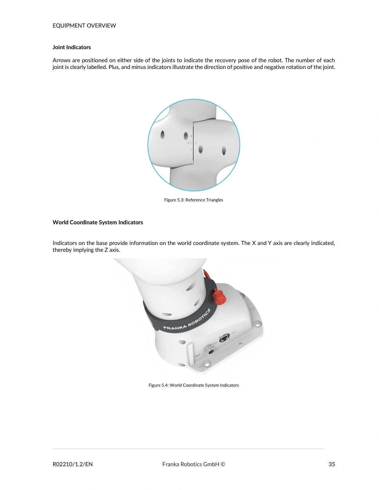



```
EQUIPMENT OVERVIEW  
 
R02210/1.2/EN 
Franka Robotics GmbH ©  
35  
 
Joint Indicators 
Arrows are positioned on either side of the joints to indicate the recovery pose of the robot. The number of each 
joint is clearly labelled. Plus, and minus indicators illustrate the direction of positive and negative rotation of the joint. 
 
 
 
Figure 5.3: Reference Triangles 
 
World Coordinate System Indicators 
 
Indicators on the base provide information on the world coordinate system. The X and Y axis are clearly indicated, 
thereby implying the Z axis. 
 
Figure 5.4: World Coordinate System Indicators
```



## PDF page 36

**Source:** Hardware Manual Franka Research 3\_Arm v2.1\_R02210\_1.2\_EN.pdf, original pdf page 36. [Open the corresponding PDF reading-copy page](https://1292444914-files.gitbook.io/~/files/v0/b/gitbook-x-prod.appspot.com/o/spaces%2FtgOfPnscWebs1eh82EKq%2Fuploads%2FtEQkDaW2vAvSdYPxFlpg%2FFR3_HARDWARE-pages-034-040.pdf?alt=media#page=3).



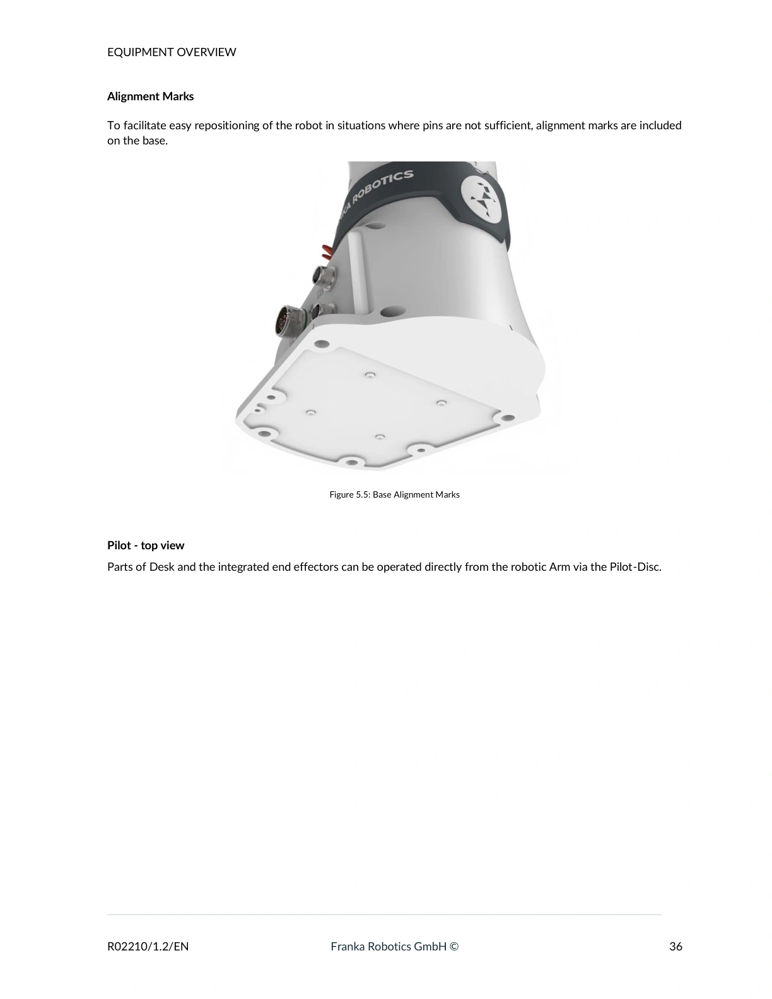



```
EQUIPMENT OVERVIEW  
 
R02210/1.2/EN 
Franka Robotics GmbH ©  
36  
 
Alignment Marks 
To facilitate easy repositioning of the robot in situations where pins are not sufficient, alignment marks are included 
on the base. 
 
Figure 5.5: Base Alignment Marks 
                                                                            
Pilot - top view 
Parts of Desk and the integrated end effectors can be operated directly from the robotic Arm via the Pilot-Disc.
```



## PDF page 37

**Source:** Hardware Manual Franka Research 3\_Arm v2.1\_R02210\_1.2\_EN.pdf, original pdf page 37. [Open the corresponding PDF reading-copy page](https://1292444914-files.gitbook.io/~/files/v0/b/gitbook-x-prod.appspot.com/o/spaces%2FtgOfPnscWebs1eh82EKq%2Fuploads%2FtEQkDaW2vAvSdYPxFlpg%2FFR3_HARDWARE-pages-034-040.pdf?alt=media#page=4).



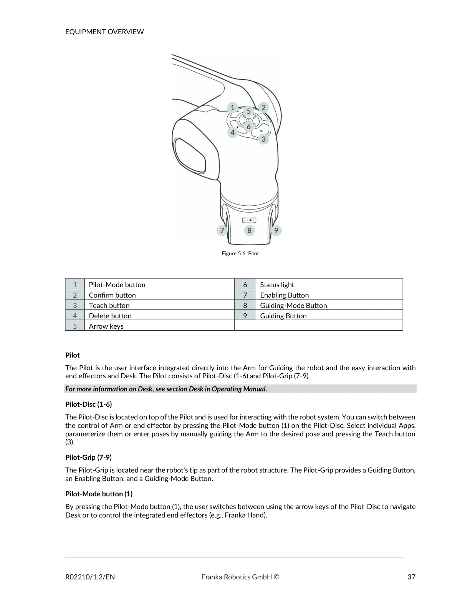



```
EQUIPMENT OVERVIEW  
 
R02210/1.2/EN 
Franka Robotics GmbH ©  
37  
 
 
Figure 5.6: Pilot 
 
1 
Pilot-Mode button 
6 
Status light 
2 
Confirm button  
7 
Enabling Button 
3 
Teach button 
8 
Guiding-Mode Button 
4 
Delete button 
9 
Guiding Button 
5 
Arrow keys 
 
 
 
Pilot 
The Pilot is the user interface integrated directly into the Arm for Guiding the robot and the easy interaction with 
end effectors and Desk. The Pilot consists of Pilot-Disc (1-6) and Pilot-Grip (7-9). 
For more information on Desk, see section Desk in Operating Manual. 
Pilot-Disc (1-6) 
The Pilot-Disc is located on top of the Pilot and is used for interacting with the robot system. You can switch between 
the control of Arm or end effector by pressing the Pilot-Mode button (1) on the Pilot-Disc. Select individual Apps, 
parameterize them or enter poses by manually guiding the Arm to the desired pose and pressing the Teach button 
(3). 
Pilot-Grip (7-9) 
The Pilot-Grip is located near the robot's tip as part of the robot structure. The Pilot-Grip provides a Guiding Button, 
an Enabling Button, and a Guiding-Mode Button. 
Pilot-Mode button (1) 
By pressing the Pilot-Mode button (1), the user switches between using the arrow keys of the Pilot-Disc to navigate 
Desk or to control the integrated end effectors (e.g., Franka Hand).
```



## PDF page 38

**Source:** Hardware Manual Franka Research 3\_Arm v2.1\_R02210\_1.2\_EN.pdf, original pdf page 38. [Open the corresponding PDF reading-copy page](https://1292444914-files.gitbook.io/~/files/v0/b/gitbook-x-prod.appspot.com/o/spaces%2FtgOfPnscWebs1eh82EKq%2Fuploads%2FtEQkDaW2vAvSdYPxFlpg%2FFR3_HARDWARE-pages-034-040.pdf?alt=media#page=5).



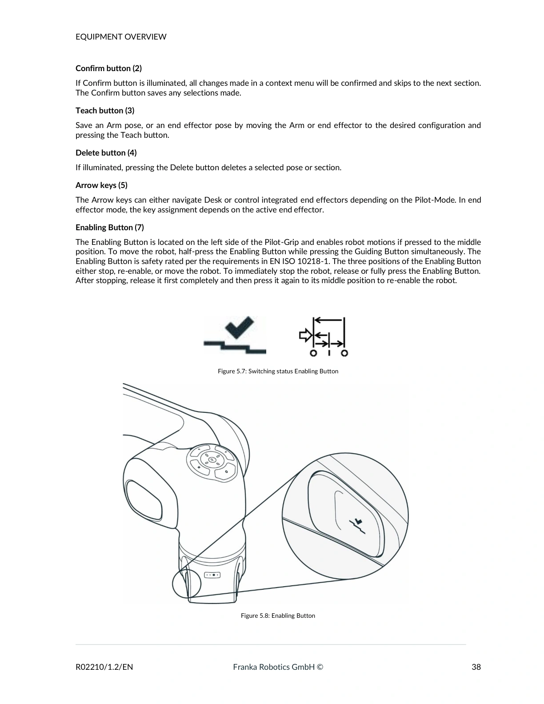



```
EQUIPMENT OVERVIEW  
 
R02210/1.2/EN 
Franka Robotics GmbH ©  
38  
 
Confirm button (2) 
If Confirm button is illuminated, all changes made in a context menu will be confirmed and skips to the next section. 
The Confirm button saves any selections made. 
Teach button (3) 
Save an Arm pose, or an end effector pose by moving the Arm or end effector to the desired configuration and 
pressing the Teach button. 
Delete button (4) 
If illuminated, pressing the Delete button deletes a selected pose or section. 
Arrow keys (5) 
The Arrow keys can either navigate Desk or control integrated end effectors depending on the Pilot-Mode. In end 
effector mode, the key assignment depends on the active end effector.  
Enabling Button (7)  
The Enabling Button is located on the left side of the Pilot-Grip and enables robot motions if pressed to the middle 
position. To move the robot, half-press the Enabling Button while pressing the Guiding Button simultaneously. The 
Enabling Button is safety rated per the requirements in EN ISO 10218-1. The three positions of the Enabling Button 
either stop, re-enable, or move the robot. To immediately stop the robot, release or fully press the Enabling Button. 
After stopping, release it first completely and then press it again to its middle position to re-enable the robot. 
 
 
Figure 5.7: Switching status Enabling Button 
 
Figure 5.8: Enabling Button
```



## PDF page 39

**Source:** Hardware Manual Franka Research 3\_Arm v2.1\_R02210\_1.2\_EN.pdf, original pdf page 39. [Open the corresponding PDF reading-copy page](https://1292444914-files.gitbook.io/~/files/v0/b/gitbook-x-prod.appspot.com/o/spaces%2FtgOfPnscWebs1eh82EKq%2Fuploads%2FtEQkDaW2vAvSdYPxFlpg%2FFR3_HARDWARE-pages-034-040.pdf?alt=media#page=6).



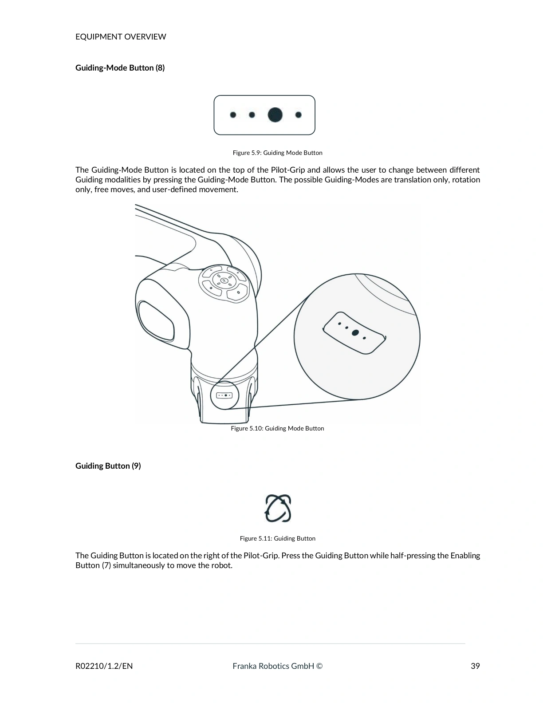



```
EQUIPMENT OVERVIEW  
 
R02210/1.2/EN 
Franka Robotics GmbH ©  
39  
 
Guiding-Mode Button (8) 
 
Figure 5.9: Guiding Mode Button 
The Guiding‑Mode Button is located on the top of the Pilot-Grip and allows the user to change between different 
Guiding modalities by pressing the Guiding-Mode Button. The possible Guiding-Modes are translation only, rotation 
only, free moves, and user-defined movement. 
 
Figure 5.10: Guiding Mode Button 
 
Guiding Button (9) 
 
Figure 5.11: Guiding Button 
The Guiding Button is located on the right of the Pilot-Grip. Press the Guiding Button while half-pressing the Enabling 
Button (7) simultaneously to move the robot.
```



## PDF page 40

**Source:** Hardware Manual Franka Research 3\_Arm v2.1\_R02210\_1.2\_EN.pdf, original pdf page 40. [Open the corresponding PDF reading-copy page](https://1292444914-files.gitbook.io/~/files/v0/b/gitbook-x-prod.appspot.com/o/spaces%2FtgOfPnscWebs1eh82EKq%2Fuploads%2FtEQkDaW2vAvSdYPxFlpg%2FFR3_HARDWARE-pages-034-040.pdf?alt=media#page=7).



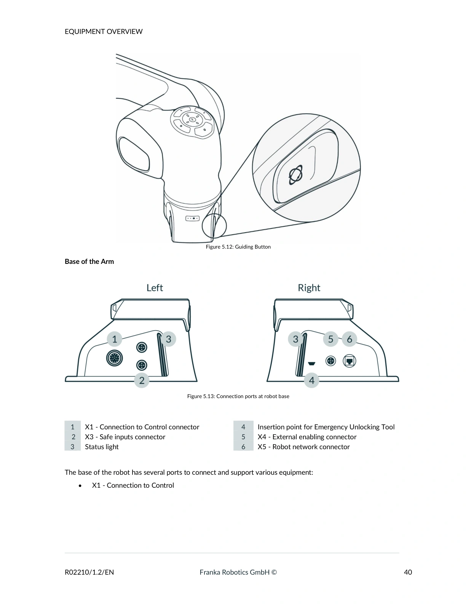



```
EQUIPMENT OVERVIEW  
 
R02210/1.2/EN 
Franka Robotics GmbH ©  
40  
 
 
Figure 5.12: Guiding Button 
Base of the Arm 
 
 
Figure 5.13: Connection ports at robot base 
 
1 
X1 - Connection to Control connector 
4 
Insertion point for Emergency Unlocking Tool 
 2 
X3 - Safe inputs connector 
5 
X4 - External enabling connector 
 3 
Status light 
6 
X5 - Robot network connector 
 
The base of the robot has several ports to connect and support various equipment: 
• 
X1 - Connection to Control
```



## PDF page 41

**Source:** Hardware Manual Franka Research 3\_Arm v2.1\_R02210\_1.2\_EN.pdf, original pdf page 41. [Open the corresponding PDF reading-copy page](https://1292444914-files.gitbook.io/~/files/v0/b/gitbook-x-prod.appspot.com/o/spaces%2FtgOfPnscWebs1eh82EKq%2Fuploads%2Fnp4jBcdiRnZDRt6nw5Ds%2FFR3_HARDWARE-pages-041-045.pdf?alt=media#page=1).



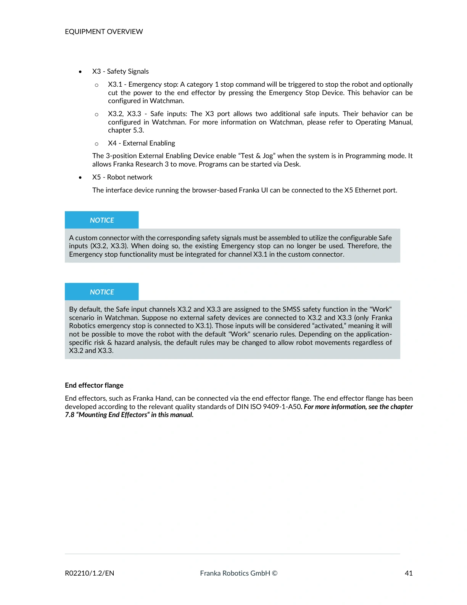



```
EQUIPMENT OVERVIEW  
 
R02210/1.2/EN 
Franka Robotics GmbH ©  
41  
 
 
• 
X3 - Safety Signals 
o 
X3.1 - Emergency stop: A category 1 stop command will be triggered to stop the robot and optionally 
cut the power to the end effector by pressing the Emergency Stop Device. This behavior can be 
configured in Watchman.  
o 
X3.2, X3.3 - Safe inputs: The X3 port allows two additional safe inputs. Their behavior can be 
configured in Watchman. For more information on Watchman, please refer to Operating Manual, 
chapter 5.3. 
o 
X4 - External Enabling 
The 3-position External Enabling Device enable “Test & Jog” when the system is in Programming mode. It 
allows Franka Research 3 to move. Programs can be started via Desk. 
• 
X5 - Robot network 
The interface device running the browser-based Franka UI can be connected to the X5 Ethernet port. 
 
NOTICE 
 
A custom connector with the corresponding safety signals must be assembled to utilize the configurable Safe 
inputs (X3.2, X3.3). When doing so, the existing Emergency stop can no longer be used. Therefore, the 
Emergency stop functionality must be integrated for channel X3.1 in the custom connector. 
 
NOTICE 
 
By default, the Safe input channels X3.2 and X3.3 are assigned to the SMSS safety function in the "Work" 
scenario in Watchman. Suppose no external safety devices are connected to X3.2 and X3.3 (only Franka 
Robotics emergency stop is connected to X3.1). Those inputs will be considered “activated,” meaning it will 
not be possible to move the robot with the default "Work" scenario rules. Depending on the application-
specific risk & hazard analysis, the default rules may be changed to allow robot movements regardless of 
X3.2 and X3.3. 
 
End effector flange 
End effectors, such as Franka Hand, can be connected via the end effector flange. The end effector flange has been 
developed according to the relevant quality standards of DIN ISO 9409-1-A50. For more information, see the chapter 
7.8 “Mounting End Effectors“ in this manual.
```



**Original document cross-references:** [PDF 71](pages-001-072.md#pdf-page-71)

## PDF page 42

**Source:** Hardware Manual Franka Research 3\_Arm v2.1\_R02210\_1.2\_EN.pdf, original pdf page 42. [Open the corresponding PDF reading-copy page](https://1292444914-files.gitbook.io/~/files/v0/b/gitbook-x-prod.appspot.com/o/spaces%2FtgOfPnscWebs1eh82EKq%2Fuploads%2Fnp4jBcdiRnZDRt6nw5Ds%2FFR3_HARDWARE-pages-041-045.pdf?alt=media#page=2).



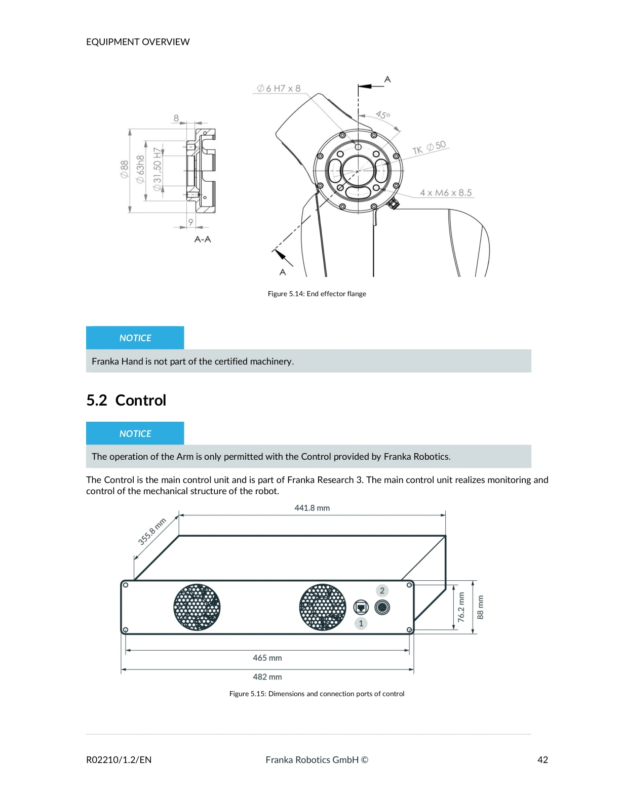



```
EQUIPMENT OVERVIEW  
 
R02210/1.2/EN 
Franka Robotics GmbH ©  
42  
 
 
Figure 5.14: End effector flange 
 
NOTICE 
 
Franka Hand is not part of the certified machinery.  
5.2 Control 
NOTICE 
 
The operation of the Arm is only permitted with the Control provided by Franka Robotics.  
The Control is the main control unit and is part of Franka Research 3. The main control unit realizes monitoring and 
control of the mechanical structure of the robot. 
 
Figure 5.15: Dimensions and connection ports of control
```



## PDF page 43

**Source:** Hardware Manual Franka Research 3\_Arm v2.1\_R02210\_1.2\_EN.pdf, original pdf page 43. [Open the corresponding PDF reading-copy page](https://1292444914-files.gitbook.io/~/files/v0/b/gitbook-x-prod.appspot.com/o/spaces%2FtgOfPnscWebs1eh82EKq%2Fuploads%2Fnp4jBcdiRnZDRt6nw5Ds%2FFR3_HARDWARE-pages-041-045.pdf?alt=media#page=3).



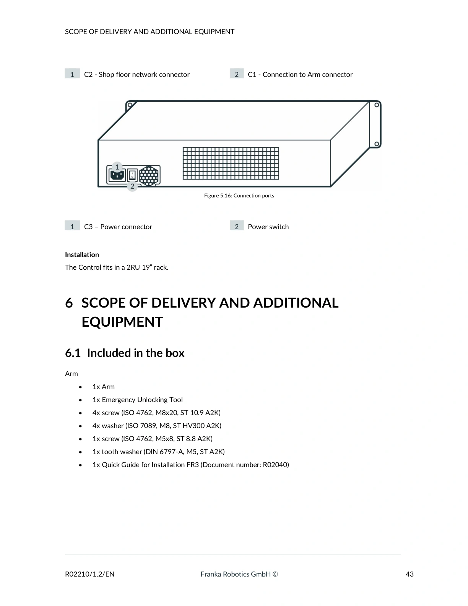



```
SCOPE OF DELIVERY AND ADDITIONAL EQUIPMENT  
 
R02210/1.2/EN 
Franka Robotics GmbH ©  
43  
 
 
1 
C2 - Shop floor network connector 
2 
C1 - Connection to Arm connector 
 
 
Figure 5.16: Connection ports 
 
1 
C3 – Power connector 
2 
Power switch 
 
Installation 
The Control fits in a 2RU 19” rack. 
 
6 SCOPE OF DELIVERY AND ADDITIONAL 
EQUIPMENT 
6.1 Included in the box 
Arm 
• 
1x Arm 
• 
1x Emergency Unlocking Tool 
• 
4x screw (ISO 4762, M8x20, ST 10.9 A2K) 
• 
4x washer (ISO 7089, M8, ST HV300 A2K) 
• 
1x screw (ISO 4762, M5x8, ST 8.8 A2K) 
• 
1x tooth washer (DIN 6797-A, M5, ST A2K) 
• 
1x Quick Guide for Installation FR3 (Document number: R02040)
```



## PDF page 44

**Source:** Hardware Manual Franka Research 3\_Arm v2.1\_R02210\_1.2\_EN.pdf, original pdf page 44. [Open the corresponding PDF reading-copy page](https://1292444914-files.gitbook.io/~/files/v0/b/gitbook-x-prod.appspot.com/o/spaces%2FtgOfPnscWebs1eh82EKq%2Fuploads%2Fnp4jBcdiRnZDRt6nw5Ds%2FFR3_HARDWARE-pages-041-045.pdf?alt=media#page=4).



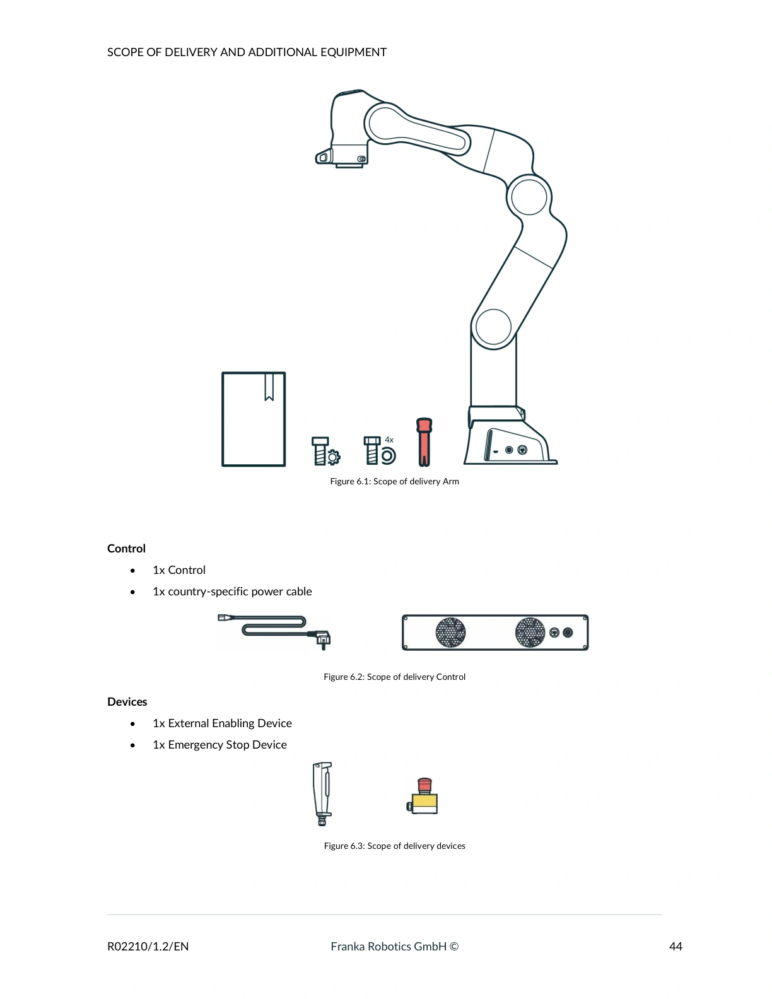



```
SCOPE OF DELIVERY AND ADDITIONAL EQUIPMENT  
 
R02210/1.2/EN 
Franka Robotics GmbH ©  
44  
 
 
Figure 6.1: Scope of delivery Arm 
 
 
Control 
• 
1x Control 
• 
1x country-specific power cable 
 
Figure 6.2: Scope of delivery Control 
Devices 
• 
1x External Enabling Device 
• 
1x Emergency Stop Device 
 
Figure 6.3: Scope of delivery devices
```



## PDF page 45

**Source:** Hardware Manual Franka Research 3\_Arm v2.1\_R02210\_1.2\_EN.pdf, original pdf page 45. [Open the corresponding PDF reading-copy page](https://1292444914-files.gitbook.io/~/files/v0/b/gitbook-x-prod.appspot.com/o/spaces%2FtgOfPnscWebs1eh82EKq%2Fuploads%2Fnp4jBcdiRnZDRt6nw5Ds%2FFR3_HARDWARE-pages-041-045.pdf?alt=media#page=5).



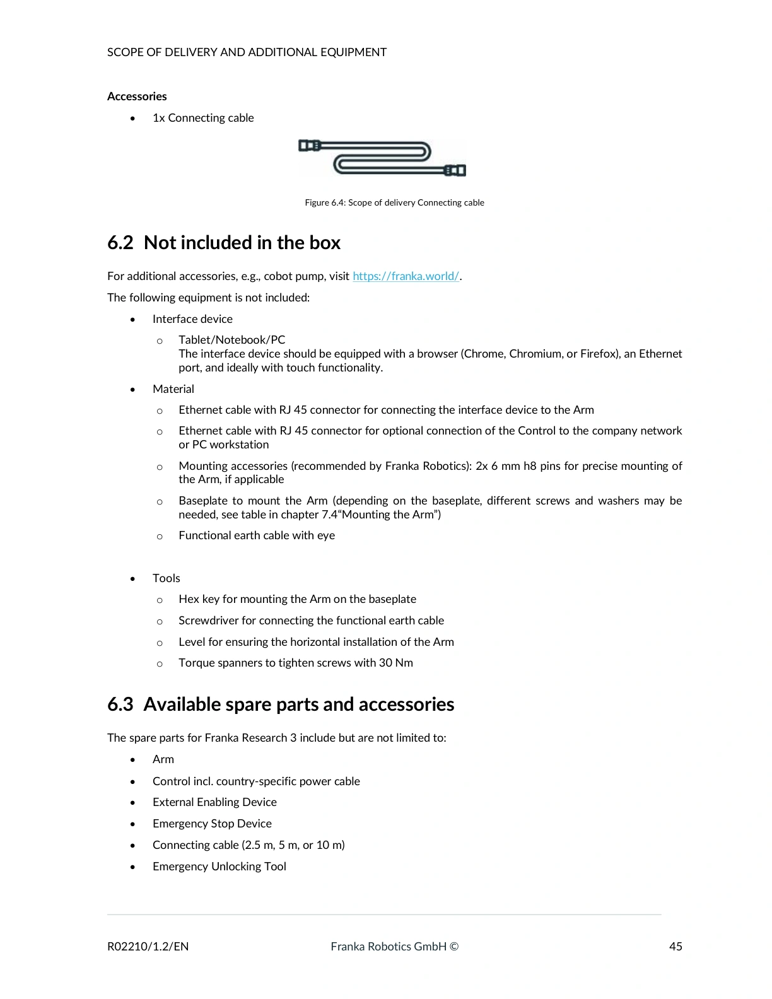



```
SCOPE OF DELIVERY AND ADDITIONAL EQUIPMENT  
 
R02210/1.2/EN 
Franka Robotics GmbH ©  
45  
 
Accessories 
• 
1x Connecting cable 
 
Figure 6.4: Scope of delivery Connecting cable 
6.2 Not included in the box 
For additional accessories, e.g., cobot pump, visit https://franka.world/. 
The following equipment is not included: 
• 
Interface device 
o 
Tablet/Notebook/PC 
The interface device should be equipped with a browser (Chrome, Chromium, or Firefox), an Ethernet 
port, and ideally with touch functionality. 
• 
Material 
o 
Ethernet cable with RJ 45 connector for connecting the interface device to the Arm 
o 
Ethernet cable with RJ 45 connector for optional connection of the Control to the company network 
or PC workstation 
o 
Mounting accessories (recommended by Franka Robotics): 2x 6 mm h8 pins for precise mounting of 
the Arm, if applicable 
o 
Baseplate to mount the Arm (depending on the baseplate, different screws and washers may be 
needed, see table in chapter 7.4“Mounting the Arm”) 
o 
Functional earth cable with eye 
 
• 
Tools 
o 
Hex key for mounting the Arm on the baseplate 
o 
Screwdriver for connecting the functional earth cable 
o 
Level for ensuring the horizontal installation of the Arm 
o 
Torque spanners to tighten screws with 30 Nm 
6.3 Available spare parts and accessories 
The spare parts for Franka Research 3 include but are not limited to: 
• 
Arm 
• 
Control incl. country-specific power cable 
• 
External Enabling Device 
• 
Emergency Stop Device 
• 
Connecting cable (2.5 m, 5 m, or 10 m) 
• 
Emergency Unlocking Tool
```



**Original PDF links:** [Source link 1](https://franka.world/)

**Original document cross-references:** [PDF 59](pages-001-072.md#pdf-page-59)

## PDF page 46

**Source:** Hardware Manual Franka Research 3\_Arm v2.1\_R02210\_1.2\_EN.pdf, original pdf page 46. [Open the corresponding PDF reading-copy page](https://1292444914-files.gitbook.io/~/files/v0/b/gitbook-x-prod.appspot.com/o/spaces%2FtgOfPnscWebs1eh82EKq%2Fuploads%2FAqw1JS4DOtQAncXkqG4M%2FFR3_HARDWARE-pages-046-051.pdf?alt=media#page=1).



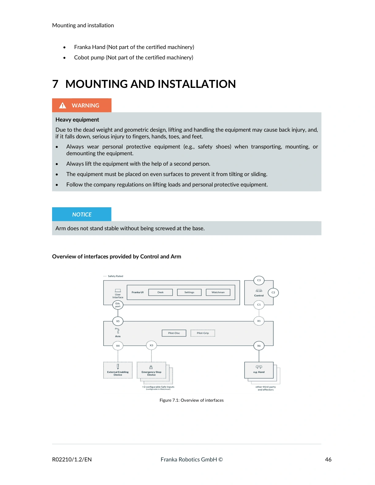



```
Mounting and installation  
 
R02210/1.2/EN 
Franka Robotics GmbH ©  
46  
 
• 
Franka Hand (Not part of the certified machinery) 
• 
Cobot pump (Not part of the certified machinery) 
 
7 MOUNTING AND INSTALLATION 
WARNING 
  
Heavy equipment 
Due to the dead weight and geometric design, lifting and handling the equipment may cause back injury, and, 
if it falls down, serious injury to fingers, hands, toes, and feet. 
• 
Always wear personal protective equipment (e.g., safety shoes) when transporting, mounting, or 
demounting the equipment. 
• 
Always lift the equipment with the help of a second person. 
• 
The equipment must be placed on even surfaces to prevent it from tilting or sliding. 
• 
Follow the company regulations on lifting loads and personal protective equipment. 
 
 
NOTICE 
 
Arm does not stand stable without being screwed at the base. 
 
Overview of interfaces provided by Control and Arm 
 
 
Figure 7.1: Overview of interfaces
```



## PDF page 47

**Source:** Hardware Manual Franka Research 3\_Arm v2.1\_R02210\_1.2\_EN.pdf, original pdf page 47. [Open the corresponding PDF reading-copy page](https://1292444914-files.gitbook.io/~/files/v0/b/gitbook-x-prod.appspot.com/o/spaces%2FtgOfPnscWebs1eh82EKq%2Fuploads%2FAqw1JS4DOtQAncXkqG4M%2FFR3_HARDWARE-pages-046-051.pdf?alt=media#page=2).



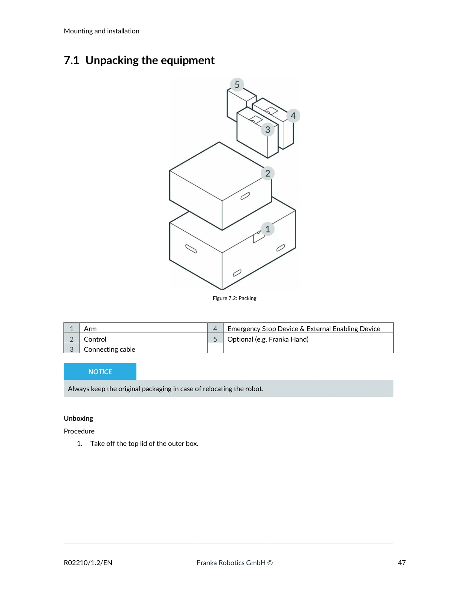



```
Mounting and installation  
 
R02210/1.2/EN 
Franka Robotics GmbH ©  
47  
 
7.1 Unpacking the equipment 
 
Figure 7.2: Packing 
 
1 
Arm 
4 
Emergency Stop Device & External Enabling Device 
2 
Control 
5 
Optional (e.g. Franka Hand) 
3 
Connecting cable 
 
 
 
NOTICE 
 
Always keep the original packaging in case of relocating the robot. 
 
Unboxing 
Procedure 
1. 
Take off the top lid of the outer box.
```



## PDF page 48

**Source:** Hardware Manual Franka Research 3\_Arm v2.1\_R02210\_1.2\_EN.pdf, original pdf page 48. [Open the corresponding PDF reading-copy page](https://1292444914-files.gitbook.io/~/files/v0/b/gitbook-x-prod.appspot.com/o/spaces%2FtgOfPnscWebs1eh82EKq%2Fuploads%2FAqw1JS4DOtQAncXkqG4M%2FFR3_HARDWARE-pages-046-051.pdf?alt=media#page=3).



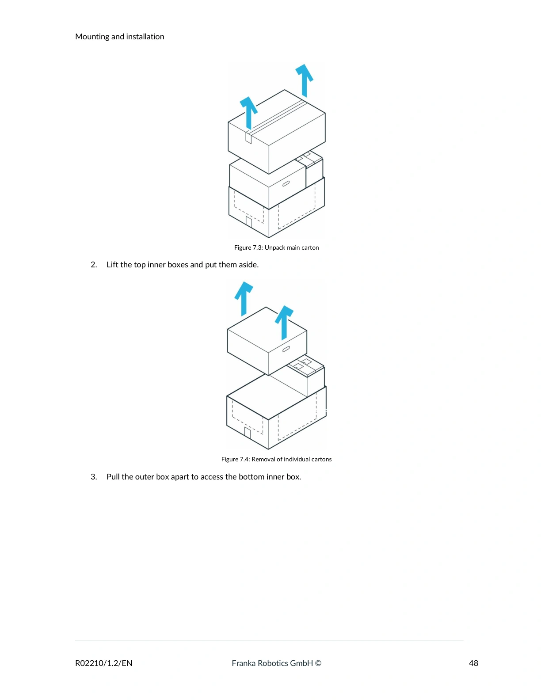



```
Mounting and installation  
 
R02210/1.2/EN 
Franka Robotics GmbH ©  
48  
 
 
Figure 7.3: Unpack main carton 
2. 
Lift the top inner boxes and put them aside. 
 
Figure 7.4: Removal of individual cartons 
3. 
Pull the outer box apart to access the bottom inner box. 
 
 
Picture will be substituted with graphic before release.
```



## PDF page 49

**Source:** Hardware Manual Franka Research 3\_Arm v2.1\_R02210\_1.2\_EN.pdf, original pdf page 49. [Open the corresponding PDF reading-copy page](https://1292444914-files.gitbook.io/~/files/v0/b/gitbook-x-prod.appspot.com/o/spaces%2FtgOfPnscWebs1eh82EKq%2Fuploads%2FAqw1JS4DOtQAncXkqG4M%2FFR3_HARDWARE-pages-046-051.pdf?alt=media#page=4).



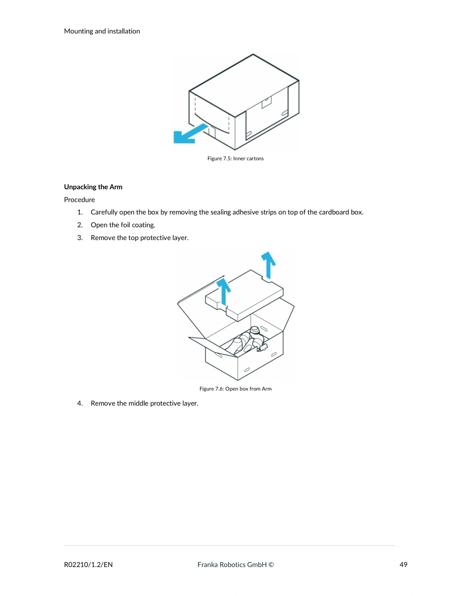



```
Mounting and installation  
 
R02210/1.2/EN 
Franka Robotics GmbH ©  
49  
 
 
Figure 7.5: Inner cartons 
 
Unpacking the Arm 
Procedure 
1. 
Carefully open the box by removing the sealing adhesive strips on top of the cardboard box. 
2. 
Open the foil coating. 
3. 
Remove the top protective layer. 
 
Figure 7.6: Open box from Arm 
4. 
Remove the middle protective layer.
```



## PDF page 50

**Source:** Hardware Manual Franka Research 3\_Arm v2.1\_R02210\_1.2\_EN.pdf, original pdf page 50. [Open the corresponding PDF reading-copy page](https://1292444914-files.gitbook.io/~/files/v0/b/gitbook-x-prod.appspot.com/o/spaces%2FtgOfPnscWebs1eh82EKq%2Fuploads%2FAqw1JS4DOtQAncXkqG4M%2FFR3_HARDWARE-pages-046-051.pdf?alt=media#page=5).



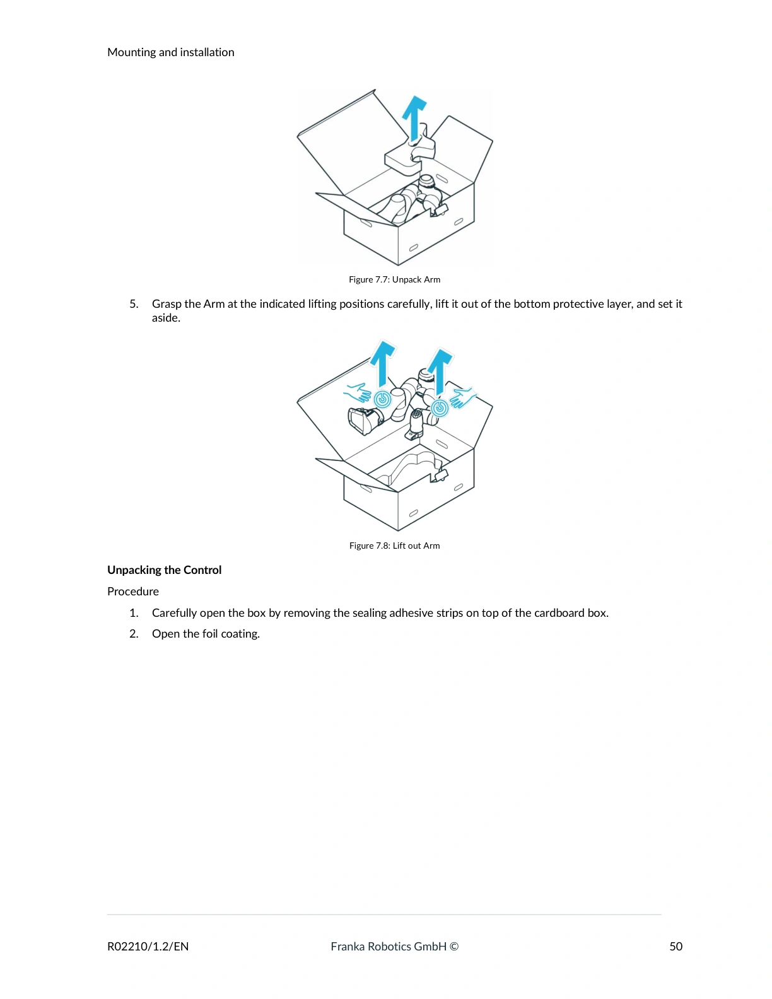



```
Mounting and installation  
 
R02210/1.2/EN 
Franka Robotics GmbH ©  
50  
 
 
Figure 7.7: Unpack Arm 
5. 
Grasp the Arm at the indicated lifting positions carefully, lift it out of the bottom protective layer, and set it 
aside. 
 
Figure 7.8: Lift out Arm 
Unpacking the Control 
Procedure 
1. 
Carefully open the box by removing the sealing adhesive strips on top of the cardboard box. 
2. 
Open the foil coating.
```



## PDF page 51

**Source:** Hardware Manual Franka Research 3\_Arm v2.1\_R02210\_1.2\_EN.pdf, original pdf page 51. [Open the corresponding PDF reading-copy page](https://1292444914-files.gitbook.io/~/files/v0/b/gitbook-x-prod.appspot.com/o/spaces%2FtgOfPnscWebs1eh82EKq%2Fuploads%2FAqw1JS4DOtQAncXkqG4M%2FFR3_HARDWARE-pages-046-051.pdf?alt=media#page=6).



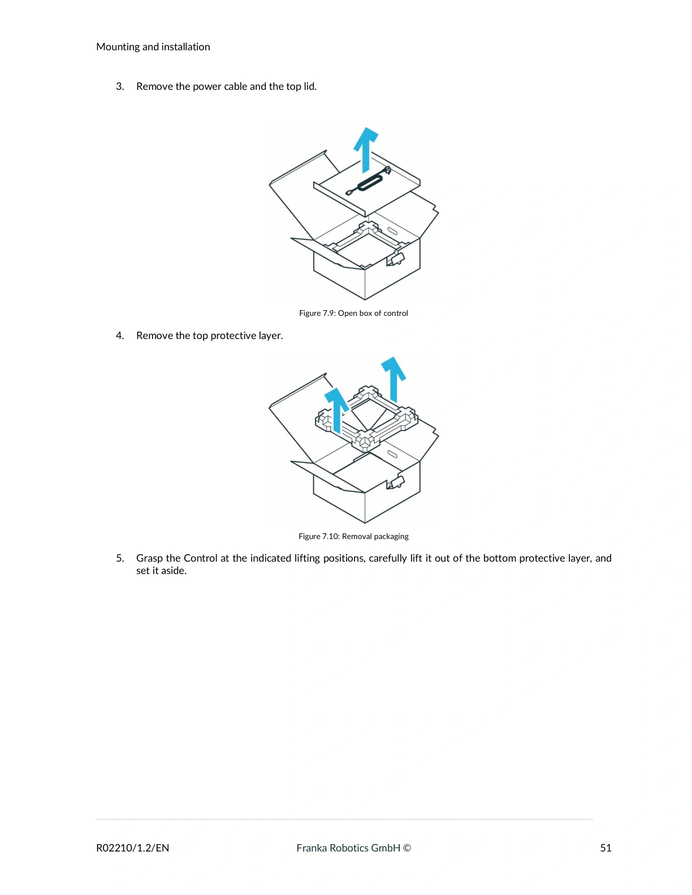



```
Mounting and installation  
 
R02210/1.2/EN 
Franka Robotics GmbH ©  
51  
 
3. 
Remove the power cable and the top lid. 
 
 
Figure 7.9: Open box of control 
4. 
Remove the top protective layer. 
 
Figure 7.10: Removal packaging 
5. 
Grasp the Control at the indicated lifting positions, carefully lift it out of the bottom protective layer, and 
set it aside.
```



## PDF page 52

**Source:** Hardware Manual Franka Research 3\_Arm v2.1\_R02210\_1.2\_EN.pdf, original pdf page 52. [Open the corresponding PDF reading-copy page](https://1292444914-files.gitbook.io/~/files/v0/b/gitbook-x-prod.appspot.com/o/spaces%2FtgOfPnscWebs1eh82EKq%2Fuploads%2FVbAxYb9GQ9XEyUoamXVH%2FFR3_HARDWARE-pages-052-063.pdf?alt=media#page=1).







```
Mounting and installation  
 
R02210/1.2/EN 
Franka Robotics GmbH ©  
52  
 
 
Figure 7.11: Lift out  control 
 
7.2 Correct installation site 
7.2.1 Maximum-and safeguarded space 
Classification of spaces 
 
Figure 7.12: Classifcation of spaces 
1 
Maximum workspace 
3 
Perimeter safeguarding 
2 
Safeguarded space
```



## PDF page 53

**Source:** Hardware Manual Franka Research 3\_Arm v2.1\_R02210\_1.2\_EN.pdf, original pdf page 53. [Open the corresponding PDF reading-copy page](https://1292444914-files.gitbook.io/~/files/v0/b/gitbook-x-prod.appspot.com/o/spaces%2FtgOfPnscWebs1eh82EKq%2Fuploads%2FVbAxYb9GQ9XEyUoamXVH%2FFR3_HARDWARE-pages-052-063.pdf?alt=media#page=2).







```
Mounting and installation  
 
R02210/1.2/EN 
Franka Robotics GmbH ©  
53  
 
• 
Maximum workspace 
 
Space that can be swept by the robot's moving parts plus the space which the end effector and the 
workpiece can sweep. 
• 
Safeguarded space 
 
Defined by the perimeter safeguarding (see graphic) 
 
NOTICE 
 
Utilize the provided safety functions to mitigate any risks of accidental collisions from an unexpectedly 
moving Arm. Monitoring functions are only triggered upon violation. The safety integrator must consider 
stopping times, distances, and tolerances. 
 
NOTICE 
 
Application-specific risk analysis may define a hazardous zone larger than the maximum workspace in some 
applications. 
7.2.2 Ambient conditions: Arm 
Permissible conditions at the site of installation  
Ambient temperature 
• 
+15 °C to +25 °C (normal) 
• 
+5 °C to +45 °C (extended) 
• 
IP 20 
• 
Normal operations (no-derating): +15°C to +25°C, 60% not condensing humidity 
• 
Extended operations (no de-rating of safety system, de-rating of performance possible) : +5°C to +45°C, 
90% not condensing humidity 
• 
Storage and transport: -10°C to +60°C 
Relative air humidity 
• 
20 % to 80 %, non-condensing 
Site of installation 
• 
Indoors, in enclosed buildings 
• 
Not exposed to direct sunlight 
• 
No vibrations, no accelerating fundaments 
• 
Magnetic fields are only permissible in the stated specification range.  
Please refer to topic 4.2 Notice of liability in this Manual. 
Orientation of installation 
• 
Arm may only be installed vertically (base horizontal to the earth’s surface, no hanging Arm) 
Ambient medium 
• 
Air 
• 
Free from flammable substances (dust, gas, liquid) 
• 
Free from aggressive media
```



**Original document cross-references:** [PDF 15](pages-001-072.md#pdf-page-15)

## PDF page 54

**Source:** Hardware Manual Franka Research 3\_Arm v2.1\_R02210\_1.2\_EN.pdf, original pdf page 54. [Open the corresponding PDF reading-copy page](https://1292444914-files.gitbook.io/~/files/v0/b/gitbook-x-prod.appspot.com/o/spaces%2FtgOfPnscWebs1eh82EKq%2Fuploads%2FVbAxYb9GQ9XEyUoamXVH%2FFR3_HARDWARE-pages-052-063.pdf?alt=media#page=3).







```
Mounting and installation  
 
R02210/1.2/EN 
Franka Robotics GmbH ©  
54  
 
• 
Free from corrosive substances 
• 
Free from flying objects 
• 
Free from spraying liquids 
• 
Free from pressurized air streams 
Pollution degree 
• 
Degree 2 (according to EN 60664) 
• 
Only dry, non-conductive pollution occurs; occasionally, temporary conductibility caused by condensation 
may occur 
Setup altitude 
• 
≤ 2,000 m above sea level 
Electromagnetic compatibility  
• 
Environment conditions must adhere to general industrial equipment according to EN 61000-6-4 as the 
system is designed for respective emission tolerance according to EN 61000-6-2 
 
NOTICE 
 
In order not to endanger the safety functionality of the system, ensure pollution degree 2 according to EN 
60664. 
Adequate ventilation 
NOTICE 
 
The heat produced by power electronic components and modules inside the Arm is dissipated via the Arm’s 
surface. 
• 
Install the Arm in an adequately ventilated place. 
• 
Do not expose the Arm to direct sunlight. 
• 
Do not repaint, paste up, or wrap up the Arm. 
Ergonomic consideration 
NOTICE 
 
To avoid overheating, the system will stop working when it exceeds the extended temperature range. The 
user will be informed through Franka UI. 
Follow further instructions in Franka UI. 
 
NOTICE 
 
To avoid overheating of the motors, the system will stop working, if the internal sensors detect excess 
temperatures in the windings. The user will be informed through Franka UI. 
Follow further instructions in Franka UI.
```



## PDF page 55

**Source:** Hardware Manual Franka Research 3\_Arm v2.1\_R02210\_1.2\_EN.pdf, original pdf page 55. [Open the corresponding PDF reading-copy page](https://1292444914-files.gitbook.io/~/files/v0/b/gitbook-x-prod.appspot.com/o/spaces%2FtgOfPnscWebs1eh82EKq%2Fuploads%2FVbAxYb9GQ9XEyUoamXVH%2FFR3_HARDWARE-pages-052-063.pdf?alt=media#page=4).







```
Mounting and installation  
 
R02210/1.2/EN 
Franka Robotics GmbH ©  
55  
 
NOTICE 
 
Install the Arm in an ergonomic teaching position. 
7.2.3 Ambient conditions: Control 
Permissible conditions at site of installation 
Ambient temperature 
• 
+15 °C to +25 °C (normal) 
• 
+5 °C to +45 °C (extended) 
Relative air humidity 
• 
20 % to 80 %, non-condensing 
Site of installation 
• 
Indoors, in enclosed buildings 
• 
Not exposed to direct sunlight 
• 
No vibrations 
• 
Magnetic fields are only permissible in the stated specification range. 
Please refer to topic 4.2 Notice of liability in this Manual. 
• 
Enclosure needs a minimum degree of protection corresponding to IP4X or IPXXD if located in places open 
to all persons. 
Orientation of installation 
• 
Device may only be installed horizontally on the earth’s surface 
• 
Mounting in angle brackets, e.g., under tables 
• 
Mounting in control cabinets (2U, 4HP) 
Power supply 
• 
In order to ensure stability and safety of the system, provide a stable power supply that maintains enough 
power to the control to shut down in a controlled fashion, when the power supply is shut off. 
Ambient medium 
• 
Air 
• 
Free from flammable substances (dust, gas, liquid) 
• 
Free from aggressive media 
• 
Free from corrosive substances 
• 
Free from flying objects 
• 
Free from spraying liquids 
• 
Free from pressurized air streams 
Pollution degree 
• 
Degree 2 (according to EN 60664) 
• 
Only dry, non-conductive pollution occurs; occasionally, temporary conductibility caused by condensation 
may occur
```



**Original document cross-references:** [PDF 15](pages-001-072.md#pdf-page-15)

## PDF page 56

**Source:** Hardware Manual Franka Research 3\_Arm v2.1\_R02210\_1.2\_EN.pdf, original pdf page 56. [Open the corresponding PDF reading-copy page](https://1292444914-files.gitbook.io/~/files/v0/b/gitbook-x-prod.appspot.com/o/spaces%2FtgOfPnscWebs1eh82EKq%2Fuploads%2FVbAxYb9GQ9XEyUoamXVH%2FFR3_HARDWARE-pages-052-063.pdf?alt=media#page=5).







```
Mounting and installation  
 
R02210/1.2/EN 
Franka Robotics GmbH ©  
56  
 
Setup altitude:  
• 
≤ 2,000 m above sea level 
NOTICE 
 
If it is not open to all persons, only pollution degree 2 is relevant and needs to be ensured. 
 
 
NOTICE 
 
In order not to endanger the safety functionality of the system, ensure pollution degree 2 according to 
EN 60664. 
The enclosure mentioned above is not suitable to protect from higher pollution degrees. Here, an even higher 
IP is needed. 
 
7.3 Preparing the Installation site 
Correct installation site 
Before installation, prepare the installation site. Please refer to topic 7.7 Correct installation site later in this chapter. 
WARNING 
  
Malfunctions and unexpected motions due to improper installation 
Risk of severe injury, such as crushing of fingers, hands, upper body, head. 
• 
Only switch on the robot when the Arm is properly installed on the platform. 
• 
Only install the Arm on even, unmoving, and stable platforms. Accelerations and vibrations induced by 
the platform are not permissible. 
• 
Do not install the Arm hanging or on tilted or uneven platforms.  
• 
Level the platform and install the robot in an upright position. 
• 
Tighten the screws after 100 hours of operation with the correct tightening torque. 
7.3.1 Arm 
Derating 
When operating Franka Research 3 within the extended temperature range, the user may need to reduce the dynamic 
parameters (acceleration, maximum speed, etc.) to avoid overheating the system and its components. Otherwise, 
Franka Research 3 stops its operation. 
Stable platform 
The Arm is equipped with highly sensitive sensor technology and fine-tuned control algorithms. The control algorithm 
requires installation on a stable, leveled, non-moving, and non-vibrating platform in an upright position. The maximum 
permitted tilt angle is 0.1°. 
The following maximum forces must be supported during static and dynamic operation from mounting base: 
• 
tilting torque: 280 Nm
```



## PDF page 57

**Source:** Hardware Manual Franka Research 3\_Arm v2.1\_R02210\_1.2\_EN.pdf, original pdf page 57. [Open the corresponding PDF reading-copy page](https://1292444914-files.gitbook.io/~/files/v0/b/gitbook-x-prod.appspot.com/o/spaces%2FtgOfPnscWebs1eh82EKq%2Fuploads%2FVbAxYb9GQ9XEyUoamXVH%2FFR3_HARDWARE-pages-052-063.pdf?alt=media#page=6).







```
Mounting and installation  
 
R02210/1.2/EN 
Franka Robotics GmbH ©  
57  
 
• 
torque around axis: 190 Nm 
• 
horizontally force: 300 N 
• 
vertical force: 410 N 
 
Figure 7.13: Preparing the baseplate 
 
1 
Tilting torque 
4 
Horizontal force 
2 
Torque around axis 
5 
Vertical force 
3 
Front 
6 
Leveled surface 
 
Preparing the baseplate 
Required material 
• 
Detailed mounting layout for baseplate 
Procedure 
• 
Use the technical drawing for positioning the holes. 
NOTICE 
 
NOTICE the position of the Arm in the technical drawing and align it on the baseplate accordingly. 
The hole spacing is designed to be compatible with flexible assembly parts by ITEM. Two holes (Ø 6 mm H7) for 
dowel pins in the mounting flange allow for accurate, repeatable assembly of the Arm using 2 x Ø6 h8 pins (see table 
in chapter 7.4 “Mounting the Arm”).
```



**Original document cross-references:** [PDF 59](pages-001-072.md#pdf-page-59)

## PDF page 58

**Source:** Hardware Manual Franka Research 3\_Arm v2.1\_R02210\_1.2\_EN.pdf, original pdf page 58. [Open the corresponding PDF reading-copy page](https://1292444914-files.gitbook.io/~/files/v0/b/gitbook-x-prod.appspot.com/o/spaces%2FtgOfPnscWebs1eh82EKq%2Fuploads%2FVbAxYb9GQ9XEyUoamXVH%2FFR3_HARDWARE-pages-052-063.pdf?alt=media#page=7).







```
Mounting and installation  
 
R02210/1.2/EN 
Franka Robotics GmbH ©  
58  
 
 
Figure 7.14: Drilling template 
1 
Front 
3 
Thread for functional earth M5 
2 
Holes for M8 screws 
4 
Holes for alignment pins Ø6H7 
7.3.2 Control 
Installation site 
Place the Control horizontally in its intended location. 
Alternative: 
Install the Control in a rack designed for 19-inch equipment. 
For further information, please refer to chapter 7.2 Correct installation site in this Manual. 
NOTICE 
 
The power supply connection must be established via suitable equipment, e.g., by using the supplied country-
specific cable. 
Make sure that the main supply and main switch are easily accessible. 
Adequate ventilation 
NOTICE 
 
The heat produced by power electronic components and modules inside the Control is dissipated through an 
internal ventilation system. 
• 
Install the Control in an adequately ventilated place.  
• 
Do not expose the Control to direct sunlight. 
• 
Place the Control at a sufficient distance between the front/back fans and covering components (40 mm 
on both sides). 
• 
Make sure that the Control's fans are not covered with dirt.
```



## PDF page 59

**Source:** Hardware Manual Franka Research 3\_Arm v2.1\_R02210\_1.2\_EN.pdf, original pdf page 59. [Open the corresponding PDF reading-copy page](https://1292444914-files.gitbook.io/~/files/v0/b/gitbook-x-prod.appspot.com/o/spaces%2FtgOfPnscWebs1eh82EKq%2Fuploads%2FVbAxYb9GQ9XEyUoamXVH%2FFR3_HARDWARE-pages-052-063.pdf?alt=media#page=8).







```
Mounting and installation  
 
R02210/1.2/EN 
Franka Robotics GmbH ©  
59  
 
WARNING 
  
Heavy equipment  
Due to the dead weight and partly due to the geometric design, lifting and handling the equipment may cause 
back injury and, if it falls, serious injury to fingers, hands, toes, and feet. 
• 
Always wear personal protective equipment (e.g., safety shoes), when transporting, mounting, or 
demounting the equipment. 
• 
The equipment must be placed on even surfaces to prevent it from tilting or sliding. 
• 
Follow the company regulations on lifting loads and personal protective equipment. 
7.4 Mounting the Arm 
The Arm must be connected securely to the baseplate with four suitable-sized screws. For this purpose, four drill 
holes with a diameter of 9 mm are provided in the base flange of the Arm. 
Use only the designated lifting points to lift the Arm. 
Required tools and material 
• 
Washers and screws depend on the surface the robot is mounted on. Please check the table below for 
details.  
• 
1x cylindrical head screw with hexagon socket M5x8 (strength class 8.8 A2K) 
• 
1x tooth washer M5 (strength class A2K) 
• 
Torque spanners to tighten screws with 30 Nm 
 
 
Robot on aluminum table 
Robot on steel table 
Robot on ITEM aluminum profiles 
Screws 
ISO 4762 - M8x25 - 10.9 
ISO 4762 - M8x20 - 10.9 (included in the scope of delivery) 
Washers 
ISO 7089-8,4-HV300 Washers (included in the scope of delivery) 
Minimal thread length 
16 mm 
11 mm 
Line 8 construction profiles 
Tightening torque 
30 Nm 
Other 
 
 
Only use ITEM 0.0.420.83 Heavy 
Duty T-Slot M8 Nuts. 
 
NOTICE 
 
Material damage to the Arm 
Moving the Arm by force in a locked state will lead to a momentary slipping of internal parts which causes loss 
of calibration and damage to the Arm. 
• 
Handle, lift, and transport the Arm only at the points indicated in this manual to avoid overstressing the 
joints of the Arm. 
• 
The Arm is to be handled gently even when set up and switched on or off.
```



## PDF page 60

**Source:** Hardware Manual Franka Research 3\_Arm v2.1\_R02210\_1.2\_EN.pdf, original pdf page 60. [Open the corresponding PDF reading-copy page](https://1292444914-files.gitbook.io/~/files/v0/b/gitbook-x-prod.appspot.com/o/spaces%2FtgOfPnscWebs1eh82EKq%2Fuploads%2FVbAxYb9GQ9XEyUoamXVH%2FFR3_HARDWARE-pages-052-063.pdf?alt=media#page=9).







```
Mounting and installation  
 
R02210/1.2/EN 
Franka Robotics GmbH ©  
60  
 
NOTICE 
 
Make sure that the maximum forces and torques are supported during static and dynamic operation. For 
more information. 
please refer to chapter 7.5 Preparing the installation site in this Manual. 
 
Precondition 
• 
Two people are required for mounting the Arm. 
• 
Prepared baseplate. See section Preparing the Baseplate in chapter 7.3 “Preparing the Installation site”. 
Procedure 
1. 
Lift the Arm. 
2. 
Carry the Arm to its designated position. 
3. 
Align the Arm accordingly to the pre-fixed holes on the baseplate. 
4. 
Person 1: Hold the Arm. 
Person 2: Use the four screws to mount it to the baseplate with a tightening torque of 30 Nm. 
 
Figure 7.15: Mounting of the Arm 
5. 
Connect the functional earth to the base of the Arm. 
The Arm is successfully mounted to the baseplate. 
NOTICE 
 
The Arm should not be powered until correct mounting is validated again.
```



**Original document cross-references:** [PDF 56](pages-001-072.md#pdf-page-56)

## PDF page 61

**Source:** Hardware Manual Franka Research 3\_Arm v2.1\_R02210\_1.2\_EN.pdf, original pdf page 61. [Open the corresponding PDF reading-copy page](https://1292444914-files.gitbook.io/~/files/v0/b/gitbook-x-prod.appspot.com/o/spaces%2FtgOfPnscWebs1eh82EKq%2Fuploads%2FVbAxYb9GQ9XEyUoamXVH%2FFR3_HARDWARE-pages-052-063.pdf?alt=media#page=10).







```
Mounting and installation  
 
R02210/1.2/EN 
Franka Robotics GmbH ©  
61  
 
7.5 Positioning the Control 
WARNING 
  
Heavy equipment  
Due to the dead weight and partly due to the geometric design, lifting and handling the equipment may cause 
back injury and, if it falls, serious injury to fingers, hands, toes, and feet. 
• 
Always wear personal protective equipment (e.g., safety shoes), when transporting, mounting, or 
demounting the equipment. 
• 
The Control must be placed on even surfaces to prevent it from tilting or sliding. 
• 
Follow the company regulations on lifting loads and personal protective equipment. 
 
NOTICE 
 
Material damage to Arm and Control 
Moving the Arm by force in a locked state will lead to a momentary slipping of internal parts which causes loss 
of calibration and damage to the Arm. 
• 
Avoid shocks. 
• 
Carefully set down the devices. 
• 
Always store and transport the devices in their original packing, even inside buildings. 
Positioning 
Procedure 
1. 
Person 1: Grasp the Control at the indicated lifting positions. 
2. 
Person 2: Remove the foam packaging from the Control. 
3. 
Place the Control horizontally in its designated position and ensure that proper ventilation is provided. 
Alternative option: 
Attach the Control in a rack designed for 19-inch units.  
Please refer to topic 7.2 Correct installation site above in this chapter.
```



## PDF page 62

**Source:** Hardware Manual Franka Research 3\_Arm v2.1\_R02210\_1.2\_EN.pdf, original pdf page 62. [Open the corresponding PDF reading-copy page](https://1292444914-files.gitbook.io/~/files/v0/b/gitbook-x-prod.appspot.com/o/spaces%2FtgOfPnscWebs1eh82EKq%2Fuploads%2FVbAxYb9GQ9XEyUoamXVH%2FFR3_HARDWARE-pages-052-063.pdf?alt=media#page=11).







```
Mounting and installation  
 
R02210/1.2/EN 
Franka Robotics GmbH ©  
62  
 
7.6 Wiring and Electrical installation 
Sound condition 
DANGER 
  
Damaged wires or inadequate electrical installation 
Risk of personal injury by electric shock, as well as material damage 
• 
Only use Franka Research 3 in sound technical condition. 
• 
Only install the emergency stop and safety peripherals system with qualified personnel. 
• 
Check cables and electrical installations. 
 
CAUTION 
  
Exposed wires and cables 
Operators may trip and fall due to exposed wires and cables in the maximum workspace. Therefore: 
• 
Always lay cables safely. 
 
NOTICE 
 
Only devices with galvanic isolation up to 60 V in the Ethernet port may be connected to the system. 
 
NOTICE 
 
Do not swap or unplug the connected Arm while the Control is powered on.
```



## PDF page 63

**Source:** Hardware Manual Franka Research 3\_Arm v2.1\_R02210\_1.2\_EN.pdf, original pdf page 63. [Open the corresponding PDF reading-copy page](https://1292444914-files.gitbook.io/~/files/v0/b/gitbook-x-prod.appspot.com/o/spaces%2FtgOfPnscWebs1eh82EKq%2Fuploads%2FVbAxYb9GQ9XEyUoamXVH%2FFR3_HARDWARE-pages-052-063.pdf?alt=media#page=12).







```
Mounting and installation  
 
R02210/1.2/EN 
Franka Robotics GmbH ©  
63  
 
7.7 Connecting to the robot interface 
7.7.1 Connection diagram 
 
 
 
Figure 7.16: Overview connection diagram 
7.7.2 Interfaces 
X3 - Safe inputs 
Safe inputs (X3.n) always have two separate channels, designated A and B. Each channel is implemented via its p- 
and n-pins which have to be connected via a floating switch. During regular operation, both channels must be in the 
same state (open/closed) and not be connected; any other state will trigger a failure in the safety system. 
The safe inputs are galvanically isolated from the robot system and other interfaces at the robot, although all safe 
inputs share a common electrical domain, regardless of their interface connector. 
Interface X3 is located at the base of the robot arm and carries three safe input signals. X3.1 provides the emergency 
stop integration of the robot, X3.2 and X3.3 provide two freely configurable safety inputs. The connector is a female 
12-pin M12 connector with A coding. 
Safe Inputs electrical domain characteristics for X3:  
• 
signal voltage 24 V; signal current 30mA
```



## PDF page 64

**Source:** Hardware Manual Franka Research 3\_Arm v2.1\_R02210\_1.2\_EN.pdf, original pdf page 64. [Open the corresponding PDF reading-copy page](https://1292444914-files.gitbook.io/~/files/v0/b/gitbook-x-prod.appspot.com/o/spaces%2FtgOfPnscWebs1eh82EKq%2Fuploads%2FVLntfGkvO2PrWlMP7ZB3%2FFR3_HARDWARE-pages-064-073.pdf?alt=media#page=1).







```
Mounting and installation  
 
R02210/1.2/EN 
Franka Robotics GmbH ©  
64  
 
 
Figure 7.17: X3 - Safe Inputs 
 
X4 - External enabling 
Interface X4 is located at the base of the robot arm and carries one safe input signal. The connector is a female 4-pin 
M12 connector with A coding. This connector is intended for the temporary connection of the External Enabling 
Device during operating phases when this is required.  
If possible, always use the external enabling device supplied. 
Notice 
 
If a separate external enabling device is to be used, the external enabling device must comply with IEC 60204 
1 and DIN EN 60947 5 8. 
X5 - Robot network 
The X5 connector is located on the robot base and provides the internal robot network via an Ethernet socket. The 
robot network has an integrated DHCP server. The operating device can be connected to X5. By entering the URL 
robot.franka.de, you can access the Franka UI web interface of the robot. The IP address of the X5 interface can be 
configured in the settings.  
The default setting has the stored IP address 192.168.0/24. The robot can then be reached under the IP address 
192.168.0.1. The DHCP server assigns addresses in the range 100 to 150 to the clients, i.e. with default settings 
192.168.0.100 to 192.168.0.150. 
X6 - End effector 
Interface X6 is located at the wrist of the robot arm and carries signals from the robot connecting to the end effector. 
The connector is a Binder 8-pin female Snap-in IP67 Series 620. 
M12, 12 PIN, male 
standard A-coding 
for Arm: X3 
M12 connector 
X3 panel on Arm 
Emergency 
Stop 
Configurable 
safe inputs
```



## PDF page 65

**Source:** Hardware Manual Franka Research 3\_Arm v2.1\_R02210\_1.2\_EN.pdf, original pdf page 65. [Open the corresponding PDF reading-copy page](https://1292444914-files.gitbook.io/~/files/v0/b/gitbook-x-prod.appspot.com/o/spaces%2FtgOfPnscWebs1eh82EKq%2Fuploads%2FVLntfGkvO2PrWlMP7ZB3%2FFR3_HARDWARE-pages-064-073.pdf?alt=media#page=2).







```
Mounting and installation  
 
R02210/1.2/EN 
Franka Robotics GmbH ©  
65  
 
 
Figure 7.18: X6 interface 
• 
Nominal voltage 48 ± 3 VDC. 
• 
Nominal hold current 0.5 A at 25°C. 
• 
Maximal capacitive load 220 µF. 
 
The end-effector interface does not transmit any safety-related information. It provides neither discrete signals nor 
protocol-based safe data transfer. When SEEPO (Safe Electrical Power Off) is active, no 48 V power supply is 
available on this interface. Additionally, the end-effector supply does not include an earthing connection. 
If additional devices are connected, please test whether the intended function works as expected. 
C2 Network connection 
The C2 interface is located on the front of the control unit. It provides an Ethernet connection via which the control 
unit can be connected to a system/company network and also to the Internet. 
The network connection can be configured in the settings. The DHCP client is activated for this interface in the 
default settings. It is also possible to manually set the network connection for integration into an existing network. 
Please note that the robot network and the company network must not have an identical IP address range.Connecting 
the functional earth 
NOTICE 
 
It is required to connect the functional earth to meet the stated EMC levels. 
 
Required material 
• 
M5 screw thread 
• 
1x tooth washer M5 
• 
Functional earth cable 
We recommend using a minimum 1.5 mm2 section Cu cable, with a maximum length of 5 m.
```



## PDF page 66

**Source:** Hardware Manual Franka Research 3\_Arm v2.1\_R02210\_1.2\_EN.pdf, original pdf page 66. [Open the corresponding PDF reading-copy page](https://1292444914-files.gitbook.io/~/files/v0/b/gitbook-x-prod.appspot.com/o/spaces%2FtgOfPnscWebs1eh82EKq%2Fuploads%2FVLntfGkvO2PrWlMP7ZB3%2FFR3_HARDWARE-pages-064-073.pdf?alt=media#page=3).







```
Mounting and installation  
 
R02210/1.2/EN 
Franka Robotics GmbH ©  
66  
 
 
Figure 7.19: Connection the functional earth 
Procedure 
1. 
Connect the functional earth to the M5 thread of the Arm’s base at the indicated position on one side and 
to a nearby, well-grounded part (e.g., a solid metal grounding bar) on the other side. 
2. 
Position the tooth washer M5 at the indicated position at the Arm's base for the functional earth. 
3. 
Secure the cable lug of the functional earth cable with the M5 screw. 
4. 
Connect the other side of the cable to a nearby, well-grounded part (e.g., a solid metal grounding bar). 
NOTICE 
 
The electrical safety of the system does not depend on a functional earth connection. A functional earth 
connection is not suited to propagate protective bonding to attached equipment like end effectors. All 
equipment in the vicinity of the robot must be installed in accordance with their respective electrical 
requirements, including protective bonding, if applicable. 
7.7.3 Wiring 
NOTICE 
 
The Arm connection cable, emergency stop cable, External Enabling Device cable, and user specific cabling 
shall not be extraordinarily subjected to the following: 
• 
Mechanical handling and dragging across rough surfaces (abrasion) 
• 
Operation without guides (kinking) 
• 
Guide rollers and forced guiding, being wound and re-wound on cable drums (stress) 
• 
High tensile stress, small radii, bending into another plane and/or frequent duty cycles 
Connecting Arm to Control 
 
Required material: 
• 
Connecting cable
```



## PDF page 67

**Source:** Hardware Manual Franka Research 3\_Arm v2.1\_R02210\_1.2\_EN.pdf, original pdf page 67. [Open the corresponding PDF reading-copy page](https://1292444914-files.gitbook.io/~/files/v0/b/gitbook-x-prod.appspot.com/o/spaces%2FtgOfPnscWebs1eh82EKq%2Fuploads%2FVLntfGkvO2PrWlMP7ZB3%2FFR3_HARDWARE-pages-064-073.pdf?alt=media#page=4).







```
Mounting and installation  
 
R02210/1.2/EN 
Franka Robotics GmbH ©  
67  
 
NOTICE 
 
Only connecting cables provided by Franka Robotics shall be used for electrical connection between Arm 
and Control. 
Procedure 
1. 
Carefully place the connector port (female site) onto the connector X1 and ensure that the triangular 
marking points upward. 
         
 
Figure 7.20: Connection of connecting cable  the Arm 
2. 
The plug itself is pulled into the connector port by turning the movable front part of the connector. 
3. 
Turn hand-tight and test correct fit by slightly pulling the plug. 
4. 
Apply the same principle to connect the other end of the connecting cable (male site) with the connector 
C1 on the front of the Control. 
 
Figure 7.21: Connection of connecting cable to the control 
Connecting External Enabling Device  
Required material: 
• 
External Enabling Device supplied 
Procedure 
1. 
Make sure that the guide pin is pointing in the right direction. 
2. 
External Enabling Device to the X4 connector.
```



## PDF page 68

**Source:** Hardware Manual Franka Research 3\_Arm v2.1\_R02210\_1.2\_EN.pdf, original pdf page 68. [Open the corresponding PDF reading-copy page](https://1292444914-files.gitbook.io/~/files/v0/b/gitbook-x-prod.appspot.com/o/spaces%2FtgOfPnscWebs1eh82EKq%2Fuploads%2FVLntfGkvO2PrWlMP7ZB3%2FFR3_HARDWARE-pages-064-073.pdf?alt=media#page=5).







```
Mounting and installation  
 
R02210/1.2/EN 
Franka Robotics GmbH ©  
68  
 
 
Figure 7.22: Connection of external Enabeling Device 
3. 
The plug itself is pulled into the connector port by turning the movable front part of the connector. 
4. 
Turn hand tight. 
Connecting your operating device (for operation via Franka UI) 
Required material: 
• 
Interface device 
Please refer to the Chapter 2.1.1 Connecting a user interface device in the respective Operating Manual 
corresponding to your system version (e.g.,5.8.0). 
• 
Ethernet cable with RJ 45 connector (not included) 
Procedure 
• 
Connect your interface device and the connector X5 at the Arm base with the Ethernet cable. 
 
Figure 7.23: Connection of operating device
```



## PDF page 69

**Source:** Hardware Manual Franka Research 3\_Arm v2.1\_R02210\_1.2\_EN.pdf, original pdf page 69. [Open the corresponding PDF reading-copy page](https://1292444914-files.gitbook.io/~/files/v0/b/gitbook-x-prod.appspot.com/o/spaces%2FtgOfPnscWebs1eh82EKq%2Fuploads%2FVLntfGkvO2PrWlMP7ZB3%2FFR3_HARDWARE-pages-064-073.pdf?alt=media#page=6).







```
Mounting and installation  
 
R02210/1.2/EN 
Franka Robotics GmbH ©  
69  
 
Connecting the Control with the power supply 
 
NOTICE 
 
Make sure to connect the mandatory locking mechanism to the C14 connector on the power supply cable. 
 
NOTICE 
 
Allowed supply frequency: 50 − 60 Hz 
Supply voltage: 100 - 240 VAC 
Earth leakage: < 10 mA 
Required material: 
• 
Country-specific power cable 
Procedure 
1. 
Connect the power cable to the Control. 
2. 
Connect the power cable to the power supply. 
Connecting protective devices 
If you want to connect external safety devices to slow down the Arm and / or bring it to a standstill by means of 
category 1 or 2 stops (according to IEC 60204 1). 
Please refer to Chapter 4.7 Installation of safety peripherals above in this Manual.   
 
WARNING 
  
Risk of injuries 
Connecting external devices with a separate power supply may jeopardize the system safety functionality. 
Risk of severe injury, such as crushing, tearing of the skin, and puncturing from the Arm and end effectors. 
• 
Ensure that the voltages in the connected devices are either SELV or suitably isolated to system-
connected signals. 
 
NOTICE 
 
Material damage 
Connecting external devices with a separate power supply may cause system damage if not adhering to 
electrical ratings. 
• 
Voltages in connected devices must either be SELV or suitably isolated to system-connected signals.
```



## PDF page 70

**Source:** Hardware Manual Franka Research 3\_Arm v2.1\_R02210\_1.2\_EN.pdf, original pdf page 70. [Open the corresponding PDF reading-copy page](https://1292444914-files.gitbook.io/~/files/v0/b/gitbook-x-prod.appspot.com/o/spaces%2FtgOfPnscWebs1eh82EKq%2Fuploads%2FVLntfGkvO2PrWlMP7ZB3%2FFR3_HARDWARE-pages-064-073.pdf?alt=media#page=7).







```
Mounting and installation  
 
R02210/1.2/EN 
Franka Robotics GmbH ©  
70  
 
NOTICE 
 
Material damage of cables 
Improper handling of cables leads to damage to the cables. 
• 
Do not bend, fold, or roll the connection cable. 
• 
Lay the connection cable such that it will not be overstressed. 
 
NOTICE 
 
Material damage of Arm or end effectors 
Unsafe connection or disconnection of live cables or end effectors during operation leads to equipment 
damage. 
• 
Do not connect or disconnect cables when Franka Research 3 is connected to the power supply. 
• 
Do not connect or disconnect end effectors when Franka Research 3 is connected to the power supply. 
 
Using the supplied emergency stop device 
 
Required material 
• 
Supplied emergency stop device or customer-provided protective device (not included in scope of delivery) 
• 
When using a customer-provided protective device: an additional connecting cable (not included in scope 
of delivery) 
Procedure 
1. 
connect the supplied emergency stop device to the X3 terminal.  
or 
Connect the customer-specific configurated matching connector to the X3 connection and the protective 
devices to be connected (not included in the scope of delivery). Connect the protective device to the X3 
connector.  
 
Figure 7.24: Connection of the protective device (here emergency stop command device 
2. 
The plug itself is pulled into the connector port by turning the movable front part of the connector.
```



## PDF page 71

**Source:** Hardware Manual Franka Research 3\_Arm v2.1\_R02210\_1.2\_EN.pdf, original pdf page 71. [Open the corresponding PDF reading-copy page](https://1292444914-files.gitbook.io/~/files/v0/b/gitbook-x-prod.appspot.com/o/spaces%2FtgOfPnscWebs1eh82EKq%2Fuploads%2FVLntfGkvO2PrWlMP7ZB3%2FFR3_HARDWARE-pages-064-073.pdf?alt=media#page=8).







```
Mounting and installation  
 
R02210/1.2/EN 
Franka Robotics GmbH ©  
71  
 
3. 
Turn hand-tight 
For more information on safe input, please refer to Chapter 4.10 Safe input in this Manual. 
 
For more information please refer to Chapter 4.7 Installation of safety peripherals in this Manual. 
 
NOTICE 
 
Safety devices need to be checked for proper functioning before initial operation and at regular intervals. 
7.8 Mounting End Effectors 
WARNING 
  
Falling and/or flying tools from the end effectors 
Tools that remain inserted in the end effector may turn into projectiles during later motions of the Arm and 
lead to injuries. 
• 
Do not leave any tools inside the robot. 
 
CAUTION 
  
Sharp-edged, pointed designs and moving parts 
Attached end effectors may cause injuries to hands, fingers, upper body, and head. 
• 
Always wear personal protective equipment (e.g., safety goggles). 
• 
The integrator needs to perform a risk assessment of any attached end effector. 
• 
Do not stand in the maximum workspace during operation. 
 
NOTICE 
 
Connecting external devices with a separate power supply may jeopardize the system’s safety function if it 
does not adhere to electrical ratings. 
In addition, the voltages in the connected devices must either be SELV or suitably isolated from system-
connected signals. 
The information on the end effector flange can be found in Chapter 7.3.1 Arm in this Manual.  
NOTICE 
 
Note that the pilot grip has a 45° twist to the end effector flange. 
Interface X6 - End effector 
The X6 electrical connection on the end effector flange can be used to supply power to the end effector if required 
and to communicate with the controller via the can bus. NOTICE that the X6 connection has been configured
```



## PDF page 72

**Source:** Hardware Manual Franka Research 3\_Arm v2.1\_R02210\_1.2\_EN.pdf, original pdf page 72. [Open the corresponding PDF reading-copy page](https://1292444914-files.gitbook.io/~/files/v0/b/gitbook-x-prod.appspot.com/o/spaces%2FtgOfPnscWebs1eh82EKq%2Fuploads%2FVLntfGkvO2PrWlMP7ZB3%2FFR3_HARDWARE-pages-064-073.pdf?alt=media#page=9).







```
Mounting and installation  
 
R02210/1.2/EN 
Franka Robotics GmbH ©  
72  
 
specifically for Franka Hand and other devices may not be compatible with this connection. If an end effector is to 
be coupled that cannot be directly connected to such a port, external wiring for power supply and control of the end 
effector can be designed and implemented accordingly. 
For detailed description of the wiring of interface X6 please refer to Chapter 7.6 Wiring and electrical installation in this 
Manual. 
 
CAUTION 
  
Opening and closing end effectors 
Malfunctions of the Control may lead to an unexpected opening and closing of end effectors. 
• 
Always wear personal protective equipment (e.g., safety goggles). 
• 
The integrator must perform a risk assessment on any attached end effector. 
• 
Do not stand in the maximum workspace during operation. 
 
CAUTION 
  
Moving Arm 
Risk of severe injury, such as crushing, tearing of the skin, and puncturing 
• 
Always wear personal protective equipment (e.g., safety goggles). 
• 
The integrator must perform a risk assessment on any attached end effector. 
• 
Do not stand in the maximum workspace during operation. 
 
After connecting an end effector, a risk assessment needs to be performed. The risk assessment depends on the end 
effector and includes but is not limited to the following: 
• 
Sharp-edged or pointed end effectors 
• 
Movement or rotation of sharp rotating end effectors 
• 
Unexpectedly moving Arm leading to the end effector impacting or crushing a human 
NOTICE 
An additional risk assessment is required for risks of a possible end effector failure. The failure risk assessment 
depends on the end effector and includes but is not limited to the following: 
• 
Malfunction of the protective stop signal leading to not stopping of the end effector opening/closing 
• 
Evaluation of power-loss of the end effector and its functions 
Control failures leading to unexpectedly opening/closing of the end effector
```


