# FR3 Arm v2.1 hardware manual R02210/1.2 — PDF pages 73–118


**Complete supplied source:** Hardware Manual Franka Research 3\_Arm v2.1\_R02210\_1.2\_EN.pdf · **Coverage:** 118 original PDF pages. [Return to the Franka source library](../).


Every source page is retained in the original order. The **Original page** view preserves complete diagrams, photographs, tables, equations, connector orientation, notices and examples. The **Searchable text** view preserves native PDF text or the slide’s native text, embedded links and substantive speaker notes. Text extraction can retain reading-order/character defects; use the original image for exact layout, table columns and code indentation.


This supplied R02210/1.2 hardware manual applies to Arm v2.1. Match Arm, Control and System Image using the manufacturer compatibility matrix; do not merge the supplied manual with newer R02210/1.3 or System Image-specific operating instructions. Mechanical installation, fail-safe locking, manual movement and safety tests require the complete applicable procedures and qualified personnel.


**Attribution:** the manufacturer and contributors identified in the supplied document. Original notices remain visible on every source page. Navigation, revision notes and the linked engineering explanations are OpenELAB editorial additions.

[Full document index](./) · This reading section contains original PDF pages **73–118**.

## Document navigation

| Source section / function                                     | Original page                            |
| ------------------------------------------------------------- | ---------------------------------------- |
| Practical Tips for Usage and Positioning of Franka Research 3 | [PDF 73](pages-073-118.md#pdf-page-73)   |
| Energy consumption                                            | [PDF 73](pages-073-118.md#pdf-page-73)   |
| ESD limits                                                    | [PDF 73](pages-073-118.md#pdf-page-73)   |
| Design of the workspace                                       | [PDF 75](pages-073-118.md#pdf-page-75)   |
| Personal safety and ergonomics                                | [PDF 76](pages-073-118.md#pdf-page-76)   |
| USAGE                                                         | [PDF 78](pages-073-118.md#pdf-page-78)   |
| Switching On                                                  | [PDF 78](pages-073-118.md#pdf-page-78)   |
| Safety Relevant Tests of Franka Research 3                    | [PDF 80](pages-073-118.md#pdf-page-80)   |
| Self-test of the robotic system                               | [PDF 80](pages-073-118.md#pdf-page-80)   |
| Regular testing of safety functions                           | [PDF 81](pages-073-118.md#pdf-page-81)   |
| Testing the emergency stop                                    | [PDF 81](pages-073-118.md#pdf-page-81)   |
| Switching off and restarting                                  | [PDF 83](pages-073-118.md#pdf-page-83)   |
| ROBOT LED INDICATOR SYSTEM                                    | [PDF 84](pages-073-118.md#pdf-page-84)   |
| Overview of the status indicators                             | [PDF 84](pages-073-118.md#pdf-page-84)   |
| LED Activation Behavior                                       | [PDF 85](pages-073-118.md#pdf-page-85)   |
| Flashing Patterns                                             | [PDF 85](pages-073-118.md#pdf-page-85)   |
| LED Priority Logic                                            | [PDF 86](pages-073-118.md#pdf-page-86)   |
| LED Color Reference Table                                     | [PDF 86](pages-073-118.md#pdf-page-86)   |
| MAINTENANCE AND DISPOSAL                                      | [PDF 88](pages-073-118.md#pdf-page-88)   |
| Maintenance                                                   | [PDF 88](pages-073-118.md#pdf-page-88)   |
| Cleaning                                                      | [PDF 89](pages-073-118.md#pdf-page-89)   |
| Disposal                                                      | [PDF 90](pages-073-118.md#pdf-page-90)   |
| Mechanical exchange of Control                                | [PDF 90](pages-073-118.md#pdf-page-90)   |
| TROUBLESHOOTING                                               | [PDF 90](pages-073-118.md#pdf-page-90)   |
| TECHNICAL DATA                                                | [PDF 91](pages-073-118.md#pdf-page-91)   |
| Technical specifications                                      | [PDF 91](pages-073-118.md#pdf-page-91)   |
| Ambient conditions for delivery and transport                 | [PDF 92](pages-073-118.md#pdf-page-92)   |
| TRANSPORTATION AND HANDLING                                   | [PDF 92](pages-073-118.md#pdf-page-92)   |
| Procedure                                                     | [PDF 92](pages-073-118.md#pdf-page-92)   |
| Step 1. Transportation pose of the Arm                        | [PDF 93](pages-073-118.md#pdf-page-93)   |
| Step 2. Handling and lifting                                  | [PDF 93](pages-073-118.md#pdf-page-93)   |
| Step 3. Re-packing the Arm                                    | [PDF 95](pages-073-118.md#pdf-page-95)   |
| APPENDIX                                                      | [PDF 97](pages-073-118.md#pdf-page-97)   |
| Stopping Times and Distances                                  | [PDF 97](pages-073-118.md#pdf-page-97)   |
| Stop Category 0 — body heading; contents labels Category 1    | [PDF 98](pages-073-118.md#pdf-page-98)   |
| Joint 1                                                       | [PDF 100](pages-073-118.md#pdf-page-100) |
| Joint 2                                                       | [PDF 101](pages-073-118.md#pdf-page-101) |
| Joint 3                                                       | [PDF 102](pages-073-118.md#pdf-page-102) |
| Joint 4                                                       | [PDF 103](pages-073-118.md#pdf-page-103) |
| Stop Category 2                                               | [PDF 103](pages-073-118.md#pdf-page-103) |
| Joint 1                                                       | [PDF 104](pages-073-118.md#pdf-page-104) |
| Joint 2                                                       | [PDF 105](pages-073-118.md#pdf-page-105) |
| Joint 3                                                       | [PDF 106](pages-073-118.md#pdf-page-106) |
| Time Joint 4                                                  | [PDF 107](pages-073-118.md#pdf-page-107) |
| Response times                                                | [PDF 108](pages-073-118.md#pdf-page-108) |
| Safe Position Accuracy                                        | [PDF 108](pages-073-118.md#pdf-page-108) |
| GLOSSARY                                                      | [PDF 109](pages-073-118.md#pdf-page-109) |
| INDEX                                                         | [PDF 114](pages-073-118.md#pdf-page-114) |
| TABLE OF FIGURES                                              | [PDF 116](pages-073-118.md#pdf-page-116) |

## PDF page 73

**Source:** Hardware Manual Franka Research 3\_Arm v2.1\_R02210\_1.2\_EN.pdf, original pdf page 73. [Open the corresponding PDF reading-copy page](https://1292444914-files.gitbook.io/~/files/v0/b/gitbook-x-prod.appspot.com/o/spaces%2FtgOfPnscWebs1eh82EKq%2Fuploads%2FVLntfGkvO2PrWlMP7ZB3%2FFR3_HARDWARE-pages-064-073.pdf?alt=media#page=10).



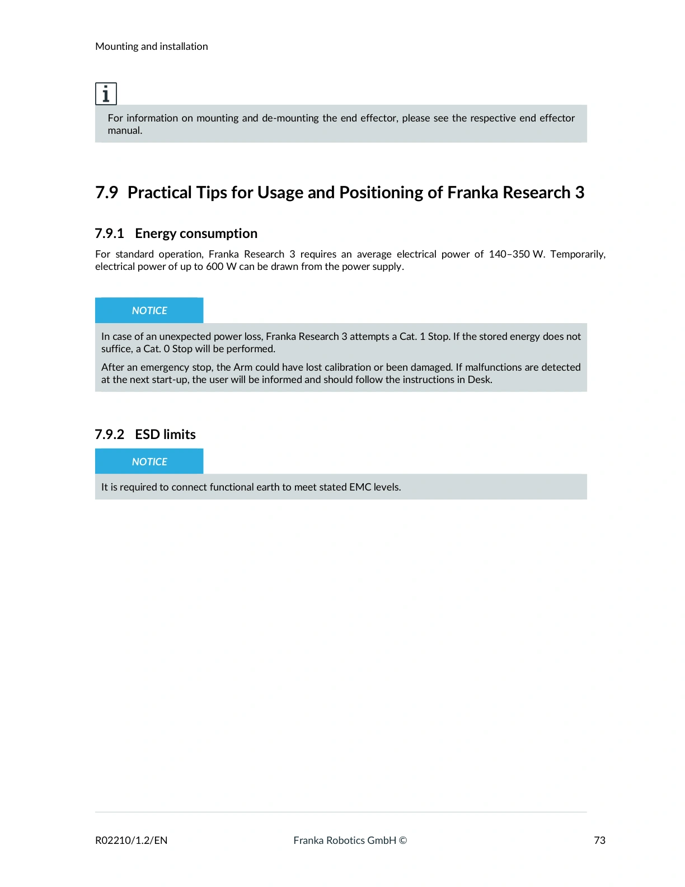



```
Mounting and installation  
 
R02210/1.2/EN 
Franka Robotics GmbH ©  
73  
 
 
 
For information on mounting and de-mounting the end effector, please see the respective end effector 
manual. 
 
7.9 Practical Tips for Usage and Positioning of Franka Research 3  
7.9.1 Energy consumption 
For standard operation, Franka Research 3 requires an average electrical power of 140–350 W. Temporarily, 
electrical power of up to 600 W can be drawn from the power supply. 
 
NOTICE 
 
In case of an unexpected power loss, Franka Research 3 attempts a Cat. 1 Stop. If the stored energy does not 
suffice, a Cat. 0 Stop will be performed. 
After an emergency stop, the Arm could have lost calibration or been damaged. If malfunctions are detected 
at the next start-up, the user will be informed and should follow the instructions in Desk. 
 
7.9.2 ESD limits 
NOTICE 
 
It is required to connect functional earth to meet stated EMC levels.
```



## PDF page 74

**Source:** Hardware Manual Franka Research 3\_Arm v2.1\_R02210\_1.2\_EN.pdf, original pdf page 74. [Open the corresponding PDF reading-copy page](https://1292444914-files.gitbook.io/~/files/v0/b/gitbook-x-prod.appspot.com/o/spaces%2FtgOfPnscWebs1eh82EKq%2Fuploads%2F3Z45SPTFn1rSxe0f4z53%2FFR3_HARDWARE-pages-074-078.pdf?alt=media#page=1).



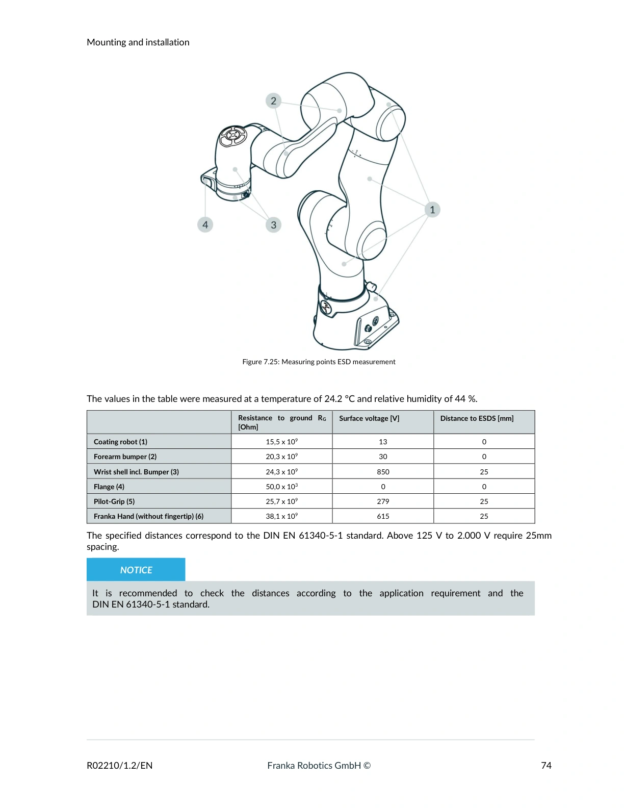



```
Mounting and installation  
 
R02210/1.2/EN 
Franka Robotics GmbH ©  
74  
 
 
Figure 7.25: Measuring points ESD measurement 
 
The values in the table were measured at a temperature of 24.2 °C and relative humidity of 44 %. 
 
Resistance to ground RG  
[Ohm]  
Surface voltage [V]  
Distance to ESDS [mm] 
Coating robot (1) 
15,5 x 109 
13 
0 
Forearm bumper (2) 
20,3 x 109 
30 
0 
Wrist shell incl. Bumper (3) 
24,3 x 109 
850 
25 
Flange (4) 
50,0 x 103 
0 
0 
Pilot-Grip (5) 
25,7 x 109 
279 
25 
Franka Hand (without fingertip) (6) 
38,1 x 109 
615 
25 
The specified distances correspond to the DIN EN 61340-5-1 standard. Above 125 V to 2.000 V require 25mm 
spacing. 
NOTICE 
 
It is recommended to check the distances according to the application requirement and the    
DIN EN 61340-5-1 standard.
```



## PDF page 75

**Source:** Hardware Manual Franka Research 3\_Arm v2.1\_R02210\_1.2\_EN.pdf, original pdf page 75. [Open the corresponding PDF reading-copy page](https://1292444914-files.gitbook.io/~/files/v0/b/gitbook-x-prod.appspot.com/o/spaces%2FtgOfPnscWebs1eh82EKq%2Fuploads%2F3Z45SPTFn1rSxe0f4z53%2FFR3_HARDWARE-pages-074-078.pdf?alt=media#page=2).



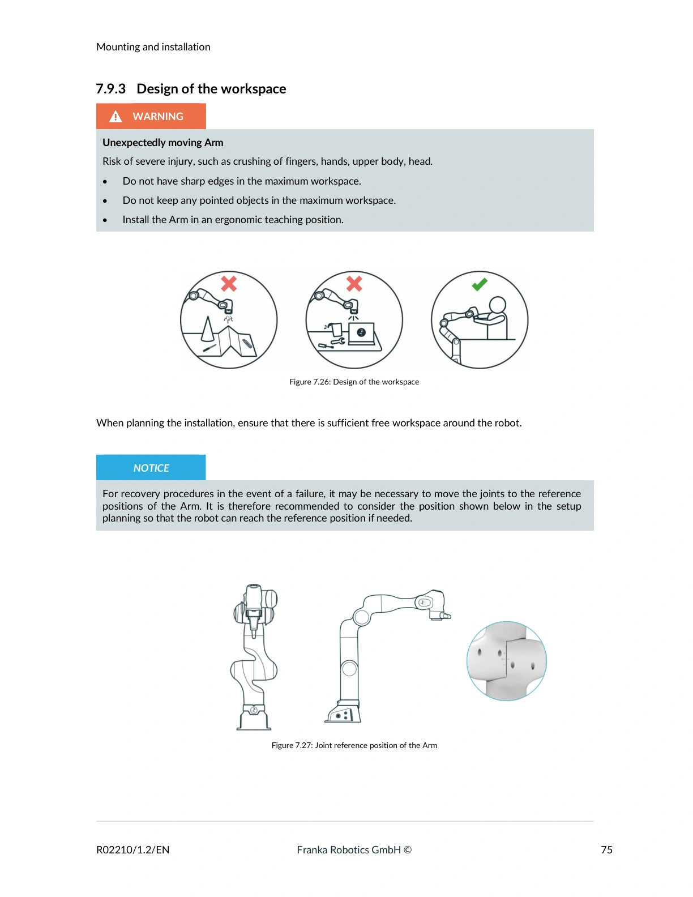



```
Mounting and installation  
 
R02210/1.2/EN 
Franka Robotics GmbH ©  
75  
 
7.9.3 Design of the workspace 
WARNING 
  
Unexpectedly moving Arm 
Risk of severe injury, such as crushing of fingers, hands, upper body, head. 
• 
Do not have sharp edges in the maximum workspace. 
• 
Do not keep any pointed objects in the maximum workspace. 
• 
Install the Arm in an ergonomic teaching position. 
 
 
Figure 7.26: Design of the workspace 
 
When planning the installation, ensure that there is sufficient free workspace around the robot. 
 
NOTICE 
 
For recovery procedures in the event of a failure, it may be necessary to move the joints to the reference 
positions of the Arm. It is therefore recommended to consider the position shown below in the setup 
planning so that the robot can reach the reference position if needed. 
 
 
 
Figure 7.27: Joint reference position of the Arm
```



## PDF page 76

**Source:** Hardware Manual Franka Research 3\_Arm v2.1\_R02210\_1.2\_EN.pdf, original pdf page 76. [Open the corresponding PDF reading-copy page](https://1292444914-files.gitbook.io/~/files/v0/b/gitbook-x-prod.appspot.com/o/spaces%2FtgOfPnscWebs1eh82EKq%2Fuploads%2F3Z45SPTFn1rSxe0f4z53%2FFR3_HARDWARE-pages-074-078.pdf?alt=media#page=3).



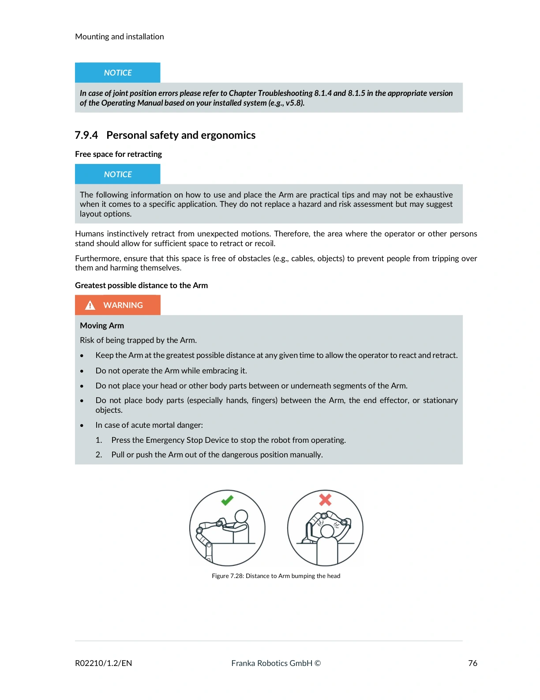



```
Mounting and installation  
 
R02210/1.2/EN 
Franka Robotics GmbH ©  
76  
 
NOTICE 
 
In case of joint position errors please refer to Chapter Troubleshooting 8.1.4 and 8.1.5 in the appropriate version 
of the Operating Manual based on your installed system (e.g., v5.8). 
7.9.4 Personal safety and ergonomics 
Free space for retracting 
NOTICE 
 
The following information on how to use and place the Arm are practical tips and may not be exhaustive 
when it comes to a specific application. They do not replace a hazard and risk assessment but may suggest 
layout options. 
Humans instinctively retract from unexpected motions. Therefore, the area where the operator or other persons 
stand should allow for sufficient space to retract or recoil. 
Furthermore, ensure that this space is free of obstacles (e.g., cables, objects) to prevent people from tripping over 
them and harming themselves. 
Greatest possible distance to the Arm 
WARNING 
  
Moving Arm 
Risk of being trapped by the Arm. 
• 
Keep the Arm at the greatest possible distance at any given time to allow the operator to react and retract. 
• 
Do not operate the Arm while embracing it. 
• 
Do not place your head or other body parts between or underneath segments of the Arm. 
• 
Do not place body parts (especially hands, fingers) between the Arm, the end effector, or stationary 
objects. 
• 
In case of acute mortal danger: 
1. 
Press the Emergency Stop Device to stop the robot from operating. 
2. 
Pull or push the Arm out of the dangerous position manually. 
 
 
Figure 7.28: Distance to Arm bumping the head
```



## PDF page 77

**Source:** Hardware Manual Franka Research 3\_Arm v2.1\_R02210\_1.2\_EN.pdf, original pdf page 77. [Open the corresponding PDF reading-copy page](https://1292444914-files.gitbook.io/~/files/v0/b/gitbook-x-prod.appspot.com/o/spaces%2FtgOfPnscWebs1eh82EKq%2Fuploads%2F3Z45SPTFn1rSxe0f4z53%2FFR3_HARDWARE-pages-074-078.pdf?alt=media#page=4).



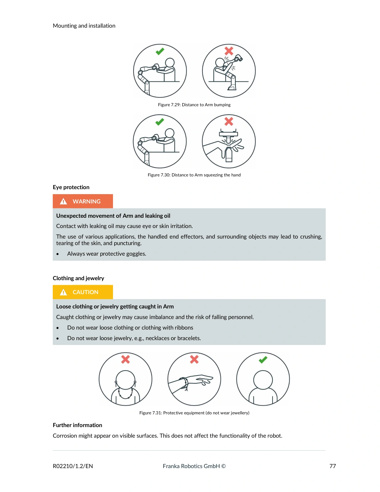



```
Mounting and installation  
 
R02210/1.2/EN 
Franka Robotics GmbH ©  
77  
 
 
Figure 7.29: Distance to Arm bumping 
 
Figure 7.30: Distance to Arm squeezing the hand 
Eye protection 
WARNING 
  
Unexpected movement of Arm and leaking oil 
Contact with leaking oil may cause eye or skin irritation. 
The use of various applications, the handled end effectors, and surrounding objects may lead to crushing, 
tearing of the skin, and puncturing. 
• 
Always wear protective goggles. 
 
Clothing and jewelry 
CAUTION 
  
Loose clothing or jewelry getting caught in Arm 
Caught clothing or jewelry may cause imbalance and the risk of falling personnel. 
• 
Do not wear loose clothing or clothing with ribbons 
• 
Do not wear loose jewelry, e.g., necklaces or bracelets. 
 
Figure 7.31: Protective equipment (do not wear jewellery) 
Further information  
Corrosion might appear on visible surfaces. This does not affect the functionality of the robot.
```



## PDF page 78

**Source:** Hardware Manual Franka Research 3\_Arm v2.1\_R02210\_1.2\_EN.pdf, original pdf page 78. [Open the corresponding PDF reading-copy page](https://1292444914-files.gitbook.io/~/files/v0/b/gitbook-x-prod.appspot.com/o/spaces%2FtgOfPnscWebs1eh82EKq%2Fuploads%2F3Z45SPTFn1rSxe0f4z53%2FFR3_HARDWARE-pages-074-078.pdf?alt=media#page=5).



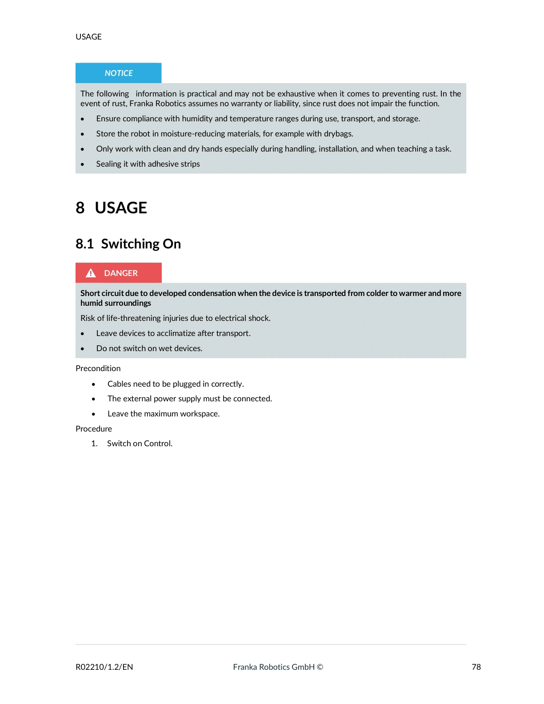



```
USAGE  
 
R02210/1.2/EN 
Franka Robotics GmbH ©  
78  
 
NOTICE 
 
The following information is practical and may not be exhaustive when it comes to preventing rust. In the 
event of rust, Franka Robotics assumes no warranty or liability, since rust does not impair the function. 
• 
Ensure compliance with humidity and temperature ranges during use, transport, and storage. 
• 
Store the robot in moisture-reducing materials, for example with drybags. 
• 
Only work with clean and dry hands especially during handling, installation, and when teaching a task. 
• 
Sealing it with adhesive strips 
 
8 USAGE 
8.1 Switching On 
DANGER 
  
Short circuit due to developed condensation when the device is transported from colder to warmer and more 
humid surroundings 
Risk of life-threatening injuries due to electrical shock. 
• 
Leave devices to acclimatize after transport. 
• 
Do not switch on wet devices. 
Precondition 
• 
Cables need to be plugged in correctly. 
• 
The external power supply must be connected. 
• 
Leave the maximum workspace.  
Procedure 
1. 
Switch on Control.
```



## PDF page 79

**Source:** Hardware Manual Franka Research 3\_Arm v2.1\_R02210\_1.2\_EN.pdf, original pdf page 79. [Open the corresponding PDF reading-copy page](https://1292444914-files.gitbook.io/~/files/v0/b/gitbook-x-prod.appspot.com/o/spaces%2FtgOfPnscWebs1eh82EKq%2Fuploads%2FHMyH8GhtEQkJsDavVNrh%2FFR3_HARDWARE-pages-079-092.pdf?alt=media#page=1).



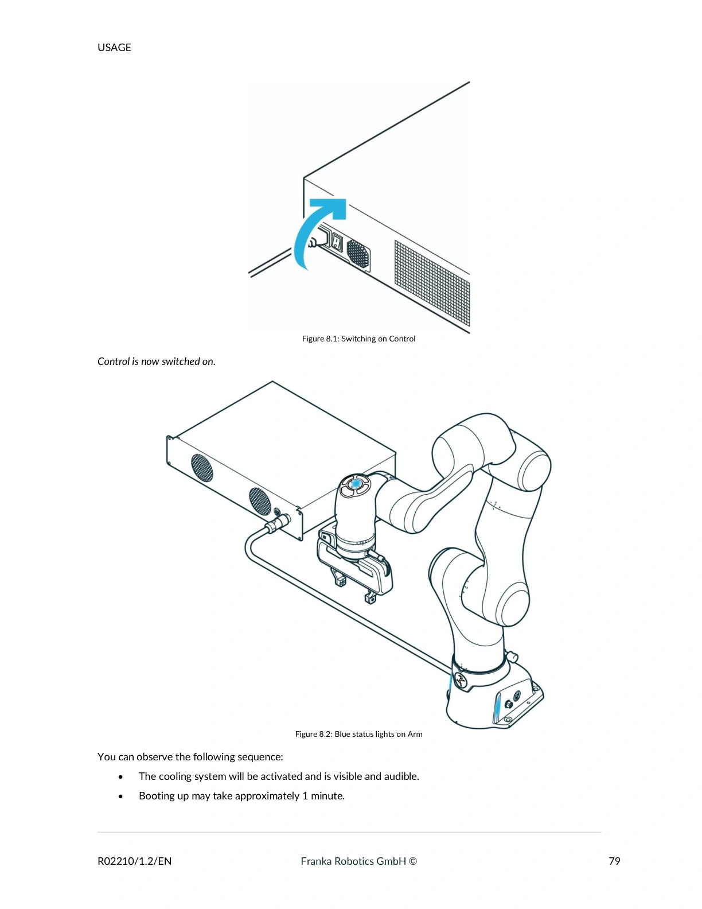



```
USAGE  
 
R02210/1.2/EN 
Franka Robotics GmbH ©  
79  
 
 
Figure 8.1: Switching on Control 
Control is now switched on. 
 
Figure 8.2: Blue status lights on Arm 
You can observe the following sequence: 
• 
The cooling system will be activated and is visible and audible. 
• 
Booting up may take approximately 1 minute.
```



## PDF page 80

**Source:** Hardware Manual Franka Research 3\_Arm v2.1\_R02210\_1.2\_EN.pdf, original pdf page 80. [Open the corresponding PDF reading-copy page](https://1292444914-files.gitbook.io/~/files/v0/b/gitbook-x-prod.appspot.com/o/spaces%2FtgOfPnscWebs1eh82EKq%2Fuploads%2FHMyH8GhtEQkJsDavVNrh%2FFR3_HARDWARE-pages-079-092.pdf?alt=media#page=2).



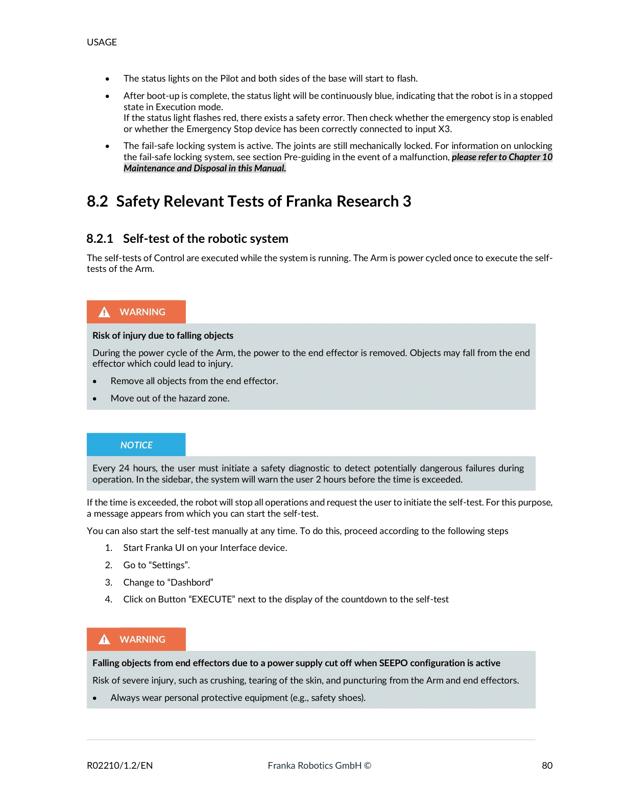



```
USAGE  
 
R02210/1.2/EN 
Franka Robotics GmbH ©  
80  
 
• 
The status lights on the Pilot and both sides of the base will start to flash. 
• 
After boot-up is complete, the status light will be continuously blue, indicating that the robot is in a stopped 
state in Execution mode.  
If the status light flashes red, there exists a safety error. Then check whether the emergency stop is enabled 
or whether the Emergency Stop device has been correctly connected to input X3. 
• 
The fail-safe locking system is active. The joints are still mechanically locked. For information on unlocking 
the fail-safe locking system, see section Pre-guiding in the event of a malfunction, please refer to Chapter 10 
Maintenance and Disposal in this Manual. 
8.2 Safety Relevant Tests of Franka Research 3 
8.2.1 Self-test of the robotic system 
The self-tests of Control are executed while the system is running. The Arm is power cycled once to execute the self-
tests of the Arm. 
 
WARNING 
  
Risk of injury due to falling objects 
During the power cycle of the Arm, the power to the end effector is removed. Objects may fall from the end 
effector which could lead to injury.  
• 
Remove all objects from the end effector. 
• 
Move out of the hazard zone. 
 
NOTICE 
 
Every 24 hours, the user must initiate a safety diagnostic to detect potentially dangerous failures during 
operation. In the sidebar, the system will warn the user 2 hours before the time is exceeded.  
If the time is exceeded, the robot will stop all operations and request the user to initiate the self-test. For this purpose, 
a message appears from which you can start the self-test. 
You can also start the self-test manually at any time. To do this, proceed according to the following steps  
1. 
Start Franka UI on your Interface device. 
2. 
Go to “Settings”. 
3. 
Change to “Dashbord” 
4. 
Click on Button “EXECUTE” next to the display of the countdown to the self-test 
 
WARNING 
  
Falling objects from end effectors due to a power supply cut off when SEEPO configuration is active 
Risk of severe injury, such as crushing, tearing of the skin, and puncturing from the Arm and end effectors. 
• 
Always wear personal protective equipment (e.g., safety shoes).
```



## PDF page 81

**Source:** Hardware Manual Franka Research 3\_Arm v2.1\_R02210\_1.2\_EN.pdf, original pdf page 81. [Open the corresponding PDF reading-copy page](https://1292444914-files.gitbook.io/~/files/v0/b/gitbook-x-prod.appspot.com/o/spaces%2FtgOfPnscWebs1eh82EKq%2Fuploads%2FHMyH8GhtEQkJsDavVNrh%2FFR3_HARDWARE-pages-079-092.pdf?alt=media#page=3).



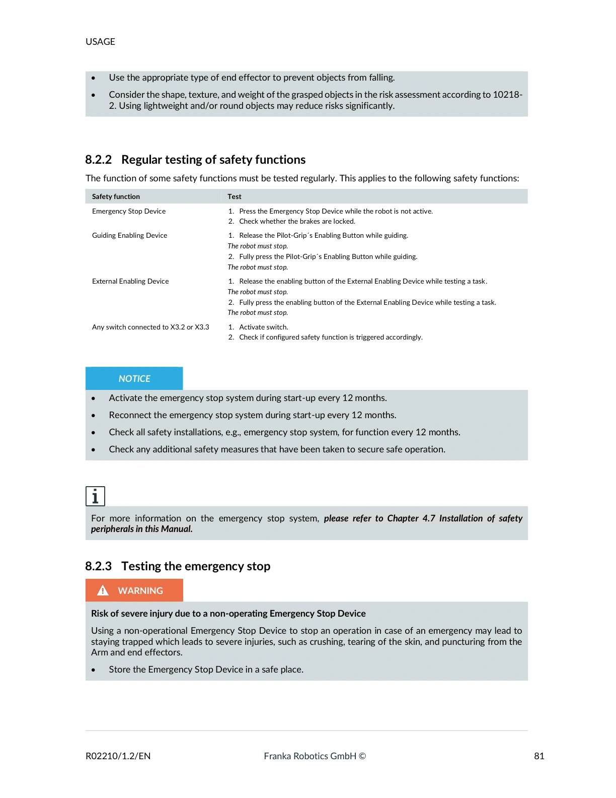



```
USAGE  
 
R02210/1.2/EN 
Franka Robotics GmbH ©  
81  
 
• 
Use the appropriate type of end effector to prevent objects from falling. 
• 
Consider the shape, texture, and weight of the grasped objects in the risk assessment according to 10218-
2. Using lightweight and/or round objects may reduce risks significantly. 
 
8.2.2 Regular testing of safety functions 
The function of some safety functions must be tested regularly. This applies to the following safety functions: 
Safety function 
Test 
Emergency Stop Device 
1. Press the Emergency Stop Device while the robot is not active. 
2. Check whether the brakes are locked. 
Guiding Enabling Device  
1. Release the Pilot-Grip´s Enabling Button while guiding. 
The robot must stop. 
2. Fully press the Pilot-Grip´s Enabling Button while guiding. 
The robot must stop. 
External Enabling Device 
1. Release the enabling button of the External Enabling Device while testing a task. 
The robot must stop. 
2. Fully press the enabling button of the External Enabling Device while testing a task. 
The robot must stop. 
Any switch connected to X3.2 or X3.3 
1. Activate switch. 
2. Check if configured safety function is triggered accordingly. 
 
NOTICE 
 
• 
Activate the emergency stop system during start-up every 12 months. 
• 
Reconnect the emergency stop system during start-up every 12 months. 
• 
Check all safety installations, e.g., emergency stop system, for function every 12 months. 
• 
Check any additional safety measures that have been taken to secure safe operation. 
 
 
 
For more information on the emergency stop system, please refer to Chapter 4.7 Installation of safety 
peripherals in this Manual.  
8.2.3 Testing the emergency stop 
WARNING 
  
Risk of severe injury due to a non-operating Emergency Stop Device 
Using a non-operational Emergency Stop Device to stop an operation in case of an emergency may lead to 
staying trapped which leads to severe injuries, such as crushing, tearing of the skin, and puncturing from the 
Arm and end effectors.  
• 
Store the Emergency Stop Device in a safe place.
```



## PDF page 82

**Source:** Hardware Manual Franka Research 3\_Arm v2.1\_R02210\_1.2\_EN.pdf, original pdf page 82. [Open the corresponding PDF reading-copy page](https://1292444914-files.gitbook.io/~/files/v0/b/gitbook-x-prod.appspot.com/o/spaces%2FtgOfPnscWebs1eh82EKq%2Fuploads%2FHMyH8GhtEQkJsDavVNrh%2FFR3_HARDWARE-pages-079-092.pdf?alt=media#page=4).



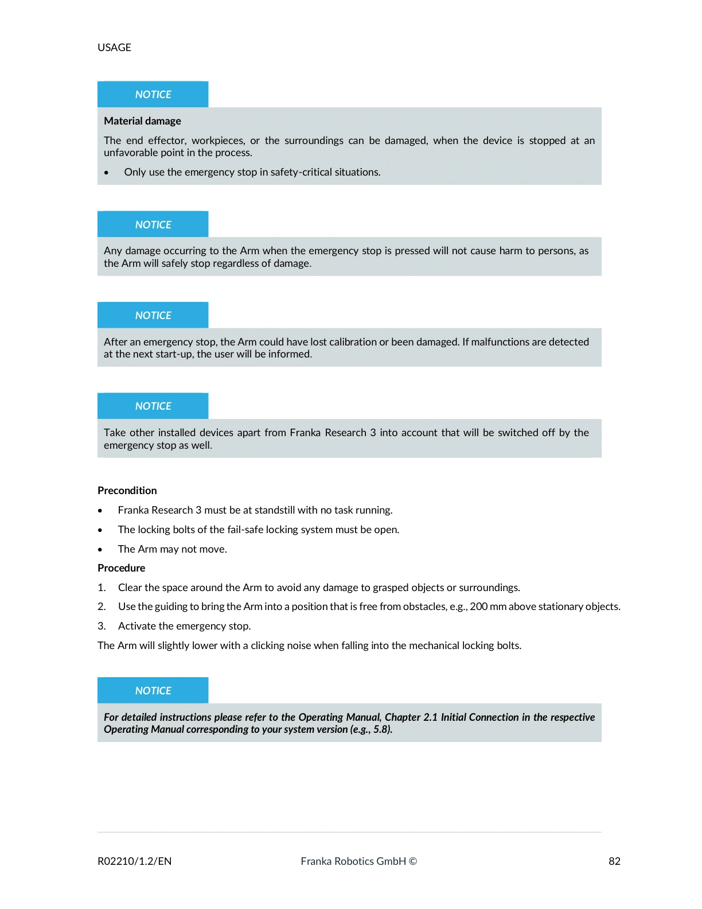



```
USAGE  
 
R02210/1.2/EN 
Franka Robotics GmbH ©  
82  
 
NOTICE 
 
Material damage 
The end effector, workpieces, or the surroundings can be damaged, when the device is stopped at an 
unfavorable point in the process. 
• 
Only use the emergency stop in safety-critical situations. 
 
NOTICE 
 
Any damage occurring to the Arm when the emergency stop is pressed will not cause harm to persons, as 
the Arm will safely stop regardless of damage. 
 
NOTICE 
 
After an emergency stop, the Arm could have lost calibration or been damaged. If malfunctions are detected 
at the next start-up, the user will be informed. 
 
NOTICE 
 
Take other installed devices apart from Franka Research 3 into account that will be switched off by the 
emergency stop as well. 
 
Precondition 
• 
Franka Research 3 must be at standstill with no task running. 
• 
The locking bolts of the fail-safe locking system must be open. 
• 
The Arm may not move. 
Procedure 
1. 
Clear the space around the Arm to avoid any damage to grasped objects or surroundings. 
2. 
Use the guiding to bring the Arm into a position that is free from obstacles, e.g., 200 mm above stationary objects. 
3. 
Activate the emergency stop. 
The Arm will slightly lower with a clicking noise when falling into the mechanical locking bolts. 
 
NOTICE 
 
For detailed instructions please refer to the Operating Manual, Chapter 2.1 Initial Connection in the respective 
Operating Manual corresponding to your system version (e.g., 5.8).
```



## PDF page 83

**Source:** Hardware Manual Franka Research 3\_Arm v2.1\_R02210\_1.2\_EN.pdf, original pdf page 83. [Open the corresponding PDF reading-copy page](https://1292444914-files.gitbook.io/~/files/v0/b/gitbook-x-prod.appspot.com/o/spaces%2FtgOfPnscWebs1eh82EKq%2Fuploads%2FHMyH8GhtEQkJsDavVNrh%2FFR3_HARDWARE-pages-079-092.pdf?alt=media#page=5).



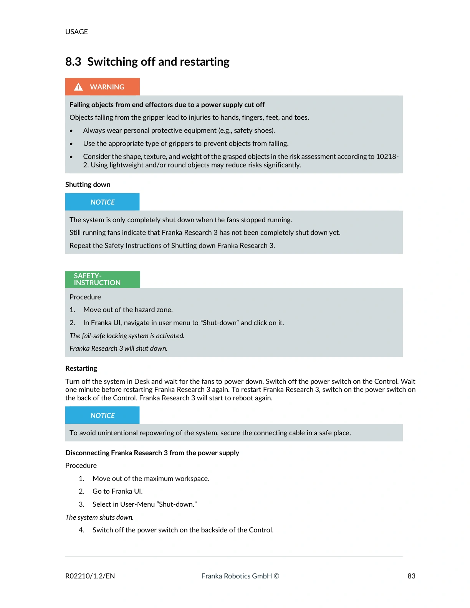



```
USAGE  
 
R02210/1.2/EN 
Franka Robotics GmbH ©  
83  
 
8.3 Switching off and restarting 
WARNING 
  
Falling objects from end effectors due to a power supply cut off 
Objects falling from the gripper lead to injuries to hands, fingers, feet, and toes. 
• 
Always wear personal protective equipment (e.g., safety shoes). 
• 
Use the appropriate type of grippers to prevent objects from falling. 
• 
Consider the shape, texture, and weight of the grasped objects in the risk assessment according to 10218-
2. Using lightweight and/or round objects may reduce risks significantly. 
Shutting down 
NOTICE 
 
The system is only completely shut down when the fans stopped running. 
Still running fans indicate that Franka Research 3 has not been completely shut down yet. 
Repeat the Safety Instructions of Shutting down Franka Research 3. 
 
SAFETY-
INSTRUCTION 
 
Procedure 
1. 
Move out of the hazard zone. 
2. 
In Franka UI, navigate in user menu to “Shut-down” and click on it. 
The fail-safe locking system is activated. 
Franka Research 3 will shut down. 
Restarting 
Turn off the system in Desk and wait for the fans to power down. Switch off the power switch on the Control. Wait 
one minute before restarting Franka Research 3 again. To restart Franka Research 3, switch on the power switch on 
the back of the Control. Franka Research 3 will start to reboot again. 
NOTICE 
 
To avoid unintentional repowering of the system, secure the connecting cable in a safe place. 
Disconnecting Franka Research 3 from the power supply 
Procedure 
1. 
Move out of the maximum workspace. 
2. 
Go to Franka UI. 
3. 
Select in User-Menu “Shut-down.” 
The system shuts down. 
4. 
Switch off the power switch on the backside of the Control.
```



## PDF page 84

**Source:** Hardware Manual Franka Research 3\_Arm v2.1\_R02210\_1.2\_EN.pdf, original pdf page 84. [Open the corresponding PDF reading-copy page](https://1292444914-files.gitbook.io/~/files/v0/b/gitbook-x-prod.appspot.com/o/spaces%2FtgOfPnscWebs1eh82EKq%2Fuploads%2FHMyH8GhtEQkJsDavVNrh%2FFR3_HARDWARE-pages-079-092.pdf?alt=media#page=6).



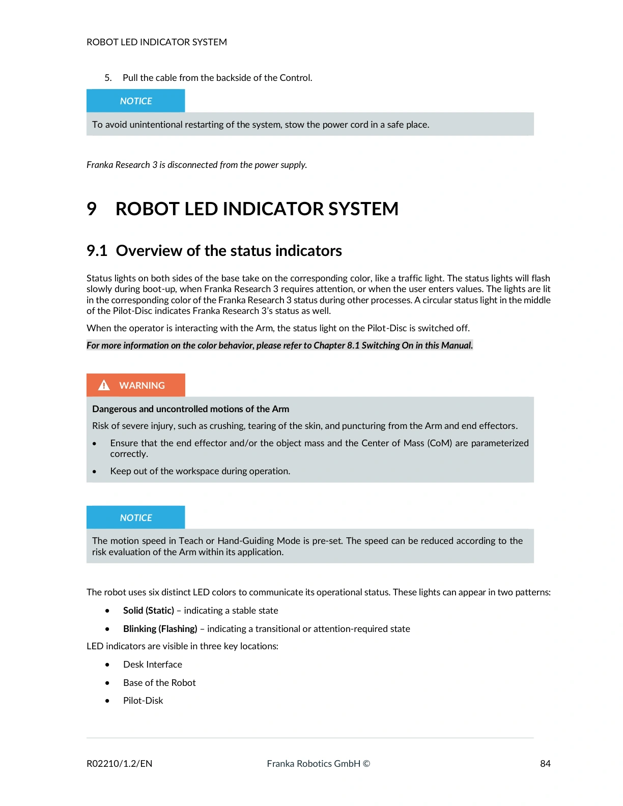



```
ROBOT LED INDICATOR SYSTEM  
 
R02210/1.2/EN 
Franka Robotics GmbH ©  
84  
 
5. 
Pull the cable from the backside of the Control. 
NOTICE 
 
To avoid unintentional restarting of the system, stow the power cord in a safe place. 
 
Franka Research 3 is disconnected from the power supply. 
 
9 ROBOT LED INDICATOR SYSTEM 
9.1 Overview of the status indicators 
Status lights on both sides of the base take on the corresponding color, like a traffic light. The status lights will flash 
slowly during boot-up, when Franka Research 3 requires attention, or when the user enters values. The lights are lit 
in the corresponding color of the Franka Research 3 status during other processes. A circular status light in the middle 
of the Pilot-Disc indicates Franka Research 3’s status as well. 
When the operator is interacting with the Arm, the status light on the Pilot-Disc is switched off. 
For more information on the color behavior, please refer to Chapter 8.1 Switching On in this Manual. 
 
WARNING 
  
Dangerous and uncontrolled motions of the Arm 
Risk of severe injury, such as crushing, tearing of the skin, and puncturing from the Arm and end effectors. 
• 
Ensure that the end effector and/or the object mass and the Center of Mass (CoM) are parameterized 
correctly. 
• 
Keep out of the workspace during operation. 
 
NOTICE 
 
The motion speed in Teach or Hand-Guiding Mode is pre-set. The speed can be reduced according to the 
risk evaluation of the Arm within its application. 
 
The robot uses six distinct LED colors to communicate its operational status. These lights can appear in two patterns: 
• 
Solid (Static) – indicating a stable state 
• 
Blinking (Flashing) – indicating a transitional or attention-required state 
LED indicators are visible in three key locations: 
• 
Desk Interface 
• 
Base of the Robot 
• 
Pilot-Disk
```



## PDF page 85

**Source:** Hardware Manual Franka Research 3\_Arm v2.1\_R02210\_1.2\_EN.pdf, original pdf page 85. [Open the corresponding PDF reading-copy page](https://1292444914-files.gitbook.io/~/files/v0/b/gitbook-x-prod.appspot.com/o/spaces%2FtgOfPnscWebs1eh82EKq%2Fuploads%2FHMyH8GhtEQkJsDavVNrh%2FFR3_HARDWARE-pages-079-092.pdf?alt=media#page=7).



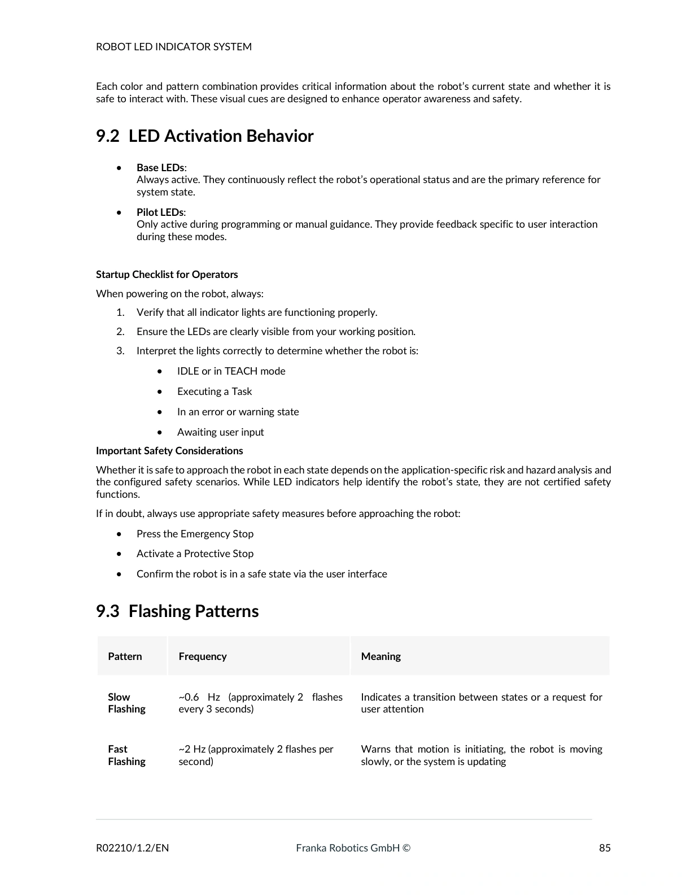



```
ROBOT LED INDICATOR SYSTEM  
 
R02210/1.2/EN 
Franka Robotics GmbH ©  
85  
 
Each color and pattern combination provides critical information about the robot’s current state and whether it is 
safe to interact with. These visual cues are designed to enhance operator awareness and safety. 
9.2 LED Activation Behavior 
• 
Base LEDs: 
Always active. They continuously reflect the robot’s operational status and are the primary reference for 
system state. 
• 
Pilot LEDs: 
Only active during programming or manual guidance. They provide feedback specific to user interaction 
during these modes. 
 
Startup Checklist for Operators 
When powering on the robot, always: 
1. 
Verify that all indicator lights are functioning properly. 
2. 
Ensure the LEDs are clearly visible from your working position. 
3. 
Interpret the lights correctly to determine whether the robot is: 
• 
IDLE or in TEACH mode 
• 
Executing a Task 
• 
In an error or warning state 
• 
Awaiting user input 
Important Safety Considerations 
Whether it is safe to approach the robot in each state depends on the application-specific risk and hazard analysis and 
the configured safety scenarios. While LED indicators help identify the robot’s state, they are not certified safety 
functions. 
If in doubt, always use appropriate safety measures before approaching the robot: 
• 
Press the Emergency Stop 
• 
Activate a Protective Stop 
• 
Confirm the robot is in a safe state via the user interface 
9.3 Flashing Patterns  
Pattern 
Frequency 
Meaning 
Slow 
Flashing 
~0.6 Hz (approximately 2 flashes 
every 3 seconds) 
Indicates a transition between states or a request for 
user attention 
Fast 
Flashing 
~2 Hz (approximately 2 flashes per 
second) 
Warns that motion is initiating, the robot is moving 
slowly, or the system is updating
```



## PDF page 86

**Source:** Hardware Manual Franka Research 3\_Arm v2.1\_R02210\_1.2\_EN.pdf, original pdf page 86. [Open the corresponding PDF reading-copy page](https://1292444914-files.gitbook.io/~/files/v0/b/gitbook-x-prod.appspot.com/o/spaces%2FtgOfPnscWebs1eh82EKq%2Fuploads%2FHMyH8GhtEQkJsDavVNrh%2FFR3_HARDWARE-pages-079-092.pdf?alt=media#page=8).



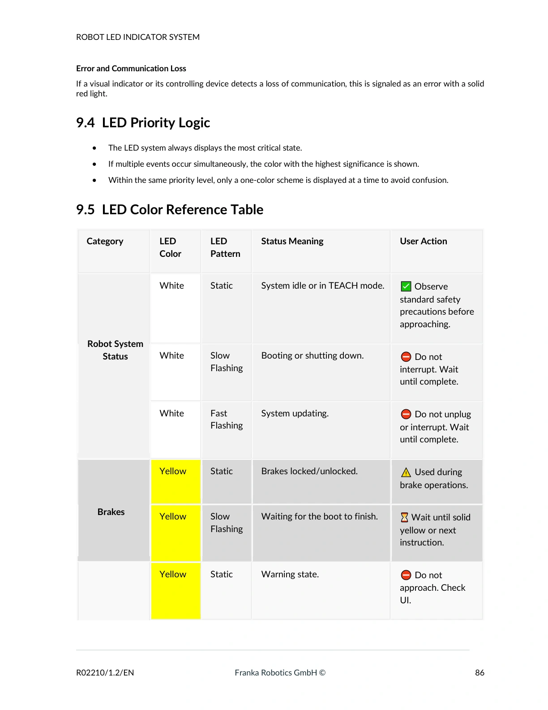



```
ROBOT LED INDICATOR SYSTEM  
 
R02210/1.2/EN 
Franka Robotics GmbH ©  
86  
 
Error and Communication Loss 
If a visual indicator or its controlling device detects a loss of communication, this is signaled as an error with a solid 
red light. 
9.4 LED Priority Logic 
• 
The LED system always displays the most critical state. 
• 
If multiple events occur simultaneously, the color with the highest significance is shown. 
• 
Within the same priority level, only a one-color scheme is displayed at a time to avoid confusion. 
9.5 LED Color Reference Table  
Category 
LED 
Color 
LED 
Pattern 
Status Meaning 
User Action 
 
 
 
Robot System 
Status 
White 
Static 
System idle or in TEACH mode. 
 
 Observe 
standard safety 
precautions before 
approaching. 
White 
Slow 
Flashing 
Booting or shutting down. 
 
 Do not 
interrupt. Wait 
until complete. 
White 
Fast 
Flashing 
System updating. 
 
 Do not unplug 
or interrupt. Wait 
until complete. 
 
 
     Brakes 
Yellow 
Static 
Brakes locked/unlocked. 
 
 Used during 
brake operations. 
Yellow 
Slow 
Flashing 
Waiting for the boot to finish. 
 
 Wait until solid 
yellow or next 
instruction. 
 
 
Yellow 
Static 
Warning state. 
 
 Do not 
approach. Check 
UI.
```



## PDF page 87

**Source:** Hardware Manual Franka Research 3\_Arm v2.1\_R02210\_1.2\_EN.pdf, original pdf page 87. [Open the corresponding PDF reading-copy page](https://1292444914-files.gitbook.io/~/files/v0/b/gitbook-x-prod.appspot.com/o/spaces%2FtgOfPnscWebs1eh82EKq%2Fuploads%2FHMyH8GhtEQkJsDavVNrh%2FFR3_HARDWARE-pages-079-092.pdf?alt=media#page=9).



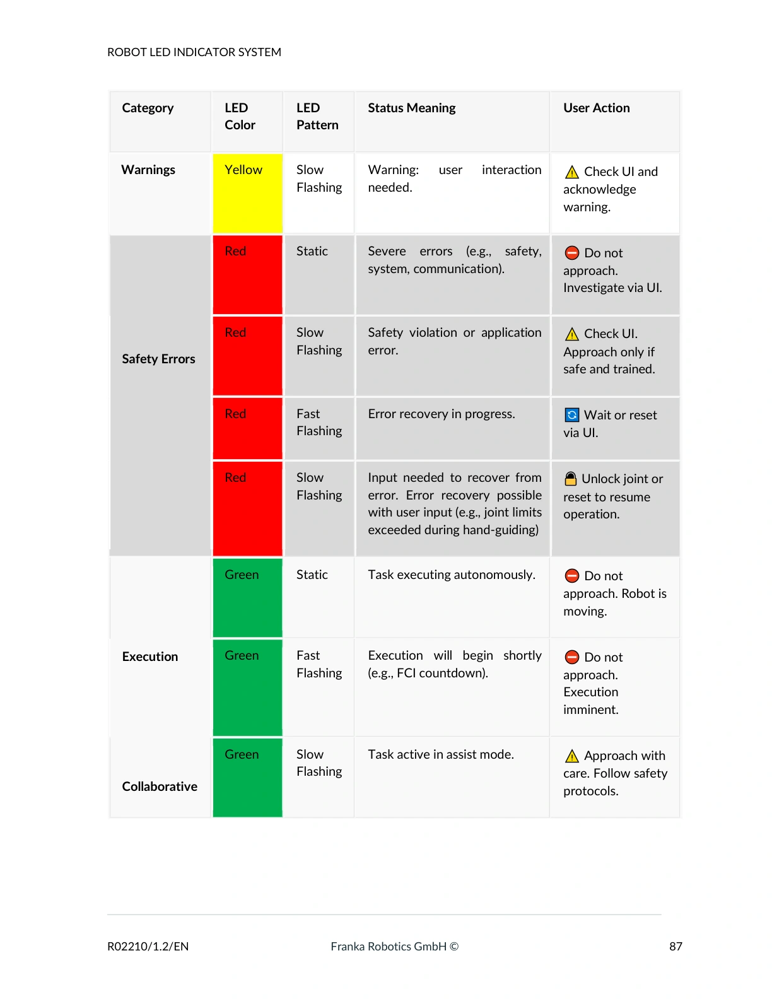



```
ROBOT LED INDICATOR SYSTEM  
 
R02210/1.2/EN 
Franka Robotics GmbH ©  
87  
 
Category 
LED 
Color 
LED 
Pattern 
Status Meaning 
User Action 
Warnings 
Yellow 
Slow 
Flashing 
Warning: 
user 
interaction 
needed. 
 
 Check UI and 
acknowledge 
warning. 
 
 
 
 
Safety Errors 
Red 
Static 
Severe 
errors 
(e.g., 
safety, 
system, communication). 
 
 Do not 
approach. 
Investigate via UI. 
Red 
Slow 
Flashing 
Safety violation or application 
error. 
 
 Check UI. 
Approach only if 
safe and trained. 
Red 
Fast 
Flashing 
Error recovery in progress. 
 
 Wait or reset 
via UI. 
Red 
Slow 
Flashing 
Input needed to recover from 
error. Error recovery possible 
with user input (e.g., joint limits 
exceeded during hand-guiding) 
 
 Unlock joint or 
reset to resume 
operation. 
 
 
 
Execution 
Green 
Static 
Task executing autonomously. 
 
 Do not 
approach. Robot is 
moving. 
Green 
Fast 
Flashing 
Execution will begin shortly 
(e.g., FCI countdown). 
 
 Do not 
approach. 
Execution 
imminent. 
 
Collaborative 
Green 
Slow 
Flashing 
Task active in assist mode. 
 
 Approach with 
care. Follow safety 
protocols.
```



## PDF page 88

**Source:** Hardware Manual Franka Research 3\_Arm v2.1\_R02210\_1.2\_EN.pdf, original pdf page 88. [Open the corresponding PDF reading-copy page](https://1292444914-files.gitbook.io/~/files/v0/b/gitbook-x-prod.appspot.com/o/spaces%2FtgOfPnscWebs1eh82EKq%2Fuploads%2FHMyH8GhtEQkJsDavVNrh%2FFR3_HARDWARE-pages-079-092.pdf?alt=media#page=10).



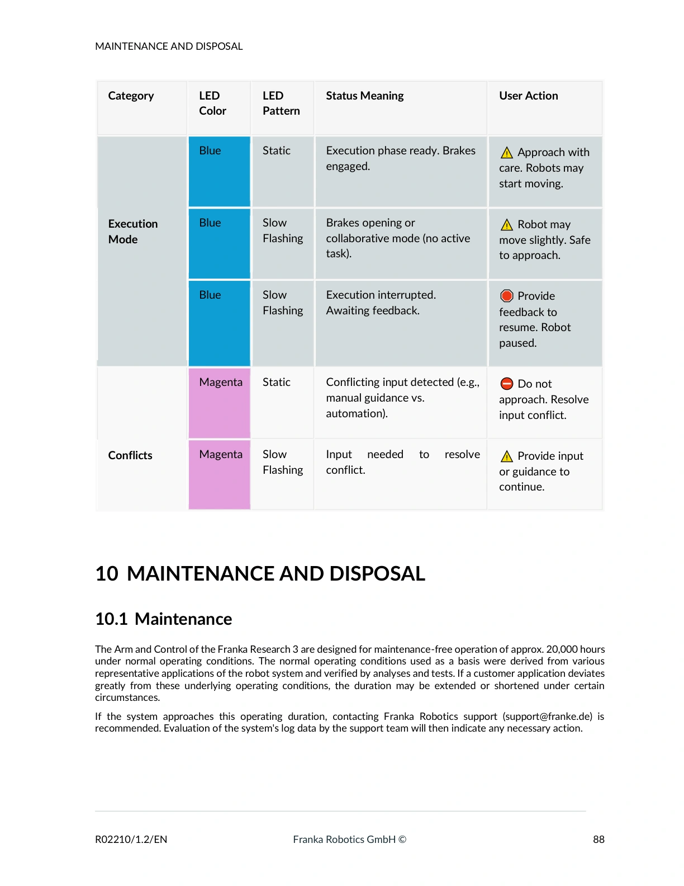



```
MAINTENANCE AND DISPOSAL  
 
R02210/1.2/EN 
Franka Robotics GmbH ©  
88  
 
Category 
LED 
Color 
LED 
Pattern 
Status Meaning 
User Action 
 
 
 
Execution 
Mode 
Blue 
Static 
Execution phase ready. Brakes 
engaged. 
 
 Approach with 
care. Robots may 
start moving. 
Blue 
Slow 
Flashing 
Brakes opening or 
collaborative mode (no active 
task). 
 
 Robot may 
move slightly. Safe 
to approach. 
Blue 
Slow 
Flashing 
Execution interrupted. 
Awaiting feedback. 
 
 Provide 
feedback to 
resume. Robot 
paused. 
 
 
 
Conflicts 
Magenta 
Static 
Conflicting input detected (e.g., 
manual guidance vs. 
automation). 
 
 Do not 
approach. Resolve 
input conflict. 
Magenta 
Slow 
Flashing 
Input 
needed 
to 
resolve 
conflict. 
 
 Provide input 
or guidance to 
continue. 
 
 
10 MAINTENANCE AND DISPOSAL 
10.1 Maintenance 
The Arm and Control of the Franka Research 3 are designed for maintenance-free operation of approx. 20,000 hours 
under normal operating conditions. The normal operating conditions used as a basis were derived from various 
representative applications of the robot system and verified by analyses and tests. If a customer application deviates 
greatly from these underlying operating conditions, the duration may be extended or shortened under certain 
circumstances. 
If the system approaches this operating duration, contacting Franka Robotics support (support@franke.de) is 
recommended. Evaluation of the system's log data by the support team will then indicate any necessary action.
```



## PDF page 89

**Source:** Hardware Manual Franka Research 3\_Arm v2.1\_R02210\_1.2\_EN.pdf, original pdf page 89. [Open the corresponding PDF reading-copy page](https://1292444914-files.gitbook.io/~/files/v0/b/gitbook-x-prod.appspot.com/o/spaces%2FtgOfPnscWebs1eh82EKq%2Fuploads%2FHMyH8GhtEQkJsDavVNrh%2FFR3_HARDWARE-pages-079-092.pdf?alt=media#page=11).



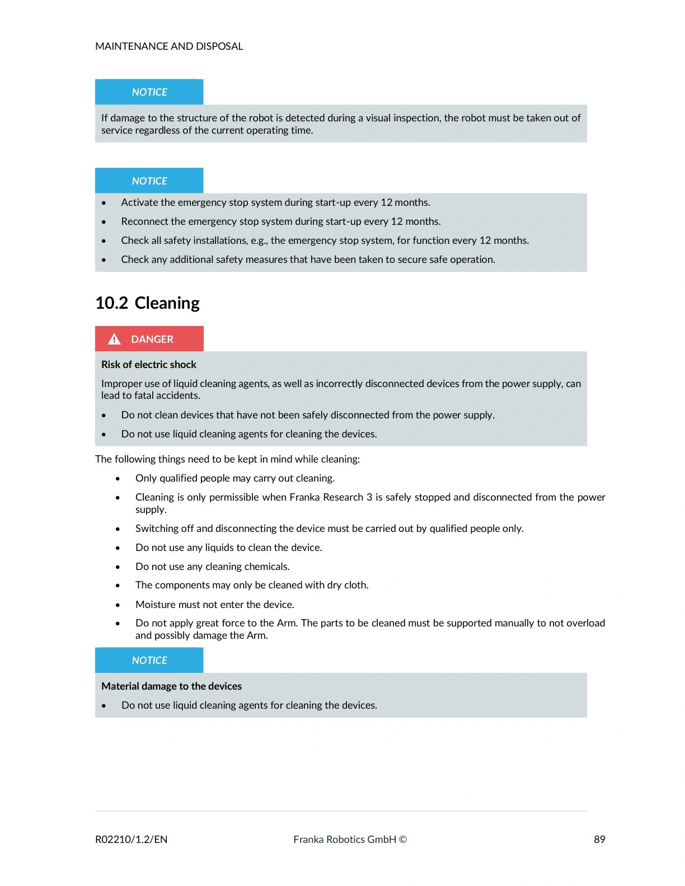



```
MAINTENANCE AND DISPOSAL  
 
R02210/1.2/EN 
Franka Robotics GmbH ©  
89  
 
NOTICE 
 
If damage to the structure of the robot is detected during a visual inspection, the robot must be taken out of 
service regardless of the current operating time. 
 
NOTICE 
 
• 
Activate the emergency stop system during start-up every 12 months. 
• 
Reconnect the emergency stop system during start-up every 12 months. 
• 
Check all safety installations, e.g., the emergency stop system, for function every 12 months. 
• 
Check any additional safety measures that have been taken to secure safe operation. 
10.2 Cleaning 
DANGER 
  
Risk of electric shock 
Improper use of liquid cleaning agents, as well as incorrectly disconnected devices from the power supply, can 
lead to fatal accidents. 
• 
Do not clean devices that have not been safely disconnected from the power supply. 
• 
Do not use liquid cleaning agents for cleaning the devices. 
The following things need to be kept in mind while cleaning: 
• 
Only qualified people may carry out cleaning. 
• 
Cleaning is only permissible when Franka Research 3 is safely stopped and disconnected from the power 
supply. 
• 
Switching off and disconnecting the device must be carried out by qualified people only. 
• 
Do not use any liquids to clean the device. 
• 
Do not use any cleaning chemicals. 
• 
The components may only be cleaned with dry cloth. 
• 
Moisture must not enter the device. 
• 
Do not apply great force to the Arm. The parts to be cleaned must be supported manually to not overload 
and possibly damage the Arm. 
NOTICE 
 
Material damage to the devices 
• 
Do not use liquid cleaning agents for cleaning the devices.
```



## PDF page 90

**Source:** Hardware Manual Franka Research 3\_Arm v2.1\_R02210\_1.2\_EN.pdf, original pdf page 90. [Open the corresponding PDF reading-copy page](https://1292444914-files.gitbook.io/~/files/v0/b/gitbook-x-prod.appspot.com/o/spaces%2FtgOfPnscWebs1eh82EKq%2Fuploads%2FHMyH8GhtEQkJsDavVNrh%2FFR3_HARDWARE-pages-079-092.pdf?alt=media#page=12).



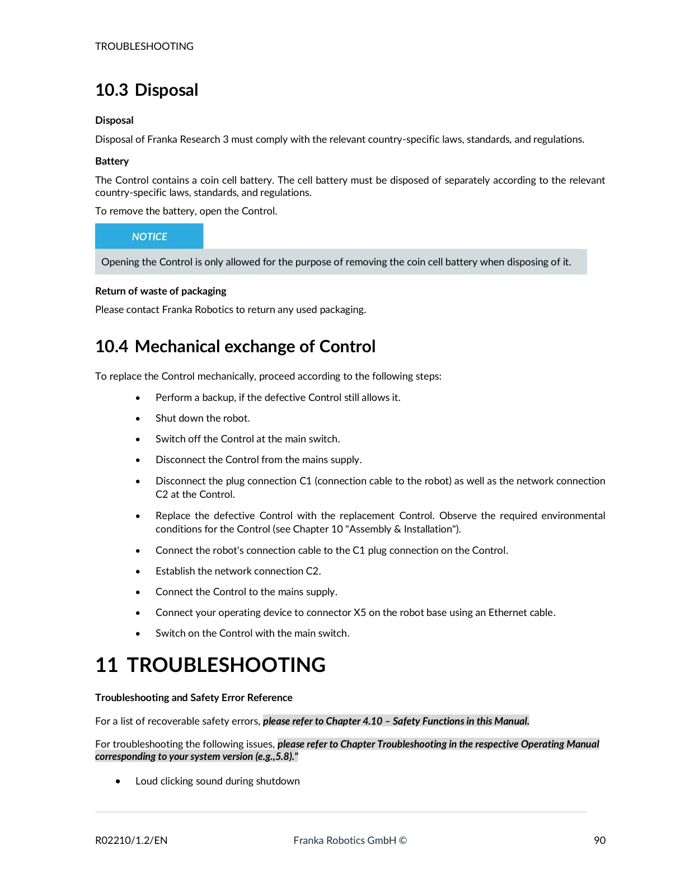



```
TROUBLESHOOTING  
 
R02210/1.2/EN 
Franka Robotics GmbH ©  
90  
 
10.3 Disposal 
Disposal 
Disposal of Franka Research 3 must comply with the relevant country-specific laws, standards, and regulations. 
Battery 
The Control contains a coin cell battery. The cell battery must be disposed of separately according to the relevant 
country-specific laws, standards, and regulations. 
To remove the battery, open the Control. 
NOTICE 
 
Opening the Control is only allowed for the purpose of removing the coin cell battery when disposing of it. 
Return of waste of packaging 
Please contact Franka Robotics to return any used packaging. 
10.4 Mechanical exchange of Control 
To replace the Control mechanically, proceed according to the following steps: 
• 
Perform a backup, if the defective Control still allows it. 
• 
Shut down the robot. 
• 
Switch off the Control at the main switch. 
• 
Disconnect the Control from the mains supply. 
• 
Disconnect the plug connection C1 (connection cable to the robot) as well as the network connection 
C2 at the Control. 
• 
Replace the defective Control with the replacement Control. Observe the required environmental 
conditions for the Control (see Chapter 10 "Assembly & Installation"). 
• 
Connect the robot's connection cable to the C1 plug connection on the Control. 
• 
Establish the network connection C2. 
• 
Connect the Control to the mains supply. 
• 
Connect your operating device to connector X5 on the robot base using an Ethernet cable. 
• 
Switch on the Control with the main switch. 
11 TROUBLESHOOTING  
Troubleshooting and Safety Error Reference 
For a list of recoverable safety errors, please refer to Chapter 4.10 – Safety Functions in this Manual. 
For troubleshooting the following issues, please refer to Chapter Troubleshooting in the respective Operating Manual 
corresponding to your system version (e.g.,5.8)." 
• 
Loud clicking sound during shutdown
```



## PDF page 91

**Source:** Hardware Manual Franka Research 3\_Arm v2.1\_R02210\_1.2\_EN.pdf, original pdf page 91. [Open the corresponding PDF reading-copy page](https://1292444914-files.gitbook.io/~/files/v0/b/gitbook-x-prod.appspot.com/o/spaces%2FtgOfPnscWebs1eh82EKq%2Fuploads%2FHMyH8GhtEQkJsDavVNrh%2FFR3_HARDWARE-pages-079-092.pdf?alt=media#page=13).



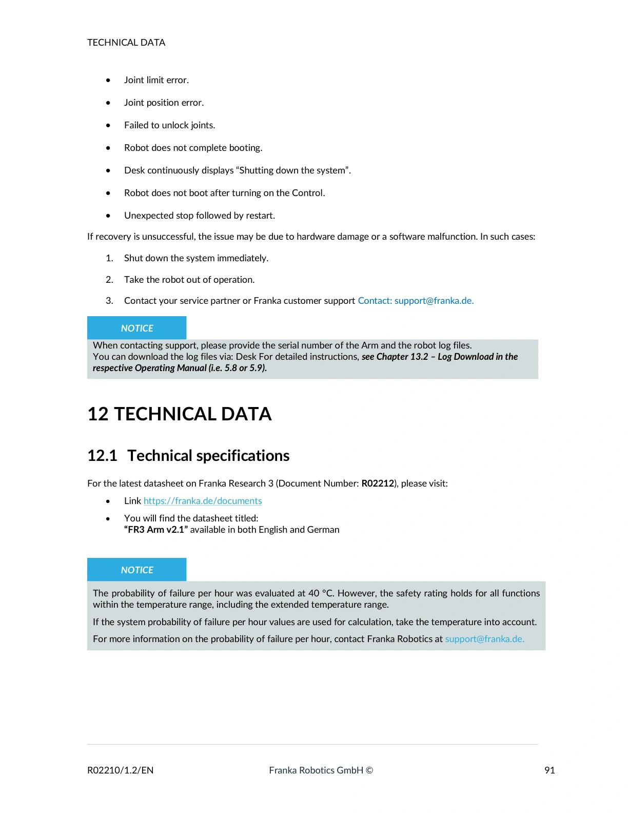



```
TECHNICAL DATA  
 
R02210/1.2/EN 
Franka Robotics GmbH ©  
91  
 
• 
Joint limit error. 
• 
Joint position error. 
• 
Failed to unlock joints. 
• 
Robot does not complete booting. 
• 
Desk continuously displays “Shutting down the system”. 
• 
Robot does not boot after turning on the Control. 
• 
Unexpected stop followed by restart. 
If recovery is unsuccessful, the issue may be due to hardware damage or a software malfunction. In such cases: 
1. 
Shut down the system immediately. 
2. 
Take the robot out of operation. 
3. 
Contact your service partner or Franka customer support Contact: support@franka.de. 
NOTICE 
 
When contacting support, please provide the serial number of the Arm and the robot log files. 
You can download the log files via: Desk For detailed instructions, see Chapter 13.2 – Log Download in the 
respective Operating Manual (i.e. 5.8 or 5.9). 
 
12 TECHNICAL DATA 
12.1  Technical specifications 
For the latest datasheet on Franka Research 3 (Document Number: R02212), please visit: 
• 
Link https://franka.de/documents 
• 
You will find the datasheet titled: 
“FR3 Arm v2.1” available in both English and German 
 
NOTICE 
 
The probability of failure per hour was evaluated at 40 °C. However, the safety rating holds for all functions 
within the temperature range, including the extended temperature range. 
If the system probability of failure per hour values are used for calculation, take the temperature into account. 
For more information on the probability of failure per hour, contact Franka Robotics at support@franka.de.
```



**Original PDF links:** [Source link 1](https://franka.de/documents)

## PDF page 92

**Source:** Hardware Manual Franka Research 3\_Arm v2.1\_R02210\_1.2\_EN.pdf, original pdf page 92. [Open the corresponding PDF reading-copy page](https://1292444914-files.gitbook.io/~/files/v0/b/gitbook-x-prod.appspot.com/o/spaces%2FtgOfPnscWebs1eh82EKq%2Fuploads%2FHMyH8GhtEQkJsDavVNrh%2FFR3_HARDWARE-pages-079-092.pdf?alt=media#page=14).



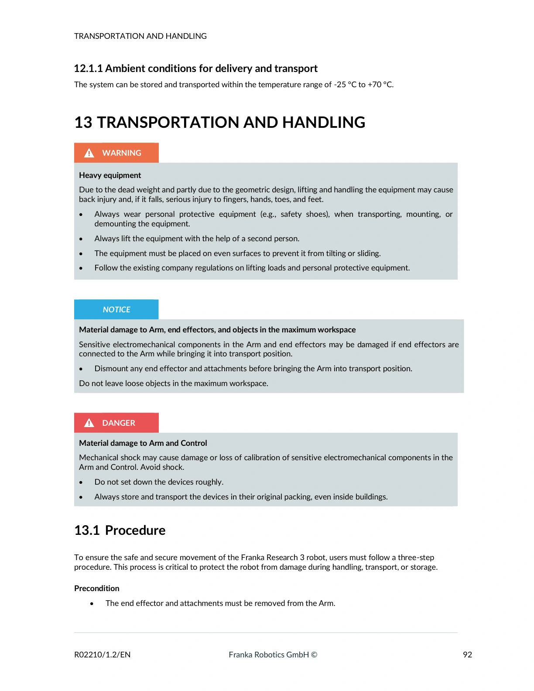



```
TRANSPORTATION AND HANDLING  
 
R02210/1.2/EN 
Franka Robotics GmbH ©  
92  
 
12.1.1 Ambient conditions for delivery and transport 
The system can be stored and transported within the temperature range of -25 °C to +70 °C.  
 
13 TRANSPORTATION AND HANDLING 
WARNING 
  
Heavy equipment 
Due to the dead weight and partly due to the geometric design, lifting and handling the equipment may cause 
back injury and, if it falls, serious injury to fingers, hands, toes, and feet. 
• 
Always wear personal protective equipment (e.g., safety shoes), when transporting, mounting, or 
demounting the equipment. 
• 
Always lift the equipment with the help of a second person. 
• 
The equipment must be placed on even surfaces to prevent it from tilting or sliding. 
• 
Follow the existing company regulations on lifting loads and personal protective equipment. 
 
NOTICE 
 
Material damage to Arm, end effectors, and objects in the maximum workspace 
Sensitive electromechanical components in the Arm and end effectors may be damaged if end effectors are 
connected to the Arm while bringing it into transport position. 
• 
Dismount any end effector and attachments before bringing the Arm into transport position. 
Do not leave loose objects in the maximum workspace. 
 
DANGER 
Material damage to Arm and Control 
Mechanical shock may cause damage or loss of calibration of sensitive electromechanical components in the 
Arm and Control. Avoid shock. 
• 
Do not set down the devices roughly. 
• 
Always store and transport the devices in their original packing, even inside buildings. 
13.1 Procedure 
To ensure the safe and secure movement of the Franka Research 3 robot, users must follow a three-step 
procedure. This process is critical to protect the robot from damage during handling, transport, or storage. 
Precondition 
• 
The end effector and attachments must be removed from the Arm.
```



## PDF page 93

**Source:** Hardware Manual Franka Research 3\_Arm v2.1\_R02210\_1.2\_EN.pdf, original pdf page 93. [Open the corresponding PDF reading-copy page](https://1292444914-files.gitbook.io/~/files/v0/b/gitbook-x-prod.appspot.com/o/spaces%2FtgOfPnscWebs1eh82EKq%2Fuploads%2FtKI9uC3hXOETcdzoPzNi%2FFR3_HARDWARE-pages-093-096.pdf?alt=media#page=1).



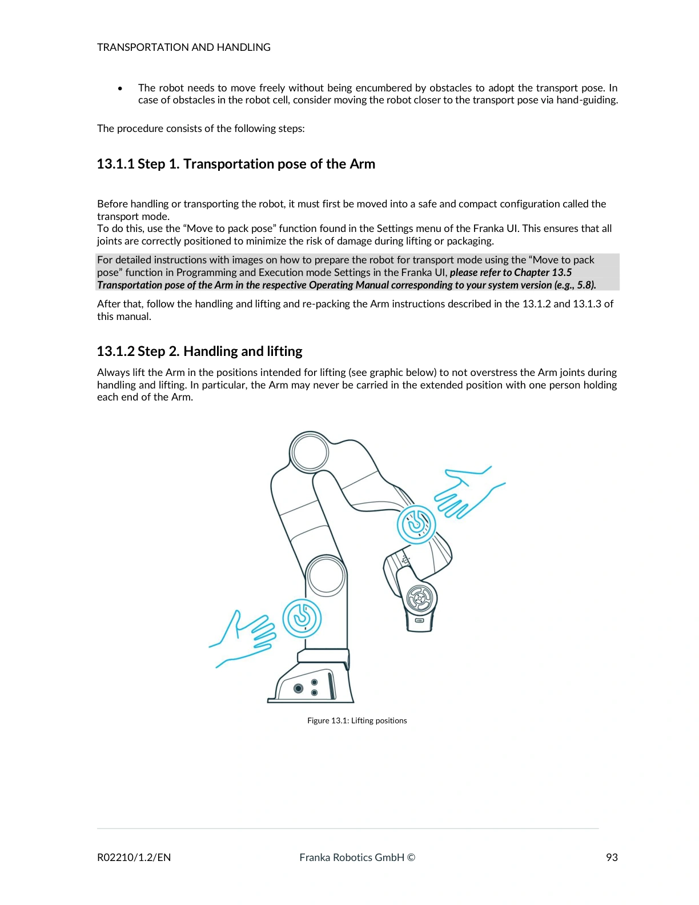



```
TRANSPORTATION AND HANDLING  
 
R02210/1.2/EN 
Franka Robotics GmbH ©  
93  
 
• 
The robot needs to move freely without being encumbered by obstacles to adopt the transport pose. In 
case of obstacles in the robot cell, consider moving the robot closer to the transport pose via hand-guiding. 
The procedure consists of the following steps: 
13.1.1 Step 1. Transportation pose of the Arm 
 
Before handling or transporting the robot, it must first be moved into a safe and compact configuration called the 
transport mode. 
To do this, use the “Move to pack pose” function found in the Settings menu of the Franka UI. This ensures that all 
joints are correctly positioned to minimize the risk of damage during lifting or packaging. 
For detailed instructions with images on how to prepare the robot for transport mode using the “Move to pack 
pose” function in Programming and Execution mode Settings in the Franka UI, please refer to Chapter 13.5 
Transportation pose of the Arm in the respective Operating Manual corresponding to your system version (e.g., 5.8). 
After that, follow the handling and lifting and re-packing the Arm instructions described in the 13.1.2 and 13.1.3 of 
this manual. 
13.1.2 Step 2. Handling and lifting 
Always lift the Arm in the positions intended for lifting (see graphic below) to not overstress the Arm joints during 
handling and lifting. In particular, the Arm may never be carried in the extended position with one person holding 
each end of the Arm. 
 
 
Figure 13.1: Lifting positions
```



## PDF page 94

**Source:** Hardware Manual Franka Research 3\_Arm v2.1\_R02210\_1.2\_EN.pdf, original pdf page 94. [Open the corresponding PDF reading-copy page](https://1292444914-files.gitbook.io/~/files/v0/b/gitbook-x-prod.appspot.com/o/spaces%2FtgOfPnscWebs1eh82EKq%2Fuploads%2FtKI9uC3hXOETcdzoPzNi%2FFR3_HARDWARE-pages-093-096.pdf?alt=media#page=2).



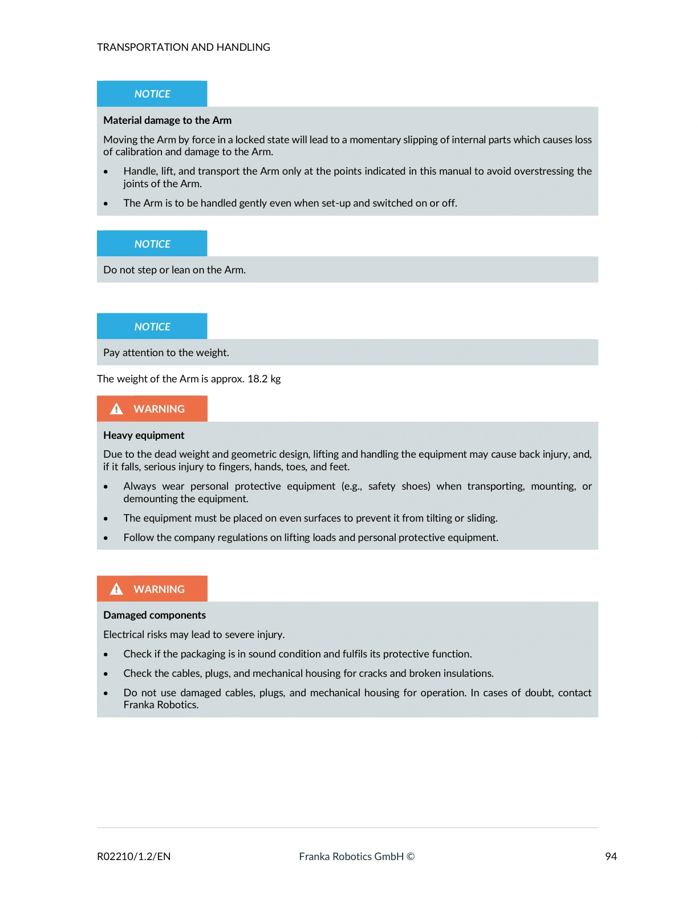



```
TRANSPORTATION AND HANDLING  
 
R02210/1.2/EN 
Franka Robotics GmbH ©  
94  
 
NOTICE 
 
Material damage to the Arm 
Moving the Arm by force in a locked state will lead to a momentary slipping of internal parts which causes loss 
of calibration and damage to the Arm. 
• 
Handle, lift, and transport the Arm only at the points indicated in this manual to avoid overstressing the 
joints of the Arm. 
• 
The Arm is to be handled gently even when set-up and switched on or off. 
 
NOTICE 
 
Do not step or lean on the Arm. 
 
NOTICE 
 
Pay attention to the weight. 
The weight of the Arm is approx. 18.2 kg 
WARNING 
  
Heavy equipment 
Due to the dead weight and geometric design, lifting and handling the equipment may cause back injury, and, 
if it falls, serious injury to fingers, hands, toes, and feet. 
• 
Always wear personal protective equipment (e.g., safety shoes) when transporting, mounting, or 
demounting the equipment. 
• 
The equipment must be placed on even surfaces to prevent it from tilting or sliding. 
• 
Follow the company regulations on lifting loads and personal protective equipment. 
 
WARNING 
  
Damaged components  
Electrical risks may lead to severe injury. 
• 
Check if the packaging is in sound condition and fulfils its protective function. 
• 
Check the cables, plugs, and mechanical housing for cracks and broken insulations. 
• 
Do not use damaged cables, plugs, and mechanical housing for operation. In cases of doubt, contact 
Franka Robotics.
```



## PDF page 95

**Source:** Hardware Manual Franka Research 3\_Arm v2.1\_R02210\_1.2\_EN.pdf, original pdf page 95. [Open the corresponding PDF reading-copy page](https://1292444914-files.gitbook.io/~/files/v0/b/gitbook-x-prod.appspot.com/o/spaces%2FtgOfPnscWebs1eh82EKq%2Fuploads%2FtKI9uC3hXOETcdzoPzNi%2FFR3_HARDWARE-pages-093-096.pdf?alt=media#page=3).



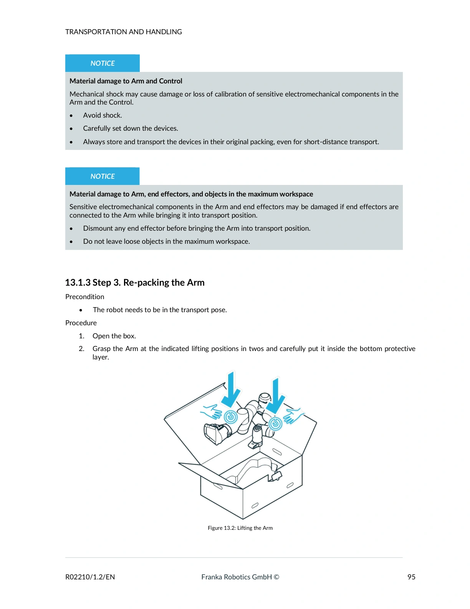



```
TRANSPORTATION AND HANDLING  
 
R02210/1.2/EN 
Franka Robotics GmbH ©  
95  
 
NOTICE 
 
Material damage to Arm and Control 
Mechanical shock may cause damage or loss of calibration of sensitive electromechanical components in the 
Arm and the Control. 
• 
Avoid shock. 
• 
Carefully set down the devices. 
• 
Always store and transport the devices in their original packing, even for short-distance transport. 
 
NOTICE 
 
Material damage to Arm, end effectors, and objects in the maximum workspace 
Sensitive electromechanical components in the Arm and end effectors may be damaged if end effectors are 
connected to the Arm while bringing it into transport position. 
• 
Dismount any end effector before bringing the Arm into transport position. 
• 
Do not leave loose objects in the maximum workspace. 
 
13.1.3 Step 3. Re-packing the Arm 
Precondition 
• 
The robot needs to be in the transport pose. 
Procedure 
1. 
Open the box. 
2. 
Grasp the Arm at the indicated lifting positions in twos and carefully put it inside the bottom protective 
layer. 
 
Figure 13.2: Lifting the Arm
```



## PDF page 96

**Source:** Hardware Manual Franka Research 3\_Arm v2.1\_R02210\_1.2\_EN.pdf, original pdf page 96. [Open the corresponding PDF reading-copy page](https://1292444914-files.gitbook.io/~/files/v0/b/gitbook-x-prod.appspot.com/o/spaces%2FtgOfPnscWebs1eh82EKq%2Fuploads%2FtKI9uC3hXOETcdzoPzNi%2FFR3_HARDWARE-pages-093-096.pdf?alt=media#page=4).



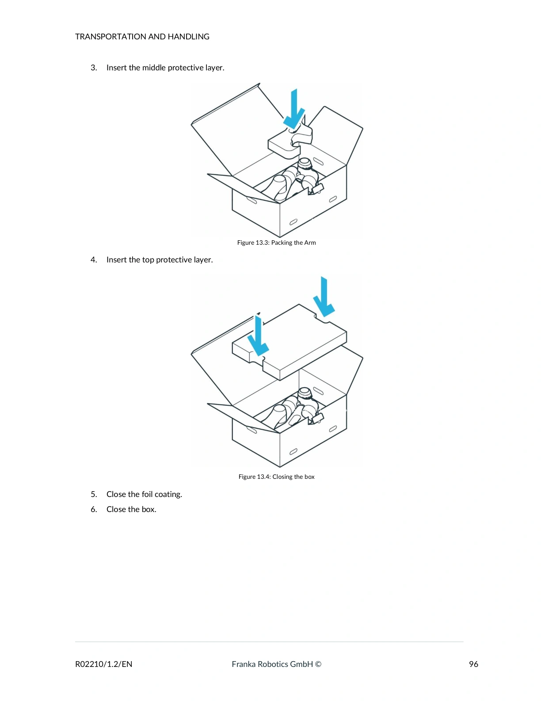



```
TRANSPORTATION AND HANDLING  
 
R02210/1.2/EN 
Franka Robotics GmbH ©  
96  
 
3. 
Insert the middle protective layer. 
 
Figure 13.3: Packing the Arm 
4. 
Insert the top protective layer. 
 
Figure 13.4: Closing the box 
5. 
Close the foil coating. 
6. 
Close the box. 
 
 
 
 
 
 
 
Picture will be substituted with graphic before release
Picture will be substituted with graphic before release
```



## PDF page 97

**Source:** Hardware Manual Franka Research 3\_Arm v2.1\_R02210\_1.2\_EN.pdf, original pdf page 97. [Open the corresponding PDF reading-copy page](https://1292444914-files.gitbook.io/~/files/v0/b/gitbook-x-prod.appspot.com/o/spaces%2FtgOfPnscWebs1eh82EKq%2Fuploads%2FDtEYwQVqZKyMM2eaGCOC%2FFR3_HARDWARE-pages-097-100.pdf?alt=media#page=1).



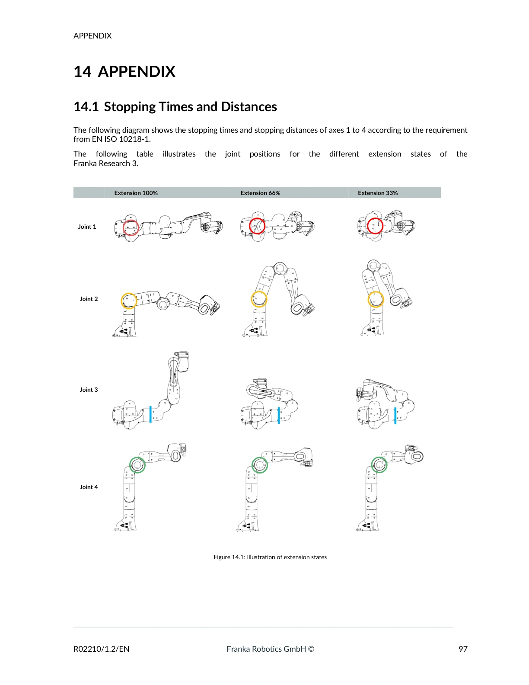



```
APPENDIX  
 
R02210/1.2/EN 
Franka Robotics GmbH ©  
97  
 
14 APPENDIX 
14.1 Stopping Times and Distances 
The following diagram shows the stopping times and stopping distances of axes 1 to 4 according to the requirement 
from EN ISO 10218-1.  
The 
following 
table 
illustrates 
the 
joint 
positions 
for 
the 
different 
extension 
states 
of 
the  
Franka Research 3. 
 
 
Extension 100% 
Extension 66% 
Extension 33% 
Joint 1 
 
 
 
Joint 2 
 
 
 
Joint 3 
 
 
 
Joint 4 
 
 
 
 
Figure 14.1: Illustration of extension states
```



## PDF page 98

**Source:** Hardware Manual Franka Research 3\_Arm v2.1\_R02210\_1.2\_EN.pdf, original pdf page 98. [Open the corresponding PDF reading-copy page](https://1292444914-files.gitbook.io/~/files/v0/b/gitbook-x-prod.appspot.com/o/spaces%2FtgOfPnscWebs1eh82EKq%2Fuploads%2FDtEYwQVqZKyMM2eaGCOC%2FFR3_HARDWARE-pages-097-100.pdf?alt=media#page=2).



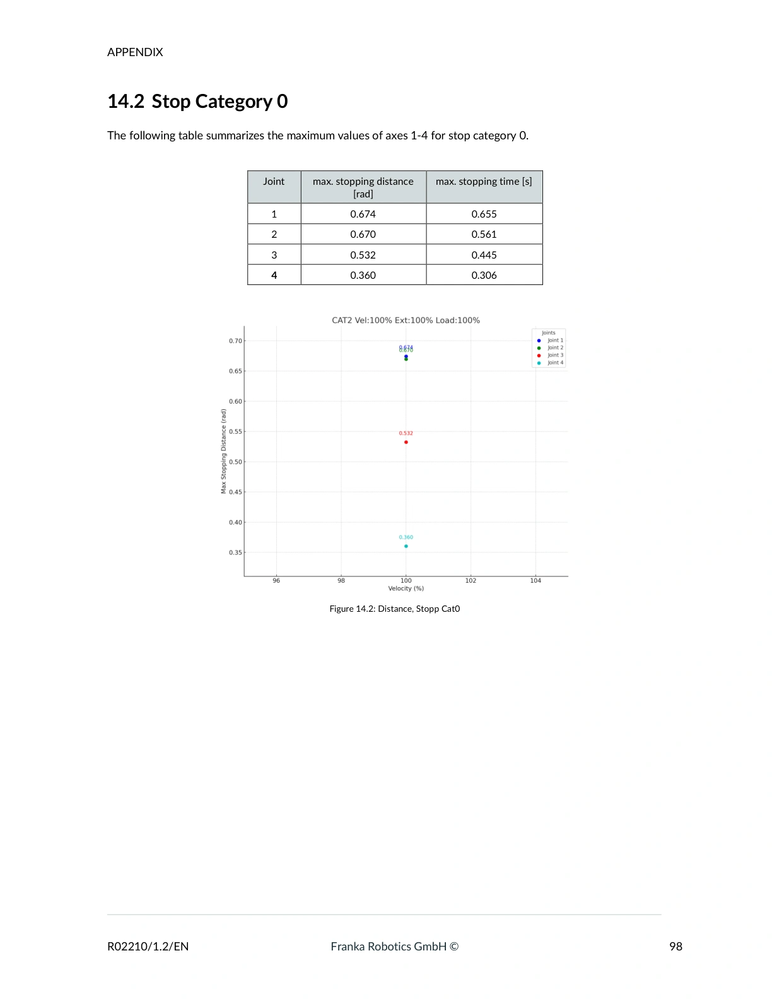



```
APPENDIX  
 
R02210/1.2/EN 
Franka Robotics GmbH ©  
98  
 
14.2 Stop Category 0 
The following table summarizes the maximum values of axes 1-4 for stop category 0. 
 
Joint 
max. stopping distance 
[rad] 
max. stopping time [s] 
1 
0.674 
0.655 
2 
0.670 
0.561 
3 
0.532 
0.445 
4 
0.360 
0.306 
 
 
Figure 14.2: Distance, Stopp Cat0
```



## PDF page 99

**Source:** Hardware Manual Franka Research 3\_Arm v2.1\_R02210\_1.2\_EN.pdf, original pdf page 99. [Open the corresponding PDF reading-copy page](https://1292444914-files.gitbook.io/~/files/v0/b/gitbook-x-prod.appspot.com/o/spaces%2FtgOfPnscWebs1eh82EKq%2Fuploads%2FDtEYwQVqZKyMM2eaGCOC%2FFR3_HARDWARE-pages-097-100.pdf?alt=media#page=3).



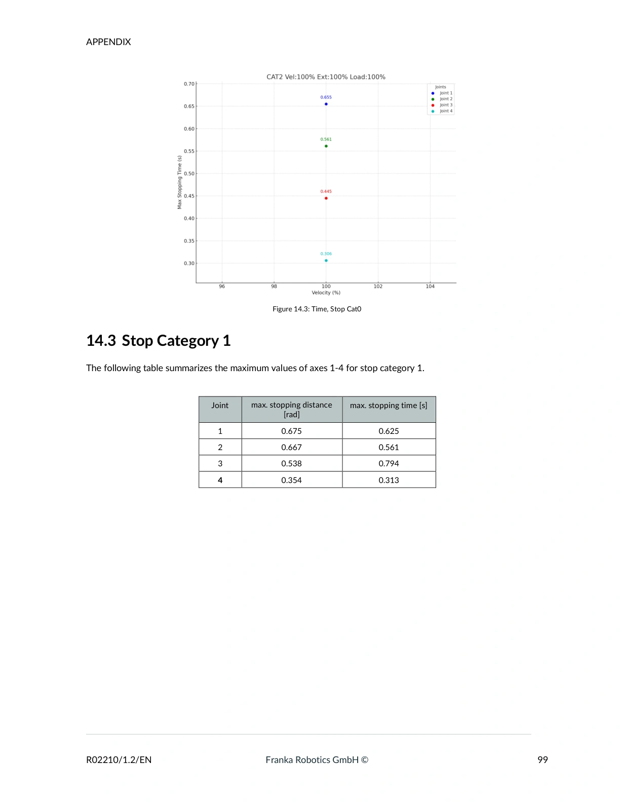



```
APPENDIX  
 
R02210/1.2/EN 
Franka Robotics GmbH ©  
99  
 
 
Figure 14.3: Time, Stop Cat0 
14.3 Stop Category 1 
The following table summarizes the maximum values of axes 1-4 for stop category 1. 
 
Joint 
max. stopping distance 
[rad] 
max. stopping time [s] 
1 
0.675 
0.625 
2 
0.667 
0.561 
3 
0.538 
0.794 
4 
0.354 
0.313
```



## PDF page 100

**Source:** Hardware Manual Franka Research 3\_Arm v2.1\_R02210\_1.2\_EN.pdf, original pdf page 100. [Open the corresponding PDF reading-copy page](https://1292444914-files.gitbook.io/~/files/v0/b/gitbook-x-prod.appspot.com/o/spaces%2FtgOfPnscWebs1eh82EKq%2Fuploads%2FDtEYwQVqZKyMM2eaGCOC%2FFR3_HARDWARE-pages-097-100.pdf?alt=media#page=4).



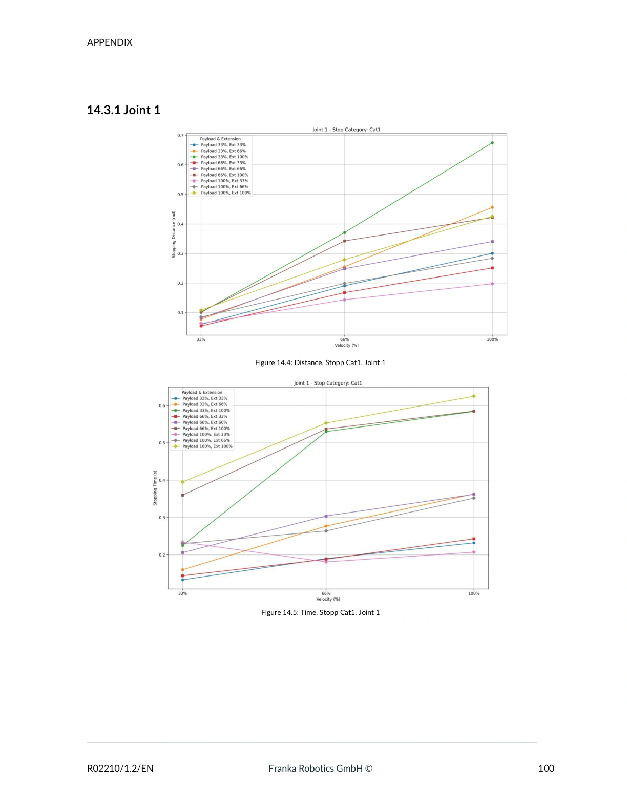



```
APPENDIX  
 
R02210/1.2/EN 
Franka Robotics GmbH ©  
100  
 
 
14.3.1 Joint 1 
 
Figure 14.4: Distance, Stopp Cat1, Joint 1 
 
Figure 14.5: Time, Stopp Cat1, Joint 1
```



## PDF page 101

**Source:** Hardware Manual Franka Research 3\_Arm v2.1\_R02210\_1.2\_EN.pdf, original pdf page 101. [Open the corresponding PDF reading-copy page](https://1292444914-files.gitbook.io/~/files/v0/b/gitbook-x-prod.appspot.com/o/spaces%2FtgOfPnscWebs1eh82EKq%2Fuploads%2FOFjOFTmiSG4L9uYm6hVm%2FFR3_HARDWARE-pages-101-103.pdf?alt=media#page=1).



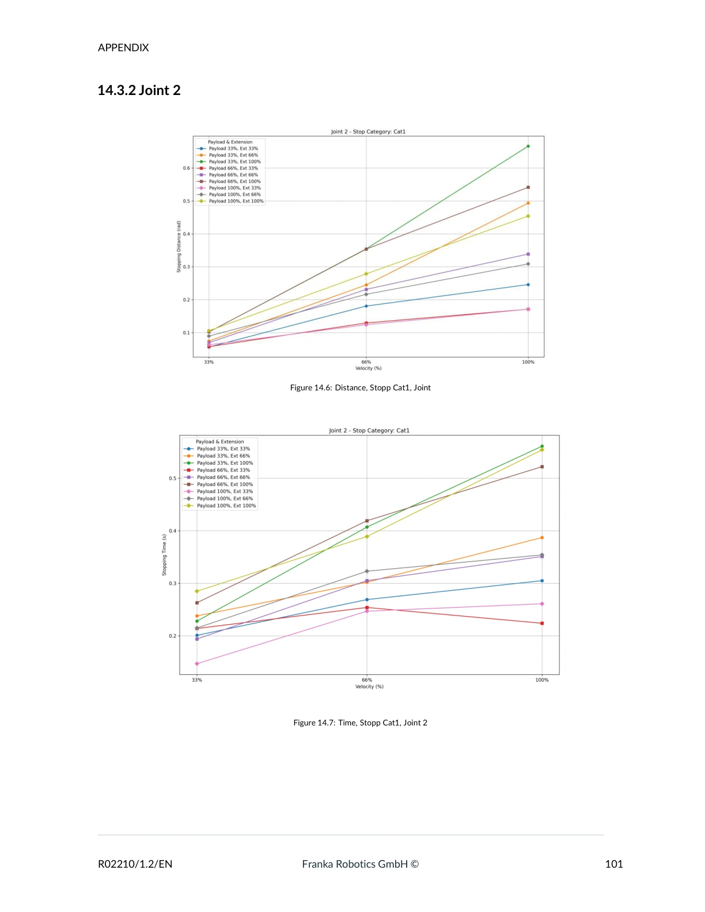



```
APPENDIX  
 
R02210/1.2/EN 
Franka Robotics GmbH ©  
101  
 
14.3.2 Joint 2 
 
 
Figure 14.6: Distance, Stopp Cat1, Joint  
 
 
Figure 14.7: Time, Stopp Cat1, Joint 2
```



## PDF page 102

**Source:** Hardware Manual Franka Research 3\_Arm v2.1\_R02210\_1.2\_EN.pdf, original pdf page 102. [Open the corresponding PDF reading-copy page](https://1292444914-files.gitbook.io/~/files/v0/b/gitbook-x-prod.appspot.com/o/spaces%2FtgOfPnscWebs1eh82EKq%2Fuploads%2FOFjOFTmiSG4L9uYm6hVm%2FFR3_HARDWARE-pages-101-103.pdf?alt=media#page=2).



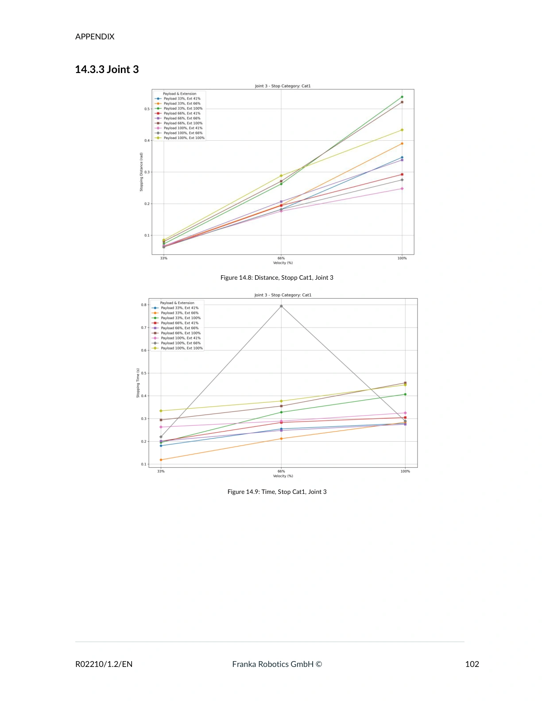



```
APPENDIX  
 
R02210/1.2/EN 
Franka Robotics GmbH ©  
102  
 
14.3.3 Joint 3 
 
Figure 14.8: Distance, Stopp Cat1, Joint 3 
 
Figure 14.9: Time, Stop Cat1, Joint 3
```



## PDF page 103

**Source:** Hardware Manual Franka Research 3\_Arm v2.1\_R02210\_1.2\_EN.pdf, original pdf page 103. [Open the corresponding PDF reading-copy page](https://1292444914-files.gitbook.io/~/files/v0/b/gitbook-x-prod.appspot.com/o/spaces%2FtgOfPnscWebs1eh82EKq%2Fuploads%2FOFjOFTmiSG4L9uYm6hVm%2FFR3_HARDWARE-pages-101-103.pdf?alt=media#page=3).



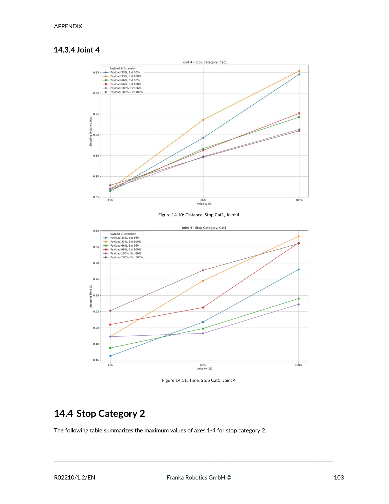



```
APPENDIX  
 
R02210/1.2/EN 
Franka Robotics GmbH ©  
103  
 
14.3.4 Joint 4 
 
Figure 14.10: Distance, Stop Cat1, Joint 4 
 
Figure 14.11: Time, Stop Cat1, Joint 4 
 
14.4 Stop Category 2 
The following table summarizes the maximum values of axes 1-4 for stop category 2.
```



## PDF page 104

**Source:** Hardware Manual Franka Research 3\_Arm v2.1\_R02210\_1.2\_EN.pdf, original pdf page 104. [Open the corresponding PDF reading-copy page](https://1292444914-files.gitbook.io/~/files/v0/b/gitbook-x-prod.appspot.com/o/spaces%2FtgOfPnscWebs1eh82EKq%2Fuploads%2F5UPmVxOf9yf8Sq2VqKKC%2FFR3_HARDWARE-pages-104-107.pdf?alt=media#page=1).



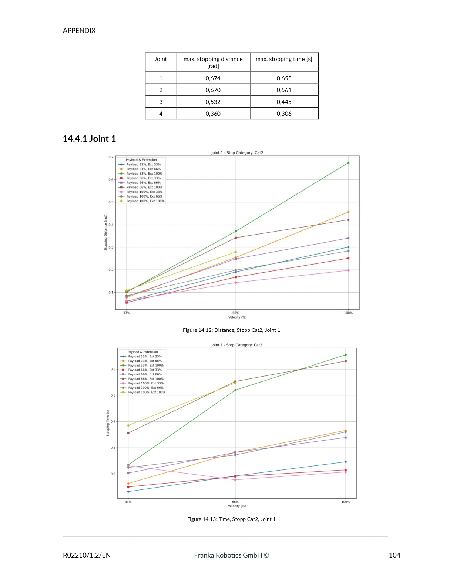



```
APPENDIX  
 
R02210/1.2/EN 
Franka Robotics GmbH ©  
104  
 
Joint 
max. stopping distance 
[rad] 
max. stopping time [s] 
1 
0,674 
0,655 
2 
0,670 
0,561 
3 
0,532 
0,445 
4 
0,360 
0,306 
14.4.1 Joint 1 
 
Figure 14.12: Distance, Stopp Cat2, Joint 1 
 
Figure 14.13: Time, Stopp Cat2, Joint 1
```



## PDF page 105

**Source:** Hardware Manual Franka Research 3\_Arm v2.1\_R02210\_1.2\_EN.pdf, original pdf page 105. [Open the corresponding PDF reading-copy page](https://1292444914-files.gitbook.io/~/files/v0/b/gitbook-x-prod.appspot.com/o/spaces%2FtgOfPnscWebs1eh82EKq%2Fuploads%2F5UPmVxOf9yf8Sq2VqKKC%2FFR3_HARDWARE-pages-104-107.pdf?alt=media#page=2).



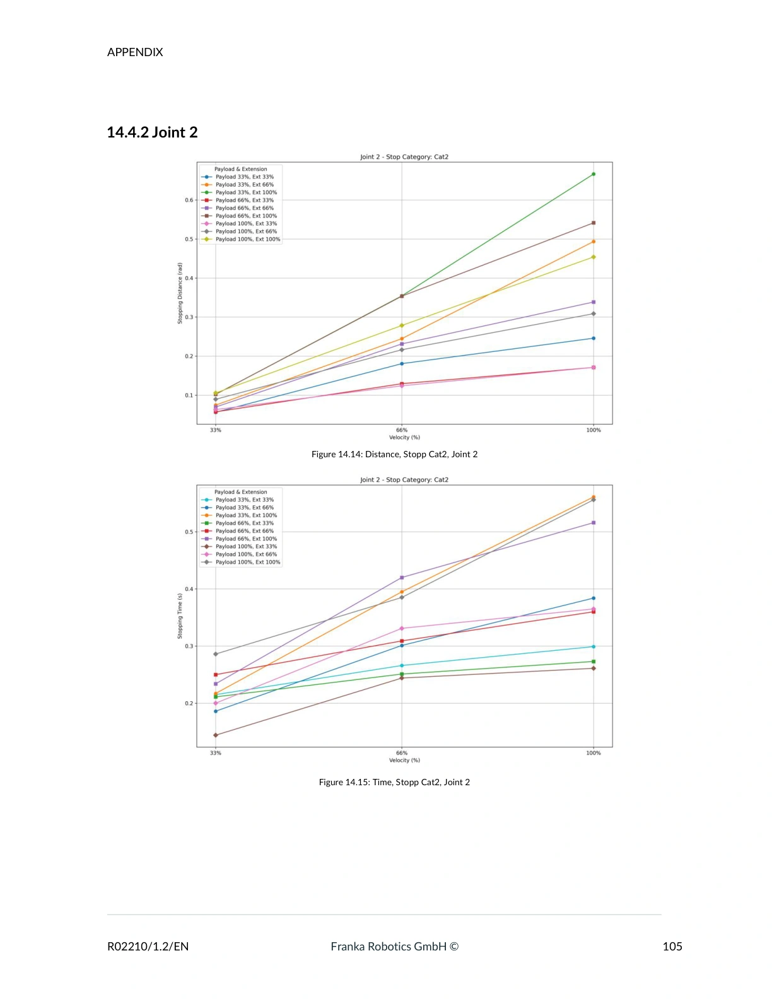



```
APPENDIX  
 
R02210/1.2/EN 
Franka Robotics GmbH ©  
105  
 
 
14.4.2 Joint 2 
 
Figure 14.14: Distance, Stopp Cat2, Joint 2 
 
Figure 14.15: Time, Stopp Cat2, Joint 2
```



## PDF page 106

**Source:** Hardware Manual Franka Research 3\_Arm v2.1\_R02210\_1.2\_EN.pdf, original pdf page 106. [Open the corresponding PDF reading-copy page](https://1292444914-files.gitbook.io/~/files/v0/b/gitbook-x-prod.appspot.com/o/spaces%2FtgOfPnscWebs1eh82EKq%2Fuploads%2F5UPmVxOf9yf8Sq2VqKKC%2FFR3_HARDWARE-pages-104-107.pdf?alt=media#page=3).



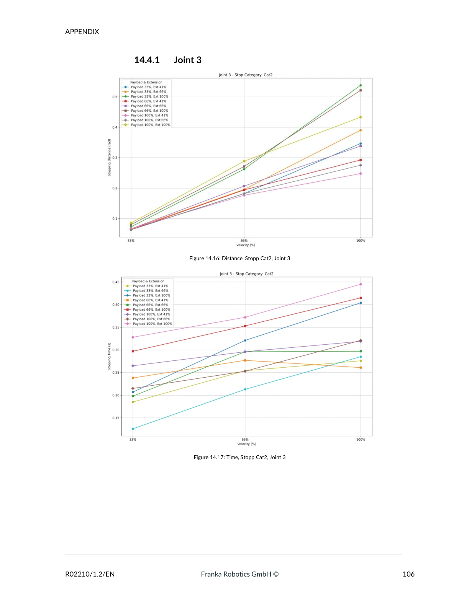



```
APPENDIX  
 
R02210/1.2/EN 
Franka Robotics GmbH ©  
106  
 
14.4.1 
Joint 3 
 
Figure 14.16: Distance, Stopp Cat2, Joint 3 
 
Figure 14.17: Time, Stopp Cat2, Joint 3
```



## PDF page 107

**Source:** Hardware Manual Franka Research 3\_Arm v2.1\_R02210\_1.2\_EN.pdf, original pdf page 107. [Open the corresponding PDF reading-copy page](https://1292444914-files.gitbook.io/~/files/v0/b/gitbook-x-prod.appspot.com/o/spaces%2FtgOfPnscWebs1eh82EKq%2Fuploads%2F5UPmVxOf9yf8Sq2VqKKC%2FFR3_HARDWARE-pages-104-107.pdf?alt=media#page=4).



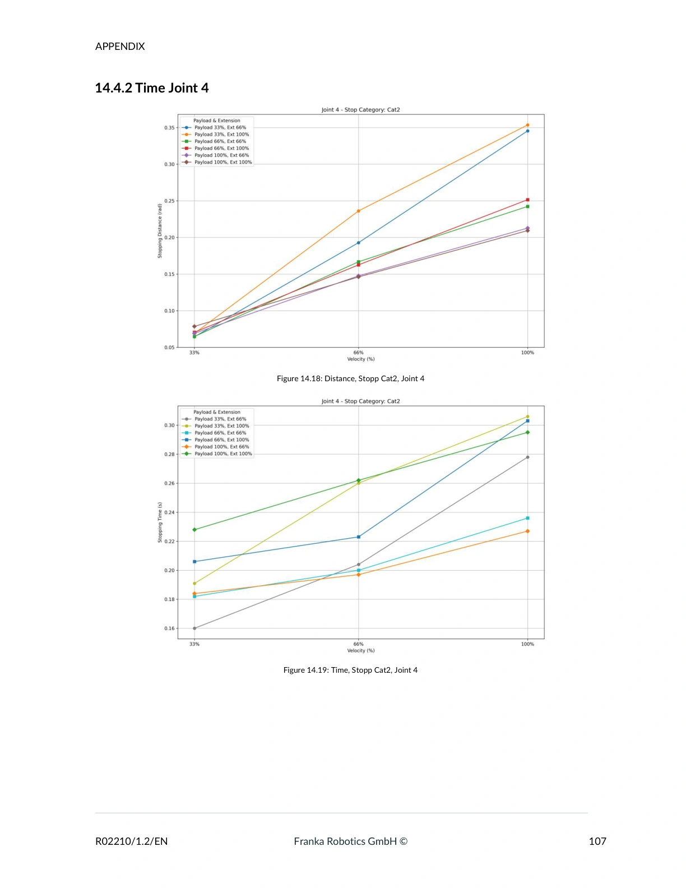



```
APPENDIX  
 
R02210/1.2/EN 
Franka Robotics GmbH ©  
107  
 
14.4.2 Time Joint 4 
 
Figure 14.18: Distance, Stopp Cat2, Joint 4 
 
Figure 14.19: Time, Stopp Cat2, Joint 4
```



## PDF page 108

**Source:** Hardware Manual Franka Research 3\_Arm v2.1\_R02210\_1.2\_EN.pdf, original pdf page 108. [Open the corresponding PDF reading-copy page](https://1292444914-files.gitbook.io/~/files/v0/b/gitbook-x-prod.appspot.com/o/spaces%2FtgOfPnscWebs1eh82EKq%2Fuploads%2FRf5300DWa79VgfPONrgo%2FFR3_HARDWARE-pages-108-118.pdf?alt=media#page=1).



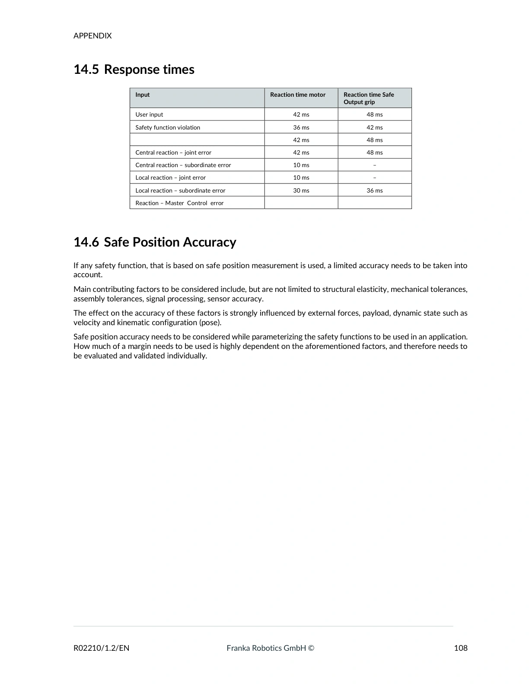



```
APPENDIX  
 
R02210/1.2/EN 
Franka Robotics GmbH ©  
108  
 
14.5 Response times 
 
 
 
 
 
 
 
 
 
14.6 Safe Position Accuracy 
If any safety function, that is based on safe position measurement is used, a limited accuracy needs to be taken into 
account. 
Main contributing factors to be considered include, but are not limited to structural elasticity, mechanical tolerances, 
assembly tolerances, signal processing, sensor accuracy. 
The effect on the accuracy of these factors is strongly influenced by external forces, payload, dynamic state such as 
velocity and kinematic configuration (pose). 
Safe position accuracy needs to be considered while parameterizing the safety functions to be used in an application. 
How much of a margin needs to be used is highly dependent on the aforementioned factors, and therefore needs to 
be evaluated and validated individually. 
 
 
 
Input 
Reaction time motor 
Reaction time Safe 
Output grip 
User input 
42 ms 
48 ms 
Safety function violation 
36 ms 
42 ms 
 
42 ms 
48 ms 
Central reaction – joint error 
42 ms 
48 ms 
Central reaction – subordinate error 
10 ms 
– 
Local reaction – joint error 
10 ms 
– 
Local reaction – subordinate error 
30 ms 
36 ms 
Reaction – Master  Control  error
```



## PDF page 109

**Source:** Hardware Manual Franka Research 3\_Arm v2.1\_R02210\_1.2\_EN.pdf, original pdf page 109. [Open the corresponding PDF reading-copy page](https://1292444914-files.gitbook.io/~/files/v0/b/gitbook-x-prod.appspot.com/o/spaces%2FtgOfPnscWebs1eh82EKq%2Fuploads%2FRf5300DWa79VgfPONrgo%2FFR3_HARDWARE-pages-108-118.pdf?alt=media#page=2).



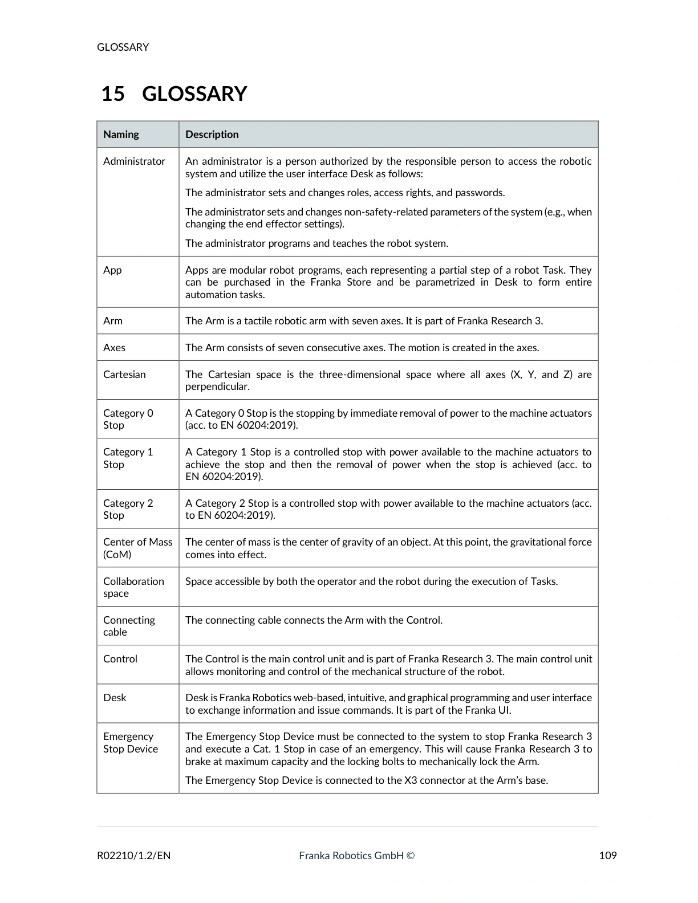



```
GLOSSARY  
 
R02210/1.2/EN 
Franka Robotics GmbH ©  
109  
 
15  GLOSSARY 
Naming 
Description 
Administrator 
An administrator is a person authorized by the responsible person to access the robotic 
system and utilize the user interface Desk as follows: 
The administrator sets and changes roles, access rights, and passwords. 
The administrator sets and changes non-safety-related parameters of the system (e.g., when 
changing the end effector settings). 
The administrator programs and teaches the robot system. 
App 
Apps are modular robot programs, each representing a partial step of a robot Task. They 
can be purchased in the Franka Store and be parametrized in Desk to form entire 
automation tasks. 
Arm 
The Arm is a tactile robotic arm with seven axes. It is part of Franka Research 3. 
Axes 
The Arm consists of seven consecutive axes. The motion is created in the axes. 
Cartesian 
The Cartesian space is the three-dimensional space where all axes (X, Y, and Z) are 
perpendicular. 
Category 0 
Stop 
A Category 0 Stop is the stopping by immediate removal of power to the machine actuators 
(acc. to EN 60204:2019). 
Category 1 
Stop 
A Category 1 Stop is a controlled stop with power available to the machine actuators to 
achieve the stop and then the removal of power when the stop is achieved (acc. to 
EN 60204:2019). 
Category 2 
Stop 
A Category 2 Stop is a controlled stop with power available to the machine actuators (acc. 
to EN 60204:2019). 
Center of Mass 
(CoM) 
The center of mass is the center of gravity of an object. At this point, the gravitational force 
comes into effect. 
Collaboration 
space 
Space accessible by both the operator and the robot during the execution of Tasks. 
Connecting 
cable 
The connecting cable connects the Arm with the Control. 
Control 
The Control is the main control unit and is part of Franka Research 3. The main control unit 
allows monitoring and control of the mechanical structure of the robot. 
Desk 
Desk is Franka Robotics web-based, intuitive, and graphical programming and user interface 
to exchange information and issue commands. It is part of the Franka UI. 
Emergency 
Stop Device 
The Emergency Stop Device must be connected to the system to stop Franka Research 3 
and execute a Cat. 1 Stop in case of an emergency. This will cause Franka Research 3 to 
brake at maximum capacity and the locking bolts to mechanically lock the Arm. 
The Emergency Stop Device is connected to the X3 connector at the Arm’s base.
```



## PDF page 110

**Source:** Hardware Manual Franka Research 3\_Arm v2.1\_R02210\_1.2\_EN.pdf, original pdf page 110. [Open the corresponding PDF reading-copy page](https://1292444914-files.gitbook.io/~/files/v0/b/gitbook-x-prod.appspot.com/o/spaces%2FtgOfPnscWebs1eh82EKq%2Fuploads%2FRf5300DWa79VgfPONrgo%2FFR3_HARDWARE-pages-108-118.pdf?alt=media#page=3).



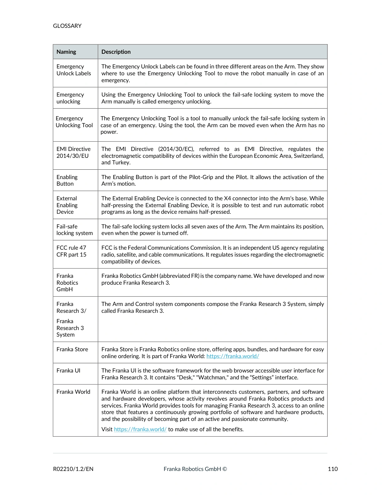



```
GLOSSARY  
 
R02210/1.2/EN 
Franka Robotics GmbH ©  
110  
 
Naming 
Description 
Emergency 
Unlock Labels 
The Emergency Unlock Labels can be found in three different areas on the Arm. They show 
where to use the Emergency Unlocking Tool to move the robot manually in case of an 
emergency. 
Emergency 
unlocking 
Using the Emergency Unlocking Tool to unlock the fail-safe locking system to move the 
Arm manually is called emergency unlocking. 
Emergency 
Unlocking Tool 
The Emergency Unlocking Tool is a tool to manually unlock the fail-safe locking system in 
case of an emergency. Using the tool, the Arm can be moved even when the Arm has no 
power. 
EMI Directive 
2014/30/EU 
The EMI Directive (2014/30/EC), referred to as EMI Directive, regulates the 
electromagnetic compatibility of devices within the European Economic Area, Switzerland, 
and Turkey. 
Enabling 
Button 
The Enabling Button is part of the Pilot-Grip and the Pilot. It allows the activation of the 
Arm’s motion. 
External 
Enabling 
Device 
The External Enabling Device is connected to the X4 connector into the Arm‘s base. While 
half-pressing the External Enabling Device, it is possible to test and run automatic robot 
programs as long as the device remains half-pressed. 
Fail-safe 
locking system 
The fail-safe locking system locks all seven axes of the Arm. The Arm maintains its position, 
even when the power is turned off. 
FCC rule 47 
CFR part 15 
FCC is the Federal Communications Commission. It is an independent US agency regulating 
radio, satellite, and cable communications. It regulates issues regarding the electromagnetic 
compatibility of devices. 
Franka 
Robotics 
GmbH 
Franka Robotics GmbH (abbreviated FR) is the company name. We have developed and now 
produce Franka Research 3. 
Franka 
Research 3/ 
Franka 
Research 3 
System 
The Arm and Control system components compose the Franka Research 3 System, simply 
called Franka Research 3. 
Franka Store 
Franka Store is Franka Robotics online store, offering apps, bundles, and hardware for easy 
online ordering. It is part of Franka World: https://franka.world/ 
Franka UI 
The Franka UI is the software framework for the web browser accessible user interface for 
Franka Research 3. It contains "Desk," "Watchman," and the “Settings” interface. 
Franka World 
Franka World is an online platform that interconnects customers, partners, and software 
and hardware developers, whose activity revolves around Franka Robotics products and 
services. Franka World provides tools for managing Franka Research 3, access to an online 
store that features a continuously growing portfolio of software and hardware products, 
and the possibility of becoming part of an active and passionate community. 
Visit https://franka.world/ to make use of all the benefits.
```



**Original PDF links:** [Source link 1](https://franka.world/)

## PDF page 111

**Source:** Hardware Manual Franka Research 3\_Arm v2.1\_R02210\_1.2\_EN.pdf, original pdf page 111. [Open the corresponding PDF reading-copy page](https://1292444914-files.gitbook.io/~/files/v0/b/gitbook-x-prod.appspot.com/o/spaces%2FtgOfPnscWebs1eh82EKq%2Fuploads%2FRf5300DWa79VgfPONrgo%2FFR3_HARDWARE-pages-108-118.pdf?alt=media#page=4).



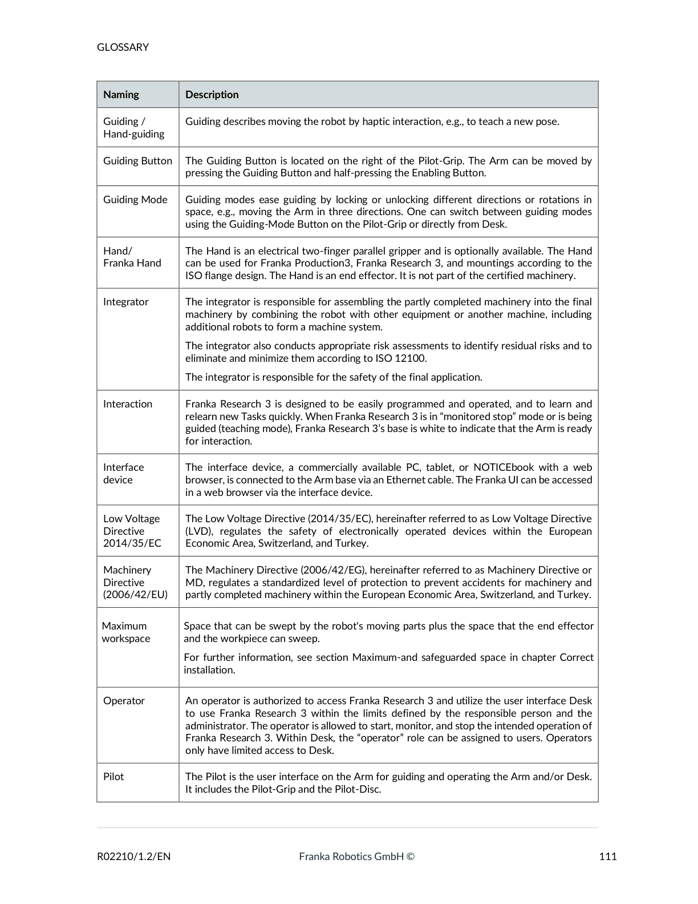



```
GLOSSARY  
 
R02210/1.2/EN 
Franka Robotics GmbH ©  
111  
 
Naming 
Description 
Guiding / 
Hand-guiding 
Guiding describes moving the robot by haptic interaction, e.g., to teach a new pose. 
Guiding Button 
The Guiding Button is located on the right of the Pilot-Grip. The Arm can be moved by 
pressing the Guiding Button and half-pressing the Enabling Button. 
Guiding Mode 
Guiding modes ease guiding by locking or unlocking different directions or rotations in 
space, e.g., moving the Arm in three directions. One can switch between guiding modes 
using the Guiding-Mode Button on the Pilot-Grip or directly from Desk. 
Hand/ 
Franka Hand 
The Hand is an electrical two-finger parallel gripper and is optionally available. The Hand 
can be used for Franka Production3, Franka Research 3, and mountings according to the 
ISO flange design. The Hand is an end effector. It is not part of the certified machinery. 
Integrator 
The integrator is responsible for assembling the partly completed machinery into the final 
machinery by combining the robot with other equipment or another machine, including 
additional robots to form a machine system. 
The integrator also conducts appropriate risk assessments to identify residual risks and to 
eliminate and minimize them according to ISO 12100. 
The integrator is responsible for the safety of the final application. 
Interaction 
Franka Research 3 is designed to be easily programmed and operated, and to learn and 
relearn new Tasks quickly. When Franka Research 3 is in “monitored stop” mode or is being 
guided (teaching mode), Franka Research 3’s base is white to indicate that the Arm is ready 
for interaction. 
Interface 
device 
The interface device, a commercially available PC, tablet, or NOTICEbook with a web 
browser, is connected to the Arm base via an Ethernet cable. The Franka UI can be accessed 
in a web browser via the interface device. 
Low Voltage 
Directive 
2014/35/EC 
The Low Voltage Directive (2014/35/EC), hereinafter referred to as Low Voltage Directive 
(LVD), regulates the safety of electronically operated devices within the European 
Economic Area, Switzerland, and Turkey. 
Machinery 
Directive 
(2006/42/EU) 
The Machinery Directive (2006/42/EG), hereinafter referred to as Machinery Directive or 
MD, regulates a standardized level of protection to prevent accidents for machinery and 
partly completed machinery within the European Economic Area, Switzerland, and Turkey. 
Maximum 
workspace 
Space that can be swept by the robot's moving parts plus the space that the end effector 
and the workpiece can sweep. 
For further information, see section Maximum-and safeguarded space in chapter Correct 
installation. 
Operator 
An operator is authorized to access Franka Research 3 and utilize the user interface Desk 
to use Franka Research 3 within the limits defined by the responsible person and the 
administrator. The operator is allowed to start, monitor, and stop the intended operation of 
Franka Research 3. Within Desk, the “operator” role can be assigned to users. Operators 
only have limited access to Desk. 
Pilot 
The Pilot is the user interface on the Arm for guiding and operating the Arm and/or Desk. 
It includes the Pilot-Grip and the Pilot-Disc.
```



**Original document cross-references:** [PDF 52](pages-001-072.md#pdf-page-52)

## PDF page 112

**Source:** Hardware Manual Franka Research 3\_Arm v2.1\_R02210\_1.2\_EN.pdf, original pdf page 112. [Open the corresponding PDF reading-copy page](https://1292444914-files.gitbook.io/~/files/v0/b/gitbook-x-prod.appspot.com/o/spaces%2FtgOfPnscWebs1eh82EKq%2Fuploads%2FRf5300DWa79VgfPONrgo%2FFR3_HARDWARE-pages-108-118.pdf?alt=media#page=5).



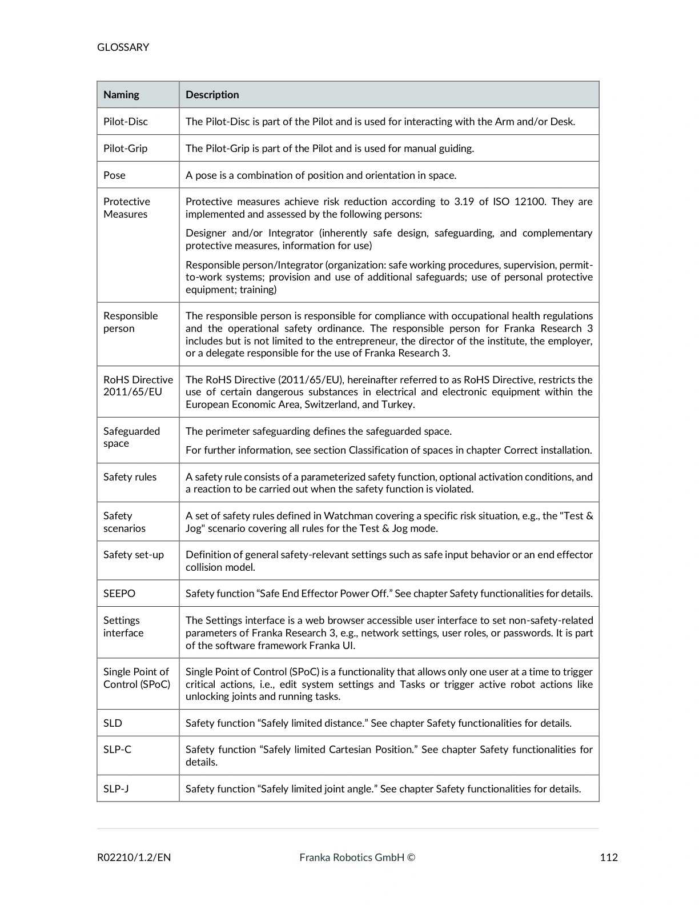



```
GLOSSARY  
 
R02210/1.2/EN 
Franka Robotics GmbH ©  
112  
 
Naming 
Description 
Pilot-Disc 
The Pilot-Disc is part of the Pilot and is used for interacting with the Arm and/or Desk. 
Pilot-Grip 
The Pilot-Grip is part of the Pilot and is used for manual guiding. 
Pose 
A pose is a combination of position and orientation in space. 
Protective 
Measures 
Protective measures achieve risk reduction according to 3.19 of ISO 12100. They are 
implemented and assessed by the following persons:  
Designer and/or Integrator (inherently safe design, safeguarding, and complementary 
protective measures, information for use) 
Responsible person/Integrator (organization: safe working procedures, supervision, permit-
to-work systems; provision and use of additional safeguards; use of personal protective 
equipment; training) 
Responsible 
person 
The responsible person is responsible for compliance with occupational health regulations 
and the operational safety ordinance. The responsible person for Franka Research 3 
includes but is not limited to the entrepreneur, the director of the institute, the employer, 
or a delegate responsible for the use of Franka Research 3. 
RoHS Directive 
2011/65/EU 
The RoHS Directive (2011/65/EU), hereinafter referred to as RoHS Directive, restricts the 
use of certain dangerous substances in electrical and electronic equipment within the 
European Economic Area, Switzerland, and Turkey. 
Safeguarded 
space 
The perimeter safeguarding defines the safeguarded space. 
For further information, see section Classification of spaces in chapter Correct installation. 
Safety rules  
A safety rule consists of a parameterized safety function, optional activation conditions, and 
a reaction to be carried out when the safety function is violated. 
Safety 
scenarios  
A set of safety rules defined in Watchman covering a specific risk situation, e.g., the "Test & 
Jog" scenario covering all rules for the Test & Jog mode. 
Safety set-up  
Definition of general safety-relevant settings such as safe input behavior or an end effector 
collision model. 
SEEPO 
Safety function “Safe End Effector Power Off.” See chapter Safety functionalities for details. 
Settings 
interface 
The Settings interface is a web browser accessible user interface to set non-safety-related 
parameters of Franka Research 3, e.g., network settings, user roles, or passwords. It is part 
of the software framework Franka UI. 
Single Point of 
Control (SPoC) 
Single Point of Control (SPoC) is a functionality that allows only one user at a time to trigger 
critical actions, i.e., edit system settings and Tasks or trigger active robot actions like 
unlocking joints and running tasks. 
SLD 
Safety function “Safely limited distance.” See chapter Safety functionalities for details. 
SLP-C 
Safety function “Safely limited Cartesian Position.” See chapter Safety functionalities for 
details.  
SLP-J 
Safety function “Safely limited joint angle.” See chapter Safety functionalities for details.
```



**Original document cross-references:** [PDF 52](pages-001-072.md#pdf-page-52)

## PDF page 113

**Source:** Hardware Manual Franka Research 3\_Arm v2.1\_R02210\_1.2\_EN.pdf, original pdf page 113. [Open the corresponding PDF reading-copy page](https://1292444914-files.gitbook.io/~/files/v0/b/gitbook-x-prod.appspot.com/o/spaces%2FtgOfPnscWebs1eh82EKq%2Fuploads%2FRf5300DWa79VgfPONrgo%2FFR3_HARDWARE-pages-108-118.pdf?alt=media#page=6).



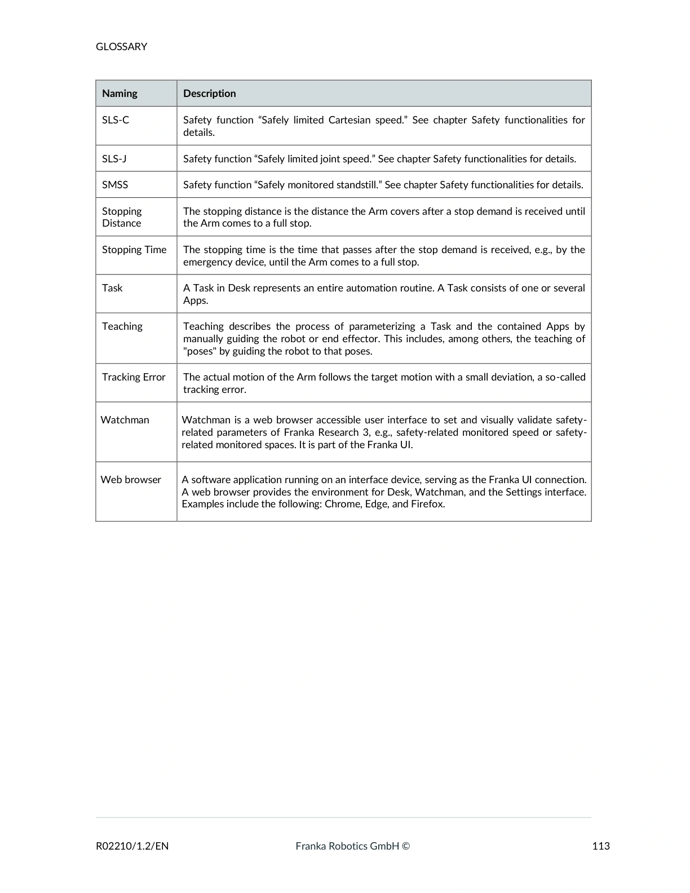



```
GLOSSARY  
 
R02210/1.2/EN 
Franka Robotics GmbH ©  
113  
 
Naming 
Description 
SLS-C 
Safety function “Safely limited Cartesian speed.” See chapter Safety functionalities for 
details.  
SLS-J 
Safety function “Safely limited joint speed.” See chapter Safety functionalities for details. 
SMSS 
Safety function “Safely monitored standstill.” See chapter Safety functionalities for details. 
Stopping 
Distance 
The stopping distance is the distance the Arm covers after a stop demand is received until 
the Arm comes to a full stop. 
Stopping Time 
The stopping time is the time that passes after the stop demand is received, e.g., by the 
emergency device, until the Arm comes to a full stop. 
Task 
A Task in Desk represents an entire automation routine. A Task consists of one or several 
Apps. 
Teaching 
Teaching describes the process of parameterizing a Task and the contained Apps by 
manually guiding the robot or end effector. This includes, among others, the teaching of 
"poses" by guiding the robot to that poses. 
Tracking Error 
The actual motion of the Arm follows the target motion with a small deviation, a so-called 
tracking error. 
Watchman 
Watchman is a web browser accessible user interface to set and visually validate safety-
related parameters of Franka Research 3, e.g., safety-related monitored speed or safety-
related monitored spaces. It is part of the Franka UI. 
Web browser 
A software application running on an interface device, serving as the Franka UI connection. 
A web browser provides the environment for Desk, Watchman, and the Settings interface. 
Examples include the following: Chrome, Edge, and Firefox.
```



## PDF page 114

**Source:** Hardware Manual Franka Research 3\_Arm v2.1\_R02210\_1.2\_EN.pdf, original pdf page 114. [Open the corresponding PDF reading-copy page](https://1292444914-files.gitbook.io/~/files/v0/b/gitbook-x-prod.appspot.com/o/spaces%2FtgOfPnscWebs1eh82EKq%2Fuploads%2FRf5300DWa79VgfPONrgo%2FFR3_HARDWARE-pages-108-118.pdf?alt=media#page=7).



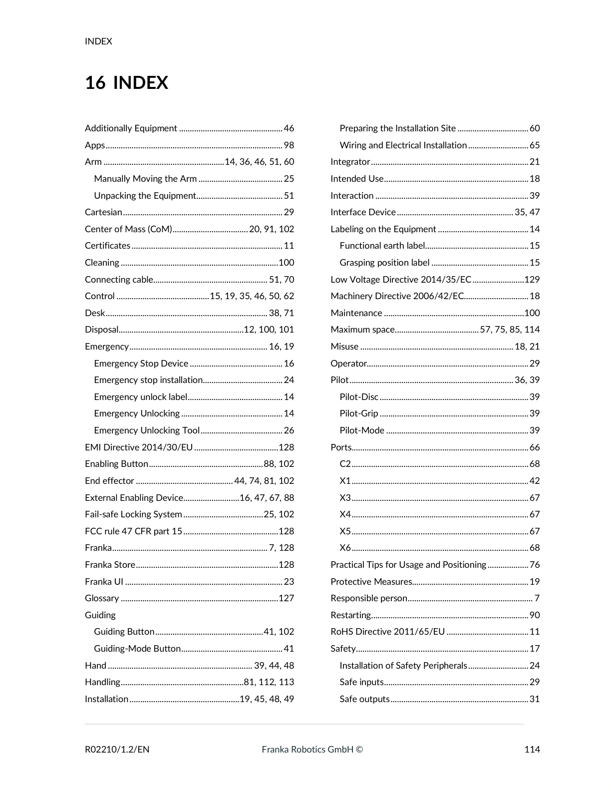



```
INDEX  
 
R02210/1.2/EN 
Franka Robotics GmbH ©  
114  
 
16 INDEX 
Additionally Equipment ................................................ 46 
Apps .................................................................................. 98 
Arm ........................................................ 14, 36, 46, 51, 60 
Manually Moving the Arm ....................................... 25 
Unpacking the Equipment ........................................ 51 
Cartesian .......................................................................... 29 
Center of Mass (CoM) ................................... 20, 91, 102 
Certificates ...................................................................... 11 
Cleaning ......................................................................... 100 
Connecting cable ..................................................... 51, 70 
Control ........................................... 15, 19, 35, 46, 50, 62 
Desk ........................................................................... 38, 71 
Disposal ..........................................................12, 100, 101 
Emergency ................................................................ 16, 19 
Emergency Stop Device ........................................... 16 
Emergency stop installation..................................... 24 
Emergency unlock label ............................................ 14 
Emergency Unlocking ............................................... 14 
Emergency Unlocking Tool ...................................... 26 
EMI Directive 2014/30/EU ....................................... 128 
Enabling Button ..................................................... 88, 102 
End effector ............................................. 44, 74, 81, 102 
External Enabling Device ..........................16, 47, 67, 88 
Fail-safe Locking System ..................................... 25, 102 
FCC rule 47 CFR part 15 ............................................ 128 
Franka ........................................................................ 7, 128 
Franka Store .................................................................. 128 
Franka UI ......................................................................... 23 
Glossary ......................................................................... 127 
Guiding 
Guiding Button .................................................. 41, 102 
Guiding-Mode Button ............................................... 41 
Hand ................................................................... 39, 44, 48 
Handling .........................................................81, 112, 113 
Installation ...................................................19, 45, 48, 49 
Preparing the Installation Site ................................. 60 
Wiring and Electrical Installation ............................ 65 
Integrator ......................................................................... 21 
Intended Use ................................................................... 18 
Interaction ....................................................................... 39 
Interface Device ...................................................... 35, 47 
Labeling on the Equipment .......................................... 14 
Functional earth label................................................ 15 
Grasping position label ............................................. 15 
Low Voltage Directive 2014/35/EC ........................129 
Machinery Directive 2006/42/EC.............................. 18 
Maintenance .................................................................100 
Maximum space ....................................... 57, 75, 85, 114 
Misuse ....................................................................... 18, 21 
Operator........................................................................... 29 
Pilot ............................................................................ 36, 39 
Pilot-Disc ..................................................................... 39 
Pilot-Grip ..................................................................... 39 
Pilot-Mode .................................................................. 39 
Ports .................................................................................. 66 
C2 .................................................................................. 68 
X1 .................................................................................. 42 
X3 .................................................................................. 67 
X4 .................................................................................. 67 
X5 .................................................................................. 67 
X6 .................................................................................. 68 
Practical Tips for Usage and Positioning ................... 76 
Protective Measures...................................................... 19 
Responsible person .......................................................... 7 
Restarting ......................................................................... 90 
RoHS Directive 2011/65/EU ...................................... 11 
Safety ................................................................................ 17 
Installation of Safety Peripherals ............................ 24 
Safe inputs ................................................................... 29 
Safe outputs ................................................................ 31
```



## PDF page 115

**Source:** Hardware Manual Franka Research 3\_Arm v2.1\_R02210\_1.2\_EN.pdf, original pdf page 115. [Open the corresponding PDF reading-copy page](https://1292444914-files.gitbook.io/~/files/v0/b/gitbook-x-prod.appspot.com/o/spaces%2FtgOfPnscWebs1eh82EKq%2Fuploads%2FRf5300DWa79VgfPONrgo%2FFR3_HARDWARE-pages-108-118.pdf?alt=media#page=8).



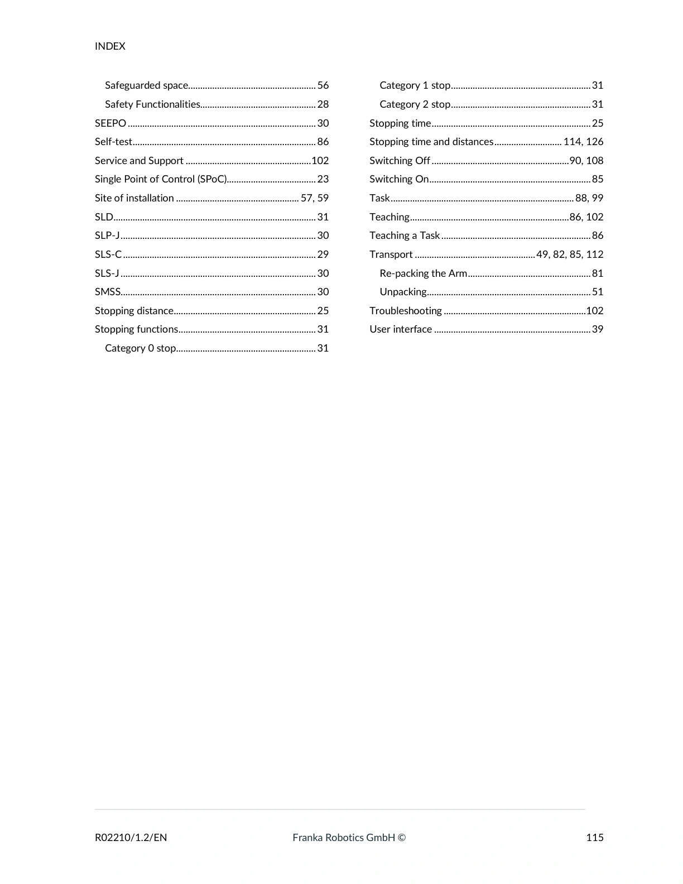



```
INDEX  
 
R02210/1.2/EN 
Franka Robotics GmbH ©  
115  
 
Safeguarded space..................................................... 56 
Safety Functionalities................................................ 28 
SEEPO .............................................................................. 30 
Self-test ............................................................................ 86 
Service and Support .................................................... 102 
Single Point of Control (SPoC)..................................... 23 
Site of installation ................................................... 57, 59 
SLD .................................................................................... 31 
SLP-J ................................................................................. 30 
SLS-C ................................................................................ 29 
SLS-J ................................................................................. 30 
SMSS................................................................................. 30 
Stopping distance ........................................................... 25 
Stopping functions ......................................................... 31 
Category 0 stop .......................................................... 31 
Category 1 stop .......................................................... 31 
Category 2 stop .......................................................... 31 
Stopping time .................................................................. 25 
Stopping time and distances ............................ 114, 126 
Switching Off ......................................................... 90, 108 
Switching On ................................................................... 85 
Task ............................................................................ 88, 99 
Teaching .................................................................. 86, 102 
Teaching a Task .............................................................. 86 
Transport .................................................. 49, 82, 85, 112 
Re-packing the Arm ................................................... 81 
Unpacking .................................................................... 51 
Troubleshooting ...........................................................102 
User interface ................................................................. 39
```



## PDF page 116

**Source:** Hardware Manual Franka Research 3\_Arm v2.1\_R02210\_1.2\_EN.pdf, original pdf page 116. [Open the corresponding PDF reading-copy page](https://1292444914-files.gitbook.io/~/files/v0/b/gitbook-x-prod.appspot.com/o/spaces%2FtgOfPnscWebs1eh82EKq%2Fuploads%2FRf5300DWa79VgfPONrgo%2FFR3_HARDWARE-pages-108-118.pdf?alt=media#page=9).



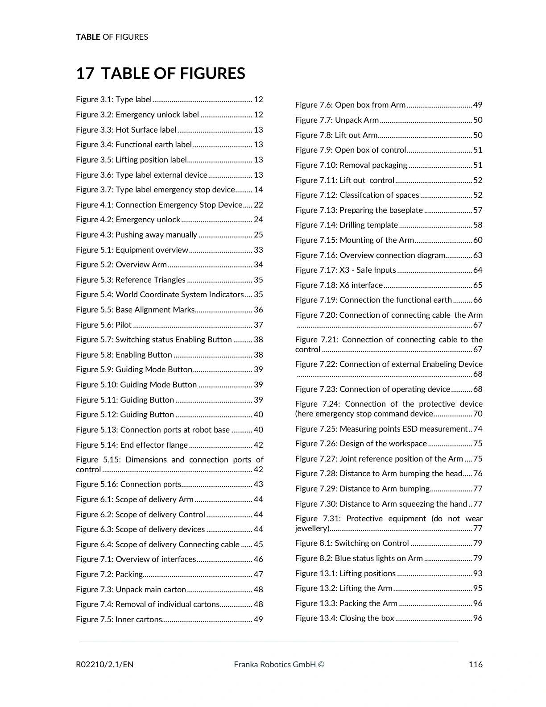



```
TABLE OF FIGURES 
 
R02210/2.1/EN 
Franka Robotics GmbH ©  
116  
 
17 TABLE OF FIGURES
Figure 3.1: Type label .................................................... 12 
Figure 3.2: Emergency unlock label ........................... 12 
Figure 3.3: Hot Surface label ....................................... 13 
Figure 3.4: Functional earth label ............................... 13 
Figure 3.5: Lifting position label .................................. 13 
Figure 3.6: Type label external device ....................... 13 
Figure 3.7: Type label emergency stop device ......... 14 
Figure 4.1: Connection Emergency Stop Device ..... 22 
Figure 4.2: Emergency unlock ..................................... 24 
Figure 4.3: Pushing away manually ............................ 25 
Figure 5.1: Equipment overview ................................. 33 
Figure 5.2: Overview Arm ............................................ 34 
Figure 5.3: Reference Triangles .................................. 35 
Figure 5.4: World Coordinate System Indicators .... 35 
Figure 5.5: Base Alignment Marks .............................. 36 
Figure 5.6: Pilot .............................................................. 37 
Figure 5.7: Switching status Enabling Button .......... 38 
Figure 5.8: Enabling Button ......................................... 38 
Figure 5.9: Guiding Mode Button ............................... 39 
Figure 5.10: Guiding Mode Button ............................ 39 
Figure 5.11: Guiding Button ........................................ 39 
Figure 5.12: Guiding Button ........................................ 40 
Figure 5.13: Connection ports at robot base ........... 40 
Figure 5.14: End effector flange ................................. 42 
Figure 5.15: Dimensions and connection ports of 
control .............................................................................. 42 
Figure 5.16: Connection ports..................................... 43 
Figure 6.1: Scope of delivery Arm .............................. 44 
Figure 6.2: Scope of delivery Control ........................ 44 
Figure 6.3: Scope of delivery devices ........................ 44 
Figure 6.4: Scope of delivery Connecting cable ...... 45 
Figure 7.1: Overview of interfaces ............................. 46 
Figure 7.2: Packing......................................................... 47 
Figure 7.3: Unpack main carton .................................. 48 
Figure 7.4: Removal of individual cartons ................. 48 
Figure 7.5: Inner cartons............................................... 49 
Figure 7.6: Open box from Arm .................................. 49 
Figure 7.7: Unpack Arm ................................................ 50 
Figure 7.8: Lift out Arm ................................................. 50 
Figure 7.9: Open box of control .................................. 51 
Figure 7.10: Removal packaging ................................. 51 
Figure 7.11: Lift out  control ........................................ 52 
Figure 7.12: Classifcation of spaces ........................... 52 
Figure 7.13: Preparing the baseplate ......................... 57 
Figure 7.14: Drilling template ...................................... 58 
Figure 7.15: Mounting of the Arm .............................. 60 
Figure 7.16: Overview connection diagram.............. 63 
Figure 7.17: X3 - Safe Inputs ....................................... 64 
Figure 7.18: X6 interface .............................................. 65 
Figure 7.19: Connection the functional earth .......... 66 
Figure 7.20: Connection of connecting cable  the Arm
 ........................................................................................... 67 
Figure 7.21: Connection of connecting cable to the 
control .............................................................................. 67 
Figure 7.22: Connection of external Enabeling Device
 ........................................................................................... 68 
Figure 7.23: Connection of operating device ........... 68 
Figure 7.24: Connection of the protective device 
(here emergency stop command device .................... 70 
Figure 7.25: Measuring points ESD measurement .. 74 
Figure 7.26: Design of the workspace ....................... 75 
Figure 7.27: Joint reference position of the Arm .... 75 
Figure 7.28: Distance to Arm bumping the head ..... 76 
Figure 7.29: Distance to Arm bumping ...................... 77 
Figure 7.30: Distance to Arm squeezing the hand .. 77 
Figure 7.31: Protective equipment (do not wear 
jewellery) .......................................................................... 77 
Figure 8.1: Switching on Control ................................ 79 
Figure 8.2: Blue status lights on Arm ......................... 79 
Figure 13.1: Lifting positions ....................................... 93 
Figure 13.2: Lifting the Arm ......................................... 95 
Figure 13.3: Packing the Arm ...................................... 96 
Figure 13.4: Closing the box ........................................ 96
```



**Original document cross-references:** [PDF 12](pages-001-072.md#pdf-page-12) · [PDF 13](pages-001-072.md#pdf-page-13) · [PDF 14](pages-001-072.md#pdf-page-14) · [PDF 22](pages-001-072.md#pdf-page-22) · [PDF 24](pages-001-072.md#pdf-page-24) · [PDF 25](pages-001-072.md#pdf-page-25) · [PDF 33](pages-001-072.md#pdf-page-33) · [PDF 34](pages-001-072.md#pdf-page-34) · [PDF 35](pages-001-072.md#pdf-page-35) · [PDF 36](pages-001-072.md#pdf-page-36) · [PDF 37](pages-001-072.md#pdf-page-37) · [PDF 38](pages-001-072.md#pdf-page-38) · [PDF 39](pages-001-072.md#pdf-page-39) · [PDF 40](pages-001-072.md#pdf-page-40) · [PDF 42](pages-001-072.md#pdf-page-42) · [PDF 43](pages-001-072.md#pdf-page-43) · [PDF 44](pages-001-072.md#pdf-page-44) · [PDF 45](pages-001-072.md#pdf-page-45) · [PDF 46](pages-001-072.md#pdf-page-46) · [PDF 47](pages-001-072.md#pdf-page-47) · [PDF 48](pages-001-072.md#pdf-page-48) · [PDF 49](pages-001-072.md#pdf-page-49) · [PDF 50](pages-001-072.md#pdf-page-50) · [PDF 51](pages-001-072.md#pdf-page-51) · [PDF 52](pages-001-072.md#pdf-page-52) · [PDF 57](pages-001-072.md#pdf-page-57) · [PDF 58](pages-001-072.md#pdf-page-58) · [PDF 60](pages-001-072.md#pdf-page-60) · [PDF 63](pages-001-072.md#pdf-page-63) · [PDF 64](pages-001-072.md#pdf-page-64) · [PDF 65](pages-001-072.md#pdf-page-65) · [PDF 66](pages-001-072.md#pdf-page-66) · [PDF 67](pages-001-072.md#pdf-page-67) · [PDF 68](pages-001-072.md#pdf-page-68) · [PDF 70](pages-001-072.md#pdf-page-70) · [PDF 74](pages-073-118.md#pdf-page-74) · [PDF 75](pages-073-118.md#pdf-page-75) · [PDF 76](pages-073-118.md#pdf-page-76) · [PDF 77](pages-073-118.md#pdf-page-77) · [PDF 79](pages-073-118.md#pdf-page-79) · [PDF 93](pages-073-118.md#pdf-page-93) · [PDF 95](pages-073-118.md#pdf-page-95) · [PDF 96](pages-073-118.md#pdf-page-96)

## PDF page 117

**Source:** Hardware Manual Franka Research 3\_Arm v2.1\_R02210\_1.2\_EN.pdf, original pdf page 117. [Open the corresponding PDF reading-copy page](https://1292444914-files.gitbook.io/~/files/v0/b/gitbook-x-prod.appspot.com/o/spaces%2FtgOfPnscWebs1eh82EKq%2Fuploads%2FRf5300DWa79VgfPONrgo%2FFR3_HARDWARE-pages-108-118.pdf?alt=media#page=10).



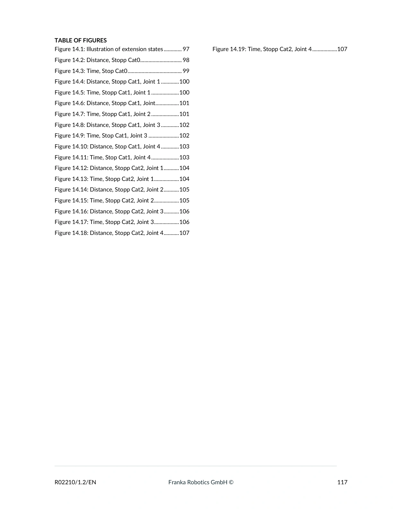



```
TABLE OF FIGURES 
 
R02210/1.2/EN 
Franka Robotics GmbH ©  
117  
 
Figure 14.1: Illustration of extension states ............. 97 
Figure 14.2: Distance, Stopp Cat0.............................. 98 
Figure 14.3: Time, Stop Cat0 ....................................... 99 
Figure 14.4: Distance, Stopp Cat1, Joint 1 ............. 100 
Figure 14.5: Time, Stopp Cat1, Joint 1 .................... 100 
Figure 14.6: Distance, Stopp Cat1, Joint ................. 101 
Figure 14.7: Time, Stopp Cat1, Joint 2 .................... 101 
Figure 14.8: Distance, Stopp Cat1, Joint 3 ............. 102 
Figure 14.9: Time, Stop Cat1, Joint 3 ...................... 102 
Figure 14.10: Distance, Stop Cat1, Joint 4 ............. 103 
Figure 14.11: Time, Stop Cat1, Joint 4 .................... 103 
Figure 14.12: Distance, Stopp Cat2, Joint 1 ........... 104 
Figure 14.13: Time, Stopp Cat2, Joint 1 .................. 104 
Figure 14.14: Distance, Stopp Cat2, Joint 2 ........... 105 
Figure 14.15: Time, Stopp Cat2, Joint 2 .................. 105 
Figure 14.16: Distance, Stopp Cat2, Joint 3 ........... 106 
Figure 14.17: Time, Stopp Cat2, Joint 3 .................. 106 
Figure 14.18: Distance, Stopp Cat2, Joint 4 ........... 107 
Figure 14.19: Time, Stopp Cat2, Joint 4 ..................107
```



**Original document cross-references:** [PDF 97](pages-073-118.md#pdf-page-97) · [PDF 98](pages-073-118.md#pdf-page-98) · [PDF 99](pages-073-118.md#pdf-page-99) · [PDF 100](pages-073-118.md#pdf-page-100) · [PDF 101](pages-073-118.md#pdf-page-101) · [PDF 102](pages-073-118.md#pdf-page-102) · [PDF 103](pages-073-118.md#pdf-page-103) · [PDF 104](pages-073-118.md#pdf-page-104) · [PDF 105](pages-073-118.md#pdf-page-105) · [PDF 106](pages-073-118.md#pdf-page-106) · [PDF 107](pages-073-118.md#pdf-page-107)

## PDF page 118

**Source:** Hardware Manual Franka Research 3\_Arm v2.1\_R02210\_1.2\_EN.pdf, original pdf page 118. [Open the corresponding PDF reading-copy page](https://1292444914-files.gitbook.io/~/files/v0/b/gitbook-x-prod.appspot.com/o/spaces%2FtgOfPnscWebs1eh82EKq%2Fuploads%2FRf5300DWa79VgfPONrgo%2FFR3_HARDWARE-pages-108-118.pdf?alt=media#page=11).







```
Error! Use the Home tab to apply Überschrift 1;PM Überschrift 1 to the text that you want to appear here. 
 
R02210/2.1/EN 
Franka Robotics GmbH ©  
118  
 
 
 
Franka Robotics GmbH 
Frei-Otto-Straße 20 
80797 Munich 
Germany 
franka.de
```


