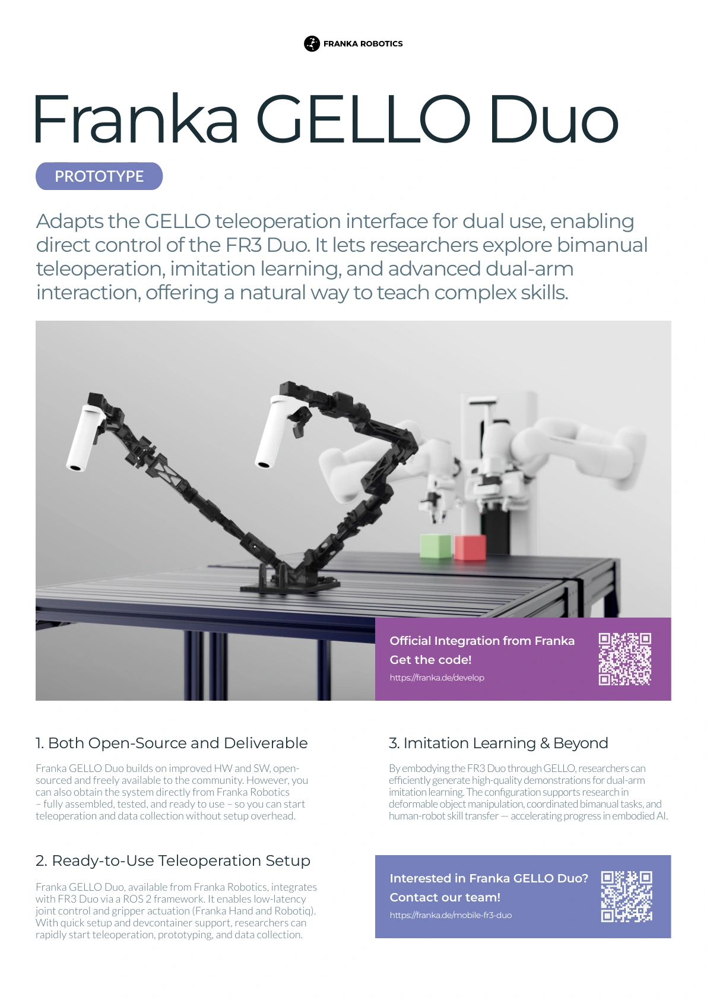

# Franka GELLO Duo brochure — complete reference


**Complete supplied source:** Franka GELLO Duo.pdf · **Coverage:** 1 original PDF pages. [Return to the Franka source library](./).


Every source page is retained in the original order. The **Original page** view preserves complete diagrams, photographs, tables, equations, connector orientation, notices and examples. The **Searchable text** view preserves native PDF text or the slide’s native text, embedded links and substantive speaker notes. Text extraction can retain reading-order/character defects; use the original image for exact layout, table columns and code indentation.


This brochure does not define a universal follower controller. Leader/follower setup, motor torque, joint mapping and startup synchronization require the exact delivered hardware/software configuration and attended motion safeguards.


**Attribution:** the manufacturer and contributors identified in the supplied document. Original notices remain visible on every source page. Navigation, revision notes and the linked engineering explanations are OpenELAB editorial additions.

## Document navigation

| Source section / function                                                          | Original page                         |
| ---------------------------------------------------------------------------------- | ------------------------------------- |
| Franka GELLO Duo / Adapts the GELLO teleoperation interface for dual use, enabling | [PDF 1](complete-gello.md#pdf-page-1) |

## PDF page 1

**Source:** Franka GELLO Duo.pdf, original pdf page 1. [Open the corresponding PDF reading-copy page](https://1292444914-files.gitbook.io/~/files/v0/b/gitbook-x-prod.appspot.com/o/spaces%2FtgOfPnscWebs1eh82EKq%2Fuploads%2FqNEwdAtfQDvHNnO4chJY%2FGELLO-pages-001-001.pdf?alt=media#page=1).







```
Franka GELLO Duo
Adapts the GELLO teleoperation interface for dual use, enabling 
direct control of the FR3 Duo. It lets researchers explore bimanual 
teleoperation, imitation learning, and advanced dual-arm 
interaction, offering a natural way to teach complex skills.
Franka GELLO Duo, available from Franka Robotics, integrates 
with FR3 Duo via a ROS 2 framework. It enables low-latency 
joint control and gripper actuation (Franka Hand and Robotiq). 
With quick setup and devcontainer support, researchers can 
rapidly start teleoperation, prototyping, and data collection.
2. Ready-to-Use Teleoperation Setup
Franka GELLO Duo builds on improved HW and SW, open-
sourced and freely available to the community. However, you 
can also obtain the system directly from Franka Robotics 
– fully assembled, tested, and ready to use – so you can start 
teleoperation and data collection without setup overhead.
1. Both Open-Source and Deliverable
By embodying the FR3 Duo through GELLO, researchers can 
efficiently generate high-quality demonstrations for dual-arm 
imitation learning. The configuration supports research in 
deformable object manipulation, coordinated bimanual tasks, and 
human-robot skill transfer — accelerating progress in embodied AI.
3. Imitation Learning & Beyond
Interested in Franka GELLO Duo? 
Contact our team! 
https://franka.de/mobile-fr3-duo
Official Integration from Franka 
Get the code! 
https://franka.de/develop
PROTOTYPE
```



**Original PDF links:** [Source link 1](https://franka.de/develop) · [Source link 2](https://franka.de/mobile-fr3-duo)
