# Franka Hand manual R50010/1.2 — complete reference


**Complete supplied source:** Product Manual Franka Hand\_R50010\_1.2\_EN (1).pdf · **Coverage:** 36 original PDF pages. [Return to the Franka source library](./).


Every source page is retained in the original order. The **Original page** view preserves complete diagrams, photographs, tables, equations, connector orientation, notices and examples. The **Searchable text** view preserves native PDF text or the slide’s native text, embedded links and substantive speaker notes. Text extraction can retain reading-order/character defects; use the original image for exact layout, table columns and code indentation.


Finger movement, homing, grasping and release can cause crushing or a dropped load. Preserve the mechanical, electrical, mass/center-of-gravity and Watchman configuration requirements. Gripper commands and the arm real-time control loop have different interfaces; a mechanical flange match is not electrical compatibility.


**Attribution:** the manufacturer and contributors identified in the supplied document. Original notices remain visible on every source page. Navigation, revision notes and the linked engineering explanations are OpenELAB editorial additions.

## Document navigation

| Source section / function                                             | Original page                          |
| --------------------------------------------------------------------- | -------------------------------------- |
| ABOUT FRANKA ROBOTICS                                                 | [PDF 5](complete-hand.md#pdf-page-5)   |
| Enabling industrial automation                                        | [PDF 5](complete-hand.md#pdf-page-5)   |
| Introducing Franka World – a digital robotics platform                | [PDF 5](complete-hand.md#pdf-page-5)   |
| ABOUT FRANKA HAND                                                     | [PDF 6](complete-hand.md#pdf-page-6)   |
| RIGHTS OF USE AND PROPERTY RIGHTS                                     | [PDF 7](complete-hand.md#pdf-page-7)   |
| General                                                               | [PDF 7](complete-hand.md#pdf-page-7)   |
| Identification                                                        | [PDF 7](complete-hand.md#pdf-page-7)   |
| SAFETY                                                                | [PDF 8](complete-hand.md#pdf-page-8)   |
| Safety Instructions and General Indications                           | [PDF 8](complete-hand.md#pdf-page-8)   |
| Notice of Liability                                                   | [PDF 9](complete-hand.md#pdf-page-9)   |
| Intended Use                                                          | [PDF 9](complete-hand.md#pdf-page-9)   |
| Misuse                                                                | [PDF 9](complete-hand.md#pdf-page-9)   |
| General Possible Dangers and Safety Measures when Working with Robots | [PDF 10](complete-hand.md#pdf-page-10) |
| TECHNICAL SPECIFICATIONS                                              | [PDF 11](complete-hand.md#pdf-page-11) |
| Mechanical Data                                                       | [PDF 11](complete-hand.md#pdf-page-11) |
| Technical drawings                                                    | [PDF 12](complete-hand.md#pdf-page-12) |
| Outer dimensions                                                      | [PDF 12](complete-hand.md#pdf-page-12) |
| Dimensions of flange                                                  | [PDF 13](complete-hand.md#pdf-page-13) |
| Travel range                                                          | [PDF 13](complete-hand.md#pdf-page-13) |
| Finger adaption Interface                                             | [PDF 14](complete-hand.md#pdf-page-14) |
| Fingertips interface                                                  | [PDF 15](complete-hand.md#pdf-page-15) |
| Fingertips                                                            | [PDF 15](complete-hand.md#pdf-page-15) |
| SCOPE OF DELIVERY                                                     | [PDF 16](complete-hand.md#pdf-page-16) |
| INSTALLATION                                                          | [PDF 17](complete-hand.md#pdf-page-17) |
| Correct Site of Installation                                          | [PDF 17](complete-hand.md#pdf-page-17) |
| Mounting the Franka Hand                                              | [PDF 18](complete-hand.md#pdf-page-18) |
| Configuration                                                         | [PDF 21](complete-hand.md#pdf-page-21) |
| Mechanical Data                                                       | [PDF 21](complete-hand.md#pdf-page-21) |
| Integration in Watchman                                               | [PDF 23](complete-hand.md#pdf-page-23) |
| MAINTENANCE                                                           | [PDF 26](complete-hand.md#pdf-page-26) |
| Cleaning                                                              | [PDF 26](complete-hand.md#pdf-page-26) |
| Disposal                                                              | [PDF 26](complete-hand.md#pdf-page-26) |
| SERVICE AND SUPPORT                                                   | [PDF 27](complete-hand.md#pdf-page-27) |
| PRODUCT CONFORMITY                                                    | [PDF 28](complete-hand.md#pdf-page-28) |
| Declaration of Incorporation                                          | [PDF 28](complete-hand.md#pdf-page-28) |
| Further Statements                                                    | [PDF 29](complete-hand.md#pdf-page-29) |
| Labeling                                                              | [PDF 29](complete-hand.md#pdf-page-29) |
| USING THE FRANKA HAND                                                 | [PDF 30](complete-hand.md#pdf-page-30) |
| TROUBLESHOOTING                                                       | [PDF 32](complete-hand.md#pdf-page-32) |
| ADDITIONAL INFORMATION                                                | [PDF 33](complete-hand.md#pdf-page-33) |
| Extending the connector cable                                         | [PDF 33](complete-hand.md#pdf-page-33) |
| TABLE OF FIGURES                                                      | [PDF 34](complete-hand.md#pdf-page-34) |
| INDEX                                                                 | [PDF 35](complete-hand.md#pdf-page-35) |

## PDF page 1

**Source:** Product Manual Franka Hand\_R50010\_1.2\_EN (1).pdf, original pdf page 1. [Open the corresponding PDF reading-copy page](https://1292444914-files.gitbook.io/~/files/v0/b/gitbook-x-prod.appspot.com/o/spaces%2FtgOfPnscWebs1eh82EKq%2Fuploads%2Fyb6H8mtq7RSpivPfLUyi%2FHAND-pages-001-010.pdf?alt=media#page=1).







```
[Hier eingeben] 
 
April 2022 
Franka Robotics GmbH ©  
1  
 
 
 
 
 
 
 
  
 
 
 
 
 
 
 
 
 
 
 
 
 
 
 
 
 
 
 
 
 
 
 
 
 
 
 
FRANKA HAND 
Product Manual
```



## PDF page 2

**Source:** Product Manual Franka Hand\_R50010\_1.2\_EN (1).pdf, original pdf page 2. [Open the corresponding PDF reading-copy page](https://1292444914-files.gitbook.io/~/files/v0/b/gitbook-x-prod.appspot.com/o/spaces%2FtgOfPnscWebs1eh82EKq%2Fuploads%2Fyb6H8mtq7RSpivPfLUyi%2FHAND-pages-001-010.pdf?alt=media#page=2).



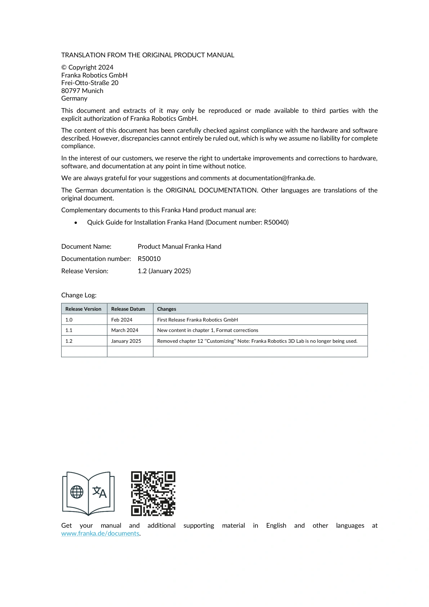



```
TRANSLATION FROM THE ORIGINAL PRODUCT MANUAL 
© Copyright 2024 
  
Franka Robotics GmbH 
 
Frei-Otto-Straße 20 
  
80797 Munich 
  
Germany  
This document and extracts of it may only be reproduced or made available to third parties with the 
explicit authorization of Franka Robotics GmbH.  
The content of this document has been carefully checked against compliance with the hardware and software 
described. However, discrepancies cannot entirely be ruled out, which is why we assume no liability for complete 
compliance.  
In the interest of our customers, we reserve the right to undertake improvements and corrections to hardware, 
software, and documentation at any point in time without notice.  
We are always grateful for your suggestions and comments at documentation@franka.de.  
The German documentation is the ORIGINAL DOCUMENTATION. Other languages are translations of the 
original document. 
Complementary documents to this Franka Hand product manual are:  
• 
Quick Guide for Installation Franka Hand (Document number: R50040) 
   
Document Name:  
Product Manual Franka Hand 
Documentation number:  R50010 
Release Version:   
1.2 (January 2025)  
 
Change Log: 
Release Version 
Release Datum 
Changes 
1.0 
Feb 2024 
First Release Franka Robotics GmbH 
1.1 
March 2024 
New content in chapter 1, Format corrections 
1.2 
January 2025 
Removed chapter 12 ‘’Customizing’’ Note: Franka Robotics 3D Lab is no longer being used. 
 
 
 
 
 
 
 
 
 
 
 
 
 
Get 
your 
manual 
and 
additional 
supporting 
material 
in 
English 
and 
other 
languages 
at 
www.franka.de/documents.
```



**Original PDF links:** [Source link 1](http://www.franka.de/documents)

## PDF page 3

**Source:** Product Manual Franka Hand\_R50010\_1.2\_EN (1).pdf, original pdf page 3. [Open the corresponding PDF reading-copy page](https://1292444914-files.gitbook.io/~/files/v0/b/gitbook-x-prod.appspot.com/o/spaces%2FtgOfPnscWebs1eh82EKq%2Fuploads%2Fyb6H8mtq7RSpivPfLUyi%2FHAND-pages-001-010.pdf?alt=media#page=3).



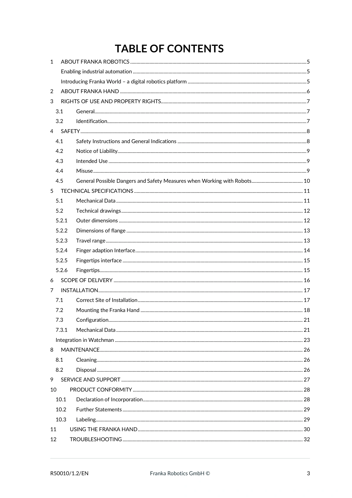



```
R50010/1.2/EN 
Franka Robotics GmbH ©  
3  
 
                         TABLE OF CONTENTS 
1 
ABOUT FRANKA ROBOTICS .......................................................................................................................................... 5 
Enabling industrial automation ........................................................................................................................................ 5 
Introducing Franka World – a digital robotics platform ............................................................................................. 5 
2 
ABOUT FRANKA HAND .................................................................................................................................................. 6 
3 
RIGHTS OF USE AND PROPERTY RIGHTS.................................................................................................................. 7 
3.1 
General...................................................................................................................................................................... 7 
3.2 
Identification ............................................................................................................................................................ 7 
4 
SAFETY ................................................................................................................................................................................. 8 
4.1 
Safety Instructions and General Indications ..................................................................................................... 8 
4.2 
Notice of Liability.................................................................................................................................................... 9 
4.3 
Intended Use ........................................................................................................................................................... 9 
4.4 
Misuse ....................................................................................................................................................................... 9 
4.5 
General Possible Dangers and Safety Measures when Working with Robots ........................................ 10 
5 
TECHNICAL SPECIFICATIONS .................................................................................................................................... 11 
5.1 
Mechanical Data .................................................................................................................................................. 11 
5.2 
Technical drawings .............................................................................................................................................. 12 
5.2.1 
Outer dimensions ................................................................................................................................................ 12 
5.2.2 
Dimensions of flange .......................................................................................................................................... 13 
5.2.3 
Travel range .......................................................................................................................................................... 13 
5.2.4 
Finger adaption Interface ................................................................................................................................... 14 
5.2.5 
Fingertips interface ............................................................................................................................................. 15 
5.2.6 
Fingertips ............................................................................................................................................................... 15 
6 
SCOPE OF DELIVERY .................................................................................................................................................... 16 
7 
INSTALLATION ................................................................................................................................................................ 17 
7.1 
Correct Site of Installation ................................................................................................................................. 17 
7.2 
Mounting the Franka Hand ............................................................................................................................... 18 
7.3 
Configuration ........................................................................................................................................................ 21 
7.3.1 
Mechanical Data .................................................................................................................................................. 21 
Integration in Watchman ................................................................................................................................................... 23 
8 
MAINTENANCE ............................................................................................................................................................... 26 
8.1 
Cleaning ................................................................................................................................................................. 26 
8.2 
Disposal ................................................................................................................................................................. 26 
9 
SERVICE AND SUPPORT .............................................................................................................................................. 27 
10 
PRODUCT CONFORMITY ..................................................................................................................................... 28 
10.1 
Declaration of Incorporation ............................................................................................................................. 28 
10.2 
Further Statements ............................................................................................................................................. 29 
10.3 
Labeling .................................................................................................................................................................. 29 
11 
USING THE FRANKA HAND ................................................................................................................................. 30 
12 
TROUBLESHOOTING ............................................................................................................................................. 32
```



**Original document cross-references:** [PDF 5](complete-hand.md#pdf-page-5) · [PDF 6](complete-hand.md#pdf-page-6) · [PDF 7](complete-hand.md#pdf-page-7) · [PDF 8](complete-hand.md#pdf-page-8) · [PDF 9](complete-hand.md#pdf-page-9) · [PDF 10](complete-hand.md#pdf-page-10) · [PDF 11](complete-hand.md#pdf-page-11) · [PDF 12](complete-hand.md#pdf-page-12) · [PDF 13](complete-hand.md#pdf-page-13) · [PDF 14](complete-hand.md#pdf-page-14) · [PDF 15](complete-hand.md#pdf-page-15) · [PDF 16](complete-hand.md#pdf-page-16) · [PDF 17](complete-hand.md#pdf-page-17) · [PDF 18](complete-hand.md#pdf-page-18) · [PDF 21](complete-hand.md#pdf-page-21) · [PDF 23](complete-hand.md#pdf-page-23) · [PDF 26](complete-hand.md#pdf-page-26) · [PDF 27](complete-hand.md#pdf-page-27) · [PDF 28](complete-hand.md#pdf-page-28) · [PDF 29](complete-hand.md#pdf-page-29) · [PDF 30](complete-hand.md#pdf-page-30) · [PDF 32](complete-hand.md#pdf-page-32)

## PDF page 4

**Source:** Product Manual Franka Hand\_R50010\_1.2\_EN (1).pdf, original pdf page 4. [Open the corresponding PDF reading-copy page](https://1292444914-files.gitbook.io/~/files/v0/b/gitbook-x-prod.appspot.com/o/spaces%2FtgOfPnscWebs1eh82EKq%2Fuploads%2Fyb6H8mtq7RSpivPfLUyi%2FHAND-pages-001-010.pdf?alt=media#page=4).



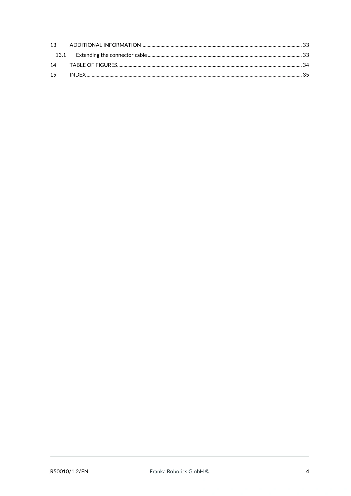



```
R50010/1.2/EN 
Franka Robotics GmbH ©  
4  
 
13 
ADDITIONAL INFORMATION .............................................................................................................................. 33 
13.1 
Extending the connector cable ......................................................................................................................... 33 
14 
TABLE OF FIGURES ................................................................................................................................................. 34 
15 
INDEX ......................................................................................................................................................................... 35
```



**Original document cross-references:** [PDF 33](complete-hand.md#pdf-page-33) · [PDF 34](complete-hand.md#pdf-page-34) · [PDF 35](complete-hand.md#pdf-page-35)

## PDF page 5

**Source:** Product Manual Franka Hand\_R50010\_1.2\_EN (1).pdf, original pdf page 5. [Open the corresponding PDF reading-copy page](https://1292444914-files.gitbook.io/~/files/v0/b/gitbook-x-prod.appspot.com/o/spaces%2FtgOfPnscWebs1eh82EKq%2Fuploads%2Fyb6H8mtq7RSpivPfLUyi%2FHAND-pages-001-010.pdf?alt=media#page=5).



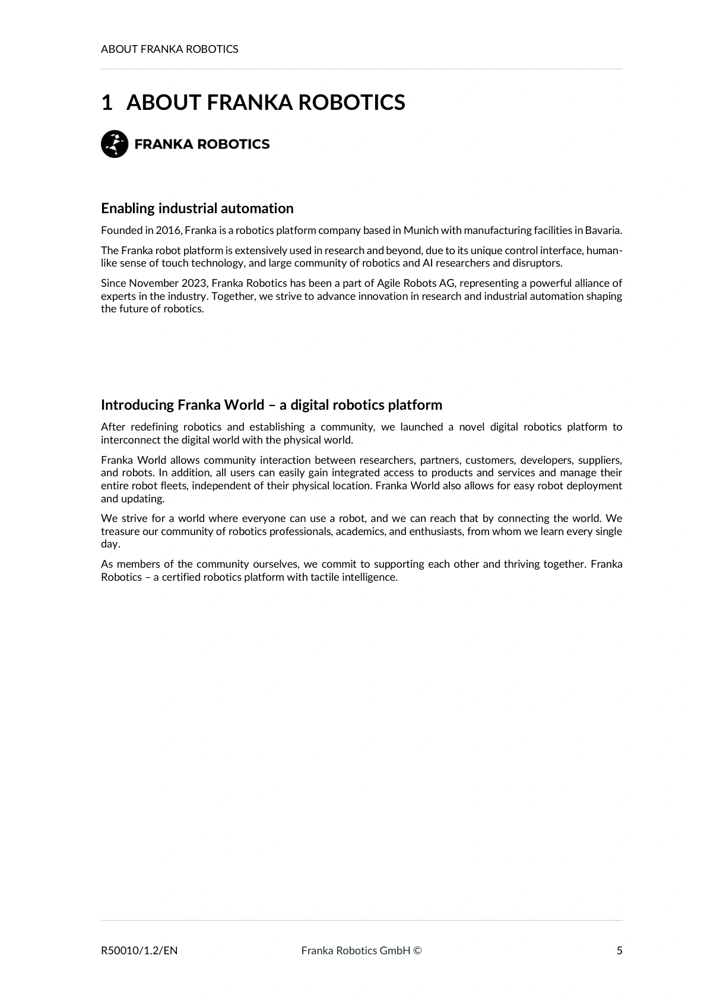



```
ABOUT FRANKA ROBOTICS 
 
R50010/1.2/EN 
Franka Robotics GmbH ©  
5  
 
1 ABOUT FRANKA ROBOTICS 
 
 
Enabling industrial automation 
Founded in 2016, Franka is a robotics platform company based in Munich with manufacturing facilities in Bavaria.  
The Franka robot platform is extensively used in research and beyond, due to its unique control interface, human-
like sense of touch technology, and large community of robotics and AI researchers and disruptors.  
Since November 2023, Franka Robotics has been a part of Agile Robots AG, representing a powerful alliance of 
experts in the industry. Together, we strive to advance innovation in research and industrial automation shaping 
the future of robotics. 
 
 
 
Introducing Franka World – a digital robotics platform 
After redefining robotics and establishing a community, we launched a novel digital robotics platform to 
interconnect the digital world with the physical world.  
Franka World allows community interaction between researchers, partners, customers, developers, suppliers, 
and robots. In addition, all users can easily gain integrated access to products and services and manage their 
entire robot fleets, independent of their physical location. Franka World also allows for easy robot deployment 
and updating. 
We strive for a world where everyone can use a robot, and we can reach that by connecting the world. We 
treasure our community of robotics professionals, academics, and enthusiasts, from whom we learn every single 
day.  
As members of the community ourselves, we commit to supporting each other and thriving together. Franka 
Robotics – a certified robotics platform with tactile intelligence.
```



## PDF page 6

**Source:** Product Manual Franka Hand\_R50010\_1.2\_EN (1).pdf, original pdf page 6. [Open the corresponding PDF reading-copy page](https://1292444914-files.gitbook.io/~/files/v0/b/gitbook-x-prod.appspot.com/o/spaces%2FtgOfPnscWebs1eh82EKq%2Fuploads%2Fyb6H8mtq7RSpivPfLUyi%2FHAND-pages-001-010.pdf?alt=media#page=6).



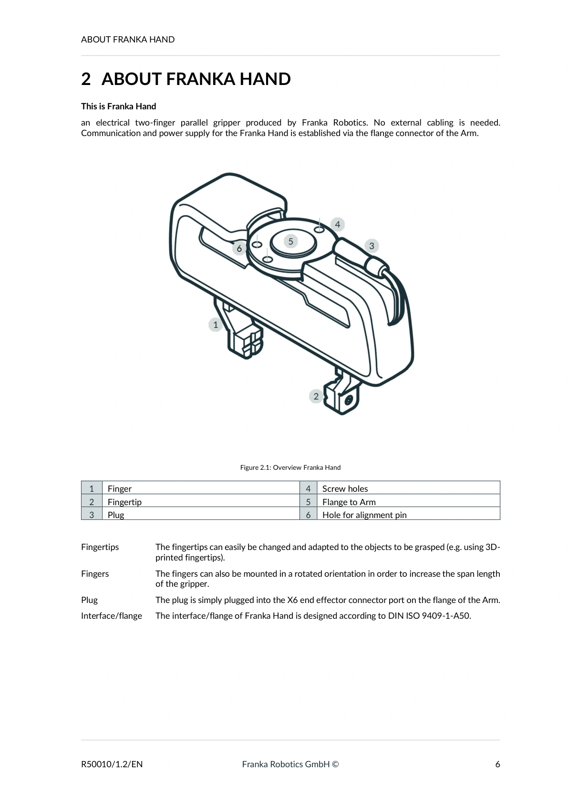



```
ABOUT FRANKA HAND 
 
R50010/1.2/EN 
Franka Robotics GmbH ©  
6  
 
2 ABOUT FRANKA HAND 
This is Franka Hand 
an electrical two-finger parallel gripper produced by Franka Robotics. No external cabling is needed. 
Communication and power supply for the Franka Hand is established via the flange connector of the Arm. 
 
 
Figure 2.1: Overview Franka Hand 
1 
Finger 
4 
Screw holes 
2 
Fingertip 
5 
Flange to Arm 
3 
Plug 
6 
Hole for alignment pin 
 
Fingertips 
The fingertips can easily be changed and adapted to the objects to be grasped (e.g. using 3D-
printed fingertips). 
Fingers 
The fingers can also be mounted in a rotated orientation in order to increase the span length 
of the gripper. 
Plug 
The plug is simply plugged into the X6 end effector connector port on the flange of the Arm. 
Interface/flange 
The interface/flange of Franka Hand is designed according to DIN ISO 9409-1-A50.
```



## PDF page 7

**Source:** Product Manual Franka Hand\_R50010\_1.2\_EN (1).pdf, original pdf page 7. [Open the corresponding PDF reading-copy page](https://1292444914-files.gitbook.io/~/files/v0/b/gitbook-x-prod.appspot.com/o/spaces%2FtgOfPnscWebs1eh82EKq%2Fuploads%2Fyb6H8mtq7RSpivPfLUyi%2FHAND-pages-001-010.pdf?alt=media#page=7).



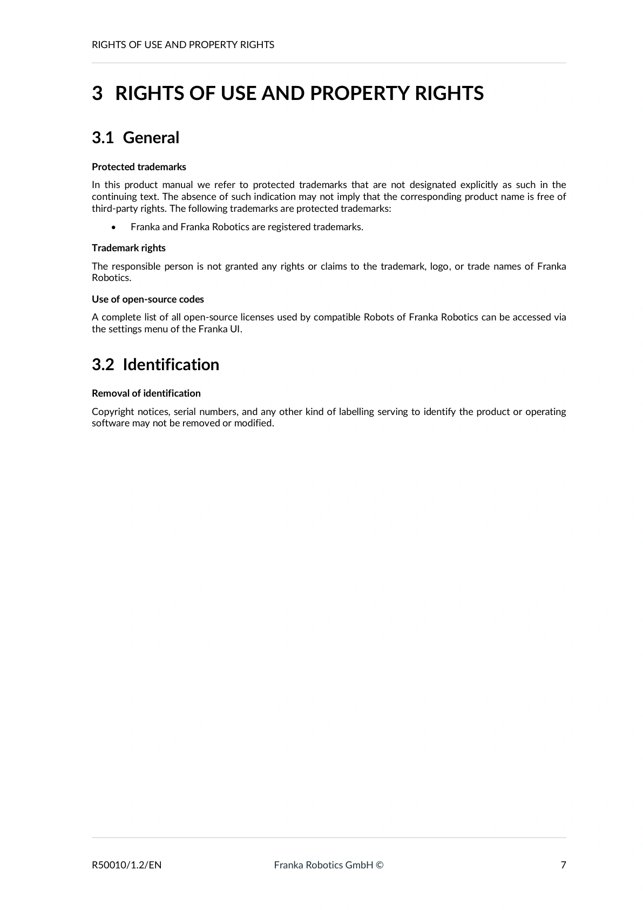



```
RIGHTS OF USE AND PROPERTY RIGHTS 
 
R50010/1.2/EN 
Franka Robotics GmbH ©  
7  
 
3 RIGHTS OF USE AND PROPERTY RIGHTS 
3.1 General 
Protected trademarks 
In this product manual we refer to protected trademarks that are not designated explicitly as such in the 
continuing text. The absence of such indication may not imply that the corresponding product name is free of 
third-party rights. The following trademarks are protected trademarks: 
• 
Franka and Franka Robotics are registered trademarks. 
Trademark rights 
The responsible person is not granted any rights or claims to the trademark, logo, or trade names of Franka 
Robotics. 
Use of open-source codes 
A complete list of all open-source licenses used by compatible Robots of Franka Robotics can be accessed via 
the settings menu of the Franka UI. 
3.2 Identification 
Removal of identification 
Copyright notices, serial numbers, and any other kind of labelling serving to identify the product or operating 
software may not be removed or modified.
```



## PDF page 8

**Source:** Product Manual Franka Hand\_R50010\_1.2\_EN (1).pdf, original pdf page 8. [Open the corresponding PDF reading-copy page](https://1292444914-files.gitbook.io/~/files/v0/b/gitbook-x-prod.appspot.com/o/spaces%2FtgOfPnscWebs1eh82EKq%2Fuploads%2Fyb6H8mtq7RSpivPfLUyi%2FHAND-pages-001-010.pdf?alt=media#page=8).



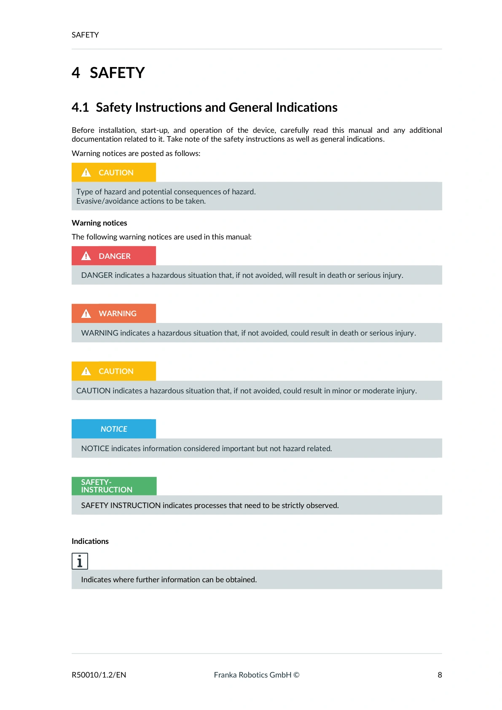



```
SAFETY 
 
R50010/1.2/EN 
Franka Robotics GmbH ©  
8  
 
4 SAFETY 
4.1 Safety Instructions and General Indications 
Before installation, start-up, and operation of the device, carefully read this manual and any additional 
documentation related to it. Take note of the safety instructions as well as general indications. 
Warning notices are posted as follows: 
CAUTION 
  
Type of hazard and potential consequences of hazard. 
 
Evasive/avoidance actions to be taken. 
Warning notices 
The following warning notices are used in this manual: 
DANGER 
  
DANGER indicates a hazardous situation that, if not avoided, will result in death or serious injury. 
 
WARNING 
  
WARNING indicates a hazardous situation that, if not avoided, could result in death or serious injury. 
 
CAUTION 
  
CAUTION indicates a hazardous situation that, if not avoided, could result in minor or moderate injury. 
 
NOTICE 
 
NOTICE indicates information considered important but not hazard related.  
 
SAFETY-
INSTRUCTION 
 
SAFETY INSTRUCTION indicates processes that need to be strictly observed.  
 
Indications 
 
 
Indicates where further information can be obtained.
```



## PDF page 9

**Source:** Product Manual Franka Hand\_R50010\_1.2\_EN (1).pdf, original pdf page 9. [Open the corresponding PDF reading-copy page](https://1292444914-files.gitbook.io/~/files/v0/b/gitbook-x-prod.appspot.com/o/spaces%2FtgOfPnscWebs1eh82EKq%2Fuploads%2Fyb6H8mtq7RSpivPfLUyi%2FHAND-pages-001-010.pdf?alt=media#page=9).



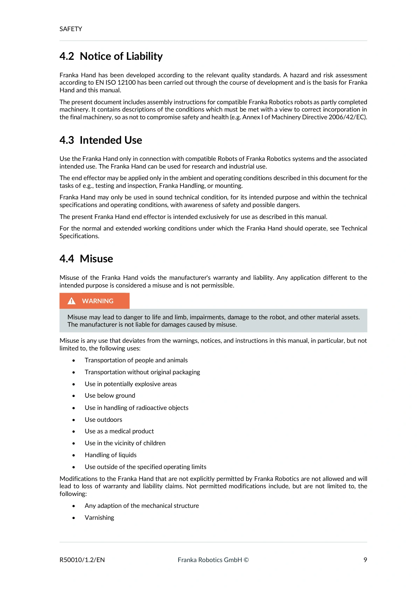



```
SAFETY 
 
R50010/1.2/EN 
Franka Robotics GmbH ©  
9  
 
4.2 Notice of Liability 
Franka Hand has been developed according to the relevant quality standards. A hazard and risk assessment 
according to EN ISO 12100 has been carried out through the course of development and is the basis for Franka 
Hand and this manual. 
The present document includes assembly instructions for compatible Franka Robotics robots as partly completed 
machinery. It contains descriptions of the conditions which must be met with a view to correct incorporation in 
the final machinery, so as not to compromise safety and health (e.g. Annex I of Machinery Directive 2006/42/EC). 
4.3 Intended Use 
Use the Franka Hand only in connection with compatible Robots of Franka Robotics systems and the associated 
intended use. The Franka Hand can be used for research and industrial use. 
The end effector may be applied only in the ambient and operating conditions described in this document for the 
tasks of e.g., testing and inspection, Franka Handling, or mounting. 
Franka Hand may only be used in sound technical condition, for its intended purpose and within the technical 
specifications and operating conditions, with awareness of safety and possible dangers. 
The present Franka Hand end effector is intended exclusively for use as described in this manual. 
For the normal and extended working conditions under which the Franka Hand should operate, see Technical 
Specifications. 
4.4 Misuse 
Misuse of the Franka Hand voids the manufacturer's warranty and liability. Any application different to the 
intended purpose is considered a misuse and is not permissible. 
WARNING 
  
Misuse may lead to danger to life and limb, impairments, damage to the robot, and other material assets. 
The manufacturer is not liable for damages caused by misuse. 
Misuse is any use that deviates from the warnings, notices, and instructions in this manual, in particular, but not 
limited to, the following uses: 
• 
Transportation of people and animals 
• 
Transportation without original packaging 
• 
Use in potentially explosive areas 
• 
Use below ground 
• 
Use in handling of radioactive objects 
• 
Use outdoors 
• 
Use as a medical product 
• 
Use in the vicinity of children 
• 
Handling of liquids 
• 
Use outside of the specified operating limits 
Modifications to the Franka Hand that are not explicitly permitted by Franka Robotics are not allowed and will 
lead to loss of warranty and liability claims. Not permitted modifications include, but are not limited to, the 
following: 
• 
Any adaption of the mechanical structure 
• 
Varnishing
```



## PDF page 10

**Source:** Product Manual Franka Hand\_R50010\_1.2\_EN (1).pdf, original pdf page 10. [Open the corresponding PDF reading-copy page](https://1292444914-files.gitbook.io/~/files/v0/b/gitbook-x-prod.appspot.com/o/spaces%2FtgOfPnscWebs1eh82EKq%2Fuploads%2Fyb6H8mtq7RSpivPfLUyi%2FHAND-pages-001-010.pdf?alt=media#page=10).



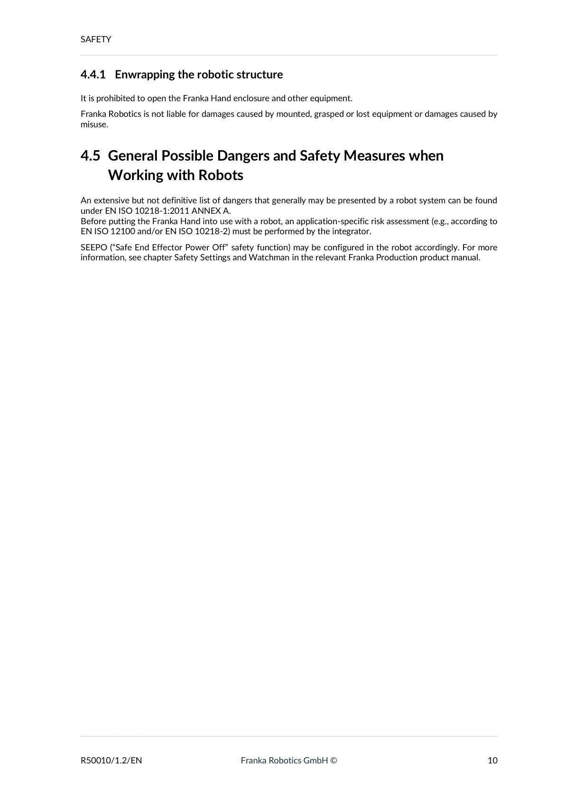



```
SAFETY 
 
R50010/1.2/EN 
Franka Robotics GmbH ©  
10  
 
4.4.1 Enwrapping the robotic structure 
It is prohibited to open the Franka Hand enclosure and other equipment. 
Franka Robotics is not liable for damages caused by mounted, grasped or lost equipment or damages caused by 
misuse. 
4.5 General Possible Dangers and Safety Measures when 
Working with Robots 
An extensive but not definitive list of dangers that generally may be presented by a robot system can be found 
under EN ISO 10218-1:2011 ANNEX A. 
 
Before putting the Franka Hand into use with a robot, an application-specific risk assessment (e.g., according to 
EN ISO 12100 and/or EN ISO 10218-2) must be performed by the integrator. 
SEEPO (“Safe End Effector Power Off” safety function) may be configured in the robot accordingly. For more 
information, see chapter Safety Settings and Watchman in the relevant Franka Production product manual.
```



## PDF page 11

**Source:** Product Manual Franka Hand\_R50010\_1.2\_EN (1).pdf, original pdf page 11. [Open the corresponding PDF reading-copy page](https://1292444914-files.gitbook.io/~/files/v0/b/gitbook-x-prod.appspot.com/o/spaces%2FtgOfPnscWebs1eh82EKq%2Fuploads%2FMTjaStieAU10nZ8a6SpB%2FHAND-pages-011-018.pdf?alt=media#page=1).



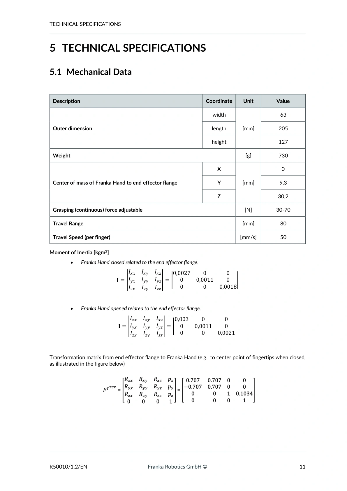



```
TECHNICAL SPECIFICATIONS 
 
R50010/1.2/EN 
Franka Robotics GmbH ©  
11  
 
5 TECHNICAL SPECIFICATIONS 
5.1 Mechanical Data 
 
Description 
Coordinate 
Unit 
Value 
Outer dimension 
width 
[mm] 
63 
length 
205 
height 
127 
Weight 
[g] 
730 
Center of mass of Franka Hand to end effector flange  
X 
[mm] 
0 
Y 
9,3 
Z 
30,2 
Grasping (continuous) force adjustable 
[N] 
30-70 
Travel Range 
[mm] 
80 
Travel Speed (per finger) 
[mm/s] 
50 
Moment of Inertia [kgm2] 
• 
Franka Hand closed related to the end effector flange. 
𝐈= |
𝐼𝑥𝑥
𝐼𝑥𝑦
𝐼𝑥𝑧
𝐼𝑦𝑥
𝐼𝑦𝑦
𝐼𝑦𝑧
𝐼𝑧𝑥
𝐼𝑧𝑦
𝐼𝑧𝑧
| = |
0,0027
0
0
0
0,0011
0
0
0
0,0018
| 
 
• 
Franka Hand opened related to the end effector flange. 
𝐈= |
𝐼𝑥𝑥
𝐼𝑥𝑦
𝐼𝑥𝑧
𝐼𝑦𝑥
𝐼𝑦𝑦
𝐼𝑦𝑧
𝐼𝑧𝑥
𝐼𝑧𝑦
𝐼𝑧𝑧
| = |
0,003
0
0
0
0,0011
0
0
0
0,0021
| 
 
Transformation matrix from end effector flange to Franka Hand (e.g., to center point of fingertips when closed, 
as illustrated in the figure below)
```



## PDF page 12

**Source:** Product Manual Franka Hand\_R50010\_1.2\_EN (1).pdf, original pdf page 12. [Open the corresponding PDF reading-copy page](https://1292444914-files.gitbook.io/~/files/v0/b/gitbook-x-prod.appspot.com/o/spaces%2FtgOfPnscWebs1eh82EKq%2Fuploads%2FMTjaStieAU10nZ8a6SpB%2FHAND-pages-011-018.pdf?alt=media#page=2).



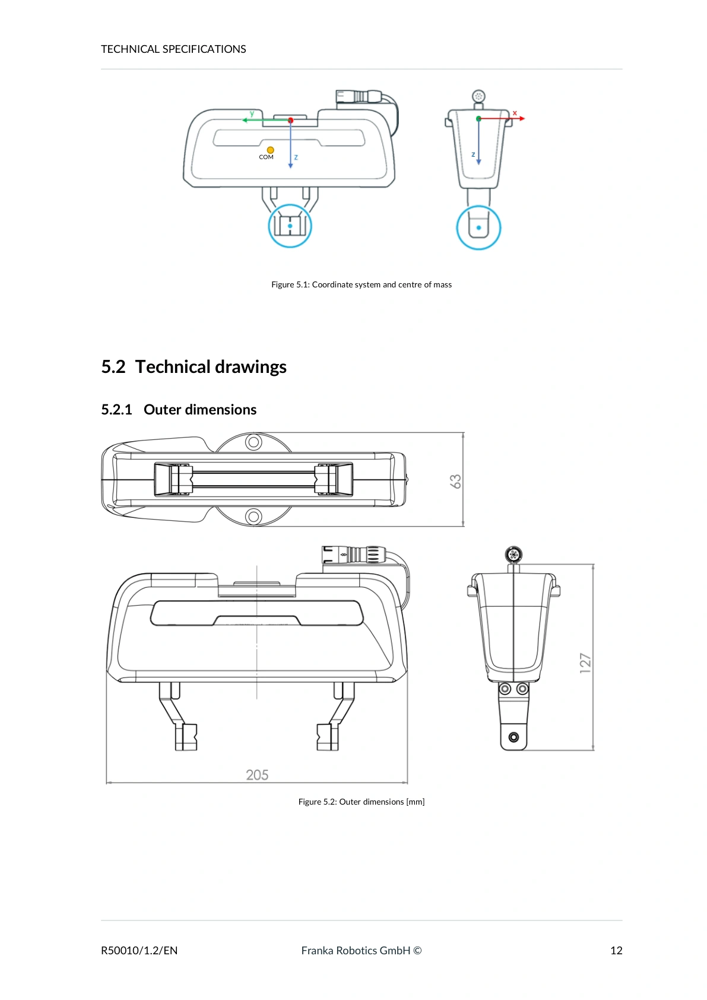



```
TECHNICAL SPECIFICATIONS 
 
R50010/1.2/EN 
Franka Robotics GmbH ©  
12  
 
 
 
Figure 5.1: Coordinate system and centre of mass 
 
 
5.2 Technical drawings  
5.2.1 Outer dimensions  
 
Figure 5.2: Outer dimensions [mm] 
COM
```



## PDF page 13

**Source:** Product Manual Franka Hand\_R50010\_1.2\_EN (1).pdf, original pdf page 13. [Open the corresponding PDF reading-copy page](https://1292444914-files.gitbook.io/~/files/v0/b/gitbook-x-prod.appspot.com/o/spaces%2FtgOfPnscWebs1eh82EKq%2Fuploads%2FMTjaStieAU10nZ8a6SpB%2FHAND-pages-011-018.pdf?alt=media#page=3).



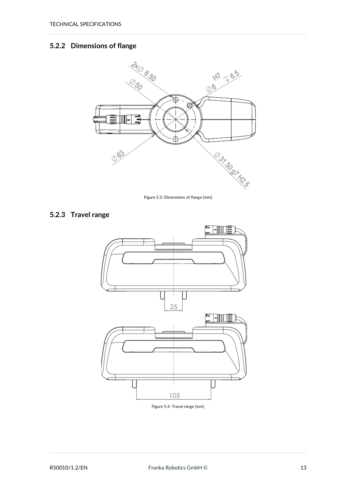



```
TECHNICAL SPECIFICATIONS 
 
R50010/1.2/EN 
Franka Robotics GmbH ©  
13  
 
5.2.2 Dimensions of flange 
 
Figure 5.3: Dimensions of flange [mm] 
5.2.3 Travel range 
 
Figure 5.4: Travel range [mm]
```



## PDF page 14

**Source:** Product Manual Franka Hand\_R50010\_1.2\_EN (1).pdf, original pdf page 14. [Open the corresponding PDF reading-copy page](https://1292444914-files.gitbook.io/~/files/v0/b/gitbook-x-prod.appspot.com/o/spaces%2FtgOfPnscWebs1eh82EKq%2Fuploads%2FMTjaStieAU10nZ8a6SpB%2FHAND-pages-011-018.pdf?alt=media#page=4).



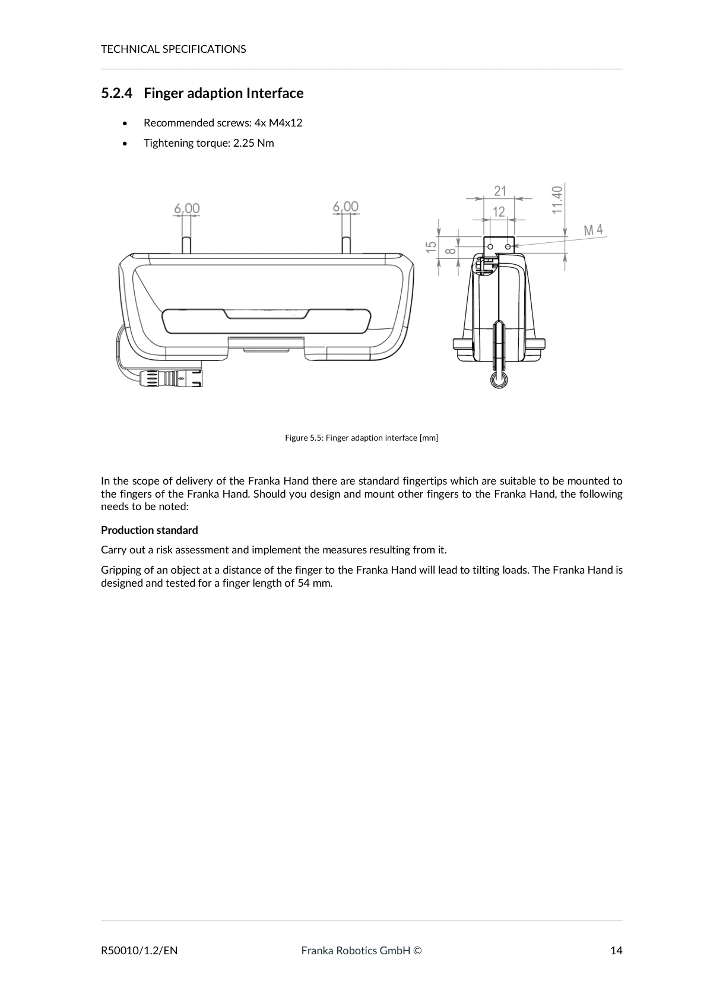



```
TECHNICAL SPECIFICATIONS 
 
R50010/1.2/EN 
Franka Robotics GmbH ©  
14  
 
5.2.4 Finger adaption Interface  
• 
Recommended screws: 4x M4x12  
• 
Tightening torque: 2.25 Nm 
 
Figure 5.5: Finger adaption interface [mm] 
 
In the scope of delivery of the Franka Hand there are standard fingertips which are suitable to be mounted to 
the fingers of the Franka Hand. Should you design and mount other fingers to the Franka Hand, the following 
needs to be noted: 
Production standard 
Carry out a risk assessment and implement the measures resulting from it. 
Gripping of an object at a distance of the finger to the Franka Hand will lead to tilting loads. The Franka Hand is 
designed and tested for a finger length of 54 mm.
```



## PDF page 15

**Source:** Product Manual Franka Hand\_R50010\_1.2\_EN (1).pdf, original pdf page 15. [Open the corresponding PDF reading-copy page](https://1292444914-files.gitbook.io/~/files/v0/b/gitbook-x-prod.appspot.com/o/spaces%2FtgOfPnscWebs1eh82EKq%2Fuploads%2FMTjaStieAU10nZ8a6SpB%2FHAND-pages-011-018.pdf?alt=media#page=5).



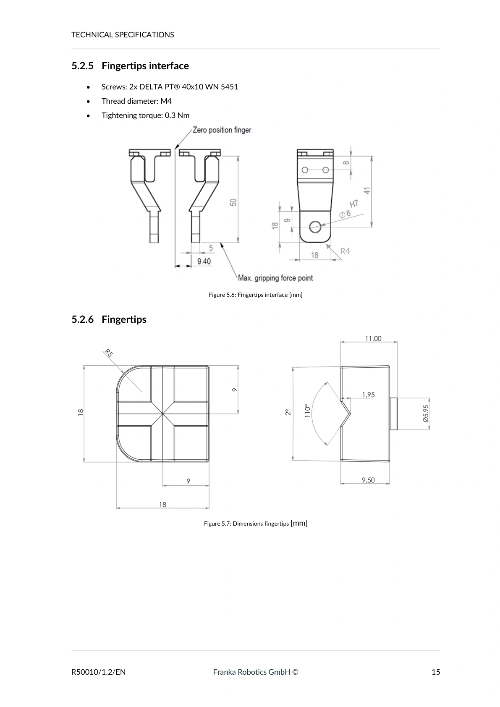



```
TECHNICAL SPECIFICATIONS 
 
R50010/1.2/EN 
Franka Robotics GmbH ©  
15  
 
5.2.5 Fingertips interface  
• 
Screws: 2x DELTA PT® 40x10 WN 5451  
• 
Thread diameter: M4  
• 
Tightening torque: 0.3 Nm 
 
Figure 5.6: Fingertips interface [mm] 
5.2.6 Fingertips  
 
Figure 5.7: Dimensions fingertips [mm]
R4
```



## PDF page 16

**Source:** Product Manual Franka Hand\_R50010\_1.2\_EN (1).pdf, original pdf page 16. [Open the corresponding PDF reading-copy page](https://1292444914-files.gitbook.io/~/files/v0/b/gitbook-x-prod.appspot.com/o/spaces%2FtgOfPnscWebs1eh82EKq%2Fuploads%2FMTjaStieAU10nZ8a6SpB%2FHAND-pages-011-018.pdf?alt=media#page=6).



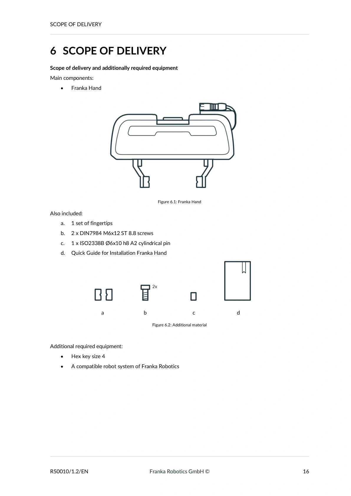



```
SCOPE OF DELIVERY 
 
R50010/1.2/EN 
Franka Robotics GmbH ©  
16  
 
6 SCOPE OF DELIVERY 
Scope of delivery and additionally required equipment 
Main components: 
• 
Franka Hand  
 
Figure 6.1: Franka Hand 
Also included: 
a. 
1 set of fingertips 
b. 
2 x DIN7984 M6x12 ST 8.8 screws 
c. 
1 x ISO2338B Ø6x10 h8 A2 cylindrical pin 
d. 
Quick Guide for Installation Franka Hand 
 
Figure 6.2: Additional material 
 
Additional required equipment: 
• 
Hex key size 4 
• 
A compatible robot system of Franka Robotics 
 
a 
b 
c 
d
```



## PDF page 17

**Source:** Product Manual Franka Hand\_R50010\_1.2\_EN (1).pdf, original pdf page 17. [Open the corresponding PDF reading-copy page](https://1292444914-files.gitbook.io/~/files/v0/b/gitbook-x-prod.appspot.com/o/spaces%2FtgOfPnscWebs1eh82EKq%2Fuploads%2FMTjaStieAU10nZ8a6SpB%2FHAND-pages-011-018.pdf?alt=media#page=7).



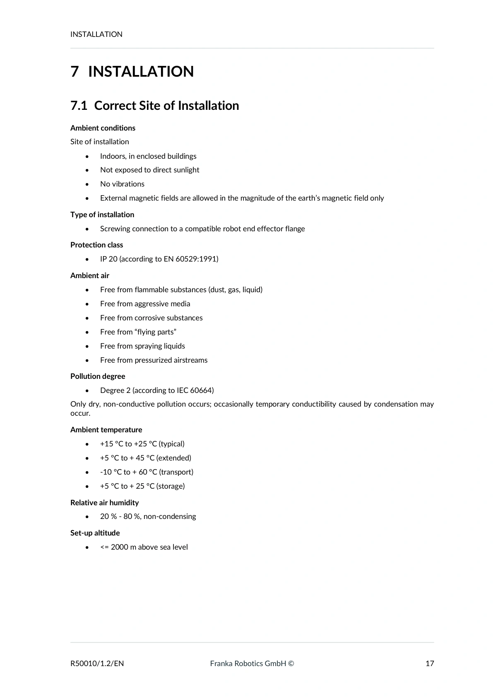



```
INSTALLATION 
 
R50010/1.2/EN 
Franka Robotics GmbH ©  
17  
 
7 INSTALLATION 
7.1 Correct Site of Installation 
Ambient conditions 
Site of installation 
• 
Indoors, in enclosed buildings 
• 
Not exposed to direct sunlight 
• 
No vibrations 
• 
External magnetic fields are allowed in the magnitude of the earth’s magnetic field only 
Type of installation 
• 
Screwing connection to a compatible robot end effector flange 
Protection class 
• 
IP 20 (according to EN 60529:1991) 
Ambient air  
• 
Free from flammable substances (dust, gas, liquid) 
• 
Free from aggressive media 
• 
Free from corrosive substances 
• 
Free from “flying parts” 
• 
Free from spraying liquids 
• 
Free from pressurized airstreams 
Pollution degree 
• 
Degree 2 (according to IEC 60664) 
Only dry, non-conductive pollution occurs; occasionally temporary conductibility caused by condensation may 
occur. 
Ambient temperature 
• 
+15 °C to +25 °C (typical) 
• 
+5 °C to + 45 °C (extended) 
• 
-10 °C to + 60 °C (transport) 
• 
+5 °C to + 25 °C (storage) 
Relative air humidity 
• 
20 % - 80 %, non-condensing 
Set-up altitude 
• 
<= 2000 m above sea level
```



## PDF page 18

**Source:** Product Manual Franka Hand\_R50010\_1.2\_EN (1).pdf, original pdf page 18. [Open the corresponding PDF reading-copy page](https://1292444914-files.gitbook.io/~/files/v0/b/gitbook-x-prod.appspot.com/o/spaces%2FtgOfPnscWebs1eh82EKq%2Fuploads%2FMTjaStieAU10nZ8a6SpB%2FHAND-pages-011-018.pdf?alt=media#page=8).



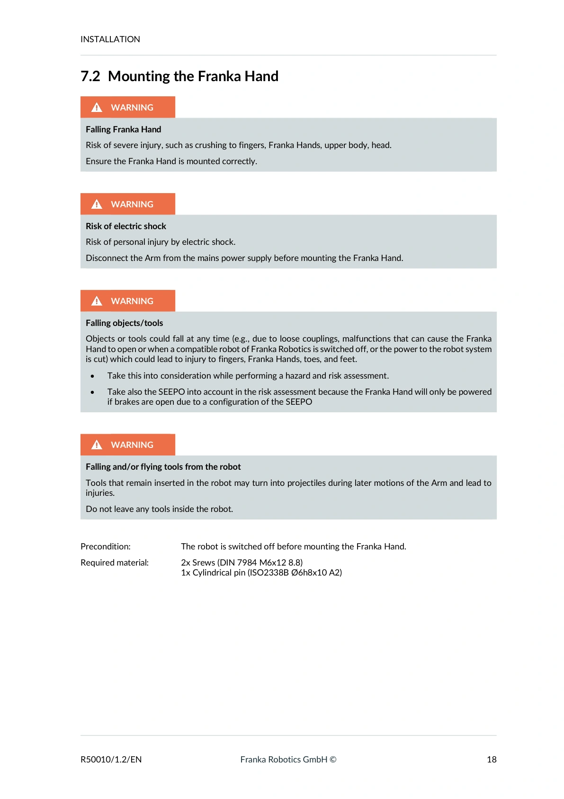



```
INSTALLATION 
 
R50010/1.2/EN 
Franka Robotics GmbH ©  
18  
 
7.2 Mounting the Franka Hand 
WARNING 
  
Falling Franka Hand 
Risk of severe injury, such as crushing to fingers, Franka Hands, upper body, head. 
Ensure the Franka Hand is mounted correctly. 
 
WARNING 
  
Risk of electric shock 
Risk of personal injury by electric shock. 
Disconnect the Arm from the mains power supply before mounting the Franka Hand. 
 
 
WARNING 
  
Falling objects/tools  
Objects or tools could fall at any time (e.g., due to loose couplings, malfunctions that can cause the Franka 
Hand to open or when a compatible robot of Franka Robotics is switched off, or the power to the robot system 
is cut) which could lead to injury to fingers, Franka Hands, toes, and feet. 
• 
Take this into consideration while performing a hazard and risk assessment. 
• 
Take also the SEEPO into account in the risk assessment because the Franka Hand will only be powered 
if brakes are open due to a configuration of the SEEPO  
 
WARNING 
  
Falling and/or flying tools from the robot 
Tools that remain inserted in the robot may turn into projectiles during later motions of the Arm and lead to 
injuries. 
Do not leave any tools inside the robot. 
 
Precondition: 
 
The robot is switched off before mounting the Franka Hand. 
Required material: 
2x Srews (DIN 7984 M6x12 8.8) 
 
 
 
 
1x Cylindrical pin (ISO2338B Ø6h8x10 A2)
```



## PDF page 19

**Source:** Product Manual Franka Hand\_R50010\_1.2\_EN (1).pdf, original pdf page 19. [Open the corresponding PDF reading-copy page](https://1292444914-files.gitbook.io/~/files/v0/b/gitbook-x-prod.appspot.com/o/spaces%2FtgOfPnscWebs1eh82EKq%2Fuploads%2FhU2DgPWNvGbeiim5qmDN%2FHAND-pages-019-025.pdf?alt=media#page=1).



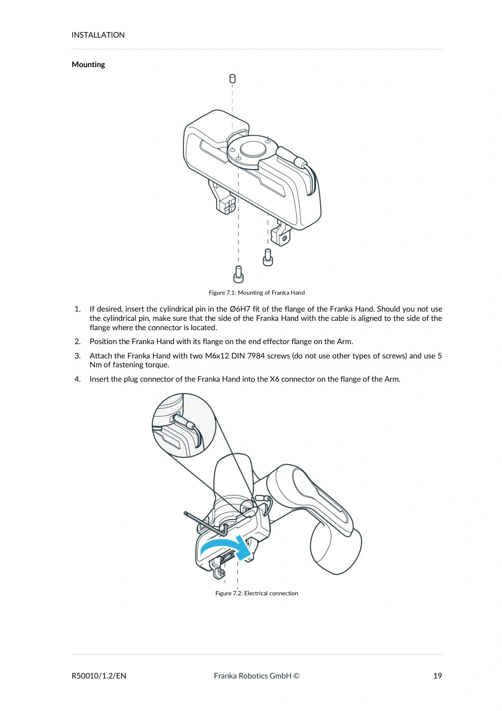



```
INSTALLATION 
 
R50010/1.2/EN 
Franka Robotics GmbH ©  
19  
 
Mounting 
 
Figure 7.1: Mounting of Franka Hand 
1. 
If desired, insert the cylindrical pin in the Ø6H7 fit of the flange of the Franka Hand. Should you not use 
the cylindrical pin, make sure that the side of the Franka Hand with the cable is aligned to the side of the 
flange where the connector is located.  
2. 
Position the Franka Hand with its flange on the end effector flange on the Arm.  
3. 
Attach the Franka Hand with two M6x12 DIN 7984 screws (do not use other types of screws) and use 5 
Nm of fastening torque. 
4. 
Insert the plug connector of the Franka Hand into the X6 connector on the flange of the Arm. 
 
Figure 7.2: Electrical connection
```



## PDF page 20

**Source:** Product Manual Franka Hand\_R50010\_1.2\_EN (1).pdf, original pdf page 20. [Open the corresponding PDF reading-copy page](https://1292444914-files.gitbook.io/~/files/v0/b/gitbook-x-prod.appspot.com/o/spaces%2FtgOfPnscWebs1eh82EKq%2Fuploads%2FhU2DgPWNvGbeiim5qmDN%2FHAND-pages-019-025.pdf?alt=media#page=2).



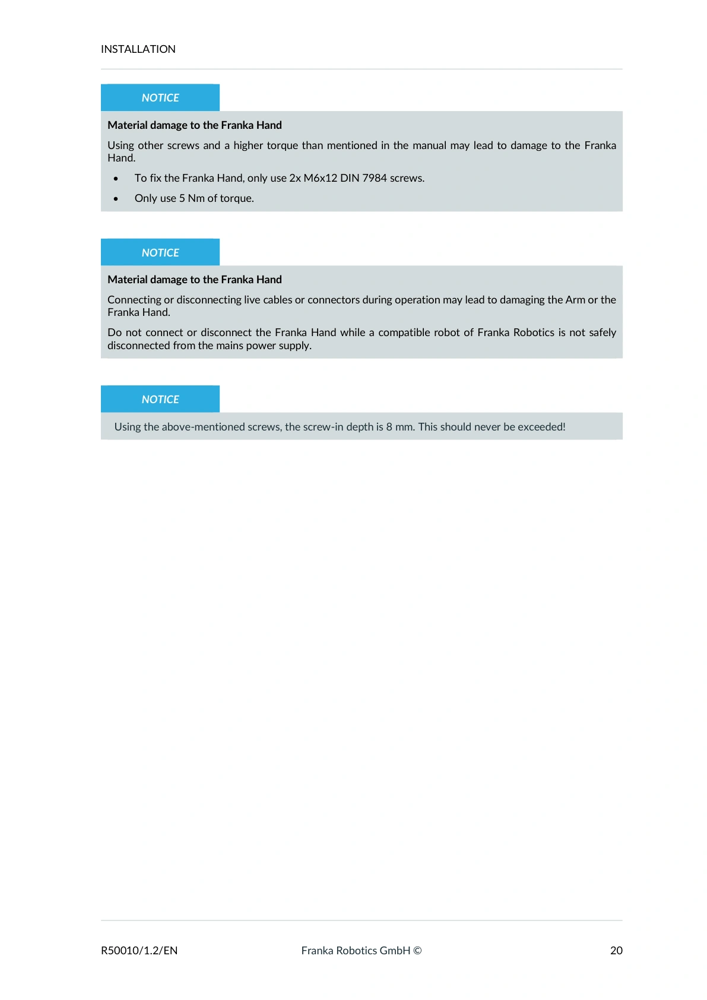



```
INSTALLATION 
 
R50010/1.2/EN 
Franka Robotics GmbH ©  
20  
 
NOTICE 
 
Material damage to the Franka Hand 
Using other screws and a higher torque than mentioned in the manual may lead to damage to the Franka 
Hand. 
• 
To fix the Franka Hand, only use 2x M6x12 DIN 7984 screws. 
• 
Only use 5 Nm of torque. 
 
NOTICE 
 
Material damage to the Franka Hand 
Connecting or disconnecting live cables or connectors during operation may lead to damaging the Arm or the 
Franka Hand. 
Do not connect or disconnect the Franka Hand while a compatible robot of Franka Robotics is not safely 
disconnected from the mains power supply. 
 
NOTICE 
 
Using the above-mentioned screws, the screw-in depth is 8 mm. This should never be exceeded!
```



## PDF page 21

**Source:** Product Manual Franka Hand\_R50010\_1.2\_EN (1).pdf, original pdf page 21. [Open the corresponding PDF reading-copy page](https://1292444914-files.gitbook.io/~/files/v0/b/gitbook-x-prod.appspot.com/o/spaces%2FtgOfPnscWebs1eh82EKq%2Fuploads%2FhU2DgPWNvGbeiim5qmDN%2FHAND-pages-019-025.pdf?alt=media#page=3).



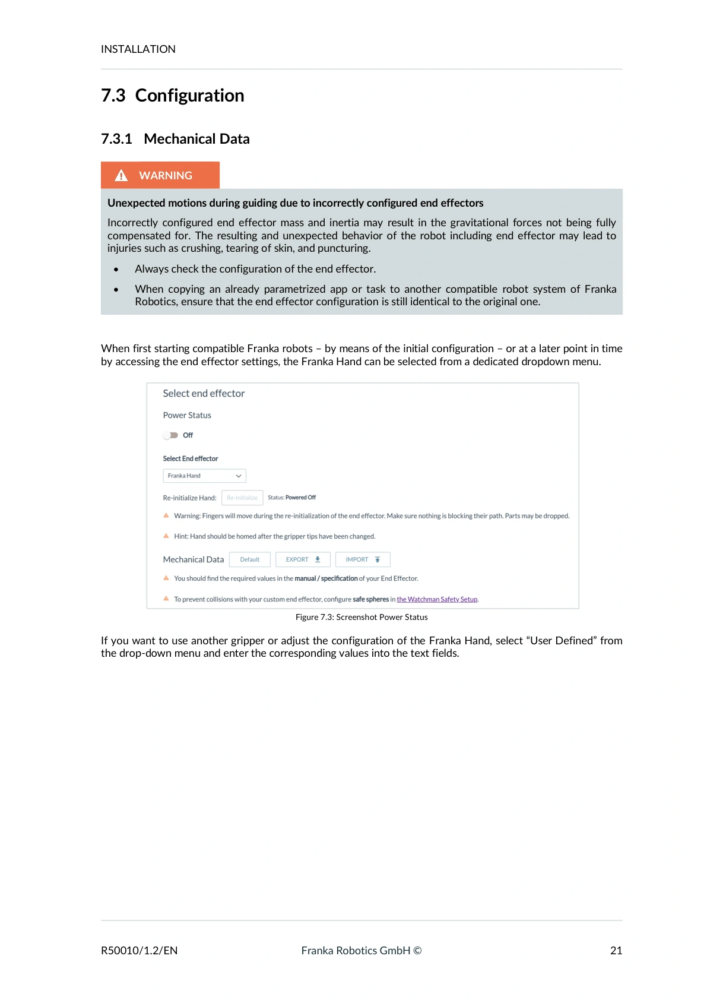



```
INSTALLATION 
 
R50010/1.2/EN 
Franka Robotics GmbH ©  
21  
 
7.3 Configuration 
7.3.1 Mechanical Data 
WARNING 
  
Unexpected motions during guiding due to incorrectly configured end effectors 
Incorrectly configured end effector mass and inertia may result in the gravitational forces not being fully 
compensated for. The resulting and unexpected behavior of the robot including end effector may lead to 
injuries such as crushing, tearing of skin, and puncturing. 
• 
Always check the configuration of the end effector. 
• 
When copying an already parametrized app or task to another compatible robot system of Franka 
Robotics, ensure that the end effector configuration is still identical to the original one. 
 
When first starting compatible Franka robots – by means of the initial configuration – or at a later point in time 
by accessing the end effector settings, the Franka Hand can be selected from a dedicated dropdown menu.  
 
Figure 7.3: Screenshot Power Status 
If you want to use another gripper or adjust the configuration of the Franka Hand, select “User Defined” from 
the drop-down menu and enter the corresponding values into the text fields.
```



## PDF page 22

**Source:** Product Manual Franka Hand\_R50010\_1.2\_EN (1).pdf, original pdf page 22. [Open the corresponding PDF reading-copy page](https://1292444914-files.gitbook.io/~/files/v0/b/gitbook-x-prod.appspot.com/o/spaces%2FtgOfPnscWebs1eh82EKq%2Fuploads%2FhU2DgPWNvGbeiim5qmDN%2FHAND-pages-019-025.pdf?alt=media#page=4).



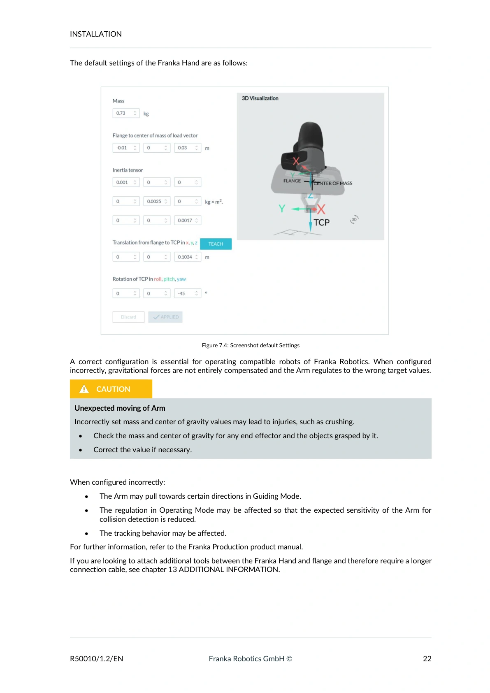



```
INSTALLATION 
 
R50010/1.2/EN 
Franka Robotics GmbH ©  
22  
 
The default settings of the Franka Hand are as follows: 
 
 
Figure 7.4: Screenshot default Settings 
A correct configuration is essential for operating compatible robots of Franka Robotics. When configured 
incorrectly, gravitational forces are not entirely compensated and the Arm regulates to the wrong target values. 
CAUTION 
  
Unexpected moving of Arm 
Incorrectly set mass and center of gravity values may lead to injuries, such as crushing. 
• 
Check the mass and center of gravity for any end effector and the objects grasped by it. 
• 
Correct the value if necessary. 
 
When configured incorrectly: 
• 
The Arm may pull towards certain directions in Guiding Mode. 
• 
The regulation in Operating Mode may be affected so that the expected sensitivity of the Arm for 
collision detection is reduced. 
• 
The tracking behavior may be affected. 
For further information, refer to the Franka Production product manual. 
If you are looking to attach additional tools between the Franka Hand and flange and therefore require a longer 
connection cable, see chapter 13 ADDITIONAL INFORMATION.
```



**Original document cross-references:** [PDF 33](complete-hand.md#pdf-page-33)

## PDF page 23

**Source:** Product Manual Franka Hand\_R50010\_1.2\_EN (1).pdf, original pdf page 23. [Open the corresponding PDF reading-copy page](https://1292444914-files.gitbook.io/~/files/v0/b/gitbook-x-prod.appspot.com/o/spaces%2FtgOfPnscWebs1eh82EKq%2Fuploads%2FhU2DgPWNvGbeiim5qmDN%2FHAND-pages-019-025.pdf?alt=media#page=5).



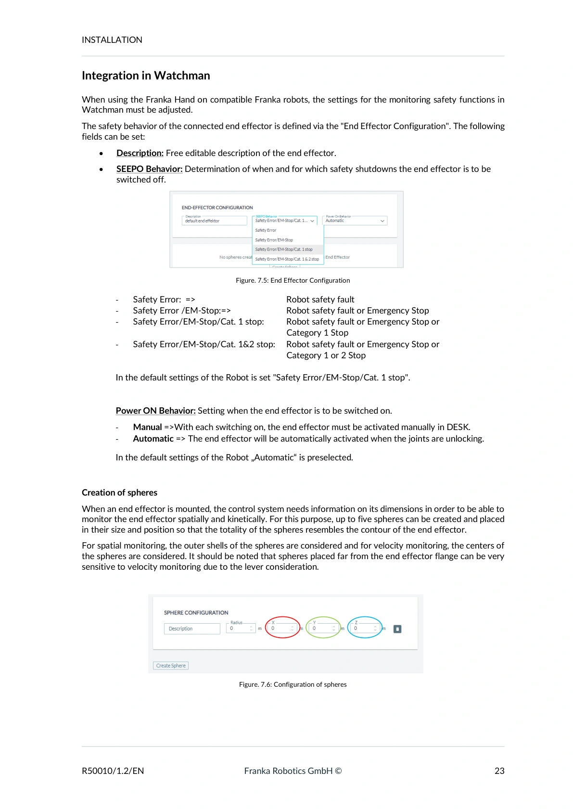



```
INSTALLATION 
 
R50010/1.2/EN 
Franka Robotics GmbH ©  
23  
 
Integration in Watchman 
When using the Franka Hand on compatible Franka robots, the settings for the monitoring safety functions in 
Watchman must be adjusted. 
The safety behavior of the connected end effector is defined via the "End Effector Configuration". The following 
fields can be set: 
• 
Description: Free editable description of the end effector. 
• 
SEEPO Behavior: Determination of when and for which safety shutdowns the end effector is to be 
switched off. 
 
Figure. 7.5: End Effector Configuration 
- 
Safety Error:  =>  
 
 
Robot safety fault 
- 
Safety Error /EM-Stop:=>  
 
Robot safety fault or Emergency Stop 
- 
Safety Error/EM-Stop/Cat. 1 stop: 
Robot safety fault or Emergency Stop or 
Category 1 Stop  
- 
Safety Error/EM-Stop/Cat. 1&2 stop: 
Robot safety fault or Emergency Stop or 
Category 1 or 2 Stop  
 
In the default settings of the Robot is set "Safety Error/EM-Stop/Cat. 1 stop". 
 
Power ON Behavior: Setting when the end effector is to be switched on. 
- 
Manual =>With each switching on, the end effector must be activated manually in DESK. 
- 
Automatic => The end effector will be automatically activated when the joints are unlocking. 
In the default settings of the Robot „Automatic“ is preselected. 
 
Creation of spheres 
When an end effector is mounted, the control system needs information on its dimensions in order to be able to 
monitor the end effector spatially and kinetically. For this purpose, up to five spheres can be created and placed 
in their size and position so that the totality of the spheres resembles the contour of the end effector. 
For spatial monitoring, the outer shells of the spheres are considered and for velocity monitoring, the centers of 
the spheres are considered. It should be noted that spheres placed far from the end effector flange can be very 
sensitive to velocity monitoring due to the lever consideration. 
 
 
Figure. 7.6: Configuration of spheres
```



## PDF page 24

**Source:** Product Manual Franka Hand\_R50010\_1.2\_EN (1).pdf, original pdf page 24. [Open the corresponding PDF reading-copy page](https://1292444914-files.gitbook.io/~/files/v0/b/gitbook-x-prod.appspot.com/o/spaces%2FtgOfPnscWebs1eh82EKq%2Fuploads%2FhU2DgPWNvGbeiim5qmDN%2FHAND-pages-019-025.pdf?alt=media#page=6).



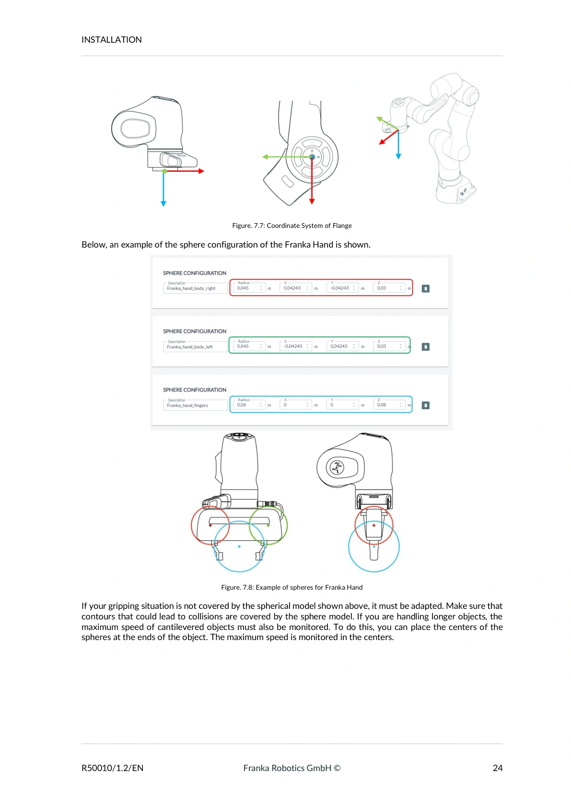



```
INSTALLATION 
 
R50010/1.2/EN 
Franka Robotics GmbH ©  
24  
 
 
Figure. 7.7: Coordinate System of Flange 
Below, an example of the sphere configuration of the Franka Hand is shown. 
 
Figure. 7.8: Example of spheres for Franka Hand 
If your gripping situation is not covered by the spherical model shown above, it must be adapted. Make sure that 
contours that could lead to collisions are covered by the sphere model. If you are handling longer objects, the 
maximum speed of cantilevered objects must also be monitored. To do this, you can place the centers of the 
spheres at the ends of the object. The maximum speed is monitored in the centers.
```



## PDF page 25

**Source:** Product Manual Franka Hand\_R50010\_1.2\_EN (1).pdf, original pdf page 25. [Open the corresponding PDF reading-copy page](https://1292444914-files.gitbook.io/~/files/v0/b/gitbook-x-prod.appspot.com/o/spaces%2FtgOfPnscWebs1eh82EKq%2Fuploads%2FhU2DgPWNvGbeiim5qmDN%2FHAND-pages-019-025.pdf?alt=media#page=7).



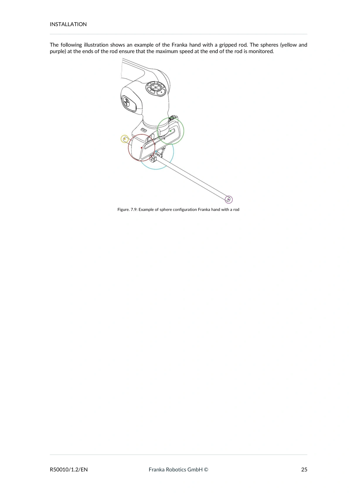



```
INSTALLATION 
 
R50010/1.2/EN 
Franka Robotics GmbH ©  
25  
 
The following illustration shows an example of the Franka hand with a gripped rod. The spheres (yellow and 
purple) at the ends of the rod ensure that the maximum speed at the end of the rod is monitored. 
 
Figure. 7.9: Example of sphere configuration Franka hand with a rod
```



## PDF page 26

**Source:** Product Manual Franka Hand\_R50010\_1.2\_EN (1).pdf, original pdf page 26. [Open the corresponding PDF reading-copy page](https://1292444914-files.gitbook.io/~/files/v0/b/gitbook-x-prod.appspot.com/o/spaces%2FtgOfPnscWebs1eh82EKq%2Fuploads%2FXFkjHVN6msnYc8rCg5x8%2FHAND-pages-026-028.pdf?alt=media#page=1).



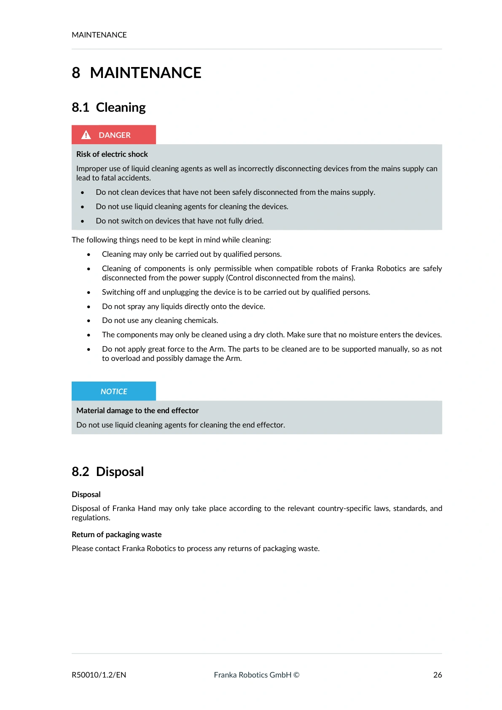



```
MAINTENANCE 
 
R50010/1.2/EN 
Franka Robotics GmbH ©  
26  
 
8 MAINTENANCE 
8.1 Cleaning 
DANGER 
  
Risk of electric shock 
Improper use of liquid cleaning agents as well as incorrectly disconnecting devices from the mains supply can 
lead to fatal accidents. 
• 
Do not clean devices that have not been safely disconnected from the mains supply. 
• 
Do not use liquid cleaning agents for cleaning the devices. 
• 
Do not switch on devices that have not fully dried. 
The following things need to be kept in mind while cleaning: 
• 
Cleaning may only be carried out by qualified persons. 
• 
Cleaning of components is only permissible when compatible robots of Franka Robotics are safely 
disconnected from the power supply (Control disconnected from the mains). 
• 
Switching off and unplugging the device is to be carried out by qualified persons. 
• 
Do not spray any liquids directly onto the device. 
• 
Do not use any cleaning chemicals. 
• 
The components may only be cleaned using a dry cloth. Make sure that no moisture enters the devices. 
• 
Do not apply great force to the Arm. The parts to be cleaned are to be supported manually, so as not 
to overload and possibly damage the Arm. 
 
NOTICE 
 
Material damage to the end effector 
Do not use liquid cleaning agents for cleaning the end effector. 
 
8.2 Disposal 
Disposal 
Disposal of Franka Hand may only take place according to the relevant country-specific laws, standards, and 
regulations. 
Return of packaging waste 
Please contact Franka Robotics to process any returns of packaging waste.
```



## PDF page 27

**Source:** Product Manual Franka Hand\_R50010\_1.2\_EN (1).pdf, original pdf page 27. [Open the corresponding PDF reading-copy page](https://1292444914-files.gitbook.io/~/files/v0/b/gitbook-x-prod.appspot.com/o/spaces%2FtgOfPnscWebs1eh82EKq%2Fuploads%2FXFkjHVN6msnYc8rCg5x8%2FHAND-pages-026-028.pdf?alt=media#page=2).



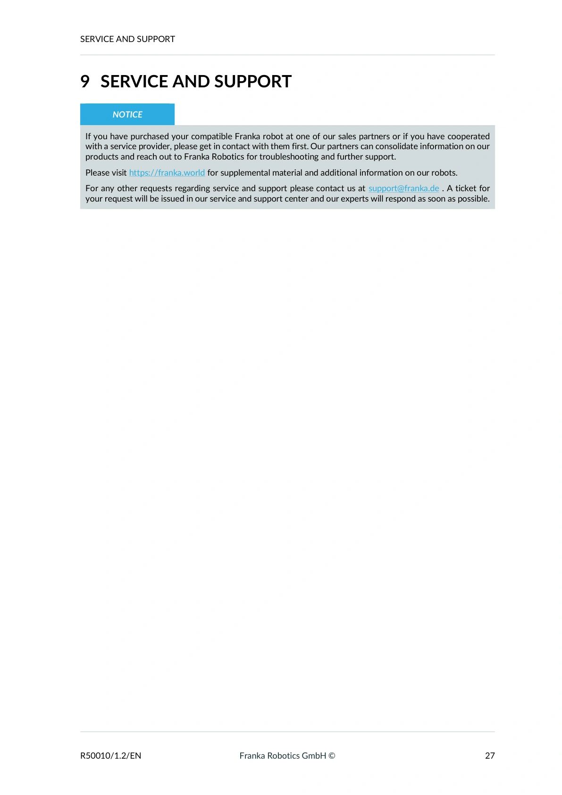



```
SERVICE AND SUPPORT 
 
R50010/1.2/EN 
Franka Robotics GmbH ©  
27  
 
9 SERVICE AND SUPPORT 
NOTICE 
 
If you have purchased your compatible Franka robot at one of our sales partners or if you have cooperated 
with a service provider, please get in contact with them first. Our partners can consolidate information on our 
products and reach out to Franka Robotics for troubleshooting and further support. 
Please visit https://franka.world for supplemental material and additional information on our robots. 
For any other requests regarding service and support please contact us at support@franka.de . A ticket for 
your request will be issued in our service and support center and our experts will respond as soon as possible.
```



**Original PDF links:** [Source link 1](https://franka.world/) · [Source link 2](mailto:support@franka.de)

## PDF page 28

**Source:** Product Manual Franka Hand\_R50010\_1.2\_EN (1).pdf, original pdf page 28. [Open the corresponding PDF reading-copy page](https://1292444914-files.gitbook.io/~/files/v0/b/gitbook-x-prod.appspot.com/o/spaces%2FtgOfPnscWebs1eh82EKq%2Fuploads%2FXFkjHVN6msnYc8rCg5x8%2FHAND-pages-026-028.pdf?alt=media#page=3).



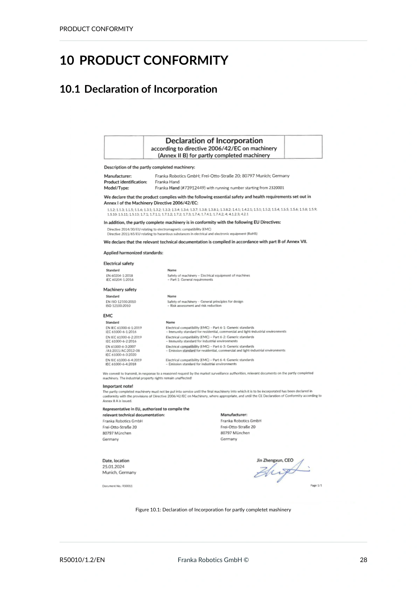



```
PRODUCT CONFORMITY 
 
R50010/1.2/EN 
Franka Robotics GmbH ©  
28  
 
10 PRODUCT CONFORMITY  
10.1 Declaration of Incorporation  
 
Figure 10.1: Declaration of Incorporation for partly completet mashinery
```



## PDF page 29

**Source:** Product Manual Franka Hand\_R50010\_1.2\_EN (1).pdf, original pdf page 29. [Open the corresponding PDF reading-copy page](https://1292444914-files.gitbook.io/~/files/v0/b/gitbook-x-prod.appspot.com/o/spaces%2FtgOfPnscWebs1eh82EKq%2Fuploads%2FPtjk3hxnJywwhGjq99AA%2FHAND-pages-029-030.pdf?alt=media#page=1).



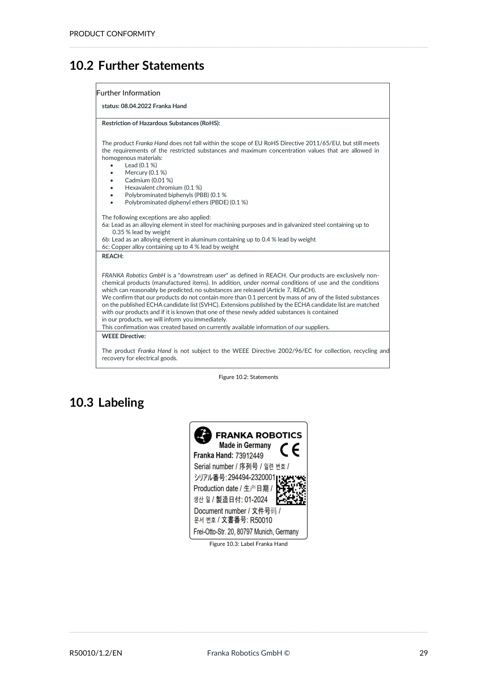



```
PRODUCT CONFORMITY 
 
R50010/1.2/EN 
Franka Robotics GmbH ©  
29  
 
10.2 Further Statements 
Further Information 
status: 08.04.2022 Franka Hand 
Restriction of Hazardous Substances (RoHS): 
 
The product Franka Hand does not fall within the scope of EU RoHS Directive 2011/65/EU, but still meets 
the requirements of the restricted substances and maximum concentration values that are allowed in 
homogenous materials: 
• 
Lead (0.1 %) 
• 
Mercury (0.1 %) 
• 
Cadmium (0.01 %) 
• 
Hexavalent chromium (0.1 %) 
• 
Polybrominated biphenyls (PBB) (0.1 % 
• 
Polybrominated diphenyl ethers (PBDE) (0.1 %) 
 
The following exceptions are also applied: 
6a: Lead as an alloying element in steel for machining purposes and in galvanized steel containing up to  
0.35 % lead by weight 
6b: Lead as an alloying element in aluminum containing up to 0.4 % lead by weight  
6c: Copper alloy containing up to 4 % lead by weight 
REACH: 
 
FRANKA Robotics GmbH is a "downstream user" as defined in REACH. Our products are exclusively non- 
chemical products (manufactured items). In addition, under normal conditions of use and the conditions 
which can reasonably be predicted, no substances are released (Article 7, REACH). 
We confirm that our products do not contain more than 0.1 percent by mass of any of the listed substances 
on the published ECHA candidate list (SVHC). Extensions published by the ECHA candidate list are matched 
with our products and if it is known that one of these newly added substances is contained 
in our products, we will inform you immediately. 
This confirmation was created based on currently available information of our suppliers. 
WEEE Directive: 
 
The product Franka Hand is not subject to the WEEE Directive 2002/96/EC for collection, recycling and 
recovery for electrical goods. 
Figure 10.2: Statements 
10.3 Labeling 
 
Figure 10.3: Label Franka Hand
```



## PDF page 30

**Source:** Product Manual Franka Hand\_R50010\_1.2\_EN (1).pdf, original pdf page 30. [Open the corresponding PDF reading-copy page](https://1292444914-files.gitbook.io/~/files/v0/b/gitbook-x-prod.appspot.com/o/spaces%2FtgOfPnscWebs1eh82EKq%2Fuploads%2FPtjk3hxnJywwhGjq99AA%2FHAND-pages-029-030.pdf?alt=media#page=2).



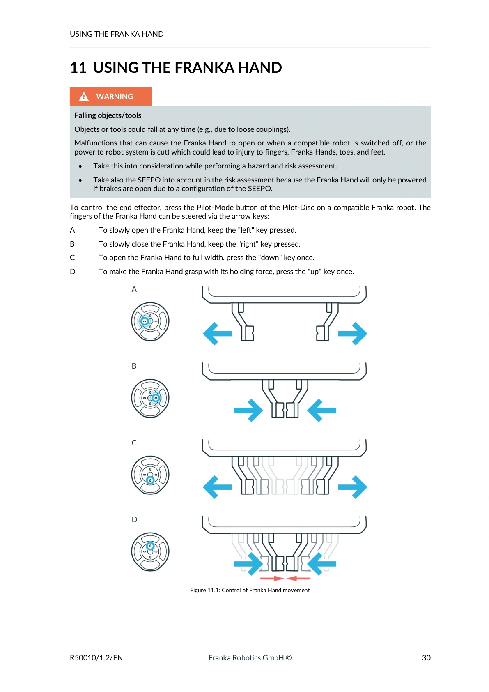



```
USING THE FRANKA HAND 
 
R50010/1.2/EN 
Franka Robotics GmbH ©  
30  
 
11 USING THE FRANKA HAND 
WARNING 
  
Falling objects/tools  
Objects or tools could fall at any time (e.g., due to loose couplings). 
Malfunctions that can cause the Franka Hand to open or when a compatible robot is switched off, or the 
power to robot system is cut) which could lead to injury to fingers, Franka Hands, toes, and feet. 
• 
Take this into consideration while performing a hazard and risk assessment. 
• 
Take also the SEEPO into account in the risk assessment because the Franka Hand will only be powered 
if brakes are open due to a configuration of the SEEPO. 
To control the end effector, press the Pilot-Mode button of the Pilot-Disc on a compatible Franka robot. The 
fingers of the Franka Hand can be steered via the arrow keys: 
A 
To slowly open the Franka Hand, keep the "left" key pressed. 
B 
To slowly close the Franka Hand, keep the "right" key pressed. 
C 
To open the Franka Hand to full width, press the "down" key once. 
D 
To make the Franka Hand grasp with its holding force, press the "up" key once. 
 
Figure 11.1: Control of Franka Hand movement
```



## PDF page 31

**Source:** Product Manual Franka Hand\_R50010\_1.2\_EN (1).pdf, original pdf page 31. [Open the corresponding PDF reading-copy page](https://1292444914-files.gitbook.io/~/files/v0/b/gitbook-x-prod.appspot.com/o/spaces%2FtgOfPnscWebs1eh82EKq%2Fuploads%2FZtOeM32kp5iMJVDOnD2j%2FHAND-pages-031-036.pdf?alt=media#page=1).



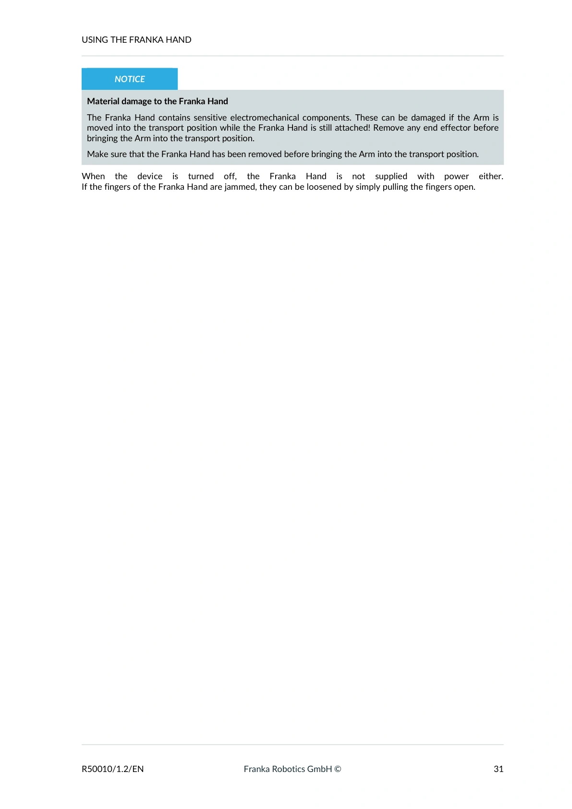



```
USING THE FRANKA HAND 
 
R50010/1.2/EN 
Franka Robotics GmbH ©  
31  
 
NOTICE 
 
Material damage to the Franka Hand 
The Franka Hand contains sensitive electromechanical components. These can be damaged if the Arm is 
moved into the transport position while the Franka Hand is still attached! Remove any end effector before 
bringing the Arm into the transport position. 
Make sure that the Franka Hand has been removed before bringing the Arm into the transport position. 
When 
the 
device 
is 
turned 
off, 
the 
Franka 
Hand 
is 
not 
supplied 
with 
power 
either.  
If the fingers of the Franka Hand are jammed, they can be loosened by simply pulling the fingers open.
```



## PDF page 32

**Source:** Product Manual Franka Hand\_R50010\_1.2\_EN (1).pdf, original pdf page 32. [Open the corresponding PDF reading-copy page](https://1292444914-files.gitbook.io/~/files/v0/b/gitbook-x-prod.appspot.com/o/spaces%2FtgOfPnscWebs1eh82EKq%2Fuploads%2FZtOeM32kp5iMJVDOnD2j%2FHAND-pages-031-036.pdf?alt=media#page=2).



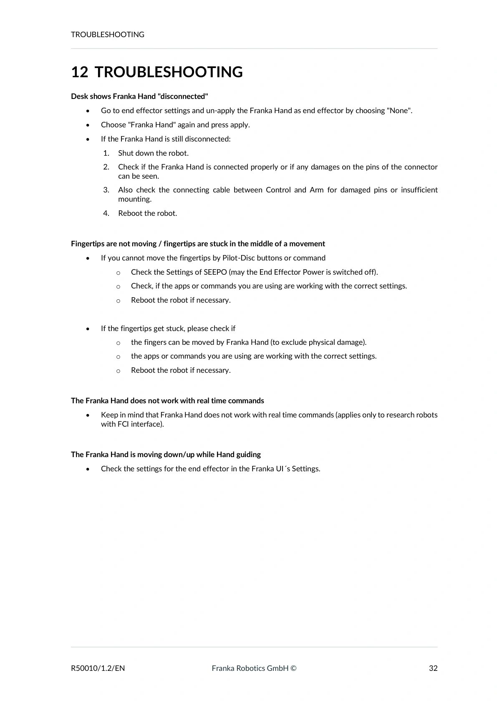



```
TROUBLESHOOTING 
 
R50010/1.2/EN 
Franka Robotics GmbH ©  
32  
 
12 TROUBLESHOOTING 
Desk shows Franka Hand "disconnected"  
• 
Go to end effector settings and un-apply the Franka Hand as end effector by choosing "None".  
• 
Choose "Franka Hand" again and press apply. 
• 
If the Franka Hand is still disconnected:  
1. 
Shut down the robot. 
2. 
Check if the Franka Hand is connected properly or if any damages on the pins of the connector 
can be seen. 
3. 
Also check the connecting cable between Control and Arm for damaged pins or insufficient 
mounting. 
4. 
Reboot the robot. 
 
Fingertips are not moving / fingertips are stuck in the middle of a movement  
• 
If you cannot move the fingertips by Pilot-Disc buttons or command 
o 
Check the Settings of SEEPO (may the End Effector Power is switched off). 
o 
Check, if the apps or commands you are using are working with the correct settings. 
o 
Reboot the robot if necessary. 
 
• 
If the fingertips get stuck, please check if 
o 
the fingers can be moved by Franka Hand (to exclude physical damage).  
o 
the apps or commands you are using are working with the correct settings. 
o 
Reboot the robot if necessary. 
 
The Franka Hand does not work with real time commands  
• 
Keep in mind that Franka Hand does not work with real time commands (applies only to research robots 
with FCI interface). 
 
The Franka Hand is moving down/up while Hand guiding 
• 
Check the settings for the end effector in the Franka UI´s Settings.
```



## PDF page 33

**Source:** Product Manual Franka Hand\_R50010\_1.2\_EN (1).pdf, original pdf page 33. [Open the corresponding PDF reading-copy page](https://1292444914-files.gitbook.io/~/files/v0/b/gitbook-x-prod.appspot.com/o/spaces%2FtgOfPnscWebs1eh82EKq%2Fuploads%2FZtOeM32kp5iMJVDOnD2j%2FHAND-pages-031-036.pdf?alt=media#page=3).



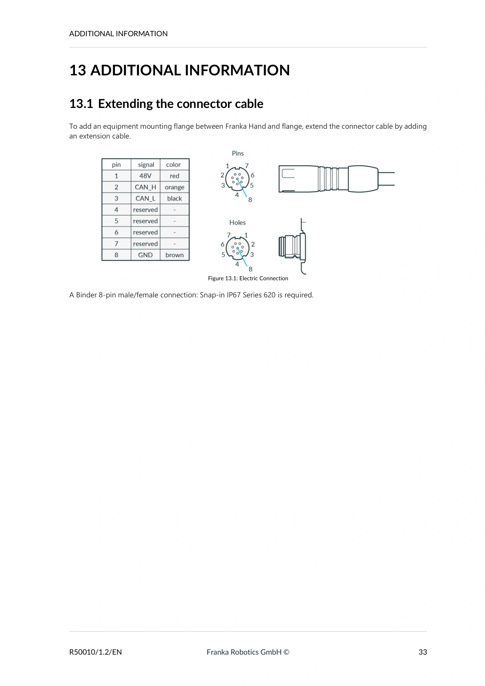



```
ADDITIONAL INFORMATION 
 
R50010/1.2/EN 
Franka Robotics GmbH ©  
33  
 
13 ADDITIONAL INFORMATION 
13.1 Extending the connector cable 
To add an equipment mounting flange between Franka Hand and flange, extend the connector cable by adding 
an extension cable. 
 
Figure 13.1: Electric Connection 
A Binder 8-pin male/female connection: Snap-in IP67 Series 620 is required.
```



## PDF page 34

**Source:** Product Manual Franka Hand\_R50010\_1.2\_EN (1).pdf, original pdf page 34. [Open the corresponding PDF reading-copy page](https://1292444914-files.gitbook.io/~/files/v0/b/gitbook-x-prod.appspot.com/o/spaces%2FtgOfPnscWebs1eh82EKq%2Fuploads%2FZtOeM32kp5iMJVDOnD2j%2FHAND-pages-031-036.pdf?alt=media#page=4).



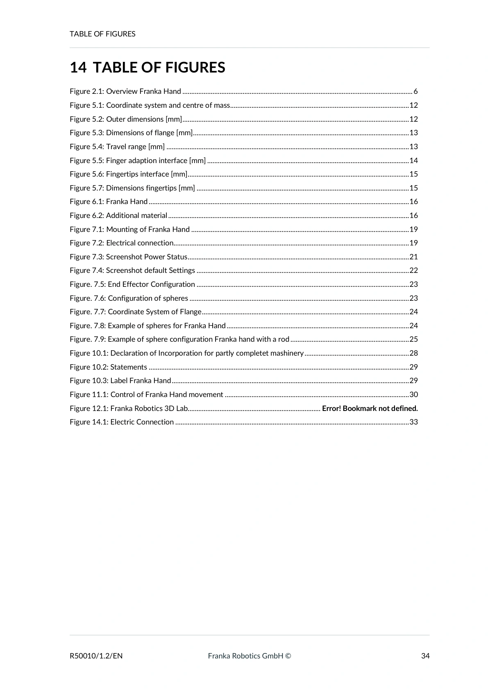



```
TABLE OF FIGURES 
 
R50010/1.2/EN 
Franka Robotics GmbH ©  
34  
 
14 TABLE OF FIGURES 
Figure 2.1: Overview Franka Hand .................................................................................................................................. 6 
Figure 5.1: Coordinate system and centre of mass ..................................................................................................... 12 
Figure 5.2: Outer dimensions [mm] ................................................................................................................................ 12 
Figure 5.3: Dimensions of flange [mm] .......................................................................................................................... 13 
Figure 5.4: Travel range [mm] ......................................................................................................................................... 13 
Figure 5.5: Finger adaption interface [mm] .................................................................................................................. 14 
Figure 5.6: Fingertips interface [mm] ............................................................................................................................. 15 
Figure 5.7: Dimensions fingertips [mm] ........................................................................................................................ 15 
Figure 6.1: Franka Hand ................................................................................................................................................... 16 
Figure 6.2: Additional material ........................................................................................................................................ 16 
Figure 7.1: Mounting of Franka Hand ........................................................................................................................... 19 
Figure 7.2: Electrical connection..................................................................................................................................... 19 
Figure 7.3: Screenshot Power Status ............................................................................................................................. 21 
Figure 7.4: Screenshot default Settings ........................................................................................................................ 22 
Figure. 7.5: End Effector Configuration ........................................................................................................................ 23 
Figure. 7.6: Configuration of spheres ............................................................................................................................ 23 
Figure. 7.7: Coordinate System of Flange ..................................................................................................................... 24 
Figure. 7.8: Example of spheres for Franka Hand ....................................................................................................... 24 
Figure. 7.9: Example of sphere configuration Franka hand with a rod ................................................................... 25 
Figure 10.1: Declaration of Incorporation for partly completet mashinery ........................................................... 28 
Figure 10.2: Statements ................................................................................................................................................... 29 
Figure 10.3: Label Franka Hand ...................................................................................................................................... 29 
Figure 11.1: Control of Franka Hand movement ........................................................................................................ 30 
Figure 12.1: Franka Robotics 3D Lab........................................................................... Error! Bookmark not defined. 
Figure 14.1: Electric Connection .................................................................................................................................... 33
```



**Original document cross-references:** [PDF 6](complete-hand.md#pdf-page-6) · [PDF 12](complete-hand.md#pdf-page-12) · [PDF 13](complete-hand.md#pdf-page-13) · [PDF 14](complete-hand.md#pdf-page-14) · [PDF 15](complete-hand.md#pdf-page-15) · [PDF 16](complete-hand.md#pdf-page-16) · [PDF 19](complete-hand.md#pdf-page-19) · [PDF 21](complete-hand.md#pdf-page-21) · [PDF 22](complete-hand.md#pdf-page-22) · [PDF 23](complete-hand.md#pdf-page-23) · [PDF 24](complete-hand.md#pdf-page-24) · [PDF 25](complete-hand.md#pdf-page-25) · [PDF 28](complete-hand.md#pdf-page-28) · [PDF 29](complete-hand.md#pdf-page-29) · [PDF 30](complete-hand.md#pdf-page-30) · [PDF 33](complete-hand.md#pdf-page-33)

## PDF page 35

**Source:** Product Manual Franka Hand\_R50010\_1.2\_EN (1).pdf, original pdf page 35. [Open the corresponding PDF reading-copy page](https://1292444914-files.gitbook.io/~/files/v0/b/gitbook-x-prod.appspot.com/o/spaces%2FtgOfPnscWebs1eh82EKq%2Fuploads%2FZtOeM32kp5iMJVDOnD2j%2FHAND-pages-031-036.pdf?alt=media#page=5).



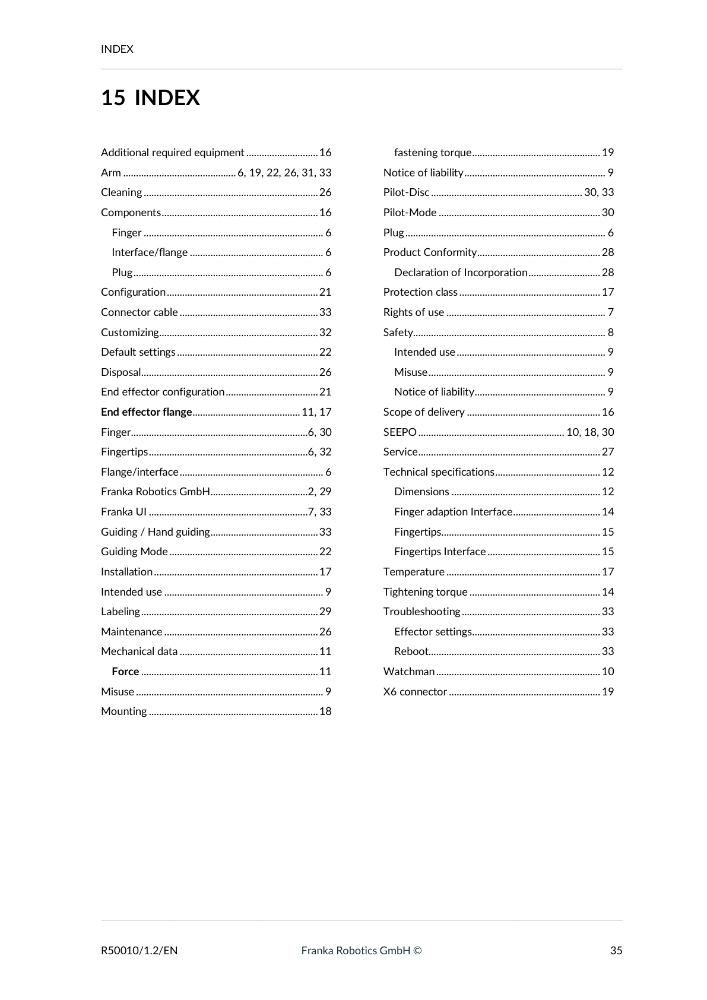



```
INDEX 
 
R50010/1.2/EN 
Franka Robotics GmbH ©  
35  
 
15 INDEX 
Additional required equipment ............................ 16 
Arm ............................................ 6, 19, 22, 26, 31, 33 
Cleaning .................................................................... 26 
Components ............................................................. 16 
Finger ...................................................................... 6 
Interface/flange .................................................... 6 
Plug .......................................................................... 6 
Configuration ........................................................... 21 
Connector cable ...................................................... 33 
Customizing .............................................................. 32 
Default settings ....................................................... 22 
Disposal ..................................................................... 26 
End effector configuration .................................... 21 
End effector flange .......................................... 11, 17 
Finger .....................................................................6, 30 
Fingertips ..............................................................6, 32 
Flange/interface ........................................................ 6 
Franka Robotics GmbH ......................................2, 29 
Franka UI ..............................................................7, 33 
Guiding / Hand guiding .......................................... 33 
Guiding Mode .......................................................... 22 
Installation ................................................................ 17 
Intended use .............................................................. 9 
Labeling ..................................................................... 29 
Maintenance ............................................................ 26 
Mechanical data ...................................................... 11 
Force ..................................................................... 11 
Misuse ......................................................................... 9 
Mounting .................................................................. 18 
fastening torque .................................................. 19 
Notice of liability ....................................................... 9 
Pilot-Disc ........................................................... 30, 33 
Pilot-Mode ............................................................... 30 
Plug .............................................................................. 6 
Product Conformity ................................................ 28 
Declaration of Incorporation ............................ 28 
Protection class ....................................................... 17 
Rights of use .............................................................. 7 
Safety........................................................................... 8 
Intended use .......................................................... 9 
Misuse ..................................................................... 9 
Notice of liability ................................................... 9 
Scope of delivery .................................................... 16 
SEEPO ......................................................... 10, 18, 30 
Service ....................................................................... 27 
Technical specifications ......................................... 12 
Dimensions .......................................................... 12 
Finger adaption Interface .................................. 14 
Fingertips .............................................................. 15 
Fingertips Interface ............................................ 15 
Temperature ............................................................ 17 
Tightening torque ................................................... 14 
Troubleshooting ...................................................... 33 
Effector settings .................................................. 33 
Reboot................................................................... 33 
Watchman ................................................................ 10 
X6 connector ........................................................... 19
```



## PDF page 36

**Source:** Product Manual Franka Hand\_R50010\_1.2\_EN (1).pdf, original pdf page 36. [Open the corresponding PDF reading-copy page](https://1292444914-files.gitbook.io/~/files/v0/b/gitbook-x-prod.appspot.com/o/spaces%2FtgOfPnscWebs1eh82EKq%2Fuploads%2FZtOeM32kp5iMJVDOnD2j%2FHAND-pages-031-036.pdf?alt=media#page=6).







```
Franka Robotics GmbH 
Frei-Otto-Strasse 20 
80797 Munich 
Germany
```


