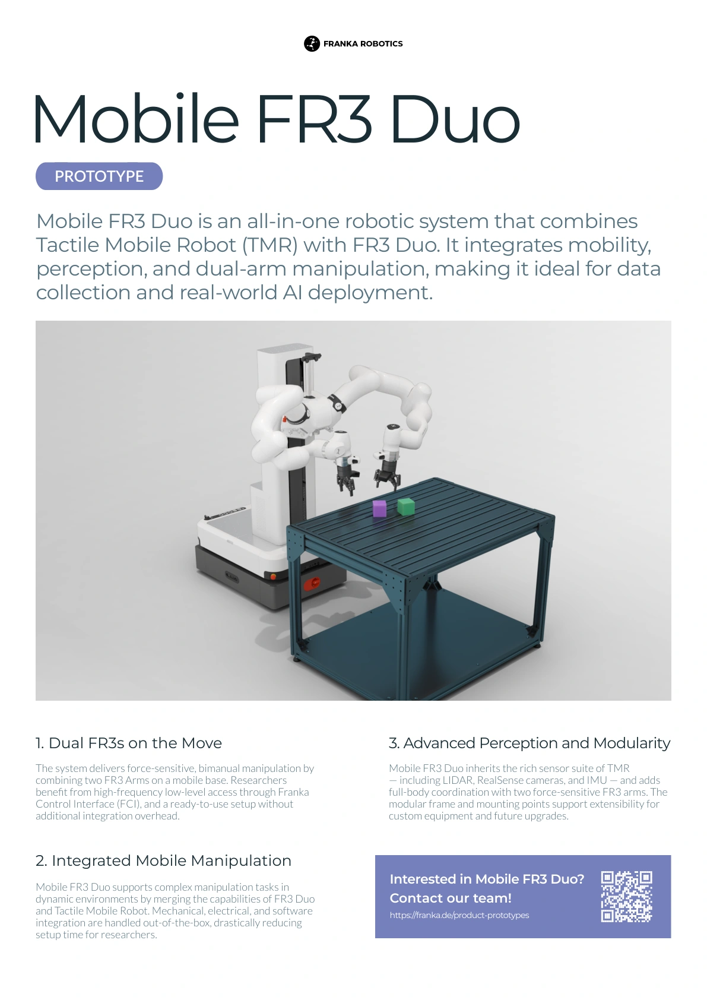
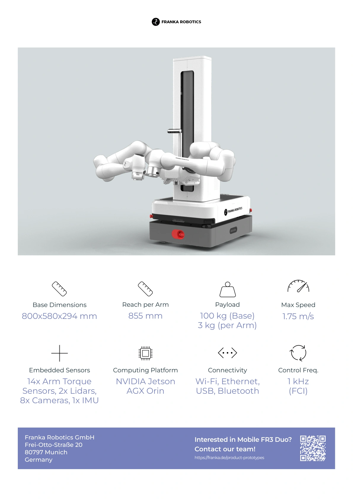

# Mobile FR3 Duo brochure — complete reference


**Complete supplied source:** Mobile FR3 Duo.pdf · **Coverage:** 2 original PDF pages. [Return to the Franka source library](./).


Every source page is retained in the original order. The **Original page** view preserves complete diagrams, photographs, tables, equations, connector orientation, notices and examples. The **Searchable text** view preserves native PDF text or the slide’s native text, embedded links and substantive speaker notes. Text extraction can retain reading-order/character defects; use the original image for exact layout, table columns and code indentation.


This is the supplied Mobile FR3 Duo brochure. It is separate from later prototype manuals, different mobile bases and delivered kits. Brochure dimensions, cameras, payload and speed are source-specific claims and do not establish a commissioned mobile safety or stopping function.


**Attribution:** the manufacturer and contributors identified in the supplied document. Original notices remain visible on every source page. Navigation, revision notes and the linked engineering explanations are OpenELAB editorial additions.

## Document navigation

| Source section / function                                                     | Original page                          |
| ----------------------------------------------------------------------------- | -------------------------------------- |
| Mobile FR3 Duo / Mobile FR3 Duo is an all-in-one robotic system that combines | [PDF 1](complete-mobile.md#pdf-page-1) |
| 800x580x294 mm / 14x Arm Torque                                               | [PDF 2](complete-mobile.md#pdf-page-2) |

## PDF page 1

**Source:** Mobile FR3 Duo.pdf, original pdf page 1. [Open the corresponding PDF reading-copy page](https://1292444914-files.gitbook.io/~/files/v0/b/gitbook-x-prod.appspot.com/o/spaces%2FtgOfPnscWebs1eh82EKq%2Fuploads%2FQsGcoRHRgwcBaDB2E8gk%2FMOBILE-pages-001-002.pdf?alt=media#page=1).







```
Mobile FR3 Duo
Mobile FR3 Duo is an all-in-one robotic system that combines 
Tactile Mobile Robot (TMR) with FR3 Duo. It integrates mobility, 
perception, and dual-arm manipulation, making it ideal for data 
collection and real-world AI deployment.
Mobile FR3 Duo supports complex manipulation tasks in 
dynamic environments by merging the capabilities of FR3 Duo 
and Tactile Mobile Robot. Mechanical, electrical, and software 
integration are handled out-of-the-box, drastically reducing 
setup time for researchers.
2. Integrated Mobile Manipulation
The system delivers force-sensitive, bimanual manipulation by 
combining two FR3 Arms on a mobile base. Researchers 
benefit from high-frequency low-level access through Franka 
Control Interface (FCI), and a ready-to-use setup without 
additional integration overhead.
1. Dual FR3s on the Move
Mobile FR3 Duo inherits the rich sensor suite of TMR 
— including LIDAR, RealSense cameras, and IMU — and adds 
full-body coordination with two force-sensitive FR3 arms. The 
modular frame and mounting points support extensibility for 
custom equipment and future upgrades.
3. Advanced Perception and Modularity
Interested in Mobile FR3 Duo? 
Contact our team! 
https://franka.de/product-prototypes
PROTOTYPE
```



**Original PDF links:** [Source link 1](https://franka.de/mobile-fr3-duo)

## PDF page 2

**Source:** Mobile FR3 Duo.pdf, original pdf page 2. [Open the corresponding PDF reading-copy page](https://1292444914-files.gitbook.io/~/files/v0/b/gitbook-x-prod.appspot.com/o/spaces%2FtgOfPnscWebs1eh82EKq%2Fuploads%2FQsGcoRHRgwcBaDB2E8gk%2FMOBILE-pages-001-002.pdf?alt=media#page=2).







```
800x580x294 mm
14x Arm Torque 
Sensors, 2x Lidars,  
8x Cameras, 1x IMU
100 kg (Base)
3 kg (per Arm)
NVIDIA Jetson  
AGX Orin
1.75 m/s
Wi-Fi, Ethernet, 
USB, Bluetooth
Franka Robotics GmbH
Frei-Otto-Straße 20
80797 Munich
Germany
1 kHz 
(FCI)
Payload
Base Dimensions
Max Speed
Embedded Sensors
Computing Platform
Connectivity
Control Freq.
855 mm
Reach per Arm
Interested in Mobile FR3 Duo? 
Contact our team! 
https://franka.de/product-prototypes
```



**Original PDF links:** [Source link 1](https://franka.de/mobile-fr3-duo)
