# Franka training 1 — System Startup — complete reference


**Complete supplied source:** EN\_1\_System\_Startup.pptx · **Coverage:** 14 original slides. [Return to the Franka source library](./).


Every source page is retained in the original order. The **Original page** view preserves complete diagrams, photographs, tables, equations, connector orientation, notices and examples. The **Searchable text** view preserves native PDF text or the slide’s native text, embedded links and substantive speaker notes. Text extraction can retain reading-order/character defects; use the original image for exact layout, table columns and code indentation.


These October 2025 training slides link several older document versions. Use the actual hardware labels and current compatibility matrix when choosing an operating manual or SDK. X5 browser access is separate from the controller’s FCI interface; seeing the web UI does not verify real-time control readiness.


**Attribution:** the manufacturer and contributors identified in the supplied document. Original notices remain visible on every source page. Navigation, revision notes and the linked engineering explanations are OpenELAB editorial additions.

**Training-copy scope:** these images are rendered reading copies of the supplied PPTX slides. The native file remains authoritative for fonts, presentation effects and editable objects. All original slide numbers, including closing or hidden slides, are retained. Any embedded motion video is linked separately below.

## Document navigation

| Source section / function | Original page                            |
| ------------------------- | ---------------------------------------- |
| Slide 1                   | [Slide 1](complete-startup.md#slide-1)   |
| Basic Training            | [Slide 2](complete-startup.md#slide-2)   |
| System Startup            | [Slide 3](complete-startup.md#slide-3)   |
| System Startup (2)        | [Slide 4](complete-startup.md#slide-4)   |
| System Startup (3)        | [Slide 5](complete-startup.md#slide-5)   |
| System Startup (4)        | [Slide 6](complete-startup.md#slide-6)   |
| System Startup (5)        | [Slide 7](complete-startup.md#slide-7)   |
| System Startup (6)        | [Slide 8](complete-startup.md#slide-8)   |
| System Startup (7)        | [Slide 9](complete-startup.md#slide-9)   |
| System Startup (8)        | [Slide 10](complete-startup.md#slide-10) |
| System Startup (9)        | [Slide 11](complete-startup.md#slide-11) |
| System Startup (10)       | [Slide 12](complete-startup.md#slide-12) |
| System Startup (11)       | [Slide 13](complete-startup.md#slide-13) |
| Diagnostics And Testing   | [Slide 14](complete-startup.md#slide-14) |

## Slide 1

**Source:** EN\_1\_System\_Startup.pptx, original slide 1. [Open the corresponding PDF reading-copy page](https://1292444914-files.gitbook.io/~/files/v0/b/gitbook-x-prod.appspot.com/o/spaces%2FtgOfPnscWebs1eh82EKq%2Fuploads%2FkoG19mbdTKnmhLC9FKzc%2FSTARTUP-pages-001-014.pdf?alt=media#page=1).



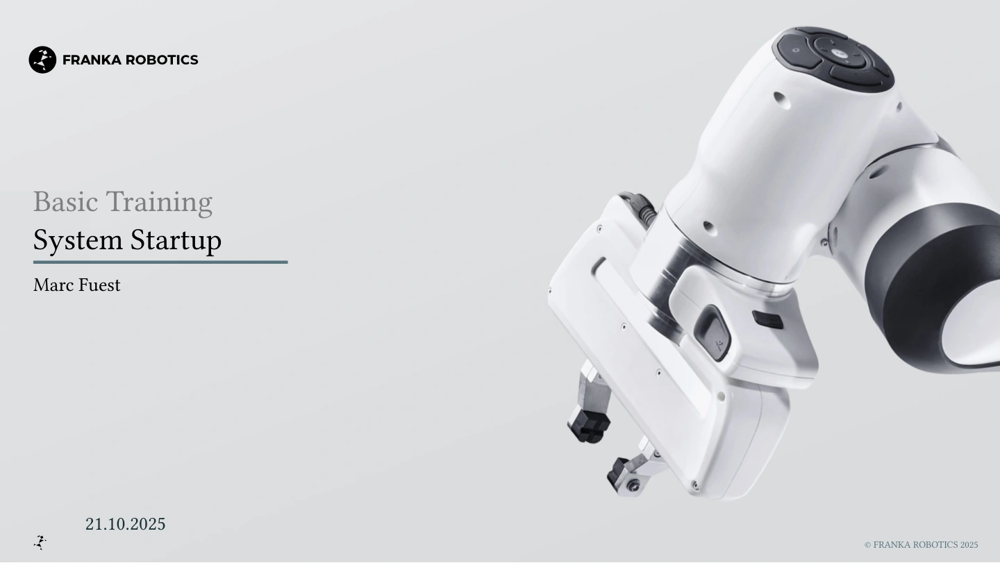



```
System Startup
Basic Training
Marc Fuest
21
.10.2025
© FRANKA ROBOTICS 2025
```



## Slide 2

**Source:** EN\_1\_System\_Startup.pptx, original slide 2. [Open the corresponding PDF reading-copy page](https://1292444914-files.gitbook.io/~/files/v0/b/gitbook-x-prod.appspot.com/o/spaces%2FtgOfPnscWebs1eh82EKq%2Fuploads%2FkoG19mbdTKnmhLC9FKzc%2FSTARTUP-pages-001-014.pdf?alt=media#page=2).



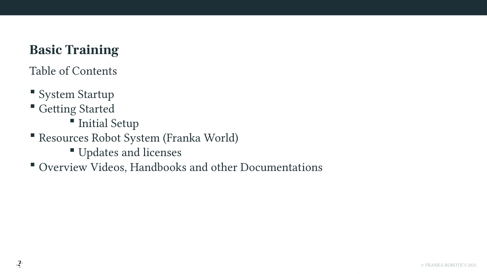



```
Basic Training
Table of Contents
System Startup
Getting Started
Initial Setup
Resources Robot System (Franka World)
Updates and 
licenses
Overview Videos, Handbooks and other Documentations
```



## Slide 3

**Source:** EN\_1\_System\_Startup.pptx, original slide 3. [Open the corresponding PDF reading-copy page](https://1292444914-files.gitbook.io/~/files/v0/b/gitbook-x-prod.appspot.com/o/spaces%2FtgOfPnscWebs1eh82EKq%2Fuploads%2FkoG19mbdTKnmhLC9FKzc%2FSTARTUP-pages-001-014.pdf?alt=media#page=3).



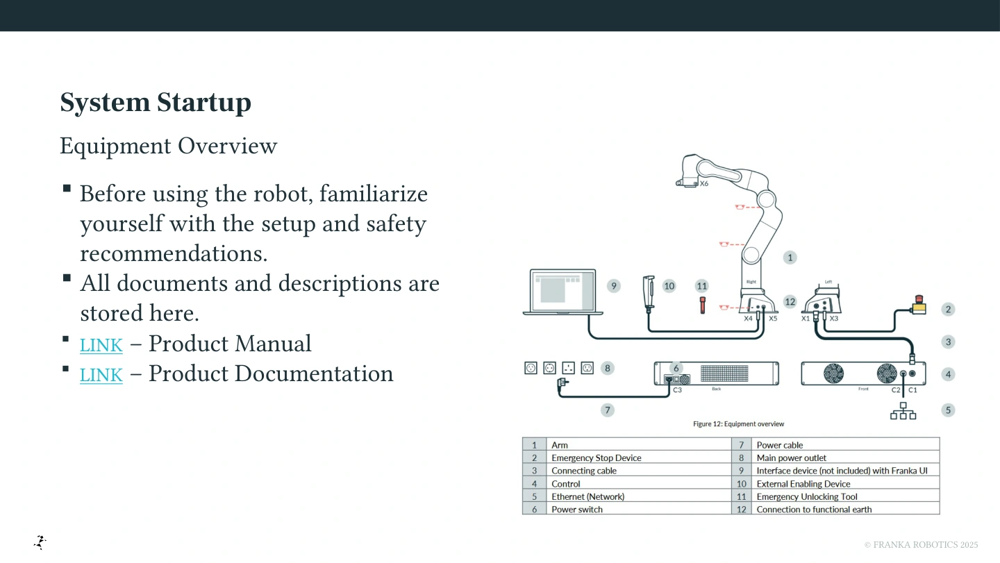



```
System Startup
Equipment Overview
Before using the robot, familiarize yourself with the setup and safety recommendations.
All documents and descriptions are stored here.
LINK
 – Product Manual
LINK
 – Product Documentation

Embedded hyperlinks
https://franka.de/documents
https://franka.de/hubfs/Product%20Manual%20Franka%20Research%203_R02210_2.0_EN.pdf?hsLang=en
```



**Embedded slide links:** [Source link 1](https://franka.de/documents) · [Source link 2](https://franka.de/hubfs/Product%20Manual%20Franka%20Research%203_R02210_2.0_EN.pdf?hsLang=en)

## Slide 4

**Source:** EN\_1\_System\_Startup.pptx, original slide 4. [Open the corresponding PDF reading-copy page](https://1292444914-files.gitbook.io/~/files/v0/b/gitbook-x-prod.appspot.com/o/spaces%2FtgOfPnscWebs1eh82EKq%2Fuploads%2FkoG19mbdTKnmhLC9FKzc%2FSTARTUP-pages-001-014.pdf?alt=media#page=4).



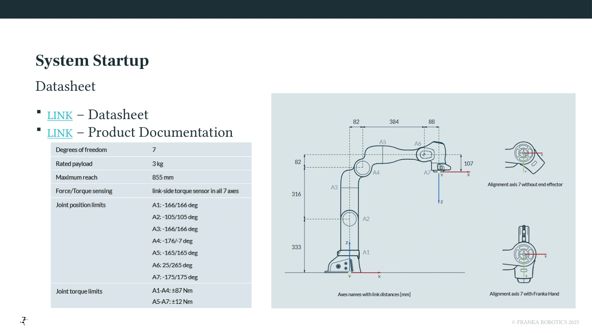



```
System Startup
Datasheet
LINK
 – Datasheet
LINK
 – Product Documentation

Embedded hyperlinks
https://franka.de/documents
https://franka.de/hubfs/Datasheet%20Franka%20Research%203_R02212_2.4_EN.pdf?hsLang=en
```



**Embedded slide links:** [Source link 1](https://franka.de/documents) · [Source link 2](https://franka.de/hubfs/Datasheet%20Franka%20Research%203_R02212_2.4_EN.pdf?hsLang=en)

## Slide 5

**Source:** EN\_1\_System\_Startup.pptx, original slide 5. [Open the corresponding PDF reading-copy page](https://1292444914-files.gitbook.io/~/files/v0/b/gitbook-x-prod.appspot.com/o/spaces%2FtgOfPnscWebs1eh82EKq%2Fuploads%2FkoG19mbdTKnmhLC9FKzc%2FSTARTUP-pages-001-014.pdf?alt=media#page=5).



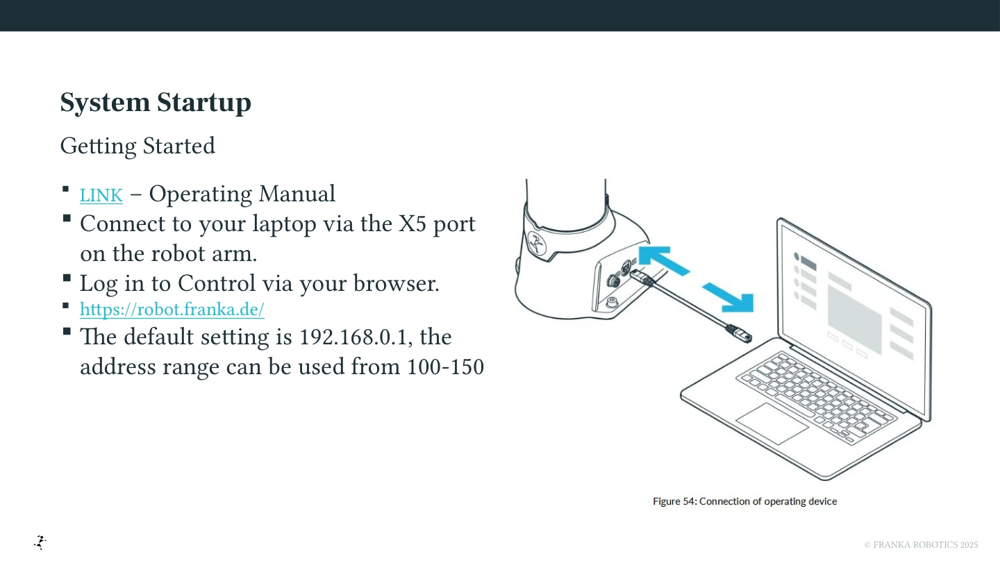



```
System Startup
Getting Started
LINK
 – Operating Manual
Connect to your laptop via the X5 port on the robot arm.
Log in to Control via your browser.
https://robot.franka.de/
The default setting is 192.168.0.1, the address range can be used from 100-150

Embedded hyperlinks
https://robot.franka.de/
https://franka.de/hubfs/Operating%20Manual%20Franka%20Research%203_R02216_1.0_EN.pdf?hsLang=en
```



**Embedded slide links:** [Source link 1](https://robot.franka.de/) · [Source link 2](https://franka.de/hubfs/Operating%20Manual%20Franka%20Research%203_R02216_1.0_EN.pdf?hsLang=en)

## Slide 6

**Source:** EN\_1\_System\_Startup.pptx, original slide 6. [Open the corresponding PDF reading-copy page](https://1292444914-files.gitbook.io/~/files/v0/b/gitbook-x-prod.appspot.com/o/spaces%2FtgOfPnscWebs1eh82EKq%2Fuploads%2FkoG19mbdTKnmhLC9FKzc%2FSTARTUP-pages-001-014.pdf?alt=media#page=6).



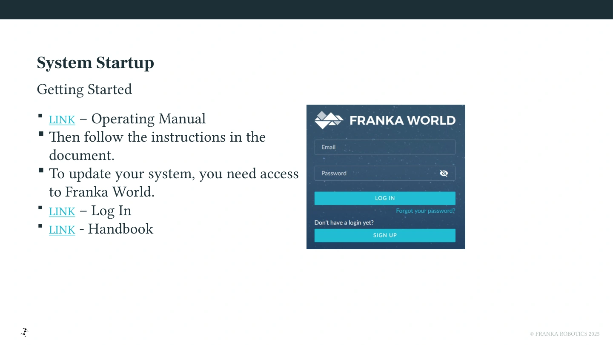



```
System Startup
Getting Started
LINK
 – Operating Manual
Then follow the instructions in the document.
To update your system, you need access to Franka World.
LINK
 – Log In 
LINK
 - Handbook

Embedded hyperlinks
https://franka.world/
https://franka.de/hubfs/Operating%20Manual%20Franka%20Research%203_R02216_1.0_EN.pdf?hsLang=en
https://download.franka.de/franka-world-manual/
```



**Embedded slide links:** [Source link 1](https://franka.world/) · [Source link 2](https://franka.de/hubfs/Operating%20Manual%20Franka%20Research%203_R02216_1.0_EN.pdf?hsLang=en) · [Source link 3](https://download.franka.de/franka-world-manual/)

## Slide 7

**Source:** EN\_1\_System\_Startup.pptx, original slide 7. [Open the corresponding PDF reading-copy page](https://1292444914-files.gitbook.io/~/files/v0/b/gitbook-x-prod.appspot.com/o/spaces%2FtgOfPnscWebs1eh82EKq%2Fuploads%2FkoG19mbdTKnmhLC9FKzc%2FSTARTUP-pages-001-014.pdf?alt=media#page=7).



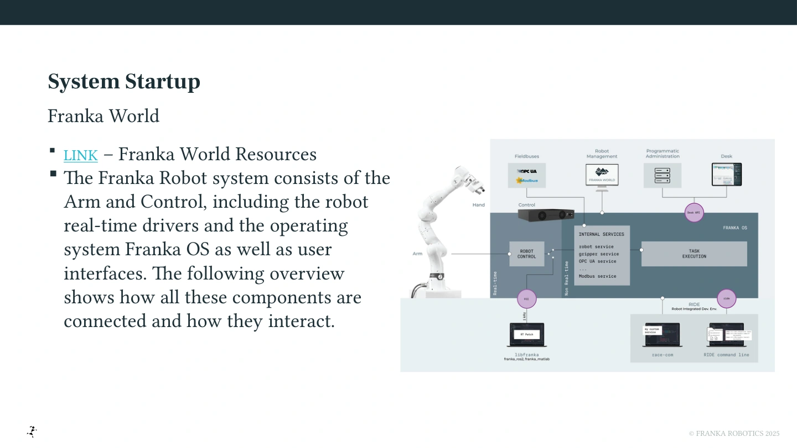



```
System Startup
Franka World
LINK
 – Franka World Resources
The Franka Robot system consists of the Arm and Control, including the robot real-time drivers and the operating system Franka OS as well as user interfaces. The following overview shows how all these components are connected and how they interact.

Embedded hyperlinks
https://franka.world/resources
```



**Embedded slide links:** [Source link 1](https://franka.world/resources)

## Slide 8

**Source:** EN\_1\_System\_Startup.pptx, original slide 8. [Open the corresponding PDF reading-copy page](https://1292444914-files.gitbook.io/~/files/v0/b/gitbook-x-prod.appspot.com/o/spaces%2FtgOfPnscWebs1eh82EKq%2Fuploads%2FkoG19mbdTKnmhLC9FKzc%2FSTARTUP-pages-001-014.pdf?alt=media#page=8).



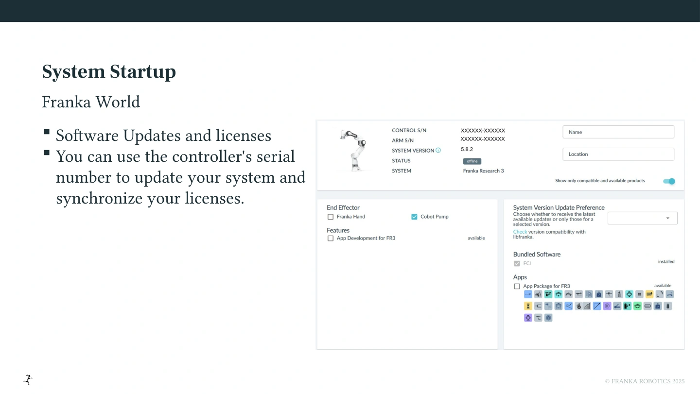



```
System Startup
Franka World
Software Updates and licenses
You can use the controller's serial number to update your system and synchronize your licenses.
```



## Slide 9

**Source:** EN\_1\_System\_Startup.pptx, original slide 9. [Open the corresponding PDF reading-copy page](https://1292444914-files.gitbook.io/~/files/v0/b/gitbook-x-prod.appspot.com/o/spaces%2FtgOfPnscWebs1eh82EKq%2Fuploads%2FkoG19mbdTKnmhLC9FKzc%2FSTARTUP-pages-001-014.pdf?alt=media#page=9).



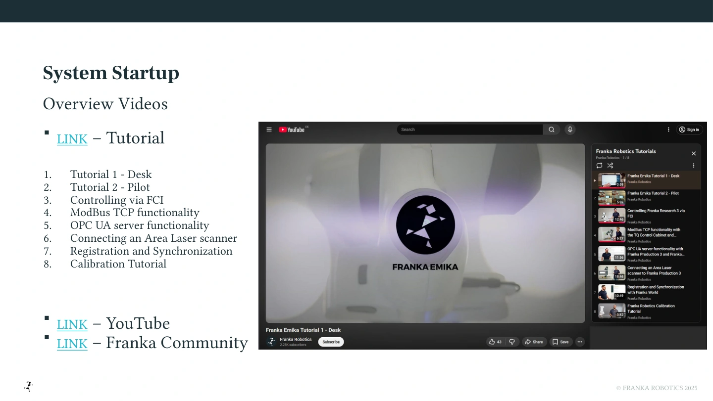



```
System Startup
Overview Videos
LINK
 – Tutorial
Tutorial 1 - Desk
Tutorial 2 - Pilot
Controlling via FCI
ModBus
 TCP 
functionality
OPC UA 
server
 
functionality
Connecting an Area Laser scanner
Registration and Synchronization
Calibration
 Tutorial
LINK
 – YouTube
LINK
 – Franka Community

Embedded hyperlinks
https://www.youtube.com/@frankarobotics1747
https://www.youtube.com/watch?v=TRMIA2J29MA&list=PL9FoYHNFGS3TyHsLcL0-qNIi-e14Xw7np
https://www.franka-community.de/
```



**Embedded slide links:** [Source link 1](https://www.youtube.com/@frankarobotics1747) · [Source link 2](https://www.youtube.com/watch?v=TRMIA2J29MA\&list=PL9FoYHNFGS3TyHsLcL0-qNIi-e14Xw7np) · [Source link 3](https://www.franka-community.de/)

## Slide 10

**Source:** EN\_1\_System\_Startup.pptx, original slide 10. [Open the corresponding PDF reading-copy page](https://1292444914-files.gitbook.io/~/files/v0/b/gitbook-x-prod.appspot.com/o/spaces%2FtgOfPnscWebs1eh82EKq%2Fuploads%2FkoG19mbdTKnmhLC9FKzc%2FSTARTUP-pages-001-014.pdf?alt=media#page=10).



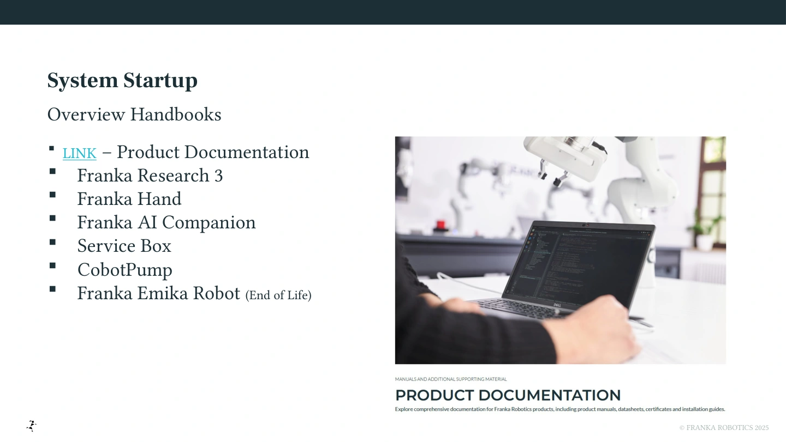



```
System Startup
Overview Handbooks
LINK
 – Product Documentation
Franka Research 3
Franka Hand
Franka AI Companion
Service Box
CobotPump
Franka Emika Robot 
(End of Life)

Embedded hyperlinks
https://franka.de/documents
```



**Embedded slide links:** [Source link 1](https://franka.de/documents)

## Slide 11

**Source:** EN\_1\_System\_Startup.pptx, original slide 11. [Open the corresponding PDF reading-copy page](https://1292444914-files.gitbook.io/~/files/v0/b/gitbook-x-prod.appspot.com/o/spaces%2FtgOfPnscWebs1eh82EKq%2Fuploads%2FkoG19mbdTKnmhLC9FKzc%2FSTARTUP-pages-001-014.pdf?alt=media#page=11).



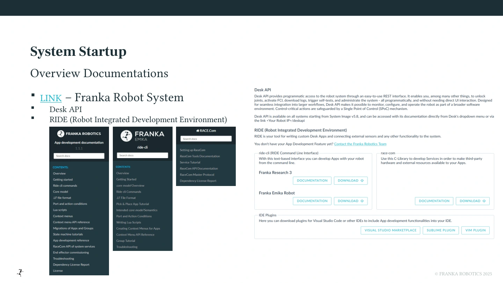



```
System Startup
Overview Documentations
LINK
 – Franka Robot System
Desk API
RIDE (Robot Integrated Development Environment)

Embedded hyperlinks
https://download.franka.de/racecom-doc-v15.4.1/index.html
https://franka.world/resources
https://download.franka.de/ride-cli-doc/index.html
https://download.franka.de/ride-cli-doc-v1.1.1/index.html
```



**Embedded slide links:** [Source link 1](https://download.franka.de/racecom-doc-v15.4.1/index.html) · [Source link 2](https://franka.world/resources) · [Source link 3](https://download.franka.de/ride-cli-doc/index.html) · [Source link 4](https://download.franka.de/ride-cli-doc-v1.1.1/index.html)

## Slide 12

**Source:** EN\_1\_System\_Startup.pptx, original slide 12. [Open the corresponding PDF reading-copy page](https://1292444914-files.gitbook.io/~/files/v0/b/gitbook-x-prod.appspot.com/o/spaces%2FtgOfPnscWebs1eh82EKq%2Fuploads%2FkoG19mbdTKnmhLC9FKzc%2FSTARTUP-pages-001-014.pdf?alt=media#page=12).



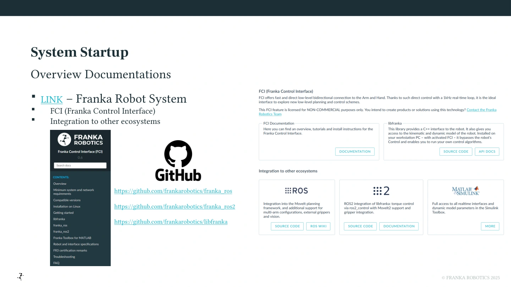



```
System Startup
Overview Documentations
LINK
 – Franka Robot System
FCI (Franka Control Interface)
Integration 
to
 
other
 
ecosystems
https://github.com/frankarobotics/franka_ros
https://github.com/frankarobotics/franka_ros2
https://github.com/frankarobotics/libfranka

Embedded hyperlinks
https://github.com/frankarobotics/libfranka
https://franka.world/resources
https://frankarobotics.github.io/docs/
```



**Embedded slide links:** [Source link 1](https://github.com/frankarobotics/libfranka) · [Source link 2](https://franka.world/resources) · [Source link 3](https://frankarobotics.github.io/docs/)

## Slide 13

**Source:** EN\_1\_System\_Startup.pptx, original slide 13. [Open the corresponding PDF reading-copy page](https://1292444914-files.gitbook.io/~/files/v0/b/gitbook-x-prod.appspot.com/o/spaces%2FtgOfPnscWebs1eh82EKq%2Fuploads%2FkoG19mbdTKnmhLC9FKzc%2FSTARTUP-pages-001-014.pdf?alt=media#page=13).



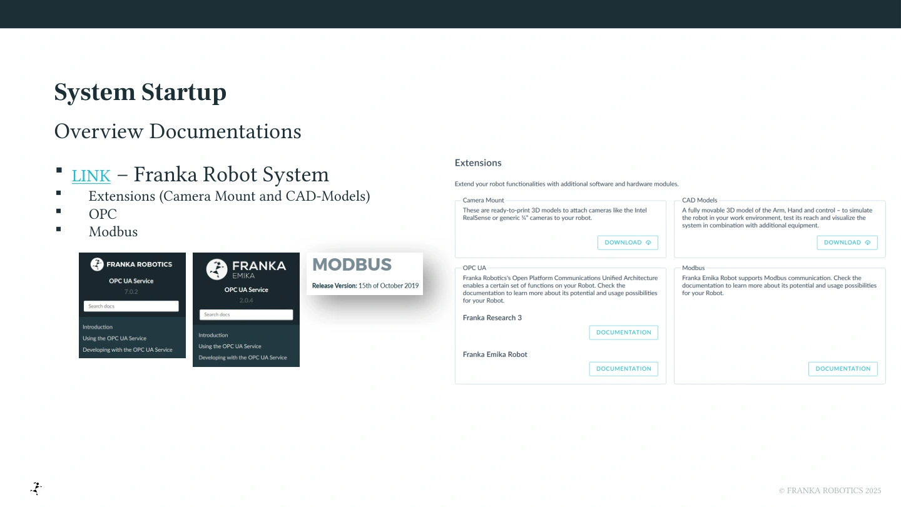



```
System Startup
Overview Documentations
LINK
 – Franka Robot System
Extensions
 (
Camera
 Mount and CAD-Models)
OPC
Modbus

Embedded hyperlinks
https://download.franka.de/Modbus.pdf
https://franka.world/resources
https://download.franka.de/opcua-server-doc-v2.0.4/index.html
https://download.franka.de/opcua-server-doc-v7.0.2/index.html
```



**Embedded slide links:** [Source link 1](https://download.franka.de/Modbus.pdf) · [Source link 2](https://franka.world/resources) · [Source link 3](https://download.franka.de/opcua-server-doc-v2.0.4/index.html) · [Source link 4](https://download.franka.de/opcua-server-doc-v7.0.2/index.html)

## Slide 14

**Source:** EN\_1\_System\_Startup.pptx, original slide 14. [Open the corresponding PDF reading-copy page](https://1292444914-files.gitbook.io/~/files/v0/b/gitbook-x-prod.appspot.com/o/spaces%2FtgOfPnscWebs1eh82EKq%2Fuploads%2FkoG19mbdTKnmhLC9FKzc%2FSTARTUP-pages-001-014.pdf?alt=media#page=14).







```
Diagnostics And Testing
```


