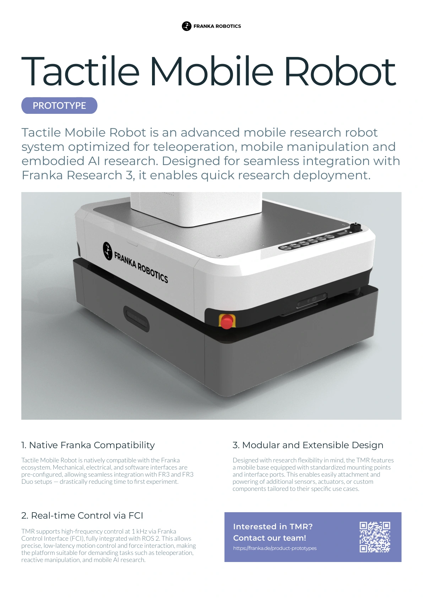
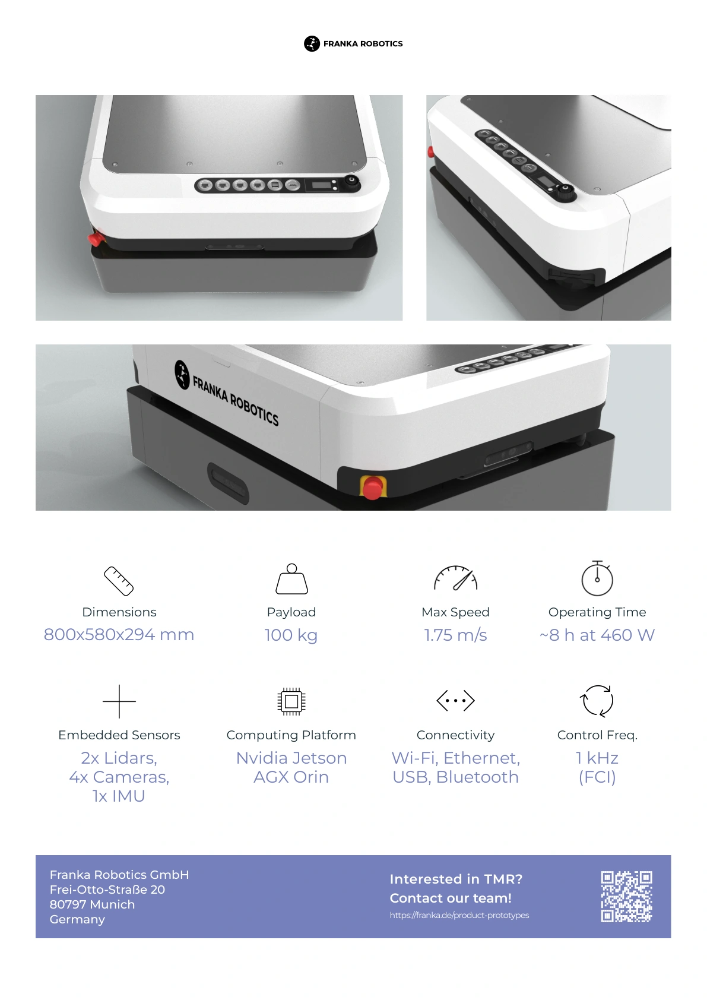

# TMR brochure — complete reference


**Complete supplied source:** TMR.pdf · **Coverage:** 2 original PDF pages. [Return to the Franka source library](./).


Every source page is retained in the original order. The **Original page** view preserves complete diagrams, photographs, tables, equations, connector orientation, notices and examples. The **Searchable text** view preserves native PDF text or the slide’s native text, embedded links and substantive speaker notes. Text extraction can retain reading-order/character defects; use the original image for exact layout, table columns and code indentation.


This is a prototype brochure, not an operating or commissioning manual. Its performance and application descriptions do not establish an approved motion, charging or safety procedure for a delivered platform.


**Attribution:** the manufacturer and contributors identified in the supplied document. Original notices remain visible on every source page. Navigation, revision notes and the linked engineering explanations are OpenELAB editorial additions.

## Document navigation

| Source section / function                                                        | Original page                       |
| -------------------------------------------------------------------------------- | ----------------------------------- |
| Tactile Mobile Robot / Tactile Mobile Robot is an advanced mobile research robot | [PDF 1](complete-tmr.md#pdf-page-1) |
| 800x580x294 mm / 2x Lidars,                                                      | [PDF 2](complete-tmr.md#pdf-page-2) |

## PDF page 1

**Source:** TMR.pdf, original pdf page 1. [Open the corresponding PDF reading-copy page](https://1292444914-files.gitbook.io/~/files/v0/b/gitbook-x-prod.appspot.com/o/spaces%2FtgOfPnscWebs1eh82EKq%2Fuploads%2FQih3LhHN7iCSHRUr0K9V%2FTMR-pages-001-002.pdf?alt=media#page=1).







```
Tactile Mobile Robot 
Tactile Mobile Robot is an advanced mobile research robot 
system optimized for teleoperation, mobile manipulation and 
embodied AI research. Designed for seamless integration with 
Franka Research 3, it enables quick research deployment. 
TMR supports high-frequency control at 1 kHz via Franka  
Control Interface (FCI), fully integrated with ROS 2. This allows 
precise, low-latency motion control and force interaction, making 
the platform suitable for demanding tasks such as teleoperation, 
reactive manipulation, and mobile AI research.
2. Real-time Control via FCI
Tactile Mobile Robot is natively compatible with the Franka 
ecosystem. Mechanical, electrical, and software interfaces are 
pre-configured, allowing seamless integration with FR3 and FR3 
Duo setups — drastically reducing time to first experiment.
Designed with research flexibility in mind, the TMR features 
a mobile base equipped with standardized mounting points 
and interface ports. This enables easily attachment and 
powering of additional sensors, actuators, or custom 
components tailored to their specific use cases.
3. Modular and Extensible Design
1. Native Franka Compatibility
Interested in TMR? 
Contact our team! 
https://franka.de/product-prototypes
PROTOTYPE
```



**Original PDF links:** [Source link 1](https://franka.de/mobile-fr3-duo)

## PDF page 2

**Source:** TMR.pdf, original pdf page 2. [Open the corresponding PDF reading-copy page](https://1292444914-files.gitbook.io/~/files/v0/b/gitbook-x-prod.appspot.com/o/spaces%2FtgOfPnscWebs1eh82EKq%2Fuploads%2FQih3LhHN7iCSHRUr0K9V%2FTMR-pages-001-002.pdf?alt=media#page=2).







```
800x580x294 mm
2x Lidars,  
4x Cameras,  
1x IMU
100 kg
Nvidia Jetson
AGX Orin
1.75 m/s
Wi-Fi, Ethernet, 
USB, Bluetooth
Franka Robotics GmbH
Frei-Otto-Straße 20
80797 Munich
Germany
~8 h at 460 W
1 kHz 
(FCI)
Payload
Dimensions
Max Speed
Operating Time
Embedded Sensors
Computing Platform
Connectivity
Control Freq.
Interested in TMR? 
Contact our team! 
https://franka.de/product-prototypes
```



**Original PDF links:** [Source link 1](https://franka.de/mobile-fr3-duo)
