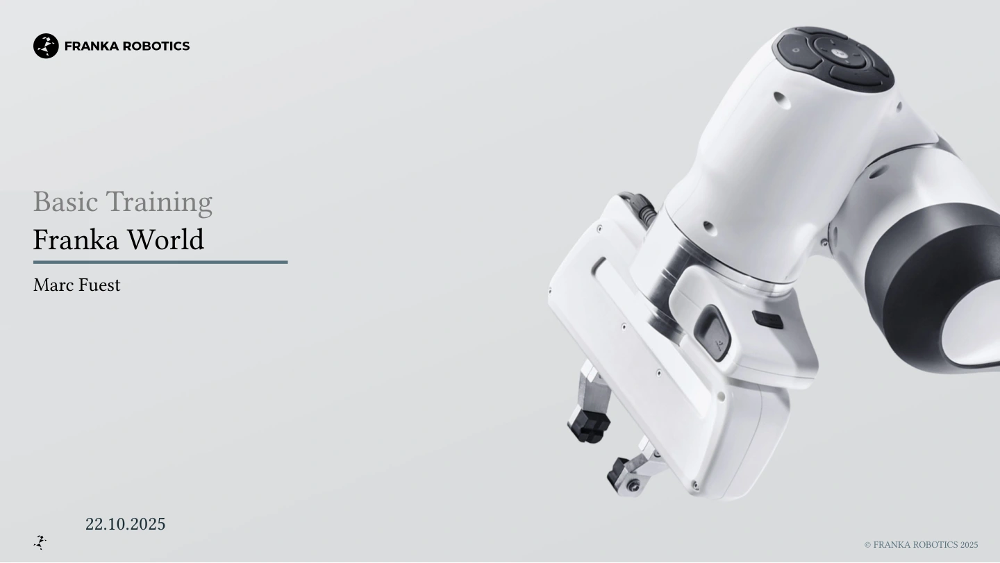
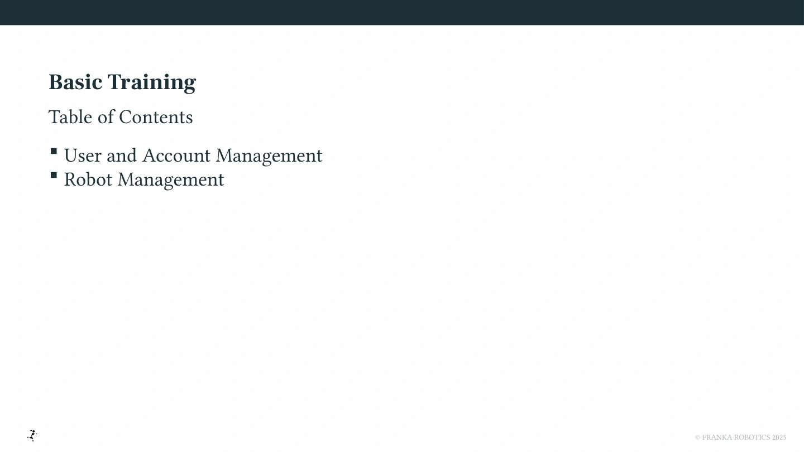
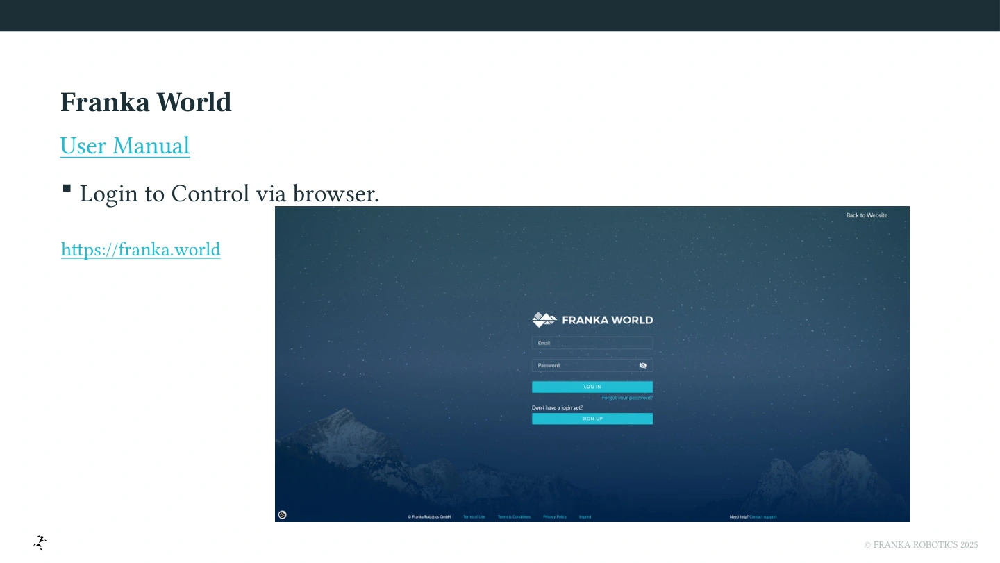
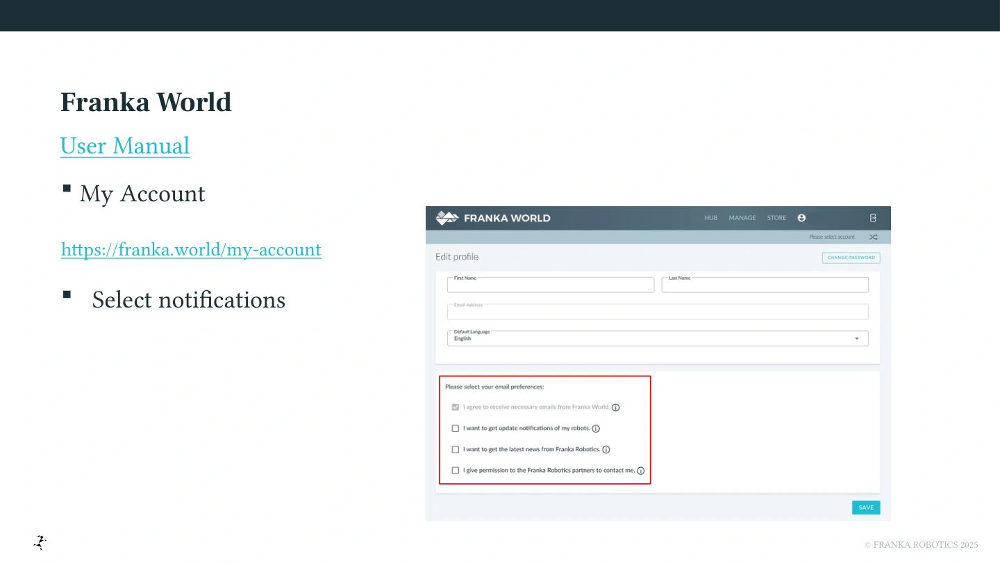
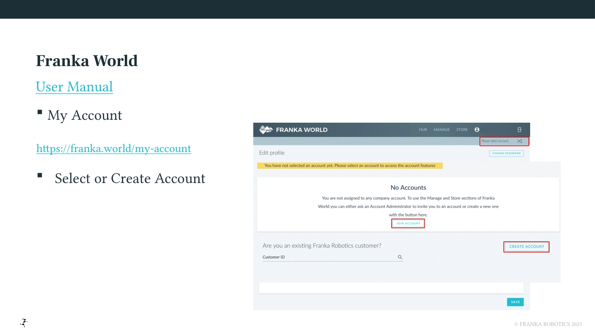
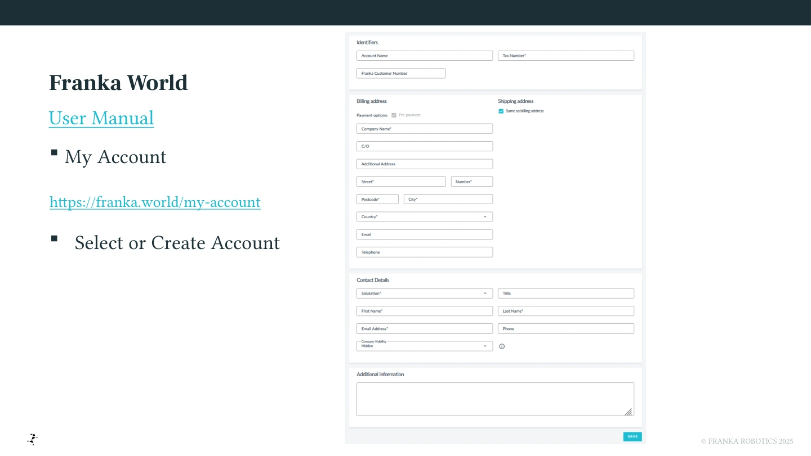
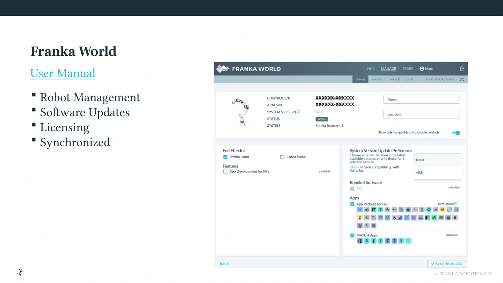
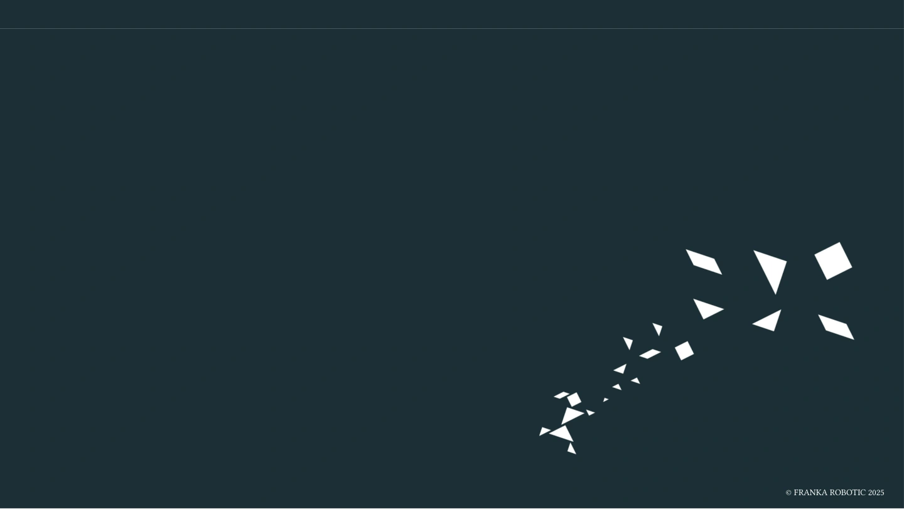

# Franka training 3 — Franka World — complete reference


**Complete supplied source:** EN\_3\_Franka\_World.pptx · **Coverage:** 8 original slides. [Return to the Franka source library](./).


Every source page is retained in the original order. The **Original page** view preserves complete diagrams, photographs, tables, equations, connector orientation, notices and examples. The **Searchable text** view preserves native PDF text or the slide’s native text, embedded links and substantive speaker notes. Text extraction can retain reading-order/character defects; use the original image for exact layout, table columns and code indentation.


These 2025 Account screenshots are retained as training evidence. The current World organization/user interface can differ. Match the robot’s Control serial, organization membership, software compatibility and license state; cloud synchronization is separate from validating physical robot safety.


**Attribution:** the manufacturer and contributors identified in the supplied document. Original notices remain visible on every source page. Navigation, revision notes and the linked engineering explanations are OpenELAB editorial additions.

**Training-copy scope:** these images are rendered reading copies of the supplied PPTX slides. The native file remains authoritative for fonts, presentation effects and editable objects. All original slide numbers, including closing or hidden slides, are retained. Any embedded motion video is linked separately below.

## Document navigation

| Source section / function | Original page                        |
| ------------------------- | ------------------------------------ |
| Slide 1                   | [Slide 1](complete-world.md#slide-1) |
| Basic Training            | [Slide 2](complete-world.md#slide-2) |
| Franka World              | [Slide 3](complete-world.md#slide-3) |
| Franka World (2)          | [Slide 4](complete-world.md#slide-4) |
| Franka World (3)          | [Slide 5](complete-world.md#slide-5) |
| Franka World (4)          | [Slide 6](complete-world.md#slide-6) |
| Franka World (5)          | [Slide 7](complete-world.md#slide-7) |
| Diagnostics And Testing   | [Slide 8](complete-world.md#slide-8) |

## Slide 1

**Source:** EN\_3\_Franka\_World.pptx, original slide 1. [Open the corresponding PDF reading-copy page](https://1292444914-files.gitbook.io/~/files/v0/b/gitbook-x-prod.appspot.com/o/spaces%2FtgOfPnscWebs1eh82EKq%2Fuploads%2FpLQkfDeRqOyyDoyjweaY%2FWORLD-pages-001-008.pdf?alt=media#page=1).







```
Franka World
Basic Training
Marc Fuest
22.10.2025
© FRANKA ROBOTICS 2025
```



## Slide 2

**Source:** EN\_3\_Franka\_World.pptx, original slide 2. [Open the corresponding PDF reading-copy page](https://1292444914-files.gitbook.io/~/files/v0/b/gitbook-x-prod.appspot.com/o/spaces%2FtgOfPnscWebs1eh82EKq%2Fuploads%2FpLQkfDeRqOyyDoyjweaY%2FWORLD-pages-001-008.pdf?alt=media#page=2).







```
Basic Training
Table of Contents
User and Account Management
Robot Management
```



## Slide 3

**Source:** EN\_3\_Franka\_World.pptx, original slide 3. [Open the corresponding PDF reading-copy page](https://1292444914-files.gitbook.io/~/files/v0/b/gitbook-x-prod.appspot.com/o/spaces%2FtgOfPnscWebs1eh82EKq%2Fuploads%2FpLQkfDeRqOyyDoyjweaY%2FWORLD-pages-001-008.pdf?alt=media#page=3).







```
Franka World
User Manual
Login to Control via browser.
https://franka.world

Embedded hyperlinks
https://franka.world/
https://download.franka.de/franka-world-manual/#orgf8344b5
```



**Embedded slide links:** [Source link 1](https://franka.world/) · [Source link 2](https://download.franka.de/franka-world-manual/#orgf8344b5)

## Slide 4

**Source:** EN\_3\_Franka\_World.pptx, original slide 4. [Open the corresponding PDF reading-copy page](https://1292444914-files.gitbook.io/~/files/v0/b/gitbook-x-prod.appspot.com/o/spaces%2FtgOfPnscWebs1eh82EKq%2Fuploads%2FpLQkfDeRqOyyDoyjweaY%2FWORLD-pages-001-008.pdf?alt=media#page=4).







```
Franka World
User Manual
My Account
https://franka.world/my-account
Select notifications

Embedded hyperlinks
https://franka.world/my-account
https://download.franka.de/franka-world-manual/#orgf8344b5
```



**Embedded slide links:** [Source link 1](https://franka.world/my-account) · [Source link 2](https://download.franka.de/franka-world-manual/#orgf8344b5)

## Slide 5

**Source:** EN\_3\_Franka\_World.pptx, original slide 5. [Open the corresponding PDF reading-copy page](https://1292444914-files.gitbook.io/~/files/v0/b/gitbook-x-prod.appspot.com/o/spaces%2FtgOfPnscWebs1eh82EKq%2Fuploads%2FpLQkfDeRqOyyDoyjweaY%2FWORLD-pages-001-008.pdf?alt=media#page=5).







```
Franka World
User Manual
My Account
https://franka.world/my-account
Select or Create Account

Embedded hyperlinks
https://franka.world/my-account
https://download.franka.de/franka-world-manual/#orgf8344b5
```



**Embedded slide links:** [Source link 1](https://franka.world/my-account) · [Source link 2](https://download.franka.de/franka-world-manual/#orgf8344b5)

## Slide 6

**Source:** EN\_3\_Franka\_World.pptx, original slide 6. [Open the corresponding PDF reading-copy page](https://1292444914-files.gitbook.io/~/files/v0/b/gitbook-x-prod.appspot.com/o/spaces%2FtgOfPnscWebs1eh82EKq%2Fuploads%2FpLQkfDeRqOyyDoyjweaY%2FWORLD-pages-001-008.pdf?alt=media#page=6).







```
Franka World
User Manual
My Account
https://franka.world/my-account
Select or Create Account

Embedded hyperlinks
https://franka.world/my-account
https://download.franka.de/franka-world-manual/#orgf8344b5
```



**Embedded slide links:** [Source link 1](https://franka.world/my-account) · [Source link 2](https://download.franka.de/franka-world-manual/#orgf8344b5)

## Slide 7

**Source:** EN\_3\_Franka\_World.pptx, original slide 7. [Open the corresponding PDF reading-copy page](https://1292444914-files.gitbook.io/~/files/v0/b/gitbook-x-prod.appspot.com/o/spaces%2FtgOfPnscWebs1eh82EKq%2Fuploads%2FpLQkfDeRqOyyDoyjweaY%2FWORLD-pages-001-008.pdf?alt=media#page=7).







```
Franka World
User Manual
Robot Management
Software Updates
Licensing
Synchronized

Embedded hyperlinks
https://download.franka.de/franka-world-manual/#orgf8344b5
```



**Embedded slide links:** [Source link 1](https://download.franka.de/franka-world-manual/#orgf8344b5)

## Slide 8

**Source:** EN\_3\_Franka\_World.pptx, original slide 8. [Open the corresponding PDF reading-copy page](https://1292444914-files.gitbook.io/~/files/v0/b/gitbook-x-prod.appspot.com/o/spaces%2FtgOfPnscWebs1eh82EKq%2Fuploads%2FpLQkfDeRqOyyDoyjweaY%2FWORLD-pages-001-008.pdf?alt=media#page=8).







```
Diagnostics And Testing
```


