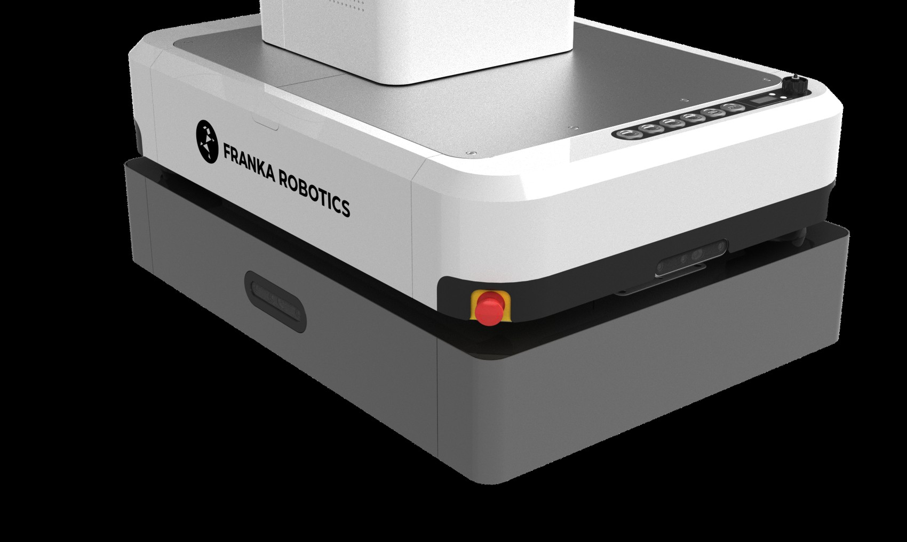

# Tactile Mobile Robot: TMR prototype reference


**Model:** Tactile Mobile Robot (TMR) · **Scope:** Supplied prototype brochure and version-specific manufacturer resources

This manufacturer-source reference has no verified separate current OpenELAB product/SKU match. Confirm the delivered configuration before ordering accessories or applying setup instructions; no substitute store listing is asserted.


## Product overview

TMR is the mobile platform used in Mobile FR3 Duo. It provides mobility, compute and perception and can be integrated with supported Franka structures. The base rating is separate from arm payload and from the load capacity of an optional Spine.

_Source: supplied TMR brochure; illustrative configuration, not a bill of materials._


**Prototype scope:** the supplied brochure and manufacturer installation guide describe research hardware. Use the delivered revision in a controlled laboratory with trained personnel, verified stop functions and an application-specific risk assessment. A certified component does not certify the integrated prototype.


## Applications

Supervised teleoperation, manipulation and embodied-AI research within the delivered platform's operating envelope. A demonstration configuration is not a production workcell or a certified mobile safety application.

## Specifications

| Parameter                         | Value and scope                                                                                                             |
| --------------------------------- | --------------------------------------------------------------------------------------------------------------------------- |
| Role                              | Mobile research base; not the complete dual-arm robot                                                                       |
| Brochure dimensions               | 800×580×294 mm                                                                                                              |
| Brochure payload / maximum speed  | 100 kg / 1.75 m/s; revision-specific reference                                                                              |
| Brochure operating-time condition | Approximately 8 h at 460 W, not an unconditional endurance guarantee                                                        |
| Sensors / compute                 | Two LiDARs, four cameras, one IMU; Jetson AGX Orin                                                                          |
| Interface statement               | Brochure says 1 kHz FCI; verify exact base/mobile API and version rather than assuming ordinary arm libfranka compatibility |

Source: [TMR brochure, PDF pp. 1–2](source-library/). Ratings are reference values for the supplied brochure's scope, not first-run motion settings.

The [v0.2 manual](https://franka.de/hubfs/Prototype%20Manual%20and%20Datasheets%20_Mobile%20FR3%20Duo_R04245_EN.pdf), §5.1, lists 800×583×370 mm, 125 kg maximum payload and 1.5 m/s. These values differ from the supplied brochure and remain a separate revision; no single operating limit is selected here.

## Hardware and connections

The [later v0.2 prototype document](https://franka.de/hubfs/Prototype%20Manual%20and%20Datasheets%20_Mobile%20FR3%20Duo_R04245_EN.pdf), §5, lists a holonomic/omnidirectional platform with different dimensions, payload and speed from the supplied brochure. It also describes battery, charging and subsystem stop arrangements. Confirm the actual delivered battery/charger and approved operating procedure; do not select a supply or reconstruct battery wiring from the brochure.

The publicly linked prototype guide explicitly does not claim a certified complete-system stop design. A LiDAR being present is not proof of a commissioned protective field. Have qualified personnel validate stop devices, coverage, sensor configuration and the controlled indoor test site.

## Software and development resources

Use the delivered TMR image and mobile workspace, not a newly installed arm-only driver. The documented v0.2 environment uses Ubuntu 22.04 and ROS 2 Humble on the companion, while current desktop ROS 2 development may use Jazzy. The model **tmrv0\_2** identifies a specific reference. Do not alter internal sensor addresses, names or calibration to make an unrelated example run. See [simulation and data acceptance](development/simulation-data.md).

## Complete source coverage and engineering details

The supplied material is now readable inside the wiki. The complete readers retain every original page, drawing, table, example and notice; the guidance below explains how to use them for this model or workflow.

| Complete in-wiki source                        | Coverage    |
| ---------------------------------------------- | ----------- |
| [TMR brochure](source-library/complete-tmr.md) | 2 PDF pages |

### Prototype architecture and acceptance

The complete supplied brochure retains both pages of TMR features, hardware/perception information, parameters and intended applications. Treat them as a prototype configuration, rather than a standard production arm/base combination. The mobile platform, manipulation hardware, tactile/perception components and compute path each need a delivered configuration record.

Before developing a task, obtain the exact base/charging and arm operating manuals, sensor/driver definitions, calibrated transforms, payload data, access/control contract and stop/recovery behavior. A manufacturer capability statement does not establish a public SDK, a commissioned navigation stack or a certified safety function.

For research data, record hardware/software versions, topic or channel definitions, timestamps, calibrated coordinate frames and units. Check actual sample content and decoding, not only a recording file or an advertised sensor count. These are supplementary acceptance requirements; no missing prototype pinout or command API is inferred.

## Getting started

1. With motion disabled, identify the base/type label, revision, companion image, batteries, charger and all stop devices. Keep the base on the approved stable floor and secure the work area.
2. Compare the delivered operating manual/BOM with the brochure. Resolve speed, payload, battery and mounting differences before powered commissioning.
3. Obtain the exact network/host and stop-recovery instructions. Verify wireless-stop battery/range and the responsible safety operator as part of the integrator's acceptance.
4. On a commissioned system, view the delivered Dashboard and record battery, drive and optional lift status without enabling a control source.
5. Check required sensors by name against the delivery's topic/calibration list. A topic's existence alone is insufficient evidence of usable data.

**Expected result:** a traceable base/status/sensor inventory and resolved delivery revision, without commanded movement. If the exact operating documents are missing, keep the process at the de-energized identification stage.

## Troubleshooting and FAQs

**The brochure and v0.2 manual disagree:** keep each source's ratings separate and obtain the delivery-specific limits. Do not use the higher rating by default.

**Battery percentage fluctuates:** use the delivered BMS/status definitions and operating instructions. A voltage-based panel estimate under dynamic load is not a calibrated state-of-charge measurement.

**A demo cannot find a camera/IMU:** check the expected image, topic names, hardware version and network map before changing device settings. Never treat an existing sensor as an already accepted safety function.

## Downloads and technical documents

| Resource                                                                | Purpose                                                            |
| ----------------------------------------------------------------------- | ------------------------------------------------------------------ |
| [Supplied source documents](source-library/)                            | Brochure identity, page citations and revision notes               |
| [Manufacturer documentation portal](https://franka.de/documents)        | Exact prototype installation guide and current operating documents |
| [Official model/CAD resources](https://franka.de/models-and-simulation) | Match robot, mount, end effectors, sensors and revision            |
| [Simulation and data acceptance](development/simulation-data.md)        | Keep offline model validation separate from physical commissioning |

## References and validation

Supplied brochure and official resources linked in this guide. Reviewed 22 November 2026. Documentation and source checks only. Software installation, compilation, live robot communication, calibration and physical tests: **not run**. Unresolved delivery-specific limits, mount/stop configuration or software compatibility block the corresponding powered/motion procedure.
