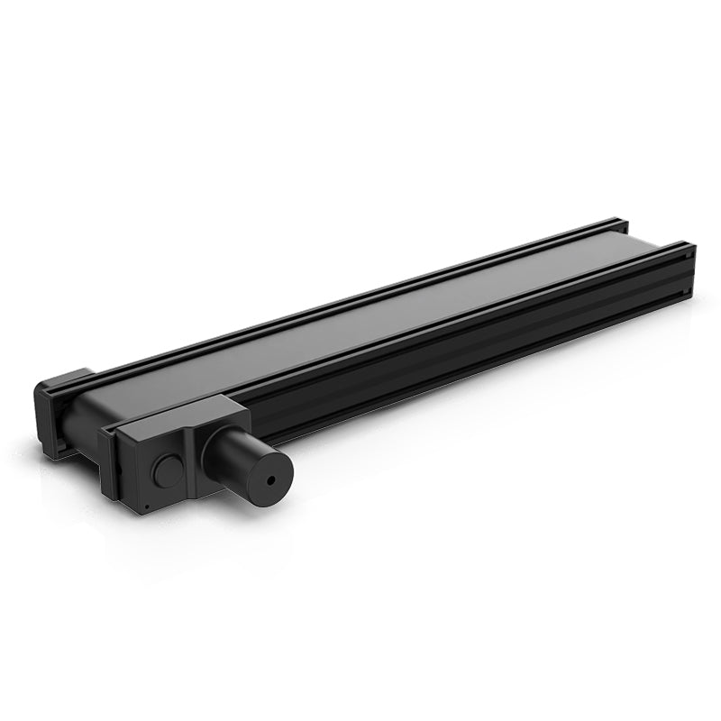

# Hiwonder 12 V Electric Conveyor Belt Guide


[**View Hiwonder 12V Electrical Conveyor Belt for Robot Sorting, 9kg Load on OpenELAB**](https://openelab.io/products/hiwonder-electrical-conveyor-belt-ai)

**SKU:** `Hiwonder-21070072`

**Model / revision scope:** 12 V Electric Conveyor Belt. Match the purchased option below; hardware revisions and controller images are not interchangeable.


## Product overview

A motor-driven tabletop conveyor for object transport and robot-sorting experiments. It uses a 12 V geared DC motor; the motor still needs an external power source or suitably rated motor driver.

The manufacturer’s “no additional power supply” wording refers to integration via the motor cable; it does not mean the conveyor operates without electrical power.

### Models and purchasing options

| OpenELAB SKU        | Purchased option |
| ------------------- | ---------------- |
| `Hiwonder-21070072` | Default Title    |

## Applications

Bench integration, education and development with the exact hardware listed above. Start with the first-result workflow before expanding the assembly or enabling autonomous operation.

## Specifications

| Parameter                       | Value / scope                                             |
| ------------------------------- | --------------------------------------------------------- |
| Motor supply                    | 12 V DC                                                   |
| Rated / no-load / start current | 2.5 A / 0.8 A / 1.3 A, manufacturer figures               |
| Maximum belt speed              | 50 mm/s                                                   |
| Effective carrying length       | 694 mm                                                    |
| Overall size / mass             | 710 × 227 × 67 mm / approximately 3.7 kg                  |
| Listed operating load           | Approximately 9 kg; not a robot-arm payload specification |

Specifications: [manufacturer product data](https://www.hiwonder.com/products/electrical-conveyor-belt) and [OpenELAB listing](https://openelab.io/products/hiwonder-electrical-conveyor-belt-ai). Figures describe the stated configuration; accessory-only options do not inherit the complete kit specifications.

## Hardware and connections

Use a DC motor driver and supply sized for the motor current, with a way to stop power immediately. Do not connect the motor to GPIO or a PWM-servo signal port. Confirm motor lead polarity and driver outputs before connection. Keep objects and fingers away from the roller pinch points.

## Software and development resources

The conveyor does not have a ROS image or positioning SDK. Control comes from the selected motor driver; a JetMax sorting project also requires its own sensing and robot program.

## Getting started

**Prerequisites:** the selected hardware, its matching power source, the required data cable, and a clear work area. Begin with the supplied firmware and an unloaded mechanism.

1. Secure the conveyor on a level surface and remove all objects from the belt.
2. With power off, connect the motor leads to a suitable reversible DC motor driver and provide its documented 12 V motor supply.
3. Start with a low commanded speed and run the belt unloaded for a short interval.
4. Stop fully, then test the reverse command. Confirm the actual travel direction before integrating a sorter.
5. Run one lightweight test object and check that it stays on the belt; increase load only within the mechanical and electrical limits.

**Expected result:** The empty belt travels smoothly in the requested direction, stops reliably, and transports a lightweight object without slipping or contacting the frame.

Procedure reference: [official model or interface manual](https://www.hiwonder.com/products/electrical-conveyor-belt). The steps above are a bounded initial check, not a substitute for the full assembly and development chapters.

## Troubleshooting and FAQs

**No response:** start with the power indicator and cable connections, then verify the selected product/controller profile. Restore communication before running a motion example.

**A function is missing:** compare the order option with the required sensors, controller and software package. A demonstration on an advanced kit does not establish support on an accessory-only or controller-excluded option.

## Downloads and technical documents

* [Official user / interface manual](https://www.hiwonder.com/products/electrical-conveyor-belt)
* [Manufacturer Hiwonder 12V Electrical Conveyor Belt for Robot Sorting, 9kg Load specifications and option drawings](https://www.hiwonder.com/products/electrical-conveyor-belt)

Use the manual’s download or appendix section for the matching revision. A linked download directory is not a claim that every firmware archive, CAD file or installer has been tested. Do not flash an image for a similarly named product.

## References and validation

* [OpenELAB product and SKU options](https://openelab.io/products/hiwonder-electrical-conveyor-belt-ai).
* [Official user / interface manual](https://www.hiwonder.com/products/electrical-conveyor-belt)
* [Manufacturer Hiwonder 12V Electrical Conveyor Belt for Robot Sorting, 9kg Load specifications and option drawings](https://www.hiwonder.com/products/electrical-conveyor-belt)

Reviewed against the linked sources on 19 November 2026. Software installation, compilation and physical hardware tests were not performed for this guide. Use the observable checkpoints above to verify your own unit before integrating it into a larger system.
