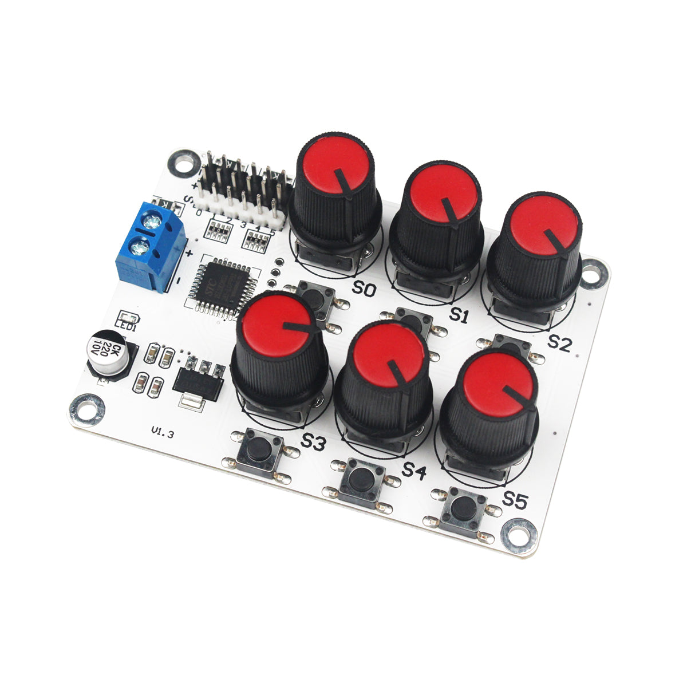

# Hiwonder 6-Output PWM Servo Tester Guide


[**View Hiwonder 6-Channel PWM Servo Tester, Knob Control & Overcurrent Protection on OpenELAB**](https://openelab.io/products/6ch-digital-servo-tester)

**SKU:** `Hiwonder-21090211`

**Model / revision scope:** 6-Output PWM Servo Tester. Match the purchased option below; hardware revisions and controller images are not interchangeable.


## Product overview

A stand-alone knob-operated PWM tester for centering and checking servos without writing a program. Use the individual channel controls for the six PWM outputs.

### Models and purchasing options

| OpenELAB SKU        | Purchased option |
| ------------------- | ---------------- |
| `Hiwonder-21090211` | Default Title    |

## Applications

Bench integration, education and development with the exact hardware listed above. Start with the first-result workflow before expanding the assembly or enabling autonomous operation.

## Specifications

| Parameter         | Value / scope                                  |
| ----------------- | ---------------------------------------------- |
| PWM outputs       | 6                                              |
| Supply            | 5–8.4 V; additionally constrained by the servo |
| Modes             | Manual knob control and Neutral mode           |
| Display           | Input voltage                                  |
| Dimensions / mass | 76 × 53 mm / 37 g                              |

Specifications: [manufacturer product data](https://www.hiwonder.com/products/6-channel-digital-servo-tester) and [OpenELAB listing](https://openelab.io/products/6ch-digital-servo-tester). Figures describe the stated configuration; accessory-only options do not inherit the complete kit specifications.

## Hardware and connections

Connect the servo lead to the marked **S / + / −** pins. Choose one board power input and match the supply to the servo; the board does not convert an 8.4 V battery into a 6 V servo rail. Keep exposed pins away from metal parts and mount the board on insulating spacers.

## Software and development resources

No PC application, firmware installation or SDK is required for manual testing. This tester does not save motion sequences and does not control serial-bus servos.

## Getting started

**Prerequisites:** the selected hardware, its matching power source, the required data cable, and a clear work area. Begin with the supplied firmware and an unloaded mechanism.

1. Remove the servo horn/load and turn the tester off before wiring.
2. Connect one compatible PWM servo with S, + and − aligned to the labels.
3. Apply a regulated voltage within both board and servo ratings. Read the displayed voltage before using the knob.
4. Select **Neutral Mode** with the mode/reset button to center the servo. Its physical angle depends on whether the servo has 180° or 270° travel.
5. Switch to Manual Mode and turn the corresponding knob a small amount. Return to Neutral Mode and confirm repeatable centering.
6. Power off before fitting the horn or adding another servo.

**Expected result:** The displayed supply remains stable, the unloaded servo follows a small knob change, and Neutral Mode returns it to its midpoint.

Procedure reference: [official model or interface manual](https://wiki.hiwonder.com/projects/6-Channel-Servo-Tester/en/latest/docs/2.6_channel_knob_servo_controller.html). The steps above are a bounded initial check, not a substitute for the full assembly and development chapters.

## Troubleshooting and FAQs

**No response:** start with the power indicator and cable connections, then verify the selected product/controller profile. Restore communication before running a motion example.

**A function is missing:** compare the order option with the required sensors, controller and software package. A demonstration on an advanced kit does not establish support on an accessory-only or controller-excluded option.

## Downloads and technical documents

* [Official user / interface manual](https://wiki.hiwonder.com/projects/6-Channel-Servo-Tester/en/latest/docs/2.6_channel_knob_servo_controller.html)
* [Manufacturer Hiwonder 6-Channel PWM Servo Tester, Knob Control & Overcurrent Protection specifications and option drawings](https://www.hiwonder.com/products/6-channel-digital-servo-tester)

Use the manual’s download or appendix section for the matching revision. A linked download directory is not a claim that every firmware archive, CAD file or installer has been tested. Do not flash an image for a similarly named product.

## References and validation

* [OpenELAB product and SKU options](https://openelab.io/products/6ch-digital-servo-tester).
* [Official user / interface manual](https://wiki.hiwonder.com/projects/6-Channel-Servo-Tester/en/latest/docs/2.6_channel_knob_servo_controller.html)
* [Manufacturer Hiwonder 6-Channel PWM Servo Tester, Knob Control & Overcurrent Protection specifications and option drawings](https://www.hiwonder.com/products/6-channel-digital-servo-tester)

Reviewed against the linked sources on 19 November 2026. Software installation, compilation and physical hardware tests were not performed for this guide. Use the observable checkpoints above to verify your own unit before integrating it into a larger system.
