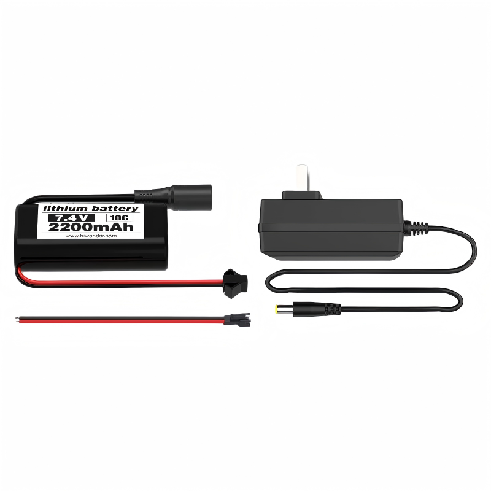

# Hiwonder 7.4 V 2200 mAh Battery and Charger Guide


[**View Hiwonder 7.4V 2200mAh 10C 2S LiPo Battery Kit with Charger on OpenELAB**](https://openelab.io/products/hiwonder-7-4v-2200mah-10c)

**SKU:** `Hiwonder-7.4V-2200mAh`

**Model / revision scope:** 7.4 V 2200 mAh Battery and Charger. Match the purchased option below; hardware revisions and controller images are not interchangeable.


## Product overview

A protected lithium battery kit with a separate charging socket, SM-2P output and dedicated charger. Nominal voltage, full-charge voltage and physical fit must all match the host robot.

The product title lists 10C. That marking is not a verified continuous current rating for the assembled pack, protection board, wiring or SM connector. The listing mixes “LiPo” wording with 18650 cylindrical cells; use the supplied lithium-pack charger and do not infer a different chemistry profile.

### Models and purchasing options

| OpenELAB SKU            | Purchased option |
| ----------------------- | ---------------- |
| `Hiwonder-7.4V-2200mAh` | Default Title    |

## Applications

Bench integration, education and development with the exact hardware listed above. Start with the first-result workflow before expanding the assembly or enabling autonomous operation.

## Specifications

| Parameter                              | Value / scope                                                       |
| -------------------------------------- | ------------------------------------------------------------------- |
| Nominal voltage                        | 7.4 V                                                               |
| Full-charge voltage                    | 8.4 V                                                               |
| Capacity / nominal energy              | 2200 mAh / 16.28 Wh                                                 |
| Included charger (store specification) | 8.4 V, 2 A                                                          |
| Approximate pack size                  | 69.5 × 37 × 19 mm                                                   |
| Output / charge socket                 | SM-2P output / DC 5.5 × 2.5 mm charge socket, as listed by OpenELAB |

Specifications: [OpenELAB listing](https://openelab.io/products/hiwonder-7-4v-2200mah-10c). Figures describe the stated configuration; accessory-only options do not inherit the complete kit specifications.

## Hardware and connections

Keep the load disconnected while checking or charging the pack. Verify the actual charger output label is **8.4 V** and that its polarity and connector match the battery. Red is the listed output positive, black negative; inspect the device-side polarity as well. The charge socket and robot power connector serve different functions. Never substitute an ordinary DC adapter for the lithium charger.

## Software and development resources

No firmware or SDK applies. Battery compatibility is electrical and mechanical, not a robot software setting.

## Getting started

**Prerequisites:** the selected hardware, its matching power source, the required data cable, and a clear work area. Begin with the supplied firmware and an unloaded mechanism.

1. Inspect the battery wrapper, leads and connectors. Do not charge a damaged, swollen, leaking or abnormally hot pack.
2. Compare the pack and charger labels with 7.4 V nominal / 8.4 V charge voltage. Keep the robot switched off and disconnected.
3. Place the pack on a nonflammable surface, connect the supplied matching charger to the battery’s charging socket, then connect the charger to mains power.
4. Supervise charging. The listing describes red for charging and green for idle/full; a green indicator by itself does not prove that a disconnected battery charged.
5. Disconnect the charger after completion. Before connecting a robot, confirm it accepts 8.4 V at full charge, the polarity matches, and the pack fits without pressure on the wires.

**Expected result:** The correct charger and battery are matched, charging completes without abnormal heat or damage, and the disconnected pack is ready for a host that meets the voltage, polarity and fit checks.

## Troubleshooting and FAQs

**Charger stays green:** confirm mains power, the correct battery charging socket and sound connector contact. Green can mean idle as well as full.

**Can this replace another capacity pack?** Only after checking full-charge voltage, polarity, pack dimensions and the host’s current requirement. Capacity alone does not establish compatibility.

**Robot resets under load:** inspect state of charge, connectors and load current; do not bypass the protection board.

**Damage or swelling:** stop use and charging, avoid puncturing the pack, and use an appropriate battery collection route.

## Downloads and technical documents

* [Product label and supplied-kit photograph](https://cdn.shopify.com/s/files/1/0621/0050/4774/files/O1CN01OJUUvv1Ip1il22tce__2201505950941_jpg.png?v=1788504766)

Use the manual’s download or appendix section for the matching revision. A linked download directory is not a claim that every firmware archive, CAD file or installer has been tested. Do not flash an image for a similarly named product.

## References and validation

* [OpenELAB product and SKU options](https://openelab.io/products/hiwonder-7-4v-2200mah-10c).
* [Product label and supplied-kit photograph](https://cdn.shopify.com/s/files/1/0621/0050/4774/files/O1CN01OJUUvv1Ip1il22tce__2201505950941_jpg.png?v=1788504766)

Reviewed against the linked sources on 19 November 2026. Software installation, compilation and physical hardware tests were not performed for this guide. Use the observable checkpoints above to verify your own unit before integrating it into a larger system.
