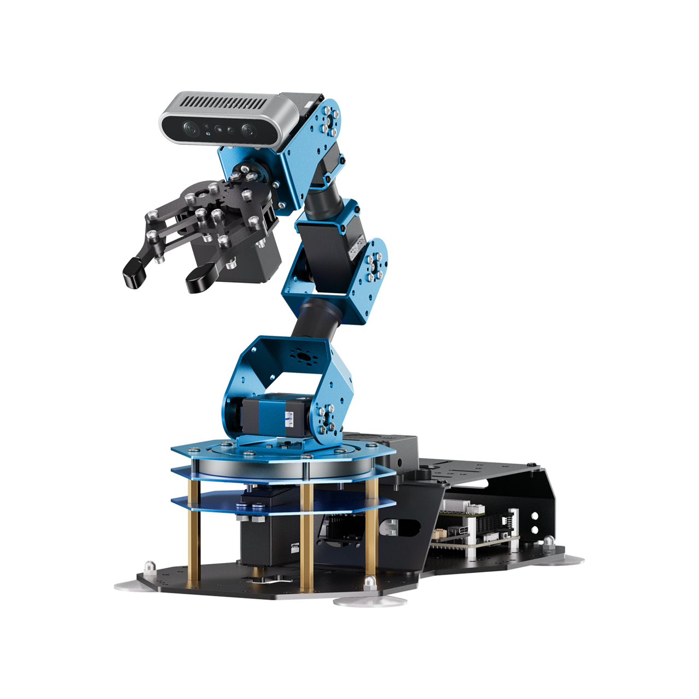

# Hiwonder ArmPi Ultra Guide


[**View Hiwonder ArmPi Ultra ROS2 3D Vision Robot Arm Kit for Raspberry Pi 5 on OpenELAB**](https://openelab.io/products/hiwonder-armpi-ultra-ros2-3d)

**SKU:** `Hiwonder-21010522`, `Hiwonder-21010639`, `Hiwonder-21010537`, `Hiwonder-21010538`, `Hiwonder-21010539`, `Hiwonder-21010526`, `Hiwonder-21010626`, `Hiwonder-21010540`, `Hiwonder-21010541`, `Hiwonder-21010542`, `Hiwonder-21010543`, `Hiwonder-21010630`, `Hiwonder-21010544`, `Hiwonder-21010545`, `Hiwonder-21010546`

**Model / revision scope:** ArmPi Ultra. Match the purchased option below; hardware revisions and controller images are not interchangeable.


## Product overview

ArmPi Ultra is a Raspberry Pi 5 ROS2 arm with six bus-servo degrees of freedom and configuration-dependent depth vision. It is distinct from ArmPi mini, FPV and the mobile ArmPi Pro.

The product table rounds the adapter to 7.4 V, while the user manual repeatedly specifies **7.5 V / 6 A into the STM32 board**. Use the supplied labelled adapter and the manual’s power connection; a camera’s 5 V rating is not the arm input.

### Models and purchasing options

| OpenELAB SKU        | Purchased option                        |
| ------------------- | --------------------------------------- |
| `Hiwonder-21010522` | Starter Kit / Without Raspberry Pi 5    |
| `Hiwonder-21010639` | Starter Kit / With Raspberry Pi 5 2GB   |
| `Hiwonder-21010537` | Starter Kit / With Raspberry Pi 5 4GB   |
| `Hiwonder-21010538` | Starter Kit / With Raspberry Pi 5 8GB   |
| `Hiwonder-21010539` | Starter Kit / With Raspberry Pi 5 16GB  |
| `Hiwonder-21010526` | Standard Kit / Without Raspberry Pi 5   |
| `Hiwonder-21010626` | Standard Kit / With Raspberry Pi 5 2GB  |
| `Hiwonder-21010540` | Standard Kit / With Raspberry Pi 5 4GB  |
| `Hiwonder-21010541` | Standard Kit / With Raspberry Pi 5 8GB  |
| `Hiwonder-21010542` | Standard Kit / With Raspberry Pi 5 16GB |
| `Hiwonder-21010543` | Advanced Kit / Without Raspberry Pi 5   |
| `Hiwonder-21010630` | Advanced Kit / With Raspberry Pi 5 2GB  |
| `Hiwonder-21010544` | Advanced Kit / With Raspberry Pi 5 4GB  |
| `Hiwonder-21010545` | Advanced Kit / With Raspberry Pi 5 8GB  |
| `Hiwonder-21010546` | Advanced Kit / With Raspberry Pi 5 16GB |

A separately named bracket, horn, chassis or rail is the listed accessory, not a complete robot or servo. A “without controller / Raspberry Pi / Jetson / micro:bit” option requires the matching controller separately. Check the selected option’s packing list before starting.

## Applications

Use ArmPi Ultra to learn manual motion, perception and staged automation. Start with an unloaded mechanism and the sensors actually included in the selected kit.

## Specifications

| Parameter      | Value / scope                                   |
| -------------- | ----------------------------------------------- |
| Controller     | Raspberry Pi 5; inclusion/RAM depends on option |
| Arm            | 6 DOF bus-servo mechanism                       |
| Power          | 7.5 V, 6 A adapter specified by the user manual |
| Mass reference | Approximately 1.47 kg                           |
| Software       | ArmPi Ultra ROS2 environment                    |

Specifications: [manufacturer product data](https://www.hiwonder.com/products/armpi-ultra) and [OpenELAB listing](https://openelab.io/products/hiwonder-armpi-ultra-ros2-3d). Figures describe the stated configuration; accessory-only options do not inherit the complete kit specifications.

## Hardware and connections

Connect the supplied battery or adapter to the **robot’s designated power/expansion board**, not directly to a computer GPIO or an unverified charging socket. Inspect the camera, motor/servo and controller cables while power is off. Secure the base to the work surface and clear the entire arm/gripper envelope. Remove objects from the gripper before startup.

Match the controller, camera, LiDAR and chassis configuration to the SKU. Optional voice/AI modules require their own cables and software. A USB camera, depth camera and CSI ribbon camera are not interchangeable interfaces.

## Software and development resources

Start with the factory image for **ArmPi Ultra and the exact controller option**. WonderPi is the documented initial control application. Use the official model downloads for restoration; a generic Raspberry Pi OS or JetPack installation does not include the robot services, calibrated offsets and device configuration.

For development, preserve a backup of the supplied image and calibration files before replacing software. Select the manual branch for the installed board and ROS generation. A menu or directory for a different product is not a compatible firmware target.

## Getting started

**Prerequisites:** the selected hardware, its matching power source, the required data cable, and a clear work area. Begin with the supplied firmware and an unloaded mechanism.

1. Match the SKU table to the physical controller and kit. For a controller-excluded option, install the supported board and its exact robot image before attempting the remaining steps.
2. Secure the base to the work surface and clear the entire arm/gripper envelope. Remove objects from the gripper before startup. Inspect polarity and cable seating, then power the robot with the supplied matching power system.
3. Allow the onboard computer to finish booting and reach its documented ready posture/indicator state. Keep the mechanism clear because initialization may move servos.
4. Install **WonderPi** from the model’s official resources. Enable Wi-Fi and the local-network/location permissions required for discovery. Select **Advanced → ArmPi Ultra**, then **+ → Direct Connection Mode**.
5. Join the robot’s **HW…** hotspot using **hiwonder** on an unchanged factory image. Stay connected if the phone reports no Internet; return to the app and refresh until the correct robot icon appears.
6. Open the model’s Robot/Remote Control screen. Confirm the camera feed, then use a small gripper or single-joint change with no payload. Return to the initial posture and stop; do not begin with an automatic pick sequence.
7. End the demonstration and shut down the onboard operating system before removing power. Keep the original image and configuration until basic control is repeatable.

**Expected result:** The correct robot is discovered, its live camera/connection status is visible, and one small manual command responds and stops predictably. Autonomous tasks and loaded motion remain subsequent tests.

Procedure reference: [official model or interface manual](https://wiki.hiwonder.com/projects/ArmPi-Ultra/en/latest/docs/1.ArmPi_Ultra_User_Manual.html). The steps above are a bounded initial check, not a substitute for the full assembly and development chapters.

## Troubleshooting and FAQs

**No hotspot:** wait for the full boot sequence, verify the battery/adapter and image/controller match, then check whether the robot was previously configured for LAN mode.

**Phone joins Wi-Fi but the app sees nothing:** remain on the robot network despite the no-Internet warning, grant local-network discovery permissions, select the correct model and refresh. The factory password may have been changed on a used unit.

**Camera works but motion is wrong:** stop immediately and verify the chassis type, motor/servo connections and model configuration. Do not compensate with unrelated servo offsets.

**Vision, mapping or voice option is unavailable:** check the selected kit’s actual camera, LiDAR and AI/voice modules. Offline local control does not establish that a cloud AI service is configured.

**Restoring firmware:** use the exact model/controller resource package and retain calibration files; do not write an image for a similarly named Pro or legacy version.

## Downloads and technical documents

* [Official user / interface manual](https://wiki.hiwonder.com/projects/ArmPi-Ultra/en/latest/docs/1.ArmPi_Ultra_User_Manual.html)
* [Official software, image and course downloads](https://wiki.hiwonder.com/projects/ArmPi-Ultra/en/latest/docs/resources_download.html)
* [Manufacturer Hiwonder ArmPi Ultra ROS2 3D Vision Robot Arm Kit for Raspberry Pi 5 specifications and option drawings](https://www.hiwonder.com/products/armpi-ultra)

Use the manual’s download or appendix section for the matching revision. A linked download directory is not a claim that every firmware archive, CAD file or installer has been tested. Do not flash an image for a similarly named product.

## References and validation

* [OpenELAB product and SKU options](https://openelab.io/products/hiwonder-armpi-ultra-ros2-3d).
* [Official user / interface manual](https://wiki.hiwonder.com/projects/ArmPi-Ultra/en/latest/docs/1.ArmPi_Ultra_User_Manual.html)
* [Official software, image and course downloads](https://wiki.hiwonder.com/projects/ArmPi-Ultra/en/latest/docs/resources_download.html)
* [Manufacturer Hiwonder ArmPi Ultra ROS2 3D Vision Robot Arm Kit for Raspberry Pi 5 specifications and option drawings](https://www.hiwonder.com/products/armpi-ultra)

Reviewed against the linked sources on 19 November 2026. Software installation, compilation and physical hardware tests were not performed for this guide. Use the observable checkpoints above to verify your own unit before integrating it into a larger system.
