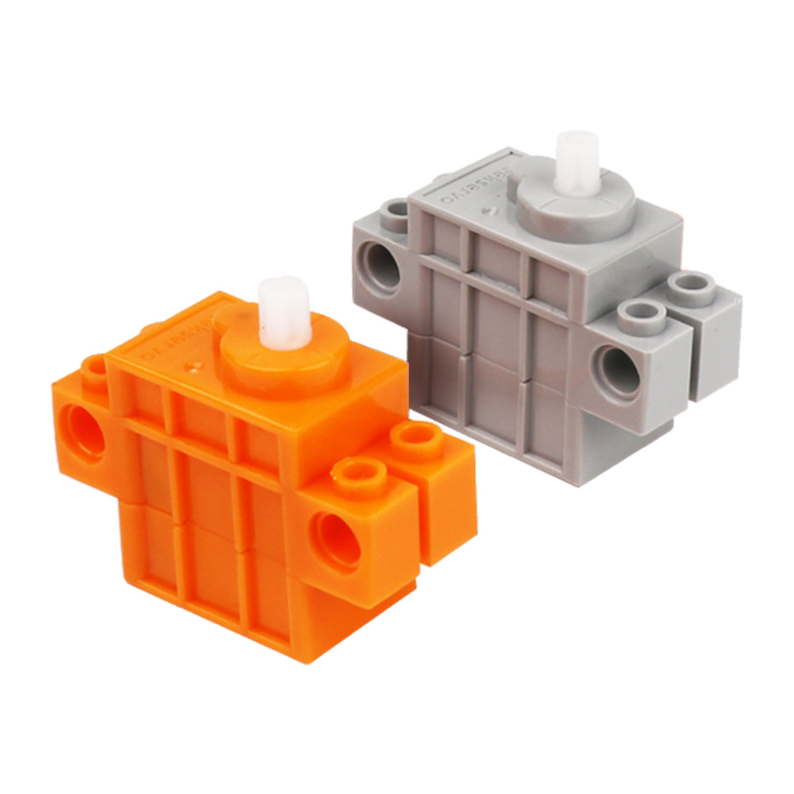

# Hiwonder Brick-Compatible 270° and 360° Servos Guide


[**View Hiwonder Brick-Compatible Servo for micro:bit, 270° Position / 360° Continuous Rotation on OpenELAB**](https://openelab.io/products/block-servo-microbit)

**SKU:** `Hiwoner-21100014`, `Hiwoner-21100013`

**Model / revision scope:** Brick-Compatible 270° and 360° Servos. Match the purchased option below; hardware revisions and controller images are not interchangeable.


## Product overview

The grey brick servo is a position actuator; the orange version is a continuous-rotation drive. Both use a cross-shaped output compatible with suitable building-block mechanisms.

Torque entries in the manufacturer table use inconsistent units for these two options; they are not used here for load sizing.

### Models and purchasing options

| OpenELAB SKU       | Purchased option |
| ------------------ | ---------------- |
| `Hiwoner-21100014` | Gray 270°        |
| `Hiwoner-21100013` | Orange 360°      |

## Applications

Joint positioning, grippers and small robotic mechanisms; choose the mechanism and duty cycle from the electrical and mechanical limits below.

## Specifications

| Parameter              | Value / scope                                                               |
| ---------------------- | --------------------------------------------------------------------------- |
| Supply                 | 6 V                                                                         |
| Grey option            | 0–270° position control                                                     |
| Orange option          | Continuous rotation; direction and speed control, no absolute-angle holding |
| Size / mass            | 40 × 16 mm; 12 g each                                                       |
| Orange neutral command | 1500 µs; verify the individual unit’s stop point                            |

Specifications: [manufacturer product data](https://www.hiwonder.com/products/lego-block-servo) and [OpenELAB listing](https://openelab.io/products/block-servo-microbit). Figures describe the stated configuration; accessory-only options do not inherit the complete kit specifications.

## Hardware and connections

Use a 6 V servo power rail on a compatible PWM controller. Connect signal, positive and negative to the labelled servo port. Do not power the servo from the micro:bit logic rail. The grey and orange options have different control meanings even though their connectors look similar.

## Software and development resources

Use the compatible controller’s PWM/servo blocks. A 360° speed servo cannot be turned into a positioning servo by passing a degree value. No model-specific firmware flash is required.

## Getting started

**Prerequisites:** the selected hardware, its matching power source, the required data cable, and a clear work area. Begin with the supplied firmware and an unloaded mechanism.

1. Identify the grey 270° or orange 360° option and disconnect the output mechanism.
2. Wire one servo to a compatible PWM controller with the power off, then supply regulated 6 V.
3. Send 1500 µs first: the grey servo should seek its midpoint; the orange servo should stop.
4. For the grey version, test 1600 µs and return to 1500 µs. For the orange version, briefly test 1400 µs, return to 1500 µs, then 1600 µs and return to 1500 µs.
5. Power off before attaching the cross axle. Keep the first mechanism test unloaded and stop if the gearing slips.

**Expected result:** The grey output returns to a repeatable position. The orange output turns in opposite directions on opposite sides of its neutral pulse and stops at neutral.

Procedure reference: [official model or interface manual](https://wiki.hiwonder.com/projects/16-Channel-Servo-Controller/en/latest/docs/1_User_Manual_formatted.html). The steps above are a bounded initial check, not a substitute for the full assembly and development chapters.

## Troubleshooting and FAQs

**No movement:** first check the servo power rail under load, ground continuity and the selected control interface. USB connection alone does not establish motor power. Test one unloaded servo before adding a chain.

**Jitter, heat or repeated resets:** disconnect the mechanical load, check for an obstructed horn and measure supply droop. A stall-torque figure is not a continuous operating torque. Reduce the load and duty cycle; do not increase supply voltage beyond the specified limit.

**Wrong travel:** verify the exact suffix and position scale. Mechanical joint limits can be narrower than the servo specification. Set limits for the installed mechanism before running a sequence.

## Downloads and technical documents

* [Official user / interface manual](https://wiki.hiwonder.com/projects/16-Channel-Servo-Controller/en/latest/docs/1_User_Manual_formatted.html)
* [Manufacturer Hiwonder Brick-Compatible Servo for micro:bit, 270° Position / 360° Continuous Rotation specifications and option drawings](https://www.hiwonder.com/products/lego-block-servo)

Use the manual’s download or appendix section for the matching revision. A linked download directory is not a claim that every firmware archive, CAD file or installer has been tested. Do not flash an image for a similarly named product.

## References and validation

* [OpenELAB product and SKU options](https://openelab.io/products/block-servo-microbit).
* [Official user / interface manual](https://wiki.hiwonder.com/projects/16-Channel-Servo-Controller/en/latest/docs/1_User_Manual_formatted.html)
* [Manufacturer Hiwonder Brick-Compatible Servo for micro:bit, 270° Position / 360° Continuous Rotation specifications and option drawings](https://www.hiwonder.com/products/lego-block-servo)

Reviewed against the linked sources on 19 November 2026. Software installation, compilation and physical hardware tests were not performed for this guide. Use the observable checkpoints above to verify your own unit before integrating it into a larger system.
