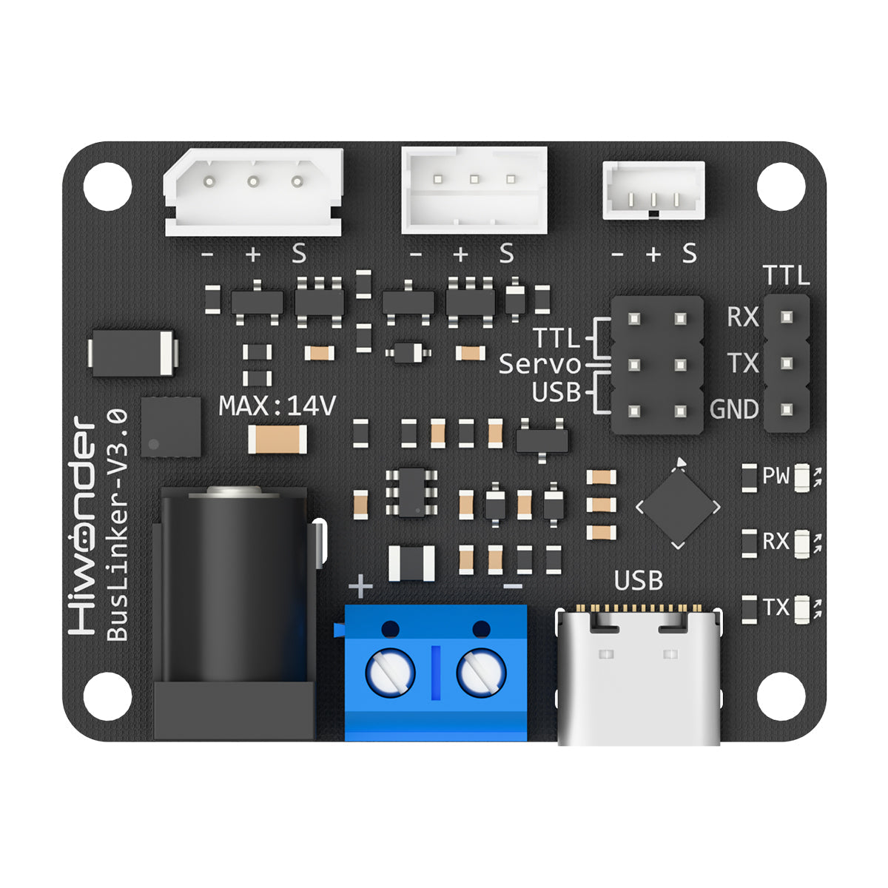

# Hiwonder BusLinker V3.0 Guide


[**View Hiwonder BusLinker V3.0 Servo Debugging Board, USB/TTL UART Driver on OpenELAB**](https://openelab.io/products/buslinker-v3-servo-board)

**SKU:** `Hiwonder-21090270`

**Model / revision scope:** BusLinker V3.0. Match the purchased option below; hardware revisions and controller images are not interchangeable.


## Product overview

BusLinker V3.0 bridges USB or a controller UART to supported Hiwonder serial-bus servos. It is particularly documented with the HX-30HM magnetic-encoder generation and ServoStudio.

### Models and purchasing options

| OpenELAB SKU        | Purchased option |
| ------------------- | ---------------- |
| `Hiwonder-21090270` | Default Title    |

## Applications

Bench integration, education and development with the exact hardware listed above. Start with the first-result workflow before expanding the assembly or enabling autonomous operation.

## Specifications

| Parameter           | Value / scope                                        |
| ------------------- | ---------------------------------------------------- |
| Board input         | 5–14 V; servo-specific limit still applies           |
| PC connection       | USB Type-C data                                      |
| Serial interfaces   | USB, UART / single-wire TTL                          |
| Servo connectors    | 5264, PH2.0 and 1.25T interfaces; match cable/pinout |
| Supported link rate | Up to 1,000,000 bit/s                                |
| Size / mass         | 42 × 33 × 15 mm / 10 g                               |

Specifications: [manufacturer product data](https://www.hiwonder.com/products/buslinker) and [OpenELAB listing](https://openelab.io/products/buslinker-v3-servo-board). Figures describe the stated configuration; accessory-only options do not inherit the complete kit specifications.

## Hardware and connections

Use the labelled DC input or screw terminals for motor power. A 5.5 × 2.1 mm DC connector is documented. Select **Servo–USB** with the jumper for PC operation; MCU mode has a different selection. Connector compatibility does not establish protocol compatibility. Confirm both the servo voltage and the board’s 14 V ceiling.

## Software and development resources

ServoStudio uses the magnetic-encoder servo interface. The manual provides ESP32, STM32, Raspberry Pi and Jetson examples. Do not install the HX-30HM firmware example on another model, and do not assume old 115200-baud servos use the same register layout.

## Getting started

**Prerequisites:** the selected hardware, its matching power source, the required data cable, and a clear work area. Begin with the supplied firmware and an unloaded mechanism.

1. With power disconnected, attach one HX-30HM using the matching 5264 cable, then set the jumper to Servo–USB.
2. Connect USB and an external 11.1 V supply with correct polarity; this voltage is for the HX-30HM example, not every attached servo.
3. Install the CH341 serial driver and open **ServoStudio** from the official Appendix.
4. Select the enumerated serial port and 1,000,000 baud, click Connect, then Dashboard → Scan.
5. Open Config to read the detected ID and mode. In Monitor, read the current position and send a nearby target at low speed using Apply.
6. Disable torque and remove power before changing wiring. Configure other servos one at a time, using their documented baud rate and protocol.

**Expected result:** ServoStudio discovers the HX-30HM and displays live feedback; a small target change produces a matching position change.

Procedure reference: [official model or interface manual](https://wiki.hiwonder.com/projects/BusLinker/en/latest/docs/1_BusLinker_V3.0_Servo_Debugging_Board_User_Manual.html). The steps above are a bounded initial check, not a substitute for the full assembly and development chapters.

## Troubleshooting and FAQs

**No response:** start with the power indicator and cable connections, then verify the selected product/controller profile. Restore communication before running a motion example.

**A function is missing:** compare the order option with the required sensors, controller and software package. A demonstration on an advanced kit does not establish support on an accessory-only or controller-excluded option.

## Downloads and technical documents

* [Official user / interface manual](https://wiki.hiwonder.com/projects/BusLinker/en/latest/docs/1_BusLinker_V3.0_Servo_Debugging_Board_User_Manual.html)
* [ServoStudio, driver and communication resources](https://wiki.hiwonder.com/projects/BusLinker/en/latest/docs/Appendix.html)
* [Manufacturer Hiwonder BusLinker V3.0 Servo Debugging Board, USB/TTL UART Driver specifications and option drawings](https://www.hiwonder.com/products/buslinker)

Use the manual’s download or appendix section for the matching revision. A linked download directory is not a claim that every firmware archive, CAD file or installer has been tested. Do not flash an image for a similarly named product.

## References and validation

* [OpenELAB product and SKU options](https://openelab.io/products/buslinker-v3-servo-board).
* [Official user / interface manual](https://wiki.hiwonder.com/projects/BusLinker/en/latest/docs/1_BusLinker_V3.0_Servo_Debugging_Board_User_Manual.html)
* [ServoStudio, driver and communication resources](https://wiki.hiwonder.com/projects/BusLinker/en/latest/docs/Appendix.html)
* [Manufacturer Hiwonder BusLinker V3.0 Servo Debugging Board, USB/TTL UART Driver specifications and option drawings](https://www.hiwonder.com/products/buslinker)

Reviewed against the linked sources on 19 November 2026. Software installation, compilation and physical hardware tests were not performed for this guide. Use the observable checkpoints above to verify your own unit before integrating it into a larger system.
