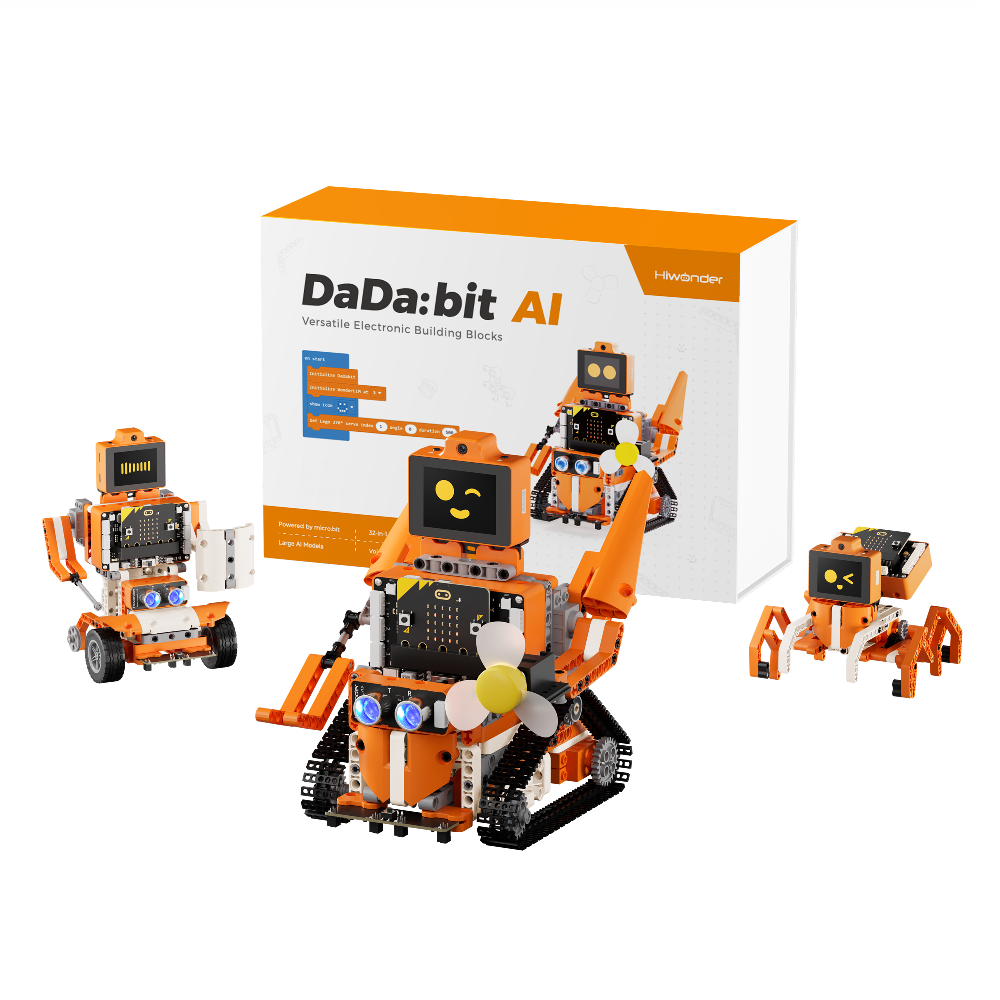

# Hiwonder DaDa:bit AI V2 Guide


[**View Hiwonder DaDa:bit AI V2 micro:bit Large Model Robotics Kit on OpenELAB**](https://openelab.io/products/hiwonder-dada-bit-ai-large)

**SKU:** `Hiwonder-21070156`, `Hiwonder-21070159`, `Hiwonder-21070157`, `Hiwonder-21070160`, `Hiwonder-21070158`, `Hiwonder-21070161`

**Model / revision scope:** DaDa:bit AI V2. Match the purchased option below; hardware revisions and controller images are not interchangeable.


## Product overview

DaDa:bit AI V2 is a micro:bit-based construction kit. The AI edition adds WonderLLM and corresponding projects; the initial test below checks only the micro:bit.

The startup procedure intentionally covers the micro:bit itself. The non-AI V2 preparation manual is cited only for this common micro:bit operation; it is not evidence for AI-module wiring or configuration.

### Models and purchasing options

| OpenELAB SKU        | Purchased option                 |
| ------------------- | -------------------------------- |
| `Hiwonder-21070156` | Starter Kit / without micro:bit  |
| `Hiwonder-21070159` | Starter Kit / with micro:bit     |
| `Hiwonder-21070157` | Standard Kit / without micro:bit |
| `Hiwonder-21070160` | Standard Kit / with micro:bit    |
| `Hiwonder-21070158` | Advanced Kit / without micro:bit |
| `Hiwonder-21070161` | Advanced Kit / with micro:bit    |

A separately named bracket, horn, chassis or rail is the listed accessory, not a complete robot or servo. A “without controller / Raspberry Pi / Jetson / micro:bit” option requires the matching controller separately. Check the selected option’s packing list before starting.

## Applications

Bench integration, education and development with the exact hardware listed above. Start with the first-result workflow before expanding the assembly or enabling autonomous operation.

## Specifications

| Parameter   | Value / scope                                                                 |
| ----------- | ----------------------------------------------------------------------------- |
| Controller  | micro:bit with model-specific expansion board; check included/excluded option |
| Programming | MakeCode for the micro:bit first test                                         |
| Battery     | Supplied 3.7 V cells; follow expansion-board charging documentation           |
| Actuators   | Two 360° motors; two 270° servo(s)                                            |
| Kit scope   | AI module and building-piece counts depend on selected option                 |

Specifications: [manufacturer product data](https://www.hiwonder.com/products/dada-bit-ai-large) and [OpenELAB listing](https://openelab.io/products/hiwonder-dada-bit-ai-large). Figures describe the stated configuration; accessory-only options do not inherit the complete kit specifications.

## Hardware and connections

For this first test, disconnect the micro:bit from the expansion board and power only the micro:bit through its USB data connector. Do not connect a motor or battery pack directly to the micro:bit edge pins. Reinsert it into the model’s expansion board only with both units powered off and with the orientation shown by the exact kit manual.

## Software and development resources

Use [MakeCode for micro:bit](https://makecode.microbit.org/) for the isolated first test. The AI product text names MakeCode while one specification table names WonderCode; use MakeCode for this micro:bit-only procedure and obtain the AI kit’s matching extension/module guide before cloud or actuator examples.

## Getting started

**Prerequisites:** the selected hardware, its matching power source, the required data cable, and a clear work area. Begin with the supplied firmware and an unloaded mechanism.

1. Verify whether the selected option includes a micro:bit. Obtain the correct board separately if excluded.
2. Disconnect the micro:bit from the robot and attach it to a computer using a USB data cable. Confirm the MICROBIT drive appears.
3. Open MakeCode for micro:bit and create a new project. Put a **show icon** block inside **forever**, choosing a heart or another visible icon.
4. Click Download and pair the micro:bit if the browser supports direct download. Otherwise save the generated HEX file and copy it to the MICROBIT drive.
5. Wait for the transfer indicator to finish, then check the LED matrix. Save the project before disconnecting USB.
6. For subsequent kit projects, use the exact V2 expansion-board extension and wiring manual. This USB-only example does not validate the motor supply, AI module or expansion-board port mapping.

**Expected result:** The bare micro:bit displays the chosen LED icon, confirming the basic editor/download path without moving the assembled kit.

Procedure reference: [official model or interface manual](https://wiki.hiwonder.com/projects/DaDabitV2/en/latest/docs/2_Preparation.html). The steps above are a bounded initial check, not a substitute for the full assembly and development chapters.

## Troubleshooting and FAQs

**MICROBIT drive missing:** try a USB data cable and a direct computer port. A charge-only cable can light the board without providing a drive.

**HEX disappears after copying:** this is normal flashing behaviour; confirm the LED output instead of expecting the file to remain.

**Icon works but the assembled robot does not:** the first test verifies the micro:bit only. Check the expansion-board battery, orientation, kit extension and port mapping separately.

**AI functions absent:** verify the AI-specific module is actually in the purchased kit; a basic V2 kit does not gain cloud functions by installing a generic extension.

## Downloads and technical documents

* [Official user / interface manual](https://wiki.hiwonder.com/projects/DaDabitV2/en/latest/docs/2_Preparation.html)
* [Manufacturer Hiwonder DaDa:bit AI V2 micro:bit Large Model Robotics Kit specifications and option drawings](https://www.hiwonder.com/products/dada-bit-ai-large)

Use the manual’s download or appendix section for the matching revision. A linked download directory is not a claim that every firmware archive, CAD file or installer has been tested. Do not flash an image for a similarly named product.

## References and validation

* [OpenELAB product and SKU options](https://openelab.io/products/hiwonder-dada-bit-ai-large).
* [Official user / interface manual](https://wiki.hiwonder.com/projects/DaDabitV2/en/latest/docs/2_Preparation.html)
* [Manufacturer Hiwonder DaDa:bit AI V2 micro:bit Large Model Robotics Kit specifications and option drawings](https://www.hiwonder.com/products/dada-bit-ai-large)

Reviewed against the linked sources on 19 November 2026. Software installation, compilation and physical hardware tests were not performed for this guide. Use the observable checkpoints above to verify your own unit before integrating it into a larger system.
