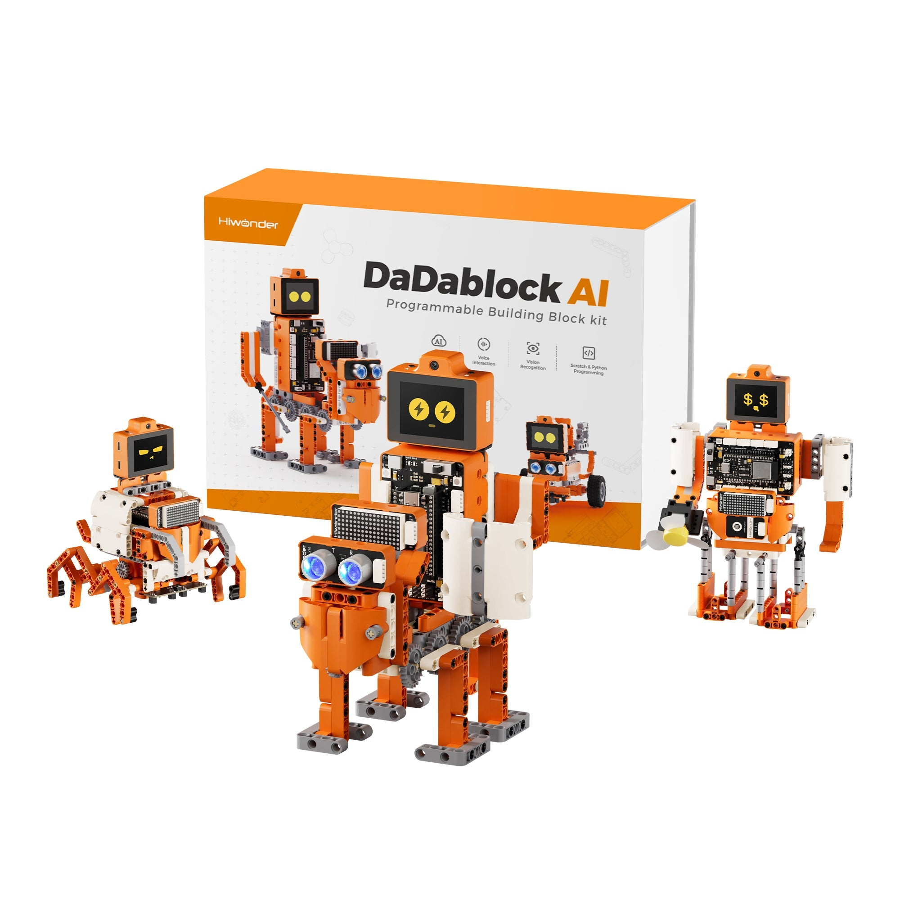

# Hiwonder DaDablock AI Guide


[**View Hiwonder DaDablock AI ESP32 Robot Kit, Vision, Voice, Scratch & Python on OpenELAB**](https://openelab.io/products/hiwonder-dadablock-ai)

**SKU:** `Hiwonder-21070162`, `Hiwonder-21070163`, `Hiwonder-21070164`

**Model / revision scope:** DaDablock AI. Match the purchased option below; hardware revisions and controller images are not interchangeable.


## Product overview

DaDablock AI uses an ESP32 block controller with configurable sensors and actuators. Begin with the onboard RGB LEDs; this tests the upload path without moving any mechanism.

### Models and purchasing options

| OpenELAB SKU        | Purchased option |
| ------------------- | ---------------- |
| `Hiwonder-21070162` | Starter Kit      |
| `Hiwonder-21070163` | Standard Kit     |
| `Hiwonder-21070164` | Advanced Kit     |

## Applications

Bench integration, education and development with the exact hardware listed above. Start with the first-result workflow before expanding the assembly or enabling autonomous operation.

## Specifications

| Parameter      | Value / scope                                         |
| -------------- | ----------------------------------------------------- |
| Controller     | K12 ESP32, model matching the linked hardware chapter |
| Battery        | Two 3.7 V, 1200 mAh cells; 7.4 V rated, 8.4 V maximum |
| Charging input | 5 V; controller charging specification 1500 mA        |
| Actuators      | Two 360° block motors and two 270° block servos       |
| AI module      | WonderLLM                                             |

Specifications: [manufacturer product data](https://www.hiwonder.com/products/dadablock-ai) and [OpenELAB listing](https://openelab.io/products/hiwonder-dadablock-ai). Figures describe the stated configuration; accessory-only options do not inherit the complete kit specifications.

## Hardware and connections

Separate the controller’s USB programming connector from its charging connector. Fit the supplied cells with the holder polarity respected. Keep motors and servos disconnected for the onboard-light test. Charge with the switch OFF using the documented 5 V input; the blue charging indicator turns off on completion. The first activation may require approximately five seconds on the charging connection. Never apply the 7.4 V battery voltage directly to a 5 V vision-module port.

## Software and development resources

WonderCode supports graphical blocks and Python conversion. Use the matching kit’s example files. The first project is local; cloud account/network setup for WonderLLM is a separate chapter. The AI Vision kit’s WonderLens supports onboard recognition and has its own firmware package.

## Getting started

**Prerequisites:** the selected hardware, its matching power source, the required data cable, and a clear work area. Begin with the supplied firmware and an unloaded mechanism.

1. Identify the kit and compare the controller with the hardware chapter. Fit/activate the supplied batteries and disconnect the charger before normal operation.
2. Install WonderCode for the computer OS from the official Quick Start links. Connect the controller’s USB data interface with a data-capable cable.
3. Create a project, click Extensions at the lower left, then choose **Controller → K12 ESP32**.
4. Open the official **Onboard RGB Light Flashing / Onboard RGB LED Blinking** starter project from the model’s Program Files. Check its loop sets the two onboard LEDs red, green and blue, with a one-second wait for each colour.
5. Click Connect device and select the controller’s actual serial port. On Windows, identify the CH340 device in Device Manager; COM3 is only an example, and COM1 is not the default target.
6. Click Upload, wait for completion, and observe the two onboard LEDs. Save the project locally before proceeding to a sensor or motor lesson.

**Expected result:** Both onboard RGB LEDs cycle red → green → blue at one-second intervals. This verifies the controller, extension and upload path without a moving build.

Procedure reference: [official model or interface manual](https://wiki.hiwonder.com/projects/DaDablock-AI/en/ultimate-kit/docs/2_Quick_Start.html). The steps above are a bounded initial check, not a substitute for the full assembly and development chapters.

## Troubleshooting and FAQs

**No serial port:** use a data cable, verify the CH340 driver and close another serial application.

**Connected but no LEDs:** verify K12 ESP32 is selected, the correct project was uploaded and the controller is powered. Watch the upload result before retrying.

**Vision screen flickers:** inspect the documented 5 V module supply and cable; battery voltage must not feed the module directly.

**Cloud AI cannot connect:** finish the local LED test first, then follow the WonderLLM network/binding chapter for the actual module; it is not required for the LED program.

## Downloads and technical documents

* [Official user / interface manual](https://wiki.hiwonder.com/projects/DaDablock-AI/en/ultimate-kit/docs/2_Quick_Start.html)
* [Controller, software and module hardware guide](https://wiki.hiwonder.com/projects/DaDablock-AI/en/ultimate-kit/docs/4_Software_and_Hardware_Guide.html)
* [Manufacturer Hiwonder DaDablock AI ESP32 Robot Kit, Vision, Voice, Scratch & Python specifications and option drawings](https://www.hiwonder.com/products/dadablock-ai)

Use the manual’s download or appendix section for the matching revision. A linked download directory is not a claim that every firmware archive, CAD file or installer has been tested. Do not flash an image for a similarly named product.

## References and validation

* [OpenELAB product and SKU options](https://openelab.io/products/hiwonder-dadablock-ai).
* [Official user / interface manual](https://wiki.hiwonder.com/projects/DaDablock-AI/en/ultimate-kit/docs/2_Quick_Start.html)
* [Controller, software and module hardware guide](https://wiki.hiwonder.com/projects/DaDablock-AI/en/ultimate-kit/docs/4_Software_and_Hardware_Guide.html)
* [Manufacturer Hiwonder DaDablock AI ESP32 Robot Kit, Vision, Voice, Scratch & Python specifications and option drawings](https://www.hiwonder.com/products/dadablock-ai)

Reviewed against the linked sources on 19 November 2026. Software installation, compilation and physical hardware tests were not performed for this guide. Use the observable checkpoints above to verify your own unit before integrating it into a larger system.
