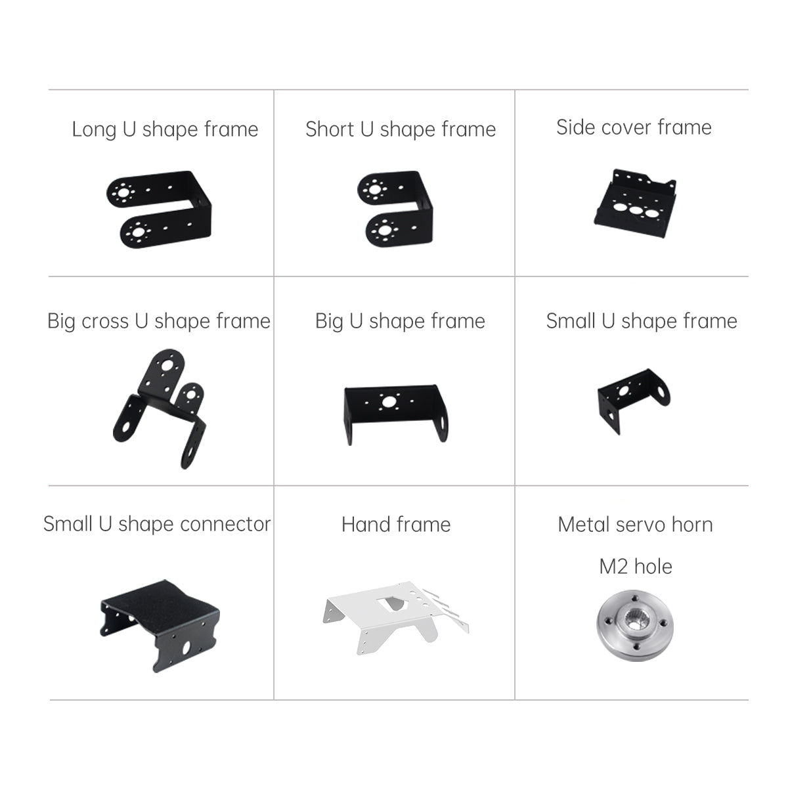

# Hiwonder Double-Shaft Servo Frame Brackets Guide


[**View Hiwonder Double-Shaft Servo Bracket & Frame Parts for Robot Joints on OpenELAB**](https://openelab.io/products/double-shaft-servo-bracket)

**SKU:** `Hiwonder-21100212`, `Hiwonder-21100213`, `Hiwonder-21100154`, `Hiwonder-21100151`, `Hiwonder-21100152`, `Hiwonder-21100153`, `Hiwonder-11020022`, `Hiwonder-21100040`, `Hiwonder-21100215`

**Model / revision scope:** Double-Shaft Servo Frame Brackets. Match the purchased option below; hardware revisions and controller images are not interchangeable.


## Product overview

A mechanical mounting accessory for compatible servo assemblies. The selected bracket is not a servo, controller or complete moving joint.

### Models and purchasing options

| OpenELAB SKU        | Purchased option        |
| ------------------- | ----------------------- |
| `Hiwonder-21100212` | long U shape frame      |
| `Hiwonder-21100213` | short U shape frame     |
| `Hiwonder-21100154` | big cross U shape frame |
| `Hiwonder-21100151` | side cover frame        |
| `Hiwonder-21100152` | big U shape frame       |
| `Hiwonder-21100153` | small U shape frame     |
| `Hiwonder-11020022` | hand frame              |
| `Hiwonder-21100040` | metal servo horn        |
| `Hiwonder-21100215` | small U shape connector |

A separately named bracket, horn, chassis or rail is the listed accessory, not a complete robot or servo. A “without controller / Raspberry Pi / Jetson / micro:bit” option requires the matching controller separately. Check the selected option’s packing list before starting.

## Applications

Bench integration, education and development with the exact hardware listed above. Start with the first-result workflow before expanding the assembly or enabling autonomous operation.

## Specifications

| Parameter         | Value / scope                                                  |
| ----------------- | -------------------------------------------------------------- |
| Compatibility     | Match the selected frame geometry and exact servo drawing      |
| Supply / firmware | Not applicable to the passive bracket                          |
| Selection         | Individual option or pack as explicitly named in the SKU table |

Specifications: [manufacturer product data](https://www.hiwonder.com/products/double-shaft-servo-frame-bracket) and [OpenELAB listing](https://openelab.io/products/double-shaft-servo-bracket). Figures describe the stated configuration; accessory-only options do not inherit the complete kit specifications.

## Hardware and connections

Compare the mounting-hole centres, horn interface, shaft support and screw engagement with the manufacturer drawing. Do not assume that similarly sized LX-series or double-shaft servos share every mounting dimension. Plan cable exit and joint clearance before tightening the assembly.

## Software and development resources

No software is required for the bracket. Motion control, voltage and firmware requirements belong to the separately selected servo.

## Getting started

**Prerequisites:** the selected hardware, its matching power source, the required data cable, and a clear work area. Begin with the supplied firmware and an unloaded mechanism.

1. Lay out only the selected bracket parts and compare them with the order option and packing image.
2. Disconnect servo power and place the bracket against the matching case without forcing the shaft or bending the plate.
3. Align the documented holes, fit the correct supplied fasteners loosely, and check that screws do not bottom out inside the case.
4. Verify that the cable exits remain clear and the intended joint travel does not collide with the bracket.
5. Tighten the mounting hardware, then use the servo’s own centering and small-travel procedure before applying a load.

**Expected result:** The bracket fits squarely, all intended fasteners engage correctly, and the cable and linkage have clearance through the planned motion.

Procedure reference: [official model or interface manual](https://www.hiwonder.com/products/double-shaft-servo-frame-bracket). The steps above are a bounded initial check, not a substitute for the full assembly and development chapters.

## Troubleshooting and FAQs

**Holes do not align:** recheck the exact servo suffix and bracket option; do not enlarge holes to force an unverified fit.

**Joint binds:** check shaft alignment, support-bearing seating, cable interference and screw length before powering the servo.

**Servo missing from the parcel:** this listing supplies the named mounting accessory; consult the selected option’s packing list.

## Downloads and technical documents

* [Official user / interface manual](https://www.hiwonder.com/products/double-shaft-servo-frame-bracket)
* [Manufacturer Hiwonder Double-Shaft Servo Bracket & Frame Parts for Robot Joints specifications and option drawings](https://www.hiwonder.com/products/double-shaft-servo-frame-bracket)

Use the manual’s download or appendix section for the matching revision. A linked download directory is not a claim that every firmware archive, CAD file or installer has been tested. Do not flash an image for a similarly named product.

## References and validation

* [OpenELAB product and SKU options](https://openelab.io/products/double-shaft-servo-bracket).
* [Official user / interface manual](https://www.hiwonder.com/products/double-shaft-servo-frame-bracket)
* [Manufacturer Hiwonder Double-Shaft Servo Bracket & Frame Parts for Robot Joints specifications and option drawings](https://www.hiwonder.com/products/double-shaft-servo-frame-bracket)

Reviewed against the linked sources on 19 November 2026. Software installation, compilation and physical hardware tests were not performed for this guide. Use the observable checkpoints above to verify your own unit before integrating it into a larger system.
