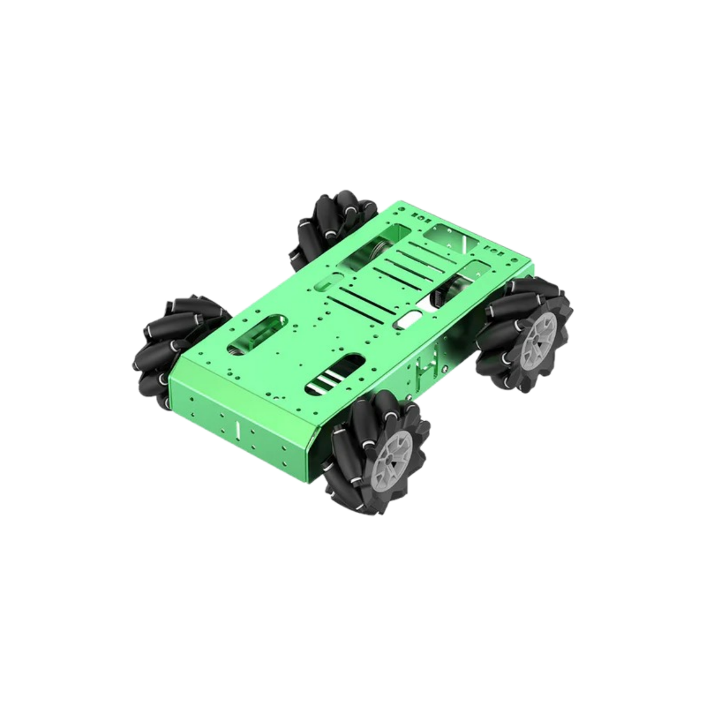

# Hiwonder Green 80 mm Mecanum Chassis Guide


[**View Hiwonder JetMax Green Mecanum Vehicle Chassis Unassembled Kit on OpenELAB**](https://openelab.io/products/hiwonder-green-vehicle-chassis-unassembled)

**SKU:** `Hiwonder-21030032`

[**View Hiwonder 80mm 4WD Mecanum Wheel Robot Chassis with 12V Encoder Motors on OpenELAB**](https://openelab.io/products/hiwonder-4wd-mecanum-wheel-chassis)

**SKU:** `Hiwonder-MC80-1L-12V`, `Hiwonder-MC80-2L-12V`

**Model / revision scope:** Green 80 mm Mecanum Chassis. Match the purchased option below; hardware revisions and controller images are not interchangeable.


## Product overview

Green 80 mm Mecanum Chassis is a mechanical drive platform for a separately chosen controller and motor-driver system. Select the exact encoder, driver and layer option from the SKU table.

### Models and purchasing options

| OpenELAB SKU           | Purchased option                                                                                                          |
| ---------------------- | ------------------------------------------------------------------------------------------------------------------------- |
| `Hiwonder-21030032`    | Default Title — Hiwonder JetMax Green Mecanum Vehicle Chassis Unassembled Kit                                             |
| `Hiwonder-MC80-1L-12V` | Single-Layer Chassis with 80mm Mecanum Wheels 12V — Hiwonder 80mm 4WD Mecanum Wheel Robot Chassis with 12V Encoder Motors |
| `Hiwonder-MC80-2L-12V` | Dual-Layer Chassis with 80mm Mecanum Wheels 12V — Hiwonder 80mm 4WD Mecanum Wheel Robot Chassis with 12V Encoder Motors   |

A separately named bracket, horn, chassis or rail is the listed accessory, not a complete robot or servo. A “without controller / Raspberry Pi / Jetson / micro:bit” option requires the matching controller separately. Check the selected option’s packing list before starting.

## Applications

Bench integration, education and development with the exact hardware listed above. Start with the first-result workflow before expanding the assembly or enabling autonomous operation.

## Specifications

| Parameter     | Value / scope                              |
| ------------- | ------------------------------------------ |
| Motor voltage | 9–12 V                                     |
| Drive         | 12 V encoder motors, approximately 110 rpm |
| Dimensions    | 300 × 245 × 100 mm                         |
| Mass          | 1.9 kg                                     |

Specifications: [manufacturer product data](https://www.hiwonder.com/products/large-metal-4wd-vehicle-chassis-green) and [OpenELAB listing](https://openelab.io/products/hiwonder-green-vehicle-chassis-unassembled). Figures describe the stated configuration; accessory-only options do not inherit the complete kit specifications.

## Hardware and connections

Match the motor driver’s voltage and current capability to the installed motor. Route motor-power wires separately from encoder signals and keep cables away from wheels/tracks. Identify each motor and encoder connector using the supplied drawing; connector shape alone does not establish pin order. Fit left/right-handed Mecanum wheels in the manufacturer’s arrangement; reversing a wheel’s roller orientation changes lateral motion.

## Software and development resources

The chassis itself has no firmware image. Use the selected motor-driver examples, then configure the real wheel diameter, wheelbase/track width and encoder counts in your controller. A Mecanum, differential-track and Ackermann drive use different kinematics.

## Getting started

**Prerequisites:** the selected hardware, its matching power source, the required data cable, and a clear work area. Begin with the supplied firmware and an unloaded mechanism.

1. Lay out the chassis parts and match the selected packing option. Confirm whether encoder motors and a driver board are included.
2. Assemble the frame and wheels/tracks using the manufacturer’s product drawings, with all electronics unpowered.
3. Secure the chassis with wheels/tracks clear of the work surface. Confirm free cable routing and no frame contact.
4. Connect one motor to a suitably rated driver using its verified terminal diagram. Use a supply matched to the motor voltage above, not a voltage copied from a different-colour chassis.
5. Command a brief low-speed movement, stop, and reverse. Repeat for the other motor channels and record each direction before coordinated driving.
6. For encoder-equipped options, verify counts change when that motor turns before enabling closed-loop speed control.

**Expected result:** Each installed motor responds individually, stops reliably and turns in a recorded direction; encoder-equipped channels produce changing feedback. The chassis is then ready for controller-specific kinematic calibration.

Procedure reference: [official model or interface manual](https://www.hiwonder.com/products/large-metal-4wd-vehicle-chassis-green). The steps above are a bounded initial check, not a substitute for the full assembly and development chapters.

## Troubleshooting and FAQs

**Robot turns instead of moving straight:** test motors individually and compare the channel/direction map. For Mecanum wheels also verify handedness and mounting order.

**High current or poor travel:** inspect track tension, wheel/frame contact, binding bearings and supply droop before raising the command.

**No encoder data:** first confirm the purchased option actually includes encoders, then verify its power and A/B signal mapping.

**Controller absent:** this is a chassis listing; only the selected packing option determines the supplied electronics.

## Downloads and technical documents

* [Official user / interface manual](https://www.hiwonder.com/products/large-metal-4wd-vehicle-chassis-green)
* [Manufacturer Hiwonder JetMax Green Mecanum Vehicle Chassis Unassembled Kit specifications and option drawings](https://www.hiwonder.com/products/large-metal-4wd-vehicle-chassis-green)
* [Manufacturer Hiwonder 80mm 4WD Mecanum Wheel Robot Chassis with 12V Encoder Motors specifications and option drawings](https://www.hiwonder.com/products/large-metal-4wd-vehicle-chassis-green)

Use the manual’s download or appendix section for the matching revision. A linked download directory is not a claim that every firmware archive, CAD file or installer has been tested. Do not flash an image for a similarly named product.

## References and validation

* [OpenELAB product and SKU options](https://openelab.io/products/hiwonder-green-vehicle-chassis-unassembled).
* [OpenELAB product and SKU options](https://openelab.io/products/hiwonder-4wd-mecanum-wheel-chassis).
* [Official user / interface manual](https://www.hiwonder.com/products/large-metal-4wd-vehicle-chassis-green)
* [Manufacturer Hiwonder JetMax Green Mecanum Vehicle Chassis Unassembled Kit specifications and option drawings](https://www.hiwonder.com/products/large-metal-4wd-vehicle-chassis-green)
* [Manufacturer Hiwonder 80mm 4WD Mecanum Wheel Robot Chassis with 12V Encoder Motors specifications and option drawings](https://www.hiwonder.com/products/large-metal-4wd-vehicle-chassis-green)

Reviewed against the linked sources on 19 November 2026. Software installation, compilation and physical hardware tests were not performed for this guide. Use the observable checkpoints above to verify your own unit before integrating it into a larger system.
