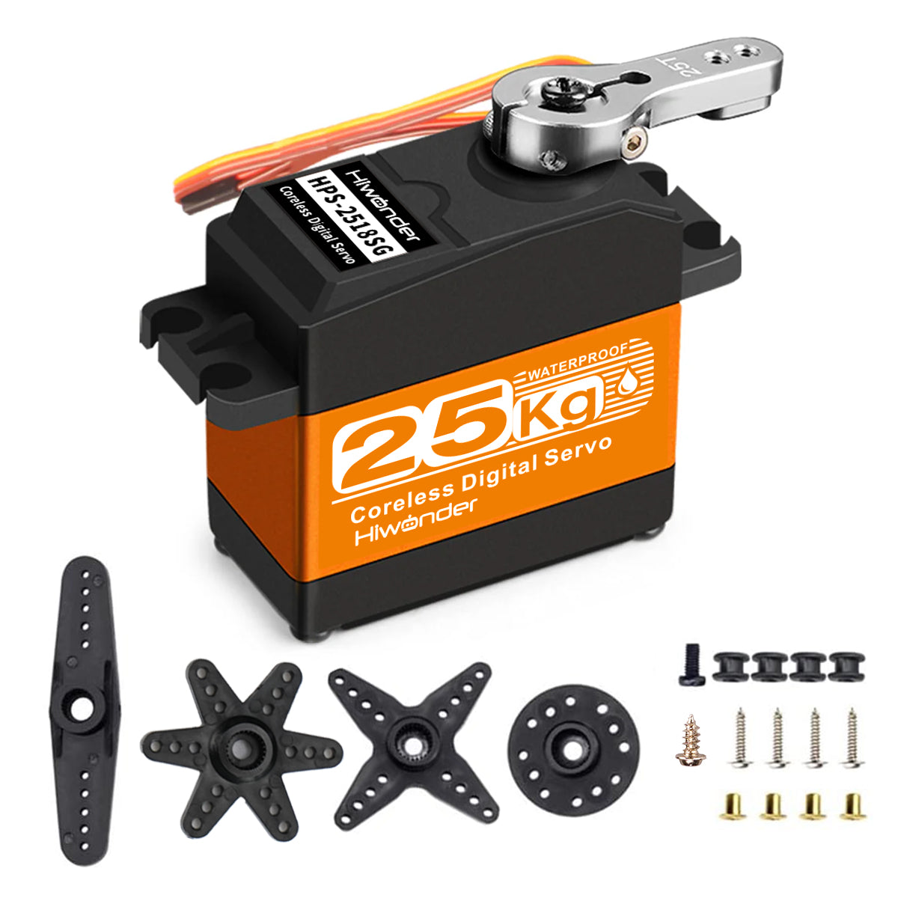

# Hiwonder HPS-2518SG Guide


[**View Hiwonder HPS-2518SG 25kg Coreless Waterproof PWM Servo, 180° on OpenELAB**](https://openelab.io/products/hps-2518sg-servo)

**SKU:** `Hiwoner-21100208`

**Model / revision scope:** HPS-2518SG. Match the purchased option below; hardware revisions and controller images are not interchangeable.


## Product overview

HPS-2518SG is a three-wire PWM position servo. Coreless servo, 180° travel.

### Models and purchasing options

| OpenELAB SKU       | Purchased option |
| ------------------ | ---------------- |
| `Hiwoner-21100208` | Default Title    |

## Applications

Joint positioning, grippers and small robotic mechanisms; choose the mechanism and duty cycle from the electrical and mechanical limits below.

## Specifications

| Parameter                             | Value / scope                                                     |
| ------------------------------------- | ----------------------------------------------------------------- |
| Supply range                          | 5–8.4 V                                                           |
| Positioning travel                    | 180°                                                              |
| Command pulse range                   | 500–2500 µs; check the installed mechanism before using endpoints |
| Stall torque (manufacturer reference) | 25 kgf·cm at 7.4 V                                                |
| Mass                                  | 60 g                                                              |
| Stall-current reference               | 2.2–3.2 A                                                         |

Specifications: [manufacturer product data](https://www.hiwonder.com/products/hps-2518sg) and [OpenELAB listing](https://openelab.io/products/hps-2518sg-servo). Figures describe the stated configuration; accessory-only options do not inherit the complete kit specifications.

## Hardware and connections

Use a PWM servo controller with outputs labelled **S / + / −**. Connect the signal conductor to S, supply positive to + and ground to − after checking the cable identification on the exact servo. Do not use a serial-bus port. The controller and servo supply ranges must overlap; USB or a microcontroller GPIO is not the motor power source.

The linked LSC-16 manual shows a PWM-controller example; its 500–2500 values are pulse widths, not degrees. For this 180° model, the nominal midpoint is 90°. Fit the horn after centering with power removed.

## Software and development resources

No firmware flashing is needed for the servo. A PWM tester or the LSC-series PC application generates the control signal. Arduino or Raspberry Pi integration requires a suitable servo power rail and PWM interface; do not substitute the bus-servo protocol.

## Getting started

**Prerequisites:** the selected hardware, its matching power source, the required data cable, and a clear work area. Begin with the supplied firmware and an unloaded mechanism.

1. Remove the horn/load, secure the servo body, and disconnect power before wiring. Use one PWM output only for the initial check.
2. Connect the servo to channel 1 of an LSC-16 or equivalent labelled PWM controller. Set a regulated 6 V servo supply, within both device ratings, and observe polarity.
3. Connect the LSC-16 by USB and open **Hiwonder Servo Control** from its official Appendix. Select only channel 1; verify the connection indicator.
4. Click **Reset servo** to send the 1500 µs midpoint. Keep the shaft unloaded and clear of obstructions.
5. Change the channel-1 value to 1600, then back to 1500. This deliberately small test avoids sweeping to the mechanical ends. Stop if the supply collapses or the servo strains.
6. Power off, fit the horn in the required neutral orientation, then set narrower software limits for the linkage before adding load.

**Expected result:** The unloaded shaft moves a small amount and returns to the same midpoint. This checks PWM response; it does not establish torque capacity or absolute mechanical calibration.

Procedure reference: [official model or interface manual](https://wiki.hiwonder.com/projects/16-Channel-Servo-Controller/en/latest/docs/1_User_Manual_formatted.html). The steps above are a bounded initial check, not a substitute for the full assembly and development chapters.

## Troubleshooting and FAQs

**No movement:** first check the servo power rail under load, ground continuity and the selected control interface. USB connection alone does not establish motor power. Test one unloaded servo before adding a chain.

**Jitter, heat or repeated resets:** disconnect the mechanical load, check for an obstructed horn and measure supply droop. A stall-torque figure is not a continuous operating torque. Reduce the load and duty cycle; do not increase supply voltage beyond the specified limit.

**Wrong travel:** verify the exact suffix and position scale. Mechanical joint limits can be narrower than the servo specification. Set limits for the installed mechanism before running a sequence.

## Downloads and technical documents

* [Official user / interface manual](https://wiki.hiwonder.com/projects/16-Channel-Servo-Controller/en/latest/docs/1_User_Manual_formatted.html)
* [Manufacturer Hiwonder HPS-2518SG 25kg Coreless Waterproof PWM Servo, 180° specifications and option drawings](https://www.hiwonder.com/products/hps-2518sg)

Use the manual’s download or appendix section for the matching revision. A linked download directory is not a claim that every firmware archive, CAD file or installer has been tested. Do not flash an image for a similarly named product.

## References and validation

* [OpenELAB product and SKU options](https://openelab.io/products/hps-2518sg-servo).
* [Official user / interface manual](https://wiki.hiwonder.com/projects/16-Channel-Servo-Controller/en/latest/docs/1_User_Manual_formatted.html)
* [Manufacturer Hiwonder HPS-2518SG 25kg Coreless Waterproof PWM Servo, 180° specifications and option drawings](https://www.hiwonder.com/products/hps-2518sg)

Reviewed against the linked sources on 19 November 2026. Software installation, compilation and physical hardware tests were not performed for this guide. Use the observable checkpoints above to verify your own unit before integrating it into a larger system.
