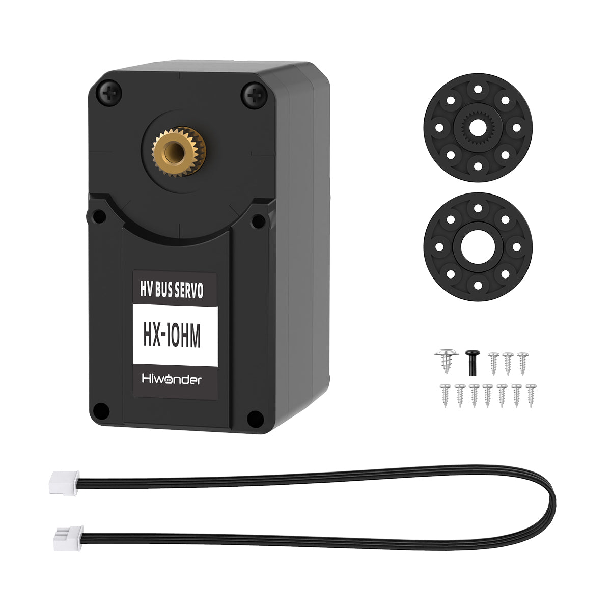

# Hiwonder HX-10HM Guide


[**View Hiwonder HX-10HM 10kg 360-Degree Magnetic Encoder Serial Bus Servo on OpenELAB**](https://openelab.io/products/hx-10hm-bus-servo)

**SKU:** `Hiwoner-21100238`, `Hiwoner-21100239`

**Model / revision scope:** HX-10HM. Match the purchased option below; hardware revisions and controller images are not interchangeable.


## Product overview

HX-10HM is an addressable serial-bus actuator with position, voltage and temperature feedback. Its 360° position range and 1000000-baud interface identify the control family covered by this guide.

### Models and purchasing options

| OpenELAB SKU       | Purchased option |
| ------------------ | ---------------- |
| `Hiwoner-21100238` | HX-10HM          |
| `Hiwoner-21100239` | Metal Servo Horn |

A separately named bracket, horn, chassis or rail is the listed accessory, not a complete robot or servo. A “without controller / Raspberry Pi / Jetson / micro:bit” option requires the matching controller separately. Check the selected option’s packing list before starting.

## Applications

Joint positioning, grippers and small robotic mechanisms; choose the mechanism and duty cycle from the electrical and mechanical limits below.

## Specifications

| Parameter               | Value / scope                                         |
| ----------------------- | ----------------------------------------------------- |
| Supply range            | 9–12.6 V                                              |
| Position range          | 360°; command values 0–4095                           |
| Direct bus baud rate    | 1,000,000 bit/s                                       |
| Torque reference        | 10 kgf·cm at 11.1 V                                   |
| Mass                    | 52 g                                                  |
| Stall-current reference | 3 A                                                   |
| Initial identity        | Default ID 1; read the existing ID before changing it |

Specifications: [manufacturer product data](https://www.hiwonder.com/products/hx-10hm) and [OpenELAB listing](https://openelab.io/products/hx-10hm-bus-servo). Figures describe the stated configuration; accessory-only options do not inherit the complete kit specifications.

## Hardware and connections

This is a **serial-bus servo**, not a PWM servo. Use its matching three-wire keyed cable and a compatible half-duplex bus interface. Identify signal, supply and ground from the connector diagram and board labels; connector shape alone is not a pinout. Power the motor rail externally at a voltage shared by the servo and interface board.

Use BusLinker V3.0 with its **Servo–USB** jumper selection for the PC test. Its 5–14 V input range does not override the servo voltage limit. The 1 Mbit/s magnetic-encoder protocol and 0–4095 position scale must not be substituted with legacy 115200-baud commands.

## Software and development resources

ServoStudio and the magnetic-encoder protocol are used for this generation. Use the firmware specifically named for HX-10HM only; the HX-30HM flashing example in the interface manual is not permission to flash that file into another model.

## Getting started

**Prerequisites:** the selected hardware, its matching power source, the required data cable, and a clear work area. Begin with the supplied firmware and an unloaded mechanism.

1. Disconnect all other servos, remove the load and secure the body. Confirm the exact model suffix on the case and the supply voltage before connecting the keyed bus cable.
2. Connect one servo to the matching BusLinker V3.0 port. Select **Servo–USB**, connect the USB data cable and an external regulated 11.1 V servo supply with correct polarity.
3. Install the official CH341 driver and open **ServoStudio** from the BusLinker Appendix. Select the actual serial port and **1,000,000 baud**, then click **Connect**.
4. In **Dashboard**, click **Scan**. Select the detected servo, then read **Config** and confirm Position mode, voltage and temperature before sending a motion command.
5. In **Monitor**, first read the current position. With the mechanism unloaded, command a nearby target at a low speed, staying inside the configured Min/Max Angle limits. Use **Apply** for the normal Write mode; do not run Auto Sweep for the first test.
6. Read the returned position and disable torque when finished. Assign unique IDs one servo at a time before connecting a chain; leave firmware, PID gains and protection thresholds unchanged for this initial test.

**Expected result:** The single servo is detected, plausible voltage/temperature/position values are returned, and a small unloaded position command changes the readback. Readback alone does not prove loaded accuracy or continuous torque.

Procedure reference: [official model or interface manual](https://wiki.hiwonder.com/projects/BusLinker/en/latest/docs/1_BusLinker_V3.0_Servo_Debugging_Board_User_Manual.html). The steps above are a bounded initial check, not a substitute for the full assembly and development chapters.

## Troubleshooting and FAQs

**No movement:** first check the servo power rail under load, ground continuity and the selected control interface. USB connection alone does not establish motor power. Test one unloaded servo before adding a chain.

**Jitter, heat or repeated resets:** disconnect the mechanical load, check for an obstructed horn and measure supply droop. A stall-torque figure is not a continuous operating torque. Reduce the load and duty cycle; do not increase supply voltage beyond the specified limit.

**Wrong travel:** verify the exact suffix and position scale. Mechanical joint limits can be narrower than the servo specification. Set limits for the installed mechanism before running a sequence.

## Downloads and technical documents

* [Official user / interface manual](https://wiki.hiwonder.com/projects/BusLinker/en/latest/docs/1_BusLinker_V3.0_Servo_Debugging_Board_User_Manual.html)
* [Manufacturer Hiwonder HX-10HM 10kg 360-Degree Magnetic Encoder Serial Bus Servo specifications and option drawings](https://www.hiwonder.com/products/hx-10hm)

Use the manual’s download or appendix section for the matching revision. A linked download directory is not a claim that every firmware archive, CAD file or installer has been tested. Do not flash an image for a similarly named product.

## References and validation

* [OpenELAB product and SKU options](https://openelab.io/products/hx-10hm-bus-servo).
* [Official user / interface manual](https://wiki.hiwonder.com/projects/BusLinker/en/latest/docs/1_BusLinker_V3.0_Servo_Debugging_Board_User_Manual.html)
* [Manufacturer Hiwonder HX-10HM 10kg 360-Degree Magnetic Encoder Serial Bus Servo specifications and option drawings](https://www.hiwonder.com/products/hx-10hm)

Reviewed against the linked sources on 19 November 2026. Software installation, compilation and physical hardware tests were not performed for this guide. Use the observable checkpoints above to verify your own unit before integrating it into a larger system.
