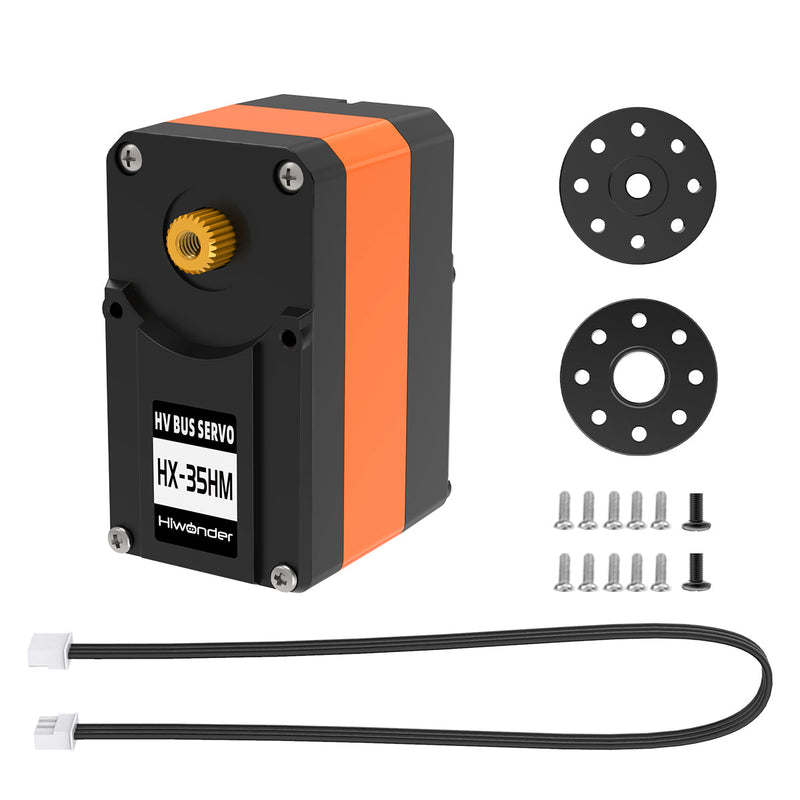

# Hiwonder HX-35H and HX-35HM Guide


[**View Hiwonder HX-35HM 35kg.cm 360-Degree Magnetic Encoder Bus Servo on OpenELAB**](https://openelab.io/products/hx-35hm-bus-servo)

**SKU:** `Hiwoner-21100063`, `Hiwoner-211000630`, `Hiwoner-21100146`

[**View Hiwonder HX-35H 35kg.cm High-Voltage Dual-Shaft Serial Bus Servo on OpenELAB**](https://openelab.io/products/hx-35h-bus-servo)

**SKU:** `Hiwoner-21100032`, `Hiwoner-21100146`, `Hiwoner-211001460`

**Model / revision scope:** HX-35H and HX-35HM. Match the purchased option below; hardware revisions and controller images are not interchangeable.


## Product overview

HX-35H and HX-35HM are high-voltage bus servos with different documented travel and position scales. OpenELAB currently reuses the same SKU for the two product records, so identify the model from the product link and physical case label before choosing commands.

**Model discrepancy:** the current HX-35H manufacturer page contains a table labelled HX-35HM. The H travel above comes from the original store/OEM specification, while HM uses its own specification. Do not treat the copied HM table as evidence for H travel. The first check only reads feedback and commands a nearby position; no full sweep or cross-model firmware change is included.

### Models and purchasing options

| OpenELAB SKU        | Purchased option                                                                     |
| ------------------- | ------------------------------------------------------------------------------------ |
| `Hiwoner-21100063`  | HX-35HM Servo Pack — Hiwonder HX-35HM 35kg.cm 360-Degree Magnetic Encoder Bus Servo  |
| `Hiwoner-211000630` | Bracket Pack — Hiwonder HX-35HM 35kg.cm 360-Degree Magnetic Encoder Bus Servo        |
| `Hiwoner-21100146`  | Metal Servo Horn — Hiwonder HX-35HM 35kg.cm 360-Degree Magnetic Encoder Bus Servo    |
| `Hiwoner-21100032`  | HX-35H Servo Pack — Hiwonder HX-35H 35kg.cm High-Voltage Dual-Shaft Serial Bus Servo |
| `Hiwoner-21100146`  | Metal Servo Horn — Hiwonder HX-35H 35kg.cm High-Voltage Dual-Shaft Serial Bus Servo  |
| `Hiwoner-211001460` | Bracket Pack — Hiwonder HX-35H 35kg.cm High-Voltage Dual-Shaft Serial Bus Servo      |

A separately named bracket, horn, chassis or rail is the listed accessory, not a complete robot or servo. A “without controller / Raspberry Pi / Jetson / micro:bit” option requires the matching controller separately. Check the selected option’s packing list before starting.

## Applications

Joint positioning, grippers and small robotic mechanisms; choose the mechanism and duty cycle from the electrical and mechanical limits below.

## Specifications

| Parameter               | Value / scope                                             |
| ----------------------- | --------------------------------------------------------- |
| Supply                  | 9–12.6 V; 11.1 V nominal                                  |
| HX-35H original model   | 240°; 0–1000 position scale                               |
| HX-35HM model           | 360°; 0–1500 position scale                               |
| Direct servo bus        | 115200 baud for these two documented models               |
| Torque reference        | 35 kgf·cm static / 25 kgf·cm rotation at 11.1 V           |
| Stall-current reference | 3 A                                                       |
| Catalog identity        | Same SKU on both listings; exact H / HM label is required |

Specifications: [manufacturer product data](https://www.hiwonder.com/products/hx-35hm) and [OpenELAB listing](https://openelab.io/products/hx-35hm-bus-servo). Figures describe the stated configuration; accessory-only options do not inherit the complete kit specifications.

## Hardware and connections

This is a **serial-bus servo**, not a PWM servo. Use its matching three-wire keyed cable and a compatible half-duplex bus interface. Identify signal, supply and ground from the connector diagram and board labels; connector shape alone is not a pinout. Power the motor rail externally at a voltage shared by the servo and interface board.

The initial check below uses the Hiwonder Bus Servo Controller and its **Servo Test** tool. The controller’s host UART is **9600 baud**, while the direct servo bus is **115200 baud**; these are separate interfaces. Use a regulated 11.1 V supply for this check, within the controller’s 6–12 V range as well as the servo range. Do not apply the servo’s maximum voltage blindly to an attached controller.

## Software and development resources

Use the Hiwonder Bus Servo Controller application for the first check. Direct MCU control requires the legacy bus-servo command protocol and a half-duplex electrical interface, not a bare RS-232 adapter. The controller’s action-group protocol differs from direct servo packets.

## Getting started

**Prerequisites:** the selected hardware, its matching power source, the required data cable, and a clear work area. Begin with the supplied firmware and an unloaded mechanism.

1. Disconnect all other servos, remove the load and secure the body. Confirm the exact model suffix on the case and the supply voltage before connecting the keyed bus cable.
2. With power off, connect one servo to the Bus Servo Controller. Attach the external regulated 11.1 V supply with red to + and black to −, then connect USB and switch the controller on.
3. Open **Bus Servo Control V3.4** from the official controller Appendix. Confirm the wired connection indicator and open **Servo Test** for the single connected servo.
4. Read the servo ID, position, voltage and temperature before editing anything. A factory-new unit is normally ID 1; a previously used unit may retain another ID.
5. Select servo/position mode. With the horn unloaded, command a small nearby position and read it back. Keep values within 0–1500 and the mechanism’s limits. The controller’s general 0–1000 slider does not represent the full 0–1500 range of this model; this test deliberately uses only a small local movement.
6. After successful readback, power off before fitting the linkage. Set unique IDs individually, then connect additional compatible servos and test them one at a time.

**Expected result:** The single servo is detected, plausible voltage/temperature/position values are returned, and a small unloaded position command changes the readback. Readback alone does not prove loaded accuracy or continuous torque.

Procedure reference: [official model or interface manual](https://wiki.hiwonder.com/projects/Bus-Servo-Controller/en/latest/docs/1.Bus_Servo_Controller_User_Manual.html). The steps above are a bounded initial check, not a substitute for the full assembly and development chapters.

## Troubleshooting and FAQs

**No movement:** first check the servo power rail under load, ground continuity and the selected control interface. USB connection alone does not establish motor power. Test one unloaded servo before adding a chain.

**Jitter, heat or repeated resets:** disconnect the mechanical load, check for an obstructed horn and measure supply droop. A stall-torque figure is not a continuous operating torque. Reduce the load and duty cycle; do not increase supply voltage beyond the specified limit.

**Wrong travel:** verify the exact suffix and position scale. Mechanical joint limits can be narrower than the servo specification. Set limits for the installed mechanism before running a sequence.

## Downloads and technical documents

* [Official user / interface manual](https://wiki.hiwonder.com/projects/Bus-Servo-Controller/en/latest/docs/1.Bus_Servo_Controller_User_Manual.html)
* [HX-35H original store specification and model images](https://openelab.io/products/hx-35h-bus-servo)
* [Manufacturer Hiwonder HX-35HM 35kg.cm 360-Degree Magnetic Encoder Bus Servo specifications and option drawings](https://www.hiwonder.com/products/hx-35hm)
* [Manufacturer Hiwonder HX-35H 35kg.cm High-Voltage Dual-Shaft Serial Bus Servo specifications and option drawings](https://www.hiwonder.com/products/hx-35h)

Use the manual’s download or appendix section for the matching revision. A linked download directory is not a claim that every firmware archive, CAD file or installer has been tested. Do not flash an image for a similarly named product.

## References and validation

* [OpenELAB product and SKU options](https://openelab.io/products/hx-35hm-bus-servo).
* [OpenELAB product and SKU options](https://openelab.io/products/hx-35h-bus-servo).
* [Official user / interface manual](https://wiki.hiwonder.com/projects/Bus-Servo-Controller/en/latest/docs/1.Bus_Servo_Controller_User_Manual.html)
* [HX-35H original store specification and model images](https://openelab.io/products/hx-35h-bus-servo)
* [Manufacturer Hiwonder HX-35HM 35kg.cm 360-Degree Magnetic Encoder Bus Servo specifications and option drawings](https://www.hiwonder.com/products/hx-35hm)
* [Manufacturer Hiwonder HX-35H 35kg.cm High-Voltage Dual-Shaft Serial Bus Servo specifications and option drawings](https://www.hiwonder.com/products/hx-35h)

Reviewed against the linked sources on 19 November 2026. Software installation, compilation and physical hardware tests were not performed for this guide. Use the observable checkpoints above to verify your own unit before integrating it into a larger system.
