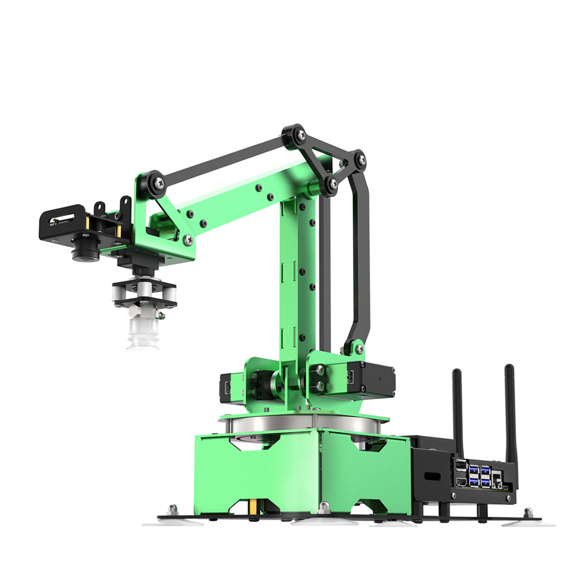

# Hiwonder JetMax Jetson Nano Guide


[**View Hiwonder JetMax Starter AI Vision Robot Arm Jetson Nano ROS Kit on OpenELAB**](https://openelab.io/products/hiwonder-jetmax-starter-ai-vision)

**SKU:** `Hiwonder-21010156`

[**View Hiwonder JetMax Standard AI Vision Robot Arm Jetson Nano ROS Kit on OpenELAB**](https://openelab.io/products/hiwonder-jetmax-standard)

**SKU:** `Hiwonder-21010157`

[**View Hiwonder JetMax Advanced AI Vision Robot Arm Jetson Nano ROS Kit on OpenELAB**](https://openelab.io/products/hiwonder-jetmax-advanced)

**SKU:** `Hiwonder-21010159`

[**View Hiwonder JetMax Jetson Nano ROS Robot Arm & Expansion Accessories on OpenELAB**](https://openelab.io/products/hiwonder-jetmax-jetson-nano-robot)

**SKU:** `Hiwonder-21010156`, `Hiwonder-21010157`, `Hiwonder-21010159`, `Hiwonder-21030032`, `Hiwonder-21070073`

**Model / revision scope:** JetMax Jetson Nano. Match the purchased option below; hardware revisions and controller images are not interchangeable.


## Product overview

JetMax is a desktop vision arm with interchangeable end tools. This guide covers the Starter, Standard, Advanced and combined-listing Jetson Nano options; it does not describe the newer JetMax 2027 controller generation.

A chassis-only or rail-only selection under the combined listing does not include the JetMax arm. Use the dedicated Green Mecanum Chassis or Sliding Rail guide for those accessories.

### Models and purchasing options

| OpenELAB SKU        | Purchased option                                                                    |
| ------------------- | ----------------------------------------------------------------------------------- |
| `Hiwonder-21010156` | Default Title — Hiwonder JetMax Starter AI Vision Robot Arm Jetson Nano ROS Kit     |
| `Hiwonder-21010157` | Default Title — Hiwonder JetMax Standard AI Vision Robot Arm Jetson Nano ROS Kit    |
| `Hiwonder-21010159` | Default Title — Hiwonder JetMax Advanced AI Vision Robot Arm Jetson Nano ROS Kit    |
| `Hiwonder-21010156` | Starter Kit — Hiwonder JetMax Jetson Nano ROS Robot Arm & Expansion Accessories     |
| `Hiwonder-21010157` | Standard Kit — Hiwonder JetMax Jetson Nano ROS Robot Arm & Expansion Accessories    |
| `Hiwonder-21010159` | Advanced Kit — Hiwonder JetMax Jetson Nano ROS Robot Arm & Expansion Accessories    |
| `Hiwonder-21030032` | Vehicle Chassis — Hiwonder JetMax Jetson Nano ROS Robot Arm & Expansion Accessories |
| `Hiwonder-21070073` | Sliding Rail — Hiwonder JetMax Jetson Nano ROS Robot Arm & Expansion Accessories    |

A separately named bracket, horn, chassis or rail is the listed accessory, not a complete robot or servo. A “without controller / Raspberry Pi / Jetson / micro:bit” option requires the matching controller separately. Check the selected option’s packing list before starting.

## Applications

Use JetMax Jetson Nano to learn manual motion, perception and staged automation. Start with an unloaded mechanism and the sensors actually included in the selected kit.

## Specifications

| Parameter          | Value / scope                                                              |
| ------------------ | -------------------------------------------------------------------------- |
| Controller         | Jetson Nano; inclusion depends on option                                   |
| Power adapter      | 12 V, 5 A                                                                  |
| Listed arm payload | 450 g; check reach, tool mass and duty cycle                               |
| Dimensions / mass  | 475 × 159 × 251 mm / approximately 1.6 kg                                  |
| Options            | Starter / Standard / Advanced; chassis and rail selections are accessories |

Specifications: [manufacturer product data](https://www.hiwonder.com/products/jetmax) and [OpenELAB listing](https://openelab.io/products/hiwonder-jetmax-starter-ai-vision). Figures describe the stated configuration; accessory-only options do not inherit the complete kit specifications.

## Hardware and connections

Connect the supplied battery or adapter to the **robot’s designated power/expansion board**, not directly to a computer GPIO or an unverified charging socket. Inspect the camera, motor/servo and controller cables while power is off. Secure the base to the work surface and clear the entire arm/gripper envelope. Remove objects from the gripper before startup.

Match the controller, camera, LiDAR and chassis configuration to the SKU. Optional voice/AI modules require their own cables and software. A USB camera, depth camera and CSI ribbon camera are not interchangeable interfaces.

## Software and development resources

Start with the legacy JetMax Jetson Nano factory image and NoMachine desktop access. Its quick-experience page names WonderPi, while the chassis chapter names WonderAi; the first check below uses the documented desktop route and does not assume those apps are interchangeable. Preserve the image and calibration before development.

## Getting started

**Prerequisites:** the selected hardware, its matching power source, the required data cable, and a clear work area. Begin with the supplied firmware and an unloaded mechanism.

1. Match the selected arm kit and Nano controller. A rail-only or chassis-only option cannot perform this arm procedure.
2. Secure the base, leave the gripper empty and clear the arm envelope. Connect the supplied 12 V, 5 A adapter through the documented expansion-board input, then power on and wait for the startup beep.
3. Install NoMachine from the official JetMax resources. Join the factory robot hotspot beginning HW using the supplied image’s password.
4. Open NoMachine and connect to **192.168.149.1**. On the documented factory image, use username **hiwonder** and password **hiwonder**. Confirm the Nano desktop appears.
5. Keep the robot stationary and check the JetMax application/source folders on the supplied desktop. Back up calibration before enabling a vision or motion project.
6. Shut down the operating system before switching off the expansion board.

**Expected result:** The JetMax Nano desktop is accessible through NoMachine. This confirms the image/network setup; arm calibration, live vision and loaded motion are subsequent documented checks.

Procedure reference: [official model or interface manual](https://wiki.hiwonder.com/projects/JetMax/en/latest/docs/3.AI%20Vision%20Games%20Lesson.html). The steps above are a bounded initial check, not a substitute for the full assembly and development chapters.

## Troubleshooting and FAQs

**No hotspot:** wait for the full boot sequence, verify the battery/adapter and image/controller match, then check whether the robot was previously configured for LAN mode.

**Phone joins Wi-Fi but the app sees nothing:** remain on the robot network despite the no-Internet warning, grant local-network discovery permissions, select the correct model and refresh. The factory password may have been changed on a used unit.

**Camera works but motion is wrong:** stop immediately and verify the chassis type, motor/servo connections and model configuration. Do not compensate with unrelated servo offsets.

**Vision, mapping or voice option is unavailable:** check the selected kit’s actual camera, LiDAR and AI/voice modules. Offline local control does not establish that a cloud AI service is configured.

**Restoring firmware:** use the exact model/controller resource package and retain calibration files; do not write an image for a similarly named Pro or legacy version.

## Downloads and technical documents

* [Official user / interface manual](https://wiki.hiwonder.com/projects/JetMax/en/latest/docs/3.AI%20Vision%20Games%20Lesson.html)
* [Official software, image and course downloads](https://wiki.hiwonder.com/projects/JetMax/en/latest/docs/10.Appendix.html)
* [Initial assembly and power-on](https://wiki.hiwonder.com/projects/JetMax/en/latest/docs/1.Getting%20Ready.html)
* [Factory app and colour calibration chapter](https://wiki.hiwonder.com/projects/JetMax/en/latest/docs/2.Quick%20User%20Experience.html)
* [Standalone green Mecanum chassis guide](https://wiki.openelab.io/robotics/hiwonder/hiwonder-green-80-mm-mecanum-chassis-guide)
* [Manufacturer Hiwonder JetMax Starter AI Vision Robot Arm Jetson Nano ROS Kit specifications and option drawings](https://www.hiwonder.com/products/jetmax)
* [Manufacturer Hiwonder JetMax Standard AI Vision Robot Arm Jetson Nano ROS Kit specifications and option drawings](https://www.hiwonder.com/products/jetmax)
* [Manufacturer Hiwonder JetMax Advanced AI Vision Robot Arm Jetson Nano ROS Kit specifications and option drawings](https://www.hiwonder.com/products/jetmax)
* [Manufacturer Hiwonder JetMax Jetson Nano ROS Robot Arm & Expansion Accessories specifications and option drawings](https://www.hiwonder.com/products/jetmax)

Use the manual’s download or appendix section for the matching revision. A linked download directory is not a claim that every firmware archive, CAD file or installer has been tested. Do not flash an image for a similarly named product.

## References and validation

* [OpenELAB product and SKU options](https://openelab.io/products/hiwonder-jetmax-starter-ai-vision).
* [OpenELAB product and SKU options](https://openelab.io/products/hiwonder-jetmax-standard).
* [OpenELAB product and SKU options](https://openelab.io/products/hiwonder-jetmax-advanced).
* [OpenELAB product and SKU options](https://openelab.io/products/hiwonder-jetmax-jetson-nano-robot).
* [Official user / interface manual](https://wiki.hiwonder.com/projects/JetMax/en/latest/docs/3.AI%20Vision%20Games%20Lesson.html)
* [Official software, image and course downloads](https://wiki.hiwonder.com/projects/JetMax/en/latest/docs/10.Appendix.html)
* [Initial assembly and power-on](https://wiki.hiwonder.com/projects/JetMax/en/latest/docs/1.Getting%20Ready.html)
* [Factory app and colour calibration chapter](https://wiki.hiwonder.com/projects/JetMax/en/latest/docs/2.Quick%20User%20Experience.html)
* [Standalone green Mecanum chassis guide](https://wiki.openelab.io/robotics/hiwonder/hiwonder-green-80-mm-mecanum-chassis-guide)
* [Manufacturer Hiwonder JetMax Starter AI Vision Robot Arm Jetson Nano ROS Kit specifications and option drawings](https://www.hiwonder.com/products/jetmax)
* [Manufacturer Hiwonder JetMax Standard AI Vision Robot Arm Jetson Nano ROS Kit specifications and option drawings](https://www.hiwonder.com/products/jetmax)
* [Manufacturer Hiwonder JetMax Advanced AI Vision Robot Arm Jetson Nano ROS Kit specifications and option drawings](https://www.hiwonder.com/products/jetmax)
* [Manufacturer Hiwonder JetMax Jetson Nano ROS Robot Arm & Expansion Accessories specifications and option drawings](https://www.hiwonder.com/products/jetmax)

Reviewed against the linked sources on 19 November 2026. Software installation, compilation and physical hardware tests were not performed for this guide. Use the observable checkpoints above to verify your own unit before integrating it into a larger system.
