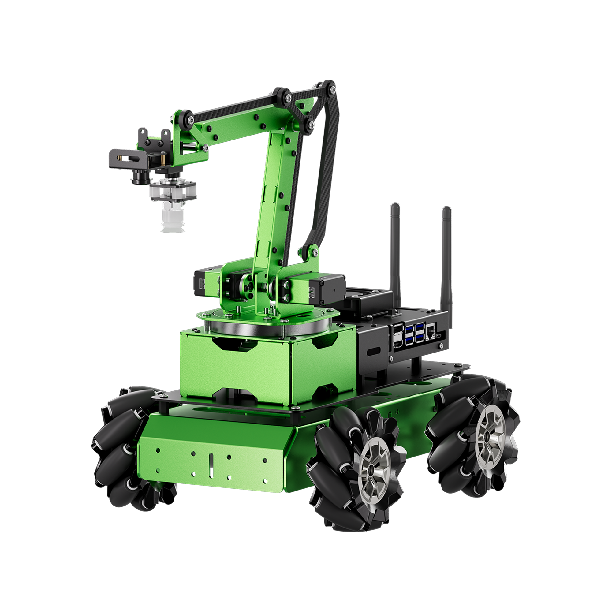

# Hiwonder JetMax Pro Jetson Nano Guide


[**View Hiwonder JetMax Pro Jetson Nano Robot Arm with Mecanum Base or Rail on OpenELAB**](https://openelab.io/products/hiwonder-jetmax-pro-jetson-nano)

**SKU:** `Hiwonder-21010078`, `Hiwonder-21010080`

**Model / revision scope:** JetMax Pro Jetson Nano. Match the purchased option below; hardware revisions and controller images are not interchangeable.


## Product overview

JetMax Pro extends the Jetson Nano desktop arm with either a Mecanum chassis or a sliding rail. These two expansions have different power and motion requirements; select the actual purchased option.

### Models and purchasing options

| OpenELAB SKU        | Purchased option                        |
| ------------------- | --------------------------------------- |
| `Hiwonder-21010078` | JetMax Advanced + Mecanum Wheel Chassis |
| `Hiwonder-21010080` | JetMax Advanced + Electric Sliding Rail |

A separately named bracket, horn, chassis or rail is the listed accessory, not a complete robot or servo. A “without controller / Raspberry Pi / Jetson / micro:bit” option requires the matching controller separately. Check the selected option’s packing list before starting.

## Applications

Use JetMax Pro Jetson Nano to learn manual motion, perception and staged automation. Start with an unloaded mechanism and the sensors actually included in the selected kit.

## Specifications

| Parameter             | Value / scope                                             |
| --------------------- | --------------------------------------------------------- |
| Arm host              | Jetson Nano                                               |
| Arm adapter           | 12 V, 5 A                                                 |
| Arm payload reference | Maximum 450 g; end-tool mass and reach affect usable load |
| Mecanum option        | 6–8 V chassis; 8 V encoder motors per Pro product table   |
| Rail option           | 12 V, 1.4 A; 607.9 × 207 × 65 mm                          |
| Software generation   | Legacy Nano JetMax image, not JetMax 2027                 |

Specifications: [manufacturer product data](https://www.hiwonder.com/products/jetmax-pro) and [OpenELAB listing](https://openelab.io/products/hiwonder-jetmax-pro-jetson-nano). Figures describe the stated configuration; accessory-only options do not inherit the complete kit specifications.

## Hardware and connections

The official chassis and rail chapters label the expansion connections **S1** (motor connection) and **IIC1** (control connection). Use the matching supplied cable assembly and installation drawing; these labels do not define a generic bare-motor pinout. Mount and restrain the base before energizing the arm. The Pro chassis product table specifies 6–8 V; do not apply the arm adapter’s 12 V directly to that chassis. The standalone Green Mecanum listing has different voltage specifications and must not be substituted blindly.

## Software and development resources

Start with the factory image for **JetMax Pro Jetson Nano and the exact controller option**. WonderAi is the documented initial control application. Use the official model downloads for restoration; a generic Raspberry Pi OS or JetPack installation does not include the robot services, calibrated offsets and device configuration.

For development, preserve a backup of the supplied image and calibration files before replacing software. Select the manual branch for the installed board and ROS generation. A menu or directory for a different product is not a compatible firmware target.

## Getting started

**Prerequisites:** the selected hardware, its matching power source, the required data cable, and a clear work area. Begin with the supplied firmware and an unloaded mechanism.

1. Identify whether the selected option contains the Mecanum base or the rail. Assemble it with the corresponding official installation video and cable diagram, with power off.
2. For the Mecanum option, connect the supplied motor assembly to S1 and control cable to IIC1 as shown in the chassis chapter. Clear the chassis and arm envelope, then power the assembled system using the supplied wiring and power system.
3. Wait for the Nano expansion-board startup beep. Open WonderAi → Advanced Kits → JetMax → + → Direct Connection Mode. Join the robot’s HW… hotspot using the password supplied with its image, then return to the app and refresh.
4. Confirm the robot icon appears. Open Position Calibration and check the empty workspace against the chapter’s calibration illustration before any automatic handling. Start with live video and a small manual arm command; avoid automatic chassis transport.
5. For the rail option, instead use the rail chapter’s gamepad workflow: insert the receiver into the Nano USB port before switching on the handle, fit its two AAA cells with correct polarity, then use the documented control mapping. Do not run a rail travel command until its path and endpoints are clear.
6. Stop the demonstration and shut down the Nano before disconnecting power. Keep arm and expansion power domains labelled.

**Expected result:** The correct JetMax interface is available and an unloaded arm check responds. Rail travel and mobile transport are separate checks using the matching expansion chapter.

Procedure reference: [official model or interface manual](https://wiki.hiwonder.com/projects/JetMax/en/latest/docs/12.JetMax%20Vehicle%20Chassis.html). The steps above are a bounded initial check, not a substitute for the full assembly and development chapters.

## Troubleshooting and FAQs

**No hotspot:** wait for the full boot sequence, verify the battery/adapter and image/controller match, then check whether the robot was previously configured for LAN mode.

**Phone joins Wi-Fi but the app sees nothing:** remain on the robot network despite the no-Internet warning, grant local-network discovery permissions, select the correct model and refresh. The factory password may have been changed on a used unit.

**Camera works but motion is wrong:** stop immediately and verify the chassis type, motor/servo connections and model configuration. Do not compensate with unrelated servo offsets.

**Vision, mapping or voice option is unavailable:** check the selected kit’s actual camera, LiDAR and AI/voice modules. Offline local control does not establish that a cloud AI service is configured.

**Restoring firmware:** use the exact model/controller resource package and retain calibration files; do not write an image for a similarly named Pro or legacy version.

## Downloads and technical documents

* [Official user / interface manual](https://wiki.hiwonder.com/projects/JetMax/en/latest/docs/12.JetMax%20Vehicle%20Chassis.html)
* [Official software, image and course downloads](https://wiki.hiwonder.com/projects/JetMax/en/latest/docs/10.Appendix.html)
* [Sliding-rail installation and gamepad control](https://wiki.hiwonder.com/projects/JetMax/en/latest/docs/11.Work%20with%20Sliding%20Rail.html)
* [Desktop development and remote connection](https://wiki.hiwonder.com/projects/JetMax/en/latest/docs/3.AI%20Vision%20Games%20Lesson.html)
* [Standalone green Mecanum chassis guide](https://wiki.openelab.io/robotics/hiwonder/hiwonder-green-80-mm-mecanum-chassis-guide)
* [Manufacturer Hiwonder JetMax Pro Jetson Nano Robot Arm with Mecanum Base or Rail specifications and option drawings](https://www.hiwonder.com/products/jetmax-pro)

Use the manual’s download or appendix section for the matching revision. A linked download directory is not a claim that every firmware archive, CAD file or installer has been tested. Do not flash an image for a similarly named product.

## References and validation

* [OpenELAB product and SKU options](https://openelab.io/products/hiwonder-jetmax-pro-jetson-nano).
* [Official user / interface manual](https://wiki.hiwonder.com/projects/JetMax/en/latest/docs/12.JetMax%20Vehicle%20Chassis.html)
* [Official software, image and course downloads](https://wiki.hiwonder.com/projects/JetMax/en/latest/docs/10.Appendix.html)
* [Sliding-rail installation and gamepad control](https://wiki.hiwonder.com/projects/JetMax/en/latest/docs/11.Work%20with%20Sliding%20Rail.html)
* [Desktop development and remote connection](https://wiki.hiwonder.com/projects/JetMax/en/latest/docs/3.AI%20Vision%20Games%20Lesson.html)
* [Standalone green Mecanum chassis guide](https://wiki.openelab.io/robotics/hiwonder/hiwonder-green-80-mm-mecanum-chassis-guide)
* [Manufacturer Hiwonder JetMax Pro Jetson Nano Robot Arm with Mecanum Base or Rail specifications and option drawings](https://www.hiwonder.com/products/jetmax-pro)

Reviewed against the linked sources on 19 November 2026. Software installation, compilation and physical hardware tests were not performed for this guide. Use the observable checkpoints above to verify your own unit before integrating it into a larger system.
