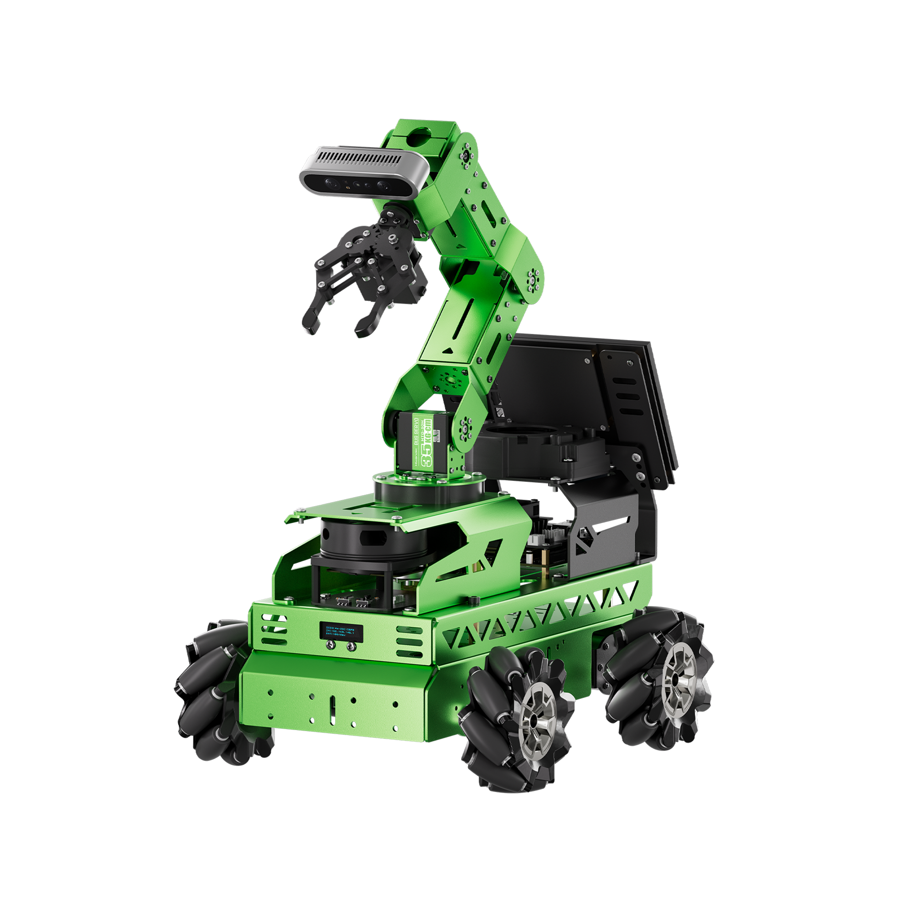

# Hiwonder JetRover Guide


[**View Hiwonder JetRover ROS1/ROS2 AI Robot Car with 6DOF Arm & SLAM on OpenELAB**](https://openelab.io/products/hiwonder-jetrover-ai-car)

**SKU:** `Hiwonder-21030590`, `Hiwonder-21030552`, `Hiwonder-21030628`, `Hiwonder-21030591`, `Hiwonder-21030586`, `Hiwonder-21030629`, `Hiwonder-21030592`, `Hiwonder-21030587`, `Hiwonder-21030630`, `Hiwonder-21030593`, `Hiwonder-21030588`, `Hiwonder-21030631`, `Hiwonder-21030594`, `Hiwonder-21030589`, `Hiwonder-21030632`, `Hiwonder-21030595`, `Hiwonder-21031590`, `Hiwonder-21030633`, `Hiwonder-21030596`, `Hiwonder-21031591`, `Hiwonder-21030634`, `Hiwonder-21030597`, `Hiwonder-21030559`, `Hiwonder-21030635`, `Hiwonder-21030598`, `Hiwonder-21030560`, `Hiwonder-21030636`, `Hiwonder-21030599`, `Hiwonder-21030561`, `Hiwonder-21030637`, `Hiwonder-21030600`, `Hiwonder-21030344`, `Hiwonder-21030638`, `Hiwonder-21030601`, `Hiwonder-21030562`, `Hiwonder-21030639`, `Hiwonder-21030602`, `Hiwonder-21030563`, `Hiwonder-21030640`, `Hiwonder-21030603`, `Hiwonder-21030564`, `Hiwonder-21030641`, `Hiwonder-21030860`, `Hiwonder-21031857`, `Hiwonder-21031858`, `Hiwonder-21031943`, `Hiwonder-210318571`, `Hiwonder-210318580`, `Hiwonder-21031607`, `Hiwonder-210318572`, `Hiwonder-21032067`, `Hiwonder-21031229`, `Hiwonder-210318573`, `Hiwonder-210318581`, `Hiwonder-21030861`, `Hiwonder-210318574`, `Hiwonder-21032066`, `Hiwonder-210320540`, `Hiwonder-210318575`, `Hiwonder-210318582`, `Hiwonder-21032054`, `Hiwonder-210318576`, `Hiwonder-210318583`, `Hiwonder-21030609`, `Hiwonder-21030572`, `Hiwonder-21030647`, `Hiwonder-21030610`, `Hiwonder-21030573`, `Hiwonder-21030648`, `Hiwonder-21030611`, `Hiwonder-21030574`, `Hiwonder-21030649`, `Hiwonder-21030612`, `Hiwonder-21030575`, `Hiwonder-21030650`, `Hiwonder-21030354`, `Hiwonder-21030391`, `Hiwonder-21030651`, `Hiwonder-21030613`, `Hiwonder-21030576`, `Hiwonder-21030652`, `Hiwonder-21030614`, `Hiwonder-21030363`, `Hiwonder-21030653`

**Model / revision scope:** JetRover. Match the purchased option below; hardware revisions and controller images are not interchangeable.


## Product overview

JetRover combines a mobile chassis, vision arm and ROS development environment. Its 84 store options vary in chassis, controller and kit level; selecting one does not include every configuration shown in demonstrations.

Mecanum permits lateral translation, Ackermann steers its front wheels, and the tracked platform uses differential drive. The app profile and robot configuration must match the purchased chassis before any movement.

### Models and purchasing options

| OpenELAB SKU         | Purchased option                                                    |
| -------------------- | ------------------------------------------------------------------- |
| `Hiwonder-21030590`  | Standard Kit / Without Controller / Mecanum Chassis                 |
| `Hiwonder-21030552`  | Standard Kit / Without Controller / Ackerman Chassis                |
| `Hiwonder-21030628`  | Standard Kit / Without Controller / Tank Chassis                    |
| `Hiwonder-21030591`  | Standard Kit / With Raspberry Pi 5(8GB) / Mecanum Chassis           |
| `Hiwonder-21030586`  | Standard Kit / With Raspberry Pi 5(8GB) / Ackerman Chassis          |
| `Hiwonder-21030629`  | Standard Kit / With Raspberry Pi 5(8GB) / Tank Chassis              |
| `Hiwonder-21030592`  | Standard Kit / With Jetson Nano(4GB) / Mecanum Chassis              |
| `Hiwonder-21030587`  | Standard Kit / With Jetson Nano(4GB) / Ackerman Chassis             |
| `Hiwonder-21030630`  | Standard Kit / With Jetson Nano(4GB) / Tank Chassis                 |
| `Hiwonder-21030593`  | Standard Kit / With Jetson Orin Nano Super(4GB) / Mecanum Chassis   |
| `Hiwonder-21030588`  | Standard Kit / With Jetson Orin Nano Super(4GB) / Ackerman Chassis  |
| `Hiwonder-21030631`  | Standard Kit / With Jetson Orin Nano Super(4GB) / Tank Chassis      |
| `Hiwonder-21030594`  | Standard Kit / With Jetson Orin Nano Super(8GB) / Mecanum Chassis   |
| `Hiwonder-21030589`  | Standard Kit / With Jetson Orin Nano Super(8GB) / Ackerman Chassis  |
| `Hiwonder-21030632`  | Standard Kit / With Jetson Orin Nano Super(8GB) / Tank Chassis      |
| `Hiwonder-21030595`  | Standard Kit / With Jetson Orin NX Super(8GB) / Mecanum Chassis     |
| `Hiwonder-21031590`  | Standard Kit / With Jetson Orin NX Super(8GB) / Ackerman Chassis    |
| `Hiwonder-21030633`  | Standard Kit / With Jetson Orin NX Super(8GB) / Tank Chassis        |
| `Hiwonder-21030596`  | Standard Kit / With Jetson Orin NX Super(16GB) / Mecanum Chassis    |
| `Hiwonder-21031591`  | Standard Kit / With Jetson Orin NX Super(16GB) / Ackerman Chassis   |
| `Hiwonder-21030634`  | Standard Kit / With Jetson Orin NX Super(16GB) / Tank Chassis       |
| `Hiwonder-21030597`  | Advanced Kit / Without Controller / Mecanum Chassis                 |
| `Hiwonder-21030559`  | Advanced Kit / Without Controller / Ackerman Chassis                |
| `Hiwonder-21030635`  | Advanced Kit / Without Controller / Tank Chassis                    |
| `Hiwonder-21030598`  | Advanced Kit / With Raspberry Pi 5(8GB) / Mecanum Chassis           |
| `Hiwonder-21030560`  | Advanced Kit / With Raspberry Pi 5(8GB) / Ackerman Chassis          |
| `Hiwonder-21030636`  | Advanced Kit / With Raspberry Pi 5(8GB) / Tank Chassis              |
| `Hiwonder-21030599`  | Advanced Kit / With Jetson Nano(4GB) / Mecanum Chassis              |
| `Hiwonder-21030561`  | Advanced Kit / With Jetson Nano(4GB) / Ackerman Chassis             |
| `Hiwonder-21030637`  | Advanced Kit / With Jetson Nano(4GB) / Tank Chassis                 |
| `Hiwonder-21030600`  | Advanced Kit / With Jetson Orin Nano Super(4GB) / Mecanum Chassis   |
| `Hiwonder-21030344`  | Advanced Kit / With Jetson Orin Nano Super(4GB) / Ackerman Chassis  |
| `Hiwonder-21030638`  | Advanced Kit / With Jetson Orin Nano Super(4GB) / Tank Chassis      |
| `Hiwonder-21030601`  | Advanced Kit / With Jetson Orin Nano Super(8GB) / Mecanum Chassis   |
| `Hiwonder-21030562`  | Advanced Kit / With Jetson Orin Nano Super(8GB) / Ackerman Chassis  |
| `Hiwonder-21030639`  | Advanced Kit / With Jetson Orin Nano Super(8GB) / Tank Chassis      |
| `Hiwonder-21030602`  | Advanced Kit / With Jetson Orin NX Super(8GB) / Mecanum Chassis     |
| `Hiwonder-21030563`  | Advanced Kit / With Jetson Orin NX Super(8GB) / Ackerman Chassis    |
| `Hiwonder-21030640`  | Advanced Kit / With Jetson Orin NX Super(8GB) / Tank Chassis        |
| `Hiwonder-21030603`  | Advanced Kit / With Jetson Orin NX Super(16GB) / Mecanum Chassis    |
| `Hiwonder-21030564`  | Advanced Kit / With Jetson Orin NX Super(16GB) / Ackerman Chassis   |
| `Hiwonder-21030641`  | Advanced Kit / With Jetson Orin NX Super(16GB) / Tank Chassis       |
| `Hiwonder-21030860`  | Developer Kit / Without Controller / Mecanum Chassis                |
| `Hiwonder-21031857`  | Developer Kit / Without Controller / Ackerman Chassis               |
| `Hiwonder-21031858`  | Developer Kit / Without Controller / Tank Chassis                   |
| `Hiwonder-21031943`  | Developer Kit / With Raspberry Pi 5(8GB) / Mecanum Chassis          |
| `Hiwonder-210318571` | Developer Kit / With Raspberry Pi 5(8GB) / Ackerman Chassis         |
| `Hiwonder-210318580` | Developer Kit / With Raspberry Pi 5(8GB) / Tank Chassis             |
| `Hiwonder-21031607`  | Developer Kit / With Jetson Nano(4GB) / Mecanum Chassis             |
| `Hiwonder-210318572` | Developer Kit / With Jetson Nano(4GB) / Ackerman Chassis            |
| `Hiwonder-21032067`  | Developer Kit / With Jetson Nano(4GB) / Tank Chassis                |
| `Hiwonder-21031229`  | Developer Kit / With Jetson Orin Nano Super(4GB) / Mecanum Chassis  |
| `Hiwonder-210318573` | Developer Kit / With Jetson Orin Nano Super(4GB) / Ackerman Chassis |
| `Hiwonder-210318581` | Developer Kit / With Jetson Orin Nano Super(4GB) / Tank Chassis     |
| `Hiwonder-21030861`  | Developer Kit / With Jetson Orin Nano Super(8GB) / Mecanum Chassis  |
| `Hiwonder-210318574` | Developer Kit / With Jetson Orin Nano Super(8GB) / Ackerman Chassis |
| `Hiwonder-21032066`  | Developer Kit / With Jetson Orin Nano Super(8GB) / Tank Chassis     |
| `Hiwonder-210320540` | Developer Kit / With Jetson Orin NX Super(8GB) / Mecanum Chassis    |
| `Hiwonder-210318575` | Developer Kit / With Jetson Orin NX Super(8GB) / Ackerman Chassis   |
| `Hiwonder-210318582` | Developer Kit / With Jetson Orin NX Super(8GB) / Tank Chassis       |
| `Hiwonder-21032054`  | Developer Kit / With Jetson Orin NX Super(16GB) / Mecanum Chassis   |
| `Hiwonder-210318576` | Developer Kit / With Jetson Orin NX Super(16GB) / Ackerman Chassis  |
| `Hiwonder-210318583` | Developer Kit / With Jetson Orin NX Super(16GB) / Tank Chassis      |
| `Hiwonder-21030609`  | Ultimate Kit / Without Controller / Mecanum Chassis                 |
| `Hiwonder-21030572`  | Ultimate Kit / Without Controller / Ackerman Chassis                |
| `Hiwonder-21030647`  | Ultimate Kit / Without Controller / Tank Chassis                    |
| `Hiwonder-21030610`  | Ultimate Kit / With Raspberry Pi 5(8GB) / Mecanum Chassis           |
| `Hiwonder-21030573`  | Ultimate Kit / With Raspberry Pi 5(8GB) / Ackerman Chassis          |
| `Hiwonder-21030648`  | Ultimate Kit / With Raspberry Pi 5(8GB) / Tank Chassis              |
| `Hiwonder-21030611`  | Ultimate Kit / With Jetson Nano(4GB) / Mecanum Chassis              |
| `Hiwonder-21030574`  | Ultimate Kit / With Jetson Nano(4GB) / Ackerman Chassis             |
| `Hiwonder-21030649`  | Ultimate Kit / With Jetson Nano(4GB) / Tank Chassis                 |
| `Hiwonder-21030612`  | Ultimate Kit / With Jetson Orin Nano Super(4GB) / Mecanum Chassis   |
| `Hiwonder-21030575`  | Ultimate Kit / With Jetson Orin Nano Super(4GB) / Ackerman Chassis  |
| `Hiwonder-21030650`  | Ultimate Kit / With Jetson Orin Nano Super(4GB) / Tank Chassis      |
| `Hiwonder-21030354`  | Ultimate Kit / With Jetson Orin Nano Super(8GB) / Mecanum Chassis   |
| `Hiwonder-21030391`  | Ultimate Kit / With Jetson Orin Nano Super(8GB) / Ackerman Chassis  |
| `Hiwonder-21030651`  | Ultimate Kit / With Jetson Orin Nano Super(8GB) / Tank Chassis      |
| `Hiwonder-21030613`  | Ultimate Kit / With Jetson Orin NX Super(8GB) / Mecanum Chassis     |
| `Hiwonder-21030576`  | Ultimate Kit / With Jetson Orin NX Super(8GB) / Ackerman Chassis    |
| `Hiwonder-21030652`  | Ultimate Kit / With Jetson Orin NX Super(8GB) / Tank Chassis        |
| `Hiwonder-21030614`  | Ultimate Kit / With Jetson Orin NX Super(16GB) / Mecanum Chassis    |
| `Hiwonder-21030363`  | Ultimate Kit / With Jetson Orin NX Super(16GB) / Ackerman Chassis   |
| `Hiwonder-21030653`  | Ultimate Kit / With Jetson Orin NX Super(16GB) / Tank Chassis       |

A separately named bracket, horn, chassis or rail is the listed accessory, not a complete robot or servo. A “without controller / Raspberry Pi / Jetson / micro:bit” option requires the matching controller separately. Check the selected option’s packing list before starting.

## Applications

Use JetRover to learn manual motion, perception and staged automation. Start with an unloaded mechanism and the sensors actually included in the selected kit.

## Specifications

| Parameter          | Value / scope                                                  |
| ------------------ | -------------------------------------------------------------- |
| Chassis options    | Mecanum / Ackermann / tracked, as selected                     |
| Controller options | Jetson Nano, Orin variants or Raspberry Pi where named         |
| Arm and sensing    | Kit-specific arm, depth camera and LiDAR                       |
| Software           | Exact JetRover/controller/chassis image required               |
| Power              | Use the supplied robot battery and charger; match their labels |

Specifications: [manufacturer product data](https://www.hiwonder.com/products/jetrover) and [OpenELAB listing](https://openelab.io/products/hiwonder-jetrover-ai-car). Figures describe the stated configuration; accessory-only options do not inherit the complete kit specifications.

## Hardware and connections

Connect the supplied battery or adapter to the **robot’s designated power/expansion board**, not directly to a computer GPIO or an unverified charging socket. Inspect the camera, motor/servo and controller cables while power is off. Place the mobile base on a clear level floor, away from edges, and remove objects from any gripper.

Match the controller, camera, LiDAR and chassis configuration to the SKU. Optional voice/AI modules require their own cables and software. A USB camera, depth camera and CSI ribbon camera are not interchangeable interfaces.

## Software and development resources

Start with the factory image for **JetRover and the exact controller option**. WonderAi is the documented initial control application. Use the official model downloads for restoration; a generic Raspberry Pi OS or JetPack installation does not include the robot services, calibrated offsets and device configuration.

For development, preserve a backup of the supplied image and calibration files before replacing software. Select the manual branch for the installed board and ROS generation. A menu or directory for a different product is not a compatible firmware target.

## Getting started

**Prerequisites:** the selected hardware, its matching power source, the required data cable, and a clear work area. Begin with the supplied firmware and an unloaded mechanism.

1. Match the SKU table to the physical controller and kit. For a controller-excluded option, install the supported board and its exact robot image before attempting the remaining steps.
2. Place the mobile base on a clear level floor, away from edges, and remove objects from any gripper. Inspect polarity and cable seating, then power the robot with the supplied matching power system.
3. Allow the onboard computer to finish booting and reach its documented ready posture/indicator state. Keep the mechanism clear because initialization may move servos.
4. Install **WonderAi** from the model’s official resources. Enable Wi-Fi and the local-network/location permissions required for discovery. Select **Advanced → JetRover(Mecanum), JetRover(Track) or JetRover(Acker)**, then **+ → Direct Connection Mode**.
5. Join the robot’s **HW…** hotspot using **hiwonder** on an unchanged factory image. Stay connected if the phone reports no Internet; return to the app and refresh until the correct robot icon appears.
6. Open Robot/Remote Control and verify the camera image. Give a brief low-speed forward command, release it and confirm the base stops before testing a turn.
7. End the demonstration and shut down the onboard operating system before removing power. Keep the original image and configuration until basic control is repeatable.

**Expected result:** The correct robot is discovered, its live camera/connection status is visible, and one small manual command responds and stops predictably. Autonomous tasks and loaded motion remain subsequent tests.

Procedure reference: [official model or interface manual](https://wiki.hiwonder.com/projects/JetRover/en/jetson-orin-nano/docs/1.Quick_Start_Guide.html). The steps above are a bounded initial check, not a substitute for the full assembly and development chapters.

## Troubleshooting and FAQs

**No hotspot:** wait for the full boot sequence, verify the battery/adapter and image/controller match, then check whether the robot was previously configured for LAN mode.

**Phone joins Wi-Fi but the app sees nothing:** remain on the robot network despite the no-Internet warning, grant local-network discovery permissions, select the correct model and refresh. The factory password may have been changed on a used unit.

**Camera works but motion is wrong:** stop immediately and verify the chassis type, motor/servo connections and model configuration. Do not compensate with unrelated servo offsets.

**Vision, mapping or voice option is unavailable:** check the selected kit’s actual camera, LiDAR and AI/voice modules. Offline local control does not establish that a cloud AI service is configured.

**Restoring firmware:** use the exact model/controller resource package and retain calibration files; do not write an image for a similarly named Pro or legacy version.

## Downloads and technical documents

* [Official user / interface manual](https://wiki.hiwonder.com/projects/JetRover/en/jetson-orin-nano/docs/1.Quick_Start_Guide.html)
* [Official software, image and course downloads](https://wiki.hiwonder.com/projects/JetRover/en/jetson-orin-nano/docs/resources_download.html)
* [Jetson Orin Nano LiDAR integration chapter](https://wiki.hiwonder.com/projects/JetRover/en/jetson-orin-nano/docs/3.Lidar_Course.html)
* [Manufacturer Hiwonder JetRover ROS1/ROS2 AI Robot Car with 6DOF Arm & SLAM specifications and option drawings](https://www.hiwonder.com/products/jetrover)

Use the manual’s download or appendix section for the matching revision. A linked download directory is not a claim that every firmware archive, CAD file or installer has been tested. Do not flash an image for a similarly named product.

## References and validation

* [OpenELAB product and SKU options](https://openelab.io/products/hiwonder-jetrover-ai-car).
* [Official user / interface manual](https://wiki.hiwonder.com/projects/JetRover/en/jetson-orin-nano/docs/1.Quick_Start_Guide.html)
* [Official software, image and course downloads](https://wiki.hiwonder.com/projects/JetRover/en/jetson-orin-nano/docs/resources_download.html)
* [Jetson Orin Nano LiDAR integration chapter](https://wiki.hiwonder.com/projects/JetRover/en/jetson-orin-nano/docs/3.Lidar_Course.html)
* [Manufacturer Hiwonder JetRover ROS1/ROS2 AI Robot Car with 6DOF Arm & SLAM specifications and option drawings](https://www.hiwonder.com/products/jetrover)

Reviewed against the linked sources on 19 November 2026. Software installation, compilation and physical hardware tests were not performed for this guide. Use the observable checkpoints above to verify your own unit before integrating it into a larger system.
