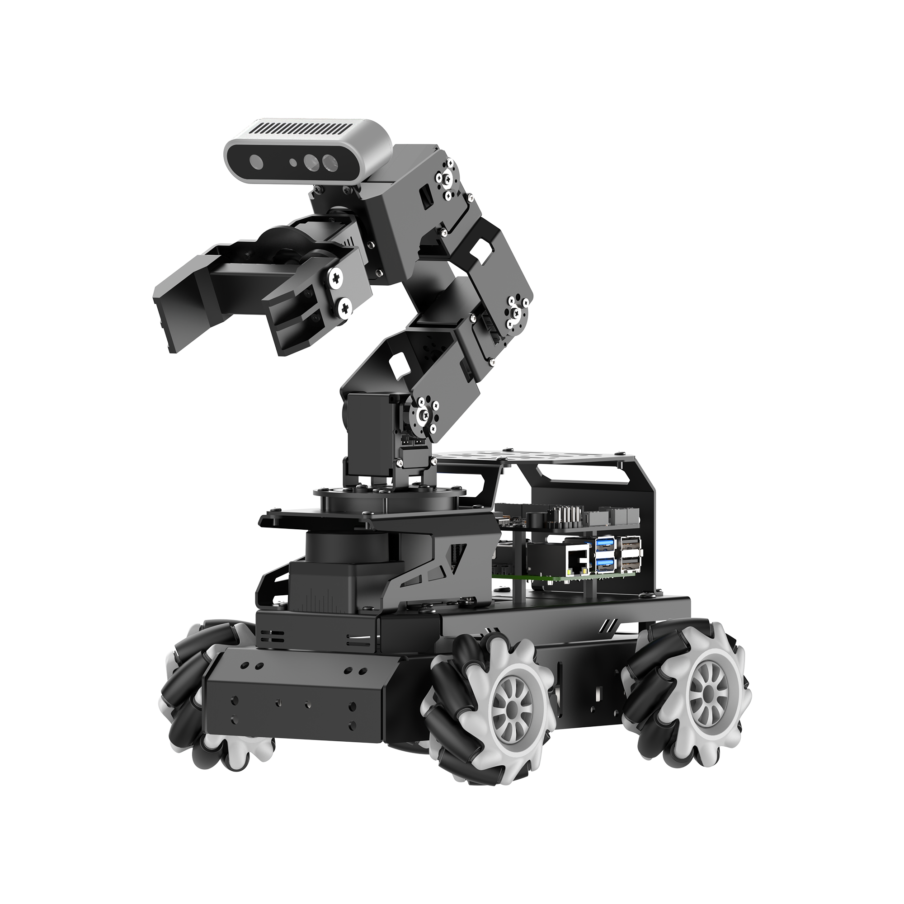

# Hiwonder LanderPi Advanced Pi 5: Mecanum ROS 2 setup and arm workflows


[**Hiwonder LanderPi Advanced / Pi 5 8 GB / Mecanum — SKU Hiwonder-21031623**](https://openelab.io/products/landerpi-robot-car?variant=46099797246150)


## Product overview <a href="#product-overview" id="product-overview"></a>



_Existing OpenELAB product illustration retained for model context; option contents and electrical connections are identified by the tables and diagrams below._

The assigned LanderPi is the **Advanced Kit with Raspberry Pi 5 8 GB and Mecanum chassis**. It combines a six-servo arm/gripper, LiDAR, depth camera and WonderEcho Pro voice box. Starter's monocular camera, Ackermann steering and Tank motor hardware are different options. The Pi 5 host runs the manufacturer's Debian12 system with ROS 2 in Docker. Use the supplied ROS terminal/container environment rather than assuming host-native Ubuntu ROS commands. [Exact store option](https://openelab.io/products/landerpi-robot-car?variant=46099797246150),[official manual](https://wiki.hiwonder.com/projects/LanderPi/en/latest/docs/1_LanderPi_User_Manual.html).

Start with power, correct chassis selection and live sensor feedback. Progress to a short manual floor test, a measured calibration, a small map and finally depth-aware manipulation. A working camera preview alone does not validate depth, odometry or arm geometry.

### Other established purchasing options <a href="#models-and-purchasing-options" id="models-and-purchasing-options"></a>

This canonical page also retains the following catalogued family options. The detailed first-run workflow above/below is for the exact host/kit variants in the opening callout; select the matching host image and kit-specific hardware for other options. A controller-excluded option needs that separately supplied host. A ROSOrin base is distinct from ROSOrin Pro with an arm.

| SKU                 | Established option                                          |
| ------------------- | ----------------------------------------------------------- |
| `Hiwonder-21031613` | Starter Kit / Without Raspberry Pi 5 / Mecanum Chassis      |
| `Hiwonder-21031625` | Starter Kit / Without Raspberry Pi 5 / Ackerman Chassis     |
| `Hiwonder-21031637` | Starter Kit / Without Raspberry Pi 5 / Tank Chassis         |
| `Hiwonder-21031916` | Starter Kit / With Raspberry Pi 5 2 GB / Mecanum Chassis    |
| `Hiwonder-21031919` | Starter Kit / With Raspberry Pi 5 2 GB / Ackerman Chassis   |
| `Hiwonder-21031922` | Starter Kit / With Raspberry Pi 5 2 GB / Tank Chassis       |
| `Hiwonder-21031614` | Starter Kit / With Raspberry Pi 5 4 GB / Mecanum Chassis    |
| `Hiwonder-21031626` | Starter Kit / With Raspberry Pi 5 4 GB / Ackerman Chassis   |
| `Hiwonder-21031638` | Starter Kit / With Raspberry Pi 5 4 GB / Tank Chassis       |
| `Hiwonder-21031615` | Starter Kit / With Raspberry Pi 5 8 GB / Mecanum Chassis    |
| `Hiwonder-21031627` | Starter Kit / With Raspberry Pi 5 8 GB / Ackerman Chassis   |
| `Hiwonder-21031639` | Starter Kit / With Raspberry Pi 5 8 GB / Tank Chassis       |
| `Hiwonder-21031616` | Starter Kit / With Raspberry Pi 5 16 GB / Mecanum Chassis   |
| `Hiwonder-21031628` | Starter Kit / With Raspberry Pi 5 16 GB / Ackerman Chassis  |
| `Hiwonder-21031640` | Starter Kit / With Raspberry Pi 5 16 GB / Tank Chassis      |
| `Hiwonder-21031617` | Standard Kit / Without Raspberry Pi 5 / Mecanum Chassis     |
| `Hiwonder-21031629` | Standard Kit / Without Raspberry Pi 5 / Ackerman Chassis    |
| `Hiwonder-21031641` | Standard Kit / Without Raspberry Pi 5 / Tank Chassis        |
| `Hiwonder-21031917` | Standard Kit / With Raspberry Pi 5 2 GB / Mecanum Chassis   |
| `Hiwonder-21031920` | Standard Kit / With Raspberry Pi 5 2 GB / Ackerman Chassis  |
| `Hiwonder-21031923` | Standard Kit / With Raspberry Pi 5 2 GB / Tank Chassis      |
| `Hiwonder-21031618` | Standard Kit / With Raspberry Pi 5 4 GB / Mecanum Chassis   |
| `Hiwonder-21031630` | Standard Kit / With Raspberry Pi 5 4 GB / Ackerman Chassis  |
| `Hiwonder-21031642` | Standard Kit / With Raspberry Pi 5 4 GB / Tank Chassis      |
| `Hiwonder-21031619` | Standard Kit / With Raspberry Pi 5 8 GB / Mecanum Chassis   |
| `Hiwonder-21031631` | Standard Kit / With Raspberry Pi 5 8 GB / Ackerman Chassis  |
| `Hiwonder-21031643` | Standard Kit / With Raspberry Pi 5 8 GB / Tank Chassis      |
| `Hiwonder-21031620` | Standard Kit / With Raspberry Pi 5 16 GB / Mecanum Chassis  |
| `Hiwonder-21031632` | Standard Kit / With Raspberry Pi 5 16 GB / Ackerman Chassis |
| `Hiwonder-21031644` | Standard Kit / With Raspberry Pi 5 16 GB / Tank Chassis     |
| `Hiwonder-21031621` | Advanced Kit / Without Raspberry Pi 5 / Mecanum Chassis     |
| `Hiwonder-21031633` | Advanced Kit / Without Raspberry Pi 5 / Ackerman Chassis    |
| `Hiwonder-21031645` | Advanced Kit / Without Raspberry Pi 5 / Tank Chassis        |
| `Hiwonder-21031918` | Advanced Kit / With Raspberry Pi 5 2 GB / Mecanum Chassis   |
| `Hiwonder-21031921` | Advanced Kit / With Raspberry Pi 5 2 GB / Ackerman Chassis  |
| `Hiwonder-21031924` | Advanced Kit / With Raspberry Pi 5 2 GB / Tank Chassis      |
| `Hiwonder-21031622` | Advanced Kit / With Raspberry Pi 5 4 GB / Mecanum Chassis   |
| `Hiwonder-21031634` | Advanced Kit / With Raspberry Pi 5 4 GB / Ackerman Chassis  |
| `Hiwonder-21031646` | Advanced Kit / With Raspberry Pi 5 4 GB / Tank Chassis      |
| `Hiwonder-21031623` | Advanced Kit / With Raspberry Pi 5 8 GB / Mecanum Chassis   |
| `Hiwonder-21031635` | Advanced Kit / With Raspberry Pi 5 8 GB / Ackerman Chassis  |
| `Hiwonder-21031647` | Advanced Kit / With Raspberry Pi 5 8 GB / Tank Chassis      |
| `Hiwonder-21031624` | Advanced Kit / With Raspberry Pi 5 16 GB / Mecanum Chassis  |
| `Hiwonder-21031636` | Advanced Kit / With Raspberry Pi 5 16 GB / Ackerman Chassis |
| `Hiwonder-21031648` | Advanced Kit / With Raspberry Pi 5 16 GB / Tank Chassis     |

[OpenELAB family options](https://openelab.io/products/landerpi-robot-car).

## Applications <a href="#applications" id="applications"></a>

LanderPi provides a compact platform for omnidirectional motion, ROS 2 interfaces, encoder/IMU feedback, SLAM, vision tracking and mobile grasping. Advanced adds voice/model-interaction lessons, but local ROS navigation does not inherently require an online-model subscription.

A useful project sequence is stationary sensor freshness, short forward/lateral/rotation checks, one saved map and a light-block pick at a fixed station. Keep the task station and camera mounting consistent until calibration is repeatable. Optional cloud/model tasks should be connected only after conventional stop behavior and physical bounds are established.

## Specifications <a href="#specifications" id="specifications"></a>

| Item                | Exact configuration/reference                                    |
| ------------------- | ---------------------------------------------------------------- |
| SKU                 | Hiwonder-21031623                                                |
| Host                | Raspberry Pi 5 8 GB included                                     |
| Kit/chassis         | Advanced; Mecanum                                                |
| Robot size/mass     | Depth-camera Mecanum reference 212 × 174 × 441 mm; about 1.79 kg |
| Battery             | **7.4 V 2200 mAh**, discharge reference≤10 A                     |
| Charging            | **8.4 V**, matched charger; robot switched off                   |
| Low-battery warning | Recharge below 7.0 V according to manual                         |
| Mecanum motors      | JGA27-310R20; 7.4 V; 1: 20 gear; AB Hall encoders                |
| Motor current       | Rated≤0.65 A; stall≤1.4 A reference                              |
| Arm servos          | 6×HX-06L intelligent bus servos, including the gripper actuator  |

| Electrical/control quantity | Published value                                                                              |
| --------------------------- | -------------------------------------------------------------------------------------------- |
| Bus-servo voltage           | Rated7.4 V; 6–8.4 V operating range                                                          |
| Bus-servo current           | 300mA no-load; 1.3 A stall reference                                                         |
| Servo position              | 0–1000 controller units correspond to 0–240°                                                 |
| Servo bus                   | UART; 5264-3pin; 115200bit/s table reference                                                 |
| Lower controller            | STM32F407VET6,168 MHz, 512 KB flash, 192 KB RAM; QMI8658 IMU                                 |
| Host output                 | 5 V 5 A on lower board                                                                       |
| Depth camera                | Aurora930 series; 30–300 cm working range; 40 mm baseline; 640 × 400 or 320 × 240 at 5–15fps |
| Camera supply/output        | 5 V±10%, 1.5 A; Raw16 depth, NV12 color, Raw8 IR                                             |

[Component tables](https://wiki.hiwonder.com/projects/LanderPi/en/latest/docs/1_LanderPi_User_Manual.html#_1-8-hardware-introduction),[store configuration](https://openelab.io/products/landerpi-robot-car). Motor/servo stall figures are not continuous-operation ratings or object payload. The quoted camera illumination figures differ from related robot manuals; test the actual scene and do not transfer another Aurora revision's sunlight limit.

## Hardware and connections <a href="#hardware-and-connections" id="hardware-and-connections"></a>

### Battery, host power and servo selection


Official Hiwonder diagram, visually inspected. Callouts 1/3 are two PWM-servo groups; 2/4 select their supply between main power and 5 V; 5 is I2C; 6 bus-servo ports; 7 four motor/encoder sockets; 8 RGB; 9 user LED; 10 keys; 11 reset; 12 switch; 13 power input; 14 **5 V 5 A output**; 15 USB serial/firmware connection; 16 buzzer; 17 power indicators; 18 GPIO/SWD; 19 MCU; 20 IMU. Callout numbers are not connector pin numbers. [Board resource table](https://wiki.hiwonder.com/projects/LanderPi/en/latest/docs/1_LanderPi_User_Manual.html#_1-8-hardware-introduction).

The board's stated5–12.6 V input capability does not qualify the whole LanderPi at 12.6 V. Its fitted battery and arm servos use the lower-voltage arrangement above. Never substitute the 12.6 V charger supplied with ROSOrin/JetRover. Do not move PWM supply jumpers under power or apply main power to a Pi GPIO/data connection. Retain the supplied Pi 5 host harness.

Mecanum uses four motor/encoder connections; Ackermann and Tank wiring differ. The assembly instructions route the two pan-tilt bus leads to the STM32 bus port and the bottom arm servo. Confirm cable orientation and actual board markings with power off. Keep leads clear of rollers and arm pinch points.

### Charging and startup

Check the keyed pack connection before first use. Charge while off; red indicates charging and green completion/no-load. The manual gives about 1 hour from 7.0 V to 8.4 V as a reference, not a guaranteed timer. Disconnect after completion. Place the robot on a level floor with the arm's reset sweep clear, then power on and wait for the short ready beep. The Pi needs time to boot before control services are available. [Charging/startup](https://wiki.hiwonder.com/projects/LanderPi/en/latest/docs/1_LanderPi_User_Manual.html#_1-3-initial-power-on).

## Software and development resources <a href="#software-and-development-resources" id="software-and-development-resources"></a>

The delivered system separates Debian host tasks from the ROS 2 container. Open the provided **black ROS terminal** for ROS commands; use the host terminal for the documented Wi-Fi/system operations. Inspect `printenv ROS_DISTRO ROS_DOMAIN_ID need_compile`, `ros2 pkg prefix controller` and `ros2 topic list -t` inside the ROS environment. Record host/container image versions and `docker ps` from the host before updates. Do not invent a container name or replace the factory launch script with a generic Docker command.

The workspace is `ros2_ws`, with `app`, `example`, `interfaces`, `slam`, `navigation`, `peripherals`, `driver` and simulation resources. Lessons use `~/.stop_ros.sh` to stop competing ROS owners before standalone bringup and `sudo systemctl restart start_app_node.service` to restore app control in the documented environment. Establish a stable stopped state before this transition. [System/software introduction](https://wiki.hiwonder.com/projects/LanderPi/en/latest/docs/1_LanderPi_User_Manual.html).

The lower-board firmware is RRC Lite/STM32 code, not a generic ESP32 program. The manual covers its framework, compilation and USB programming and links the **RRC Lite and Host Computer Communication Protocol**. Preserve the matched firmware and calibration before experimenting; the ROS interface depends on that transport/firmware version.

## Getting started <a href="#getting-started" id="getting-started"></a>

### 1. First live image and environment result

1. Complete battery, initial posture and cable checks; boot on a clear floor.
2. Join `HW…` with password `hiwonder`, remain connected despite no internet and select LanderPi/Mecanum in the supplied app.
3. Open Robot Control and confirm a changing depth-camera color preview without commanding the wheels/arm.
4. Connect VNC to `192.168.149.1`, initial account `pi`/`raspberrypi`. Use the assigned IP after STA configuration and change default credentials before shared-network operation.
5. Open the black ROS terminal and inspect the environment, packages and topic types. Verify the configuration selects **Mecanum**, the installed depth camera and WonderEcho Pro rather than Starter's monocular branch.

\*\*Expected result: \*\*reachable Pi desktop, working ROS environment and a live camera image. Host-only `ros2: command not found` does not establish a broken robot if ROS belongs to the supplied container. [Remote access](https://wiki.hiwonder.com/projects/LanderPi/en/latest/docs/1_LanderPi_User_Manual.html#_1-4-development-environment-setup).

### 2. Original read-only scan freshness check

While factory sensor nodes run, find the actual LaserScan topic using `ros2 topic list -t`. Save this as `lander_scan_check.py` and run `python3 lander_scan_check.py /scan` only if `/scan` is the observed name; otherwise pass the actual topic. This never publishes commands.

```python
import math
import sys
import time
import rclpy
from rclpy.qos import qos_profile_sensor_data
from sensor_msgs.msg import LaserScan

rclpy.init()
node = rclpy.create_node('lander_scan_receipt')
records = []

def receive(msg):
    stamp = msg.header.stamp.sec + msg.header.stamp.nanosec * 1e-9
    valid = [v for v in msg.ranges if math.isfinite(v)
             and msg.range_min <= v <= msg.range_max]
    records.append((stamp, msg.header.frame_id, len(valid), len(msg.ranges)))

sub = node.create_subscription(LaserScan, sys.argv[1], receive,
                               qos_profile_sensor_data)
try:
    end = time.monotonic() + 10
    while time.monotonic() < end:
        rclpy.spin_once(node, timeout_sec=0.2)
    unique = len({r[0] for r in records})
    print('messages=', len(records), 'distinct_stamps=', unique)
    if len(records) < 2 or unique < 2:
        raise RuntimeError('No advancing scan stream: inspect driver/QoS/domain')
    print('last_stamp_frame_valid_total=', records[-1])
finally:
    node.destroy_node()
    rclpy.shutdown()
```

\*\*Expected result: \*\*multiple messages with advancing timestamps, a frame name and finite rays in a normal indoor scene. Empty/highly reflective scenes can reduce valid returns; move a cardboard target to distinguish scene behavior from a frozen stream. This is receipt/freshness evidence, not an accuracy or safety-range test.

### 3. Chassis and calibration

Use one manual controller and verify START/stop first. Make separate short forward, lateral and rotation tests on open level flooring. A lateral command belongs to Mecanum; Ackermann/Tank behavior must not be substituted. Check rollers, motor order and encoder direction before adjusting scale.

The chassis course separates raw IMU, filtered IMU, odometry, angular and linear calibration. Back up the existing calibration YAML, keep the robot still for IMU bias work and compare physical floor distance/yaw with feedback. Controller launches such as `ros_robot_controller.launch.py`, `controller.launch.py` and `odom_publisher.launch.py` are alternatives/stages in the documented workflow; do not duplicate the serial owner. [Chassis course](https://wiki.hiwonder.com/projects/LanderPi/en/latest/docs/3_Chassis_Motion_Control.html).

### 4. LiDAR, mapping and navigation

The LiDAR app lesson uses `app lidar_node.launch.py debug:=true`, an enter service and set-running values1 avoidance, 2 following, 3 guarding, 0 stop. Inspect actual service names before use and validate raw scan receipt first. A mode's stop request and ending a process are distinct operations; establish the documented stop before running autonomous motion. [LiDAR course](https://wiki.hiwonder.com/projects/LanderPi/en/latest/docs/4_LiDAR_Training_Program.html).

For first 2D mapping, stop app ownership while stationary, then use separate ROS terminals:

```bash
ros2 launch slam slam.launch.py
ros2 launch slam rviz_slam.launch.py
ros2 launch peripherals teleop_key_control.launch.py
```

Drive a small closed loop and inspect scan/map overlap. Save a new named map using the course's workflow; retain image/YAML and verify resolution, origin and image path. For navigation, use `navigation navigation.launch.py map:=map_01` only after that map exists, then `navigation rviz_navigation.launch.py`. Initialize pose, confirm laser walls align and send a nearby clear goal.

\*\*Expected result: \*\*a reasonable path and completed goal with arm/camera clearance. RTAB-Map mapping/navigation is a separate database workflow; do not run two localization authorities. [Mapping/navigation](https://wiki.hiwonder.com/projects/LanderPi/en/latest/docs/6_Mapping_Navigation_Course.html).

### 5. Arm and full course progression

| Official topic family                                                         | Procedure and useful checkpoint                                                                                                                                   |
| ----------------------------------------------------------------------------- | ----------------------------------------------------------------------------------------------------------------------------------------------------------------- |
| Arm deviation, hand/eye tracking, sorting, waste classification and transport | Back up offsets/thresholds, verify servo IDs and an unloaded path, then one light supplied block. Raw0–1000 positions are not degrees                             |
| Depth grasping/object tracking                                                | Check valid depth, registration, camera-to-arm transform and table height before IK. Reject invalid pixels rather than interpreting them as zero-distance objects |
| OpenCV, LAB thresholds, tags/AR, line following                               | Inspect masks/overlays with motion inactive; save lighting-specific calibration before a motor response                                                           |
| Machine learning/MediaPipe                                                    | Validate labels/landmarks and timing inside the Pi 5 image/container before tying them to an action                                                               |
| MoveIt/Gazebo/URDF                                                            | Use Mecanum model/joint limits and simulated collision geometry; keep physical bridge nodes inactive during simulation-only work                                  |
| WonderEcho Pro voice                                                          | Advanced includes this module; select its supported device/language and test recognition/playback before movement                                                 |
| Large models                                                                  | Test provider/local inference separately from robot tools; Pi 5 RAM does not imply CUDA or compatibility with every Orin model demo                               |
| Group control                                                                 | Confirm each robot's identity, network/domain/namespace and stop owner; test one member before group commands                                                     |
| STM32/RRC Lite foundation                                                     | Inspect framework/protocol on a backup source copy; retain working robot firmware and matched USB programming procedure                                           |

[Arm](https://wiki.hiwonder.com/projects/LanderPi/en/latest/docs/9_Robotic_Arm_Basic_Control.html),[OpenCV](https://wiki.hiwonder.com/projects/LanderPi/en/latest/docs/7_ROS+OpenCV.html),[machine learning](https://wiki.hiwonder.com/projects/LanderPi/en/latest/docs/8_ROS+Machine_Learning_Course.html),[simulation](https://wiki.hiwonder.com/projects/LanderPi/en/latest/docs/10_MoveIt_&_Gazebo_Simulation.html),[voice](https://wiki.hiwonder.com/projects/LanderPi/en/latest/docs/11_Voice_Control_Course.html),[AI](https://wiki.hiwonder.com/projects/LanderPi/en/latest/docs/12_Large_AI_Model_Course.html),[group control](https://wiki.hiwonder.com/projects/LanderPi/en/latest/docs/13_Group_Control.html).

## Troubleshooting and FAQs <a href="#troubleshooting-and-faqs" id="troubleshooting-and-faqs"></a>

| Symptom                                   | Diagnostic                                                                                    |
| ----------------------------------------- | --------------------------------------------------------------------------------------------- |
| Low-voltage beep or resets                | Stop and check7.4 V pack; recharge below 7 V with matched8.4 V charger while off              |
| ROS absent in host terminal               | Open the supplied ROS/container terminal and inspect that environment                         |
| Camera/serial device missing in container | Check host enumeration, original device mapping and one owner before rebuilding the image     |
| Wrong strafe/rotation                     | Verify Mecanum selection, wheel orientation, motor/encoder order and scale                    |
| Arm hot/buzzing                           | End motion, inspect load/binding/voltage; stall limits are not operating targets              |
| Grasp misses after camera move            | Recheck camera/hand-eye calibration and object height; do not overwrite joint neutral blindly |
| App fails after custom nodes              | End competing owners and restore the documented app service                                   |

**Can I use a 12.6 V robot charger?** No. The supplied LanderPi battery charges to 8.4 V, and its listed arm servos operate at 6–8.4 V.

**Does the board's5–12.6 V range authorize a 12 V battery upgrade?** No. That is a board input specification, not a qualification of all assembled components.

**How do I recover?** Back up maps, thresholds, servo deviations, robot configuration and the host/container launch setup. Obtain the matching Pi 5 image and lower-board firmware from official resources; identify the target card before writing. Keep a known-good card rather than formatting the working installation as an initial diagnostic.

## Downloads and technical documents <a href="#downloads-and-technical-documents" id="downloads-and-technical-documents"></a>

| Resource                                       | Official destination                                                                                                                                         |
| ---------------------------------------------- | ------------------------------------------------------------------------------------------------------------------------------------------------------------ |
| Full manual, charging, wiring, STM32 framework | [LanderPi manual](https://wiki.hiwonder.com/projects/LanderPi/en/latest/docs/1_LanderPi_User_Manual.html)                                                    |
| Controller protocol                            | [RRC Lite and host protocol](https://drive.google.com/file/d/1154LkF-UzKce9SSoH5a8n7HjI-tMGJgU/view?usp=sharing)                                             |
| Controller source analysis                     | [Official program materials](https://drive.google.com/drive/folders/1RhTUdSMw-vIlK6bOv_nrZ02pVP1N-hIg?usp=sharing)                                           |
| STM32 course                                   | [Official controller course](https://drive.google.com/drive/folders/1lfAAMXW7YbRU1SLw8qKh7ToSUOgHyaRs?usp=sharing)                                           |
| Firmware programming tools                     | [Official download software](https://drive.google.com/drive/folders/1UrpM_oS8g299VhCZZQ-JrD4rsge4ApjE?usp=sharing)                                           |
| Pi controller/image materials                  | [ROS Controller folder](https://drive.google.com/drive/folders/1Gja4_4h4-2w47aJ_6_SB2qA1RNJT2YTk?usp=sharing)                                                |
| Datasheet                                      | [STM32F407VET6 reference](https://drive.google.com/file/d/1gLeLGeH48V9vHjxMsu4xwTD5uw5a0pvy/view?usp=sharing)                                                |
| Mechanical/model files                         | [MoveIt/Gazebo course](https://wiki.hiwonder.com/projects/LanderPi/en/latest/docs/10_MoveIt_&_Gazebo_Simulation.html); use its matching URDF/model resources |

Individual recovery/CAD archive versions and checksums were not exhaustively inspected. No unverified robot-image release or full electrical schematic revision is asserted.

### Additional established resources

These established links supplement the model-specific resources above. Retain the matching model, host and revision when selecting a download.

* [manufacturer product data](https://www.hiwonder.com/products/landerpi)

## Hiwonder LanderPi Advanced Pi 5 Mecanum 8 GB: course reference

**Scope:** `Hiwonder-21031623`, Advanced Kit, Raspberry Pi 5 8 GB, Mecanum chassis. This appendix supplies original procedural explanations of the downloaded official LanderPi course bodies, rather than merely linking their titles. It covers the supplied `en/latest` snapshot reviewed 24 November 2026. “Latest” is a documentation lane, not a pinned firmware or dependency version. The reference system is the manufacturer's Pi environment with **ROS 2 in Docker**; `/home/ubuntu` examples refer to the documented ROS environment, while the Pi desktop login is separate. [L1](https://wiki.hiwonder.com/projects/LanderPi/en/latest/docs/1_LanderPi_User_Manual.html)

The Advanced kit's depth/voice course applicability does not establish inclusion of a driving mat, traffic-light props, bridge, extra robots or a six-microphone array. The assigned Mecanum base supports lateral motion; Ackermann and Tank configuration/kinematics are retained below as distinctions, not interchangeable control settings. NexArm raw servo positions and Orin power/image procedures do not apply to this Pi 5 robot.

### 1. Platform commissioning, electrical boundaries and network access <a href="#lp01" id="lp01"></a>

Use the fitted **7.4 V 2200 mAh** pack and matched **8.4 V charger**, with the robot switched off during charging. The manual calls for recharge below **7.0 V**; its approximate charging time is a reference rather than a timer that overrides the charger's indication. The STM32 board's wider stated input range does not qualify the complete robot or HX-06L servo wiring for a higher-voltage charger. Keep the Pi's supplied host power harness and the controller's 5 V output distinct from its battery input. [L1 §§1.2–1.3,1.8](https://wiki.hiwonder.com/projects/LanderPi/en/latest/docs/1_LanderPi_User_Manual.html)

With power off, check all four Mecanum motor/encoder leads, the arm's bus-servo chain, LiDAR and camera USB connections. The board diagrams include PWM-servo supply selectors; do not move them under power or assume they affect the bus-servos identically. Route the arm/antenna/camera leads clear of joint and roller paths. Position the robot on a flat open surface with room for its startup arm reset, switch on and wait for the ready beep. [L1 §§1.2,1.3.2,1.8.1](https://wiki.hiwonder.com/projects/LanderPi/en/latest/docs/1_LanderPi_User_Manual.html)

For initial AP access join `HW…`, password `hiwonder`, then open VNC at `192.168.149.1` with the documented Pi account **`pi` / `raspberrypi`**. An AP-only connection provides local access, not cloud-model Internet service. To use LAN mode, provision the robot and client onto the same network through the app or the supplied `wifi_manager/wifi_conf.py`; the course restarts `wifi.service` after configuration. Read the actual assigned address instead of retaining the AP address in an STA session. [L1 §§1.3.3,1.4.2](https://wiki.hiwonder.com/projects/LanderPi/en/latest/docs/1_LanderPi_User_Manual.html)

Open the desktop **Tool** configuration application and select **`LanderPi_Mecanum` → Save → Apply → Quit**; wait for the short beep. `LanderPi_Tank` and `LanderPi_Acker` are different hardware selections. Select the actual depth camera and **MS200** LiDAR if those are the fitted devices. Configuration selection is not hardware conversion. [L1 §1.4.3](https://wiki.hiwonder.com/projects/LanderPi/en/latest/docs/1_LanderPi_User_Manual.html); [L4 §4.1.3](https://wiki.hiwonder.com/projects/LanderPi/en/latest/docs/4_LiDAR_Training_Program.html)

The desktop has two terminals: the **ROS 2 environment terminal** for the robot workspace/container and a native **system terminal** for Pi services/files. Follow the lesson's terminal choice. The `pi` login does not imply that every example path should be rewritten from `/home/ubuntu` to `/home/pi`. ROS launch branches and software tools depend on their delivered environment. [L1 §§1.4.4,1.9](https://wiki.hiwonder.com/projects/LanderPi/en/latest/docs/1_LanderPi_User_Manual.html)

Before a standalone development lesson, end app/controller activity and run:

```bash
~/.stop_ros.sh
```

After the lesson's nodes have ended, restore the app/controller service in the appropriate Pi system terminal:

```bash
sudo systemctl restart start_app_node.service
```

The documented reason is exclusive hardware ownership: leaving the app running can occupy USB/servo resources and freeze another tool. **Expected first result:** changing camera data, a correctly selected Mecanum configuration and reachable ROS environment before autonomous motion. [L1 §1.9.2](https://wiki.hiwonder.com/projects/LanderPi/en/latest/docs/1_LanderPi_User_Manual.html); [L9 §9.1](https://wiki.hiwonder.com/projects/LanderPi/en/latest/docs/9_Robotic_Arm_Basic_Control.html)

WonderPi offers Robot Control, LiDAR, color Object Tracking, Line Following, Finger Recognition and AR. Its live view can adjust the pan-tilt by dragging; the arm icon exposes individual joint controls. The finger-trace mode's strafing applies only to Mecanum, while AR overlays predefined 3D images on tags rather than generating a calibrated collision model. LiDAR avoidance/following use a documented 90° front sector; objects behind the robot remain outside that application's described detection sector. [L1 §1.3.4](https://wiki.hiwonder.com/projects/LanderPi/en/latest/docs/1_LanderPi_User_Manual.html)

For the supplied wireless controller, fit the USB receiver before boot and wait for green steady/red off after pairing. Left stick commands forward/back and, on Mecanum, sideways motion; right stick commands turning. START stops/resets in this LanderPi controller mode. The controller sleeps after 30 seconds without pairing or five minutes unused and wakes with START. The manual warns about interference/misconnection around multiple robots; chapter 13 uses an explicit group setup instead. [L1 §1.3.5](https://wiki.hiwonder.com/projects/LanderPi/en/latest/docs/1_LanderPi_User_Manual.html)

### 2. STM32 firmware development and the resource-only basic course <a href="#lp02" id="lp02"></a>

The lower controller runs FreeRTOS and closes the motor-speed PID loop: chassis target → inverse wheel kinematics → motor targets → timer PWM/driver → encoder feedback. Its Robot\_Task handles overall control, kinematics, IMU acquisition and transmission; a miscellaneous task handles lower-rate battery, calibration and buzzer work. The ROS serial link uses Hiwonder's hexadecimal RRC protocol and returns odometry/speed, IMU and battery information. This is different from replacing the Pi-side ROS node or voice-module firmware. The Mecanum board controls four motors; Tank/Ackermann use two, with an extra steering servo in Ackermann. [L1 §§1.6–1.7.4](https://wiki.hiwonder.com/projects/LanderPi/en/latest/docs/1_LanderPi_User_Manual.html)

For deliberate lower-level development, the course uses **Keil5 → Project → Options → Output** to enable HEX generation, then **Build Target** and inspection of Build Output. Treat any compiler error as unresolved; no compilation was performed here. For USB ISP programming, connect the board's documented **UART1 Type-C** port to the computer, select its actual COM port in **ATK-XISP** and **115200 bit/s**. The source selects **Run After Programming**, **Verify**, **Full Chip Erase Before Programming**, **DTR Low Reset** and **RTS High Enter BootLoader**, then chooses the matched HEX and starts programming. That full erase is destructive to existing firmware. `RosRobotControllerLite20250722.hex` is a source-listed example, not a binary obtained or verified for this unit. Routine ROS use does not require reflashing the factory controller. [L1 §§1.7.5–1.7.6](https://wiki.hiwonder.com/projects/LanderPi/en/latest/docs/1_LanderPi_User_Manual.html)

The public **chapter 2 Basic Course** contains only a pointer to a separate “2. Basic Course” folder. No substantive Python/Linux/ROS lessons from that folder are included in the supplied snapshot. The operational foundations above and below are synthesized from the actual manual/control courses; they are not represented as a full reproduction of that unavailable course. No numbered chapter 5 body is supplied in the downloaded LanderPi index. [L2](https://wiki.hiwonder.com/projects/LanderPi/en/latest/docs/2_Basic_Course.html)

The manufacturer links the [RRC Lite and host communication protocol](https://drive.google.com/file/d/1154LkF-UzKce9SSoH5a8n7HjI-tMGJgU/view?usp=sharing) and [RRCLite program-analysis folder](https://drive.google.com/drive/folders/1RhTUdSMw-vIlK6bOv_nrZ02pVP1N-hIg?usp=sharing). These linked binaries/documents were not retrieved during source review; packet bytes, command IDs, CRC rules and electrical pin mappings must not be invented from their names. [L1 §1.6.2](https://wiki.hiwonder.com/projects/LanderPi/en/latest/docs/1_LanderPi_User_Manual.html)

### 3. Chassis kinematics, motion messages and explicit stopping <a href="#lp03" id="lp03"></a>

For the Mecanum robot, four wheel velocities combine forward/backward, lateral and yaw components. Wheel roller orientation and motor direction matter; turning a wheel sign into a geometry correction can break the other motion axes. The Ackermann course relates steering geometry to a turning radius; its base cannot rotate or translate like a Mecanum platform. The Tank course uses left/right differential speed and no holonomic lateral axis. Retain the fitted wheel diameter/base/track and encoder mapping instead of transplanting a formula's constants from another chassis. [L3 §3.1](https://wiki.hiwonder.com/projects/LanderPi/en/latest/docs/3_Chassis_Motion_Control.html)

Start `ros2 launch controller controller.launch.py` after stopping app bringup. Its motion input is **`/controller/cmd_vel`**, with `geometry_msgs/msg/Twist` on ROS 2: `linear.x` forward speed and `linear.y` Mecanum lateral speed in **m/s**, `angular.z` yaw rate in **rad/s**. The course demonstrates the velocity message, but prints the older `geometry_msgs/Twist` spelling in one command. Its FAQ also prints a ROS 1 `rostopic` command on `/hiwonder_controller/cmd_vel`. Those are inconsistent with the ROS 2 node and must not be copied as a verified stop recipe. [L3 §3.2.3](https://wiki.hiwonder.com/projects/LanderPi/en/latest/docs/3_Chassis_Motion_Control.html)

**Original ROS 2 adaptation of the source's zero-velocity message:** with the documented controller actually running/subscribed on `/controller/cmd_vel`, send all zero components:

```bash
ros2 topic pub --once /controller/cmd_vel geometry_msgs/msg/Twist "{linear: {x: 0.0, y: 0.0, z: 0.0}, angular: {x: 0.0, y: 0.0, z: 0.0}}"
```

This command corrects ROS 2 type notation and makes one publication explicit; it was **not executed**. Confirm the active motion owner/topic before relying on it. A message to an unused namespace cannot stop another controller; end the application that is still commanding movement and verify the physical wheels stop. Ctrl+C in a publisher terminal is not itself a documented motor brake. [L3 §3.2.3](https://wiki.hiwonder.com/projects/LanderPi/en/latest/docs/3_Chassis_Motion_Control.html)

**Original commissioning sequence:** use the app/manual control for a short forward movement, then lateral movement, then yaw, checking the physical directions against odometry after each. Use a clear floor area and return velocity to zero between axes. These are proposed checks, not hardware results.

### 4. IMU, odometry and measured motion calibration <a href="#lp04" id="lp04"></a>

The robot is factory-calibrated. Recalibration is for a measured deviation or mechanical change, not an arbitrary first-use reset. The chapter describes a six-orientation accelerometer procedure, a full-turn angular check and a one-meter linear check. Keep backups of the original YAML and record the measured results. [L3 §3.2.1](https://wiki.hiwonder.com/projects/LanderPi/en/latest/docs/3_Chassis_Motion_Control.html)

#### IMU orientation calibration

1. End auto-start and launch `ros2 launch ros_robot_controller ros_robot_controller.launch.py`.
2. In another ROS terminal run:

```bash
ros2 run imu_calib do_calib --ros-args -r imu:=/ros_robot_controller/imu_raw --param output_file:=/home/ubuntu/ros2_ws/src/calibration/config/imu_calib.yaml
```

3. Follow each live prompt and hold the robot steadily in its six requested orientations: forward, backward, left, right, up and down, pressing Enter to record each. Protect the arm, screen and depth camera while supporting the unit; do not rest it on the camera.
4. **Expected result:** the node calculates calibration parameters and writes the specified YAML. Run `ros2 launch peripherals imu_view.launch.py` and compare the displayed orientation with slow physical reorientation. Do not infer an orientation merely from a completed file write.

To inspect filtered data, start `ros2 launch peripherals imu_filter.launch.py`, then use `ros2 topic info /imu` and `ros2 topic echo /imu`. `/imu` should carry `sensor_msgs/msg/Imu`. Launch `ros2 launch controller odom_publisher.launch.py` for `/odom_raw`, a `nav_msgs/msg/Odometry` stream containing pose and twist. Wheel encoders estimate motion even during slip; an odometry stream is not independent proof of actual displacement. [L3 §§3.2.1–3.2.2](https://wiki.hiwonder.com/projects/LanderPi/en/latest/docs/3_Chassis_Motion_Control.html)

#### Angular calibration for the assigned Mecanum base

Save the original `~/ros2_ws/src/driver/controller/config/calibrate_params.yaml`, initialize the relevant angular correction to 1.0 and mark the robot's actual heading on the floor. Start the lower controller and `ros2 launch calibration angular_calib.launch.py`. Open **calibrate\_angular**, set/check **test\_angle=360°**, inspect **tolerance**, then enable **start\_test**. Compare the completed physical turn with the original heading. Adjust `odom_angle_scale_correction` in the documented **0.01** increments and repeat; write the accepted value into **`angular_correction_factor`** in the YAML. [L3 §3.2.1](https://wiki.hiwonder.com/projects/LanderPi/en/latest/docs/3_Chassis_Motion_Control.html)

The page labels the angular test's `speed` as a “linear speed” of 0.15 m/s. That is dimensionally ambiguous for a rotation test; inspect the installed calibration node's parameter meaning rather than presenting 0.15 as a verified yaw rate. The source excludes Ackermann from this angular calibration; that exclusion does not apply to the assigned Mecanum robot.

#### Linear calibration

Set `linear_correction_factor` to 1.0, place floor markers **1 m** apart and start `ros2 launch calibration linear_calib.launch.py` with the lower controller running. In **calibrate\_linear**, the documented defaults are **test\_distance=1 m**, **speed=0.2 m/s**, plus tolerance and `odom_linear_scale_correction`. Start the test, measure actual distance/straightness, adjust the scale in 0.01 increments and save the result as **`linear_correction_factor`**. A scale corrects traveled distance; persistent sideways veering also merits a wheel/roller/direction/mechanical check rather than endless scale adjustment. That last distinction is engineering interpretation, not a claimed manufacturer test. [L3 §3.2.1](https://wiki.hiwonder.com/projects/LanderPi/en/latest/docs/3_Chassis_Motion_Control.html)

### 5. MS200 LiDAR: configuration, avoidance, tracking and guard <a href="#lp05" id="lp05"></a>

The course selects the fitted LiDAR in **Tool → Lidar → MS200 → Save → Apply** and waits for auto-start reconfiguration. The manual identifies MS200 as time-of-flight. Its interface table states **5 V (4.5–5.5 V)** supply and a Tx signal at **0–3.3 V**; power and UART logic are different voltage domains. Use the keyed supplied harness and its original connector diagram. The source's generic TOF explanation omits the round-trip factor; for measured return time Δt the one-way distance is `c·Δt/2`, not `c·Δt`. Do not apply this equation to raw protocol fields without the actual protocol's scaling. [L1 §1.8.4](https://wiki.hiwonder.com/projects/LanderPi/en/latest/docs/1_LanderPi_User_Manual.html); [L4 §§4.1–4.2](https://wiki.hiwonder.com/projects/LanderPi/en/latest/docs/4_LiDAR_Training_Program.html)

After ending auto-start, start the LiDAR application:

```bash
ros2 launch app lidar_node.launch.py debug:=true
```

Enter the application in another terminal:

```bash
ros2 service call /lidar_app/enter std_srvs/srv/Trigger {}
```

Then choose one mode using `/lidar_app/set_running`, type `interfaces/srv/SetInt64`:

| `data` | Course                 | Operation and expected result                                                                                                                                                          |
| ------ | ---------------------- | -------------------------------------------------------------------------------------------------------------------------------------------------------------------------------------- |
| 1      | 4.3 Obstacle avoidance | Detects an object in front and turns according to the application's distance setting; otherwise proceeds forward. First test with a broad, visible obstacle and a clear escape region. |
| 2      | 4.4 Tracking           | Uses **35 cm** as the documented follow distance: advances when farther, backs away when nearer and aims to stop at the set distance. It can reverse; keep the rear clear.             |
| 3      | 4.5 Guard              | Rotates to face a detected object within its configured range. The course excludes Ackermann; the assigned Mecanum variant is the applicable lane.                                     |
| 0      | Stop mode              | Stops the current LiDAR behavior before ending its launch process.                                                                                                                     |

Example source command for tracking is `ros2 service call /lidar_app/set_running interfaces/srv/SetInt64 "{data: 2}"`; substitute 0 to stop. These modes are local LiDAR behaviors, not saved-map navigation or validated personnel protection. If objects are absent from the view, check fitted model/driver and scan availability before changing avoidance thresholds. [L4 §§4.3–4.5](https://wiki.hiwonder.com/projects/LanderPi/en/latest/docs/4_LiDAR_Training_Program.html)

### 6. Mapping, localization and navigation with a saved map <a href="#lp06" id="lp06"></a>

A useful map requires stable wheel/IMU estimates, a consistent `odom → base_link` transform and live LiDAR scans. URDF supplies the frame tree and sensor offsets; correcting a visual mesh alone does not correct the physical LiDAR-to-base transform. Inspect `~/ros2_ws/src/simulations/landerpi_description/urdf/` for the robot model used by the mapping course. Robot/VM networking and DDS discovery must be configured before expecting remote RViz to display data. [L6 §§6.1.1–6.1.4](https://wiki.hiwonder.com/projects/LanderPi/en/latest/docs/6_Mapping_Navigation_Course.html)

#### 2D SLAM Toolbox mapping

1. Place the Mecanum robot on a flat, well-lit, open route with useful fixed features; calibrate motion if the measured trajectory is poor. End app bringup.
2. **Robot ROS terminal:** `ros2 launch slam slam.launch.py`.
3. **Configured VM:** `ros2 launch slam rviz_slam.launch.py` to visualize the map. Use the course's keyboard control `ros2 launch peripherals teleop_key_control.launch.py` in its documented control environment. Drive slowly enough for scan matching and revisit a known region for loop closure.
4. Save the map on the robot:

```bash
cd ~/ros2_ws/src/slam/maps
ros2 run nav2_map_server map_saver_cli -f "map_01" --ros-args -p map_subscribe_transient_local:=true
```

5. **Expected result:** an occupancy map and its associated map metadata are saved under that basename. Preserve both files together. The name `map_01` is an example input; reusing it can replace a previous map. The app's quick mapping path uses the most recently created map and warns that a new map replaces that app selection. [L1 §1.5.1](https://wiki.hiwonder.com/projects/LanderPi/en/latest/docs/1_LanderPi_User_Manual.html); [L6 §6.1.4](https://wiki.hiwonder.com/projects/LanderPi/en/latest/docs/6_Mapping_Navigation_Course.html)

The source describes synchronous/asynchronous SLAM Toolbox modes and a pose-graph backend. Its configuration is `~/ros2_ws/src/slam/config/slam.yaml`. An occupancy map saved for Nav2 and a serialized SLAM pose graph serve different purposes; do not claim map merging/resumable mapping merely because map\_saver completed. [L6 §6.1.4](https://wiki.hiwonder.com/projects/LanderPi/en/latest/docs/6_Mapping_Navigation_Course.html)

#### 2D navigation and localization

On the robot stop app auto-start with `~/.stop_ros.sh`, then start `ros2 launch navigation navigation.launch.py map:=map_01`; on the configured VM start `ros2 launch navigation rviz_navigation.launch.py`. Use **2D Pose Estimate** to place the initial robot pose correctly on the loaded map, checking the arrow direction as well as position. For one target use **2D Nav Goal**. [L6 §6.2.4, robot and VM startup](https://wiki.hiwonder.com/projects/LanderPi/en/latest/docs/6_Mapping_Navigation_Course.html#_6-2-4-lidar-single-point-and-multi-point-navigation-and-obstacle-avoidance)

For a route, select **Waypoint**, add the ordered navigation points using the course's **Publish Point** workflow, then click **Start Waypoint Following** to begin sequential execution. Adding points alone does not start the route. The source distinguishes **Start Nav Through Poses**, which does not require the specified orientation at each navigation point, from **Start Waypoint Following**, which reaches each waypoint with its required orientation. Choose the execution mode deliberately after localization and goal placement. **Expected result:** a path appears and the robot visits the intended points in order while responding to perceived obstacles. A drawn global path alone does not prove the local controller can execute it. [L6 §6.2.4, multi-point steps and orientation note](https://wiki.hiwonder.com/projects/LanderPi/en/latest/docs/6_Mapping_Navigation_Course.html#_6-2-4-lidar-single-point-and-multi-point-navigation-and-obstacle-avoidance)

AMCL estimates pose from a pre-existing map using particles; it is not the map-building process. If localization jumps, first inspect map identity, initial pose, scan alignment and odometry. The source explains Dijkstra/A\* global search and DWA/TEB local planning conceptually; those explanations do not prove a particular controller plugin is active in every shipped image. Read the delivered navigation configuration before changing planner-specific parameters. The local planner must consider current obstacles and motion limits, whereas the global route describes the map-scale objective. [L6 §§6.2.1–6.2.3](https://wiki.hiwonder.com/projects/LanderPi/en/latest/docs/6_Mapping_Navigation_Course.html)

#### RGBD RTAB-VSLAM

On the robot run `ros2 launch slam rtabmap_slam.launch.py`, and on the VM `ros2 launch slam rviz_rtabmap.launch.py`. Move through textured views with valid registered depth; low texture or rapid motion degrades feature matching. The course says its database is saved when mapping exits with Ctrl+C; it does not provide a verified database path in the retained procedure, so locate the actual output rather than inventing one. [L6 §6.1.5](https://wiki.hiwonder.com/projects/LanderPi/en/latest/docs/6_Mapping_Navigation_Course.html)

For reuse launch `ros2 launch navigation rtabmap_navigation.launch.py` on the robot and `ros2 launch navigation rviz_rtabmap_navigation.launch.py` on the VM. Use **Download graph**, display the 3D map, then set a goal. Verify that the downloaded graph belongs to the current room/session. This RGBD pipeline depends on more than a functioning RGB preview. [L6 §6.2.5](https://wiki.hiwonder.com/projects/LanderPi/en/latest/docs/6_Mapping_Navigation_Course.html)

### 7. OpenCV: LAB adjustment, color detection, QR codes and line following <a href="#lp07" id="lp07"></a>

All chapter 7 procedures use the supplied ROS 2 environment. To open LAB TOOL, stop auto-start, start `ros2 launch peripherals depth_camera.launch.py`, then in another terminal run `python3 /home/ubuntu/software/lab_tool/main.py`. Confirm the camera feed before adjusting sliders. Select the correct camera type and target color; set minima to 0/maxima to 255, then narrow the interval until only the target is white. For red increase minimum A first; tune L and B against actual lighting. **Save** is required. To add yellow use **Add → yellow → select yellow → tune → Save**. End the camera launch and close the tool before restoring app services. [L7 §7.1](https://wiki.hiwonder.com/projects/LanderPi/en/latest/docs/7_ROS+OpenCV.html)

The independent color demonstration runs `cd ~/ros2_ws/src/example/example/color_detect && python3 color_detect_demo.py` with the depth-camera launch active. It reads `/depth_cam/rgb/image_raw`, resizes to **320×240**, blurs, converts to LAB, thresholds and applies morphology before contour selection. Expect the target enclosed by a corresponding colored circle and the red/green/blue name displayed. Avoid other similarly colored objects in the frame; a mask cannot know which same-color object was intended. [L7 §7.2](https://wiki.hiwonder.com/projects/LanderPi/en/latest/docs/7_ROS+OpenCV.html)

For QR generation run `cd ~/ros2_ws/src/example/example/qrcode && python3 qrcode_creater.py`, enter a payload string and confirm the generated image/save path. The code uses `add_data`, `make`, `make_image` with black foreground/white background, then `imwrite`. For reading, start the camera and `cd ~/ros2_ws/src/example/example/qrcode && python3 qrcode_detecter.py`; show the printed code in view and expect an enclosing box and the decoded payload in the terminal. Decoded text is data, not authorization to execute a command found in a QR code. [L7 §7.3](https://wiki.hiwonder.com/projects/LanderPi/en/latest/docs/7_ROS+OpenCV.html)

The line-following lesson launches `ros2 launch app line_following_node.launch.py debug:=true`, enters with `/line_following/enter` (`std_srvs/srv/Trigger`, `{}`), then starts with `/line_following/set_running` (`std_srvs/srv/SetBool`, `{data: True}`). Select the track's color in the returned image. The node computes line-center error and applies PID; its LiDAR callback can stop movement for detected obstacles. End through `/line_following/exit` with Trigger before closing the launch. The exit callback ends subscriptions and resets PID. **Expected result:** the selected line is highlighted and followed. This does not establish protection against a table edge. [L7 §7.4](https://wiki.hiwonder.com/projects/LanderPi/en/latest/docs/7_ROS+OpenCV.html)

### 8. YOLO dataset and model deployment on the Pi lane <a href="#lp08" id="lp08"></a>

The ML foundations distinguish AI, machine learning and deep learning; supervised examples use labels, unsupervised examples look for structure without supplied classes. The framework overview lists PyTorch, TensorFlow, PaddlePaddle and MXNet. Operationally, the supplied LanderPi course uses its **YOLO26** training/detection project. Generic anchor-box and architecture explanations in that article are teaching material; no exact installed library version is pinned. Keep weights, class ordering, task format and runtime paired. [L8 §§8.1–8.2.2](https://wiki.hiwonder.com/projects/LanderPi/en/latest/docs/8_ROS+Machine_Learning_Course.html)

1. Stop auto-start, start the depth camera, create/select `my_data` in `~/software/collect_picture/main.py` and capture varied distances, rotation and backgrounds. Images appear in `JPEGImages`; repeated nearly identical frames do not supply much new variation.
2. Use `python3 ~/software/labelImg/labelImg.py` for this **LanderPi** lane, set the output to `Annotations`, draw the full target box, name the class (the source uses `left`), save and advance with D. This differs from NexArm's rotated-label `roLabelImg`/OBB conversion.
3. Set `~/my_data/classes.names` with one exact label per line, then convert:

```bash
python3 ~/software/xml2yolo.py --data ~/my_data --yaml ~/my_data/data.yaml
```

Review the generated train/validation paths, especially if moving the dataset to a GPU PC. Preserve the class order. The source recommends an external GPU machine for large datasets due to the robot's memory/I/O constraints. [L8 §§8.2.3–8.2.4](https://wiki.hiwonder.com/projects/LanderPi/en/latest/docs/8_ROS+Machine_Learning_Course.html)

The Pi-lane training example is:

```bash
cd /home/ubuntu/third_party_ros2/yolo/yolo26
python3 train.py --img 640 --batch 8 --epochs 300 --data ~/my_data/data.yaml --weights yolo26n.pt
```

The arguments mean input image dimensions, batch size, epochs, dataset YAML and initial weights. **Batch 8 is an example, not a measured fit/throughput result for the 8 GB Pi.** Read the printed run output rather than assuming `train2` always exists. Copy its actual `weights/best.pt` into `~/third_party_ros2/yolo`, edit `CLASSES_NAMES_DEFAULT` in `~/ros2_ws/src/example/example/yolo_detect/yolo_detect_demo.py`, and launch `ros2 launch example yolo_detect_demo.launch.py model_name:=best`. [L8 §§8.2.5–8.2.6](https://wiki.hiwonder.com/projects/LanderPi/en/latest/docs/8_ROS+Machine_Learning_Course.html)

For the provided traffic-sign model use `ros2 launch example yolo_detect_demo.launch.py model_name:=best_traffic_26`. Expect boxes, class names and confidence on signs in the camera view. Keep traffic-sign testing separate from enabling the driving policy. The waste-classification chapter still mentions YOLOv11 while the training chapter names YOLO26; verify the installed launch's actual weight/task rather than treating those labels as a version lock. [L8 §8.2.7](https://wiki.hiwonder.com/projects/LanderPi/en/latest/docs/8_ROS+Machine_Learning_Course.html); [L9 §9.2.1](https://wiki.hiwonder.com/projects/LanderPi/en/latest/docs/9_Robotic_Arm_Basic_Control.html)

### 9. MediaPipe: image-only detection and body-controlled motion <a href="#lp09" id="lp09"></a>

For the image-only scripts below, stop app bringup, launch `peripherals depth_camera.launch.py`, then run the named Python file under `~/ros2_ws/src/example/example/mediapipe_example/`. The callback reads camera images and keeps a current frame queue; the model's result is drawn on the frame. Esc exits the image loop and Ctrl+C ends the process. These are the legacy MediaPipe Solutions examples supplied by the course, not a guarantee that installing the newest MediaPipe preserves the same APIs. [L8 §8.3](https://wiki.hiwonder.com/projects/LanderPi/en/latest/docs/8_ROS+Machine_Learning_Course.html)

| Lesson                                | Script or launch                                     | Concrete input/output and limitation                                                                                                                                                                                                             |
| ------------------------------------- | ---------------------------------------------------- | ------------------------------------------------------------------------------------------------------------------------------------------------------------------------------------------------------------------------------------------------ |
| 8.3.2 Background segmentation         | `python3 self_segmentation.py`                       | Segmentation mask, edge filtering and replacement background. A person/hand region is separated from the background; it is not an object-depth measurement.                                                                                      |
| 8.3.3 Objectron                       | `python3 objectron.py`                               | A supported-category object, illustrated with a handled cup, receives a 3D-style bounding box. The course lists handled cups, shoes, chairs and cameras; arbitrary industrial parts are not trained categories.                                  |
| 8.3.4 Face detection                  | `python3 face_detect.py`                             | BlazeFace-based face box and six landmarks, with confidence-based acceptance; multiple faces may appear.                                                                                                                                         |
| 8.3.5 Face mesh                       | `python3 face_mesh.py`                               | 468 facial landmarks and mesh connections. Inferred landmark geometry is distinct from measured registered RGBD points.                                                                                                                          |
| 8.3.6 Hand keypoints                  | `python3 hand.py`                                    | 21 landmarks per hand and their finger connections; finger states are inferred from joint geometry.                                                                                                                                              |
| 8.3.7 Body keypoints                  | `python3 pose.py`                                    | Torso/limb landmarks and connecting skeleton. Detection is not yet an instruction to move.                                                                                                                                                       |
| 8.3.8 Fingertip trajectory            | `python3 hand_gesture.py`                            | Recognized hand state locks a fingertip and draws its path. Finger joint angles and a state machine control recording.                                                                                                                           |
| 8.3.9 Body gesture motion             | `ros2 launch example body_control.launch.py`         | Source conflict: the opening describes arm gestures as lateral movement, but the outcome/program prose describes spins. The purchased Mecanum motion mapping remains conditional on the installed chassis branch; see the acceptance gate below. |
| 8.3.10 Registered-person color fusion | `ros2 launch example body_and_rgb_control.launch.py` | Clothing color associates one visible person with the gesture controller; recognized torso/limb actions then drive the robot. This is visual association, not secure identity authentication.                                                    |
| 8.3.11 Fall-pose demonstration        | `ros2 launch example fall_down_detect.launch.py`     | Body-center/pose heuristics trigger a buzzer and robot movement when a fall is inferred. It is not validated fall detection or a safety monitor; provide space for its alert motion.                                                             |

The conflict occurs within the same body-control lesson: its opening says camera-view left arm → robot right and right arm → robot left, while the outcome and program discussion say left arm → **spin left** and right arm → **spin right**. Both descriptions map left leg to forward and right leg to backward. The excerpt reads `MACHINE_TYPE` and contains an Ackermann-specific branch, but it does not adequately establish which conflicting arm description applies to this Mecanum unit. Do not present either arm mapping as hardware verified. [L8 §8.3.9](https://wiki.hiwonder.com/projects/LanderPi/en/latest/docs/8_ROS+Machine_Learning_Course.html#_8-3-9-body-gesture-control)

Before launching gesture motion, stop app auto-start with `~/.stop_ros.sh` and inspect the installed `~/ros2_ws/src/example/example/body_control/include/body_control.py` together with the actual `MACHINE_TYPE` configuration. **Original acceptance gate:** establish stable landmarks with an image-only example, then check the installed branch's commanded motion and wheel directions with the chassis securely supported and wheels clear before floor operation. The launch can drive the chassis; no independent motion-enable switch is established here. The translation/rotation mapping remains unresolved until that check is performed on the received unit. Do not compensate for lost detections by increasing motor speed. Source/static review has not performed this check. [L8 §8.3.9, startup and program analysis](https://wiki.hiwonder.com/projects/LanderPi/en/latest/docs/8_ROS+Machine_Learning_Course.html#_8-3-9-body-gesture-control)

### 10. Autonomous-driving course: lane, signs, lights and parking <a href="#lp10" id="lp10"></a>

This course needs a smooth driving mat and, for the integrated exercise, **two Go signs, one Turn Right sign, one Park sign and the traffic-light prop** in the illustrated arrangement. Lay the mat on a flat open floor and face the props in the course's travel direction. These accessories are separate prerequisites, not inferred Advanced-kit contents. Calibrate the yellow lane threshold; for the integrated exercise the source additionally asks for black/white/red/green/blue/yellow calibration. Avoid glare, wrinkles and extra same-color objects. [L8 §8.4.1](https://wiki.hiwonder.com/projects/LanderPi/en/latest/docs/8_ROS+Machine_Learning_Course.html)

* **Lane-only, 8.4.2:** `ros2 launch example self_driving.launch.py only_line_follow:=true`. The code extracts yellow-lane ROIs, estimates near/far centers and heading, and applies the chassis-specific following strategy. Expect heading correction without signs/lights; those props are not needed for this row.
* **Traffic signs, 8.4.3:** start `ros2 launch example yolo_detect_demo.launch.py model_name:=best_traffic_26` and show the printed signs. Verify label/box recognition before enabling driving. The traffic-label output must match the policy's expected classes.
* **Traffic lights, 8.4.4:** use that supplied model demonstration to check red/green recognition in the actual lighting. A colored circle in an unrelated scene is not established as a recognized traffic light.
* **Integrated driving, 8.4.5:** `ros2 launch example self_driving.launch.py`. The policy follows yellow lanes, stops for red, proceeds for green, slows at the crosswalk, turns at Turn Right and performs side parking at Park. These are educational track rules, not road-driving capability.
* **Tuning/recovery, 8.4.6:** for wobble first recheck color masks and camera/arm geometry. For early/late turns inspect the lane-center parameter in `~/ros2_ws/src/example/example/self_driving/self_driving.py`; the source says decreasing the indicated center makes the turn earlier and increasing it later. For parking alignment inspect the parking action and its start/stop coordinates. The exact highlighted variable is not recoverable as a complete parameter definition from the prose; no guessed variable name or universal value is supplied here. [L8 §§8.4.2–8.4.6](https://wiki.hiwonder.com/projects/LanderPi/en/latest/docs/8_ROS+Machine_Learning_Course.html)

### 11. Arm basics, action groups, pose control and neutral calibration <a href="#lp11" id="lp11"></a>

The arm course describes **HX-06L** serial bus servos, **6–8.4 V**, **115200 bit/s**, and controller position **0–1000 corresponding to 0–240°**. Those are interface ranges, not safe mechanical travel for every installed joint. Its **100 g handling payload**, **410 mm arm reach** and separately stated effective gripping radius **≤23 cm** describe different operating/geometric conditions; use the calibrated working area rather than treating maximum reach as an assured pick radius. The six actuators include the gripper; the “6 DOF” label is not evidence of six independent pose axes plus a seventh motor. [L9 §9.1.1](https://wiki.hiwonder.com/projects/LanderPi/en/latest/docs/9_Robotic_Arm_Basic_Control.html)

Stop auto-start, then open the desktop **Arm** tool, or enter `cd software/arm_pc` and run `python3 main.py` in its documented environment. Mapping/navigation/servo nodes must be closed first because they occupy the USB interface. The General Mode sliders distinguish position **0–1000** from deviation **-125…125**. Resetting servos to 500 is a commanded posture change, not a read-only action. Support links before **Manual** relaxes torque. [L9 §9.1.1](https://wiki.hiwonder.com/projects/LanderPi/en/latest/docs/9_Robotic_Arm_Basic_Control.html)

For action creation, move/read the desired pose, set **Duration(ms)** and add a row. The action table stores servo positions and duration; replace/insert/delete/reorder affect the sequence. Run one row or the sequence with space clear; loop mode repeats until stopped. Save a new `.d6a` file before overwriting a working routine. **Integrate file** appends one action file after another: the source combines `place_left.d6a` and `place_right.d6a`, then saves a combined name without spaces. Do not assume a safe transition exists merely because two routines are individually valid. [L9 §9.1.1](https://wiki.hiwonder.com/projects/LanderPi/en/latest/docs/9_Robotic_Arm_Basic_Control.html)

For transfer, the source copies `pick.d6a` from `/home/ubuntu/software/arm_pc/ActionGroups/` to `/home/ubuntu/shared/` and exports it through the remote file client. Import to the matching action directory, open it in the Arm tool and inspect its rows before running. Similar file format does not prove compatibility with another servo-ID map. [L9 §9.1.1](https://wiki.hiwonder.com/projects/LanderPi/en/latest/docs/9_Robotic_Arm_Basic_Control.html)

The pose panel exposes X/Y/Z and pitch; the course identifies -90° as its upward end-effector convention and 0° as horizontal, with pitch-search bounds -180°…180°. The extracted panel description does not unambiguously establish X/Y/Z units, so do not enter a NexArm mm value or a generic ROS meter value by analogy. Inspect the installed tool's labels and implementation first. IK solves a requested end pose into valid joint values; a visible coordinate entry is not proof of reachability. [L9 §9.1.1](https://wiki.hiwonder.com/projects/LanderPi/en/latest/docs/9_Robotic_Arm_Basic_Control.html)

#### Restore a measured joint offset rather than copying example deviations

The robot ships calibrated; use the published side/top alignment diagrams as physical references after a real deviation or repair. **Both neutral-position criteria must hold together:** links associated with servo IDs **1–5** align horizontally and vertically relative to the chassis as illustrated, and the **ID 10 gripper has an open gap of 2–3 cm**. Its numerical adjustment interval alone does not define that neutral opening. [L9 §9.1.2, calibration standards](https://wiki.hiwonder.com/projects/LanderPi/en/latest/docs/9_Robotic_Arm_Basic_Control.html#_9-1-2-robotic-arm-deviation-adjustment-optional)

Stop auto-start, open Arm, use **Reset servo** with clearance, then **Read deviation**. Adjust the **deviation slider**, not a positional slider masquerading as calibration, until the applicable neutral-position criterion is met, checking both criteria together for the completed arm. **Download deviation** persists the value. Select action range **camera → init → Run action** to verify the reference pose after saving. The article's servo 3 change from -18 to 10 is one example, not a calibration value to copy to another robot. [L9 §9.1.2](https://wiki.hiwonder.com/projects/LanderPi/en/latest/docs/9_Robotic_Arm_Basic_Control.html)

The gripper is **servo ID 10** in this course and has a documented adjustment interval **200–700**; forcing past the mechanical limit can damage it. A frozen Read deviation operation first calls for checking competing auto-start/serial owners. Calibration must not be used to hide a bent link or wrong servo horn installation. [L9 §9.1.2](https://wiki.hiwonder.com/projects/LanderPi/en/latest/docs/9_Robotic_Arm_Basic_Control.html)

### 12. 2D arm vision: hand/color tracking, sorting, obstacle clearing and transport <a href="#lp12" id="lp12"></a>

Each launch below is a separate application after ending auto-start. Depth-camera output can be displayed separately with `rqt_image_view` if needed; the hand-tracking lesson warns that its returned video can add lag. Confirm a stable detector before enabling a manipulation sequence. [L9 §9.2.1](https://wiki.hiwonder.com/projects/LanderPi/en/latest/docs/9_Robotic_Arm_Basic_Control.html)

| Subcourse                         | Procedure / source entry point                                                                                                          | Expected result and calibration/failure checkpoint                                                                                                                                                                                                                                                          |
| --------------------------------- | --------------------------------------------------------------------------------------------------------------------------------------- | ----------------------------------------------------------------------------------------------------------------------------------------------------------------------------------------------------------------------------------------------------------------------------------------------------------- |
| Hand tracking                     | `ros2 launch example hand_track_node.launch.py`                                                                                         | The arm lifts, follows vertical hand movement through MediaPipe detection, PID and IK. Keep the hand outside the arm sweep; lack of a target should not be interpreted as a need to increase range.                                                                                                         |
| Color recognition/sorting         | `ros2 launch example color_sorting_node.launch.py debug:=true`                                                                          | During its initial downward, open-gripper calibration, place the block at the gripper center as directed, then allow the arm to reset. A red ROI turns yellow after calibration. Only blocks inside that region are picked. Red goes in front, green front-left, blue front-right in the documented layout. |
| Color tracking                    | `ros2 launch example color_track_node.launch.py`                                                                                        | Default red target; detected center/size drives PID and IK. The extension changes `request.data` to `green` in the supplied color-track program, with matching color thresholds, rather than inventing another raw servo target.                                                                            |
| Black-line following and clearing | `ros2 launch example line_follow_clean_node.launch.py`                                                                                  | Follow the black line, stop for a colored block, pick it and place it to the left, then resume. Camera/color/LiDAR callbacks combine line error, obstacle distance and the removal action group.                                                                                                            |
| Clearing calibration              | Same launch with `debug:=true`                                                                                                          | Pauses line travel but keeps the picking calibration: center the block in the open gripper, allow reset and confirm the marked ROI/pick location. Re-run the normal lesson afterward.                                                                                                                       |
| Waste cards                       | `ros2 launch example garbage_classification.launch.py debug:=true`                                                                      | Printed cards → detector labels → category-specific action groups. Perform its open-gripper/ROI calibration, then present targets inside the accepted region. Confidence is a class score, not proof of correct waste policy or grasp success.                                                              |
| Fixed-point transport             | First `ros2 launch example automatic_pick.launch.py debug:=true`; then `ros2 launch example navigation_transport.launch.py map:=map_01` | Calibrated visual picking/placing is combined with saved-map navigation. `start_pick_srv_callback`/`start_place_srv_callback` associate navigation goals with the selected handling phase; `goal_callback` switches phases at the destination.                                                              |

**Original transport checkpoint:** test arrival at the intended station without an object, then a stationary pick/place at that station, then combine them. A reliable stationary grasp does not prove that localization places the moving base at the same camera-to-block geometry. The source's navigation transport code path is `~/ros2_ws/src/example/example/navigation_transport/navigation_transport.py`. [L9 §9.2.1](https://wiki.hiwonder.com/projects/LanderPi/en/latest/docs/9_Robotic_Arm_Basic_Control.html)

### 13. RGBD arm vision: drop-offs, bridge, tracking, grasping and shape classification <a href="#lp13" id="lp13"></a>

These are **depth-camera** courses; a Starter monocular camera cannot provide the required depth stream by configuration alone. The retained source mixes `/depth_cam/…` naming with older **`/ascamera/camera_publisher/depth0/image_raw`** references in drop-off examples. Resolve the installed driver's actual image/CameraInfo topics before launching. A topic alias or code comment does not establish identical calibration. [L9 §9.2.2](https://wiki.hiwonder.com/projects/LanderPi/en/latest/docs/9_Robotic_Arm_Basic_Control.html)

#### Fall-prevention demonstration

Run `ros2 launch example prevent_falling.launch.py debug:=true` on the flat reference floor to calibrate the depth baseline; subsequent runs use `ros2 launch example prevent_falling.launch.py`. The source computes valid depth means in left/center/right ROIs, rejects invalid zeros/large readings and compares against `self.plane_high`. A difference above **2 cm** triggers its risk logic; the described response is rotation at **0.8 rad/s**, otherwise forward at **0.2 m/s**. Its baseline is stored in `/home/ubuntu/ros2_ws/src/example/config/plane_distance.yaml`. Recalibrate after changing camera/arm pose or reference geometry. This is a manufacturer demonstration, not independently tested fall protection; test on a protected floor setup rather than relying on it at an exposed table edge. [L9 §9.2.2](https://wiki.hiwonder.com/projects/LanderPi/en/latest/docs/9_Robotic_Arm_Basic_Control.html)

#### Bridge-crossing demonstration

With the required bridge prop, run `ros2 launch example cross_bridge.launch.py debug:=true` for initial/repositioned baseline calibration, then the same launch without debug. The first 50 frames establish the reference plane in the described implementation. Left-only risk turns right, right-only risk turns left; when the center also indicates danger the stated correction is ±1.0 rad/s, versus ±0.2 rad/s for minor correction. If all three ROIs indicate drop-off, it stops. The chapter excludes Ackermann. These thresholds belong to that camera pose and prop arrangement, not a general bridge-width/payload specification. [L9 §9.2.2](https://wiki.hiwonder.com/projects/LanderPi/en/latest/docs/9_Robotic_Arm_Basic_Control.html)

#### Object following

`ros2 launch example track_object.launch.py` synchronizes RGB, depth and intrinsics, constructs/crops a point cloud and removes the dominant plane with RANSAC. It selects a target and uses PID with **`self.stop_distance=0.4 m`**. Mecanum can correct laterally. The same paragraph mentions other chassis steering, but the operation note excludes Ackermann; that conflict is not resolved by assuming Ackermann support. Verify frame conventions before interpreting “maximum Z” in a transformed cloud as camera-nearest. [L9 §9.2.2](https://wiki.hiwonder.com/projects/LanderPi/en/latest/docs/9_Robotic_Arm_Basic_Control.html)

#### Track and grasp

`ros2 launch example track_and_grab.launch.py` combines a `ColorTracker` with `TrackAndGrabNode`. Color segmentation centers the target, registered depth supplies distance, and hand-eye transforms map **camera → end effector → world → joint solution**. The described grasp requires **two seconds of stable tracking** before the pick/place sequence and state reset. No landmark box alone supplies a valid 3D grasp. If depth is missing or the target is in the blind zone, stop the attempt instead of using zero as a measured distance. [L9 §9.2.2](https://wiki.hiwonder.com/projects/LanderPi/en/latest/docs/9_Robotic_Arm_Basic_Control.html)

#### Shape and color classification

`ros2 launch example object_classification.launch.py` extracts a depth ROI and contours, combines geometry and color, rejects unstable targets, calculates a grasp angle and sorts sphere/cylinder/cube into positions 1/2/3. The source describes empirical features: sphere depth spread above 53 with at least four contour corners; cube spread above 41 when sphere conditions do not hold; cylinder aspect-ratio error below 0.2 and radial spread below 5. **The source does not establish physical units for every heuristic**, so those numbers must not be relabeled as mm or universal recognition thresholds. One analysis filename also mistakenly points to the tracking launch; use the operation's `object_classification.launch.py` and inspect the installed node. [L9 §9.2.2](https://wiki.hiwonder.com/projects/LanderPi/en/latest/docs/9_Robotic_Arm_Basic_Control.html)

For changed grasp geometry, the source's utility is `cd ros2_ws/src/example/example/rgbd_function/utils` then `python3 plane_fit_node.py`. Place a block at the open-gripper center when requested and wait for reset/regrasp. The article says default parameters are Mecanum-specific, which matches this SKU; do not apply another chassis's correction to a working Mecanum setup. [L9 §9.2.2](https://wiki.hiwonder.com/projects/LanderPi/en/latest/docs/9_Robotic_Arm_Basic_Control.html)

**Original geometry check:** a valid depth Z and intrinsics permit `X=(u-cx)Z/fx`, `Y=(v-cy)Z/fy`. Keep depth units consistent, then apply hand-eye transforms; image pixels are not arm coordinates. This explanatory calculation is not a replacement for the supplied calibration.

### 14. URDF, MoveIt2, Gazebo, simulated mapping and physical synchronization <a href="#lp14" id="lp14"></a>

Use the supplied Ubuntu/ROS 2 Humble VM and matching simulation package. The course imports/builds `~/ros2_ws`, sources its `.typerc` and `install/setup.bash`, and bridges the VM network to the robot's subnet. Match the robot's actual **DOMAIN\_ID** in the VM; **23 is the illustrated example**, not a universal LanderPi default. Its file-transfer lesson uses the shared directory for moving the supplied files; copying an archive does not establish a completed build. [L10 §10.1](https://wiki.hiwonder.com/projects/LanderPi/en/latest/docs/10_MoveIt_&_Gazebo_Simulation.html)

URDF links define visual/collision/inertial properties and joints define parent/child, origin, axis and limits. Use radians for revolute bounds and preserve physical camera/LiDAR offsets; visual meshes alone do not create correct dynamics. The course shows different source directory layouts (`landerpi_description` versus `simulations/landerpi_description` in mapping), so find the actual delivered package rather than creating a second guessed tree. `ros2 launch moveit_setup_assistant setup_assistant.launch.py` opens the assistant for collision checks, planning groups, named poses, end effectors and controllers. [L10 §§10.2–10.3.2](https://wiki.hiwonder.com/projects/LanderPi/en/latest/docs/10_MoveIt_&_Gazebo_Simulation.html); [L6 §6.1](https://wiki.hiwonder.com/projects/LanderPi/en/latest/docs/6_Mapping_Navigation_Course.html)

Start `ros2 launch hiwonder_moveit_config demo.launch.py` in the VM:

| Lesson                          | Concrete operation and expected result                                                                                                                                                                                  |
| ------------------------------- | ----------------------------------------------------------------------------------------------------------------------------------------------------------------------------------------------------------------------- |
| 10.3.1 Kinematics               | Understand FK from joints to end pose and IK from target pose to joint solution; link offsets and frame order must match the model.                                                                                     |
| 10.3.3 Control                  | Move the interactive goal, plan and inspect, then execute. A red/colliding goal is not an executable command.                                                                                                           |
| 10.3.4 Random motion            | Choose **random valid**, plan and execute in the modeled collision scene.                                                                                                                                               |
| 10.3.5 Cartesian path           | Select the Cartesian option and plan an end-effector path; a straight Cartesian path can fail even if some joint-space route exists.                                                                                    |
| 10.3.6 Collision detection      | Add obstacles and enable **Collision-aware IK** before planning; unmodeled table/antenna/cables remain outside the collision check.                                                                                     |
| 10.3.7 Scene design             | Adjust object pose and size, then **Publish** before relying on it in planning.                                                                                                                                         |
| 10.3.8 Trajectory planning      | Review **Show Trail**, plan without execution, then execute only the accepted trajectory.                                                                                                                               |
| 10.3.9 Real arm synchronization | On robot: stop auto-start and launch `ros_robot_controller ros_robot_controller.launch.py`. On VM: launch `servo_controller servo_controller.launch.py`, then the MoveIt demo. Plan & Execute can now move real joints. |

The physical synchronization procedure explicitly assigns the servo-controller launch to the **VM**, unlike many standalone robot lessons. Follow the supplied matching network/controller setup; do not start duplicate serial owners by treating every launch as robot-side. [L10 §10.3.9](https://wiki.hiwonder.com/projects/LanderPi/en/latest/docs/10_MoveIt_&_Gazebo_Simulation.html)

For Gazebo model visualization run `ros2 launch robot_gazebo worlds.launch.py moveit_unite:=true` as shown in this LanderPi course. Hardware-simulation examples inspect `~/ros2_ws/src/robot_gazebo/urdf/lidar.gazebo.xacro` and `imu.gazebo.xacro`; those files specify simulated topics, offsets, range/noise and IMU properties, not measured sensor noise on the physical robot. [L10 §§10.4.1–10.4.3](https://wiki.hiwonder.com/projects/LanderPi/en/latest/docs/10_MoveIt_&_Gazebo_Simulation.html)

For **simulated mapping**, launch `ros2 launch robot_gazebo room_worlds.launch.py`, then `ros2 launch robot_gazebo slam.launch.py` and `ros2 run robot_gazebo teleop_key_control`. Save the map under **`~/ros2_ws/src/robot_gazebo/maps`** using `nav2_map_server map_saver_cli`, not into the real robot's map directory by assumption. For **simulated navigation**, launch `ros2 launch robot_gazebo room_worlds.launch.py nav:=true`, then `ros2 launch robot_gazebo navigation.launch.py map:=map_01`. [L10 §§10.4.4–10.4.5](https://wiki.hiwonder.com/projects/LanderPi/en/latest/docs/10_MoveIt_&_Gazebo_Simulation.html)

For Gazebo/MoveIt integration use the Gazebo `moveit_unite:=true` launch and `ros2 launch hiwonder_moveit_config demo.launch.py use_sim_time:=true use_gazebo:=true`. Plan the arm/gripper and expect synchronized simulated motion. A completed Gazebo trajectory does not validate wheel friction, real gripper contact, collision clearances or hardware timing. None of these simulations or builds was run here. [L10 §10.4.6](https://wiki.hiwonder.com/projects/LanderPi/en/latest/docs/10_MoveIt_&_Gazebo_Simulation.html)

### 15. WonderEcho Pro audio test and offline voice applications <a href="#lp15" id="lp15"></a>

The Advanced voice lessons use WonderEcho Pro USB audio/wake recognition. Install it with the robot forward and its USB socket facing the Pi USB side; the course names USB port 4. Check actual enumeration before copying a card number. The voice chapter spells its chip “CL1302” while the firmware chapter uses **CI1302**; confirm the actual module/firmware tool before flashing. [L11 §§11.1–11.2](https://wiki.hiwonder.com/projects/LanderPi/en/latest/docs/11_Voice_Control_Course.html); [L12 §12.2](https://wiki.hiwonder.com/projects/LanderPi/en/latest/docs/12_Large_AI_Model_Course.html)

The documented audio test is:

```bash
arecord -l
arecord -D hw:0,0 -f S16_LE -r 16000 -c 2 test.wav
aplay test.wav
```

Replace the card number 0 with the enumerated device if different. This records signed 16-bit little-endian audio at **16 kHz**, **two channels**; speak for roughly five seconds then Ctrl+C. **Expected result:** an actual `test.wav` with intelligible playback. A device icon does not establish successful recording. [L11 §11.1.3](https://wiki.hiwonder.com/projects/LanderPi/en/latest/docs/11_Voice_Control_Course.html)

After stopping app bringup, select one package launch below. Wake with the installed **Hello Hiwonder** firmware and wait for its acknowledgement before the command. The offline callback matches recognized phrases to pre-existing robot behaviors; it does not supply unlimited language understanding. [L11 §11.3](https://wiki.hiwonder.com/projects/LanderPi/en/latest/docs/11_Voice_Control_Course.html)

| Course                        | `xf_mic_asr_offline` launch                                  | Output, prerequisite and recovery checkpoint                                                                                                                            |
| ----------------------------- | ------------------------------------------------------------ | ----------------------------------------------------------------------------------------------------------------------------------------------------------------------- |
| 11.3.1 Chassis movement       | `voice_control_move.launch.py`                               | Recognized move/turn/follow behavior publishes the corresponding velocities. Clear the whole movement path and establish a stop first.                                  |
| 11.3.2 Arm movement           | `voice_control_arm.launch.py`                                | Maps recognized phrases to action groups; keep the arm sweep clear and verify the installed group.                                                                      |
| 11.3.3 Color recognition      | `voice_control_color_detect.launch.py`                       | Starts RGB color recognition and announces the detected red/green/blue result. Tune LAB first.                                                                          |
| 11.3.4 Color tracking         | `voice_control_color_track.launch.py`                        | Passes the requested color to the conventional tracking node; spoken acknowledgement alone does not establish a tracked target.                                         |
| 11.3.5 Color sorting          | `voice_control_color_sorting.launch.py debug:=true`          | Perform the visual picking calibration before voice-triggered sorting; accepted words enable the sorting node.                                                          |
| 11.3.6 Waste cards            | `voice_control_garbage_classification.launch.py debug:=true` | Requires printed cards, class/category recognition and its grasp calibration.                                                                                           |
| 11.3.7 Multi-point navigation | `voice_control_navigation_transport.launch.py map:=map_01`   | Requires a prebuilt map and configured A/B destinations. The source uses this same launch in both navigation and transport lessons; do not invent a second launch name. |
| 11.3.8 Navigation/transport   | `voice_control_navigation_transport.launch.py map:=map_01`   | Calls pick/place after arrival at the configured points. First calibrate `example automatic_pick.launch.py debug:=true` and test each station.                          |

The navigation source uses map-frame +X forward and +Y left relative to the mapping start. Editing Point A from positive to negative X changes its location; it does not move the physical room. Record map identity, point coordinates and orientation together. To end these voice navigation lessons the source uses `~/.stop_ros.sh` and closes the terminals. [L11 §§11.3.7–11.3.8](https://wiki.hiwonder.com/projects/LanderPi/en/latest/docs/11_Voice_Control_Course.html)

To change wake language, flash the matching firmware from chapter 12 and set the robot's **Tool** language → Save → Apply. Wake firmware and robot-side phrase tables must agree. No firmware was downloaded or flashed in this task. [L11 §11.4](https://wiki.hiwonder.com/projects/LanderPi/en/latest/docs/11_Voice_Control_Course.html)

### 16. Large-model foundations, speech, vision and firmware configuration <a href="#lp16" id="lp16"></a>

The first four chapter 12 lessons are substantive examples independent of the later motion applications:

* **12.1.1 Text:** `~/large_models/openai_llm_demo.py`, `openai_llm_nlu_demo.py` and `openai_llm_er_demo.py` demonstrate a text answer, intent interpretation and emotion-related text output. The source's “So Sad”/“Ha Ha” examples illustrate model responses, not emotion measurement. Configure the supplied SDK credentials first.
* **12.1.2 Speech:** `wakeup_demo.py` checks wake detection; `openai_asr_demo.py` converts recorded speech to text; `openai_tts_demo.py` synthesizes speech; the source spells its combined demo **`openai_interaciton_demo.py`**. The shown SDK calls use `speech.RealTimeOpenAIASR()` and `update_session(model='whisper-1',language='en',threshold=0.2,prefix_padding_ms=300,silence_duration_ms=800)`. Those are a course snapshot, not a current-provider compatibility promise. The platform preparation includes Jetson-specific directories/fan commands; do not apply them to the Pi 5 lane.
* **12.1.3 Vision language:** `openai_vllm_understand.py` describes a picture; `qwen_vllm_detect_demo.py` demonstrates vision detection; `openai_vllm_ocr.py` reads text in a selected image. Its extension changes the file input to `./resources/pictures/ocr1.png`, illustrated with “COME ON”. A local image path must exist in the program's working directory.
* **12.1.4 Multimodal agent:** `openai_agent_demo.py` chains wake-up, speech input, model interpretation and the supplied action format. It produces only the local actions implemented by that demo, not arbitrary executable robot skills. [L12 §12.1](https://wiki.hiwonder.com/projects/LanderPi/en/latest/docs/12_Large_AI_Model_Course.html)

WonderEcho Pro firmware creation/flashing is distinct from STM32 firmware. Chapter 12 selects **CI1302** in PACK\_UPDATE\_TOOL, chooses the intended language/wake-word binary and serial port, then uses RST for flashing. Firmware creation uses the ChipIntelli platform, with the prescribed language/wake words and UART/algorithm settings. Keep the module model and existing firmware before replacement; a `.bin` name is not proof of hardware support. The separate audio test above checks USB capture/playback, whereas the serial wake test checks the recognition firmware. [L12 §12.2](https://wiki.hiwonder.com/projects/LanderPi/en/latest/docs/12_Large_AI_Model_Course.html)

For ROS-integrated online examples configure **`/home/ubuntu/ros2_ws/src/large_models/large_models/large_models/config.py`**. The comprehensive lesson identifies **`llm_api_key`** for OpenAI and **`vllm_api_key`** for OpenRouter; keep each provider's key with its configured endpoint/model. Use Internet through STA or AP plus Ethernet. The article's provider registration/billing screens and named models are historical context; no account was created, paid service activated or model availability checked here. Keep credentials out of shared documents and version control. [L12 §§12.3.1,12.4.1,12.5.1](https://wiki.hiwonder.com/projects/LanderPi/en/latest/docs/12_Large_AI_Model_Course.html)

### 17. Online model applications: motion, patrol, tracking and embodied tasks <a href="#lp17" id="lp17"></a>

Stop app bringup, start one lesson below, wait for the readiness announcement, wake with the configured word and issue one task. The processing chain is **audio → recognized text → model result/tool arguments → local behavior → TTS/completion state**. Inspect the local action/target as well as the response. Unsupported action names do not become implemented capabilities because the model understands them. [L12 §§12.3–12.5](https://wiki.hiwonder.com/projects/LanderPi/en/latest/docs/12_Large_AI_Model_Course.html)

| Subcourse                                 | Source-verified command                                                                                                                                                                                | Concrete task and expected behavior                                                                                                                                              |
| ----------------------------------------- | ------------------------------------------------------------------------------------------------------------------------------------------------------------------------------------------------------ | -------------------------------------------------------------------------------------------------------------------------------------------------------------------------------- |
| 12.3.2 Voice movement                     | `ros2 launch large_models_examples llm_control_move.launch.py`                                                                                                                                         | Model-interpreted movement is mapped to the local chassis helpers. Begin with the existing bounded motion behavior, not an unspecified route.                                    |
| 12.3.3 Visual patrol                      | `ros2 launch large_models_examples llm_visual_patrol.launch.py`                                                                                                                                        | A request such as following the black line selects the existing calibrated line-following function. Keep the line and obstacle sensors working first.                            |
| 12.3.4 Color following                    | `ros2 launch large_models_examples llm_color_track.launch.py`                                                                                                                                          | The model selects a requested color and the local tracking node follows it. A same-color distraction remains a vision ambiguity.                                                 |
| 12.4.3 Scene recognition                  | `ros2 launch large_models_examples vllm_with_camera.launch.py`                                                                                                                                         | Camera view/question → generated scene description spoken by the box. A useful stationary check of network/audio/vision.                                                         |
| 12.4.4 Smart assistant                    | Robot: `ros2 launch large_models_examples vllm_navigation.launch.py map:=map_01`; configured VM: `ros2 launch large_models vllm_navigation_virtual.launch.py` and navigation RViz                      | Navigates to a configured named place, examines its scene and returns/reports, illustrated by a zoo task. Requires map/localization and a real named-goal mapping.               |
| 12.4.5 Visual tracking                    | `ros2 launch large_models_examples vllm_track.launch.py`                                                                                                                                               | Model-selected target box → local tracking with synchronized camera/depth data. Inspect target identity and bounds before motion.                                                |
| 12.4.6 Intelligent transport              | First `ros2 launch large_models_examples automatic_pick.launch.py debug:=pick` and separately `debug:=place`; then `ros2 launch large_models_examples vllm_navigation_transport.launch.py map:=map_01` | A request such as putting a red block into a blue box becomes local pick/place and navigation actions. Both ends of the transfer require calibration.                            |
| 12.5.2 Comprehensive vision/actions       | `ros2 launch large_models_examples llm_control_progress.launch.py`                                                                                                                                     | Predefined tools combine movement, lines, obstacle behavior, tracking and scene description. A tool function is selected and executed, then its result is returned to the model. |
| 12.5.3 Comprehensive navigation/transport | `ros2 launch large_models_examples llm_control_progress.launch.py function:=navigation`                                                                                                                | A named station task is mapped to saved map goals and calibrated pick/place; illustrated by collecting a red package and returning to start.                                     |

For the comprehensive navigation lesson the source displays a duplicated `rviz2 rviz2` invocation. The intent is RViz with the supplied `navigation_controller.rviz` configuration; the duplicated executable is not reproduced as a working command. It also documents named destinations in `~/ros2_ws/src/large_models_examples/large_models_examples/function_calling/llm_control.py`. Use RViz's goal output to obtain actual map coordinates, with **x/y in meters** and stored **roll/pitch/yaw in degrees**. A quaternion is not a yaw angle; the course's example converts its quaternion to about -69.3° yaw. Preserve the mapping origin and convert orientation deliberately. [L12 §12.5.3](https://wiki.hiwonder.com/projects/LanderPi/en/latest/docs/12_Large_AI_Model_Course.html)

**Original integration example:** create one known station on the saved map, first ask for a stationary camera description, then request travel to that station without handling anything. Only after arrival and a separate successful calibration trial should a red-package return task be attempted. No model inference, navigation or handling test was performed here.

### 18. Multi-robot group control: namespaces, discovery and time <a href="#lp18" id="lp18"></a>

Chapter 13 requires **at least two LanderPi units**; one Advanced kit cannot perform this course alone. Select one as host, configure its hotspot through `wifi_manager/wifi_conf.py`, and connect the other as STA/LAN mode **2** using that actual SSID/password. Reboot after the change. The source's `HW-123` is an example SSID. Bring the host AP up before starting the slave; after three failed network searches the slave can fall back to AP while retaining its STA configuration for the next boot. [L13 §13.1](https://wiki.hiwonder.com/projects/LanderPi/en/latest/docs/13_Group_Control.html)

In each robot's documented `.typerc` configuration enable the host/slave setup and assign unique **HOST** values, illustrated as `robot_1` and `robot_2`. Reload the supplied shell with `source ~/.zshrc`. Shared discovery and separate namespaces solve different problems: robots must communicate, but their command topics must remain distinguishable. Do not assign one identical host namespace to both. [L13 §13.1.4](https://wiki.hiwonder.com/projects/LanderPi/en/latest/docs/13_Group_Control.html)

The lesson checks `date` on each unit and manually synchronizes the slave to the host. Its printed 2025 timestamp is sample data, not today's setting. Account for elapsed seconds and recheck both clocks; the course specifically associates visible desynchronization with clock differences. This demonstrates approximate synchronization, not measured submillisecond timing. [L13 §13.2.1](https://wiki.hiwonder.com/projects/LanderPi/en/latest/docs/13_Group_Control.html)

On the host the source launches the joystick-control script `python3 ros2_ws/src/multi/launch/joystick_control_multi.py` and `ros2 run joy joy_node`; it also lists `ros2 launch large_models llm_control_move.launch.py` in its host launch block. On the slave use `ros2 launch multi multi_controller.launch.py`. Keep that package distinction: this chapter's `large_models` launch is not the `large_models_examples` launch used elsewhere. Inspect whether that supplied host launch is present before starting; no replacement launch is inferred. **Expected result:** a host controller drives the addressed slave(s) in coordinated motion. First verify each namespace and stop behavior with all robots stationary; body separation and wheel slip remain physical constraints despite synchronized commands. [L13 §§13.2.2–13.2.3](https://wiki.hiwonder.com/projects/LanderPi/en/latest/docs/13_Group_Control.html)

### 19. Backup, system image restoration and fault recovery <a href="#lp19" id="lp19"></a>

Before calibration, source changes or flashing, preserve a separate copy of the actual workspace/configuration and action groups, including `calibrate_params.yaml`, IMU calibration, `plane_distance.yaml`, map files/metadata, named navigation locations, `.d6a` actions and recorded robot/camera/host selections. This is an original project-backup recommendation, not a completed full-system clone. Store model configuration separately so exported public documents do not contain keys. The filesystem path must be resolved in the correct host/container view. [L1 §1.9](https://wiki.hiwonder.com/projects/LanderPi/en/latest/docs/1_LanderPi_User_Manual.html); [L3](https://wiki.hiwonder.com/projects/LanderPi/en/latest/docs/3_Chassis_Motion_Control.html); [L9](https://wiki.hiwonder.com/projects/LanderPi/en/latest/docs/9_Robotic_Arm_Basic_Control.html); [L12](https://wiki.hiwonder.com/projects/LanderPi/en/latest/docs/12_Large_AI_Model_Course.html)

The official system-recovery chapter documents **writing** a supplied Pi SD-card image: use a card with capacity larger than the extracted image, extract the vendor `.img` from its multipart archive to a suitable local path, select the correct card in SD Card Formatter/Win32DiskImager and **Write**. Check the exact device selection before formatting/writing; it erases existing data. Wait for **Write Successful**, then ignore operating-system prompts to format the newly written Linux partitions. Reinsert into the matched Pi 5 robot and boot. The screenshot image name is not a verified image filename for this SKU. [L1 §1.10](https://wiki.hiwonder.com/projects/LanderPi/en/latest/docs/1_LanderPi_User_Manual.html)

The article says to back up beforehand but does not supply a complete bit-for-bit image-backup procedure in the readable chapter. No full-system backup, recovery binary checksum, successful restore or verified firmware/image pairing is claimed. Retain the current card until the exact matched replacement image is available and has been independently checked. Do not use NexArm's Orin image or a generic Raspberry Pi OS install as an equivalent robotics image. [L1 §1.10](https://wiki.hiwonder.com/projects/LanderPi/en/latest/docs/1_LanderPi_User_Manual.html)

| Symptom                                           | Useful ordered investigation / recovery                                                                                                                                          |
| ------------------------------------------------- | -------------------------------------------------------------------------------------------------------------------------------------------------------------------------------- |
| VNC reachable, ROS launch missing                 | Check ROS environment terminal versus Pi system terminal, actual container/workspace, sourced installation and package path.                                                     |
| Arm tool freezes / USB busy                       | End mapping, navigation, servo and auto-start owners; reopen Arm only after the serial resource is free.                                                                         |
| Wrong wheel direction / no lateral motion         | Confirm `LanderPi_Mecanum`, fitted motor/encoder ports and roller orientation before calibrating scales.                                                                         |
| Robot still moves after Ctrl+C                    | Identify the active command owner; send zero only to the subscribed ROS 2 controller topic and verify physical stop. The legacy ROS 1 FAQ command is not a verified alternative. |
| Map bent / pose jumps                             | Inspect motion calibration, frame offsets, LiDAR model/scan availability and slip; verify correct map and initial pose before tuning AMCL.                                       |
| Mask works, pick misses                           | Check camera/arm pose, debug calibration, accepted yellow ROI and the correct action group/servo deviations.                                                                     |
| Drop-off/bridge demonstration misclassifies floor | Recheck valid depth, actual topic and baseline calibration after repositioning; do not rely on the demonstration near an unprotected edge.                                       |
| Wake works, no useful audio                       | Test actual ALSA device number, saved recording and playback independently.                                                                                                      |
| Audio works, cloud task fails                     | Separate Internet access, imported config keys/provider, camera input, tool availability and local motion readiness.                                                             |
| Group follower missing/delayed                    | Check host AP first, STA fallback/address, unique HOST values, matching discovery settings and clocks; then inspect individual controller launch availability.                   |

### 20. Original diagrams, resource limits and validation <a href="#lp20" id="lp20"></a>

The original [STM32 controller diagram](https://wiki.hiwonder.com/projects/LanderPi/en/latest/assets/image170.CIrzurv9.webp), [arm course illustration](https://wiki.hiwonder.com/projects/LanderPi/en/latest/assets/image1.1WDJKoDS.webp) and [simulation-course illustration](https://wiki.hiwonder.com/projects/LanderPi/en/latest/assets/image3.BALTetiV.webp) remain available at the observed source image URLs. Use each within its course's numbered procedure; no pinout or dimension has been reconstructed from appearance here.

The official large-model article lists a [source-code and voice-firmware resource folder](https://drive.google.com/drive/folders/1Na86By9er9Jj1_1YXz3sxAwePrIgSUcN?usp=sharing), [remote access/file-transfer tools](https://drive.google.com/drive/folders/17mfRH9lmP9OYO4_LAyzkRnHfytqRYldJ?usp=sharing) and a [voice-flashing reference file](https://drive.google.com/file/d/1ETzWzMl_N2Z1HDhExGgJK2x6erBpauMW/view?usp=sharing). The manual separately lists [STM32 course resources](https://drive.google.com/drive/folders/1lfAAMXW7YbRU1SLw8qKh7ToSUOgHyaRs?usp=sharing) and [ATK-XISP firmware-download software](https://drive.google.com/drive/folders/1UrpM_oS8g299VhCZZQ-JrD4rsge4ApjE?usp=sharing). These are source-observed links, not verified downloaded archives or recovery binaries. [L1](https://wiki.hiwonder.com/projects/LanderPi/en/latest/docs/1_LanderPi_User_Manual.html)[L12](https://wiki.hiwonder.com/projects/LanderPi/en/latest/docs/12_Large_AI_Model_Course.html)

All supplied substantive chapters 1, 3, 4 and 6–13 map to the procedures above; chapter 2's resource-only body and the absent chapter 5 remain explicitly bounded. Alternative chassis theory is retained without assuming its hardware is fitted. Linked Drive archives, source repositories outside the downloaded bodies, video demonstrations and recovery binaries were not opened/executed; source links are preserved as access points, not claims of successful download or build.

**Validation performed:** local official-source review, command/type/configuration comparison, course-to-section coverage and Markdown/JSON consistency checks. **Not run:** ROS commands, software builds/training, MoveIt/Gazebo, audio/model calls, firmware flashing, system backup/restore, calibration, navigation or hardware handling.

### Official course sources

* **L1:** [1. LanderPi User Manual](https://wiki.hiwonder.com/projects/LanderPi/en/latest/docs/1_LanderPi_User_Manual.html)
* **L2:** [2. Basic Course](https://wiki.hiwonder.com/projects/LanderPi/en/latest/docs/2_Basic_Course.html) — resource pointer only.
* **L3:** [3. Chassis Motion Control](https://wiki.hiwonder.com/projects/LanderPi/en/latest/docs/3_Chassis_Motion_Control.html)
* **L4:** [4. Lidar](https://wiki.hiwonder.com/projects/LanderPi/en/latest/docs/4_LiDAR_Training_Program.html)
* **L6:** [6. Mapping & Navigation Course](https://wiki.hiwonder.com/projects/LanderPi/en/latest/docs/6_Mapping_Navigation_Course.html)
* **L7:** [7. ROS+OpenCV Course](https://wiki.hiwonder.com/projects/LanderPi/en/latest/docs/7_ROS+OpenCV.html)
* **L8:** [8. ROS+Machine Learning Course](https://wiki.hiwonder.com/projects/LanderPi/en/latest/docs/8_ROS+Machine_Learning_Course.html)
* **L9:** [9. Robotic Arm Control](https://wiki.hiwonder.com/projects/LanderPi/en/latest/docs/9_Robotic_Arm_Basic_Control.html)
* **L10:** [10. MoveIt & Gazebo Simulation](https://wiki.hiwonder.com/projects/LanderPi/en/latest/docs/10_MoveIt_&_Gazebo_Simulation.html)
* **L11:** [11. Voice Control Course](https://wiki.hiwonder.com/projects/LanderPi/en/latest/docs/11_Voice_Control_Course.html)
* **L12:** [12. Large AI Model Course](https://wiki.hiwonder.com/projects/LanderPi/en/latest/docs/12_Large_AI_Model_Course.html)
* **L13:** [13. Group Control](https://wiki.hiwonder.com/projects/LanderPi/en/latest/docs/13_Group_Control.html)

## References and validation <a href="#references-and-validation" id="references-and-validation"></a>

Reviewed the exact Advanced/Pi 5 8 GB/Mecanum option, official power/board/servo tables and course interfaces. The numbered STM32 connection diagram was visually inspected. The guide separates battery voltage, board capability, servo limits and Pi host power.

The original scan observer passed Python syntax parsing. No Pi/container installation, ROS build, sensor measurement, firmware flash, calibration or motion was run. Related [ROSOrin](https://wiki.openelab.io/robotics/hiwonder/hiwonder-rosorin-pro-development-guide)uses a different battery and host setup.
