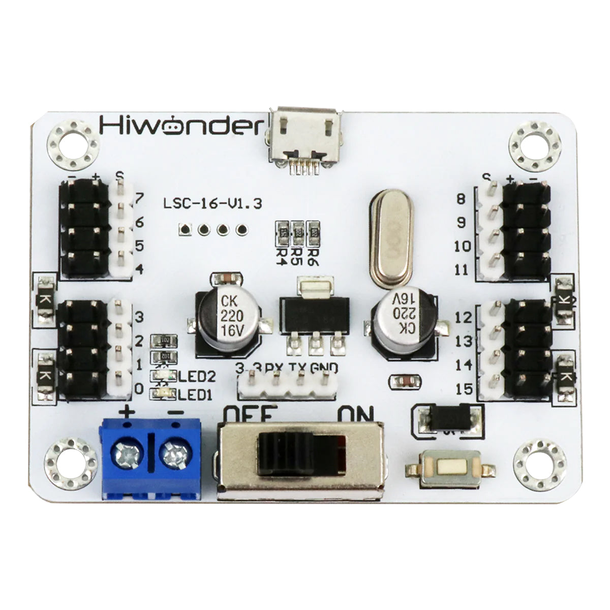

# Hiwonder LSC-16 PWM Servo Controller Guide


[**View Hiwonder LSC-16 16-Channel Servo Controller, USB & TTL Serial on OpenELAB**](https://openelab.io/products/lsc-16-servo-controller)

**SKU:** `Hiwonder-21090001`

**Model / revision scope:** LSC-16 PWM Servo Controller. Match the purchased option below; hardware revisions and controller images are not interchangeable.


## Product overview

LSC-16 generates independent PWM signals for up to 16 servos and stores action groups for offline execution. It is a controller, not a set of included servos.

### Models and purchasing options

| OpenELAB SKU        | Purchased option |
| ------------------- | ---------------- |
| `Hiwonder-21090001` | Default Title    |

## Applications

Bench integration, education and development with the exact hardware listed above. Start with the first-result workflow before expanding the assembly or enabling autonomous operation.

## Specifications

| Parameter        | Value / scope                                |
| ---------------- | -------------------------------------------- |
| PWM channels     | 16                                           |
| Supply           | 5–8.4 V; must also suit every attached servo |
| Memory           | 16M, manufacturer notation                   |
| External UART    | 9600 baud; LSC controller protocol           |
| Board dimensions | 58 × 42 mm                                   |
| Mass             | 18 g                                         |

Specifications: [manufacturer product data](https://www.hiwonder.com/products/lsc-16) and [OpenELAB listing](https://openelab.io/products/lsc-16-servo-controller). Figures describe the stated configuration; accessory-only options do not inherit the complete kit specifications.

## Hardware and connections

Use the labelled **S / + / −** rows on each PWM channel. The motor supply must cover the combined servo current; the USB data cable does not replace it. Mount the board on insulating spacers. Connect the battery/supply with red to + and black to −. External UART wiring and logic compatibility must follow this board’s communication chapter.

## Software and development resources

The Windows application edits positions and action groups. Use the official LSC-series protocol for UART integration; position values in the PC tool are microsecond PWM pulse widths, not degrees. A 270° servo has a different angle mapping from a 180° servo.

## Getting started

**Prerequisites:** the selected hardware, its matching power source, the required data cable, and a clear work area. Begin with the supplied firmware and an unloaded mechanism.

1. With power off, connect one unloaded compatible PWM servo to channel 1, aligning S, + and −.
2. Connect an external supply within 5–8.4 V and within the servo rating. Connect USB to the PC and turn the board on.
3. Install **Hiwonder Servo Control** from the official Appendix, then open it and verify the connected indicator. Select only the channel actually connected.
4. Click **Reset servo** to command 1500 µs. Change channel 1 to 1600, then back to 1500, watching for smooth unloaded motion.
5. Set **Action Time** to 1000 ms and **Add Action** for the neutral and nearby positions. Save the action file, then use **Online Run** once with Loop disabled.
6. After successful online testing, select action group **100**, download the sequence, disconnect USB and use the onboard **Run** button for the documented offline test. Keep the servo supply connected.

**Expected result:** The servo follows the two nearby positions online, and the saved group can run from the board’s Run button without a PC. No other channel should be commanded.

Procedure reference: [official model or interface manual](https://wiki.hiwonder.com/projects/16-Channel-Servo-Controller/en/latest/docs/1_User_Manual_formatted.html). The steps above are a bounded initial check, not a substitute for the full assembly and development chapters.

## Troubleshooting and FAQs

**USB connected, servo stationary:** verify the external servo supply and its polarity, select the correct channel, then use Reset servo.

**Unexpected channel motion:** deselect unconnected channels and inspect the action list before Online Run.

**Offline button does nothing:** confirm the successfully tested action file was downloaded to group 100. Saving a file on the PC is not the same as downloading it to the board.

**Low-voltage alarm:** measure the supply under load and check the battery; do not suppress the alarm by raising voltage beyond 8.4 V.

## Downloads and technical documents

* [Official user / interface manual](https://wiki.hiwonder.com/projects/16-Channel-Servo-Controller/en/latest/docs/1_User_Manual_formatted.html)
* [Official software, protocol and examples appendix](https://wiki.hiwonder.com/projects/16-Channel-Servo-Controller/en/latest/docs/Appendix.html)
* [Manufacturer Hiwonder LSC-16 16-Channel Servo Controller, USB & TTL Serial specifications and option drawings](https://www.hiwonder.com/products/lsc-16)

Use the manual’s download or appendix section for the matching revision. A linked download directory is not a claim that every firmware archive, CAD file or installer has been tested. Do not flash an image for a similarly named product.

## References and validation

* [OpenELAB product and SKU options](https://openelab.io/products/lsc-16-servo-controller).
* [Official user / interface manual](https://wiki.hiwonder.com/projects/16-Channel-Servo-Controller/en/latest/docs/1_User_Manual_formatted.html)
* [Official software, protocol and examples appendix](https://wiki.hiwonder.com/projects/16-Channel-Servo-Controller/en/latest/docs/Appendix.html)
* [Manufacturer Hiwonder LSC-16 16-Channel Servo Controller, USB & TTL Serial specifications and option drawings](https://www.hiwonder.com/products/lsc-16)

Reviewed against the linked sources on 19 November 2026. Software installation, compilation and physical hardware tests were not performed for this guide. Use the observable checkpoints above to verify your own unit before integrating it into a larger system.
