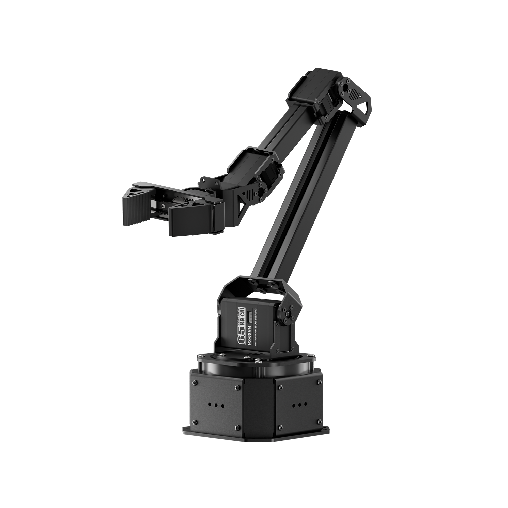

# Hiwonder NexArm ESP32 and Imitation Learning Guide


[**View Hiwonder NexArm Open-Source VLA AI Robotic Arm, K230 Vision & LeRobot on OpenELAB**](https://openelab.io/products/hiwonder-nexarm-open-source-vla)

**SKU:** `Hiwonder-21010615`, `Hiwonder-21010663`, `Hiwonder-21010644`, `Hiwonder-21010645`, `Hiwonder-21010646`, `Hiwonder-21010616`, `Hiwonder-21010664`, `Hiwonder-21010647`, `Hiwonder-21010648`, `Hiwonder-21010649`, `Hiwonder-21010617`, `Hiwonder-21010665`, `Hiwonder-21010650`, `Hiwonder-21010651`, `Hiwonder-21010652`, `Hiwonder-21010653`, `Hiwonder-21010654`, `Hiwonder-21010655`, `Hiwonder-21010656`

**Model / revision scope:** NexArm ESP32 and Imitation Learning. Match the purchased option below; hardware revisions and controller images are not interchangeable.


## Product overview

NexArm combines a compact serial-bus arm with ESP32 control; selected kits add a leader arm, cameras or K230 vision.

The first-use chapter contains a 12.5 V sentence while its packing list and product specify a 12 V adapter. Use the original labelled adapter; do not raise the supply to reconcile that text. The Bluetooth test covers the powered follower arm. Leader calibration, LeRobot datasets and policy training are separate procedures tied to the imitation-learning kit.

### Models and purchasing options

| OpenELAB SKU        | Purchased option                           |
| ------------------- | ------------------------------------------ |
| `Hiwonder-21010615` | Starter Kit / No Extra Accessories         |
| `Hiwonder-21010663` | Starter Kit / + NexArm (Leader Arm)        |
| `Hiwonder-21010644` | Starter Kit / +Suspension Mecanum Chassis  |
| `Hiwonder-21010645` | Starter Kit / +Sliding Rail                |
| `Hiwonder-21010646` | Starter Kit / +Conveyor Belt               |
| `Hiwonder-21010616` | Standard Kit / No Extra Accessories        |
| `Hiwonder-21010664` | Standard Kit / + NexArm (Leader Arm)       |
| `Hiwonder-21010647` | Standard Kit / +Suspension Mecanum Chassis |
| `Hiwonder-21010648` | Standard Kit / +Sliding Rail               |
| `Hiwonder-21010649` | Standard Kit / +Conveyor Belt              |
| `Hiwonder-21010617` | Advanced Kit / No Extra Accessories        |
| `Hiwonder-21010665` | Advanced Kit / + NexArm (Leader Arm)       |
| `Hiwonder-21010650` | Advanced Kit / +Suspension Mecanum Chassis |
| `Hiwonder-21010651` | Advanced Kit / +Sliding Rail               |
| `Hiwonder-21010652` | Advanced Kit / +Conveyor Belt              |
| `Hiwonder-21010653` | Ultimate Kit / No Extra Accessories        |
| `Hiwonder-21010654` | Ultimate Kit / +Suspension Mecanum Chassis |
| `Hiwonder-21010655` | Ultimate Kit / +Sliding Rail               |
| `Hiwonder-21010656` | Ultimate Kit / +Conveyor Belt              |

A separately named bracket, horn, chassis or rail is the listed accessory, not a complete robot or servo. A “without controller / Raspberry Pi / Jetson / micro:bit” option requires the matching controller separately. Check the selected option’s packing list before starting.

## Applications

Bench integration, education and development with the exact hardware listed above. Start with the first-result workflow before expanding the assembly or enabling autonomous operation.

## Specifications

| Parameter    | Value / scope                                                                |
| ------------ | ---------------------------------------------------------------------------- |
| Main control | ESP32 family; exact expansion board as supplied                              |
| Power        | Supplied 12 V arm adapter; separate supply for each powered arm              |
| Mechanism    | Leader/follower and camera scope depends on option                           |
| Software     | Factory control firmware; Arduino / Python / graphical lessons vary by model |

Specifications: [manufacturer product data](https://www.hiwonder.com/products/nexarm) and [OpenELAB listing](https://openelab.io/products/hiwonder-nexarm-open-source-vla). Figures describe the stated configuration; accessory-only options do not inherit the complete kit specifications.

## Hardware and connections

Inspect the numbered servo/motor cables while power is off and use the supplied power system. Secure the base with its mounting hardware and leave the gripper empty. Do not overwrite the preloaded app firmware for the first test. Vision and voice functions require the modules named in the purchased kit.

## Software and development resources

The initial check uses the factory program. Use the model-specific Arduino, MicroPython or graphical-programming lessons only after it succeeds. Uploading an unrelated example can replace the app-control program; restore only from the exact model’s documented factory package.

## Getting started

**Prerequisites:** the selected hardware, its matching power source, the required data cable, and a clear work area. Begin with the supplied firmware and an unloaded mechanism.

1. Match the SKU, body, battery/adapter and optional modules to the order. Complete the model’s assembly before powering on.
2. Clear the motion envelope and power on with the supplied matching power system. Wait for the initial ready posture before touching any control.
3. Install **Wonderbot** from the official model resources. Enable Bluetooth and the permissions needed for nearby-device discovery.
4. Select **NexArm** inside the app and tap its Bluetooth icon. Connect to **Nex\_Arm** in the device list; do not pair using a phone-settings passkey. If app control is unavailable, KEY2 switches between PS3 and app-control modes on the documented controller.
5. Confirm the connection indicator is steady and the reported battery/supply status is plausible. Use the manual control screen for a small unloaded motion, then return to the initial pose.
6. Stop and power off before changing mechanical parts. Save a backup of custom programs before any later factory-firmware restoration.

**Expected result:** The correct device is paired inside the app, supply status is visible, and a small manual motion completes without stalling or loss of connection.

Procedure reference: [official model or interface manual](https://wiki.hiwonder.com/projects/NexArm/en/esp32-version/docs/1_Getting_Started_NexArm.html). The steps above are a bounded initial check, not a substitute for the full assembly and development chapters.

## Troubleshooting and FAQs

**Bluetooth device missing:** power-cycle once, enable nearby-device/location permissions, close another connected phone and search inside the app.

**App connected but controls fail after programming:** a custom program may have replaced the factory app service. Back up the current program and use the model’s documented restoration package.

**Joints strain at startup:** switch off, check assembly and cable numbering, and confirm the initial posture; do not force a powered servo.

**Vision/voice unavailable:** verify that the selected kit contains the required module and that its own firmware and connection match the robot.

## Downloads and technical documents

* [Official user / interface manual](https://wiki.hiwonder.com/projects/NexArm/en/esp32-version/docs/1_Getting_Started_NexArm.html)
* [NexArm imitation-learning version manual](https://wiki.hiwonder.com/projects/NexArm/en/imitation-learning-version/docs/1_Getting_Started_NexArm.html)
* [Manufacturer Hiwonder NexArm Open-Source VLA AI Robotic Arm, K230 Vision & LeRobot specifications and option drawings](https://www.hiwonder.com/products/nexarm)

Use the manual’s download or appendix section for the matching revision. A linked download directory is not a claim that every firmware archive, CAD file or installer has been tested. Do not flash an image for a similarly named product.

## References and validation

* [OpenELAB product and SKU options](https://openelab.io/products/hiwonder-nexarm-open-source-vla).
* [Official user / interface manual](https://wiki.hiwonder.com/projects/NexArm/en/esp32-version/docs/1_Getting_Started_NexArm.html)
* [NexArm imitation-learning version manual](https://wiki.hiwonder.com/projects/NexArm/en/imitation-learning-version/docs/1_Getting_Started_NexArm.html)
* [Manufacturer Hiwonder NexArm Open-Source VLA AI Robotic Arm, K230 Vision & LeRobot specifications and option drawings](https://www.hiwonder.com/products/nexarm)

Reviewed against the linked sources on 19 November 2026. Software installation, compilation and physical hardware tests were not performed for this guide. Use the observable checkpoints above to verify your own unit before integrating it into a larger system.
