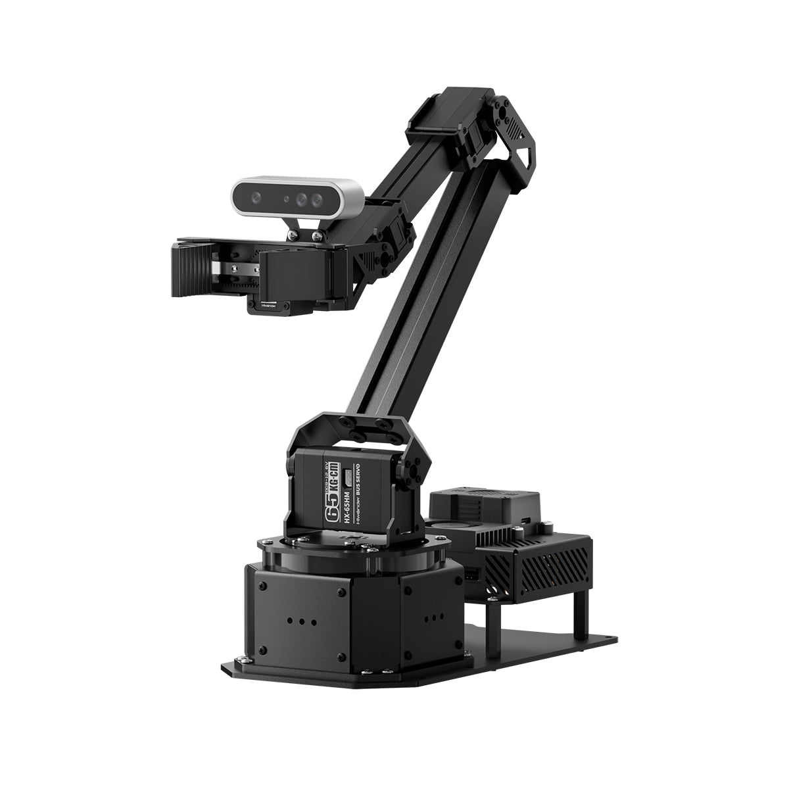

# Hiwonder NexArm ROS: Orin Nano SUPER setup, joints and depth grasping


[**Hiwonder NexArm ROS / Orin Nano SUPER 8 GB on OpenELAB — SKU Hiwonder-21010737**](https://openelab.io/products/hiwonder-nexarm-ros-robotic-arm?variant=46058949083334)


## Product overview <a href="#product-overview" id="product-overview"></a>



_Existing OpenELAB product illustration retained for model context; option contents and electrical connections are identified by the tables and diagrams below._

NexArm ROS is a desktop manipulation platform with an external ROS host, a six-actuator arm/gripper, depth camera and an **ESP-WROOM +AT32 motion controller**. The assigned option includes **Jetson Orin Nano SUPER 8 GB**, not a Raspberry Pi-ready controller-free kit. Its reference environment is Ubuntu 22.04/ROS 2 Humble with 128 GB SSD storage. [Exact store option](https://openelab.io/products/hiwonder-nexarm-ros-robotic-arm?variant=46058949083334).

Use the [Jetson-version manual](https://wiki.hiwonder.com/projects/NexArm/en/jetsonNano/docs/1.%20NexArm%20User%20Manual.html), which explicitly describes Orin Nano/NX remote access despite its historical “jetsonNano” URL. The separate `ros-version` documentation contains Raspberry Pi wiring and resources. Keep host-specific power, image and desktop instructions separate; the arm's ESP32 controller remains present in both configurations.

### Other established purchasing options <a href="#models-and-purchasing-options" id="models-and-purchasing-options"></a>

This canonical page also retains the following catalogued family options. The detailed first-run workflow above/below is for the exact host/kit variants in the opening callout; select the matching host image and kit-specific hardware for other options. A controller-excluded option needs that separately supplied host. A ROSOrin base is distinct from ROSOrin Pro with an arm.

| SKU                 | Established option                |
| ------------------- | --------------------------------- |
| `Hiwonder-21010731` | Without Controller                |
| `Hiwonder-21010732` | With Raspberry Pi 5 (4 GB)        |
| `Hiwonder-21010733` | With Raspberry Pi 5 (8 GB)        |
| `Hiwonder-21010734` | With Raspberry Pi 5 (16 GB)       |
| `Hiwonder-21010797` | Without Jetson Controller         |
| `Hiwonder-21010735` | With Jetson Nano(4 GB)            |
| `Hiwonder-21010736` | With Jetson Orin Nano Super(4 GB) |
| `Hiwonder-21010737` | With Jetson Orin Nano Super(8 GB) |
| `Hiwonder-21010738` | With Jetson Orin NX Super(8 GB)   |
| `Hiwonder-21010739` | With Jetson Orin NX Super(16 GB)  |

[OpenELAB family options](https://openelab.io/products/hiwonder-nexarm-ros-robotic-arm).

## Applications <a href="#applications" id="applications"></a>

NexArm supports joint/coordinate control, forward/inverse kinematics, vision-guided picking, sorting, tracking, voice interaction and model-assisted task experiments. Begin with a clamped stationary arm, read its configuration, then perform a pure forward-kinematics query before any new motion command.

A useful development project separates image detection, depth localization, coordinate transformation, IK and gripper contact. Test those stages with a stationary supplied block before combining them. Sliding rails, conveyors, sorting sandboxes, mobile bases and imitation-learning configurations have their own hardware/course requirements; they are not automatically included with this ROS host option.

## Specifications <a href="#specifications" id="specifications"></a>

| Item                            | Exact-model reference                                                    |
| ------------------------------- | ------------------------------------------------------------------------ |
| SKU / host                      | Hiwonder-21010737; Orin Nano SUPER 8 GB                                  |
| Robot reference dimensions/mass | 245 × 131 × 617 mm; about 1.3 kg; pose/configuration dependent           |
| Host environment                | Ubuntu 22.04/ROS 2 Humble; Orin storage reference 128 GB SSD             |
| Main motion controller          | ESP-WROOM; dual-core Xtensa LX6, up to 240 MHz, 4 MB flash, 520 KB SRAM  |
| Secondary motion chip           | AT32F421F8P7; Cortex-M4, up to 120 MHz, 64 KB flash                      |
| Arm supply                      | 12 V 5 A DC adapter; DC5.5 × 2.5 mm input                                |
| Controller output               | Type-C 5 V 5 A output; not a 12 V input or a universal Orin supply       |
| Bus connections                 | Two5264 and twoPH2.0 bus-servo interfaces; retain original keyed harness |
| User interfaces                 | 0.96-inch128 × 64 OLED, two custom keys, buzzer, three I2C channels      |
| Actuators                       | 2×HX-12H, 3×HX-30HM, 1×HX-65HM intelligent bus servos                    |
| Perception/control              | Depth camera; USB/Wi-Fi/Ethernet; PS3/app/PC/ROS control paths           |

[Store specifications](https://openelab.io/products/hiwonder-nexarm-ros-robotic-arm),[Jetson manual hardware](https://wiki.hiwonder.com/projects/NexArm/en/jetsonNano/docs/1.%20NexArm%20User%20Manual.html#_1-10-hardware-instructions). The software models J1 base, J2 shoulder, J3 elbow, J4 wrist, J5 tool rotation and J6 gripper. Thus “6DOF”in the product description should not be interpreted as six independent pose axes plus a seventh gripper motor.

| Control quantity            | Units/meaning to preserve                                |
| --------------------------- | -------------------------------------------------------- |
| FK/IK `j1…j4,roll,claw`     | Degrees in the documented service examples               |
| Cartesian `x,y,z`           | Millimeters in the documented kinematics interface       |
| PC Step / Speed             | Millimeters / millimeters per second                     |
| Servo message `position`    | Raw controller position units; not automatically degrees |
| Global acceleration setting | 0–254 controller setting; not SI acceleration            |
| LAB threshold components    | 0–255 in the supplied tool                               |

The manual's PC-summary and controller-button descriptions do not provide one unambiguous physical servo-ID ordering across all revisions. Treat **J1…J6 kinematic names and bus IDs as separate maps**. Read the delivered diagram/position feedback before commanding a raw ID. No unsupported payload, servo torque or generic 0–1000 range is assigned to this mixed-servo arm.

## Hardware and connections <a href="#hardware-and-connections" id="hardware-and-connections"></a>

### Distinguish arm power, USB data and 5 V output


Official Hiwonder base diagram, visually inspected. The USB communication socket and adjacent **5 V-OUT** are different functions. The round POWER connection receives the supplied 12 V 5 A adapter. Do not put 12 V into 5 V-OUT or assume that USB data powers the servos. The switch and KEY1/KEY2 remain accessible after mounting. [Base wiring](https://wiki.hiwonder.com/projects/NexArm/en/jetsonNano/docs/1.%20NexArm%20User%20Manual.html#_1-2-accessory-installation-and-wiring-instructions).

Clamp the arm base firmly using the supplied matched arrangement before boot or SDK bringup; it can reset its posture during initialization. Keep the entire link/gripper sweep clear and leave cable slack through wrist rotation. Support the links before torque-off. A slider, All Center, Reset or Calibrate Neutral Position action can move the arm or change its reference; Read Position is the appropriate initial operation.

The Jetson section includes older Nano port pictures alongside Orin access instructions. Use the **delivered Orin carrier's matched power harness**, not a Pi/Nano 5 V cable copied from a picture. Record the actual carrier/power label before changing anything. The public arm pinout does not qualify an arbitrary host GPIO/UART connection; use USB data and the supplied controller. Native ESP32/AT32 bus, UART and I2C connectors are not universally voltage-interchangeable.

## Software and development resources <a href="#software-and-development-resources" id="software-and-development-resources"></a>

The Jetson image supplies `~/ros2_ws` with `app`, `interfaces`, `simulations`, `bringup`, `driver`, `example`, `peripherals` and large-model packages. Basic control uses `ros2 launch sdk nexarm.launch.py` and messages in `ros_robot_controller_msgs`. The custom arm services include `/ros_robot_controller/arm/get_fk` and `get_ik`. They are model-specific APIs, not AgileX or generic MoveIt interfaces. [Basic control](https://wiki.hiwonder.com/projects/NexArm/en/jetsonNano/docs/2.%20Basic%20Robotic%20Arm%20Control.html),[advanced kinematics](https://wiki.hiwonder.com/projects/NexArm/en/jetsonNano/docs/3.%20Advanced%20Robotic%20Arm%20Control.html).

Inspect first:

```bash
cat /etc/os-release
cat /etc/nv_tegra_release
printenv ROS_DISTRO ROS_DOMAIN_ID need_compile
ros2 pkg prefix sdk
ros2 interface show ros_robot_controller_msgs/srv/GetArmFK
ros2 node list
ros2 service list -t
```

Use the delivered environment rather than replacing dependencies with a generic latest ESP32 sketch. The ESP32 and AT32 firmware are separate device versions exposed in the PC interface; record both. The vendor's PACK\_UPDATE\_TOOL and matched firmware/resources are the recovery path. The exact Jetson system image/full source is requested through the [order-number access instructions](https://wiki.hiwonder.com/projects/NexArm/en/jetsonNano/docs/Appendix.html); a public topic page is not a verified recovery binary.

Before a standalone lesson, return to a stable posture and close competing app/PC controllers. The course uses `~/.stop_ros.sh` before launching its SDK owner. Do not start two serial owners or call a torque-off operation while a gripper is supporting an object. Restore the original bringup after development using its actual installed launcher.

## Getting started <a href="#getting-started" id="getting-started"></a>

### 1. First result through WonderROS and PC reads

1. Clamp the base, inspect the supplied 12 V connection and fitted Orin/camera/voice harness, then clear the startup sweep.
2. Power on and wait for the completed reset and short buzzer indication. Join `HW…` with password `hiwonder` and retain the no-internet connection.
3. Open **WonderROS → NexArm → Direct Connection**. Verify a changing camera view before selecting a motion game.
4. Connect NoMachine to `192.168.149.1`; the Orin Nano/NX initial account is `ubuntu`/`ubuntu`. The Jetson manual requires a dummy HDMI plug or real monitor for the Orin remote-desktop path. Older Nano's `hiwonder` account is not the Orin account.
5. Open the supplied PC interface and use **Read Firmware Version**, **Read Position**, **Read Limits** and **Read Parameters**. Save the current values/log before changing any setting. Avoid All Center, Power Off and factory reset during this first read.

\*\*Expected result: \*\*a reachable Orin desktop, live camera, six-actuator status and recorded ESP32/AT32/configuration values. A read should not be replaced by neutral-position calibration when a connection fails. Change default network credentials before shared use. [Jetson first-run](https://wiki.hiwonder.com/projects/NexArm/en/jetsonNano/docs/1.%20NexArm%20User%20Manual.html).

### 2. Original bounded forward-kinematics client

Once the matched SDK node is running and its service type matches the interface inspection above, save `nexarm_fk_check.py` and run `python3 nexarm_fk_check.py`. This sends a **calculation request**, not a move/servo-position request. It uses the documented degree fields and requires a finite successful response within a bounded wait.

```python
import math
import rclpy
from ros_robot_controller_msgs.srv import GetArmFK

rclpy.init()
node = rclpy.create_node('nexarm_fk_observer')
try:
    client = node.create_client(GetArmFK, '/ros_robot_controller/arm/get_fk')
    if not client.wait_for_service(timeout_sec=3.0):
        raise RuntimeError('FK service absent: inspect matched SDK bringup')
    request = GetArmFK.Request()
    request.j1 = 0.0
    request.j2 = -10.0
    request.j3 = 20.0
    request.j4 = -10.0
    request.roll = 0.0
    request.claw = 0.0
    future = client.call_async(request)
    rclpy.spin_until_future_complete(node, future, timeout_sec=5.0)
    if not future.done():
        raise RuntimeError('FK response timed out')
    result = future.result()
    if result is None or not result.success:
        raise RuntimeError('FK calculation rejected; preserve logs/configuration')
    values = [result.x, result.y, result.z, result.pitch, result.roll, result.claw]
    if not all(math.isfinite(v) for v in values):
        raise RuntimeError('Non-finite FK output')
    print('xyz_mm=', values[:3], 'pitch_roll_claw_deg=', values[3:])
finally:
    node.destroy_node()
    rclpy.shutdown()
```

\*\*Expected result: \*\*finite endpoint coordinates in millimeters and orientation/gripper values in degrees. Exact coordinates depend on the installed link/offset parameters, so no invented numeric answer is given. The physical arm should not move in response to this service. If the installed interface differs, stop and reconcile its SDK revision. [Service definition/example source](https://wiki.hiwonder.com/projects/NexArm/en/jetsonNano/docs/3.%20Advanced%20Robotic%20Arm%20Control.html).

### 3. Validate joint mapping before a small motion

After the read/calculation checks, verify the physical ID diagram and current positions in the supplied PC software. Start from the displayed pose, change one actuator a small amount within a clear local envelope and confirm which joint moves. Restore the recorded pose and verify the stop function before adding frames.

For an action group, save a new file/name, record the initial checked pose, one small move and return, then run once with looping off. Preserve frame timing and acceleration settings. The interface can write action groups onboard; keep the group ID/file associated with the actual controller revision. Do not treat a J1 angle as bus ID1 without checking the map.

Coordinate motion requires valid link lengths, offsets, limits and a reachable path. The IK calculation service can establish whether a target has a solution; it does not establish that the real trajectory avoids the table, camera or cables. Test a light supplied block only after an unloaded path is clear. [Motion/action/kinematics](https://wiki.hiwonder.com/projects/NexArm/en/jetsonNano/docs/3.%20Advanced%20Robotic%20Arm%20Control.html).

### 4. Camera-to-arm calibration and depth picking

Fix the camera and reference work surface. Calibrate lens/position geometry with the supplied target, then inspect a stationary block's image location, depth and transformed arm coordinates separately. Use the actual depth encoding/units and reject missing/out-of-range pixels. RGB and depth must be registered before indexing depth with a color coordinate. Save the calibration and verify a second known position before enabling picking.

The desktop Full Scene Calibration separates color, camera, pixel/depth and scene coordinates. Select the actual scene size rather than an optional sandbox's reference panel. The supplied 30 mm color blocks and 40 mm wood blocks provide different object heights; changing height changes the grasp target. [Depth camera applications](https://wiki.hiwonder.com/projects/NexArm/en/jetsonNano/docs/8.%20Robotic%20Arm%20Depth%20Camera%20Application%20Course.html).

### 5. Remaining official course families and expansions

| Topic                                                 | Development path and expected checkpoint                                                                                                                                                           |
| ----------------------------------------------------- | -------------------------------------------------------------------------------------------------------------------------------------------------------------------------------------------------- |
| OpenCV thresholds, tags, color/face tracking, sorting | Validate masks/overlays with motion inactive, then map detections into the calibrated scene before one pick                                                                                        |
| MediaPipe gestures/human interaction                  | Confirm gesture labels and latency before linking them to prechecked action groups; unexpected labels must not select arbitrary motion                                                             |
| Deep learning/object recognition                      | Use the installed model/runtime versions on Nano 8 GB; verify class/confidence and timing independently of arm control                                                                             |
| URDF/modeling/simulation                              | Inspect link dimensions, joint signs/limits and collision geometry; keep physical owners inactive during simulation-only work                                                                      |
| Voice                                                 | Select the fitted voice module/language/firmware; test recognition and playback before manipulation commands                                                                                       |
| Large models/OpenClaw                                 | Configure credentials privately, test responses without robot tools, then inspect allowed actions and stop/cancel behavior. Online service access and local model memory are separate dependencies |
| Basic/Standard/Advanced sorting sandboxes             | Use the matching baseplate/panel/scene calibration; their display, trays or conveyor hardware are not assumed in this standalone SKU                                                               |
| Sliding-rail warehouse sandbox                        | Verify rail travel, homing, steps and arm-to-rail transform in its separate expansion procedure before combined tasks                                                                              |
| Mobile chassis expansion                              | Use exact Mecanum or suspension-Tank installation/wiring and chassis parameters; do not reuse desktop-only coordinate assumptions                                                                  |

[Complete Jetson course index](https://wiki.hiwonder.com/projects/NexArm/en/jetsonNano/docs/1.%20NexArm%20User%20Manual.html),[expansion resources](https://wiki.hiwonder.com/projects/NexArm/en/jetsonNano/docs/Appendix.html). The ROS, ESP32-only and imitation-learning versions are separate source lanes; software availability does not imply included expansion hardware.

## Troubleshooting and FAQs <a href="#troubleshooting-and-faqs" id="troubleshooting-and-faqs"></a>

| Symptom                               | Check before resetting or flashing                                                                                 |
| ------------------------------------- | ------------------------------------------------------------------------------------------------------------------ |
| Arm resets/servos stall               | Inspect1 2 V 5 A supply, cable retention, blocked joints and base support; do not widen limits to overcome contact |
| Orin desktop unavailable              | Wait for boot, check monitor/dummy plug, network mode and Orin account; Pi VNC instructions are a different lane   |
| PC reads work, ROS service absent     | Inspect active environment, `sdk` package, namespace and one SDK owner                                             |
| FK result implausible                 | Read link/offset parameters and units; do not write new geometry merely to fit one observation                     |
| Wrong actuator moves                  | Stop; resolve bus-ID versus kinematic-joint map using the delivered diagram/reads                                  |
| 2D detection works, depth grasp fails | Check valid depth, registration, scene height and hand-eye transform separately                                    |
| No voice response                     | Check optional-module presence, device selection, firmware language and audio path                                 |

**Does12 V apply to every exposed connector?** No. The arm supply and 5 V output are distinct; logic/bus interfaces require their own definitions.

**Should I calibrate neutral positions at first boot?** First read and preserve the factory values.A wrong neutral changes motion and kinematics; factory reset is not a connection test.

**How do I recover?** Back up action files, limits, geometry, calibration, network and both motion-chip firmware versions. Obtain the exact Orin image and controller firmware through the vendor's resource/order-number route. Use PACK\_UPDATE\_TOOL only with matched files; do not replace the controller with a generic ESP32 firmware.

## Downloads and technical documents <a href="#downloads-and-technical-documents" id="downloads-and-technical-documents"></a>

| Resource                    | Official destination                                                                                                                                                                                                                                           |
| --------------------------- | -------------------------------------------------------------------------------------------------------------------------------------------------------------------------------------------------------------------------------------------------------------- |
| Correct Jetson/Orin manual  | [NexArm Jetson manual](https://wiki.hiwonder.com/projects/NexArm/en/jetsonNano/docs/1.%20NexArm%20User%20Manual.html)                                                                                                                                          |
| Image/source access         | [Jetson appendix](https://wiki.hiwonder.com/projects/NexArm/en/jetsonNano/docs/Appendix.html); order number requested for full image/source                                                                                                                    |
| Jetson resource collection  | [NexArm Jetson Nano Resources](https://drive.google.com/drive/folders/1_leYpT5OIt1FHgbxMzJ3Vt6d2rHb5V4k?usp=sharing)                                                                                                                                           |
| Motion firmware tool        | [PACK\_UPDATE\_TOOL](https://drive.google.com/drive/folders/1r2ct899U_7aK2qF7nz46MaSzFiB6Jh4N?usp=sharing)                                                                                                                                                     |
| Bus-servo data              | [Official servo files](https://drive.google.com/drive/folders/1c4xj5Ex51sFAMeYQVX--2qyh8QxTKExF?usp=sharing)                                                                                                                                                   |
| Camera data                 | [Official camera files](https://drive.google.com/drive/folders/1ABajX_zCw8Woc43Zm1ehuo27dVEmwwES?usp=sharing)                                                                                                                                                  |
| SDK/protocol examples       | [Basic control](https://wiki.hiwonder.com/projects/NexArm/en/jetsonNano/docs/2.%20Basic%20Robotic%20Arm%20Control.html),[FK/IK source](https://wiki.hiwonder.com/projects/NexArm/en/jetsonNano/docs/3.%20Advanced%20Robotic%20Arm%20Control.html)              |
| Mechanical/model references | [URDF/modeling course](https://wiki.hiwonder.com/projects/NexArm/en/jetsonNano/docs/7.%20URDF%20Modeling%20and%20Simulation.html); no unverified dimensioned machining CAD asserted                                                                            |
| Earlier ROS/Pi source lane  | [Existing ROS-version manual](https://wiki.hiwonder.com/projects/NexArm/en/ros-version/docs/1.%20NexArm%20User%20Manual.html);[ESP32 appendix](https://wiki.hiwonder.com/projects/NexArm/en/esp32-version/docs/Appendix.html), retained as distinct references |

### Additional established resources

These established links supplement the model-specific resources above. The old `ros-version` and `esp32-version` links are Raspberry Pi/ESP32 reference lanes; use the Jetson lane above for this Orin SKU. Retain the matching model, host and revision when selecting a download.

* [manufacturer product data](https://www.hiwonder.com/products/nexarm-ros)
* [ROS-version Appendix and download access](https://wiki.hiwonder.com/projects/NexArm/en/ros-version/docs/Appendix.html)

## Hiwonder NexArm Orin Nano SUPER 8 GB: course reference

**Scope:** SKU `Hiwonder-21010737`, Jetson Orin Nano SUPER 8 GB. This appendix expands the canonical NexArm guide with original engineering explanations of the supplied official courses. It uses Hiwonder's `en/jetsonNano` lane for the Jetson configuration, despite that lane's historical name. The separate `en/ros-version` lane is compared for Raspberry Pi differences; its mobile-base chapters are retained as optional expansion references. Source snapshot reviewed 24 November 2026; the pages do not pin a complete image/firmware/package release. Procedures below are manufacturer-documented expectations, not results observed on a robot.

The arm is not six pose joints plus a separate gripper. Its six actuators include tool rotation and gripping. Do not transfer LanderPi's HX-06L position range, joint IDs or calibration to NexArm. Sandboxes, conveyor, rail, second arm, Mecanum chassis and tank chassis require additional hardware; their appearance in a course does not establish inclusion in this SKU. [N1](https://wiki.hiwonder.com/projects/NexArm/en/jetsonNano/docs/1.%20NexArm%20User%20Manual.html)[N12](https://wiki.hiwonder.com/projects/NexArm/en/jetsonNano/docs/12.%20NexArm%20+%20Basic%20Sorting%20Sandbox.html)[N15](https://wiki.hiwonder.com/projects/NexArm/en/jetsonNano/docs/15.%20NexArm%20+%20Sliding%20Rail%20Warehouse%20Sandbox.html)[P16](https://wiki.hiwonder.com/projects/NexArm/en/ros-version/docs/16.%20NexArm%20+%20Mecanum-Wheel%20Chassis%20Course.html)[P17](https://wiki.hiwonder.com/projects/NexArm/en/ros-version/docs/17.%20NexArm%20+%20Tank%20Chassis%20Course.html)

### 1. Platform, power, networking and controller ownership <a href="#nx01" id="nx01"></a>

For the Orin configuration, secure the base with G-clamps, connect the arm's matched **12 V 5 A** adapter to its controller, and leave the startup sweep clear. The host connection diagrams include old Jetson Nano pictures; use the delivered Orin carrier and matched harness rather than adapting a Nano or Pi power lead from a picture. The controller's **5 V output** is not another 12 V input. Boot normally returns the arm to its initial posture and produces a short ready beep after approximately a minute. [N1 §§1.2–1.3](https://wiki.hiwonder.com/projects/NexArm/en/jetsonNano/docs/1.%20NexArm%20User%20Manual.html)

The factory AP is named `HW…`, password `hiwonder`; it provides local access rather than Internet service. For the Orin Nano/NX path, NoMachine connects to `192.168.149.1`, with the documented initial `ubuntu` / `ubuntu` account. An older Nano uses a different account; the Pi lane uses VNC and Pi-specific setup. The Jetson instructions also require a real display or dummy HDMI connection for the remote desktop path. If using the Jetson USB network connection, install the computer's NDIS-compatible network driver and connect to `192.168.55.1`; Orin uses a Type-C data cable, whereas the older Nano example uses Micro-USB. USB networking and the arm's USB serial connection have different purposes. [N1 §1.5](https://wiki.hiwonder.com/projects/NexArm/en/jetsonNano/docs/1.%20NexArm%20User%20Manual.html)

To obtain Internet access, use WonderROS → NexArm → LAN Mode to provision the robot onto the same Wi-Fi as the client, or retain AP access and provide the documented Ethernet uplink. Read the assigned IP by long-pressing the device icon. In STA mode the `HW…` AP disappears; holding KEY1 until the blue light flashes returns to AP. The Jetson page's fallback text mentions a Raspberry Pi and an SD card: those paragraphs are not an Orin SSD recovery procedure. [N1 §§1.3.2,1.4.2,1.5](https://wiki.hiwonder.com/projects/NexArm/en/jetsonNano/docs/1.%20NexArm%20User%20Manual.html)

The manual describes the ROS 2 framework **inside Docker**. Start the supplied ROS environment terminal and identify its workspace before applying a host-level change. `~/ros2_ws/src` contains `app`, `interfaces`, `simulations`, `bringup`, `driver`, `example`, `peripherals` and large-model packages. `/home/ubuntu` paths in the lessons belong to this documented environment; they do not establish the native filesystem layout of every Orin image. `need_compile=True` launch branches resolve installed package shares; source branches often hard-code `/home/ubuntu/ros2_ws/src`. [N1 §1.11](https://wiki.hiwonder.com/projects/NexArm/en/jetsonNano/docs/1.%20NexArm%20User%20Manual.html); [N2](https://wiki.hiwonder.com/projects/NexArm/en/jetsonNano/docs/2.%20Basic%20Robotic%20Arm%20Control.html)

For a standalone lesson, close PC/app motion controllers, support any held object and run:

```bash
~/.stop_ros.sh
```

Then start only that lesson's launch file. If a table below says a launch includes camera/SDK nodes, do not separately open duplicate serial/camera owners. For app-based scene lessons, restore `ros2 launch bringup bringup.launch.py` only after ending the standalone application. A clean terminal exit does not imply that a held object is supported or that servo torque has been removed. [N1 §1.11](https://wiki.hiwonder.com/projects/NexArm/en/jetsonNano/docs/1.%20NexArm%20User%20Manual.html); [N12 §12.6.3](https://wiki.hiwonder.com/projects/NexArm/en/jetsonNano/docs/12.%20NexArm%20+%20Basic%20Sorting%20Sandbox.html)

**First checkpoint:** a reachable desktop, changing RGB image, recorded host/image identity and only one controller owner. If the image is absent, check camera USB/harness and the selected camera model before changing thresholds or IK parameters.

### 2. Basic servo and buzzer control: messages and expected results <a href="#nx02" id="nx02"></a>

Chapter 2 presents topic, Python-file and launch-file interfaces to the same controller. Start the SDK in the supplied ROS 2 terminal:

```bash
ros2 launch sdk nexarm.launch.py
```

The basic servo lesson publishes `ros_robot_controller_msgs/msg/ServosPosition` on `/ros_robot_controller/bus_servo/set_position`. Its documented IDs are 1–6 and its position values are controller units, generally 0–4096 with a center near 2048. This range is an interface description, not permission to command an installed joint to either endpoint. Confirm the physical ID map and read current positions first. The vendor example requests ID 3 at 2500:

```bash
ros2 topic pub /ros_robot_controller/bus_servo/set_position ros_robot_controller_msgs/msg/ServosPosition "{position: [{id: 3, position: 2500}]}"
```

**Expected result:** the selected servo moves to that raw target and the message is logged. The Python example at `~/ros2_ws/src/example/example/simple/include/bus_servo_node.py`, or `ros2 launch example bus_servo.launch.py`, alternates 2000 and 2500 at 0.8-second intervals. It waits for `/controller_manager/init_finish` and checks subscriber discovery, although its fallback still publishes without a subscriber. If a command produces no motion, distinguish controller readiness, topic subscription and actual servo power rather than repeatedly increasing the position. Stop the repeating example with Ctrl+C. [N2 §2.1](https://wiki.hiwonder.com/projects/NexArm/en/jetsonNano/docs/2.%20Basic%20Robotic%20Arm%20Control.html)

The buzzer provides a useful controller-output check without deliberately changing a joint target:

```bash
ros2 topic pub --once /ros_robot_controller/set_buzzer ros_robot_controller_msgs/msg/BuzzerState "{freq: 1900, on_time: 0.1, off_time: 0.2, repeat: 10}"
```

Here frequency is **Hz**, on/off durations are **seconds**, and `repeat` is a count: the documented expectation is ten 1900 Hz pulses with 0.1 s on and 0.2 s off. `ros2 launch example buzzer.launch.py` runs the separate Python lesson, whose example uses 1500 Hz and a different off interval. Do not confuse these ROS durations with the PC tool's millisecond fields. [N2 §2.2](https://wiki.hiwonder.com/projects/NexArm/en/jetsonNano/docs/2.%20Basic%20Robotic%20Arm%20Control.html)

### 3. Transformations, FK and IK without commanding motion <a href="#nx03" id="nx03"></a>

A homogeneous transform represents orientation and translation together. Compose transforms in the order of the physical frames; reversing camera-to-tool and tool-to-base transforms changes the result. The NexArm geometry lessons reduce the arm to a working plane after solving base rotation. They retain the structural offset `d`, construct an equivalent second link and its correction angle, solve a triangle at the wrist point, then recover actual joint angles using the end pitch constraint. Treat these intermediate triangle angles as geometric variables rather than servo commands. Do not substitute link lengths from another Hiwonder arm. [N3 §§3.1–3.3](https://wiki.hiwonder.com/projects/NexArm/en/jetsonNano/docs/3.%20Advanced%20Robotic%20Arm%20Control.html)

With the SDK running, the controller-level FK query is:

```bash
ros2 service call /ros_robot_controller/arm/get_fk ros_robot_controller_msgs/srv/GetArmFK "{claw: 0.0, j1: 0.0, j2: 0.0, j3: 0.0, j4: 0.0, roll: 0.0}"
```

All six request angles are **degrees**. The manual's example expects `(x,y,z)=(500,0,73)` **mm**, pitch/roll/claw all 0°. This service calculates a pose; it does not move the arm. `ros2 launch example fk.launch.py` uses a different example (`j2=-30`, `j3=60`, `j4=-20`), so its expected output is not the all-zero result. Its client allows up to five attempts while controller parameters become ready. [N3 §3.4](https://wiki.hiwonder.com/projects/NexArm/en/jetsonNano/docs/3.%20Advanced%20Robotic%20Arm%20Control.html)

The inverse query accepts Cartesian **mm** and orientation/gripper **degrees**:

```bash
ros2 service call /ros_robot_controller/arm/get_ik ros_robot_controller_msgs/srv/GetArmIK "{x: 200.0, y: 0.0, z: 200.0, roll: 0.0, pitch: 0.0, claw: 0.0}"
```

The source reports `[2048,2088,1198,1238,2048,2048]` for that example. This is a source-reported result, not a universal calibration vector. `ros2 launch example ik.launch.py` instead requests `z=100` mm and pitch `-90`°. An unreachable pose may have no valid solution; check success and returned fields, not merely whether the service responds. Both lessons are computational queries. The PC tool's **Send Coordinate Command**, **Home All** and pose sliders, in contrast, can move the arm. [N3 §3.5](https://wiki.hiwonder.com/projects/NexArm/en/jetsonNano/docs/3.%20Advanced%20Robotic%20Arm%20Control.html); [N1 §1.7.2.3](https://wiki.hiwonder.com/projects/NexArm/en/jetsonNano/docs/1.%20NexArm%20User%20Manual.html)

**Interface boundary:** older OpenCV lessons call `/kinematics/set_pose_target` with coordinates in **meters** and publish through `servo_controller`; newer controller examples use `/ros_robot_controller/arm/set_coords` and `ArmCoords`, with Cartesian **mm**. Some old vision code still contains 0–1000-like servo constants and an opposite-looking bus order. Those constants are not a verified raw-position recipe for this mixed-servo NexArm. Inspect the installed package/message definition and its conversion path before physical execution; the common launch filename alone does not prove the interfaces match. [N4 §§4.1.10–4.1.12](https://wiki.hiwonder.com/projects/NexArm/en/jetsonNano/docs/4.%20OpenCV%20Vision%20Courses.html); [N8 §8.6](https://wiki.hiwonder.com/projects/NexArm/en/jetsonNano/docs/8.%20Robotic%20Arm%20Depth%20Camera%20Application%20Course.html); [N14 §14.6.6](https://wiki.hiwonder.com/projects/NexArm/en/jetsonNano/docs/14.%20NexArm%20+%20Advanced%20Sorting%20Sandbox.html)

### 4. Calibration: color masks, geometry, center offset and edge scaling <a href="#nx04" id="nx04"></a>

Color calibration and spatial calibration solve different problems. LAB TOOL adjusts which pixels count as a target. Position Calibration identifies the working area and maps it into the robot frame. Correct both before interpreting a missed grasp as an IK error. [N1 §§1.6,1.9](https://wiki.hiwonder.com/projects/NexArm/en/jetsonNano/docs/1.%20NexArm%20User%20Manual.html)

For LAB thresholds, place one target in the actual lighting, select its color, initialize minimum L/A/B to 0 and maximum values to 255, then narrow the ranges until the target is white and the background black in the mask. For red, increasing minimum A is the documented first adjustment; refine L for brightness and B for warm/cool appearance. Save every accepted setting. These tool sliders use **0–255** encoding; chapter 4's discussion of physical CIELAB ranges is not a slider-entry range. Add a named color with **Add**, select it, tune and **Save**. [N1 §1.6](https://wiki.hiwonder.com/projects/NexArm/en/jetsonNano/docs/1.%20NexArm%20User%20Manual.html); [N4 §4.1.2](https://wiki.hiwonder.com/projects/NexArm/en/jetsonNano/docs/4.%20OpenCV%20Vision%20Courses.html)

For the standalone mat choose **scene\_0**, not whichever sandbox appears in a screenshot. Lay the mat flat in the shown orientation, retain the reference tag and unobstructed recognition region, and clamp the base. In the calibration tool select **Calibrate**, then start calibration. **Expected result:** the working-area outline/corners appear in yellow and the completion message is displayed. A camera image without the outline is not completed geometric calibration. [N1 §§1.4.3,1.4.4.1,1.9](https://wiki.hiwonder.com/projects/NexArm/en/jetsonNano/docs/1.%20NexArm%20User%20Manual.html)

For **Pixel Positioning**, put the block in the center, click the target in RGB view and let the tool perform its grasp-only test. Adjust X/Y/Z offsets against that central test, **Save**, **Reset/Home**, then repeat. For **Depth Positioning**, click the target in the depth/point-cloud view instead; the tool obtains depth and performs the grasp-only check. In the standalone scene the text describes +X forward, +Y left, +Z upward. Record the scene and frame rather than assuming every screenshot shares that view. After the center is correct, test all four corners and adjust scale as documented, particularly Y scaling. Do not continually retune center offsets to hide a distance-dependent edge error. [N1 §§1.9.3–1.9.4](https://wiki.hiwonder.com/projects/NexArm/en/jetsonNano/docs/1.%20NexArm%20User%20Manual.html)

**Original diagnostic example:** if center and all corners miss by a similar translation, inspect offset and mechanical mounting. If the center is correct but misses increase toward opposite edges, inspect calibration scale and frame geometry. This is an engineering interpretation of the course's center-then-corners method, not a measured error model.

### 5. OpenCV positioning pipeline: eleven working stages and two extensions <a href="#nx05" id="nx05"></a>

After ending app bringup, each command in this table is a separate chapter 4 lesson in the **Jetson ROS 2 environment**. The examples subscribe to `/depth_cam/rgb/image_raw`, and conversion examples use `/depth_cam/rgb/camera_info`. Read the mask/coordinates before enabling the rows that drive motion. [N4](https://wiki.hiwonder.com/projects/NexArm/en/jetsonNano/docs/4.%20OpenCV%20Vision%20Courses.html)

| Official lesson             | Launch command                                                   | Inputs, processing and expected checkpoint                                                                                                                                                                                                                                                             |
| --------------------------- | ---------------------------------------------------------------- | ------------------------------------------------------------------------------------------------------------------------------------------------------------------------------------------------------------------------------------------------------------------------------------------------------ |
| 4.1.1 Camera invocation     | `ros2 launch example camera_topic_invoke.launch.py`              | ROS Image → CvBridge → OpenCV image. A queue of two frames discards old frames when full; expect a changing image rather than an accumulating delay. The course says the depth camera is factory-calibrated; that does not replace robot-to-camera calibration.                                        |
| 4.1.2 Color spaces          | Theory supporting subsequent rows                                | RGB/BGR channel order must match conversion flags. GRAY supports contours; LAB separates luminance from chromatic thresholds; HSV describes hue/saturation/value. Do not reuse a mask threshold after changing its color-space encoding.                                                               |
| 4.1.3 Thresholding          | `ros2 launch example color_threshold.launch.py`                  | BGR → LAB → configured red threshold. Expect BGR, LAB and binary result windows; target white/background black. The shown source reads `/home/ubuntu/ros2_ws/src/app/config/lab_config.yaml`.                                                                                                          |
| 4.1.4 Color conversion      | `ros2 launch example color_space.launch.py`                      | Explicit RGB→BGR and RGB→LAB conversions. Compare all three windows to detect swapped red/blue channels before threshold tuning.                                                                                                                                                                       |
| 4.1.5 Recognition           | `ros2 launch example color_recognition.launch.py`                | Gaussian blur, LAB threshold, erosion/dilation, external contours and largest-area selection. Expect a detected color plus BGR/binary views; a large same-color background can win over the intended block.                                                                                            |
| 4.1.6 Pixel center          | `ros2 launch example pixel_coordinate_calculation.launch.py`     | Subscribe to `/color_detection/result_image`; use the largest contour and `cv2.minAreaRect`/`cv2.boxPoints` to obtain target center. Expected output is image x/y in pixels, not a robot Cartesian target.                                                                                             |
| 4.1.7 Object attitude       | `ros2 launch example object_attitude_calculation.launch.py`      | Use the minimum bounding rectangle to obtain grasp yaw. Expect a printed angle and marked contour. A nearly symmetric object may not have one stable visual orientation.                                                                                                                               |
| 4.1.8 Perspective transform | Four-point construction described in the course                  | Match four source-plane points to four destination-plane points to solve the eight independent homography parameters. This is a calibrated plane mapping; it does not reconstruct arbitrary object height from one RGB image.                                                                          |
| 4.1.9 Frame transform       | `ros2 launch example coordinate_system_transformation.launch.py` | Combine CameraInfo, `transform.yaml`, reference corners and `calibration.yaml` offsets/scales. Expect both pixel center and transformed world coordinate in the terminal. Check camera type and undistortion path before using the result.                                                             |
| 4.1.10 Trajectory           | `ros2 launch example path_planning.launch.py`                    | `move_0`/`move_1` pass x/y/z in meters and pitch within the documented -90°…90° helper interval to IK; only valid returned solutions are used. This row commands motion and uses the older kinematics/servo interface described in §3.                                                                 |
| 4.1.11 Position and grasp   | `ros2 launch example positioning_clamp.launch.py`                | Default red target, calibrated coordinates and rectangle yaw. The shown logic requires a stable position for 60 consecutive frames before gripping; frame count is not a guaranteed elapsed time.                                                                                                      |
| 4.1.12 Color/tag sorting    | `ros2 launch example color_sorting_node.launch.py`               | Recognition/AprilTag `tag36h11`, calibrated ROI, target stability, pick yaw and place yaw. Select a target inside the calibrated region; expect a pick followed by the scene's placement sequence.                                                                                                     |
| 4.1.13 Default color        | Change the recognition target in the relevant lesson             | The source points to `/home/ubuntu/ros2_ws/src/example/example/opencv/include/color_recognition.py` and changes the indicated target-color selection to `"blue"` or `"green"`. Keep that selection consistent with the LAB configuration; this is a source edit, not a documented new service command. |

**Original stationary check:** place a block near the middle of the mat and record `(u,v)`, rectangle yaw and transformed `(x,y,z)` before running grasping. Rotate the block without moving its center: yaw should change while the transformed center remains approximately fixed. Move the block on the plane: the transformed center should follow the mat axes. These are proposed checks, not completed tests. [N4 §§4.1.6–4.1.11](https://wiki.hiwonder.com/projects/NexArm/en/jetsonNano/docs/4.%20OpenCV%20Vision%20Courses.html)

### 6. PID, color, AprilTag and KCF tracking <a href="#nx06" id="nx06"></a>

The PID lesson distinguishes proportional correction, integrated bias and derivative response. A large proportional gain can produce oscillation; a working vision mask and correct feedback direction are prerequisites to tuning. Do not treat example gains as a certified setting for a different frame rate, camera mount or load. [N4 §4.2.1](https://wiki.hiwonder.com/projects/NexArm/en/jetsonNano/docs/4.%20OpenCV%20Vision%20Courses.html)

* **Color tracking, 4.2.2:** run `ros2 launch example color_track_node.launch.py`. The node switches between color and face tracking, computes image-center error and sends IK/servo targets. Its `SetFloat64` target-color callback maps **1.0 red, 2.0 green, 3.0 blue**; those values are selectors, not hue values. Default startup selects red. Expect the selected target to stay centered; stop if the arm drives farther from it.
* **AprilTag tracking, 4.2.3:** run `ros2 launch example tag_track_node.launch.py` with an unobscured `tag36h11` tag. The source initializes Z PID `(0.00008,0,0)` and Y PID `(0.092,0,0.00000005)` in its own coordinate/control scaling. It calculates image-center error and clamps its target before using the kinematics service. A tag family mismatch is a detection problem, not a need for more servo gain.
* **KCF tracking, 4.2.4:** run `ros2 launch example kcf_track_node.launch.py`, select the ROI in the OpenCV window and follow a distinctive target slowly. `cv2.TrackerKCF_create` updates that selected appearance; **S** reselects a lost or wrong target. Its source PID examples are Z `(0.0001,0,0)`, Y `(0.09,0,0)`. KCF does not supply semantic object identity and can drift onto a similar background. [N4 §4.2](https://wiki.hiwonder.com/projects/NexArm/en/jetsonNano/docs/4.%20OpenCV%20Vision%20Courses.html)

### 7. MediaPipe interaction and waste-card application <a href="#nx07" id="nx07"></a>

The MediaPipe introduction explains graph-based processing and reusable model solutions; the actual NexArm chapter mixes MediaPipe landmarks with a YOLO mask classifier and a separate waste-card pipeline. A course title is not proof that every example uses the same model. End app bringup before selecting one launch below. [N5](https://wiki.hiwonder.com/projects/NexArm/en/jetsonNano/docs/5.%20MediaPipe%20Human-Robot%20Interaction.html)

| Course                   | Procedure / configuration                                                                                             | Expected output and operational boundary                                                                                                                                                        |
| ------------------------ | --------------------------------------------------------------------------------------------------------------------- | ----------------------------------------------------------------------------------------------------------------------------------------------------------------------------------------------- |
| 5.2 Mask recognition     | `ros2 launch example mask_classification.launch.py`; the shown implementation filters YOLO class scores above 0.5     | Bounding boxes, `mask`/`no-mask` labels and confidence. This is an educational classifier, not medical mask-fit validation.                                                                     |
| 5.3 Face mesh            | `ros2 launch example face_mesh.launch.py`; MediaPipe Face Mesh and a reduced-size frame                               | Face landmarks/connections rendered alongside the source image, FPS display; q/Esc exits its image loop. “3D face” here does not establish a depth-camera measurement for every landmark.       |
| 5.4 Face tracking        | `ros2 launch example face_tracking.launch.py`                                                                         | A face box and arm motion to center it. The shown detector confidence is 0.3; Y PID `(0.045,0,0.00015)`, Z `(0.00006,0,0)`. Confirm interface compatibility before motion.                      |
| 5.5 Gesture interaction  | `ros2 launch example hand_gesture.launch.py`; normalized hand landmarks → pixels → finger angles → gesture            | `GESTURE_ACTIONS` contains coordinate action sequences, including one/two/fist. The app supports one hand and describes a five-second gap after gestures; do not keep hands in the arm's sweep. |
| 5.6 Fingertip trajectory | `ros2 launch example finger_trajectory.launch.py`; index-finger path, open palm finishes                              | The contour is rendered and approximated with `approxPolyDP` using `0.026 × perimeter`, then labeled triangle/square/circle. This is drawn-shape recognition, not taught robot path execution.  |
| 5.7 Body skeleton        | `ros2 launch example mankind_pose.launch.py`; `model_complexity=0`, detection confidence 0.6, tracking confidence 0.2 | Pose landmarks/connections on the image. The source buffers two image frames. Skeleton visualization alone does not validate body-controlled movement.                                          |
| 5.8 Waste cards          | Calibrate the mat, then `ros2 launch example waste_classification.launch.py`                                          | Model detections are transformed into pick positions and categorized destinations; boxes are colored by waste category. This application actuates the arm.                                      |

The waste-card model's category map is explicit: storage battery/marker/oral-liquid bottle → hazardous; plastic bottle/umbrella/toothbrush → recyclable; banana peel/ketchup/broken bones → food; cigarette end/plate/disposable chopsticks → residual. These are the training-card labels and destinations used by the exercise, not a universal municipal recycling policy. If an object is recognized but placed incorrectly, inspect class-to-category and destination mapping before retraining detection. [N5 §5.8](https://wiki.hiwonder.com/projects/NexArm/en/jetsonNano/docs/5.%20MediaPipe%20Human-Robot%20Interaction.html)

### 8. Deep learning: collect, annotate, convert, train and deploy <a href="#nx08" id="nx08"></a>

Chapter 6 introduces supervised/unsupervised learning and PyTorch, TensorFlow, PaddlePaddle and MXNet, then uses the supplied **YOLO26** project. The article combines a YOLO26 introduction with generic older anchor-box teaching. Use the delivered project and weights as the executable reference; the prose does not pin an Ultralytics version, CUDA/TensorRT build or prove a general-purpose architecture diagram applies to each weight file. [N6 §§6.1–6.3](https://wiki.hiwonder.com/projects/NexArm/en/jetsonNano/docs/6.%20Deep%20Learning%20Application.html)

1. End auto-start services and run `ros2 launch peripherals depth_camera.launch.py`. Create `~/my_data` and start `cd ~/software/collect_picture && python3 main.py` in another ROS terminal. Select `my_data`, capture multiple distances/rotations/tilts with Space; images are stored in `JPEGImages`.
2. Launch `python3 ~/software/roLabelImg/roLabelImg.py`, open the image directory, set the default annotation directory to `Annotations`, and use its Advanced Mode for rotated labeling. Keep category strings identical throughout the dataset and `classes.names`.
3. Populate `~/my_data/classes.names`, one exact category per line, then run:

```bash
python3 ~/third_party_ros2/yolo/xml2yolo_obb.py --data ~/my_data --yaml ~/my_data/data.yaml
```

4. The Jetson course's training example is:

```bash
cd ~/third_party_ros2/yolo/yolo26
python3 train.py --img 640 --batch 64 --epochs 300 --data ~/my_data/data.yaml --weights yolo26n.pt
```

`--img` is input image size, `--batch` images per batch, `--epochs` training epochs and the two paths select dataset/initial weights. **Batch 64 is the published example, not a demonstrated fit in Orin 8 GB memory.** The course recommends a dedicated-GPU PC for large datasets. If moving a dataset, update its actual train/validation paths and retain the category ordering. 5. Read the training run's actual output directory. The source's `train3` is only one example; do not overwrite another run by assuming that suffix. Copy that run's `weights/best.pt` into `~/third_party_ros2/yolo`, set `CLASSES_NAMES_DEFAULT` in `~/ros2_ws/src/example/example/yolo_detect/yolo_detect_demo.py`, then start `ros2 launch example yolo_detect_demo.launch.py model_name:=best`. 6. For the supplied waste-card weights use `model_name:=best_garbage_26` instead. **Expected result:** a bounding box, class string and confidence on a held-out target. A high score on a training image is not a demonstrated generalization result. [N6 §§6.4–6.5](https://wiki.hiwonder.com/projects/NexArm/en/jetsonNano/docs/6.%20Deep%20Learning%20Application.html)

### 9. URDF, MoveIt2, Gazebo and physical linkage <a href="#nx09" id="nx09"></a>

The manufacturer course uses a supplied Ubuntu/ROS 2 Humble VM and simulation archive. Import the VM in VMware, select bridged networking and follow the course's instruction to disable VMware's Accelerate 3D Graphics for that image. Unpack `simulations.zip` into `~/ros2_ws/src/simulations`, build with `cd ~/ros2_ws && colcon build --symlink-install`, load the workspace and supplied `.typerc`. This is a course environment, not permission to replace the robot's working image. [N7 §7.1](https://wiki.hiwonder.com/projects/NexArm/en/jetsonNano/docs/7.%20URDF%20Modeling%20and%20Simulation.html)

Before synchronized control, read the **actual `DOMAIN_ID` displayed in the robot's terminal**. In the VM open `~/ros2_ws/.typerc` with `gedit ~/ros2_ws/.typerc`, set its ID to match that observed value, and select the actual camera type (`aurora` for the depth camera or `usb_cam` for a monocular camera). Save and close the file, close the VM terminal, then open a fresh terminal and verify the displayed ID matches the robot. **100 is only the source's illustrated example, not this SKU's default.** The robot and VM must also be reachable on the same subnet. A matching ID alone does not establish connectivity; retain these configuration checks before the physical-link lesson. [N7 §7.1.2, device and network configuration](https://wiki.hiwonder.com/projects/NexArm/en/jetsonNano/docs/7.%20URDF%20Modeling%20and%20Simulation.html#_7-1-2-configuration-work)

URDF separates visual meshes, collision geometry and inertial data from joints. Revolute joint bounds use radians; a mesh's visual appearance does not establish a joint's control limit. Inspect the model at `ros2_ws/src/simulations/nexarm_description/urdf/`. The Humble course lists `ros-humble-urdf` and `ros-humble-xacro`, and starts configuration using `ros2 launch moveit_setup_assistant setup_assistant.launch.py`. The setup assistant generates the collision matrix, virtual/planning groups, named poses, end effector, controllers and configuration package. Keep fixed frames and actual joint names consistent between URDF, SRDF and trajectory controllers. [N7 §§7.2–7.3.2](https://wiki.hiwonder.com/projects/NexArm/en/jetsonNano/docs/7.%20URDF%20Modeling%20and%20Simulation.html)

Run `ros2 launch nexarm_moveit_config demo.launch.py` in the VM for the following lessons:

| Lesson                         | Concrete interaction and result                                                                                                                                                                                              |
| ------------------------------ | ---------------------------------------------------------------------------------------------------------------------------------------------------------------------------------------------------------------------------- |
| 7.3.3 Manual control           | Drag the interactive goal; a red collision state is not executable. Select named `init_pose` to restore the goal, then **Plan** and inspect before **Execute**.                                                              |
| 7.3.4 Random motion            | Select **random valid** for a new collision-valid goal, then Plan & Execute in simulation. “Valid” refers to the current model/scene.                                                                                        |
| 7.3.5 Cartesian path           | Enable the Cartesian path option, adjust end-effector goal and plan. The course displays +X right, +Y front, +Z up in this view. A Cartesian-constrained failure is not evidence that every joint-space route is impossible. |
| 7.3.6 Collision detection      | Add scene geometry, enable **Collision-aware IK** and plan against it. Only modeled geometry is checked.                                                                                                                     |
| 7.3.7 Scene design             | Add an obstacle in Scene Objects, adjust pose and scale, then **Publish**. Re-plan after publishing; an unpublished visual object is not an established collision constraint.                                                |
| 7.3.8 Trajectory planning      | Inspect the planned trail with **Show Trail** before execution. The course discusses OMPL sampling planners, including RRT/PRM families; no measured optimality or cycle time is established.                                |
| 7.3.9 Physical synchronization | On the robot stop auto-start and launch `sdk nexarm.launch.py`; on the VM start the MoveIt demo, Plan, then Execute only with the physical sweep clear. At this point execution may drive real servos.                       |

For Gazebo alone use `ros2 launch robot_gazebo worlds.launch.py`. Inspect model selection, movement and rotation separately from controller execution. For the Gazebo/MoveIt lesson, start:

```bash
ros2 launch robot_gazebo worlds.launch.py moveit_unite:=true
```

Then, in another VM terminal:

```bash
ros2 launch nexarm_moveit_config demo.launch.py use_sim_time:=true use_gazebo:=true
```

Choose the arm planning group for links and `gripper` for its gripper control. **Expected result:** the planned MoveIt motion appears in Gazebo. These flags establish a simulation path; a physical linkage is a separate procedure. No simulation, package compilation or physical linkage was run for this appendix. [N7 §7.4](https://wiki.hiwonder.com/projects/NexArm/en/jetsonNano/docs/7.%20URDF%20Modeling%20and%20Simulation.html)

### 10. Depth images, distances, point clouds and 3D picking <a href="#nx10" id="nx10"></a>

All six depth lessons require the actual fitted depth-camera driver. RGB, depth and CameraInfo are synchronized where the algorithm needs correspondence; matching image dimensions alone does not prove optical registration. The source uses unsigned 16-bit depth arrays, and several conversions divide depth by 1000 to obtain meters. Preserve the source's unit conversion before composing camera/tool/base transforms. A zero depth is invalid, not a measured contact distance. [N8](https://wiki.hiwonder.com/projects/NexArm/en/jetsonNano/docs/8.%20Robotic%20Arm%20Depth%20Camera%20Application%20Course.html)

| Course                     | Command after stopping app bringup                      | Inputs, operation and expected result                                                                                                                                                                                                        |
| -------------------------- | ------------------------------------------------------- | -------------------------------------------------------------------------------------------------------------------------------------------------------------------------------------------------------------------------------------------- |
| 8.1 Pseudocolor            | `ros2 launch example get_depth_rgb_img.launch.py`       | `/depth_cam/rgb/image_raw`, `/depth_cam/depth/image_raw`, depth CameraInfo. Display RGB and depth mapped to colors. The shown clip to 4000 is display processing, not a guaranteed 4 m sensor range.                                         |
| 8.2 Distance               | `ros2 launch example distance_measure.launch.py`        | Marks nearest valid depth; left-click selects a pixel. Double-left-click or the scroll wheel clears selection and resumes minimum-distance display. A 2000-value display clip does not set a hardware maximum.                               |
| 8.3 Point cloud            | `ros2 launch example rgb_depth_to_pointcloud.launch.py` | RGBD plus intrinsics → Open3D point cloud → crop/plane processing → visualization. Its `segment_plane(distance_threshold=0.05,…)` code conflicts with a “4 mm” comment: do not present those as the same threshold.                          |
| 8.4 Height pick            | `ros2 launch example remove_too_high.launch.py`         | Spatially calibrate first, place 30×30 and 40×40 mm blocks in the region, press **S** to begin gripping and **A** to stop. Depth-derived height selects the larger block for pick/place.                                                     |
| 8.5 Spatial tracking/grasp | `ros2 launch example track_and_grab.launch.py`          | Default red block is tracked in front of the raised camera, transformed into the robot frame, picked and placed. When **TOO CLOSE !!!** appears, move the block out of the camera's blind zone; do not convert zero depth to a grasp target. |
| 8.6 Shape sorting          | `ros2 launch example shape_recognition.launch.py`       | Depth mask/contour features distinguish cuboid, cylinder and sphere; calibrated pick/place follows. The newer shown code publishes `ArmCoords` to `/ros_robot_controller/arm/set_coords`, with arm-state feedback.                           |

For a pinhole camera, the lesson's unprojection is `X=(u-cx)·Z/fx`, `Y=(v-cy)·Z/fy`, with all three spatial outputs in the unit chosen for `Z`. **Original illustrative calculation:** if a calibrated camera has `fx=600 px`, `cx=320 px`, a target at `u=380 px` and valid `Z=0.50 m`, its camera-frame X is 0.050 m. These example intrinsics are invented inputs for arithmetic, not NexArm calibration values. Transform that camera point through the recorded hand-eye calibration before calling robot IK. [N8 §§8.4–8.6](https://wiki.hiwonder.com/projects/NexArm/en/jetsonNano/docs/8.%20Robotic%20Arm%20Depth%20Camera%20Application%20Course.html)

### 11. WonderEcho Pro firmware, offline voice sorting and tracking <a href="#nx11" id="nx11"></a>

The voice course identifies WonderEcho Pro's USB audio interface, 5 V supply, CI1302 voice processor and 3 W/channel 4 Ω BTL speaker drive. Connect the box using the supplied USB route; its firmware is independent of ESP32/AT32 arm firmware. [N9 §9.1](https://wiki.hiwonder.com/projects/NexArm/en/jetsonNano/docs/9.%20Voice%20Control%20Courses.html)

For recovery or a deliberate language change, the documented Windows sequence is **PACK\_UPDATE\_TOOL → CI1302 → Update → select matching firmware → select its serial port → RST**. The English example is the `Hello Hiwonder` firmware. After flashing, use Serial Port Utility on the enumerated CH340 port at **115200 bit/s**, speak the wake word and check for the returned hexadecimal recognition flag. Do not infer the flag bytes from a screenshot or flash an unrelated `.bin`. [N9 §9.1.2](https://wiki.hiwonder.com/projects/NexArm/en/jetsonNano/docs/9.%20Voice%20Control%20Courses.html)

The firmware-creation course uses the ChipIntelli Voice AI platform: select English, enable echo cancellation, select Internal RC, disable baud-rate calibration and use the documented UART configuration with 115200 communication baud. English wake words are entered in uppercase in that tool, e.g. `HELLO-HIWONDER`. Its open-drain/5 V pull-up setting describes the voice-chip firmware setup; it does not establish the voltage tolerance of an Orin GPIO pin. Export the intended project firmware and test wake-up before fitting it to a robot. [N9 §9.1.3](https://wiki.hiwonder.com/projects/NexArm/en/jetsonNano/docs/9.%20Voice%20Control%20Courses.html)

For the supplied offline sorting/tracking workflow:

1. Fit the box in the documented mount and USB connection; calibrate colors and grasp geometry first.
2. Stop auto-start. Run `ros2 launch example wonderechopro_init.launch.py`, speak the configured wake word to verify initialization, then end that test as directed by the lesson.
3. Select **one** application: `ros2 launch example voice_control_color_sorting.launch.py` or `ros2 launch example voice_control_color_track.launch.py`.
4. Wake with **Hello Hiwonder**, then issue the selected color command from the lesson's command table. The callback maps recognized words to sorting/target-color services; the vision node performs the actual recognition and movement. Expect a spoken acknowledgement and the chosen color behavior.
5. To change recognition language, flash the corresponding voice firmware and set **Tool → English → Save → Apply** for English. Firmware language and robot-side language selection must agree. [N9 §9.2](https://wiki.hiwonder.com/projects/NexArm/en/jetsonNano/docs/9.%20Voice%20Control%20Courses.html)

### 12. Online large-model control and embodied AI <a href="#nx12" id="nx12"></a>

Chapter 10 uses Internet-hosted models with the robot's local speech/vision/motion packages. Provide network access and model credentials before launching; an AP-only connection is insufficient. Configure the installed `~/ros2_ws/src/large_models/large_models/large_models/config.py`. The downloaded NexArm prose inconsistently spells `llm_api_Key` and `llm_api_key`; inspect the variable actually imported by the installed file instead of adding both or guessing. Provider keys/endpoints/model names must match that installation. Account screens and model examples are historical course context, not a claim that a provider still offers a particular plan or model. [N10 §§10.1.1–10.1.3,10.2.1–10.2.3](https://wiki.hiwonder.com/projects/NexArm/en/jetsonNano/docs/10.%20Large%20AI%20Model%20Courses.html)

After stopping auto-start, run one of these commands. Wait for the readiness announcement, speak the installed wake word, wait for acknowledgement and issue one bounded task. The source's readiness/wake cycle re-enables wake-up after action and speech completion. A fluent spoken response alone does not establish completed motion. [N10](https://wiki.hiwonder.com/projects/NexArm/en/jetsonNano/docs/10.%20Large%20AI%20Model%20Courses.html)

| Course                   | Launch within package `large_models_examples`                          | Concrete data path and expected task                                                                                                                                                                                                                   |
| ------------------------ | ---------------------------------------------------------------------- | ------------------------------------------------------------------------------------------------------------------------------------------------------------------------------------------------------------------------------------------------------ |
| 10.1.4 Voice arm control | `ros2 launch large_models_examples llm_control_servo.launch.py`        | Speech → model `action`/`response` → local servo/move/delay helpers and TTS. Inspect the actual joint mapping before an angle command.                                                                                                                 |
| 10.1.5 Color sorting     | `ros2 launch large_models_examples llm_object_sorting.launch.py`       | Extracts e.g. `color_sorting('red')`, sets a sorting target and calls the existing calibrated routine. The source outcome mistakenly says a red request grasps green; that sentence is inconsistent, so verify selection in logs/vision before motion. |
| 10.1.6 Waste sorting     | `ros2 launch large_models_examples llm_waste_classification.launch.py` | Parses e.g. `garbage_classification('food_waste')`; visual class/category mapping determines what is picked.                                                                                                                                           |
| 10.1.7 Shape sorting     | `ros2 launch large_models_examples llm_3d_object_sorting.launch.py`    | Parses e.g. `object_sorting('cylinder')`; 3D perception and conventional pick/place carry out the task.                                                                                                                                                |
| 10.2.4 Scene description | `ros2 launch large_models_examples vllm_with_camera.launch.py`         | Camera image plus voice question → model description → TTS. Begin here to verify the online pipeline while stationary.                                                                                                                                 |
| 10.2.5 Visual tracking   | `ros2 launch large_models_examples vllm_track.launch.py`               | Model supplies target boxes for an instruction such as tracking a colored ball; a local tracking thread drives centering. Wake-up can interrupt tracking.                                                                                              |
| 10.2.6 Object transport  | `ros2 launch large_models_examples vllm_object_transport.launch.py`    | Parses object/destination information, obtains visual coordinates and executes the local transport sequence. Confirm both pick and place regions first.                                                                                                |
| 10.2.7 Smart assistant   | `ros2 launch large_models_examples vllm_dietitianl.launch.py`          | The source example requests ketchup; vision outlines the selected item and the local manipulation routine delivers it. The available action implementation defines capability.                                                                         |

**Original staged example:** first request a stationary description, compare the description with the actual view, then request selection of one known red training block. Inspect the selected label/box before enabling transport. If a request names an unavailable class or unreachable destination, retain the failure rather than substituting another block or an unclamped coordinate. This is a proposed integration discipline; no model call was executed. [N10](https://wiki.hiwonder.com/projects/NexArm/en/jetsonNano/docs/10.%20Large%20AI%20Model%20Courses.html)

### 13. OpenClaw deployment, camera capture and sorting <a href="#nx13" id="nx13"></a>

The OpenClaw lesson is an additional integration layer. Its archive supplies `openclaw_controller`, model-facing skills and deployment material. The page tells users to upload `openclaw_resource.zip` into `/home/ubuntu/docker/tmp` but then shows unzipping `~/Desktop/openclaw_resource.zip`; those are different paths. Locate the file in the intended host/container view, inspect the deployment script and preserve current configuration before executing it. The printed `backup.20260408_111805` is an example timestamp, not a guaranteed backup directory on another unit. [N11 §11.1](https://wiki.hiwonder.com/projects/NexArm/en/jetsonNano/docs/11.%20OpenClaw%20Practical%20Tutorial.html)

The documented build is scoped to the package:

```bash
cd ~/ros2_ws/
colcon build --event-handlers console_direct+ --cmake-args -DCMAKE_BUILD_TYPE=Release --symlink-install --packages-select openclaw_controller
```

Reload the supplied shell environment after deployment. Configure with `openclaw config` → Local → Model → provider/API key. The article names one model example; it does not pin the installed OpenClaw version. Keep robot-control permissions limited to the intended skill and test a camera-only task first. [N11 §§11.1–11.2](https://wiki.hiwonder.com/projects/NexArm/en/jetsonNano/docs/11.%20OpenClaw%20Practical%20Tutorial.html)

For camera recognition, stop app bringup, start `ros2 launch openclaw_controller openclaw_object_transport.launch.py`, then `openclaw gateway run` in a second terminal and `openclaw tui` in a third. Ask it to capture and describe the current camera view and report the saved path. **Expected result:** a scene description plus a locally saved image path. A text answer without an actual path/file is not verified capture. The sorting exercise uses the same controller launch but requests placement of items into color-matching storage boxes; it additionally requires calibrated pick/place geometry. [N11 §§11.4.2,11.5.2](https://wiki.hiwonder.com/projects/NexArm/en/jetsonNano/docs/11.%20OpenClaw%20Practical%20Tutorial.html)

The optional Telegram course creates/configures a bot, enables `channels.telegram.enabled`, sets its bot token, starts the gateway and approves a specific pairing code. This creates a remote command channel; leave it disabled unless that channel is deliberately wanted. The appendix did not create a bot, pair an account or send a message. On exit end TUI/gateway and robot-control terminals; the vendor cleanup is `~/.stop_ros.sh` if ROS nodes remain. [N11 §11.3](https://wiki.hiwonder.com/projects/NexArm/en/jetsonNano/docs/11.%20OpenClaw%20Practical%20Tutorial.html)

### 14. Basic sorting sandbox: Scene 1 <a href="#nx14" id="nx14"></a>

**Additional hardware required:** the basic baseplate/recognition panel, mounting parts and its scene layout. Install the panel with the documented four KM4×10 screws and controller with eight KM4×10 screws; secure the arm in the matching mount. The sandbox Standard Kit note explicitly excludes the voice box. Use its own wiring diagrams; standalone host wiring does not define accessory connectors. [N12 §§12.1–12.2](https://wiki.hiwonder.com/projects/NexArm/en/jetsonNano/docs/12.%20NexArm%20+%20Basic%20Sorting%20Sandbox.html)

Select **Scene 1 → Save → Apply** in the model tool and wait for the reboot beep. In the calibration tool choose **scene\_1** even if the illustration says scene\_3. Perform camera calibration, center pixel/depth offsets and four-corner scaling as in §4, with the assembled sandbox fixed. Restore `ros2 launch bringup bringup.launch.py` only if auto-start was stopped; open the scene tool → **Basic Sorting → Start Sorting**. Expect recognition/FPS in the view and sequential color placement; use **Stop Sorting** before exiting. [N12 §§12.3–12.6.4](https://wiki.hiwonder.com/projects/NexArm/en/jetsonNano/docs/12.%20NexArm%20+%20Basic%20Sorting%20Sandbox.html)

Placement is in `~/ros2_ws/src/app/config/plays/scene1_calibration.yaml`. `place_targets` maps colors, tags and waste categories to `[x,y,z]` **meters**. The source's red example `[-0.04,0.23,0.08]` is a layout-specific destination, not a universal arm target. Back up the file before editing one target. `place_policy.only_left_y_positive=true` can convert negative Y to positive; `min_place_z` bounds the height; `place_pitch`/`place_roll` affect orientation. Global errors point to `kinematics.offset`/`kinematics.scale` or calibration rather than every target independently. Color sorting runs `app/object_sorting.py`; waste classification starts both its detector and `app/waste_classification.py`. [N12 §§12.6.5–12.6.6](https://wiki.hiwonder.com/projects/NexArm/en/jetsonNano/docs/12.%20NexArm%20+%20Basic%20Sorting%20Sandbox.html)

Model selection depends on the entry point: `~/ros2_ws/src/app/launch/waste_classification.launch.py` defaults to **`best_garbage_26`**, but the documented **`SCENE1_ID`** binding in `~/ros2_ws/src/app/app/scene_play_registry.py` explicitly passes **`model_name=best_garbage_11`**, overriding that default. The garbage-name branch selects OBB detection. Before diagnosing missing weights or choosing a model, inspect the active scene binding, launch arguments and installed matching assets; do not change Scene 1 to 26 merely to match the generic default. The standalone detection lesson in §8 has its own entry point. [N12 §12.6.6, launch and scene binding](https://wiki.hiwonder.com/projects/NexArm/en/jetsonNano/docs/12.%20NexArm%20+%20Basic%20Sorting%20Sandbox.html#_12-6-6-program-analysis)

### 15. Standard sorting sandbox: Scene 2 <a href="#nx15" id="nx15"></a>

**Additional hardware required:** the standard sandbox frame/panels and mounting arrangement. This course describes a **conveyor-free** recognition/pick/place application; do not infer a conveyor because another scene has one. Assemble and wire using this scene's diagrams, select **Scene 2 → Save → Apply**, choose **scene\_2** in calibration, and repeat both pixel and depth center/corner tests. Its screenshot caveat explicitly says the scene\_3 illustration is only a workflow example. [N13 §§13.1–13.5](https://wiki.hiwonder.com/projects/NexArm/en/jetsonNano/docs/13.%20NexArm%20+%20Standard%20Sorting%20Sandbox.html)

With app bringup active, open the Standard Sorting scene, start sorting, present separated blocks in the recognition area and expect color-matched placement. Stop through the scene UI before editing `~/ros2_ws/src/app/config/plays/scene2_color_tag_sorting.yaml`. Destinations use `[x,y,z]` meters; `place_targets` includes yellow/red/green/blue, tags and waste categories. Slot coordinates and display/sorting order are separate: inspect **`color_grid.slots` and `color_grid.slot_targets`** if colors are placed into a wrong slot sequence despite correct coordinates. `only_left_y_positive`, minimum placement height and global calibration offsets remain relevant. [N13 §13.6](https://wiki.hiwonder.com/projects/NexArm/en/jetsonNano/docs/13.%20NexArm%20+%20Standard%20Sorting%20Sandbox.html)

### 16. Advanced sorting sandbox: Scene 3 and two placement paths <a href="#nx16" id="nx16"></a>

**Additional hardware required:** the advanced sandbox, panels and scene-specific storage layout. Select Scene 3 in the system tool and `scene_3` in calibration after securing the mount. Calibrate color, RGB mapping and depth for this assembled geometry; start and stop sorting through the advanced scene UI. [N14 §§14.1–14.6.4](https://wiki.hiwonder.com/projects/NexArm/en/jetsonNano/docs/14.%20NexArm%20+%20Advanced%20Sorting%20Sandbox.html)

The apparent single destination file hides an important branch:

* **Color/object sorting:** `~/ros2_ws/src/app/config/plays/scene3_waste_classification.yaml` supplies `place_targets` in meters and `place_pitch`. The `object_sorting.py` Scene 3 branch reads these values, converts Cartesian meters to mm and publishes coordinates.
* **Waste-classification placement:** the shown `waste_classification.py` calls `_scene3_direct_place()` using **`SCENE3_PLACE_POSES`**, a table of `(x_m,y_m,z_m,pitch_deg)` values. Editing a YAML waste destination alone may not change that fixed path. The function converts the first three entries ×1000 for `/ros_robot_controller/arm/set_coords`, reaches, opens and lifts by 50 mm.

For example, the course's food-waste table entry is `(0.305,-0.19,0.18,-43.0)` for its specific sandbox. This describes configuration semantics, not a recommended target on an unverified build. Inspect `SCENE3_ID` in `scene_play_registry.py` to confirm the active scene/file, `WASTE_CLASSES` for label/category mapping, then the actual object or waste placement branch. This avoids retuning camera calibration to compensate for a destination read from a different table. [N14 §§14.6.5–14.6.6](https://wiki.hiwonder.com/projects/NexArm/en/jetsonNano/docs/14.%20NexArm%20+%20Advanced%20Sorting%20Sandbox.html)

### 17. Sliding-rail warehouse sandbox: Scene 4 <a href="#nx17" id="nx17"></a>

**Additional hardware required:** rail/stepper, warehouse shelf frame, controller/cabling and the matching baseplate. Assemble the warehouse and recognition panel, mount rail and arm, and use the exact accessory wiring drawings. Do not infer rail steps-per-mm, motor current or travel limits from the PC tool's generic Steps/Div fields. Those numerical hardware settings are not established by this snapshot. [N15 §§15.1–15.2](https://wiki.hiwonder.com/projects/NexArm/en/jetsonNano/docs/15.%20NexArm%20+%20Sliding%20Rail%20Warehouse%20Sandbox.html); [N1 §1.7.2.4](https://wiki.hiwonder.com/projects/NexArm/en/jetsonNano/docs/1.%20NexArm%20User%20Manual.html)

Select Scene 4 → Save → Apply, then `scene_4` in calibration. Perform color, pixel and depth calibration in the mounted configuration. Start the sliding-rail scene in the app tool; expected operation is visual block recognition, grasp, rail positioning and shelf/frame placement. Stop Sorting before changing destinations. [N15 §§15.3–15.6.4](https://wiki.hiwonder.com/projects/NexArm/en/jetsonNano/docs/15.%20NexArm%20+%20Sliding%20Rail%20Warehouse%20Sandbox.html)

The active play file is `~/ros2_ws/src/app/config/plays/scene4_slide_rail_sorting.yaml`, with `play_id: slide_rail_sorting`. Generic `place_targets` in meters is a **fallback**, not the whole shelf algorithm. Use:

| Desired change                        | Actual configuration path described in the course             |
| ------------------------------------- | ------------------------------------------------------------- |
| Color → upper shelf/lower shelf/frame | `scene4_place.targets`                                        |
| Slot assignment                       | `scene4_grid.all_upper_slots`, `all_lower_slots`, `all_slots` |
| Absolute slot Cartesian coordinates   | `scene4_absolute_positions`                                   |
| Rail-stop lateral offset              | `scene4_shelf.rail_slots.'4'.slot_1` through `slot_4`         |
| Arm pose at a shelf level             | `scene4_shelf.levels.upper_shelf.pose`, `lower_shelf.pose`    |
| Observation pose                      | `scene4_pick.lower_board.view_pose`                           |

Scene 4 also overrides the generic detector default: `~/ros2_ws/src/app/launch/waste_classification_scene4.launch.py` includes `waste_classification.launch.py` with `model_name=best_garbage_11`, while forwarding the scene-pose and play-config settings. Check this wrapper and the active registry entry when identifying weights; the generic `best_garbage_26` default does not describe every scene launch. [N15 §15.6.6, Scene 4 launch binding](https://wiki.hiwonder.com/projects/NexArm/en/jetsonNano/docs/15.%20NexArm%20+%20Sliding%20Rail%20Warehouse%20Sandbox.html#_15-6-6-program-analysis)

Change one level of this mapping at a time and test a clear, reachable destination with the rail path unobstructed. A correct grasp followed by a wrong shelf stop is a rail/destination configuration problem, not necessarily a perception error. [N15 §§15.6.5–15.6.6](https://wiki.hiwonder.com/projects/NexArm/en/jetsonNano/docs/15.%20NexArm%20+%20Sliding%20Rail%20Warehouse%20Sandbox.html)

### 18. Optional Mecanum and tank chassis courses <a href="#nx18" id="nx18"></a>

The supplied Jetson set stops at chapter 15; its Appendix links chassis installation resources. Detailed chapter 16/17 bodies are supplied in the **Raspberry Pi/`ros-version` lane**. Their course facts are retained here as expansion information; an Orin-specific mechanical harness, image and tested controller pairing for these bases remain unverified. Neither chassis is included merely by purchasing the Orin arm option. [NA](https://wiki.hiwonder.com/projects/NexArm/en/jetsonNano/docs/Appendix.html)[P16](https://wiki.hiwonder.com/projects/NexArm/en/ros-version/docs/16.%20NexArm%20+%20Mecanum-Wheel%20Chassis%20Course.html)[P17](https://wiki.hiwonder.com/projects/NexArm/en/ros-version/docs/17.%20NexArm%20+%20Tank%20Chassis%20Course.html)

In both courses, install the specified base and controller, configure the actual expansion type (`NexArm_mecanum` or `NexArm_Track`) and retain the matching motor/wheel geometry. The PC interface offers wheel diameter/base/track in mm and separate Mecanum/tank controls. Mecanum supports lateral translation; tank control is differential forward/back/turn. Do not command sideways translation on the tank. The controller-pairing sequence sets the PS3 MAC, switches KEY2 through the BLE/PS3 confirmation prompts, then holds PS until only LED1 stays lit. SELECT+START switches arm single-servo/coordinate mode; START resets the arm, so it is not a universal emergency stop. The illustrated servo button map follows the older course map and must be checked against the actual controller. [P16 §§16.1–16.4](https://wiki.hiwonder.com/projects/NexArm/en/ros-version/docs/16.%20NexArm%20+%20Mecanum-Wheel%20Chassis%20Course.html); [P17 §§17.1–17.4](https://wiki.hiwonder.com/projects/NexArm/en/ros-version/docs/17.%20NexArm%20+%20Tank%20Chassis%20Course.html); [N1 §1.7](https://wiki.hiwonder.com/projects/NexArm/en/jetsonNano/docs/1.%20NexArm%20User%20Manual.html)

For **object following**, the reference launch is `ros2 launch example object_tracking_node.launch.py`. The node loads camera and SDK, uses color picking to initialize `ObjectTracker`, and publishes `geometry_msgs/Twist` on `ros_robot_controller/cmd_vel`; arm pose uses `ArmCoords`. Enter the desired color target in its interactive view before enabling the run service:

```bash
ros2 service call /object_tracking/set_running std_srvs/srv/SetBool "{data: true}"
```

Use the same service with `false` to stop following. The shown paused/shutdown path publishes a zero Twist and clears tracking PID terms. Verify that this path exists in the installed build before a floor test. [P16 §16.5](https://wiki.hiwonder.com/projects/NexArm/en/ros-version/docs/16.%20NexArm%20+%20Mecanum-Wheel%20Chassis%20Course.html); [P17 §17.5](https://wiki.hiwonder.com/projects/NexArm/en/ros-version/docs/17.%20NexArm%20+%20Tank%20Chassis%20Course.html)

For **line following**, run `ros2 launch example line_tracking.launch.py`, select the line color and use `/line_following/set_running` (`std_srvs/srv/SetBool`, true/false). The algorithm computes line deviation, derives angular steering from PID and adds forward velocity only while running with a detected line. If no line is detected or running is false, the shown source publishes zero Twist and clears PID state. These are color-following demonstrations, not LiDAR-based mobile navigation or proven drop-off protection. [P16 §16.6](https://wiki.hiwonder.com/projects/NexArm/en/ros-version/docs/16.%20NexArm%20+%20Mecanum-Wheel%20Chassis%20Course.html); [P17 §17.6](https://wiki.hiwonder.com/projects/NexArm/en/ros-version/docs/17.%20NexArm%20+%20Tank%20Chassis%20Course.html)

### 19. PC operation, teaching files, backup and fault recovery <a href="#nx19" id="nx19"></a>

The PC application exposes three distinct work levels: direct joint/coordinate moves, action groups/teaching sequences and persistent system settings. Use **Read Firmware Version**, **Read Position**, **Read Limits**, **Read Params** and log export to record the current configuration before modifying it. Coordinate Step is mm and Speed mm/s; global acceleration is an integer setting 0–254, not m/s². The PC buzzer fields are On/Off milliseconds and frequency Hz. Factory Reset and neutral-position calibration change persistent behavior and are not connection diagnostics. The peripheral tab's rail, conveyor and motor controls require the corresponding hardware. [N1 §1.7](https://wiki.hiwonder.com/projects/NexArm/en/jetsonNano/docs/1.%20NexArm%20User%20Manual.html)

The app offers Position Calibration, Robot Control, Color Block Sorting, Gesture Control, Object Tracking, Waste Sorting and Intelligent Stacking. Choose a calibrated recognition region; keep separated blocks and intact tag surfaces in view. The stacking exercise palletizes tag blocks and recommends centered targets for accuracy. Gesture mode recognizes one hand and describes a five-second gap before the next response. The app's first image can be delayed; re-enter the mode if it remains absent rather than initiating a blind grasp. [N1 §1.4.4](https://wiki.hiwonder.com/projects/NexArm/en/jetsonNano/docs/1.%20NexArm%20User%20Manual.html)

The manual PS3 map uses SELECT+START to switch single-servo/coordinate modes and START to reset. In coordinate mode arrows command +X forward/-X backward and +Y left/-Y right; L1/L2 change +Z/-Z. Its servo numbering differs between parts of the manual, so use the coordinate map only with the actual installed controller mode verified. [N1 §1.8](https://wiki.hiwonder.com/projects/NexArm/en/jetsonNano/docs/1.%20NexArm%20User%20Manual.html)

For local **Teach Edit**, support the arm and remove any payload first: **Enter Edit** turns all servo power off. **Start Record** begins recording manually guided motion; **Stop Record** saves it. **Play** replays, **Stop Play** interrupts, **Query Status** reports frames, and **Exit Edit** powers servos on again. Do not release unsupported links while torque is off. The separate **Enter Sync Teach** path requires an additional synchronizer: it mirrors motion while recording, with its own Stop Record/Play/Stop Play/Clear Data/Exit Sync Teach controls. Synchronizer hardware is not established as included with the Orin SKU. [N1 §1.7.2.6](https://wiki.hiwonder.com/projects/NexArm/en/jetsonNano/docs/1.%20NexArm%20User%20Manual.html)

For teaching, record the intended joint/coordinate pose as an action step with its duration, inspect the sequence order, save/export and replay only with a clear workspace. Distinguish testing one step from looping an action group. Supporting the arm during torque-off and ensuring a gripped object is released safely are mechanical prerequisites; the GUI cannot establish them. Preserve current action files and configuration with the rest of the project backup. [N1 §§1.7.2.2,1.7.2.6](https://wiki.hiwonder.com/projects/NexArm/en/jetsonNano/docs/1.%20NexArm%20User%20Manual.html)

**Backup boundary:** make a separate copy of the actual workspace source/configuration, action files, calibration data and installed image/firmware identifiers before deployment, threshold changes or flashing. This is an original project-preservation recommendation. The accessible NexArm chapter 1.12 describes SD-card tools and even labels its preparation “Raspberry Pi 5”; it does **not** establish a byte-for-byte Orin SSD backup/restore method. Do not apply its card formatting procedure to the delivered Orin SSD. Request the exact Orin carrier/storage image and recovery instructions through the manufacturer's order-number resource process. No image binary, SSD clone, firmware signature or restoration was obtained/verified here. [N1 §1.12](https://wiki.hiwonder.com/projects/NexArm/en/jetsonNano/docs/1.%20NexArm%20User%20Manual.html); [NA](https://wiki.hiwonder.com/projects/NexArm/en/jetsonNano/docs/Appendix.html)

| Symptom                               | Ordered checks and supported recovery                                                                                                                                                                         |
| ------------------------------------- | ------------------------------------------------------------------------------------------------------------------------------------------------------------------------------------------------------------- |
| No AP or remote desktop               | Wait for startup; distinguish STA from AP; obtain the actual LAN address or return to AP with KEY1. Check Orin account/display requirements. Do not use the copied Pi SD-card paragraph as an Orin diagnosis. |
| Servo command ignored                 | Check actual servo power and clamping; end competing PC/app owners; inspect SDK initialization/subscriber presence and interface type. A buzzer check isolates part of the controller path.                   |
| Good mask, wrong grasp everywhere     | Confirm scene, fixed mount and camera calibration; correct center offsets and save before testing corners.                                                                                                    |
| Good center, poor corners             | Check transform/scale and scene dimensions; do not overwrite all destination points to compensate.                                                                                                            |
| Correct pick, wrong Scene 3 placement | Identify object-sorting YAML versus waste `SCENE3_PLACE_POSES` branch.                                                                                                                                        |
| Correct pick, wrong Scene 4 shelf     | Inspect color destination, grid slot, absolute pose and rail-offset hierarchy before generic fallback targets.                                                                                                |
| Depth zero/TOO CLOSE                  | Restore a valid target distance and registered camera stream. Stop that grasp attempt rather than using zero as Z.                                                                                            |
| Voice wakes but online task fails     | Separate firmware wake recognition, audio recording, Internet access, imported config key spelling, provider/model compatibility and local action support.                                                    |
| Red/unreachable MoveIt goal           | Restore `init_pose`, inspect collision geometry and planning group; Plan before Execute. Check VM/robot discovery separately from kinematics.                                                                 |

### 20. Original resources, coverage and validation limits <a href="#nx20" id="nx20"></a>

Useful manufacturer diagrams remain linked in their original context: [arm base wiring illustration](https://wiki.hiwonder.com/projects/NexArm/en/jetsonNano/assets/image1.eGYB8-ck.webp), [basic sandbox assembly illustration](https://wiki.hiwonder.com/projects/NexArm/en/jetsonNano/assets/image1.k4f4vwnX.webp), and [advanced sandbox assembly illustration](https://wiki.hiwonder.com/projects/NexArm/en/jetsonNano/assets/image1.C3wqhhqe.webp). These are observed source image URLs, not newly reconstructed wiring diagrams; consult their numbered original course steps before assembly.

The official Appendix lists [Jetson resources](https://drive.google.com/drive/folders/1_leYpT5OIt1FHgbxMzJ3Vt6d2rHb5V4k?usp=sharing), [voice flashing tool](https://drive.google.com/drive/folders/1r2ct899U_7aK2qF7nz46MaSzFiB6Jh4N?usp=sharing), [English voice firmware](https://drive.google.com/drive/folders/1THBsl0_o-KakU-_7QVFSXlSznB270g4v?usp=sharing), [VM/simulation material](https://drive.google.com/drive/folders/1xfOW1DPAU0hhiq32_a1rdwIR4PJ42cSc?usp=sharing), [OpenClaw resources](https://drive.google.com/drive/folders/1NsP2h56ooLOaRHbNXfJ5_xdeRs38xo0f?usp=sharing), [bus-servo data](https://drive.google.com/drive/folders/1c4xj5Ex51sFAMeYQVX--2qyh8QxTKExF?usp=sharing) and [camera data](https://drive.google.com/drive/folders/1ABajX_zCw8Woc43Zm1ehuo27dVEmwwES?usp=sharing). They are preserved as resource links; linked archives/binaries and videos were not opened or executed during source review. The public Appendix asks for an order number to obtain system image/full source. [NA](https://wiki.hiwonder.com/projects/NexArm/en/jetsonNano/docs/Appendix.html)

All supplied Jetson chapters 1–15 and Appendix have corresponding substantive sections above. Raspberry Pi chapters 1–15/Appendix were compared for host differences; chapters 16/17 are explicitly bounded expansion references. Scene 5 is named by the scene selector but has no supplied substantive course body, so no second-arm/conveyor procedure is invented. Ambiguous image-recovery text and mixed interface generations remain explicit limitations.

**Validation performed:** local source inspection, command/configuration cross-checking, coverage and Markdown/JSON consistency checks. **Not run:** ROS nodes, compilation/training, online models, OpenClaw deployment, Gazebo/MoveIt, firmware flashing, robot calibration or hardware motion.

### Official course sources

* **N1:** [1. NexArm User Manual](https://wiki.hiwonder.com/projects/NexArm/en/jetsonNano/docs/1.%20NexArm%20User%20Manual.html)
* **N2:** [2. Basic Robotic Arm Control](https://wiki.hiwonder.com/projects/NexArm/en/jetsonNano/docs/2.%20Basic%20Robotic%20Arm%20Control.html)
* **N3:** [3. Advanced Robotic Arm Control](https://wiki.hiwonder.com/projects/NexArm/en/jetsonNano/docs/3.%20Advanced%20Robotic%20Arm%20Control.html)
* **N4:** [4. OpenCV Vision Courses](https://wiki.hiwonder.com/projects/NexArm/en/jetsonNano/docs/4.%20OpenCV%20Vision%20Courses.html)
* **N5:** [5. MediaPipe Human-Robot Interaction](https://wiki.hiwonder.com/projects/NexArm/en/jetsonNano/docs/5.%20MediaPipe%20Human-Robot%20Interaction.html)
* **N6:** [6. Deep Learning Application](https://wiki.hiwonder.com/projects/NexArm/en/jetsonNano/docs/6.%20Deep%20Learning%20Application.html)
* **N7:** [7. URDF Modeling and Simulation](https://wiki.hiwonder.com/projects/NexArm/en/jetsonNano/docs/7.%20URDF%20Modeling%20and%20Simulation.html)
* **N8:** [8. Robotic Arm Depth Camera Application Course](https://wiki.hiwonder.com/projects/NexArm/en/jetsonNano/docs/8.%20Robotic%20Arm%20Depth%20Camera%20Application%20Course.html)
* **N9:** [9. Voice Control Courses](https://wiki.hiwonder.com/projects/NexArm/en/jetsonNano/docs/9.%20Voice%20Control%20Courses.html)
* **N10:** [10. Large AI Model Courses](https://wiki.hiwonder.com/projects/NexArm/en/jetsonNano/docs/10.%20Large%20AI%20Model%20Courses.html)
* **N11:** [11. OpenClaw Practical Tutorial](https://wiki.hiwonder.com/projects/NexArm/en/jetsonNano/docs/11.%20OpenClaw%20Practical%20Tutorial.html)
* **N12:** [12. NexArm + Basic Sorting Sandbox](https://wiki.hiwonder.com/projects/NexArm/en/jetsonNano/docs/12.%20NexArm%20+%20Basic%20Sorting%20Sandbox.html)
* **N13:** [13. NexArm + Standard Sorting Sandbox](https://wiki.hiwonder.com/projects/NexArm/en/jetsonNano/docs/13.%20NexArm%20+%20Standard%20Sorting%20Sandbox.html)
* **N14:** [14. NexArm + Advanced Sorting Sandbox](https://wiki.hiwonder.com/projects/NexArm/en/jetsonNano/docs/14.%20NexArm%20+%20Advanced%20Sorting%20Sandbox.html)
* **N15:** [15. NexArm + Sliding Rail Warehouse Sandbox](https://wiki.hiwonder.com/projects/NexArm/en/jetsonNano/docs/15.%20NexArm%20+%20Sliding%20Rail%20Warehouse%20Sandbox.html)
* **NA:** [Appendix](https://wiki.hiwonder.com/projects/NexArm/en/jetsonNano/docs/Appendix.html)
* **P16:** [16. NexArm + Mecanum-Wheel Chassis Course](https://wiki.hiwonder.com/projects/NexArm/en/ros-version/docs/16.%20NexArm%20+%20Mecanum-Wheel%20Chassis%20Course.html)
* **P17:** [17. NexArm + Tank Chassis Course](https://wiki.hiwonder.com/projects/NexArm/en/ros-version/docs/17.%20NexArm%20+%20Tank%20Chassis%20Course.html)

## References and validation <a href="#references-and-validation" id="references-and-validation"></a>

Reviewed the exact Nano SUPER 8 GB catalog option and the manufacturer Jetson manual/course branch, alongside the earlier ROS/Pi branch. The12 V/USB/5 V-output figure was visually inspected. Motor model, host, image and joint/ID distinctions are explicit.

The original FK client passed Python syntax parsing only. No installation, ROS service call, flash, calibration, simulation or physical movement was run. Individual recovery archives/checksums were not exhaustively inspected; the specific access requirement is recorded rather than assuming a public image was read.
