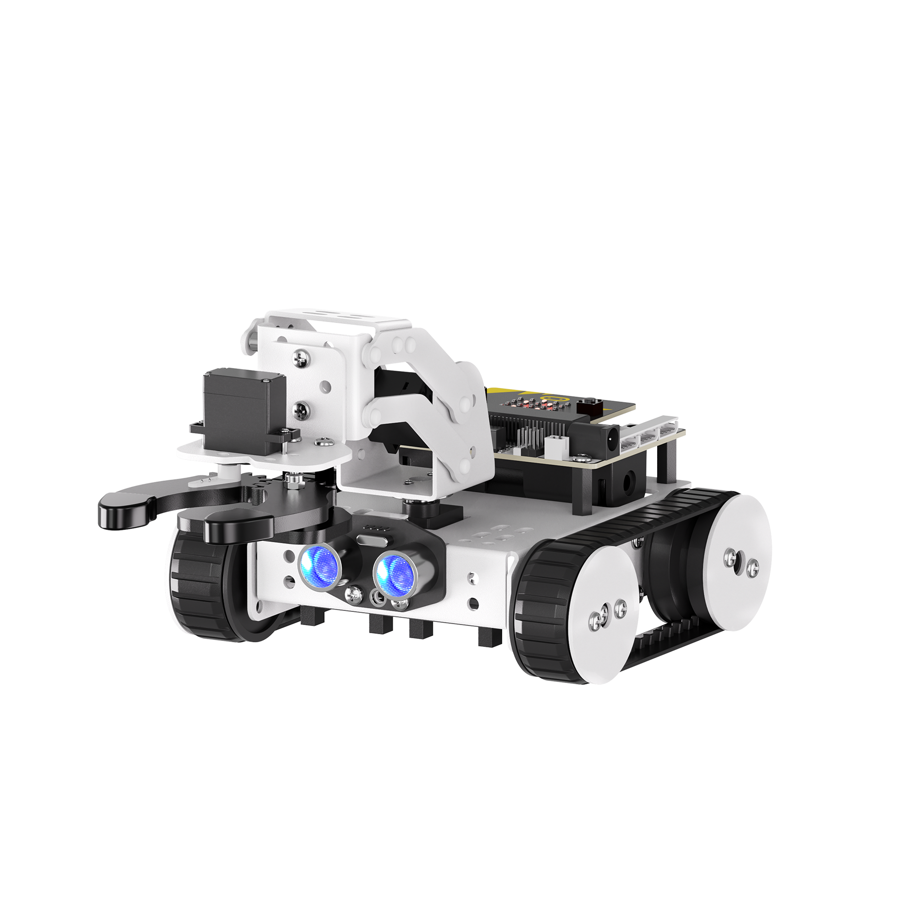

# Hiwonder Qtruck micro:bit Guide


[**View Hiwonder Qtruck micro:bit Programmable Robot Kit with 3DOF Arm (Without micro:bit) on OpenELAB**](https://openelab.io/products/qtruck-micro-bit-educational-robot)

**SKU:** `Hiwonder-21030010`

**Model / revision scope:** Qtruck micro:bit. Match the purchased option below; hardware revisions and controller images are not interchangeable.


## Product overview

Qtruck combines a small mobile base and three-joint gripper arm with a micro:bit expansion system. This OpenELAB option is sold without the micro:bit board.

### Models and purchasing options

| OpenELAB SKU        | Purchased option |
| ------------------- | ---------------- |
| `Hiwonder-21030010` | Default Title    |

## Applications

Bench integration, education and development with the exact hardware listed above. Start with the first-result workflow before expanding the assembly or enabling autonomous operation.

## Specifications

| Parameter           | Value / scope                                             |
| ------------------- | --------------------------------------------------------- |
| Required controller | Compatible micro:bit, supplied separately for this option |
| Battery reference   | 3.7 V 18650, 1800 mAh                                     |
| Mechanism           | Mobile base with 3-DOF arm                                |
| Programming         | MakeCode / manufacturer Qtruck examples                   |
| App                 | Wonderbit                                                 |

Specifications: [manufacturer product data](https://www.hiwonder.com/products/qtruck-programmable-educational-robot) and [OpenELAB listing](https://openelab.io/products/qtruck-micro-bit-educational-robot). Figures describe the stated configuration; accessory-only options do not inherit the complete kit specifications.

## Hardware and connections

Insert the micro:bit in the correct orientation with the expansion board powered off. Use the documented battery holder and motor/servo connectors; the micro:bit USB connection is for programming, not the complete robot’s motor supply. Keep the arm unloaded and wheels clear during the first check.

## Software and development resources

Use the Qtruck HEX and MakeCode lessons for the installed micro:bit version. The official manual explains V1.5/V2 compatibility; new V2-only microphone/speaker features still require a V2 board.

## Getting started

**Prerequisites:** the selected hardware, its matching power source, the required data cable, and a clear work area. Begin with the supplied firmware and an unloaded mechanism.

1. Obtain the missing compatible micro:bit and verify Qtruck assembly and battery polarity.
2. Connect the micro:bit by USB and locate **Qtruck-Bluetooth control.hex** in the official App Control Program resources.
3. Copy the exact HEX file to the MICROBIT drive. Wait for transfer activity to finish; the HEX disappearing from the drive after flashing is normal.
4. Power the assembled robot from its correct battery, then open **Wonderbit** and choose **Qtruck**.
5. Enable Bluetooth/location discovery, tap the app’s Bluetooth icon and connect to **BBC micro:bit**. Do not use the phone’s settings to pair by passkey.
6. First change the RGB-light colour. After that responds, test a brief low-speed drive command and release it before attempting arm movement.

**Expected result:** The app connection indicator becomes steady, the RGB-light colour changes, and a short drive command stops when released.

Procedure reference: [official model or interface manual](https://wiki.hiwonder.com/projects/Qtruck/en/latest/docs/1.Get_Started.html). The steps above are a bounded initial check, not a substitute for the full assembly and development chapters.

## Troubleshooting and FAQs

**No response:** start with the power indicator and cable connections, then verify the selected product/controller profile. Restore communication before running a motion example.

**A function is missing:** compare the order option with the required sensors, controller and software package. A demonstration on an advanced kit does not establish support on an accessory-only or controller-excluded option.

## Downloads and technical documents

* [Official user / interface manual](https://wiki.hiwonder.com/projects/Qtruck/en/latest/docs/1.Get_Started.html)
* [Manufacturer Hiwonder Qtruck micro:bit Programmable Robot Kit with 3DOF Arm (Without micro:bit) specifications and option drawings](https://www.hiwonder.com/products/qtruck-programmable-educational-robot)

Use the manual’s download or appendix section for the matching revision. A linked download directory is not a claim that every firmware archive, CAD file or installer has been tested. Do not flash an image for a similarly named product.

## References and validation

* [OpenELAB product and SKU options](https://openelab.io/products/qtruck-micro-bit-educational-robot).
* [Official user / interface manual](https://wiki.hiwonder.com/projects/Qtruck/en/latest/docs/1.Get_Started.html)
* [Manufacturer Hiwonder Qtruck micro:bit Programmable Robot Kit with 3DOF Arm (Without micro:bit) specifications and option drawings](https://www.hiwonder.com/products/qtruck-programmable-educational-robot)

Reviewed against the linked sources on 19 November 2026. Software installation, compilation and physical hardware tests were not performed for this guide. Use the observable checkpoints above to verify your own unit before integrating it into a larger system.
