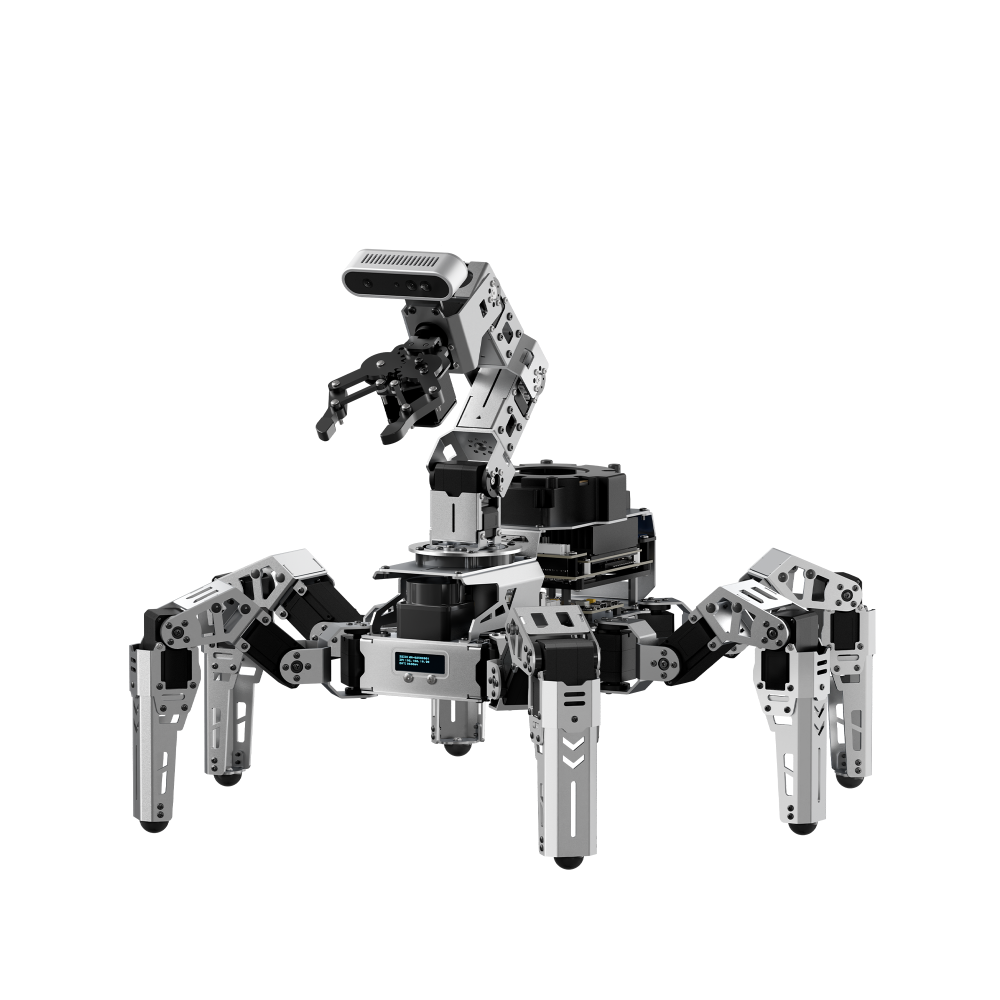

# Hiwonder ROSpider Guide


[**View Hiwonder ROSpider ROS2 Hexapod Robot Kit with 3D Vision, SLAM & 6DOF Arm on OpenELAB**](https://openelab.io/products/rospider-ros2)

**SKU:** `Hiwonder-21060093`, `Hiwonder-21060095`, `Hiwonder-21060109`, `Hiwonder-21060107`, `Hiwonder-21060108`, `Hiwonder-21060094`, `Hiwonder-21060096`, `Hiwonder-21060098`, `Hiwonder-21060114`, `Hiwonder-21060112`, `Hiwonder-21060113`, `Hiwonder-21060097`, `Hiwonder-21060119`, `Hiwonder-21060101`, `Hiwonder-21060099`, `Hiwonder-21060117`, `Hiwonder-21060118`, `Hiwonder-21060100`, `Hiwonder-21060124`, `Hiwonder-21060104`, `Hiwonder-21060102`, `Hiwonder-21060122`, `Hiwonder-21060123`, `Hiwonder-21060103`

**Model / revision scope:** ROSpider. Match the purchased option below; hardware revisions and controller images are not interchangeable.


## Product overview

ROSpider is a ROS2 hexapod platform with optional arm and vision equipment. It uses a host computer plus an STM32 motion controller; purchased kit contents determine the available functions.

ROSpider’s current manual specifies **WN… / 12345678** for direct Wi-Fi, unlike the HW/hiwonder defaults on several older Hiwonder robots. Apply the values from the image actually supplied with the unit.

### Models and purchasing options

| OpenELAB SKU        | Purchased option                                |
| ------------------- | ----------------------------------------------- |
| `Hiwonder-21060093` | Starter Kit / Without Controller                |
| `Hiwonder-21060095` | Starter Kit / With Raspberry Pi 5(8GB)          |
| `Hiwonder-21060109` | Starter Kit / With Jetson Nano(4GB)             |
| `Hiwonder-21060107` | Starter Kit / With Jetson Orin Nano Super(8GB)  |
| `Hiwonder-21060108` | Starter Kit / With Jetson Orin NX Super(8GB)    |
| `Hiwonder-21060094` | Starter Kit / With Jetson Orin NX Super(16GB)   |
| `Hiwonder-21060096` | Standard Kit / Without Controller               |
| `Hiwonder-21060098` | Standard Kit / With Raspberry Pi 5(8GB)         |
| `Hiwonder-21060114` | Standard Kit / With Jetson Nano(4GB)            |
| `Hiwonder-21060112` | Standard Kit / With Jetson Orin Nano Super(8GB) |
| `Hiwonder-21060113` | Standard Kit / With Jetson Orin NX Super(8GB)   |
| `Hiwonder-21060097` | Standard Kit / With Jetson Orin NX Super(16GB)  |
| `Hiwonder-21060119` | Advanced Kit / Without Controller               |
| `Hiwonder-21060101` | Advanced Kit / With Raspberry Pi 5(8GB)         |
| `Hiwonder-21060099` | Advanced Kit / With Jetson Nano(4GB)            |
| `Hiwonder-21060117` | Advanced Kit / With Jetson Orin Nano Super(8GB) |
| `Hiwonder-21060118` | Advanced Kit / With Jetson Orin NX Super(8GB)   |
| `Hiwonder-21060100` | Advanced Kit / With Jetson Orin NX Super(16GB)  |
| `Hiwonder-21060124` | Ultimate Kit / Without Controller               |
| `Hiwonder-21060104` | Ultimate Kit / With Raspberry Pi 5(8GB)         |
| `Hiwonder-21060102` | Ultimate Kit / With Jetson Nano(4GB)            |
| `Hiwonder-21060122` | Ultimate Kit / With Jetson Orin Nano Super(8GB) |
| `Hiwonder-21060123` | Ultimate Kit / With Jetson Orin NX Super(8GB)   |
| `Hiwonder-21060103` | Ultimate Kit / With Jetson Orin NX Super(16GB)  |

A separately named bracket, horn, chassis or rail is the listed accessory, not a complete robot or servo. A “without controller / Raspberry Pi / Jetson / micro:bit” option requires the matching controller separately. Check the selected option’s packing list before starting.

## Applications

Use ROSpider to learn joint coordination, gait/pose control and camera-based interaction.

## Specifications

| Parameter         | Value / scope                                                 |
| ----------------- | ------------------------------------------------------------- |
| Host              | Jetson / Raspberry Pi options as listed                       |
| Motion controller | STM32F407 family                                              |
| Battery reference | 11.1 V, 6000 mAh, 3C                                          |
| Mass reference    | Approximately 3.2 kg for the described ultimate configuration |
| Software          | ROSpider ROS2 image for the exact host                        |

Specifications: [manufacturer product data](https://www.hiwonder.com/products/rospider) and [OpenELAB listing](https://openelab.io/products/rospider-ros2). Figures describe the stated configuration; accessory-only options do not inherit the complete kit specifications.

## Hardware and connections

Connect the supplied battery or adapter to the **robot’s designated power/expansion board**, not directly to a computer GPIO or an unverified charging socket. Inspect the camera, motor/servo and controller cables while power is off. Keep a clear area around every leg and support the robot in the initial resting posture shown in its model manual. Do not hold a powered joint by hand.

Match the controller, camera, LiDAR and chassis configuration to the SKU. Optional voice/AI modules require their own cables and software. A USB camera, depth camera and CSI ribbon camera are not interchangeable interfaces.

## Software and development resources

Start with the factory image for **ROSpider and the exact controller option**. WonderAi is the documented initial control application. Use the official model downloads for restoration; a generic Raspberry Pi OS or JetPack installation does not include the robot services, calibrated offsets and device configuration.

For development, preserve a backup of the supplied image and calibration files before replacing software. Select the manual branch for the installed board and ROS generation. A menu or directory for a different product is not a compatible firmware target.

## Getting started

**Prerequisites:** the selected hardware, its matching power source, the required data cable, and a clear work area. Begin with the supplied firmware and an unloaded mechanism.

1. Match the SKU table to the physical controller and kit. For a controller-excluded option, install the supported board and its exact robot image before attempting the remaining steps.
2. Keep a clear area around every leg and support the robot in the initial resting posture shown in its model manual. Do not hold a powered joint by hand. Inspect polarity and cable seating, then power the robot with the supplied matching power system.
3. Allow the onboard computer to finish booting and reach its documented ready posture/indicator state. Keep the mechanism clear because initialization may move servos.
4. Install **WonderAi** from the model’s official resources. Enable Wi-Fi and the local-network/location permissions required for discovery. Select **ROSpider**, then **+ → Direct Connection Mode**.
5. Join the robot’s **WN…** hotspot using **12345678** on an unchanged factory image. Stay connected if the phone reports no Internet; return to the app and refresh until the correct robot icon appears.
6. Open the model’s Robot/Remote Control screen and verify the camera feed before issuing a brief low-speed command on a clear floor. Release the control and verify the robot stops; avoid autonomous gaits for this first test.
7. End the demonstration and shut down the onboard operating system before removing power. Keep the original image and configuration until basic control is repeatable.

**Expected result:** The correct robot is discovered, its live camera/connection status is visible, and one small manual command responds and stops predictably. Autonomous tasks and loaded motion remain subsequent tests.

Procedure reference: [official model or interface manual](https://wiki.hiwonder.com/projects/ROSpider/en/jetson-orin-nano-version/docs/1_ROSpider_User_Manual.html). The steps above are a bounded initial check, not a substitute for the full assembly and development chapters.

## Troubleshooting and FAQs

**No hotspot:** wait for the full boot sequence, verify the battery/adapter and image/controller match, then check whether the robot was previously configured for LAN mode.

**Phone joins Wi-Fi but the app sees nothing:** remain on the robot network despite the no-Internet warning, grant local-network discovery permissions, select the correct model and refresh. The factory password may have been changed on a used unit.

**Camera works but motion is wrong:** stop immediately and verify the chassis type, motor/servo connections and model configuration. Do not compensate with unrelated servo offsets.

**Vision, mapping or voice option is unavailable:** check the selected kit’s actual camera, LiDAR and AI/voice modules. Offline local control does not establish that a cloud AI service is configured.

**Restoring firmware:** use the exact model/controller resource package and retain calibration files; do not write an image for a similarly named Pro or legacy version.

## Downloads and technical documents

* [Official user / interface manual](https://wiki.hiwonder.com/projects/ROSpider/en/jetson-orin-nano-version/docs/1_ROSpider_User_Manual.html)
* [Official software, image and course downloads](https://wiki.hiwonder.com/projects/ROSpider/en/jetson-orin-nano-version/docs/Appendix.html)
* [Official source repository — match branch and host](https://github.com/Hiwonder/ROSpider)
* [Manufacturer Hiwonder ROSpider ROS2 Hexapod Robot Kit with 3D Vision, SLAM & 6DOF Arm specifications and option drawings](https://www.hiwonder.com/products/rospider)

Use the manual’s download or appendix section for the matching revision. A linked download directory is not a claim that every firmware archive, CAD file or installer has been tested. Do not flash an image for a similarly named product.

## References and validation

* [OpenELAB product and SKU options](https://openelab.io/products/rospider-ros2).
* [Official user / interface manual](https://wiki.hiwonder.com/projects/ROSpider/en/jetson-orin-nano-version/docs/1_ROSpider_User_Manual.html)
* [Official software, image and course downloads](https://wiki.hiwonder.com/projects/ROSpider/en/jetson-orin-nano-version/docs/Appendix.html)
* [Official source repository — match branch and host](https://github.com/Hiwonder/ROSpider)
* [Manufacturer Hiwonder ROSpider ROS2 Hexapod Robot Kit with 3D Vision, SLAM & 6DOF Arm specifications and option drawings](https://www.hiwonder.com/products/rospider)

Reviewed against the linked sources on 19 November 2026. Software installation, compilation and physical hardware tests were not performed for this guide. Use the observable checkpoints above to verify your own unit before integrating it into a larger system.
