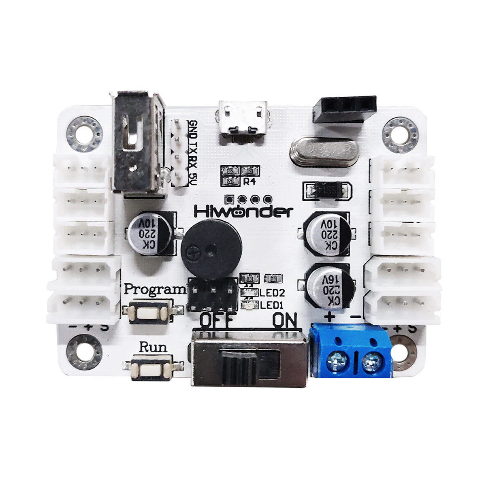

# Hiwonder Serial Bus Servo Controller Guide


[**View Hiwonder Serial Bus Servo Controller, 40-Servo Motion & TTL Communication on OpenELAB**](https://openelab.io/products/serial-bus-servo-tester)

**SKU:** `Hiwonder-21090003`

**Model / revision scope:** Serial Bus Servo Controller. Match the purchased option below; hardware revisions and controller images are not interchangeable.


## Product overview

The Hiwonder serial-bus controller controls addressed bus servos, stores action groups, and supports PC and optional remote interfaces. Its USB/host protocol is different from a direct servo debugging adapter.

### Models and purchasing options

| OpenELAB SKU        | Purchased option |
| ------------------- | ---------------- |
| `Hiwonder-21090003` | Default Title    |

## Applications

Bench integration, education and development with the exact hardware listed above. Start with the first-result workflow before expanding the assembly or enabling autonomous operation.

## Specifications

| Parameter         | Value / scope                                            |
| ----------------- | -------------------------------------------------------- |
| Board supply      | 6–12 V in the current manual; match the connected servos |
| Host UART         | 9600 baud                                                |
| Memory            | 16M, manufacturer notation                               |
| Dimensions / mass | 58 × 42 mm / approximately 21 g                          |
| Offline group     | 100, activated with Run                                  |

Specifications: [manufacturer product data](https://www.hiwonder.com/products/serial-bus-servo-controller) and [OpenELAB listing](https://openelab.io/products/serial-bus-servo-tester). Figures describe the stated configuration; accessory-only options do not inherit the complete kit specifications.

## Hardware and connections

Connect a compatible legacy Hiwonder bus servo to a labelled servo port. For a low-voltage LX-16A use a 7.4 V supply; for a suitable high-voltage model use a regulated 11.1 V supply. Keep the board within its own 6–12 V limit. Connect supply red to + and black to − before turning on. USB connects to the PC; the external supply powers the servo. The documented 9600 baud applies to the host controller protocol, not the direct 115200-baud servo bus.

## Software and development resources

Use the controller’s Bus Servo Control application and host communication protocol. A direct BusLinker adapter and a 1 Mbit/s magnetic-encoder servo require their own protocol/software; this guide does not establish cross-generation compatibility.

## Getting started

**Prerequisites:** the selected hardware, its matching power source, the required data cable, and a clear work area. Begin with the supplied firmware and an unloaded mechanism.

1. Connect one unloaded legacy bus servo and the appropriate external supply with the board switched off.
2. Attach USB, turn on the controller, and install/open **Bus Servo Control V3.4** from its Appendix.
3. Open **Servo Test** and read the single servo’s ID, voltage, temperature and position before moving it.
4. In General Mode, select only that servo ID and command a small nearby position. Do not use the generic full-range reset on a mechanism with unknown limits.
5. Add two verified nearby positions to an action group using a 1000 ms duration, save the file, and run it once online.
6. Download the tested sequence to action group 100; use Run to verify offline operation while keeping the servo power connected.

**Expected result:** The controller communicates with one servo and runs the same small motion sequence online and offline.

Procedure reference: [official model or interface manual](https://wiki.hiwonder.com/projects/Bus-Servo-Controller/en/latest/docs/1.Bus_Servo_Controller_User_Manual.html). The steps above are a bounded initial check, not a substitute for the full assembly and development chapters.

## Troubleshooting and FAQs

**No response:** start with the power indicator and cable connections, then verify the selected product/controller profile. Restore communication before running a motion example.

**A function is missing:** compare the order option with the required sensors, controller and software package. A demonstration on an advanced kit does not establish support on an accessory-only or controller-excluded option.

## Downloads and technical documents

* [Official user / interface manual](https://wiki.hiwonder.com/projects/Bus-Servo-Controller/en/latest/docs/1.Bus_Servo_Controller_User_Manual.html)
* [Manufacturer Hiwonder Serial Bus Servo Controller, 40-Servo Motion & TTL Communication specifications and option drawings](https://www.hiwonder.com/products/serial-bus-servo-controller)

Use the manual’s download or appendix section for the matching revision. A linked download directory is not a claim that every firmware archive, CAD file or installer has been tested. Do not flash an image for a similarly named product.

## References and validation

* [OpenELAB product and SKU options](https://openelab.io/products/serial-bus-servo-tester).
* [Official user / interface manual](https://wiki.hiwonder.com/projects/Bus-Servo-Controller/en/latest/docs/1.Bus_Servo_Controller_User_Manual.html)
* [Manufacturer Hiwonder Serial Bus Servo Controller, 40-Servo Motion & TTL Communication specifications and option drawings](https://www.hiwonder.com/products/serial-bus-servo-controller)

Reviewed against the linked sources on 19 November 2026. Software installation, compilation and physical hardware tests were not performed for this guide. Use the observable checkpoints above to verify your own unit before integrating it into a larger system.
