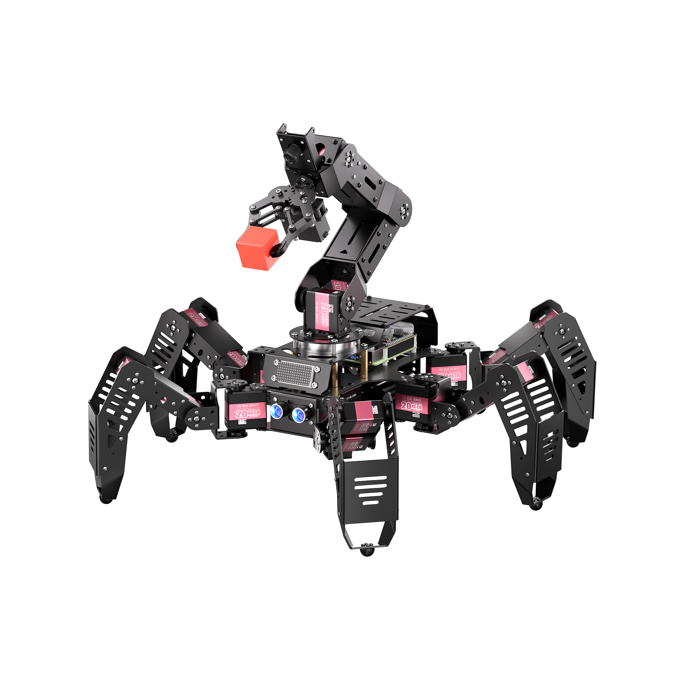

# Hiwonder SpiderPi Pro Pi 5: 4 GB/16 GB setup, Python vision and gait control


[**SpiderPi Pro Raspberry Pi 5 16 GB — SKU Hiwonder-21060060**](https://openelab.io/products/spiderpi-pro-pi5?variant=46120281604294) · [**Raspberry Pi 5 4 GB — SKU Hiwonder-21060050**](https://openelab.io/products/spiderpi-pro-pi5?variant=46120281538758)


## Product overview <a href="#product-overview" id="product-overview"></a>



_Existing OpenELAB product illustration retained for model context; option contents and electrical connections are identified by the tables and diagrams below._

SpiderPi Pro combines an 18 DOF hexapod body, a five-servo visual arm/gripper and a Raspberry Pi running Python/OpenCV applications. This page covers the exact **Pi 5 16 GB and Pi 5 4 GB** options. They share the mechanical platform and lesson paths; memory capacity changes, not servo IDs or battery voltage. Pi 4B kits are separate options and require their appropriate system image. [OpenELAB option list](https://openelab.io/products/spiderpi-pro-pi5), [current Pi 5 manual](https://wiki.hiwonder.com/projects/SpiderPi_Pro/en/latest/docs/1_read_before_studying.html).

Start with charging, stable boot and a live camera result. Then inspect the PC action editor, calibrate vision and develop short gait or grasp sequences. This is the Python/WonderPi platform; the ROSpider's ROS 2 services, 24-servo mapping and WonderAi setup are different.

### Other established purchasing options <a href="#models-and-purchasing-options" id="models-and-purchasing-options"></a>

This canonical page also retains the following catalogued family options. The detailed first-run workflow above/below is for the exact host/kit variants in the opening callout; select the matching host image and kit-specific hardware for other options. A controller-excluded option needs that separately supplied host.

| SKU                 | Established option          |
| ------------------- | --------------------------- |
| `Hiwonder-21060012` | With Raspberry Pi 4B (4 GB) |
| `Hiwonder-21060132` | With Raspberry Pi 5 (2 GB)  |
| `Hiwonder-21060050` | With Raspberry Pi 5 (4 GB)  |
| `Hiwonder-21060051` | With Raspberry Pi 5 (8 GB)  |
| `Hiwonder-21060060` | With Raspberry Pi 5 (16 GB) |

[OpenELAB family options](https://openelab.io/products/spiderpi-pro-pi5).

## Applications <a href="#applications" id="applications"></a>

SpiderPi Pro supports gait and inverse-kinematics study, color/tag/face recognition, line following, target tracking, visual block picking, sorting, stacking and group-control experiments. Combine these gradually: prove camera acquisition, segment a stationary target, verify coordinates, then command a small physical movement.

A color detection result does not establish a grasp location. Lens distortion, camera mounting, floor/table height and arm geometry must also be calibrated. The robot's camera sees only part of the leg workspace; protect table edges and other blind areas independently. [Kinematics](https://wiki.hiwonder.com/projects/SpiderPi_Pro/en/latest/docs/8_forward_inverse_kinematics.html), [vision](https://wiki.hiwonder.com/projects/SpiderPi_Pro/en/latest/docs/10_recognition_tracking.html).

## Specifications <a href="#specifications" id="specifications"></a>

| Item                               | Pi 5 16 GB                                                             | Pi 5 4 GB               |
| ---------------------------------- | ---------------------------------------------------------------------- | ----------------------- |
| Exact SKU                          | Hiwonder-21060060                                                      | Hiwonder-21060050       |
| Store variant ID                   | 46120281604294                                                         | 46120281538758          |
| Host                               | Raspberry Pi 5, 16 GB                                                  | Raspberry Pi 5, 4 GB    |
| Body/arm                           | 18 leg DOF plus 5-servo visual arm/gripper                             | Same                    |
| Software lane                      | Manufacturer Pi 5 image; Python 3/OpenCV                               | Same                    |
| Battery reference                  | 11.1 V 3500 mAh 5C lithium pack                                        | Same                    |
| Charging                           | 12.6 V 2 A; DC 5.5 × 2.5 mm                                            | Same                    |
| Documented robot operating voltage | 9–12.6 V; recharge when below 10 V                                     | Same                    |
| Body mass                          | About 3.1 kg                                                           | Same platform reference |
| Servo families                     | LX-224HV and HTS-20H bus servos                                        | Same                    |
| Sensor reference                   | 480P wide-angle camera; IMU; ultrasonic 2–400 cm reference; dot matrix | Same                    |

The store's approximately 40-minute runtime and 20 kg·cm servo-torque reference are conditional manufacturer figures, not measured runtime or arm payload. Memory alone does not make a heavy target safe to lift or improve mechanical repeatability. [Hardware and options](https://openelab.io/products/spiderpi-pro-pi5), [voltage/charge limits](https://wiki.hiwonder.com/projects/SpiderPi_Pro/en/latest/docs/1_read_before_studying.html#_1-4-charging-and-power-on-status-explanation).

| PC software parameter   | Documented domain                               | Interpretation                                                                  |
| ----------------------- | ----------------------------------------------- | ------------------------------------------------------------------------------- |
| Servo position          | 0–1000                                          | Controller position units, not degrees                                          |
| Servo deviation         | −125…+125                                       | Calibration offsets; save original values                                       |
| Action duration         | 20–9999 ms                                      | Action time field; confirm units in the installed editor before modifying files |
| Arm ID ordering         | 25 down to 21, top to bottom in the arm diagram | Do not reuse ROSpider IDs 19–24                                                 |
| Neutral-position button | 500                                             | Commands movement to reference; not a harmless read                             |

[Action editor](https://wiki.hiwonder.com/projects/SpiderPi_Pro/en/latest/docs/7_PC_Software.html).

## Hardware and connections <a href="#hardware-and-connections" id="hardware-and-connections"></a>

### Robot supply is not Pi GPIO supply

The pack powers the robot's expansion/controller assembly, which distributes suitable host and servo supplies. Use the factory Pi 5 harness and matched charger. Do not put the 11.1 V battery on a Pi 5 V header or USB data port. The public guide does not establish one revision-independent bare UART pinout/logic rating; preserve the supplied connection rather than substituting a generic TTL cable.


Official Hiwonder arm-wiring illustration, visually inspected. It identifies the bus-servo connection and cable route. Match the board revision/silkscreen on the actual Pi 5 kit before using a socket: an older illustrated board layout is not permission to transpose power pins. Follow the adjacent camera/arm assembly steps with power off. [Assembly and wiring](https://wiki.hiwonder.com/projects/SpiderPi_Pro/en/latest/docs/1_read_before_studying.html#_1-3-assembly-tutorial).

Keep servo wiring away from joint pinch points and leave slack through the intended arm sweep. Confirm USB camera seating, arm fasteners and leg linkage before boot. Do not manually force powered joints. The PC editor's torque-release function can let the arm/body drop; support them first.

### Charge and boot

Use the marked charging socket and supplied 12.6 V 2 A charger. The charger is green disconnected, red during charging and green when complete; the manual gives about 3 hours as a reference. Disconnect it when finished. Inspect battery polarity red-to-red/black-to-black before powering on.

Place the robot in its illustrated starting posture on a level floor, clear the reset sweep and switch on. LED1/LED2 initially illuminate; LED2 later flashes, a buzzer sounds and the robot reaches its attention posture. Wait for this completion before control. Read the onboard voltage display: recharge below 10 V rather than attempting to diagnose jerky motion with a depleted pack. [Power-up guidance](https://wiki.hiwonder.com/projects/SpiderPi_Pro/en/latest/docs/1_read_before_studying.html#_1-4-charging-and-power-on-status-explanation).

## Software and development resources <a href="#software-and-development-resources" id="software-and-development-resources"></a>

The supplied home directory includes `spiderpi` for robot applications, `spiderpi_software` for the graphical editor and `hiwonder-toolbox` for networking. Within `spiderpi`, inspect `functions`, `advanced`, `kinematic_routines` and the controller/camera libraries. Current lessons import `common.ros_robot_controller_sdk.Board` and `calibration.camera.Camera`; older public code may use differently named `spiderpi_sdk` modules. Record which files actually exist before copying an example. [Delivered directory layout](https://wiki.hiwonder.com/projects/SpiderPi_Pro/en/latest/docs/6_remote_tool.html).

Read-only environment checks:

```bash
cat /etc/os-release
python3 --version
ls -ld ~/spiderpi ~/spiderpi_software ~/hiwonder-toolbox
ls ~/spiderpi/functions ~/spiderpi/advanced ~/spiderpi/kinematic_routines
pgrep -af 'SpiderPi.py|spiderpi|camera'
```

A file listing is the authority for case-sensitive filenames. For example, the manual's directory table lists `color_detect.py` while a newer lesson launches `color_recognition.py`. Use the installed matching file; do not rename one to satisfy another version's instructions. The [public SpiderPi-Pro repository](https://github.com/Hiwonder/SpiderPi-Pro) is useful for inspection, but its presence does not establish Pi 5 image compatibility. Do not replace the working system with repository files wholesale.

For custom development, exit the app's active game, close PC control and stop the documented owning program before opening a second camera/controller. The current manual identifies `SpiderPi.py` as autostart; it does not establish a single service name across every image. Inspect its launcher before changing startup. Restore that launcher after testing so app/gamepad behavior returns.

## Getting started <a href="#getting-started" id="getting-started"></a>

### 1. Connect without triggering a demo

1. Complete the posture, charge and boot checks above.
2. Join the robot's `HW…` hotspot using the documented initial password `hiwonder`. Stay connected despite the no-internet warning. Grant the app its required local-network access and location/discovery permissions when prompted; a denied discovery permission can hide an otherwise reachable robot.
3. Open WonderPi and select the **SpiderPi Pro** model. Parts of the generic connection lesson use TurboPi screenshots; do not select a wheeled TurboPi merely to match those screenshots.
4. Open Robot Control and verify the live camera view before touching gait/arm controls. Move a colored block within view and confirm a new frame arrives.
5. For development, connect VNC to `192.168.149.1`, initial account `pi`/`raspberrypi`. A 5 GHz-capable Wi-Fi adapter may be needed to discover the supplied hotspot. Change default credentials before shared-network use.

**Expected result:** a stationary attention posture, reachable desktop/app and a changing live view. Neither the Pi 4B nor ROSpider credentials should be guessed if the delivered image was customized. [Remote access](https://wiki.hiwonder.com/projects/SpiderPi_Pro/en/latest/docs/6_remote_tool.html), [app experience](https://wiki.hiwonder.com/projects/SpiderPi_Pro/en/latest/docs/2_Getting%20Ready.html).

### 2. Original camera-only receipt and brightness check

After closing the camera-owning game, save the following as `~/spiderpi/camera_receipt.py`. Run it from the supplied project directory:

```bash
cd ~/spiderpi
python3 camera_receipt.py
```

It checks the installed camera-opening signature: the newer lesson accepts `correction=True`, while the public snapshot has a no-argument method. It uses that installed `Camera` lifecycle but never constructs a board, starts a gait or calls an action group. It writes one image and reports approximate brightness, clipped pixels and the number of changed images. These help distinguish an exposure problem from a frozen stream.

```python
import hashlib
import inspect
import time
import cv2
from calibration.camera import Camera

camera = Camera()
received = 0
changed = 0
previous = None
last = None
try:
    parameters = inspect.signature(camera.camera_open).parameters
    if "correction" in parameters:
        camera.camera_open(correction=True)
    else:
        camera.camera_open()
    end = time.monotonic() + 10
    while time.monotonic() < end:
        frame = camera.frame
        if frame is None:
            time.sleep(0.05)
            continue
        image = frame.copy()
        digest = hashlib.sha256(image.tobytes()).digest()
        if digest != previous:
            changed += 1
            previous = digest
        received += 1
        last = image
        time.sleep(0.1)
    if last is None:
        raise RuntimeError('No camera frame; inspect ownership/cable/image version')
    gray = cv2.cvtColor(last, cv2.COLOR_BGR2GRAY)
    print('sampled=', received, 'changed=', changed, 'shape=', last.shape)
    print('mean_gray=', round(float(gray.mean()), 1),
          'near_black_fraction=', round(float((gray < 5).mean()), 3),
          'near_white_fraction=', round(float((gray > 250).mean()), 3))
    if not cv2.imwrite('spiderpi-camera-check.png', last):
        raise RuntimeError('Snapshot could not be saved')
finally:
    camera.camera_close()
    cv2.destroyAllWindows()
```

**Expected result:** nonzero sampled frames, a saved `spiderpi-camera-check.png` and changed images when a prop moves. Sampling the shared frame repeatedly is not a camera-FPS measurement. An entirely static scene can legitimately have few changes; deliberately move a prop to test freshness. Extreme black/white fractions suggest exposure or illumination problems. [Camera API used by current lesson](https://wiki.hiwonder.com/projects/SpiderPi_Pro/en/latest/docs/10_recognition_tracking.html).

### 3. Calibrate vision before tracking or picking

Use the desktop color-threshold tool in the actual project lighting. Place only the intended colored target in view. Adjust the LAB mask so it contains the target and rejects background; test at multiple positions and distances before saving. Keep a copy of the original threshold YAML. A larger area threshold can suppress noise but can also discard a distant valid target.

The camera-calibration workflow separates lens correction from coordinate calibration. Retain the existing factory files while checking the supplied pattern, image size and camera mount. The cited public plane-calibration sample mixes raw frames with rectified intrinsics and has an automatic motion/save timer: it is excluded as a verified calibrator. Use only an inspected delivered implementation with a consistent image/intrinsics/distortion contract, the complete motion clearance and save checks described below. NumPy parameter loading or a correction option alone does not establish that consistency. [Vision course](https://wiki.hiwonder.com/projects/SpiderPi_Pro/en/latest/docs/10_recognition_tracking.html), [kinematics course](https://wiki.hiwonder.com/projects/SpiderPi_Pro/en/latest/docs/8_forward_inverse_kinematics.html).

### 4. Build one bounded action, then one manipulation task

1. Open the SpiderPi graphical editor and **read the saved deviations**. Save a backup before touching offsets.
2. Keep the robot supported and start from its existing posture. Move one servo a small amount within a clear envelope; compare ID and physical joint.
3. Add the current posture as the first action, the checked small move as the second, and a return as the third. Save under a new name, leave Loop off and run once.
4. Verify the editor's stop behavior before creating longer actions. Torque release and middle-position reset are actuation operations.
5. For first picking, use a supplied sponge cube, a fixed camera/table arrangement and the matching `advanced` lesson. Observe segmentation and target coordinates before enabling the grasp sequence. Test an unloaded trajectory before introducing the object.

**Expected result:** the intended joint moves predictably, the return posture is clear and a single action group ends without a loop. A successful visual pick requires both the calibrated vision and a reachable arm pose; it is not established by a colored bounding box. [Action editing](https://wiki.hiwonder.com/projects/SpiderPi_Pro/en/latest/docs/7_PC_Software.html), [advanced vision](https://wiki.hiwonder.com/projects/SpiderPi_Pro/en/latest/docs/11_AI_Vision_advanced_lesson.html).

### 5. Complete the official topic families

| Course family                                                               | How to develop it on this exact Pi 5 kit                                                                                                                                                                   |
| --------------------------------------------------------------------------- | ---------------------------------------------------------------------------------------------------------------------------------------------------------------------------------------------------------- |
| Forward/inverse kinematics; arm/chassis height; synchronized adjustment     | Check leg numbering, body frame and length units in the installed IK module; start with a small supported pose change, then a finite step sequence                                                         |
| Color/tag/face recognition, tracking, line following and obstacle avoidance | Validate the image overlay first. Use a fully visible, flat tag; the face lesson describes an indoor demonstration around 0.5–1 m. Ultrasonic readings do not detect every material, edge or side obstacle |
| Ball locating/kicking                                                       | Tune target color with the ball fixed; inspect position estimate before allowing approach/kick; protect camera blind regions                                                                               |
| Object/intelligent picking, color sorting and shape recognition             | Use light supplied props, fixed floor height and distinct target/background. Separate recognition errors from arm-offset errors                                                                            |
| Line-following transport                                                    | Validate line following without load, then stationary grasp/release, then combine; record transition conditions so a lost line cannot leave a stale motion command                                         |
| PC action playback from Python                                              | Inspect the installed `ActionGroupController` constructor and stop behavior; do not mix older module imports with the current board object                                                                 |
| Group control                                                               | Put each robot at a stable start pose, identify server/client IPs and one command owner per robot; test one client before broadcasting to a group                                                          |
| AP/STA networking                                                           | Back up `hiwonder-toolbox/wifi_conf.py`; inspect the installed service name before restart. The wiki contains both `hw_wifi.service` and `wifi.service` branches                                           |

[Full official topic index](https://wiki.hiwonder.com/projects/SpiderPi_Pro/en/latest/docs/1_read_before_studying.html), [group control](https://wiki.hiwonder.com/projects/SpiderPi_Pro/en/latest/docs/12_mass_control.html), [network configuration](https://wiki.hiwonder.com/projects/SpiderPi_Pro/en/latest/docs/13_network_configuration.html).

### SpiderPi Pro programming and course reference

SpiderPi Pro's courses connect three layers: camera/perception produces measurements; application logic selects an action; a Raspberry Pi serial controller sends positions to the leg and arm servos. The `ros_robot_controller_sdk` filename does **not** make these Python lessons ROS nodes. Run them in the supplied Pi 5 environment, with one owner of the camera and controller. The 4 GB and 16 GB options on this page share this workflow; extra RAM does not change servo IDs or authorize an image from ROSpider. [Official course index](https://wiki.hiwonder.com/projects/SpiderPi_Pro/en/latest/), [published application source](https://github.com/Hiwonder/SpiderPi-Pro/tree/1a309b7e697507f6d7b6165852c530a0a8731e88).

#### Establish the installed API before importing a motion module

The published source is useful for reading the actual command path, but it contains mismatches with the newer wiki and internal defects. Record the installed version and compare these specific interfaces before enabling a demo:

| Interface in the inspected source                       | Units / behavior                                                                                                   | Integration consequence                                                                                                         |
| ------------------------------------------------------- | ------------------------------------------------------------------------------------------------------------------ | ------------------------------------------------------------------------------------------------------------------------------- |
| `Board(device='/dev/ttyAMA0', baudrate=1000000)`        | Opens the serial port during construction                                                                          | Constructing a board is an I/O action; do not use it for a supposedly offline calculation                                       |
| `bus_servo_set_position(duration, [[id,position],...])` | `duration` in seconds; implementation multiplies by 1000 for the packet                                            | Raw bus position is not a degree value or a PWM microsecond value                                                               |
| `pwm_servo_set_position(duration, positions)`           | Duration also seconds; a separate PWM command                                                                      | Do not transfer bus-servo values to the PWM connector                                                                           |
| Arm `setPitchRange((x,y,z),alpha1,alpha2,da=1)`         | Cartesian coordinates in centimetres, pitch range in degrees; returns `(servo_positions, chosen_pitch)` or `False` | This method calculates a solution, but importing its module already constructs `Board()`                                        |
| `setPitchRangeMoving(...,movetime)`                     | Solves and **sends** the joint command                                                                             | Supply an explicit seconds value only on the inspected seconds-based implementation; do not trust the stale millisecond comment |
| Chassis lesson `Stand(height,mode,t)`                   | Height in millimetres; lesson time parameter in milliseconds                                                       | This helper has a different unit contract from the board and arm calls                                                          |
| Camera `camera_open()`                                  | Published snapshot has no `correction` keyword                                                                     | Newer wiki uses `camera_open(correction=True)`; inspect the installed signature rather than copying either blindly              |

The arm wrapper's automatic timing path also reads IDs 3–6 while the move writes arm IDs 24–21. Therefore this page does not recommend `movetime=None` or running its standalone `__main__` example, whose value `1000` conflicts with the seconds-based board call. The current wiki's examples use `1` or `2` seconds. Preserve the factory SDK until the installed implementation is matched. [Board implementation](https://github.com/Hiwonder/SpiderPi-Pro/blob/1a309b7e697507f6d7b6165852c530a0a8731e88/spiderpi_sdk/common_sdk/common/ros_robot_controller_sdk.py), [arm movement wrapper](https://github.com/Hiwonder/SpiderPi-Pro/blob/1a309b7e697507f6d7b6165852c530a0a8731e88/spiderpi_sdk/arm_ik_sdk/arm_ik/arm_move_ik.py), [current kinematics lessons](https://wiki.hiwonder.com/projects/SpiderPi_Pro/en/latest/docs/8_forward_inverse_kinematics.html).

#### Action editor: positions, offsets and recorded sequences

The desktop **SpiderPi** editor separates body IDs 1–18 from arm IDs 21–25. Its position sliders span 0–1000 raw counts; deviation sliders span −125 to +125. These are editor ranges, not collision-free workspace limits. The gripper is ID25, with the remaining arm joints down to the base ID21. Read existing deviations before modifying them, and record each original value. “All middle” sends 500 to the servos; it is a motion command, not an automatic mechanical calibration. [Editor controls](https://wiki.hiwonder.com/projects/SpiderPi_Pro/en/latest/docs/7_PC_Software.html#_4-1-pc-software-introduction).

For a new action, use a copy of a known starting posture and support the body/arm before any torque release. The editor's manual-position feature makes joints loose; the robot may settle under its own weight. A sequence row contains duration and all relevant servo positions. Adjusting the time field alone does not change an existing row until **Update Action** is applied. The editor documents a 20–9999 ms row-time range. Add slower intermediate poses where one pose would otherwise cross the body, floor or camera cable.

1. Open a known `.d6a` action and inspect the initial pose before running it.
2. Create a new filename, then modify only the required joints. Add the present pose as a row; use **Update Action** when changing a selected row.
3. Step through the list once with the workspace clear. Leave **Loop** off during development.
4. Save the new sequence and reopen it to confirm row count, timings and servo values.
5. If concatenating actions with **Integrate file**, check the transition between the first sequence's last pose and the next sequence's first pose; file concatenation does not plan a safe transition.

**Expected result:** the saved file reopens with the intended finite sequence. A successful file save does not establish that every pose is reachable. The documented “forward and pick” example uses 26 rows and interleaves tripod leg groups with arm handling; its screenshots explain sequencing, but their raw positions are not universal calibration values. [Action editing and integration](https://wiki.hiwonder.com/projects/SpiderPi_Pro/en/latest/docs/7_PC_Software.html).

The current source expects files under `/home/pi/spiderpi/action_groups/`; a legacy editor paragraph uses `/home/pi/SpiderPi/ActionGroups`. Linux treats these as different paths. Inspect the installed `ActionGroupController.action_path` and the editor's save location before moving files. Do not create an empty alternate directory to conceal a version mismatch.

#### Read an action file without sending servo commands

A `.d6a` file is a SQLite action database in the inspected implementation. The controller reads `ActionGroup`; each row begins with a row identifier and duration in milliseconds, followed by servo columns. The controller's order is IDs 1–18 then 21–25. The following original inspection opens one known file **read-only** and reports its rows without importing the controller or starting an action. Save it as `action_inventory.py` and run `python3 action_inventory.py` from the supplied project directory.

```python
from pathlib import Path
import sqlite3

path = Path.home() / 'spiderpi/action_groups/stand_low.d6a'
if not path.is_file():
    raise SystemExit(f'Matched action file missing: {path}')
with sqlite3.connect(path.resolve().as_uri() + '?mode=ro', uri=True) as db:
    columns = db.execute('PRAGMA table_info(ActionGroup)').fetchall()
    rows = db.execute('SELECT * FROM ActionGroup').fetchall()
print('file=', path.name, 'columns=', len(columns), 'rows=', len(rows))
if not rows:
    raise SystemExit('No action rows')
servo_ids = list(range(1, 19)) + list(range(21, 26))
for index, row in enumerate(rows):
    if len(row) != len(servo_ids) + 2:
        raise SystemExit(f'Row {index}: unexpected schema length {len(row)}')
    duration_ms = float(row[1])
    if duration_ms <= 0:
        raise SystemExit(f'Row {index}: non-positive duration')
    print(index, 'duration_ms=', duration_ms,
          'arm_base21_count=', dict(zip(servo_ids, row[2:]))[21])
print('total_duration_s=', sum(float(row[1]) for row in rows) / 1000)
```

**Expected result:** row/column counts and a positive total duration for the installed `stand_low.d6a`. A schema mismatch is a reason to inspect the installed reader; do not coerce the database or run it to discover the format. This inspection checks data shape, not joint limits. [Action database reader](https://github.com/Hiwonder/SpiderPi-Pro/blob/1a309b7e697507f6d7b6165852c530a0a8731e88/spiderpi_sdk/common_sdk/common/action_group_controller.py).

The published `run_action_group(actNum,times=1,lock_servos='')` nominally uses a filename without `.d6a`, finite repeat counts and zero for indefinite repetition. However, the snapshot also tests `self.stop_action_group` as a Boolean while defining that name as a method; the method object is truthy. This prevents treating the snapshot as a verified action player. Its group-control client calls `stopActionGroup()`, absent from this class. Use the working factory editor for a bounded sequence and resolve these implementation differences before developing a new player. Do not interpret “no movement” from that source as a failed servo or increase power to compensate. [Controller source](https://github.com/Hiwonder/SpiderPi-Pro/blob/1a309b7e697507f6d7b6165852c530a0a8731e88/spiderpi_sdk/common_sdk/common/action_group_controller.py).

#### Forward and inverse kinematics: what is calculated

Forward kinematics maps measured joint angles and link geometry to an end-effector pose. Inverse kinematics instead starts with a desired Cartesian point and tool pitch, then searches for joint angles. SpiderPi Pro's educational arm solver reduces the geometry to the base rotation and a planar linkage: `theta21` is obtained from `atan2(Y,X)`; the remaining lengths and pitch determine the triangle and elbow/wrist angles. A geometric solution still needs servo-range checking and collision checking; the simple solver does not model nearby obstacles or the floor. [Coordinate/DH and IK lessons](https://wiki.hiwonder.com/projects/SpiderPi_Pro/en/latest/docs/8_forward_inverse_kinematics.html).

The inspected mathematical solver uses centimetres and degrees, with default link parameters L1=13, L2=13, L3=13, L4=15 cm. Those are source defaults, not independent measurements of every purchased arm. Its origin and tool point must match the physical assembly; changing the gripper or camera bracket can invalidate a taught picking transform. The low-level solver returns a dictionary `theta24`, `theta23`, `theta22`, `theta21`, or `False` for rejected geometry. The movement wrapper additionally converts these to raw servo positions and applies its servo-range limits. [Mathematical solver](https://github.com/Hiwonder/SpiderPi-Pro/blob/1a309b7e697507f6d7b6165852c530a0a8731e88/spiderpi_sdk/arm_ik_sdk/arm_ik/inverse_kinematics.py).

For an offline calculation, load only `inverse_kinematics.py`; importing `arm_move_ik` would open the controller. This original example requires the inspected source path and performs no hardware access:

```python
from pathlib import Path
import importlib.util

path = (Path.home() / 'spiderpi/spiderpi_sdk/arm_ik_sdk/'
        'arm_ik/inverse_kinematics.py')
if not path.is_file():
    raise SystemExit(f'Solver missing: {path}')
spec = importlib.util.spec_from_file_location('spiderpi_math_ik', path)
if spec is None or spec.loader is None:
    raise SystemExit('Cannot load mathematical solver')
module = importlib.util.module_from_spec(spec)
spec.loader.exec_module(module)
solver = module.IK()
print('link_lengths_cm=', solver.getLinkLength())
for height_cm in (25.0, 30.0, 35.0):
    solution = solver.getRotationAngle((0.0, 15.0, height_cm), 0.0)
    print('target_cm=', (0.0, 15.0, height_cm), 'pitch_deg=0', solution)
```

**Expected result:** configured link lengths and an angle dictionary or explicit `False` for each target. These are mathematical results, not permission to send the corresponding joint positions. This procedure was source-reviewed and syntax-checked; it was not run against an installed Pi image.

#### Coordinate transforms and the course's modified DH convention

Define `R_A←B` as a rotation that expresses a vector written in frame B using frame A's axes. Its columns are B's unit axes expressed in A. For a point, translation also matters: `p_A = R_A←B p_B + t_A←B`, where `t_A←B` is B's origin expressed in A. All terms in one calculation must use the same length unit. In homogeneous coordinates, `T_A←B = [R_A←B, t_A←B; 0 0 0, 1]`, and `T_A←C = T_A←B T_B←C`. Matrix order is material: the rightmost transform acts first. A pure translation adds a displacement; a rotation changes the axes used to express it. For a proper rotation, the inverse is the transpose; use the inverse translation as well when reversing a complete transform. [Coordinate and rotation lessons](https://wiki.hiwonder.com/projects/SpiderPi_Pro/en/latest/docs/8_forward_inverse_kinematics.html#_5-1-establish-robotic-arm-coordinate-system).

Positive rotation follows the right-hand rule. As a simple data check, rotating `(1,0,0)` cm by +90° about +Z produces `(0,1,0)` cm; adding a translation `(2,3,0)` cm then gives `(2,4,0)` cm. Translating first generally gives a different result. Do not mix degrees with a library expecting radians, or reuse camera pixel axes as robot-base axes.


_Hiwonder course illustration, visually inspected. This is a generic frame-construction diagram, not a dimensioned drawing of the purchased arm. The source labels link geometry with `a(i−1)` and `alpha(i−1)` and joint quantities with `d(i)` and `theta(i)`._ [Original DH lesson and formulas](https://wiki.hiwonder.com/projects/SpiderPi_Pro/en/latest/docs/8_forward_inverse_kinematics.html#_5-2-1-dh-parameter-introduction).

The course's displayed matrix uses the **modified DH** ordering below. Do not substitute a standard-DH matrix while keeping its parameter table:

| Parameter    | Geometric meaning in this convention                                | Units / role                                        |
| ------------ | ------------------------------------------------------------------- | --------------------------------------------------- |
| `a(i−1)`     | Distance along the common-normal X axis between adjacent joint axes | Length; link geometry                               |
| `alpha(i−1)` | Twist between adjacent joint Z axes about that X axis               | Angle; link geometry                                |
| `d(i)`       | Translation along joint axis Z(i)                                   | Length; constant for a revolute joint in this model |
| `theta(i)`   | Rotation about joint axis Z(i)                                      | Angle; joint variable for a revolute joint          |

Assign Z to each joint axis, X along the common normal and Y to complete the right-handed frame. Intersecting or parallel axes need a consistent frame choice; axis signs and zero offsets must remain with the table. In the convention shown in the inspected formula image:

```
T(i−1 ← i) = Rx(alpha(i−1)) Tx(a(i−1)) Rz(theta(i)) Tz(d(i))
T(base ← tool) = T(base ← 1) T(1 ← 2) ... T(last ← tool)
```

Forward kinematics multiplies those transforms at the current joint angles and applies the tool offset. The course's symbolic five-row example uses `d`, `l1`, `l2`, `l3` and joint-angle symbols; it does not supply an independently measured exact-SKU DH calibration. Retain the actual frame convention, horn zeros and tool point before assigning measured numbers. The public geometric solver's L1–L4 defaults below are a separate source model; do not silently relabel the generic DH illustration as that measured arm. [Inspected parameter table](https://wiki.hiwonder.com/projects/SpiderPi_Pro/en/latest/assets/image4.C5ACfzJq.webp), [inspected modified-DH matrix](https://wiki.hiwonder.com/projects/SpiderPi_Pro/en/latest/assets/image5.DWEx3Sp8.webp).

#### Wrist-centre geometry and IK rejection conditions

The pinned `inverse_kinematics.py` accepts tool coordinates `(X,Y,Z)` in **cm** and tool pitch `Alpha` in **degrees**. Its base result is `theta21 = degrees(atan2(Y,X))`. Define `A = radians(Alpha)` for trigonometric calculation. Removing the tool link leaves the planar wrist target:

```
r  = sqrt(X² + Y²)
AF = r − L4 cos(A)
CF = Z − L1 − L4 sin(A)
AC = sqrt(AF² + CF²)
cABC = (L2² + L3² − AC²) / (2 L2 L3)
cBAC = (AC² + L2² − L3²) / (2 L2 AC)
```

The source rejects a wrist point below its allowed reference (`round(CF,4) < −L1`), an outer-reach violation (`round(AC,4) > L2+L3`) and cosine-law values outside \[−1,1]. It rounds the cosine-law terms to four decimal places. For its selected elbow branch, `theta23 = 180° − degrees(acos(cABC))`. With `s = −1` when `CF < 0`, otherwise +1, it obtains `theta22 = degrees(s acos(AF/AC) + acos(cBAC))`, then `theta24 = Alpha − theta22 + theta23`. These equations describe the **pinned implementation**, including its chosen branch; they are not a complete general IK solver. [Readable mathematical source](https://github.com/Hiwonder/SpiderPi-Pro/blob/1a309b7e697507f6d7b6165852c530a0a8731e88/spiderpi_sdk/arm_ik_sdk/arm_ik/inverse_kinematics.py), [planar IK lesson](https://wiki.hiwonder.com/projects/SpiderPi_Pro/en/latest/docs/8_forward_inverse_kinematics.html#_5-3-2-brief-analysis-of-inverse-kinematics).

A new mathematical caller must handle non-finite inputs, non-positive link lengths, `AC=0`, the base-axis ambiguity at `X=Y=0`, and values near the inverse-cosine boundary. The source does not guard every zero denominator or every floating-point domain case; some inputs can raise an exception rather than return `False`. Inner/outer reach, branch choice and singular or nearly straight/folded configurations must be reviewed before treating a result as usable. Its pitch search also depends on the direction and endpoints passed to `numpy.arange`; a requested pitch interval is not a guarantee of a solution at every endpoint.

Finally, the movement wrapper maps geometric angles to IDs 24–21 using servo-specific ranges, reversed joint orientation and offsets, and may reject a mathematical solution. Raw 0–1000 counts are not degrees. Neither the mathematical solution nor that count-range check verifies collision, foot support, payload, gripper clearance or cable routing. Keep this reference and the original solver example calculation-only; the serial-opening movement wrapper and its timing defects remain excluded from an offline check. [Angle-to-servo conversion](https://github.com/Hiwonder/SpiderPi-Pro/blob/1a309b7e697507f6d7b6165852c530a0a8731e88/spiderpi_sdk/arm_ik_sdk/arm_ik/arm_move_ik.py).

#### Four kinematics demonstrations and their limits

| Lesson / installed source              | Inputs and processing                                                      | Output and checks                                                                                                                |
| -------------------------------------- | -------------------------------------------------------------------------- | -------------------------------------------------------------------------------------------------------------------------------- |
| `kinematic_routines/block_tracking.py` | Color mask plus calibrated camera coordinates; feedback adjusts target X/Y | Arm follows the target while holding the selected height; validate LAB and camera-to-plane transform first                       |
| `arm_fluctuation.py`                   | Fixed X/Y and a sequence of Z targets, expressed in cm                     | Arm raises/lowers while chassis posture remains commanded separately                                                             |
| `pedestal__fluctuation.py`             | Helper changes each leg endpoint Z, expressed in mm                        | Chassis height changes; actual filename has **two underscores** between `pedestal` and `fluctuation` in the inspected repository |
| `head_stabilizer.py`                   | Arm height and chassis height commanded together                           | Demonstrates coordinated height compensation, not a certified stabilization controller                                           |

The chassis helper sets the leg Z values to the negative requested height and passes its time to `ik.stand`. Its `mode` argument is retained in the educational signature but unused in the inspected helper. The underlying kinematics implementation is supplied as a binary module, so this review does not claim its internal gait solver was audited. The source's 50/150 mm chassis and 25/35 cm arm examples are taught poses; retain the assembled robot's mechanical clearance and current calibration before replay. [Kinematics programs](https://github.com/Hiwonder/SpiderPi-Pro/tree/1a309b7e697507f6d7b6165852c530a0a8731e88/kinematic_routines).

#### Camera pipeline, LAB thresholds and target position

The basic vision pipeline takes a BGR frame, reduces noise, converts to LAB, thresholds between the selected color's `min` and `max`, erodes/dilates the mask, and chooses a sufficiently large contour. A contour centre is an **image coordinate**; it does not become a centimetre position without calibration. OpenCV uses `(x,y)` for image points and `(height,width,channels)` for an array's shape. Keep that distinction when mapping resized detection results back to the displayed image. [Recognition/tracking course](https://wiki.hiwonder.com/projects/SpiderPi_Pro/en/latest/docs/10_recognition_tracking.html).

`common.yaml_handle.lab_file_path` points to `/home/pi/spiderpi/config/lab_config.yaml` in the public source. The shared configuration should be backed up before editing. In the app, use the threshold-adjustment view for the selected color and verify a clean foreground mask under the final room lighting. A broad mask that includes the floor or clothing makes the largest-contour rule select the wrong object. Tune lighting and thresholds before increasing PID gains or servo travel. The separately indexed **AI Vision Basic Lesson** largely overlaps the recognition/tracking chapter; it is the same course family, not another hardware platform. [App threshold controls](https://wiki.hiwonder.com/projects/SpiderPi_Pro/en/latest/docs/2_Getting%20Ready.html), [configuration paths](https://github.com/Hiwonder/SpiderPi-Pro/blob/1a309b7e697507f6d7b6165852c530a0a8731e88/spiderpi_sdk/common_sdk/common/yaml_handle.py).

The course distinguishes three useful color checkpoints:

* `functions/color_recognition.py` in the newer lesson outlines a red target, displays its label and beeps. This filename is absent from the inspected public snapshot, so use it only when present on the supplied image.
* `functions/color_detect.py` adds a physical response: the manual describes nodding for red and shaking for green/blue. Its initialization can position the arm. It is not a camera-only replacement for `color_recognition.py`.
* `functions/color_position_recognition.py` reports detected red/green/blue image XY coordinates. Confirm the installed file and initialization before launching; the newer documented filename is also not established by the older public file inventory.

For each, place one target at a time in uncluttered view, confirm the outline and label, and only then permit any documented motion response. No contour should cause a new action after the target is removed; if it does, inspect the application's state/reset path rather than making thresholds still wider.

#### Save and reload LAB thresholds without enabling a motion lesson

1. Stop the active game and keep the robot in its stable supported posture. Back up `~/spiderpi/config/lab_config.yaml`, recording the camera, lighting and target material. Use the supplied desktop **LAB\_Tool** or the app's threshold view; do not start the walking/tracking lesson just to tune its mask.
2. Connect the tool and confirm a fresh camera view. Select the intended color key, such as `red`, before changing any sliders. The phone procedure starts with three lower bounds at 0 and three upper bounds at 255; that intentionally includes almost everything and is not a usable final target mask.
3. Adjust the **six** L/a/b lower/upper sliders, each in the tool's 0–255 encoding, until the complete target is white and the background is black. Maintain each lower bound at or below its upper bound. Tune under the final illumination at multiple image positions; remove similarly colored objects while checking.
4. Use **Save**, then inspect the corresponding YAML key's three-component `min` and `max` arrays. Disconnect/reconnect or reload the tool and verify that the selected key retains those values and reproduces the mask. A changed screen without a persisted YAML change is not a saved configuration.
5. In a copy of the intended lesson, set its target selector to that same key. For example, `__target_color=('white',)` selects the `white` mask in `visual_patrol.py`; it does not itself change LAB thresholds. A tuple's trailing comma matters. Preserve the original key if other lessons depend on it, rather than silently relabelling a blue mask as `red`.
6. Close the tool's camera ownership before another application captures. Verify the intended overlay/label on a non-actuating path before coupling it to an action. Keep a rollback copy for the earlier lighting setup.

**Expected result:** a reloaded clean mask and matching saved color selector/configuration. The source extension demonstrates repurposing an existing key for another color; if used, document that change because every consumer of that key is affected. The supplied configuration does not automatically learn a new color from its English name. [LAB save/check procedure](https://wiki.hiwonder.com/projects/SpiderPi_Pro/en/latest/docs/10_recognition_tracking.html#_6-5-5-function-extension), [phone six-slider controls](https://wiki.hiwonder.com/projects/SpiderPi_Pro/en/latest/docs/2_Getting%20Ready.html#_2-3-3-adjust-color-threshold).

#### Tracking and line following

`functions/color_track.py` uses a green target by default. The largest detected contour supplies pixel errors relative to the image centre; separate PID loops adjust the arm's viewing direction. The published starting gains are P/I/D=0.1/0.001/0.008 for X and 0.1/0.02/0.008 for Y. These are source settings, not a guarantee of stability after changing resolution, payload or update rate. Move the target slowly, keep it in view, and inspect whether the requested raw servo values approach their clamps before changing gains. If the mask jumps between objects, changing PID gains will not repair the detector. [Tracking source](https://github.com/Hiwonder/SpiderPi-Pro/blob/1a309b7e697507f6d7b6165852c530a0a8731e88/functions/color_track.py).

`functions/visual_patrol.py` follows a red tape line by default. It analyses selected image regions and turns the chassis from the estimated line centre. The camera first assumes the taught downward view; a changed arm pose changes the line's geometry. The program commands walking, so test on a broad level area with no stair edge, one clear line and a known stop method. A coloured object above the line is not a reliable path marker. If an acquired line disappears, the pinned implementation continues search turns; review the detailed state/cancellation boundaries below before a motion trial. Do not assume it includes obstacle avoidance. [Line-following lesson and source](https://wiki.hiwonder.com/projects/SpiderPi_Pro/en/latest/docs/10_recognition_tracking.html#_6-5-line-following), [visual patrol](https://github.com/Hiwonder/SpiderPi-Pro/blob/1a309b7e697507f6d7b6165852c530a0a8731e88/functions/visual_patrol.py).

#### Source-specific vision settings and acquired-line loss

These are settings of the inspected snapshot, not universal tuning limits or a verified live controller:

| Lesson / parameter             | Source value and units/frame                                                                          | Effect / diagnostic                                                                                      |
| ------------------------------ | ----------------------------------------------------------------------------------------------------- | -------------------------------------------------------------------------------------------------------- |
| Line follower `__target_color` | `('red',)` by default                                                                                 | Select the identically named LAB key; changing only the selector cannot fix a bad mask                   |
| `img_center_x`                 | 320 pixels in the taught 640-pixel-wide view                                                          | Steering error is image X minus 320; changing resolution requires reviewing centre and ROI together      |
| Line ROI                       | Rows `[240:280]`, columns `[0:640]`                                                                   | Detects a 40-row horizontal strip; camera tilt changes which floor patch occupies it                     |
| Line valid-area gate           | Contour processing requires `area > 10` pixel²                                                        | Small blobs are rejected; the helper's contour threshold and final strict comparison both matter         |
| Straight/turn decision         | `abs(line_center−320) < 60` pixels goes forward; error ≥+60 turns right; the negative side turns left | At exactly ±60 it turns. Verify sign and image orientation before enabling movement                      |
| Line state                     | Initial `line_center=-2`; after acquisition and subsequent loss, `-1`                                 | Lost-line search continues turning based on the last centre; this is not an automatic stationary stop    |
| Shape contour approximation    | `epsilon = 0.035 × perimeter` in pixels                                                               | Too coarse an outline can change vertex count; inspect the actual approximated contour                   |
| Shape aggregation              | Collect 24 vertex-count samples, then round their mean                                                | This is a sample window, not a 24 fps guarantee or calibrated confidence score                           |
| Shape output branches          | 3 → triangle, 4 → rectangle, ≥6 → circle; 5 has no circle branch                                      | The plain program uses 1/2/3 beeps respectively; the other program selects a dot-matrix pattern          |
| Plain shape area gate          | Processing requires `area_max > 200` pixel²                                                           | Too-small or distant shapes can reset the displayed classification; check scale before altering geometry |

Sources: [line-follower implementation](https://github.com/Hiwonder/SpiderPi-Pro/blob/1a309b7e697507f6d7b6165852c530a0a8731e88/functions/visual_patrol.py), [plain shape processing](https://github.com/Hiwonder/SpiderPi-Pro/blob/1a309b7e697507f6d7b6165852c530a0a8731e88/advanced/shape_recognition_plain.py), [multi-color/dot-matrix processing](https://github.com/Hiwonder/SpiderPi-Pro/blob/1a309b7e697507f6d7b6165852c530a0a8731e88/advanced/shape_recognition.py).

When an **acquired** line disappears, the pinned follower searches left if `last_line_center >= 320`, otherwise right. The initial −2 state is distinct from that loss state. Covering the line can therefore cause continued search motion; a missing mask is not a stop request. The source's `stop()` clears the running flag, while `exit()` also commands a standing pose; neither establishes torque-off or cancellation of a previously accepted servo segment. Exclude an unreviewed active follower from the first result and inspect the delivered cancellation/lost-target policy before a supervised trial. A broad clear floor and a complete line remain prerequisites, not substitutes for that policy.

#### AprilTags, faces and shape recognition

AprilTag detection converts the frame to grayscale, decodes a square marker and reports its family/ID and image corners. Keep the white border intact, avoid glare and use a plain background. The newer `apriltag_recognition.py` lesson is the label/buzzer checkpoint; `apriltag_detect.py` adds action groups: ID1 waves, ID2 marks time and ID3 twists. Verify the installed action files and working controller before presenting a tag to the action version. Printed tag identity is not a metric pose until marker size and camera calibration are supplied. [Tag lessons](https://wiki.hiwonder.com/projects/SpiderPi_Pro/en/latest/docs/10_recognition_tracking.html#_6-6-tag-detection).

The two face lessons demonstrate finding a face and greeting it; they do not establish identity authentication or recognition of enrolled people. The wiki spells one newer filename `face_recongition.py`; use the actual file listing rather than silently renaming it. `face_detect.py` scans with the arm/camera and triggers a wave. Indoors, keep the face in a well-lit view, approximately within the lesson's 0.5–1 m working demonstration distance. Start with no person within the arm sweep: face detection itself can trigger motion. If the image is good but no face box appears, inspect the installed model path and detector confidence before adjusting servo offsets. [Face course](https://wiki.hiwonder.com/projects/SpiderPi_Pro/en/latest/docs/10_recognition_tracking.html#_6-8-face-recognition).

The two shape programs live in `advanced`: `shape_recognition_plain.py` demonstrates blue-object classification with buzzer counts; `shape_recognition.py` uses red/green/blue and draws a pattern on the dot matrix. Their contour approximation distinguishes a triangle, rectangle and circle from the outline, not from a trained general object model. Blur, partial occlusion and perspective can change the inferred vertex count. Validate the color mask first and show a flat, complete silhouette. The “plain” version's startup still initializes arm/chassis in the published source; its name does not mean no motion. A missing optional dot-matrix module explains a display failure without disproving the contour result. [Shape lessons](https://wiki.hiwonder.com/projects/SpiderPi_Pro/en/latest/docs/10_recognition_tracking.html#_6-11-shape-recognition-under-single-color).

#### Change target/action mappings as data before dispatch

The current tag sample maps ID1 to `wave`, ID2 to `stepping` and ID3 to `twist_l`; the official extension demonstrates an additional ID4 mapped to `stand_high`. The face-triggered lesson defaults to `wave` and describes replacing it with `twist`. Express the intended mapping first as reviewable data:

```
tag_actions = {1: "wave", 2: "stepping", 3: "twist_l", 4: "stand_high"}
face_action = "twist"
```

This is a configuration illustration, not an executable action-player example. Confirm that every named `.d6a` file exists in the installed action directory, inspect its schema/timing without playback, and verify its complete pose transition and joint-lock behavior in the matched implementation. Keep the earlier method/Boolean stop-state and absent-method boundaries: changing a dictionary or tag ID does not repair that public action-player code. Presenting a tag or a face to an action consumer can trigger physical movement, so establish detection-only labels before dispatch. Do not copy the tutorial's fixed source-line numbers or misspelled `aiction_groups` path. [Tag/action extensions](https://wiki.hiwonder.com/projects/SpiderPi_Pro/en/latest/docs/10_recognition_tracking.html#_6-7-5-function-extension), [face-action extension](https://wiki.hiwonder.com/projects/SpiderPi_Pro/en/latest/docs/10_recognition_tracking.html#_6-9-5-function-extension).

#### Ultrasonic avoidance: units, cancellation and invalid readings

`functions/avoidance.py` divides `ultrasonic.getDistance()` by **10.0**, so the application's `distance` and default `Threshold=40.0` are **centimetres** in this snapshot. Its intended positive-range branches back up below 25 cm, then turn left; between 25 cm and the threshold they turn left; otherwise they move forward. The generic phone-app table labels its threshold in **millimetres**. The app-to-handler conversion was not established here: do not copy a UI number directly into `Threshold` or claim the two controls have the same units. [Course analysis](https://wiki.hiwonder.com/projects/SpiderPi_Pro/en/latest/docs/10_recognition_tracking.html#_6-10-4-program-analysis), [app controls](https://wiki.hiwonder.com/projects/SpiderPi_Pro/en/latest/docs/2_Getting%20Ready.html#_2-2-2-start-games), [pinned avoidance source](https://github.com/Hiwonder/SpiderPi-Pro/blob/1a309b7e697507f6d7b6165852c530a0a8731e88/functions/avoidance.py).

**Do not use the uncorrected pinned avoidance program as an active first result.** Its outer movement loop tests `__isRunning`, but the inner `while distance < 25` repeatedly calls `ik.back` without checking that flag. `stop()` clears the flag and commands `ik.stand`; meanwhile the image-processing `run()` updates `distance` only while running. If stop occurs during the backing loop, the last near reading can remain unchanged and the inner loop has no flag-based exit. This is a source-level cancellation defect, not an observed hardware incident.

The forward `else` is also broader than “valid distance beyond 40 cm”: initial zero, a negative value, or NaN can fail `0 < distance < Threshold` and enter that branch. The pandas standard-deviation filter can produce NaN from its first one-value window; this is a static consequence of the code, not a measured sensor failure. A missing/invalid or stale range is therefore not proven to leave this snapshot stationary. Keep checks passive until the delivered handler has a reviewed cancellation and finite, positive, fresh-range policy. Do not change thresholds to hide invalid readings.

Use a separate non-actuating sensor/display check on the matched factory system to compare the reading with a large flat object while the chassis is stationary; do not launch this program to obtain that “passive” measurement, because startup calls initialize the arm and enable movement. Inspect sensor seating, timestamp/update rate and driver units first. Soft material, angled surfaces and objects outside the acoustic cone remain limitations even when the reading is valid.

An app Stop or Ctrl+C is not demonstrated stationary torque-off. In this source, Stop itself commands a posture, and terminating Python does not establish cancellation of a servo movement already accepted by the lower controller. Physical power isolation is a separate hardware operation requiring the robot to be supported; this guide does not invent an emergency software command or certify the sample's stopping behavior. Resolve the installed implementation before any supervised avoidance walking.

#### Intrinsic camera calibration: capture, calculate and independently check

Retain factory calibration unless a changed mount/lens/resolution or a measured failure justifies replacement. The pinned SDK's `CalibrationConfig.py` declares an 8×6 inner-corner board, adjacent-corner spacing 1.4 cm, `calibration_images/`, `calibration_param` and `map_param` under `/home/pi/spiderpi/spiderpi_sdk/camera_calibration_sdk/calibration/`. These are source settings; measure the printed pattern and inspect the installed detector's corner ordering. In this snapshot the detector passes `(calibration_size[1], calibration_size[0])`, so confirm the actual pattern orientation and successful corner overlay rather than assuming the tuple is an image width/height. [Configuration](https://github.com/Hiwonder/SpiderPi-Pro/blob/1a309b7e697507f6d7b6165852c530a0a8731e88/spiderpi_sdk/camera_calibration_sdk/calibration/CalibrationConfig.py).

The following workflow is conditional on a reviewed installed tool; these programs were **not executed** here. They acquire images and replace calibration files, so keep the camera/controller ownership and file boundaries explicit:

1. Back up the existing `calibration_images` directory, `calibration_param.npz`, any `map_param` artifact and `~/spiderpi/config/camera_cal.yaml` to a separate labelled copy. Record the current camera, lens, capture resolution and date. Do not collect into the only copy of old photographs.
2. Inspect the installed `CollectCalibrationPicture.py` and its `save_path` before running it from the SDK's calibration directory. The pinned tool opens OpenCV camera **−1**, saves a numbered JPEG on **Space** and exits on **Escape**. Its counter restarts at 1 every session and does not protect existing filenames. Use a fresh collection directory selected in the reviewed configuration after backing up the original; do not overwrite an established calibration session.
3. With the robot stationary and no motion application active, collect clear views of the complete measured board at varied positions, tilts and distances, including image edges. Keep the same capture resolution for the session; reject blur, clipped corners and duplicate near-identical views. Inventory which photographs produce successful corner detections, rather than counting saved files alone.
4. Review `Calibration.py` before calculation. It detects and refines the board corners, fits camera parameters, prints `mtx`/`dist` and a mean of per-view reprojection statistics, then saves `mtx_array` and `dist_array` to `calibration_param.npz`. Require sufficient successful, geometrically varied views and consistent image dimensions. The pinned program lacks guards for no images, unreadable images or no successful detections; resolve those conditions before invoking it instead of relying on an exception as a validation result.
5. Its final preview assumes **`calibration_images/10.jpg` exists**, even though not every capture session has that filename. Confirm the intended valid preview image in the reviewed tool. The preview can fail **after the NPZ has already been saved**; a later display exception does not mean the old file remains intact.
6. Verify the saved matrix has shape 3×3, finite values and a physically plausible focal/principal-point configuration for the recorded image size; verify the distortion array is finite and retained with that matrix. The NPZ alone does not record the entire capture/session contract. The pinned script builds a unit-spaced board grid without multiplying by `corners_length`; do not interpret its temporary extrinsic translations as centimetres simply because the configuration lists 1.4 cm.
7. Use separate held-out views and visible straight edges/corners to check distortion correction and reprojection across the frame, not only the board used to fit the model. Preserve the error statistics and inspect spatial error patterns; no universal numerical pass tolerance is established by this source. A visually improved centre with warped edges is not a successful whole-frame calibration.
8. Keep the original active calibration until these checks succeed. Only then use the matching new parameters in a separately reviewed plane-calibration workflow, followed by an independent supervised pickup check on the intended surface.

**Expected result:** a backed-up, traceable calibration session, successful corner-detection inventory, finite saved intrinsics/distortion arrays and held-out geometric checks at the same image size. Merely seeing `save successful` is insufficient. The source `GenerateCalibrationPlate.py` imports lowercase `calibration_config`, while this repository supplies `CalibrationConfig.py`; on a case-sensitive Pi filesystem that helper is not an unqualified working command. Use the supplied measured pattern or resolve the installed generator/import before generating a new one. [Capture tool](https://github.com/Hiwonder/SpiderPi-Pro/blob/1a309b7e697507f6d7b6165852c530a0a8731e88/spiderpi_sdk/camera_calibration_sdk/calibration/CollectCalibrationPicture.py), [calculation and preview](https://github.com/Hiwonder/SpiderPi-Pro/blob/1a309b7e697507f6d7b6165852c530a0a8731e88/spiderpi_sdk/camera_calibration_sdk/calibration/Calibration.py), [pattern generator](https://github.com/Hiwonder/SpiderPi-Pro/blob/1a309b7e697507f6d7b6165852c530a0a8731e88/spiderpi_sdk/camera_calibration_sdk/calibration/GenerateCalibrationPlate.py).

#### Plane calibration: match the image and projection model first

Intrinsic calibration estimates the camera matrix and lens distortion. Plane/extrinsic calibration instead estimates how a known marker/surface relates to the camera. `camera_to_world` intersects an image ray with the assumed plane; it does not measure arbitrary object depth. A changed block height, tilted support or moved camera changes that geometry. The source uses a **33.30 mm marker** and two object-coordinate planes separated by **40 mm**. [Position-calibration course](https://wiki.hiwonder.com/projects/SpiderPi_Pro/en/latest/docs/11_AI_Vision_advanced_lesson.html#_7-3-position-calibration).

**The uncorrected pinned `camera_cal_main.py` is excluded as a verified calibrator.** It computes `newcameramtx`, assigns it to `State.K`, and calls `solvePnP`/`projectPoints` with no distortion coefficients. Yet its camera opens raw frames and both the undistortion-map creation and `remap` are commented out. It can therefore fit raw distorted image points using rectified intrinsics and a zero-distortion model. This is a static consistency defect in the cited source/course excerpt, not a measured pickup error. A seconds-based servo API check alone does not resolve it. [Pinned calibrator](https://github.com/Hiwonder/SpiderPi-Pro/blob/1a309b7e697507f6d7b6165852c530a0a8731e88/functions/camera_cal_main.py), [raw camera implementation](https://github.com/Hiwonder/SpiderPi-Pro/blob/1a309b7e697507f6d7b6165852c530a0a8731e88/spiderpi_sdk/camera_calibration_sdk/calibration/camera.py).

An inspected factory implementation must satisfy one complete projection contract:

| Image-point lane        | Intrinsics and distortion                                                                         | Required consistency                                                                                                                                                          |
| ----------------------- | ------------------------------------------------------------------------------------------------- | ----------------------------------------------------------------------------------------------------------------------------------------------------------------------------- |
| Raw camera pixels       | Original calibrated `K` plus original distortion coefficients for PnP/projection                  | Image size must match calibration. Before a pinhole inverse-ray/plane calculation, account for lens distortion; multiplying an uncorrected raw pixel by `K⁻¹` is insufficient |
| Rectified camera pixels | The exact new `K` used to create those rectified pixels; zero distortion for that rectified image | Actually apply the matching remap/undistortion. Keep its resolution and crop/principal-point offset; merely calculating `newcameramtx` does not rectify a frame               |

`solvePnP` estimates a transformation from the marker/object frame into the camera frame. The matrix, distortion, object-point units, detected points and image size must describe the same model. Do not rectify twice or mix a cropped rectified image with an uncropped principal point. These are alternative mathematical contracts, **not an untested code patch**. Preserve the active factory calibration until independent reprojection checks establish a consistent installed implementation. [OpenCV PnP projection contract](https://docs.opencv.org/4.13.0/d5/d1f/calib3d_solvePnP.html).

#### Timed plane-calibration motion, file replacement and acceptance

The published sample does more than position the arm once. It starts a daemon timer thread at **module scope**, before main-loop initialization. The nominal timer events below are measured from that thread's start and include additional function-call/scheduling time; they are not guaranteed timestamps after the first camera image appears:

| Phase                                                               | Command / effect in the pinned sample                                                                                   | Preparation / acceptance boundary                                                                                                                      |
| ------------------------------------------------------------------- | ----------------------------------------------------------------------------------------------------------------------- | ------------------------------------------------------------------------------------------------------------------------------------------------------ |
| Main initialization, concurrently with the timer                    | `ik.stand(ik.initial_pos)`, gripper ID25 raw 650, arm `(0,15,5)` cm at pitch −90° with the seconds-based call           | Empty the gripper, support the body and clear the full arm/leg path; raw 650 is a sample position, not a force limit                                   |
| After the timer's first 3 s sleep                                   | One beep, then `down_cb()` requests arm `(0,15,−2)` cm, duration 2 s                                                    | Clear the entire downward path. Negative Z is relative to the solver origin, not a universal safe distance above a table                               |
| After a further 10 s sleep, nominally about 13 s plus call overhead | Two beeps, then `up_cb()` requests `(0,15,5)` cm, duration 2 s                                                          | Clear the return path as well as the initial pose; do not adjust the marker with a hand in that sweep                                                  |
| After a further 15 s sleep, nominally about 28 s plus call overhead | Three beeps, then `save_cb()` is attempted                                                                              | Beeps do not certify a valid fit. There is no measured reprojection-error gate before this save attempt                                                |
| Save callback                                                       | Writes `~/spiderpi/config/camera_cal.yaml` containing **`card_params`** and **`block_params`**, each with `K`, `R`, `T` | Existing file can be replaced. Missing poses can fail at `tolist()` before the write; finite/valid matrices are not explicitly certified by the sample |

The callback stores the marker-plane estimate in `card_params`; the second estimate uses the object model with its Z values reduced by 40 mm and is stored in `block_params`. The camera matrix is shared, while the two extrinsic records describe their respective object planes. Keep both records and their units together; do not interchange an `R` or `T` from another calibration. [Timed callbacks and save implementation](https://github.com/Hiwonder/SpiderPi-Pro/blob/1a309b7e697507f6d7b6165852c530a0a8731e88/functions/camera_cal_main.py#L140-L187).

The following is the **conditional factory-tool workflow**, not permission to execute the uncorrected pinned sample:

1. Preserve the current YAML/NPZ/images, record fixed camera resolution and mounting, and inspect the delivered tool for the projection contract above, valid-state save checks and its actual cancellation behavior.
2. Confirm the installed board/arm timing API. Empty the gripper, support the chassis and clear the complete initial, down and return sweeps. The timer can begin before the displayed image is ready.
3. Only for a matched, reviewed factory implementation, the documented invocation is `python3 camera_cal_main.py` from `~/spiderpi/functions`. Present the supplied ID1 block as the manufacturer's geometry requires, without hands in the commanded path. Do not run the cited uncorrected repository file merely because it has this name.
4. Require stable marker detections and valid estimated poses throughout the intended stages. Check the five reprojected black points against the five coloured references, including points away from the centre; a beep or elapsed timer is not a pass criterion.
5. Before adopting a newly saved YAML, check finite `K`/`R`/`T` arrays and expected shapes (3×3 intrinsics, three-component rotation/translation vectors), correct record names, fixed image size and consistent projection. Reproject known held-out points on the same plane independently. If checks fail, retain/restore the recorded factory file rather than tuning grasp offsets around an invalid fit.
6. After the calibration process is finished, perform a separate supervised pickup-location check at multiple positions on the same intended plane. First assess detector coordinates and a clear unloaded approach. A constant offset and a position-dependent error call for different frame/intrinsic checks.

**Expected result:** consistent image/projection geometry, valid saved records and repeatable independent location checks. This sample's timer and normal window/process exit do not implement an emergency stop or torque-off; accepted servo commands are distinct from process lifetime. There is no demonstrated coordinated cancellation of its timer/motion. Physical power isolation is a separate operation that requires supporting the mechanism, not an assumed effect of Escape or Ctrl+C. The wiki's `camera_cal_ main.py` and `advand/` spellings are typographical errors; the actual resources are `camera_cal_main.py` and `advanced/`. No calibration tool, motion or corrective patch was executed here.

#### Ball location and kicking

`advanced/ball_orientation.py` combines a green color mask with the calibrated plane transform. It prints the ball position and raises the corresponding side's front leg; despite its “locate” name it is an actuating demo. Validate the marker/plane calibration and color outline while the body is supported, then test only on clear level ground. If the wrong leg is chosen, compare camera orientation and coordinate sign before editing gait logic. [Locate-ball lesson](https://wiki.hiwonder.com/projects/SpiderPi_Pro/en/latest/docs/11_AI_Vision_advanced_lesson.html#_7-1-locate-the-ball).

`advanced/intelligent_kick.py` extends detection with camera/arm tracking, chassis alignment and the selected kicking leg. It uses several feedback loops, so a stable outline is a prerequisite for stable movement. The default target is green; change the target selector together with its matching LAB thresholds. Do not treat the source's raw foot coordinates, gripper initialization or kick stroke as a safe custom trajectory. A lost or partially occluded ball must be diagnosed at the detector before increasing approach distance. [Kick-ball lesson](https://wiki.hiwonder.com/projects/SpiderPi_Pro/en/latest/docs/11_AI_Vision_advanced_lesson.html#_7-2-kick-the-ball).

#### Picking, sorting, handover and line transport

These four applications share color recognition and arm control, but their task states and human interaction differ:

| Program in `~/spiderpi/advanced` | Essential state sequence                                                                                                       | Observable checkpoint / parameters                                                                   |
| -------------------------------- | ------------------------------------------------------------------------------------------------------------------------------ | ---------------------------------------------------------------------------------------------------- |
| `block_fetch.py`                 | Detect a block, approach/open gripper, accept the block and transfer to the right                                              | Confirm the outlined target and a stationary open-gripper stage before placing anything in it        |
| `color_sorting.py`               | Detect color, select reject or grasp branch, transfer to a color-dependent destination                                         | Lesson rejects red by a head shake; green goes to the left-front destination and blue to right-front |
| `intelligent_fetch.py`           | Locate red block using calibrated plane coordinates, pick, then wait for face detection and deliver to the programmed position | Verify both block coordinates and face trigger; do not equate the trigger with a tracked human hand  |
| `cruise_carry.py`                | Follow red line, detect horizontal marker, collect green/blue block, turn to travel, place at the other end, return            | Verify each state separately before repeated transport; both turning and arm clearance matter        |

Sources: [block picking](https://wiki.hiwonder.com/projects/SpiderPi_Pro/en/latest/docs/11_AI_Vision_advanced_lesson.html#_7-4-block-picking), [sorting](https://wiki.hiwonder.com/projects/SpiderPi_Pro/en/latest/docs/11_AI_Vision_advanced_lesson.html#_7-5-color-sorting), [intelligent picking](https://wiki.hiwonder.com/projects/SpiderPi_Pro/en/latest/docs/11_AI_Vision_advanced_lesson.html#_7-6-intelligent-picking), [transport](https://wiki.hiwonder.com/projects/SpiderPi_Pro/en/latest/docs/11_AI_Vision_advanced_lesson.html#_7-7-line-following-and-transferring).

Use the corresponding script only after the camera, LAB thresholds, calibration and installed motion implementation pass their separate checks. These are finite workspace demonstrations, not general grasp planners. Raw gripper positions in source vary between lessons and object widths; a value that opens one assembly is not a calibrated force setting. Keep fingers outside the closing gripper and pass an object only during the intended stationary stage. For transport, first prove a single pickup/place cycle with the return path clear; automatic repetition magnifies a small pose error or line-marker false positive.

If detection is correct but the gripper stops consistently in front of the block, compare the calibrated plane/tool frame and the physical gripper location; do not alter every target coordinate by a guessed universal correction. If it reaches the block but releases early, inspect the task-state transition and gripper command timing separately from perception. The source uses calibration `K`, `R` and `T` from `camera_cal.yaml`; preserve the matching triplet rather than combining files from different calibrations. [Shared configuration loader](https://github.com/Hiwonder/SpiderPi-Pro/blob/1a309b7e697507f6d7b6165852c530a0a8731e88/spiderpi_sdk/common_sdk/common/yaml_handle.py), [application source](https://github.com/Hiwonder/SpiderPi-Pro/tree/1a309b7e697507f6d7b6165852c530a0a8731e88/advanced).

#### From a detected pixel to the arm target: records, signs and units

The plane transform is not the arm transform. `camera_cal_main.py` obtains `R`/`T` from object points expressed in **millimetres**: with Rodrigues conversion, `p_camera = R p_plane + T`. Its inverse-ray calculation uses `R⁻¹`, `K⁻¹` and the plane constraint to recover a point on that plane, provided the image/projection contract above is valid. The camera's image axes (+X right, +Y down) and its optical Z direction must not be assumed to match the arm's axes. [Calibration model and plane intersection](https://github.com/Hiwonder/SpiderPi-Pro/blob/1a309b7e697507f6d7b6165852c530a0a8731e88/functions/camera_cal_main.py).

| Stage                       | Exact data / source behavior                                                                                                           | Meaning and prerequisite                                                                                                     |
| --------------------------- | -------------------------------------------------------------------------------------------------------------------------------------- | ---------------------------------------------------------------------------------------------------------------------------- |
| Detection                   | Contour centre `(u,v)` in image pixels, mapped back from any resized detector image                                                    | Use the corresponding camera resolution and a consistent raw/rectified point lane                                            |
| Record selection            | `block_fetch.py` and `intelligent_fetch.py` load `camera_cal.yaml['block_params']`, not `card_params`                                  | `K` is reshaped 3×3; Rodrigues rotation vector `R` and translation `T` each have three components                            |
| Plane intersection          | `camera_to_world(K,R,T,...)` returns the selected plane's `w` coordinates in mm                                                        | It constrains the result to that plane; no monocular height measurement is created                                           |
| Application sign/scale      | `world_x = int(-w[0])/10`, `world_y = int(-w[1])/10`                                                                                   | Negate both axes; truncate to integer millimetres before converting to cm. The truncation order loses sub-mm information     |
| Arm target offset           | Both named samples use `initial_coord=(0,15,5)` cm and form `x=initial_coord[0]+world_x`, `y=initial_coord[1]+world_y`                 | This ties the plane-origin measurement to the taught arm reference. It is not a universal offset for another mounting        |
| Task approach / tool height | `block_fetch` approaches `(x,y,5)` cm; `intelligent_fetch` uses `(x,y+2,−5)` cm for its pickup approach, then `(x,y,8)` cm for lifting | The extra +2 cm and the chosen Z values belong to that specific task/geometry. Do not transplant them as general corrections |

For a non-actuating arithmetic example, suppose a **valid** plane calculation gives `w=(23.7,−41.2,0)` mm. The sample's exact sign/truncation/scale rules give `world_x=−2.3` cm and `world_y=4.1` cm. Adding the taught reference gives `(x,y)=(−2.3,19.1)` cm before any task-specific approach offset. This is a worked conversion, not a measured target or a servo instruction. Independently confirm axis direction by moving a known object along each plane axis before coupling the result to motion. [Block-fetch processing and target](https://github.com/Hiwonder/SpiderPi-Pro/blob/1a309b7e697507f6d7b6165852c530a0a8731e88/advanced/block_fetch.py), [intelligent-fetch processing and target](https://github.com/Hiwonder/SpiderPi-Pro/blob/1a309b7e697507f6d7b6165852c530a0a8731e88/advanced/intelligent_fetch.py).

An image overlay, a finite plane coordinate and a reachable arm pose are three separate checkpoints. Sentinel values such as 666 in these samples represent application state, not centimetre destinations. Keep stale/missing targets out of command generation; do not fix a sign error by moving every waypoint or fix an invalid calibration by adding a guessed tool offset. The positive target offset, optical-plane model, arm base/tool point and actual surface height must all be reviewed together.

#### Gamepad modes and multi-robot control

Insert the gamepad receiver before boot. The documented controller needs two AAA cells; after pairing its green indicator remains lit. It may sleep after about 30 s without pairing or 5 min without input; **START** wakes it. **START+SELECT** switches body/arm control, with one beep for body mode and two for arm mode. In body mode, START restores a posture, directional controls command walking, L2/R2 turn and the face buttons select actions. In arm mode, L2/R2 operate gripper (ID 25) while the other controls move joints 21–24. Confirm the active mode before pressing a control: the same key can command a different mechanism. The source table's right-direction wording is inconsistent, so inspect the installed handler rather than treating that row as a reliable direction contract. [Gamepad mapping](https://wiki.hiwonder.com/projects/SpiderPi_Pro/en/latest/docs/12_mass_control.html#_8-1-handle-control).

#### Gamepad body mode: one-beep checkpoint

These are the official course's body-mode assignments. The distances/angles describe its taught requests, not measured travel accuracy. Verify the installed handler and clear the leg/arm sweep before using them.

| Control                  | Body-mode assignment                                                                                                                                                                                         |
| ------------------------ | ------------------------------------------------------------------------------------------------------------------------------------------------------------------------------------------------------------ |
| START                    | Return body to the initial posture; this is an actuating reset                                                                                                                                               |
| L2 / R2                  | Turn left / right by the documented 30° request                                                                                                                                                              |
| Up / left stick up       | Forward by the documented 50 mm request                                                                                                                                                                      |
| Down / left stick down   | Backward by the documented 50 mm request                                                                                                                                                                     |
| Left / left stick left   | Left translation by the documented 50 mm request                                                                                                                                                             |
| Right / left stick right | **Unresolved table inconsistency:** that row says “move backward 50 mm.” Do not assume right translation or copy the contradictory wording as a verified direction; inspect the delivered handler before use |
| Triangle / Cross         | `attack` / `twist` actions                                                                                                                                                                                   |
| Square / Circle          | `wave` / `kick` actions                                                                                                                                                                                      |
| R1                       | Dance action                                                                                                                                                                                                 |

#### Gamepad arm mode: two-beep checkpoint

“Forward/backward” below preserves the manufacturer's joint-control wording; it is not a Cartesian tool direction. Stay in the verified small joint envelope and confirm the selected mode before touching the controls.

| Control                 | Arm-mode assignment                                           |
| ----------------------- | ------------------------------------------------------------- |
| START                   | Return arm to its initial posture; clear the full reset sweep |
| L2 / R2                 | Open / close gripper servo ID25                               |
| Left stick up / down    | Servo ID21 forward / backward                                 |
| Left stick left / right | Servo ID22 forward / backward                                 |
| Square / Triangle       | Servo ID23 backward / forward                                 |
| Cross / Circle          | Servo ID24 backward / forward                                 |

Use **START+SELECT** and its one-/two-beep indication to establish the mode before a test. The same L2/R2 keys turn the body in one mode and close/open a gripper in the other. START is a posture command, not an emergency stop. Keep the pairing, receiver-before-boot and sleep/wake checks above; do not transfer ROSpider's joint IDs or controls to this five-servo arm. [Exact mode tables](https://wiki.hiwonder.com/projects/SpiderPi_Pro/en/latest/docs/12_mass_control.html#_8-1-handle-control).

Group control needs at least two SpiderPi Pros on one network. The master hosts a relay; clients receive an action/kinematics request and execute locally. This synchronizes commands, not measured joint trajectories or clocks. The inspected relay listens on **TCP port 7788**, with WebSocket `/up` and `/down` paths; the client uses `ws://192.168.149.1:7788/down`. JSON-RPC dispatch names include `run_action_set(action_name,repeat)`, `kinematics_control(name)` and `stop()`. No authentication or TLS is implemented in that example, so use a controlled local network. [Group course](https://wiki.hiwonder.com/projects/SpiderPi_Pro/en/latest/docs/12_mass_control.html#_8-2-group-control), [relay](https://github.com/Hiwonder/SpiderPi-Pro/blob/1a309b7e697507f6d7b6165852c530a0a8731e88/functions/multi_control_server.py), [client](https://github.com/Hiwonder/SpiderPi-Pro/blob/1a309b7e697507f6d7b6165852c530a0a8731e88/functions/multi_control_client.py).

The documented launch is `python3 multi_control_server.py` on the master and `python3 multi_control_client.py` on each client, both from `~/spiderpi/functions`. Before those launches, match the installed `websockets` API to the source's two-argument handler and resolve the absent stop method/action-controller defect described above. The client also suppresses action/kinematics execution when `/dev/input/js0` exists; leave the gamepad receiver on the master only, as the course describes. A client receiving a packet without moving can therefore be a handler/state condition, not weak Wi-Fi. Do not use this uncorrected snapshot as an active multi-robot first result.

#### AP/STA networking and recovery

AP mode creates the robot's local hotspot and normally provides no external internet; STA mode joins an existing router. The generic Pi 5 network chapter uses **MasterPi** screenshots and has two different service names, `hw_wifi.service` and `wifi.service`. Its settings are useful as a network-family reference, but the model selector remains SpiderPi Pro and the installed service must be identified before restart. [Network configuration](https://wiki.hiwonder.com/projects/SpiderPi_Pro/en/latest/docs/13_network_configuration.html).

Before changing Wi-Fi, copy `~/hiwonder-toolbox/wifi_conf.py`, record the current hotspot/IP and keep local console access. Relevant keys are `HW_WIFI_MODE` (1 AP, 2 STA), `HW_WIFI_AP_SSID`, `HW_WIFI_AP_PASSWORD`, `HW_WIFI_STA_SSID` and `HW_WIFI_STA_PASSWORD`; the gateway configuration is in the companion `wifi.py` in that chapter. Keep credentials private. Inspect the actual service without changing it:

```bash
systemctl status hw_wifi.service wifi.service --no-pager
systemctl cat hw_wifi.service wifi.service
ip -brief address
```

**Expected result:** the installed unit and its executed program identify which configuration is in use. One absent unit is not itself a fault when the other is the delivered implementation. Use that version's procedure to restart, expect the remote session to disconnect, and reconnect using the app-reported DHCP address in STA mode. A router isolating wireless clients can prevent discovery despite a valid IP; check reachability before reinstalling VNC. Restore the recorded AP configuration through the local console if the router credentials are wrong. The chapter's KEY1 recovery applies only to an expansion board/firmware implementing it; do not assume an arbitrary button performs the same reset.

#### A practical course debugging sequence

Diagnose one layer at a time: stable supply and boot posture → one camera owner and fresh images → clean target mask → correct image coordinates → valid camera/plane calibration → reachable arm solution → correct servo IDs/seconds → finite application state sequence. For an import error, record the module's actual location and installed image rather than installing unrelated packages with similar names. For a frozen camera, stop the competing application first. For a correct outline but wrong pickup, preserve the image and numeric coordinates before changing calibration. For a whole-body twitch or power reset, return to battery/connector checks before modifying algorithms.

For normal session shutdown, first end the reviewed active behavior and establish a supported stationary posture, close the camera/control applications, then use the desktop operating system's **Shutdown** control. Wait for OS shutdown to finish before switching off robot power. This normal shutdown sequence does not repair the avoidance cancellation defect or provide an emergency stop.

The public course text, code excerpts and the named repository files were reviewed for this reference. Optional videos, the manufacturer's complete system-image archive and the encrypted chassis kinematics internals were not treated as inspected source. No servo command, camera capture, calibration, group-control connection or SDK execution was run during authoring.

## Troubleshooting and FAQs <a href="#troubleshooting-and-faqs" id="troubleshooting-and-faqs"></a>

| Symptom                                     | Useful check                                                                                                                              |
| ------------------------------------------- | ----------------------------------------------------------------------------------------------------------------------------------------- |
| No hotspot                                  | Confirm full boot and voltage; verify computer5 GHz capability before editing network files                                               |
| Camera unavailable                          | Close the existing owner, inspect USB cable and exact `calibration.camera` module; do not start two capture threads as a fix              |
| Import error for `common` or `spiderpi_sdk` | Compare the installed image's source tree with the lesson revision; use its matching imports and working directory                        |
| Jerky motion or resets                      | Read battery voltage under load, check servo binding and allow cooling; do not increase position correction to overcome a stalled linkage |
| Wrong arm joint moves                       | Verify IDs21–25 and cable/servo configuration; stop before changing ID or offset                                                          |
| Tracking works, picking misses              | Check lens/coordinate calibration, target height, reach and gripper alignment separately                                                  |
| App fails after a custom script             | Close that script, restore original launcher and camera ownership; preserve the working startup configuration                             |

**Will16 GB run the same programs as4 GB?** The supplied Pi 5 software lane and interfaces are shared. Larger images/models consume more RAM; benchmark the actual workload rather than claiming a memory-only FPS gain.

**Can I install generic ROS 2 tutorials on this image?** This product's documented first-run path is Python/OpenCV. Use a separately validated environment for ROS development; do not infer that ROSpider's packages are present.

**How do I recover?** Back up action groups, deviations, threshold/calibration files and networking. Obtain the **Pi 5** image from the official resource collection and identify the target card before writing it. Avoid formatting the working card as an initial diagnostic; keep a known-good spare for recovery. [Official resources](https://wiki.hiwonder.com/projects/SpiderPi_Pro/en/latest/docs/resources_download.html).

## Downloads and technical documents <a href="#downloads-and-technical-documents" id="downloads-and-technical-documents"></a>

| Resource                                                                  | Official destination                                                                                                                                                                                                                                   |
| ------------------------------------------------------------------------- | ------------------------------------------------------------------------------------------------------------------------------------------------------------------------------------------------------------------------------------------------------ |
| Manual and wiring                                                         | [Getting Ready](https://wiki.hiwonder.com/projects/SpiderPi_Pro/en/latest/docs/1_read_before_studying.html)                                                                                                                                            |
| Image, tutorials and hardware resources                                   | [SpiderPi Pro Resources](https://drive.google.com/drive/folders/16lnBJxecgSG7r4qslP1IYO-QjpDv6NDv?usp=sharing)                                                                                                                                         |
| Public source                                                             | [Hiwonder/SpiderPi-Pro](https://github.com/Hiwonder/SpiderPi-Pro); compare API layout with delivered Pi 5 image                                                                                                                                        |
| Camera/kinematic examples                                                 | [Current vision lesson](https://wiki.hiwonder.com/projects/SpiderPi_Pro/en/latest/docs/10_recognition_tracking.html), [kinematics](https://wiki.hiwonder.com/projects/SpiderPi_Pro/en/latest/docs/8_forward_inverse_kinematics.html)                   |
| Android/iOS WonderPi, image writer, card formatter, VNC/SSH/file transfer | [Direct official download index](https://wiki.hiwonder.com/projects/SpiderPi_Pro/en/latest/docs/resources_download.html)                                                                                                                               |
| Mechanical/servo references                                               | [Assembly diagram](https://wiki.hiwonder.com/projects/SpiderPi_Pro/en/latest/docs/1_read_before_studying.html#_1-3-assembly-tutorial) and hardware files in the resource collection; no independently verified full schematic/CAD revision is asserted |

### Additional established resources

These established links supplement the model-specific resources above. Retain the matching model, host and revision when selecting a download.

* [manufacturer product data](https://www.hiwonder.com/products/spiderpi-pro)

## References and validation <a href="#references-and-validation" id="references-and-validation"></a>

Reviewed the exact Pi 5 4 GB/16 GB catalog variants, official setup, action editing, kinematics, all listed basic/advanced vision families, gamepad/group control and network course content, plus the pinned public SDK/application source. Essential architecture, interfaces, units, calibration, expected results and diagnostics are explained on-page. The arm-wiring figure was visually inspected and remains attributed to Hiwonder. Module, filename and network-service differences are kept explicit rather than silently substituting an older revision.

The original camera-only, read-only action-database and mathematical-IK examples passed Python syntax parsing. No Pi image installation, camera acquisition, controller call, calibration, gait or picking test was run. Individual resource-folder image checksums and hardware archive revisions were not exhaustively inspected. For the separate ROS 2 hexapod, see [ROSpider](https://wiki.openelab.io/robotics/hiwonder/hiwonder-rospider-development-guide).
