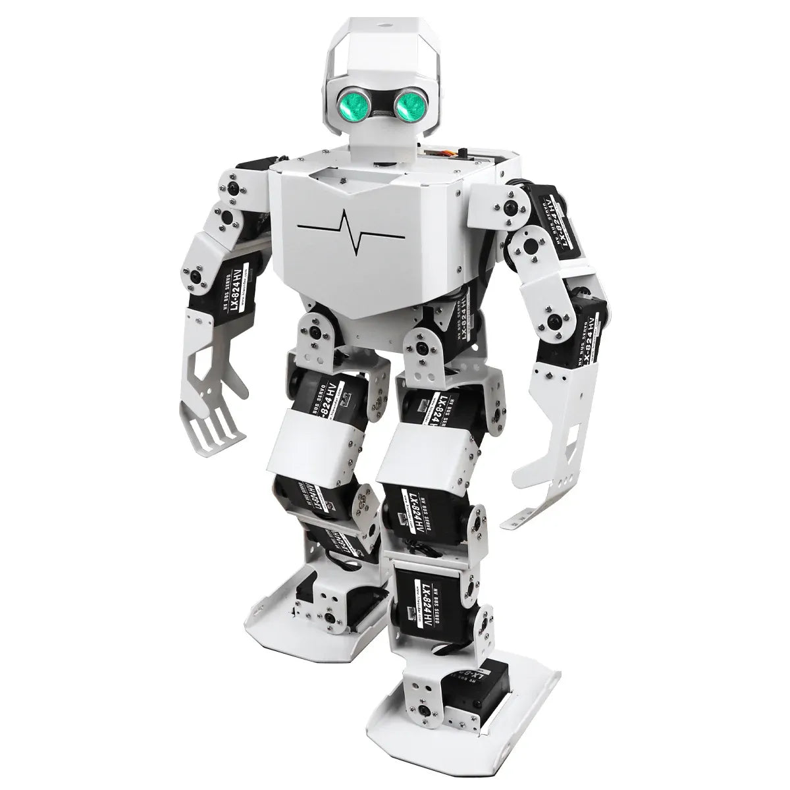

# Hiwonder Tonybot Guide


[**View Hiwonder Tonybot 17DOF Humanoid Robot Kit for Arduino, Scratch & Python on OpenELAB**](https://openelab.io/products/hiwonder-tonybot-humanoid-robot-ai)

**SKU:** `Hiwonder-21020007`, `Hiwonder-21020009`, `Hiwonder-21020123`

**Model / revision scope:** Tonybot. Match the purchased option below; hardware revisions and controller images are not interchangeable.


## Product overview

An ESP32 humanoid for action editing, sensing and optional vision/voice projects.

### Models and purchasing options

| OpenELAB SKU        | Purchased option |
| ------------------- | ---------------- |
| `Hiwonder-21020007` | standard kit     |
| `Hiwonder-21020009` | advanced kit     |
| `Hiwonder-21020123` | Ultimate kit     |

## Applications

Bench integration, education and development with the exact hardware listed above. Start with the first-result workflow before expanding the assembly or enabling autonomous operation.

## Specifications

| Parameter    | Value / scope                                                                |
| ------------ | ---------------------------------------------------------------------------- |
| Main control | ESP32 family; exact expansion board as supplied                              |
| Power        | 11.1 V, 2000 mAh, 10C battery                                                |
| Mechanism    | 17 DOF                                                                       |
| Software     | Factory control firmware; Arduino / Python / graphical lessons vary by model |

Specifications: [manufacturer product data](https://www.hiwonder.com/products/tonybot) and [OpenELAB listing](https://openelab.io/products/hiwonder-tonybot-humanoid-robot-ai). Figures describe the stated configuration; accessory-only options do not inherit the complete kit specifications.

## Hardware and connections

Inspect the numbered servo/motor cables while power is off and use the supplied power system. Arrange the legs in the documented initial resting posture on a clear level surface before startup. Do not overwrite the preloaded app firmware for the first test. Vision and voice functions require the modules named in the purchased kit.

## Software and development resources

The initial check uses the factory program. Use the model-specific Arduino, MicroPython or graphical-programming lessons only after it succeeds. Uploading an unrelated example can replace the app-control program; restore only from the exact model’s documented factory package.

## Getting started

**Prerequisites:** the selected hardware, its matching power source, the required data cable, and a clear work area. Begin with the supplied firmware and an unloaded mechanism.

1. Match the SKU, body, battery/adapter and optional modules to the order. Complete the model’s assembly before powering on.
2. Clear the motion envelope and power on with the supplied matching power system. Wait for the initial ready posture before touching any control.
3. Install **Wonderbot** from the official model resources. Enable Bluetooth and the permissions needed for nearby-device discovery.
4. Select **Tonybot** inside the app and tap its Bluetooth icon. Connect to **Tonybot** in the device list; do not pair using a phone-settings passkey.
5. Confirm the connection indicator is steady and the reported battery/supply status is plausible. Use the manual control screen for a small unloaded motion, then return to the initial pose.
6. Stop and power off before changing mechanical parts. Save a backup of custom programs before any later factory-firmware restoration.

**Expected result:** The correct device is paired inside the app, supply status is visible, and a small manual motion completes without stalling or loss of connection.

Procedure reference: [official model or interface manual](https://wiki.hiwonder.com/projects/Tonybot/en/latest/docs/2.app_control.html). The steps above are a bounded initial check, not a substitute for the full assembly and development chapters.

## Troubleshooting and FAQs

**Bluetooth device missing:** power-cycle once, enable nearby-device/location permissions, close another connected phone and search inside the app.

**App connected but controls fail after programming:** a custom program may have replaced the factory app service. Back up the current program and use the model’s documented restoration package.

**Joints strain at startup:** switch off, check assembly and cable numbering, and confirm the initial posture; do not force a powered servo.

**Vision/voice unavailable:** verify that the selected kit contains the required module and that its own firmware and connection match the robot.

## Downloads and technical documents

* [Official user / interface manual](https://wiki.hiwonder.com/projects/Tonybot/en/latest/docs/2.app_control.html)
* [Manufacturer Hiwonder Tonybot 17DOF Humanoid Robot Kit for Arduino, Scratch & Python specifications and option drawings](https://www.hiwonder.com/products/tonybot)

Use the manual’s download or appendix section for the matching revision. A linked download directory is not a claim that every firmware archive, CAD file or installer has been tested. Do not flash an image for a similarly named product.

## References and validation

* [OpenELAB product and SKU options](https://openelab.io/products/hiwonder-tonybot-humanoid-robot-ai).
* [Official user / interface manual](https://wiki.hiwonder.com/projects/Tonybot/en/latest/docs/2.app_control.html)
* [Manufacturer Hiwonder Tonybot 17DOF Humanoid Robot Kit for Arduino, Scratch & Python specifications and option drawings](https://www.hiwonder.com/products/tonybot)

Reviewed against the linked sources on 19 November 2026. Software installation, compilation and physical hardware tests were not performed for this guide. Use the observable checkpoints above to verify your own unit before integrating it into a larger system.
