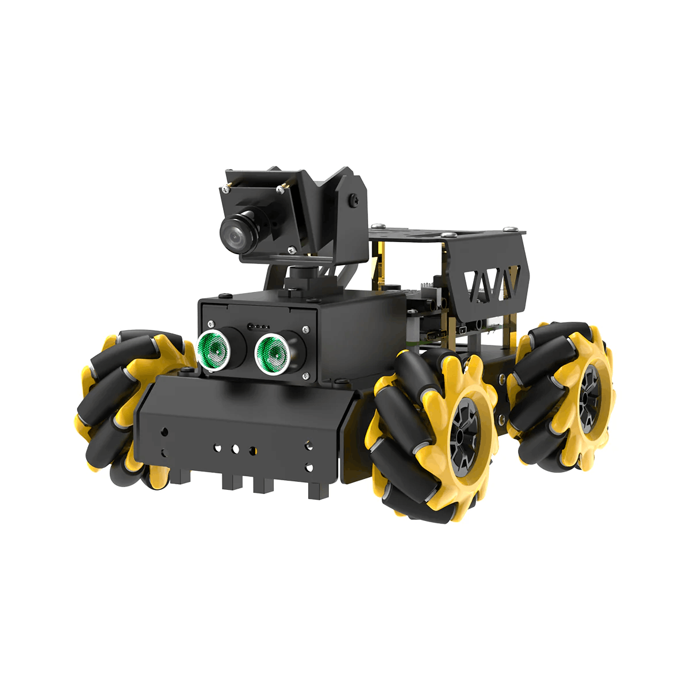

# Hiwonder TurboPi Guide


[**View Hiwonder TurboPi Raspberry Pi Robot Car - Mecanum, Vision & ROS2 Kits on OpenELAB**](https://openelab.io/products/hiwonder-turbopi-ros2-ai-car)

**SKU:** `Hiwonder-21030533`, `Hiwonder-21030534`, `Hiwonder-21030259`, `Hiwonder-21031925`, `Hiwonder-21030489`, `Hiwonder-21030536`, `Hiwonder-21030467`, `Hiwonder-21031926`, `Hiwonder-21030538`, `Hiwonder-21030539`, `Hiwonder-21030540`, `Hiwonder-21032055`, `Hiwonder-21032056`, `Hiwonder-21032057`, `Hiwonder-21032058`, `Hiwonder-21032059`

**Model / revision scope:** TurboPi. Match the purchased option below; hardware revisions and controller images are not interchangeable.


## Product overview

A Raspberry Pi Mecanum car for camera perception, line following and model-specific ROS2/AI extensions.

The Standard documentation uses /home/pi/TurboPi; the Advanced ROS2 documentation describes an Ubuntu container and different tools. These environments are distinct. Do not run Standard paths or write a Pi 4 image onto a Pi 5 configuration.

### Models and purchasing options

| OpenELAB SKU        | Purchased option                        |
| ------------------- | --------------------------------------- |
| `Hiwonder-21030533` | Standard Kit / Without Raspberry Pi 4B  |
| `Hiwonder-21030534` | Standard Kit / With Raspberry Pi 4B 4GB |
| `Hiwonder-21030259` | Standard Kit / Without Raspberry Pi 5   |
| `Hiwonder-21031925` | Standard Kit / With Raspberry Pi 5 2GB  |
| `Hiwonder-21030489` | Standard Kit / With Raspberry Pi 5 4GB  |
| `Hiwonder-21030536` | Standard Kit / With Raspberry Pi 5 8GB  |
| `Hiwonder-21030467` | Advanced Kit / Without Raspberry Pi 5   |
| `Hiwonder-21031926` | Advanced Kit / With Raspberry Pi 5 2GB  |
| `Hiwonder-21030538` | Advanced Kit / With Raspberry Pi 5 4GB  |
| `Hiwonder-21030539` | Advanced Kit / With Raspberry Pi 5 8GB  |
| `Hiwonder-21030540` | Advanced Kit / With Raspberry Pi 5 16GB |
| `Hiwonder-21032055` | Ultimate Kit / Without Raspberry Pi 5   |
| `Hiwonder-21032056` | Ultimate Kit / With Raspberry Pi 5 2GB  |
| `Hiwonder-21032057` | Ultimate Kit / With Raspberry Pi 5 4GB  |
| `Hiwonder-21032058` | Ultimate Kit / With Raspberry Pi 5 8GB  |
| `Hiwonder-21032059` | Ultimate Kit / With Raspberry Pi 5 16GB |

A separately named bracket, horn, chassis or rail is the listed accessory, not a complete robot or servo. A “without controller / Raspberry Pi / Jetson / micro:bit” option requires the matching controller separately. Check the selected option’s packing list before starting.

## Applications

Use TurboPi to learn manual motion, perception and staged automation. Start with an unloaded mechanism and the sensors actually included in the selected kit.

## Specifications

| Parameter  | Value / scope                                         |
| ---------- | ----------------------------------------------------- |
| Controller | Raspberry Pi 4/5 options; use the matching image      |
| Drive      | Mecanum wheels                                        |
| Power      | Supplied pair of 18650 cells; capacity differs by kit |
| Arm/camera | Two-axis camera on TurboPi; arm on MasterPi           |

Specifications: [manufacturer product data](https://www.hiwonder.com/products/turbopi) and [OpenELAB listing](https://openelab.io/products/hiwonder-turbopi-ros2-ai-car). Figures describe the stated configuration; accessory-only options do not inherit the complete kit specifications.

## Hardware and connections

Connect the supplied battery or adapter to the **robot’s designated power/expansion board**, not directly to a computer GPIO or an unverified charging socket. Inspect the camera, motor/servo and controller cables while power is off. Place the mobile base on a clear level floor, away from edges, and remove objects from any gripper.

Match the controller, camera, LiDAR and chassis configuration to the SKU. Optional voice/AI modules require their own cables and software. A USB camera, depth camera and CSI ribbon camera are not interchangeable interfaces.

## Software and development resources

Start with the factory image for **TurboPi and the exact controller option**. WonderPi is the documented initial control application. Use the official model downloads for restoration; a generic Raspberry Pi OS or JetPack installation does not include the robot services, calibrated offsets and device configuration.

For development, preserve a backup of the supplied image and calibration files before replacing software. Select the manual branch for the installed board and ROS generation. A menu or directory for a different product is not a compatible firmware target.

## Getting started

**Prerequisites:** the selected hardware, its matching power source, the required data cable, and a clear work area. Begin with the supplied firmware and an unloaded mechanism.

1. Match the SKU table to the physical controller and kit. For a controller-excluded option, install the supported board and its exact robot image before attempting the remaining steps.
2. Place the mobile base on a clear level floor, away from edges, and remove objects from any gripper. Inspect polarity and cable seating, then power the robot with the supplied matching power system.
3. Allow the onboard computer to finish booting and reach its documented ready posture/indicator state. Keep the mechanism clear because initialization may move servos.
4. Connect the computer to the robot’s HW… hotspot on the factory image, using the documented password hiwonder.
5. Open VNC Viewer and connect to **192.168.149.1** in AP mode. For the documented standard image, enter user **pi** and password **raspberrypi**; use the supplied image credentials if they differ.
6. Confirm the robot desktop loads. Open the model’s servo/camera control application from that desktop and verify a live image before enabling motion.
7. Use the system shutdown command/menu, wait for shutdown, then switch off the expansion board.

**Expected result:** The model-specific Raspberry Pi desktop is accessible over VNC and its camera preview responds. This isolates power, image and network setup before driving or arm motion.

Procedure reference: [official model or interface manual](https://wiki.hiwonder.com/projects/TurboPi/en/standard/docs/1.getting_ready.html). The steps above are a bounded initial check, not a substitute for the full assembly and development chapters.

## Troubleshooting and FAQs

**No hotspot:** wait for the full boot sequence, verify the battery/adapter and image/controller match, then check whether the robot was previously configured for LAN mode.

**Phone joins Wi-Fi but the app sees nothing:** remain on the robot network despite the no-Internet warning, grant local-network discovery permissions, select the correct model and refresh. The factory password may have been changed on a used unit.

**Camera works but motion is wrong:** stop immediately and verify the chassis type, motor/servo connections and model configuration. Do not compensate with unrelated servo offsets.

**Vision, mapping or voice option is unavailable:** check the selected kit’s actual camera, LiDAR and AI/voice modules. Offline local control does not establish that a cloud AI service is configured.

**Restoring firmware:** use the exact model/controller resource package and retain calibration files; do not write an image for a similarly named Pro or legacy version.

## Downloads and technical documents

* [Official user / interface manual](https://wiki.hiwonder.com/projects/TurboPi/en/standard/docs/1.getting_ready.html)
* [Official software, image and course downloads](https://wiki.hiwonder.com/projects/TurboPi/en/advanced/docs/Appendix.html)
* [Manufacturer Hiwonder TurboPi Raspberry Pi Robot Car - Mecanum, Vision & ROS2 Kits specifications and option drawings](https://www.hiwonder.com/products/turbopi)

Use the manual’s download or appendix section for the matching revision. A linked download directory is not a claim that every firmware archive, CAD file or installer has been tested. Do not flash an image for a similarly named product.

## References and validation

* [OpenELAB product and SKU options](https://openelab.io/products/hiwonder-turbopi-ros2-ai-car).
* [Official user / interface manual](https://wiki.hiwonder.com/projects/TurboPi/en/standard/docs/1.getting_ready.html)
* [Official software, image and course downloads](https://wiki.hiwonder.com/projects/TurboPi/en/advanced/docs/Appendix.html)
* [Manufacturer Hiwonder TurboPi Raspberry Pi Robot Car - Mecanum, Vision & ROS2 Kits specifications and option drawings](https://www.hiwonder.com/products/turbopi)

Reviewed against the linked sources on 19 November 2026. Software installation, compilation and physical hardware tests were not performed for this guide. Use the observable checkpoints above to verify your own unit before integrating it into a larger system.
