# Linker Hand L20 Lite Product Manual


[**View LINKERBOT L20 Lite on OpenELAB**](https://openelab.io/products/linker-hand-linkerbot-l20-lite)

**Model:** L20 Lite · **SKU:** `Linker-Hand-L20-Lite-1 (left, RS485; confirm chosen side/bus)` · **Manual:** V1.0 (2025-09-11)


[LINKERBOT family index](linkerbot-dexterous-hands-developer-guide/) · **Complete manufacturer manual and diagrams below**

### Product overview

**L20 Lite** has **10 controlled; 20 total (10 active, 10 passive)**. Its supplied manufacturer product manual is revision **V1.0 (2025-09-11)**. This page describes the exact model; any other Linkerbot hand with a similar number may have a different joint array, mounting flange, sensor option, adapter voltage or bus protocol. **Identity:** Linker-Hand-L20-Lite-1 (left, RS485; confirm chosen side/bus).

### Applications

* Model-specific end-effector integration into research manipulators and humanoid platforms.
* Safe device identification, position/state logging, and supervised dexterous control research.
* Tactile and closed-loop grasp studies **only when installed sensors and controls are verified**.

### Specifications

| Parameter                                  | Source-backed value                                                                                                                    |
| ------------------------------------------ | -------------------------------------------------------------------------------------------------------------------------------------- |
| Controlled DoF and physical joints         | 10 controlled; 20 total (10 active, 10 passive)                                                                                        |
| Power                                      | **24 VDC ±10%**                                                                                                                        |
| Bus / variant                              | CAN/RS485; actual store variant must match adapter                                                                                     |
| Manufacturer-reported mass                 | 800 g                                                                                                                                  |
| Manufacturer maximum load                  | 25 kg per OEM manual vs 5 kg listed in storefront (discrepancy)                                                                        |
| Manufacturer-reported opening/closing time | 1.2 s                                                                                                                                  |
| Tactile/sensing                            | Fingertip piezoresistive 6×12 array at 200 fps; optional ≥50 Hz capacitive sensor and optional visual-tactile module are NOT standard. |
| Manual revision                            | V1.0 (2025-09-11)                                                                                                                      |

**Evidence:** exact attached product manual and corresponding connected product catalog where available. These are device-level figures, not automatically rated full-arm payload or production contact performance.

### Hardware and connections

1. Inspect the model, serial, left/right label and selected store interface; do not rely only on a family nickname.
2. Confirm the supplied adapter, supported cable, correct keyed connector and the mounting drawing **before** connecting DC power.
3. Use a stable fixture, keep fingers and cables away from moving linkages and make the operator's stop/disconnect method accessible.

#### Model-specific mechanical mounting

M3 flange screws, length determined from mounting-thickness and **L20 Lite V1.0 page 13** drawing.

#### Electrical bus and connector

XT30 (2+2) **on the documented CAN connection**: pin 1 CAN L, 2 CAN H, 3 GND, 4 +24 V. Confirm keyed orientation and purchased RS485 versus CAN adapter. Do not transfer this pin table to other hand models.

**Manufacturer-model note:** The storefront title calls this a '20-DOF' hand, but the manual defines **10 active plus 10 passive joints**, and the modern ROS 2 driver exposes **10 controllable axes**. Do not send a 20-element motor vector.

### Software and development resources

| Resource                                                                                                                              | Verified purpose                                                                        |
| ------------------------------------------------------------------------------------------------------------------------------------- | --------------------------------------------------------------------------------------- |
| [Current seven-model Linkerbot ROS 2 driver](https://github.com/linker-bot/linkerbot-hand-ros2-sdk)                                   | ROS 2 Humble/Jazzy driver and read-only state topics; **native CAN/CAN FD** model entry |
| [ROS 2 model compatibility matrix](https://github.com/linker-bot/linkerbot-hand-ros2-sdk/blob/main/linkerbot_hand_ros/docs/models.md) | Confirms active joint count, bus and per-model capability differences                   |
| [LinkerHand Python SDK](https://github.com/linker-bot/linkerhand-python-sdk)                                                          | Firmware/adapter-specific Python examples; verify variant and driver before using       |
| [Preserved L20 Lite OEM manual in OpenELAB Wiki](linker-hand-l20-lite-product-manual.md)                                              | Exact manual hardware, mechanical dimensions, connector and installation source         |

**Version constraint:** a current GitHub model entry does not certify a purchased RS485 variant for a CAN-only launch. Check model/device capabilities, firmware and the installed transport. Never run sample code that writes angles or torque as the first device check.

### Getting started

#### Prerequisites

Physical hand and variant labeling; correct original or manufacturer-approved adapter; matching CAN/CAN FD/RS485 interface; secure fixture; model manual. For first read-only software use, a compatible Windows host utility or ROS 2 environment must be available as appropriate.

#### First working result

1. Following the OEM Windows CAN commissioning section, install the compatible **PEAK USB-to-CAN driver** if Windows, adjust `can_bridge_dashboard/config.toml` `can_interface` to the actual interface(s) (example `['can1']`), launch the supplied `can_bridge.exe`, then the matching `dashboard.exe` and open `http://localhost:9090`. Select the actual hand model, side and port; inspect **online/offline status without touching global control, sliders or preset actions**.
2. Record current model, side, revision, bus, installed host utility/SDK commit and relevant status values. Do **not** command finger positions, resets, gains or torque until identity and safety are confirmed.

**Expected result:** A reachable local dashboard showing the selected device's online status, port and model, without motion.

**If the check fails:** If the dashboard is inaccessible, check CAN bridge process/log (`can_bridge.log`), PEAK driver and interface names. On Windows the manual says restart the CAN bridge after device plug/unplug.

#### Next safe experiment

With device and software explicitly approved, log a sequence of **read-only** state observations and compare expected joint count/units, metadata validity and sample freshness. Motion/grasping is a separate supervised step after confirming range, direction, force and stop behavior.

### Troubleshooting and FAQs

**A device appears but the reported joint count differs.** Confirm the exact model, model discovery, loaded SDK feature definition and **active DoF versus passive mechanical joints**. Do not pad/trim a control vector to guess joint mapping.

**The device does not connect or respond.** If the dashboard is inaccessible, check CAN bridge process/log (`can_bridge.log`), PEAK driver and interface names. On Windows the manual says restart the CAN bridge after device plug/unplug.

**Can I use another Linkerbot model's power cable or protocol?** No. This model's documented electrical interface is **CAN/RS485; actual store variant must match adapter**; use its own labeled cable, supply and OEM connector drawing.

**Can I assume tactile data is present?** Fingertip piezoresistive 6×12 array at 200 fps; optional ≥50 Hz capacitive sensor and optional visual-tactile module are NOT standard. Validate sensor options and returned data before relying on tactile feedback.

### Downloads and technical documents

| Resource                        | Scope and link                                                                                                                               |
| ------------------------------- | -------------------------------------------------------------------------------------------------------------------------------------------- |
| Original product manual         | [Preserved L20 Lite OEM manual in OpenELAB Wiki](linker-hand-l20-lite-product-manual.md)                                                     |
| Manufacturer ROS 2 model matrix | [Model definitions and control semantics](https://github.com/linker-bot/linkerbot-hand-ros2-sdk/blob/main/linkerbot_hand_ros/docs/models.md) |
| Manufacturer current ROS 2 SDK  | [Installation and examples](https://github.com/linker-bot/linkerbot-hand-ros2-sdk)                                                           |
| Manufacturer Python SDK         | [Source and model examples](https://github.com/linker-bot/linkerhand-python-sdk)                                                             |
| OpenELAB product/SKU            | [Matched model and selectable variants](https://openelab.io/products/linker-hand-linkerbot-l20-lite)                                         |

**Physical drawings:** preserve the flange/connector images in the existing manual; do not recreate dimensioned pinout diagrams from photos.

### References and validation

* LINKERBOT / Lingxin Qiaoshou, _L20 Lite Product Manual_, **V1.0 (2025-09-11)**, provided upload, reviewed 2026-11-21.
* [Current official Linkerbot ROS 2 model matrix](https://github.com/linker-bot/linkerbot-hand-ros2-sdk/blob/main/linkerbot_hand_ros/docs/models.md), reviewed 2026-11-21.
* [OpenELAB exact model listing](https://openelab.io/products/linker-hand-linkerbot-l20-lite), matched to catalog variant on 2026-11-21.

**Documentation review:** completed for provided revision; **software execution:** not run; **hardware test:** not run. Check the actual shipped interface and firmware before any actuator operation.

### Original LINKERBOT L20 Lite Manufacturer Manual and Diagrams

This section preserves the original LINKERBOT manufacturer manual text, technical tables, images and installation illustrations from the established product page.

#### LINKERBOT Linker Hand L20 Lite 20-DOF Dexterous Robotic



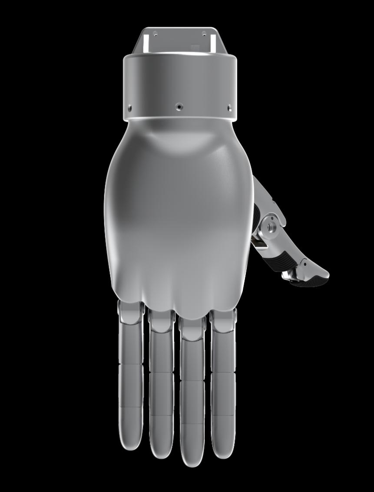

#### Revision History

| Version | Date       | Description                                              |
| ------- | ---------- | -------------------------------------------------------- |
| V1.0    | 2025-09-11 | First edition of the Linker Hand L20 Lite Product Manual |

#### Safety Instructions

Read this manual and all related manuals before installing or using the product. Observe the following precautions:

1. Use only the matching or specified cables, and secure the product as instructed. Do not use damaged power cords, damaged plugs, or loose sockets.
2. Follow the installation requirements in this manual. Operation outside the specified installation conditions may shorten the service life and create serious safety hazards.
3. Extended high-power operation may increase the product temperature. If the temperature becomes excessive, stop operation and allow the product to cool before resuming use.
4. Only trained personnel may operate the equipment. Do not open the housing, disassemble the device, or attempt unauthorized repairs. Contact after-sales support if the equipment malfunctions.
5. Diagrams and photographs are illustrative and may differ from the purchased product. The manual may be revised as the product and its specifications are updated.

#### Product Overview

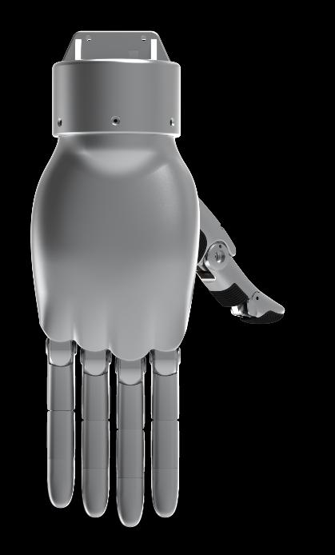

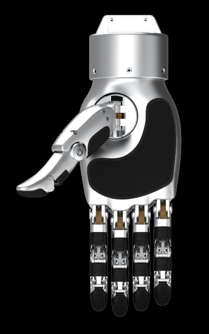

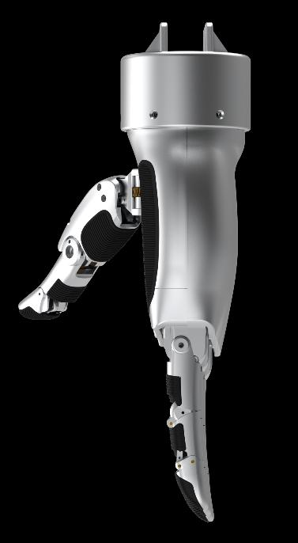

The Linker Hand L20 Lite is a high-precision bionic robotic hand developed by Lingxin Qiaoshou. It combines self-developed joint motor modules with a worm-gear transmission system and provides 10 active degrees of freedom across 20 joints: 10 active joints and 10 passive joints. The design emphasizes load capacity, precise control, compact construction, and efficient transmission.

**High Load Capacity**

The five-finger grip force is specified at up to 80 N, while the maximum fingertip force is 15 N for the thumb and each of the four fingers. The worm-gear transmission provides substantial output torque and self-locking capability, helping the hand remain stable under load. This supports tasks ranging from precision assembly to light industrial handling.

**Precise Control**

Repeatability is specified as better than ±0.2 mm. CAN and RS485 industrial bus interfaces support communication rates up to 800 Hz. Combined with force-position hybrid control, the hand can perform delicate grasping and flexible gripping for research and industrial applications.

**Compact, Efficient Transmission**

The worm-gear transmission provides a compact structure, high transmission ratio, self-locking capability, and smooth operation. The 800 g hand combines 10 actuated joints with 10 passive joints for complex motion and adaptive grasping.

#### Product Functions

**Position Control**

Position control manages the overall hand position and individual finger joints so that preset trajectories can be executed smoothly. This supports both whole-hand movement and fine joint adjustment for precision assembly and path-guided operation.

**Speed Control**

Finger speed can be adjusted for different tasks. High-speed operation improves efficiency, while low-speed operation supports safer precision work.

**Tactile Feedback and Force Control**

Fingertip sensors detect the force and torque applied by the fingers in real time. The controller can adjust output force to protect fragile objects and reduce the risk of slipping.

**Online Firmware Upgrade**

The dexterous-hand firmware can be updated from the host computer, allowing functional updates and performance optimization over the service life of the product.

#### Dimensions, Joints, and Motion Range

**External Dimensions**

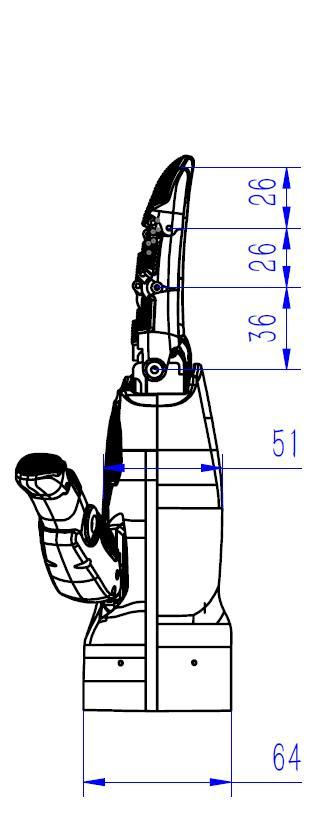

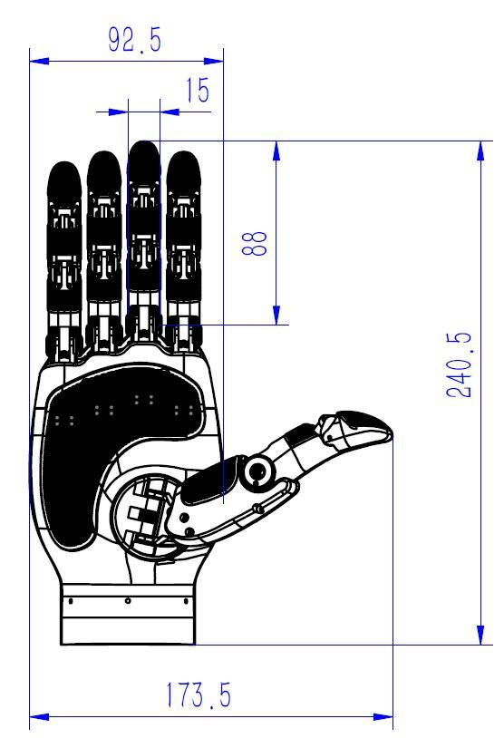

All dimensions in the drawings are in millimetres.

**Degrees of Freedom**

The L20 Lite has 10 active degrees of freedom and 20 joints in total: 10 active joints and 10 passive joints.

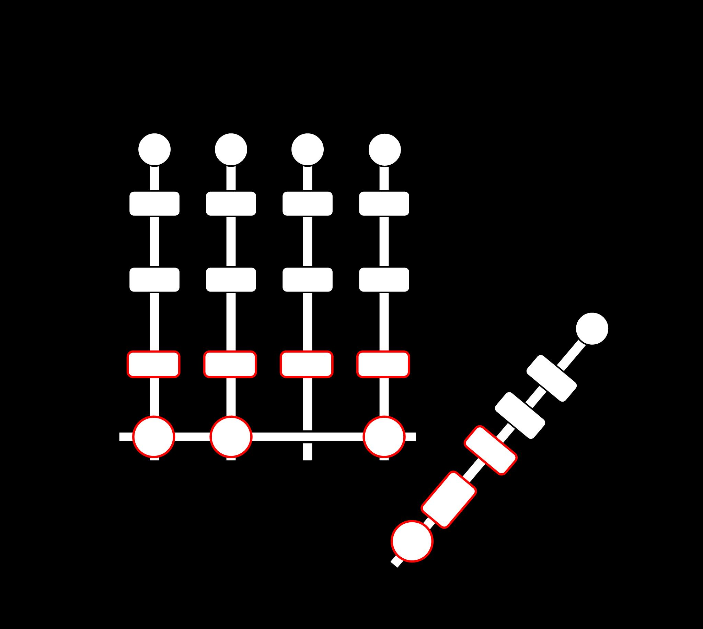

The following diagrams show the maximum mechanical ranges. The controller may apply a smaller range to prevent structural impact.

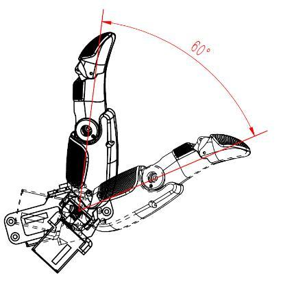

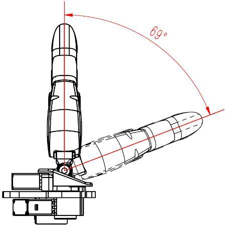

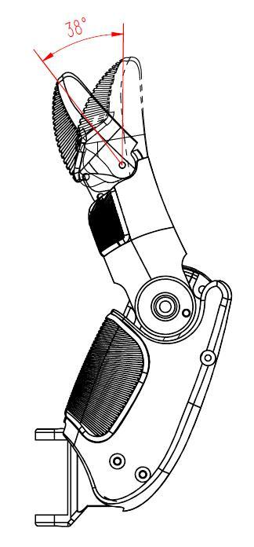

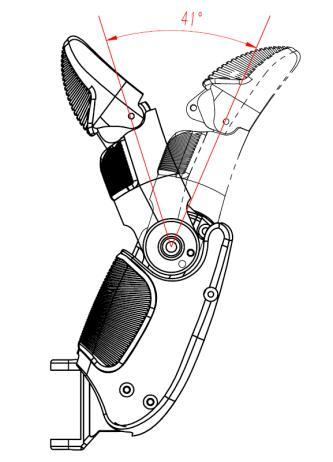

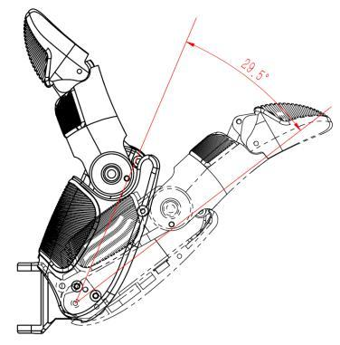

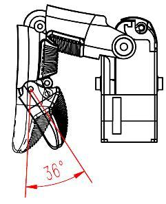

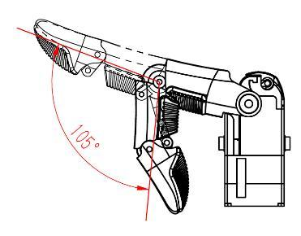

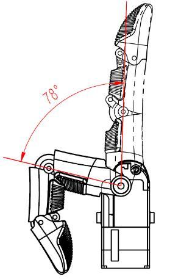

**Controlled Motion Range and Speed**

| Joint                       | Maximum motion range | Maximum speed |
| --------------------------- | -------------------: | ------------: |
| THUMB1 (bend)               |                37.9° |      63.11°/s |
| THUMB2 (bend)               |                38.4° |      52.62°/s |
| THUMB3 (bend)               |                27.9° |      42.78°/s |
| THUMB4 (lateral swing)      |                  69° |      63.21°/s |
| THUMB5 (rotation)           |                  60° |       50.9°/s |
| LF1, RF1, MF1, FF1 (bend)   |                35.8° |      29.11°/s |
| LF2, RF2, MF2, FF2 (bend)   |                 102° |      82.93°/s |
| LF3, RF3, MF3, FF3 (bend)   |                77.9° |      63.33°/s |
| FF4 (toward the thumb)      |                10.7° |      84.62°/s |
| RF4 lateral swing toward LF |                11.7° |      44.17°/s |
| LF4 lateral swing           |                17.2° |      64.93°/s |

#### Technical Specifications

**Basic Parameters**

| Parameter                     | Specification               |
| ----------------------------- | --------------------------- |
| Model                         | Linker Hand L20 Lite        |
| Active degrees of freedom     | 10                          |
| Joint count                   | 20 (10 active + 10 passive) |
| Drive                         | Linkage transmission        |
| Control interfaces            | CAN / RS485                 |
| Weight                        | 800 g                       |
| Maximum load                  | 25 kg                       |
| Working voltage               | 24 V DC ±10%                |
| Quiescent current             | 0.2 A                       |
| Average no-load motor current | 0.5 A                       |
| Maximum current               | 3 A                         |
| Repeatability                 | Better than ±0.2 mm         |
| Opening and closing time      | 1.2 s                       |

**Mechanical Performance**

| Performance item                                    | Specification |
| --------------------------------------------------- | ------------: |
| Maximum thumb-fingertip force                       |          15 N |
| Maximum fingertip force of each of the four fingers |          15 N |
| Maximum five-finger gripping force                  |          80 N |

#### Sensor System

The fingertip sensor can detect the presence and distance of objects. After contact, it can capture three-dimensional force and identify surface texture and temperature changes.

**Piezoresistive Sensor**

| Parameter                | Specification  |
| ------------------------ | -------------- |
| Piezoresistive array     | 6 × 12         |
| Force-sensitive area     | 9.6 × 14.4 mm  |
| Touch-force threshold    | 5 g            |
| Measurement range        | 20 N           |
| Service life             | 100,000 cycles |
| Communication frame rate | 200 FPS        |

**Capacitive Sensor (Optional)**

| Parameter              | Specification                     |
| ---------------------- | --------------------------------- |
| Sampling frequency     | ≥50 Hz                            |
| Measurement range      | 0-30 N                            |
| Overload limit         | 60 N                              |
| Pressure sensitivity   | 0.1 N                             |
| Measurement resolution | 0.5% FS                           |
| Measurement accuracy   | 2% FS                             |
| Pressure resolution    | 0.25 N                            |
| Directional resolution | 45°                               |
| Detection range        | 1 cm for metal and the human body |

**Visual-Tactile Perception (Optional)**

Visual-tactile perception combines optical sensing with a deep-learning model. High-precision cameras observe deformation in a compliant material when force is applied. A miniature stereo-camera system records the changing surface mesh in real time, and a pre-trained model maps the object's depth information and motion trend.

#### Installation and Commissioning

**Accessory List**

Confirm that all accessories are present before installation.

| No. | Item                       | Quantity |
| --: | -------------------------- | -------: |
|   1 | USB-to-CAN debugging cable |        1 |
|   2 | Power adapter              |        1 |
|   3 | Power cable                |        1 |

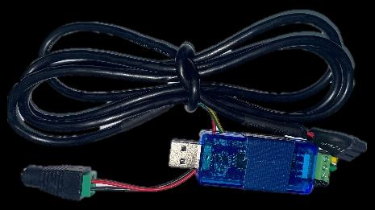

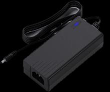

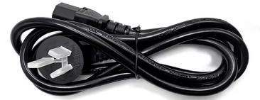

**Mechanical Installation**

Use M3 screws. Select the screw length according to the thickness of the mounting component.

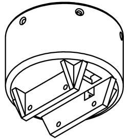

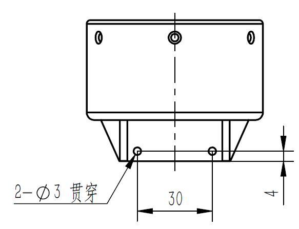

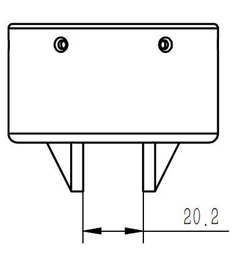

**Electrical Connection**

The hand uses an XT30 (2+2) connector.

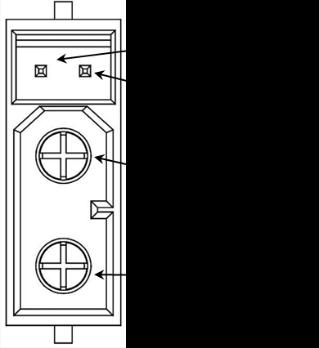

| Pin | Signal |
| --: | ------ |
|   1 | CAN L  |
|   2 | CAN H  |
|   3 | GND    |
|   4 | 24 V   |

#### Software Debugging

**Connect the Debugging Cable**

1. Connect the dexterous hand to the debugging computer with the USB-to-CAN cable.
2. Connect the power cable to the power adapter.
3. Connect the adapter to the power input of the USB-to-CAN cable.
4. Connect the other end of the power cable to a 220 V AC outlet.

**Install the USB-to-CAN Driver**

Open `PEAK-System_Driver-Setup` and follow the installer. Windows requires the driver; Linux does not. After the initial Windows installation, it does not need to be installed again.

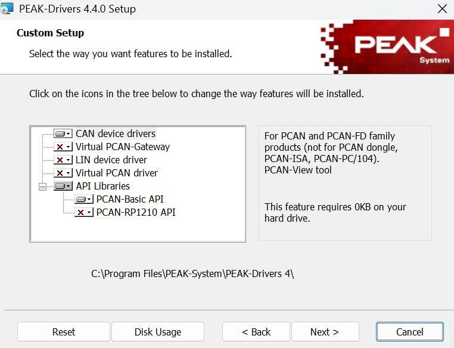

**Configure the Host-Computer Software**

Before starting the software on Windows, configure the number of connected CAN devices:

1. Open the `can_bridge_dashboard` folder.
2. Open `config.toml`.
3. Edit the `can_interface` field. For one device, use `can_interface = ["can1"]`. For two devices, use `can_interface = ["can1", "can2"]`.
4. Save the file.

**Start CAN Bridge**

Run `can_bridge.exe`. When the service starts normally, the console displays its operating address.

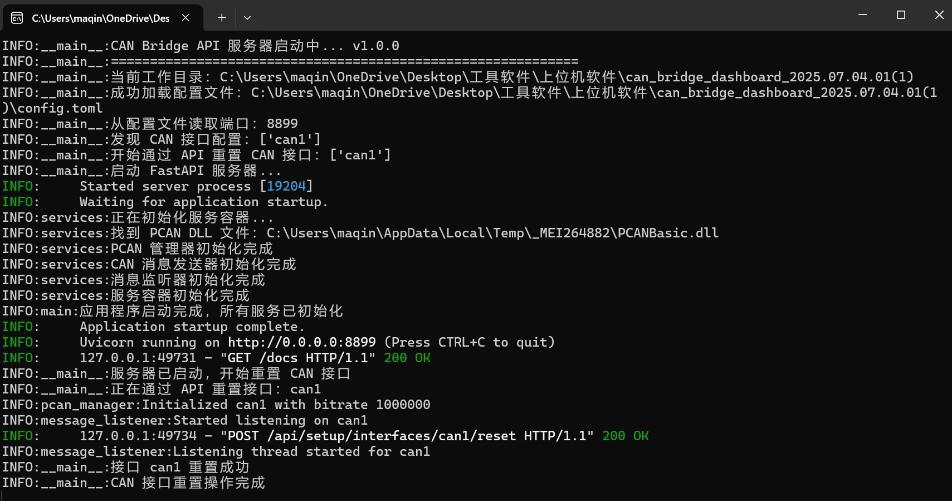

If a runtime error occurs, the program writes the exception to `can_bridge.log`. Provide this log to after-sales support when requesting assistance. On Windows, stop and restart CAN Bridge whenever a CAN device is connected or disconnected.

**Start Dashboard**

Run the `dashboard.exe` file for the appropriate hand model and wait for startup to finish.

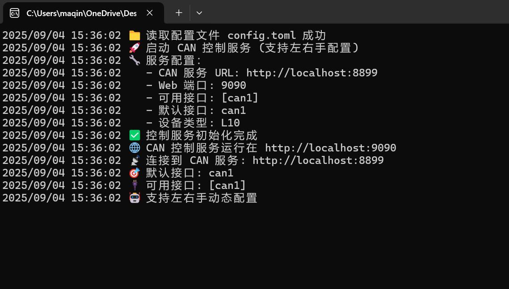

Open [http://localhost:9090](http://localhost:9090) in a web browser to access the control interface.

**Host-Computer Software Functions**

The Linker Hand L20 Lite host-computer software provides hand configuration, global control, joint control, predefined actions, and status monitoring.

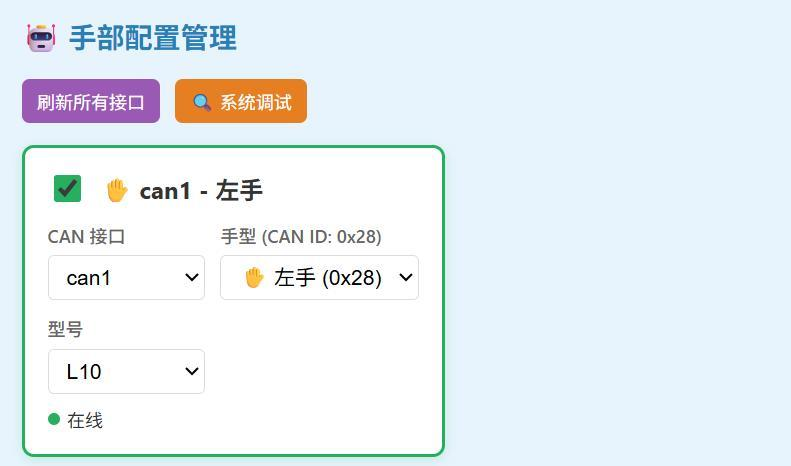

* **Hand configuration:** Select the port, hand type, and model. The interface shows whether the dexterous hand is online or offline.
* **Global control:** Send all joint poses, all palm poses, and all joint velocities; reset all hand configurations; or stop all animations.
* **Joint control:** Control joint position, palm motion, global speed, and global torque.

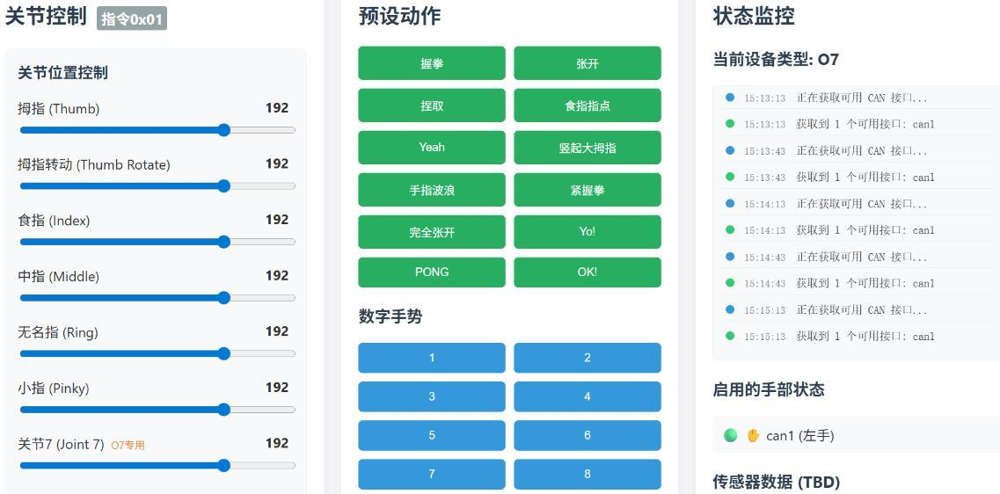

* **Predefined actions:** Configure actions such as fist, open hand, grasp, and number gestures, and create or control animations.
* **Status monitoring:** View real-time device logs, hand status, and sensor data.

#### Warranty and Service

1. The product is covered by a 12-month limited warranty from the date of purchase.
2. During the warranty period, failures caused by manufacturing or material defects are eligible for free repair or component replacement.
3. The warranty does not cover surface wear caused by normal use or damage caused by improper operation, accidents, unauthorized disassembly, or failure to follow the manual.
4. Returns or exchanges are not accepted when the issue is not a product-quality problem.
5. If the product malfunctions, contact official after-sales support. Do not disassemble the product yourself.
6. Repair services outside the warranty period are chargeable.

#### SDK and Technical Support

* ROS SDK: [linkerhand-ros-sdk](https://github.com/linker-bot/linkerhand-ros-sdk)
* ROS 2 SDK: [linkerhand-ros2-sdk](https://github.com/linker-bot/linkerhand-ros2-sdk)
* Python SDK: [linkerhand-python-sdk](https://github.com/linker-bot/linkerhand-python-sdk)
* Technical support: [support@linkerbot.cn](mailto:support@linkerbot.cn)
* Official website: [linkerbot.cn](https://linkerbot.cn)
