# Linker Hand L20 Product Manual


[**View LINKERBOT L20 on OpenELAB**](https://openelab.io/products/linker-hand-linkerbot-l20-21)

**Model:** L20 · **SKU:** `Linker-Hand-L20-1 (left, RS485; confirm variant)` · **Manual:** V1.3 (2026-08-04; filename says V10)


[**Complete supplied L20 manual — 14 PDF pages and downloads**](source-library/complete-l20.md) · [All seven complete manuals](source-library/)

[LINKERBOT family index](linkerbot-dexterous-hands-developer-guide/) · **Complete manufacturer manual and diagrams below**

## Product overview

**L20** has **16 controlled; 21 total (16 active, 5 passive)**. Its supplied manufacturer product manual is revision **V1.3 (2026-08-04; filename says V10)**. This page describes the exact model; any other Linkerbot hand with a similar number may have a different joint array, mounting flange, sensor option, adapter voltage or bus protocol. **Identity:** Linker-Hand-L20-1 (left, RS485; confirm variant).

## Applications

* Model-specific end-effector integration into research manipulators and humanoid platforms.
* Safe device identification, position/state logging, and supervised dexterous control research.
* Tactile and closed-loop grasp studies **only when installed sensors and controls are verified**.

## Specifications

| Parameter                                  | Source-backed value                                                                                                                 |
| ------------------------------------------ | ----------------------------------------------------------------------------------------------------------------------------------- |
| Controlled DoF and physical joints         | 16 controlled; 21 total (16 active, 5 passive)                                                                                      |
| Power                                      | **Manual table 24–48 VDC, while XT30 connector drawing labels +24 V; use the exact supplied adapter pending voltage confirmation.** |
| Bus / variant                              | CAN/RS485 variant                                                                                                                   |
| Manufacturer-reported mass                 | ≈1200 g                                                                                                                             |
| Manufacturer maximum load                  | 20 kg maximum load in OEM PDF vs 10 kg store listing (discrepancy)                                                                  |
| Manufacturer-reported opening/closing time | 0.98 s                                                                                                                              |
| Tactile/sensing                            | Piezoresistive array 6×12, 20 N range, 200 fps per OEM manual. Communication frequency 500 Hz is distinct.                          |
| Manual revision                            | V1.3 (2026-08-04; filename says V10)                                                                                                |

**Evidence:** exact attached product manual and corresponding connected product catalog where available. These are device-level figures, not automatically rated full-arm payload or production contact performance.

## Complete supplied-manual reference

The following details supplement the original guide using **V1.3 · 2026-08-04**. Every supplied page, including diagrams, revision history, controls and service clauses, is available in the [Complete supplied L20 manual — 14 PDF pages and downloads](source-library/complete-l20.md).

### Detailed electrical, mechanical and sensor parameters

| Parameter                      | Manufacturer source entry                                                                               |
| ------------------------------ | ------------------------------------------------------------------------------------------------------- |
| DC input and connector marking | Parameter table 24–48 V DC; CAN connector table labels power pin 24 V                                   |
| Current                        | 0.3 A quiescent; 0.4 A no-load motor average; 1.8 A maximum                                             |
| Communication and motion       | CAN / RS485 by ordered variant; 500 Hz reported communication frequency; 16 active and 5 passive joints |
| Mass, repeatability and load   | Approximately 1200 g; ±0.2 mm; table maximum load 20 kg                                                 |
| Closing time                   | 0.98 s in the parameter table; 0.9 s in the overview                                                    |
| Mechanical force               | Thumb fingertip 15 N; other fingertips 20 N; each-finger maximum grip 100 N                             |
| Piezoresistive sensor          | 6×12; 9.6×14.4 mm; 5 g touch-force entry; 20 N range; 200 fps; 100,000 cycles                           |

Sources: [PDF page 10](source-library/complete-l20.md#pdf-page-10) and the chapter map below. Maximum-load, maximum-force and cycle entries are manufacturer figures; the manual does not establish that they can be reached simultaneously or safely in a complete robot.

### Joint ranges and source interpretation

| Joint / motion label          | Source angle range (degrees) | Source speed entry (°/s unless noted) |
| ----------------------------- | ---------------------------- | ------------------------------------- |
| thumb ip / mcp / cmc\_pitch   | 71 / 70 / 45                 | 133.96 / 132.08 / 80.36               |
| thumb cmc\_yaw / cmc\_roll    | 91 / 77.6                    | 185.71 / 129                          |
| finger dip / pip / mcp\_pitch | 78 / 99 / 70                 | 195 / 247.5 / 194.44                  |
| finger mcp\_roll              | ±13                          | 68.42                                 |

Source: [PDF page 9](source-library/complete-l20.md#pdf-page-9). Physical/passive joint labels are not an independent command-vector definition.

This is the **internally identified V1.3 manual**, despite “V10” in the supplied filename. V1.3 changes joint angles, so do not copy earlier limits into a controller. The broader 24–48 V parameter entry does not establish that the delivered 24 V-marked cable/adapter supports 48 V. Obtain the exact unit/adapter rating before a supply change. The 0.9 s/0.98 s closing-time difference is retained; neither is a safety timing guarantee. The overview describes brushless motors, ball screws and rigid linkages; the parameter table abbreviates this to linkage transmission.

### Mounting, supplied items and model-specific operation

The kit lists a USB-to-CAN debug cable, XT30 (2+2) cable, adapter and power line. Use M3 flange screws selected for fixture thickness; do not infer engagement depth from photographs. On the CAN cable the printed table is **1 CAN L, 2 CAN H, 3 GND, 4 24 V**, with orientation established by the drawing. This pin table does not describe the RS485 option. The supplied manual gives cable setup and SDK references, rather than the L20 Lite browser-dashboard procedure; obtain a matching model/firmware utility instead of reusing another hand’s executable.

### Complete chapter and drawing map

| Original PDF page                                         | Topic                                        |
| --------------------------------------------------------- | -------------------------------------------- |
| [PDF page 2](source-library/complete-l20.md#pdf-page-2)   | Revision history and V1.3 joint-angle change |
| [PDF page 3](source-library/complete-l20.md#pdf-page-3)   | Safety requirements                          |
| [PDF page 5](source-library/complete-l20.md#pdf-page-5)   | Drive architecture and rated load            |
| [PDF page 6](source-library/complete-l20.md#pdf-page-6)   | Control functions and upgrades               |
| [PDF page 7](source-library/complete-l20.md#pdf-page-7)   | Dimension drawing and joint count            |
| [PDF page 8](source-library/complete-l20.md#pdf-page-8)   | Joint topology and motion diagrams           |
| [PDF page 9](source-library/complete-l20.md#pdf-page-9)   | V1.3 angle/speed table                       |
| [PDF page 10](source-library/complete-l20.md#pdf-page-10) | Electrical, forces and sensor tables         |
| [PDF page 11](source-library/complete-l20.md#pdf-page-11) | Four supplied accessories                    |
| [PDF page 12](source-library/complete-l20.md#pdf-page-12) | M3 flange and CAN connector table            |
| [PDF page 13](source-library/complete-l20.md#pdf-page-13) | Debug connection and warranty                |
| [PDF page 14](source-library/complete-l20.md#pdf-page-14) | SDK appendix                                 |

### Service, recovery and development records

The source provides a **12-month limited warranty from purchase** for manufacturing/material defects, excludes normal wear and improper operation, impact/accidents, unauthorized disassembly or use contrary to instructions, and describes paid out-of-warranty service. The original return/exchange exclusions remain in the complete reference; use the actual sales agreement for an order. If a fault occurs, stop operation and contact manufacturer support rather than dismantling the hand. Preserve model/side, serial, firmware/PCB revision, supply label, adapter, SDK commit, LED/error state and logs with the service request. Manufacturer support is `support@linkerbot.cn`; this wiki review does not send a support request.

The manuals describe firmware-upgrade capability, but do not include every model-specific firmware image, recovery package, binary protocol, CAD/URDF model or installer. Original drawings and screenshots are included; obtain the exact missing package from the manufacturer. Do not flash a related model or create pin mappings from an image’s appearance.

For current software, read the [pinned L20 feature guide](https://github.com/linker-bot/linkerbot-hand-ros2-sdk/blob/8d56b3355d2cfcd90e4e3c6b377ebceb7a5c09ac/linkerbot_hand_ros/docs/l20.md) and [model/capability definitions](https://github.com/linker-bot/linkerbot-hand-ros2-sdk/blob/8d56b3355d2cfcd90e4e3c6b377ebceb7a5c09ac/linkerbot_hand_ros/docs/models.md). The current ROS 2 stack and its `linkerbot-hand-python-sdk` dependency differ from the older `linkerhand-python-sdk` appendix. Check actual bus, joint names, validity masks and raw-unit metadata; cached configuration values are not live torque/current measurements. Current source reviewed at `8d56b3355d2c` on 22 November 2026. Software build and hardware operation were **not run**.

## Hardware and connections

1. Inspect the model, serial, left/right label and selected store interface; do not rely only on a family nickname.
2. Confirm the supplied adapter, supported cable, correct keyed connector and the mounting drawing **before** connecting DC power.
3. Use a stable fixture, keep fingers and cables away from moving linkages and make the operator's stop/disconnect method accessible.

### Model-specific mechanical mounting

M3 mounting and flange pattern, exact drawing on **L20 V1.3 page 12**.

### Electrical bus and connector

XT30 (2+2): CAN L, CAN H, GND, and +24 V indicated in the **connector pin table**. Confirm physical supply and compatibility because general model table permits a wider range.

**Manufacturer-model note:** The manufacturer updated L20 joint-angle values in V1.3. Its 21 total joints are not a 21-value command array. The active drive is 16 while five linked finger joints are passive.

## Software and development resources

| Resource                                                                                                                              | Verified purpose                                                                        |
| ------------------------------------------------------------------------------------------------------------------------------------- | --------------------------------------------------------------------------------------- |
| [Current seven-model Linkerbot ROS 2 driver](https://github.com/linker-bot/linkerbot-hand-ros2-sdk)                                   | ROS 2 Humble/Jazzy driver and read-only state topics; **native CAN/CAN FD** model entry |
| [ROS 2 model compatibility matrix](https://github.com/linker-bot/linkerbot-hand-ros2-sdk/blob/main/linkerbot_hand_ros/docs/models.md) | Confirms active joint count, bus and per-model capability differences                   |
| [LinkerHand Python SDK](https://github.com/linker-bot/linkerhand-python-sdk)                                                          | Firmware/adapter-specific Python examples; verify variant and driver before using       |
| [Preserved L20 OEM manual in OpenELAB Wiki](linker-hand-l20-product-manual.md)                                                        | Exact manual hardware, mechanical dimensions, connector and installation source         |

**Version constraint:** a current GitHub model entry does not certify a purchased RS485 variant for a CAN-only launch. Check model/device capabilities, firmware and the installed transport. Never run sample code that writes angles or torque as the first device check.

## Getting started

### Prerequisites

Physical hand and variant labeling; correct original or manufacturer-approved adapter; matching CAN/CAN FD/RS485 interface; secure fixture; model manual. For first read-only software use, a compatible Windows host utility or ROS 2 environment must be available as appropriate.

### First working result

1. Perform a **device-label, adapter-output-label and cable pinout inspection** against the OEM V1.3 manual. Do not energize an unconfirmed 24–48 V variant. Once adapter and selected CAN interface are confirmed by the manufacturer, use the model-specific ROS 2 driver to read `/linkerbot_hand/capabilities` and a fresh `/linkerbot_hand/state/angles` sample without issuing motion commands.
2. Record current model, side, revision, bus, installed host utility/SDK commit and relevant status values. Do **not** command finger positions, resets, gains or torque until identity and safety are confirmed.

**Expected result:** A signed device/adapter compatibility record, then (only after approved connection) a 16-active-joint state sample.

**If the check fails:** If a stale state or wrong joint count appears, verify actual driver model, interface, side, firmware and capabilities; do not map a 21-joint mechanical drawing directly into 16 motor commands.

### Next safe experiment

With device and software explicitly approved, log a sequence of **read-only** state observations and compare expected joint count/units, metadata validity and sample freshness. Motion/grasping is a separate supervised step after confirming range, direction, force and stop behavior.

## Troubleshooting and FAQs

**A device appears but the reported joint count differs.** Confirm the exact model, model discovery, loaded SDK feature definition and **active DoF versus passive mechanical joints**. Do not pad/trim a control vector to guess joint mapping.

**The device does not connect or respond.** If a stale state or wrong joint count appears, verify actual driver model, interface, side, firmware and capabilities; do not map a 21-joint mechanical drawing directly into 16 motor commands.

**Can I use another Linkerbot model's power cable or protocol?** No. This model's documented electrical interface is **CAN/RS485 variant**; use its own labeled cable, supply and OEM connector drawing.

**Can I assume tactile data is present?** Piezoresistive array 6×12, 20 N range, 200 fps per OEM manual. Communication frequency 500 Hz is distinct. Validate sensor options and returned data before relying on tactile feedback.

## Downloads and technical documents

| Resource                        | Scope and link                                                                                                                               |
| ------------------------------- | -------------------------------------------------------------------------------------------------------------------------------------------- |
| Original product manual         | [Preserved L20 OEM manual in OpenELAB Wiki](linker-hand-l20-product-manual.md)                                                               |
| Manufacturer ROS 2 model matrix | [Model definitions and control semantics](https://github.com/linker-bot/linkerbot-hand-ros2-sdk/blob/main/linkerbot_hand_ros/docs/models.md) |
| Manufacturer current ROS 2 SDK  | [Installation and examples](https://github.com/linker-bot/linkerbot-hand-ros2-sdk)                                                           |
| Manufacturer Python SDK         | [Source and model examples](https://github.com/linker-bot/linkerhand-python-sdk)                                                             |
| OpenELAB product/SKU            | [Matched model and selectable variants](https://openelab.io/products/linker-hand-linkerbot-l20-21)                                           |

**Physical drawings:** preserve the flange/connector images in the existing manual; do not recreate dimensioned pinout diagrams from photos.

## References and validation

* LINKERBOT / Lingxin Qiaoshou, _L20 Product Manual_, **V1.3 (2026-08-04; filename says V10)**, provided upload, reviewed 2026-11-21.
* [Current official Linkerbot ROS 2 model matrix](https://github.com/linker-bot/linkerbot-hand-ros2-sdk/blob/main/linkerbot_hand_ros/docs/models.md), reviewed 2026-11-21.
* [OpenELAB exact model listing](https://openelab.io/products/linker-hand-linkerbot-l20-21), matched to catalog variant on 2026-11-21.

**Documentation review:** completed for provided revision; **software execution:** not run; **hardware test:** not run. Check the actual shipped interface and firmware before any actuator operation.

## Original LINKERBOT L20 Manufacturer Manual and Diagrams


The previously published manufacturer material and images below are retained. For the complete supplied revision **V1.3 · 2026-08-04**, use [Complete supplied L20 manual — 14 PDF pages and downloads](source-library/complete-l20.md). Earlier drawings/wording can differ; apply the revision and discrepancy notes above.


This section preserves the original LINKERBOT manufacturer manual text, technical tables, images and installation illustrations from the established product page.

### LINKERBOT Linker Hand L20 21-DOF Dexterous Robotic



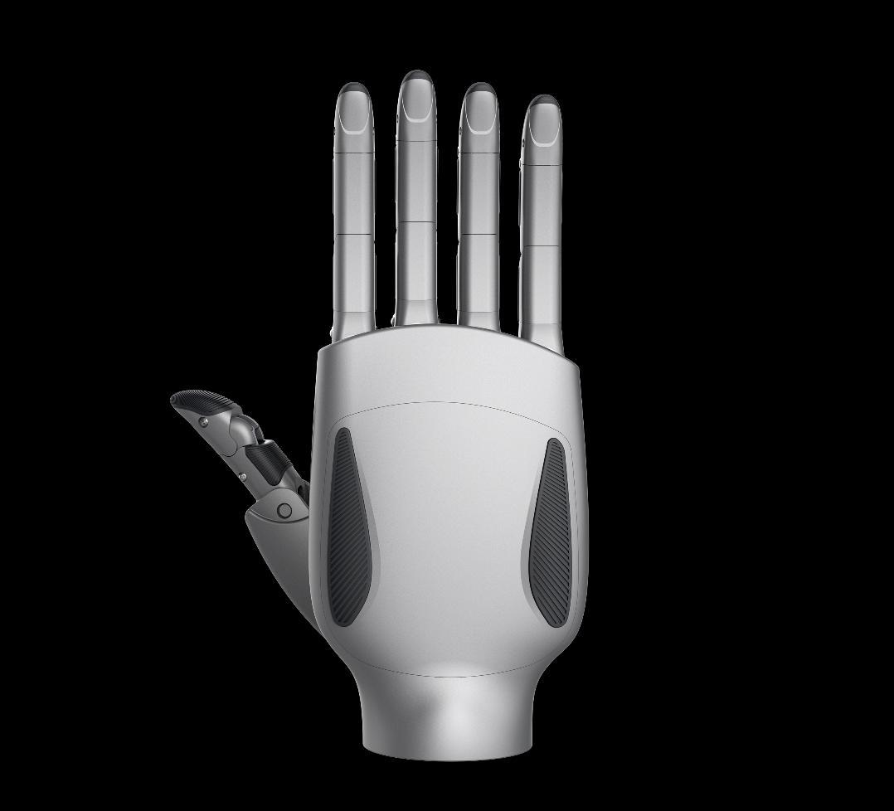

### Revision History

| Version | Date       | Description                                       |
| ------- | ---------- | ------------------------------------------------- |
| V1.0    | 2025-09-11 | Initial edition                                   |
| V1.1    | 2025-11-24 | Parameters and host-computer instructions updated |
| V1.2    | 2026-03-24 | Parameters and host-computer instructions updated |
| V1.3    | 2026-08-04 | Joint-angle values updated                        |

### Safety Instructions

Read this manual and all related manuals before installing or using the product. Observe the following precautions:

1. Use only the matching or specified cables, and secure the product as instructed. Do not use damaged power cords, damaged plugs, or loose sockets.
2. Follow the installation requirements in this manual. Operation outside the specified conditions may shorten the service life and create serious safety hazards.
3. Extended high-power operation may increase the product temperature. If the temperature becomes excessive, stop operation and allow the product to cool before resuming use.
4. Only trained personnel may operate the equipment. Do not open the housing, disassemble the device, or attempt unauthorized repairs. Contact after-sales support if the equipment malfunctions.
5. Diagrams and photographs are illustrative and may differ from the purchased product. The manual may be revised as the product and its specifications are updated.

### Product Overview

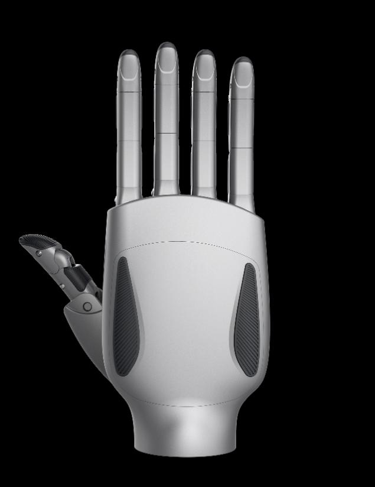

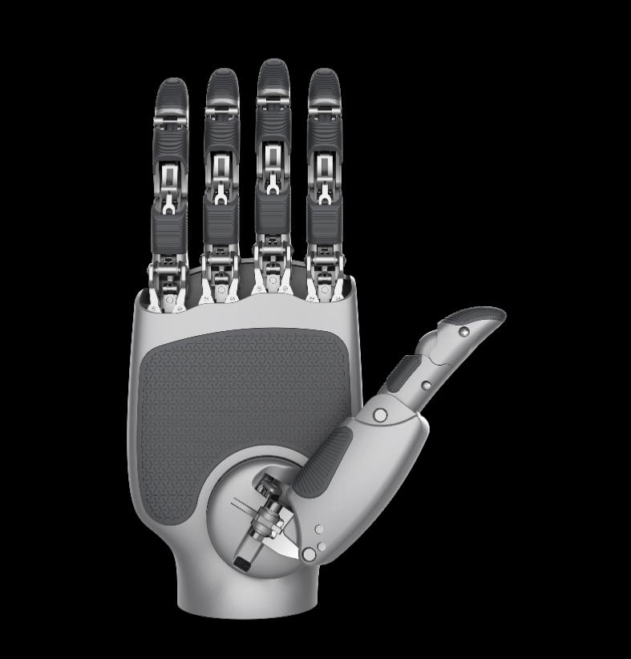

The Linker Hand L20 is a 21-joint robotic hand that combines high-performance brushless motors with precision ball screws. It reproduces human-hand motion for precise grasping and stable gripping while providing high power density and efficient transmission. The hand is intended as an industrial alternative to conventional grippers.

Its high-precision motion control and stable operation support automotive assembly, aerospace operations, irregular-package sorting, and remote or automated work in hazardous environments.

**High-Precision Control and Bionic Manipulation**

Brushless motors and micron-scale ball-screw transmission provide closed-loop position and torque control for tasks such as precision assembly and handling fragile objects.

**Powerful, Efficient Output**

The brushless motors, high-rigidity linkages, and ball screws support a rated load of up to 20 kg. Opening and closing takes approximately 0.9 seconds, enabling efficient grasp-lift-release workflows.

**Energy-Efficient Continuous Operation**

The rated static current is 0.3 A. The hand supports 24 V industrial power and continuous operation for production-line applications.

**Lightweight Integration**

The lightweight design supports rapid installation and deployment in high-precision manufacturing applications, including 3C electronics, automotive, and aerospace production.

### Product Functions

**Position Control**

Position control manages the overall hand position and individual finger joints so that preset trajectories can be executed smoothly. This supports whole-hand movement and fine joint adjustment for precision assembly and path-guided operation.

**Speed Control**

Finger speed can be adjusted for different tasks. High-speed operation improves efficiency, while low-speed operation supports safer precision work.

**Tactile Feedback and Force Control**

Fingertip sensors detect applied force and torque in real time. The controller can adjust output force to protect fragile objects and reduce the risk of slipping.

**Online Firmware Upgrade**

The dexterous-hand firmware can be updated from the host computer, allowing functional updates and performance optimization over the service life of the product.

### Dimensions, Joints, and Motion Range

**External Dimensions**

All dimensions in the drawing are in millimetres.

**Degrees of Freedom**

The Linker Hand L20 has 16 active degrees of freedom and 21 joints in total: 16 active joints and 5 passive joints.

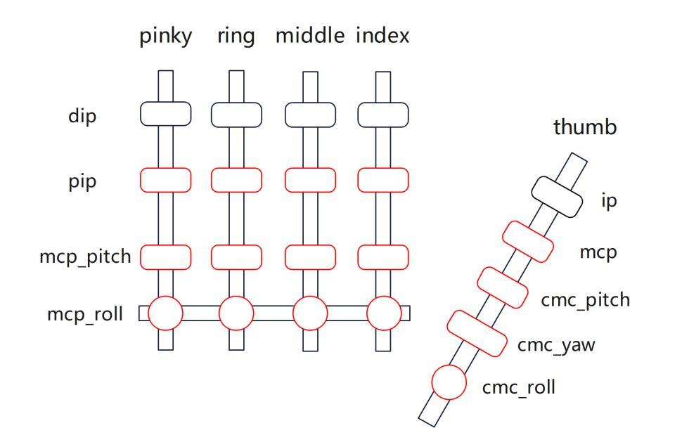

The following diagrams show the actual joint ranges.

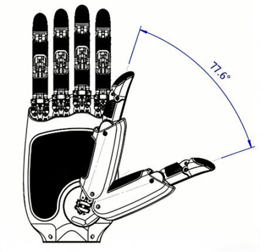

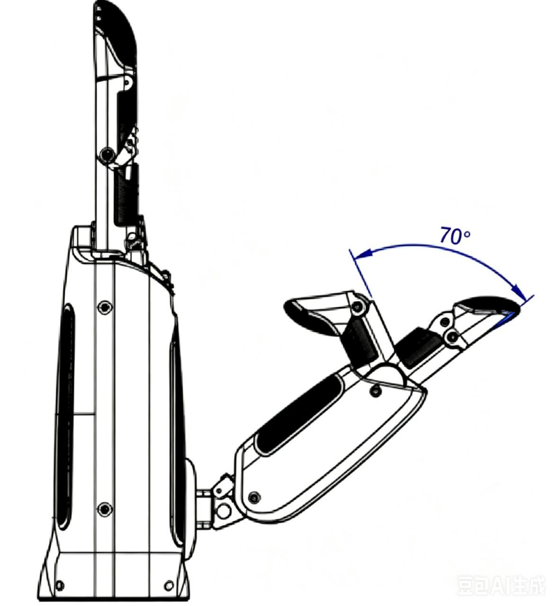

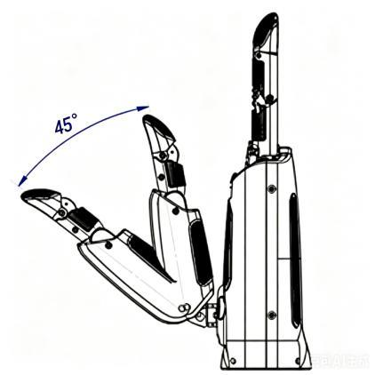

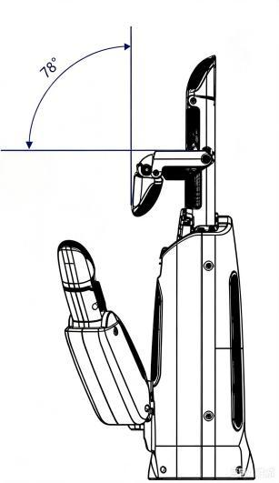

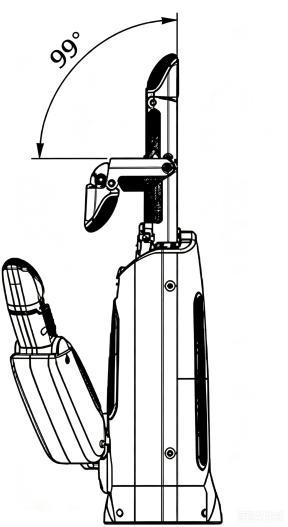

**Controlled Motion Range and Speed**

| Joint     | Maximum motion range | Maximum speed |
| --------- | -------------------: | ------------: |
| IP        |                  71° |     133.96°/s |
| MCP       |                  70° |     132.08°/s |
| CMC pitch |                  45° |      80.36°/s |
| CMC yaw   |                  91° |     185.71°/s |
| CMC roll  |                77.6° |        129°/s |
| DIP       |                  78° |        195°/s |
| PIP       |                  99° |      247.5°/s |
| MCP pitch |                  70° |     194.44°/s |
| MCP roll  |                 ±13° |      68.42°/s |

### Technical Specifications

**Basic Parameters**

| Parameter                     | Specification              |
| ----------------------------- | -------------------------- |
| Model                         | Linker Hand L20            |
| Active degrees of freedom     | 16                         |
| Joint count                   | 21 (16 active + 5 passive) |
| Drive                         | Linkage transmission       |
| Control interfaces            | CAN / RS485                |
| Communication frequency       | 500 Hz                     |
| Weight                        | Approximately 1,200 g      |
| Maximum load                  | 20 kg                      |
| Working voltage               | 24-48 V DC                 |
| Quiescent current             | 0.3 A                      |
| Average no-load motor current | 0.4 A                      |
| Maximum current               | 1.8 A                      |
| Repeatability                 | ±0.2 mm                    |
| Opening and closing time      | 0.98 s                     |

**Mechanical Performance**

| Performance item                                    | Specification |
| --------------------------------------------------- | ------------: |
| Maximum thumb-fingertip force                       |          15 N |
| Maximum fingertip force of each of the four fingers |          20 N |
| Maximum five-finger gripping force                  |         100 N |

### Sensor System

The left-hand L20 is equipped with a pressure-sensitive sensor.

| Parameter                | Specification  |
| ------------------------ | -------------- |
| Piezoresistive array     | 6 × 12         |
| Force-sensitive area     | 9.6 × 14.4 mm  |
| Touch-force threshold    | 5 g            |
| Measurement range        | 20 N           |
| Service life             | 100,000 cycles |
| Communication frame rate | 200 FPS        |

### Installation and Commissioning

**Accessory List**

Confirm that all accessories are present before installation.

| No. | Item                       | Quantity |
| --: | -------------------------- | -------: |
|   1 | USB-to-CAN debugging cable |        1 |
|   2 | XT30 (2+2) plug-in cable   |        1 |
|   3 | Power adapter              |        1 |
|   4 | Power cable                |        1 |

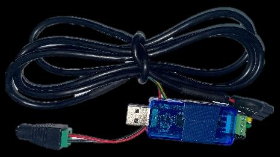

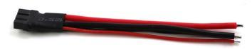

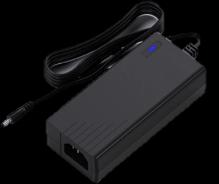

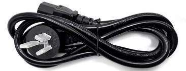

**Mechanical Installation**

Use M3 screws. Select the screw length according to the thickness of the mounting component.

**Electrical Connection**

The hand uses an XT30 (2+2) connector.

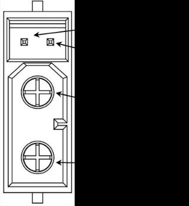

| Pin | Signal |
| --: | ------ |
|   1 | CAN L  |
|   2 | CAN H  |
|   3 | GND    |
|   4 | 24 V   |

**Debugging Cable Connection**

1. Connect the dexterous hand to the debugging computer with the USB-to-CAN cable.
2. Connect the power cable to the power adapter.
3. Connect the adapter to the power input of the USB-to-CAN cable.
4. Connect the other end of the power cable to a 220 V AC outlet.

### Warranty and Service

1. The product is covered by a 12-month limited warranty from the date of purchase.
2. During the warranty period, failures caused by manufacturing or material defects are eligible for free repair or component replacement.
3. The warranty does not cover surface wear caused by normal use or damage caused by improper operation, accidents, unauthorized disassembly, or failure to follow the manual.
4. Returns or exchanges are not accepted when the issue is not a product-quality problem.
5. If the product malfunctions, contact official after-sales support. Do not disassemble the product yourself.
6. Repair services outside the warranty period are chargeable.

### SDK and Technical Support

* ROS SDK: [linkerhand-ros-sdk](https://github.com/linker-bot/linkerhand-ros-sdk)
* ROS 2 SDK: [linkerhand-ros2-sdk](https://github.com/linker-bot/linkerhand-ros2-sdk)
* Python SDK: [linkerhand-python-sdk](https://github.com/linker-bot/linkerhand-python-sdk)
* Technical support: [support@linkerbot.cn](mailto:support@linkerbot.cn)
* Official website: [linkerbot.cn](https://linkerbot.cn)
