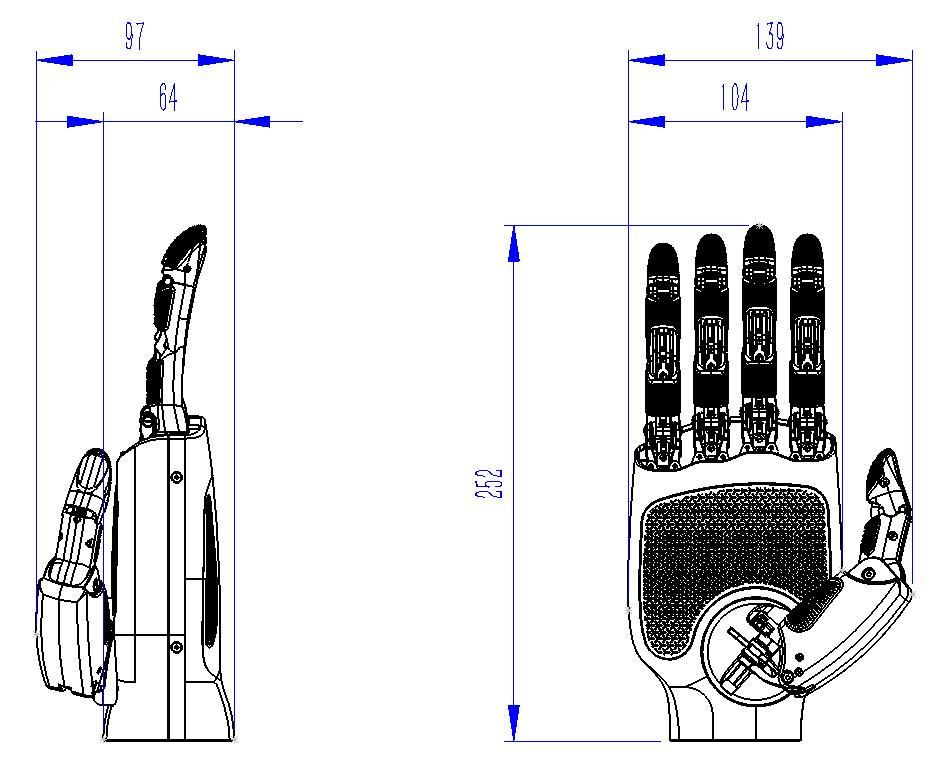
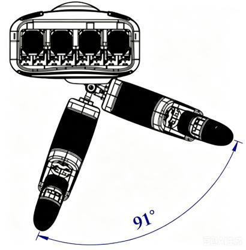
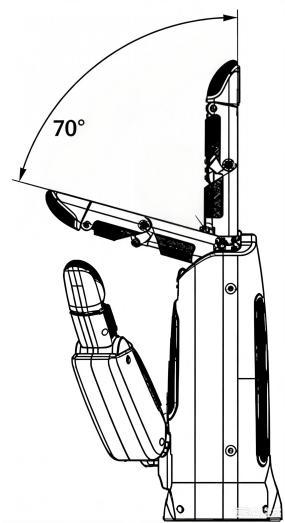
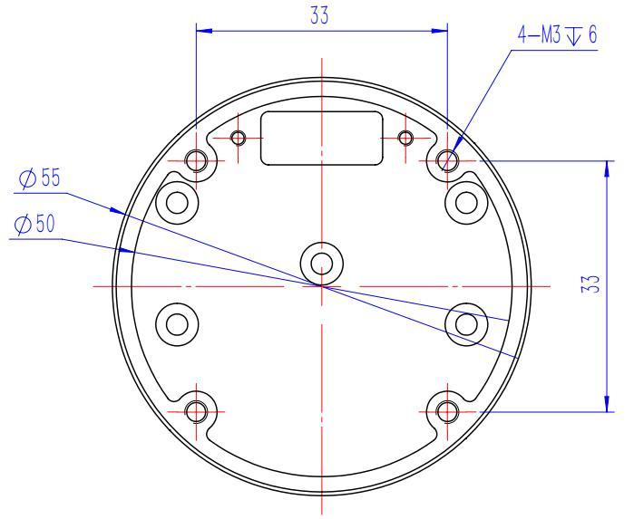

# Linker Hand L20 Product Manual

### LINKERBOT Linker Hand L20 21-DOF Dexterous Robotic



### Revision History

| Version | Date       | Description                                       |
| ------- | ---------- | ------------------------------------------------- |
| V1.0    | 2025-09-11 | Initial edition                                   |
| V1.1    | 2025-11-24 | Parameters and host-computer instructions updated |
| V1.2    | 2026-03-24 | Parameters and host-computer instructions updated |
| V1.3    | 2026-08-04 | Joint-angle values updated                        |

### Safety Instructions

Read this manual and all related manuals before installing or using the product. Observe the following precautions:

1. Use only the matching or specified cables, and secure the product as instructed. Do not use damaged power cords, damaged plugs, or loose sockets.
2. Follow the installation requirements in this manual. Operation outside the specified conditions may shorten the service life and create serious safety hazards.
3. Extended high-power operation may increase the product temperature. If the temperature becomes excessive, stop operation and allow the product to cool before resuming use.
4. Only trained personnel may operate the equipment. Do not open the housing, disassemble the device, or attempt unauthorized repairs. Contact after-sales support if the equipment malfunctions.
5. Diagrams and photographs are illustrative and may differ from the purchased product. The manual may be revised as the product and its specifications are updated.

### Product Overview

The Linker Hand L20 is a 21-joint robotic hand that combines high-performance brushless motors with precision ball screws. It reproduces human-hand motion for precise grasping and stable gripping while providing high power density and efficient transmission. The hand is intended as an industrial alternative to conventional grippers.

Its high-precision motion control and stable operation support automotive assembly, aerospace operations, irregular-package sorting, and remote or automated work in hazardous environments.

#### High-Precision Control and Bionic Manipulation

Brushless motors and micron-scale ball-screw transmission provide closed-loop position and torque control for tasks such as precision assembly and handling fragile objects.

#### Powerful, Efficient Output

The brushless motors, high-rigidity linkages, and ball screws support a rated load of up to 20 kg. Opening and closing takes approximately 0.9 seconds, enabling efficient grasp-lift-release workflows.

#### Energy-Efficient Continuous Operation

The rated static current is 0.3 A. The hand supports 24 V industrial power and continuous operation for production-line applications.

#### Lightweight Integration

The lightweight design supports rapid installation and deployment in high-precision manufacturing applications, including 3C electronics, automotive, and aerospace production.

### Product Functions

#### Position Control

Position control manages the overall hand position and individual finger joints so that preset trajectories can be executed smoothly. This supports whole-hand movement and fine joint adjustment for precision assembly and path-guided operation.

#### Speed Control

Finger speed can be adjusted for different tasks. High-speed operation improves efficiency, while low-speed operation supports safer precision work.

#### Tactile Feedback and Force Control

Fingertip sensors detect applied force and torque in real time. The controller can adjust output force to protect fragile objects and reduce the risk of slipping.

#### Online Firmware Upgrade

The dexterous-hand firmware can be updated from the host computer, allowing functional updates and performance optimization over the service life of the product.

### Dimensions, Joints, and Motion Range

#### External Dimensions

All dimensions in the drawing are in millimetres.

#### Degrees of Freedom

The Linker Hand L20 has 16 active degrees of freedom and 21 joints in total: 16 active joints and 5 passive joints.

The following diagrams show the actual joint ranges.

#### Controlled Motion Range and Speed

| Joint     | Maximum motion range | Maximum speed |
| --------- | -------------------: | ------------: |
| IP        |                  71° |     133.96°/s |
| MCP       |                  70° |     132.08°/s |
| CMC pitch |                  45° |      80.36°/s |
| CMC yaw   |                  91° |     185.71°/s |
| CMC roll  |                77.6° |        129°/s |
| DIP       |                  78° |        195°/s |
| PIP       |                  99° |      247.5°/s |
| MCP pitch |                  70° |     194.44°/s |
| MCP roll  |                 ±13° |      68.42°/s |

### Technical Specifications

#### Basic Parameters

| Parameter                     | Specification              |
| ----------------------------- | -------------------------- |
| Model                         | Linker Hand L20            |
| Active degrees of freedom     | 16                         |
| Joint count                   | 21 (16 active + 5 passive) |
| Drive                         | Linkage transmission       |
| Control interfaces            | CAN / RS485                |
| Communication frequency       | 500 Hz                     |
| Weight                        | Approximately 1,200 g      |
| Maximum load                  | 20 kg                      |
| Working voltage               | 24-48 V DC                 |
| Quiescent current             | 0.3 A                      |
| Average no-load motor current | 0.4 A                      |
| Maximum current               | 1.8 A                      |
| Repeatability                 | ±0.2 mm                    |
| Opening and closing time      | 0.98 s                     |

#### Mechanical Performance

| Performance item                                    | Specification |
| --------------------------------------------------- | ------------: |
| Maximum thumb-fingertip force                       |          15 N |
| Maximum fingertip force of each of the four fingers |          20 N |
| Maximum five-finger gripping force                  |         100 N |

### Sensor System

The left-hand L20 is equipped with a pressure-sensitive sensor.

| Parameter                | Specification  |
| ------------------------ | -------------- |
| Piezoresistive array     | 6 × 12         |
| Force-sensitive area     | 9.6 × 14.4 mm  |
| Touch-force threshold    | 5 g            |
| Measurement range        | 20 N           |
| Service life             | 100,000 cycles |
| Communication frame rate | 200 FPS        |

### Installation and Commissioning

#### Accessory List

Confirm that all accessories are present before installation.

| No. | Item                       | Quantity |
| --: | -------------------------- | -------: |
|   1 | USB-to-CAN debugging cable |        1 |
|   2 | XT30 (2+2) plug-in cable   |        1 |
|   3 | Power adapter              |        1 |
|   4 | Power cable                |        1 |

#### Mechanical Installation

Use M3 screws. Select the screw length according to the thickness of the mounting component.

#### Electrical Connection

The hand uses an XT30 (2+2) connector.

| Pin | Signal |
| --: | ------ |
|   1 | CAN L  |
|   2 | CAN H  |
|   3 | GND    |
|   4 | 24 V   |

#### Debugging Cable Connection

1. Connect the dexterous hand to the debugging computer with the USB-to-CAN cable.
2. Connect the power cable to the power adapter.
3. Connect the adapter to the power input of the USB-to-CAN cable.
4. Connect the other end of the power cable to a 220 V AC outlet.

### Warranty and Service

1. The product is covered by a 12-month limited warranty from the date of purchase.
2. During the warranty period, failures caused by manufacturing or material defects are eligible for free repair or component replacement.
3. The warranty does not cover surface wear caused by normal use or damage caused by improper operation, accidents, unauthorized disassembly, or failure to follow the manual.
4. Returns or exchanges are not accepted when the issue is not a product-quality problem.
5. If the product malfunctions, contact official after-sales support. Do not disassemble the product yourself.
6. Repair services outside the warranty period are chargeable.

### SDK and Technical Support

* ROS SDK: [linkerhand-ros-sdk](https://github.com/linker-bot/linkerhand-ros-sdk)
* ROS 2 SDK: [linkerhand-ros2-sdk](https://github.com/linker-bot/linkerhand-ros2-sdk)
* Python SDK: [linkerhand-python-sdk](https://github.com/linker-bot/linkerhand-python-sdk)
* Technical support: [support@linkerbot.cn](mailto:support@linkerbot.cn)
* Official website: [linkerbot.cn](https://linkerbot.cn)
