# Linker Hand L30 (Tendon-Driven) Product Manual


[**View LINKERBOT L30 Standard (Tendon-Driven) on OpenELAB**](https://openelab.io/products/linker-hand-linkerbot-l30-l30)

**Model:** L30 Standard (Tendon-Driven) · **SKU:** `Linker-Hand-L30-JQ1 (left tendon-driven RS485 store option; manual says CAN FD; mismatch)` · **Manual:** V1.3 (2025-10-27)


[**Complete supplied L30 Standard (tendon-driven) manual — 17 PDF pages and downloads**](source-library/complete-l30.md) · [All seven complete manuals](source-library/)

[LINKERBOT family index](linkerbot-dexterous-hands-developer-guide/) · **Complete manufacturer manual and diagrams below**

## Product overview

**L30 Standard (Tendon-Driven)** has **17 controlled; 21 total (17 active, 4 passive), including one wrist DoF**. Its supplied manufacturer product manual is revision **V1.3 (2025-10-27)**. This page describes the exact model; any other Linkerbot hand with a similar number may have a different joint array, mounting flange, sensor option, adapter voltage or bus protocol. **Identity:** Linker-Hand-L30-JQ1 (left tendon-driven RS485 store option; manual says CAN FD; mismatch).

## Applications

* Model-specific end-effector integration into research manipulators and humanoid platforms.
* Safe device identification, position/state logging, and supervised dexterous control research.
* Tactile and closed-loop grasp studies **only when installed sensors and controls are verified**.

## Specifications

| Parameter                                  | Source-backed value                                                                                     |
| ------------------------------------------ | ------------------------------------------------------------------------------------------------------- |
| Controlled DoF and physical joints         | 17 controlled; 21 total (17 active, 4 passive), including one wrist DoF                                 |
| Power                                      | **24 VDC per attached OEM Standard manual; store lists 12 V in product comparison — CRITICAL CONFLICT** |
| Bus / variant                              | Manual CAN FD + miniUSB, while store offers CAN/RS485 variants — CRITICAL CONFLICT                      |
| Manufacturer-reported mass                 | ≈1400 g                                                                                                 |
| Manufacturer maximum load                  | 5 kg per OEM vs different store comparison payload; verify source scope                                 |
| Manufacturer-reported opening/closing time | 0.2 s                                                                                                   |
| Tactile/sensing                            | Optional fingertip piezoresistive sensor, 6×12 at 200 fps; **not automatically present**.               |
| Manual revision                            | V1.3 (2025-10-27)                                                                                       |

**Evidence:** exact attached product manual and corresponding connected product catalog where available. These are device-level figures, not automatically rated full-arm payload or production contact performance.

## Complete supplied-manual reference

The following details supplement the original guide using **V1.3 · 2025-10-27**. Every supplied page, including diagrams, revision history, controls and service clauses, is available in the [Complete supplied L30 Standard (tendon-driven) manual — 17 PDF pages and downloads](source-library/complete-l30.md).

### Detailed electrical, mechanical and sensor parameters

| Parameter                     | Manufacturer source entry                                                             |
| ----------------------------- | ------------------------------------------------------------------------------------- |
| Architecture and joints       | Tendon-driven Standard edition; 17 active + 4 passive joints, including one wrist DoF |
| DC input and current          | Manual 24 V DC; 0.45 A quiescent, 0.63 A no-load motor average, 2.3 A maximum         |
| Bus and ambiguous rate        | Parameter table CAN FD / 500 kbps; overview Mini-USB + CAN FD / 500 Hz                |
| Mass, repeatability and cycle | Approximately 1400 g; ±0.20 mm; opening/closing 0.2 s                                 |
| Load and force table          | Maximum load 5 kg; thumb fingertip 8 N; other fingertips 7 N; each-finger grip 12 N   |
| Optional tactile sensor       | 6×12; 9.6×14.4 mm; 5 g touch-force entry; 20 N range; 200 fps; 100,000 cycles         |

Sources: [PDF page 10](source-library/complete-l30.md#pdf-page-10) and the chapter map below. Maximum-load, maximum-force and cycle entries are manufacturer figures; the manual does not establish that they can be reached simultaneously or safely in a complete robot.

### Joint ranges and source interpretation

| Joint / motion label                    | Source angle range (degrees) | Source speed entry (°/s unless noted) |
| --------------------------------------- | ---------------------------- | ------------------------------------- |
| Wrist / dorsal thumb swing              | 44.7 / 44.7                  | 171.9 / 406.3                         |
| Thumb rotation / thumb base / thumb tip | 75.8 / 91.9 / 85.4           | 315.8 / 437.6 / 406.6                 |
| Four-finger root bend / fingertip bend  | 84.3 / 90                    | 443.6 / 450                           |
| Passive fingertip flexion               | 82.5                         | Not specified                         |
| Index / middle lateral swing            | 21 / 20.6                    | 190.9 / 187.2                         |
| Ring / little lateral swing             | 19.3 / 15.1                  | 241.2 / 302                           |

Source: [PDF page 9](source-library/complete-l30.md#pdf-page-9). Physical/passive joint labels are not an independent command-vector definition.

**Powered commissioning remains blocked for an unconfirmed store variant:** the source says 24 V/CAN FD, while the matched L30 tendon listing contains 12 V comparison information and CAN/RS485 options. The manual itself also labels 500 kbps as a communication frequency while its overview says 500 Hz. A bitrate, a device polling frequency and the current SDK’s 1/5 Mbit/s adapter profile are different quantities; do not infer a hardware setting from one of them. The source warns that structural maximum angles can exceed the actually commanded range. The direct-drive L30 is outside this manual’s scope.

### Mounting, supplied items and model-specific operation

The tendon path is described as ultra-high-molecular-weight polyethylene tendon in a PTFE tube with a distal motor assembly. The source includes both end-flange and mounting-seat drawings and calls for M4 mounting screws selected for fixture thickness. Its CAN-side XT30 table is **1 CAN L, 2 CAN H, 3 GND, 4 24 V**. The accessory list contains USB-to-CAN-FD, USB cable, XT30 cable, adapter and power line. The `dexterous_hand_controller.exe` workflow shows Connect Device, model/serial, speed/torque settings, joint sliders and an animation sequence editor. Reading slider values, saving to sequence/file and loading a file differ from Execute/Start, which move the hand. Interval is in seconds; Loop repeats the list; Stop ends the executing sequence. These source functions are documented for completeness, not a way around the unresolved electrical match.

### Complete chapter and drawing map

| Original PDF page                                         | Topic                                           |
| --------------------------------------------------------- | ----------------------------------------------- |
| [PDF page 2](source-library/complete-l30.md#pdf-page-2)   | Revision history                                |
| [PDF page 5](source-library/complete-l30.md#pdf-page-5)   | Tendon materials, wrist and overview rate       |
| [PDF page 7](source-library/complete-l30.md#pdf-page-7)   | Dimensions and 17+4 joint topology              |
| [PDF page 8](source-library/complete-l30.md#pdf-page-8)   | Structural maxima and control-range caution     |
| [PDF page 9](source-library/complete-l30.md#pdf-page-9)   | Actual angles and speeds                        |
| [PDF page 10](source-library/complete-l30.md#pdf-page-10) | Electrical, rate, load, force and sensor tables |
| [PDF page 11](source-library/complete-l30.md#pdf-page-11) | Optional sensor and five accessories            |
| [PDF page 12](source-library/complete-l30.md#pdf-page-12) | M4 end-flange drawing                           |
| [PDF page 13](source-library/complete-l30.md#pdf-page-13) | Mounting-seat drawing and XT30 table            |
| [PDF page 14](source-library/complete-l30.md#pdf-page-14) | Controller application and connection           |
| [PDF page 15](source-library/complete-l30.md#pdf-page-15) | Joint sliders and sequence editor               |
| [PDF page 16](source-library/complete-l30.md#pdf-page-16) | Sequence continuation and warranty              |
| [PDF page 17](source-library/complete-l30.md#pdf-page-17) | SDK appendix                                    |

### Service, recovery and development records

The source provides a **12-month limited warranty from purchase** for manufacturing/material defects, excludes normal wear and improper operation, impact/accidents, unauthorized disassembly or use contrary to instructions, and describes paid out-of-warranty service. The original return/exchange exclusions remain in the complete reference; use the actual sales agreement for an order. If a fault occurs, stop operation and contact manufacturer support rather than dismantling the hand. Preserve model/side, serial, firmware/PCB revision, supply label, adapter, SDK commit, LED/error state and logs with the service request. Manufacturer support is `support@linkerbot.cn`; this wiki review does not send a support request.

The manuals describe firmware-upgrade capability, but do not include every model-specific firmware image, recovery package, binary protocol, CAD/URDF model or installer. Original drawings and screenshots are included; obtain the exact missing package from the manufacturer. Do not flash a related model or create pin mappings from an image’s appearance.

For current software, read the [pinned L30 feature guide](https://github.com/linker-bot/linkerbot-hand-ros2-sdk/blob/8d56b3355d2cfcd90e4e3c6b377ebceb7a5c09ac/linkerbot_hand_ros/docs/l30.md) and [model/capability definitions](https://github.com/linker-bot/linkerbot-hand-ros2-sdk/blob/8d56b3355d2cfcd90e4e3c6b377ebceb7a5c09ac/linkerbot_hand_ros/docs/models.md). The current ROS 2 stack and its `linkerbot-hand-python-sdk` dependency differ from the older `linkerhand-python-sdk` appendix. Check actual bus, joint names, validity masks and raw-unit metadata; cached configuration values are not live torque/current measurements. Current source reviewed at `8d56b3355d2c` on 22 November 2026. Software build and hardware operation were **not run**.

## Hardware and connections

1. Inspect the model, serial, left/right label and selected store interface; do not rely only on a family nickname.
2. Confirm the supplied adapter, supported cable, correct keyed connector and the mounting drawing **before** connecting DC power.
3. Use a stable fixture, keep fingers and cables away from moving linkages and make the operator's stop/disconnect method accessible.

### Model-specific mechanical mounting

The Standard Edition manual shows an **M4 flange and a 160 × 160 mm mounting base drawing** on pages 12–13. The separate direct-drive L30 does not share this documented flange by assumption.

### Electrical bus and connector

Its OEM XT30 (2+2) pin table gives CAN L, CAN H, GND, 24 V on page 13; the retail variant instead offers CAN/RS485 and a comparison cites 12 V. **Do not wire or energize from either source until the exact SKU is confirmed.**

**Manufacturer-model note:** The L30 model is **tendon-driven**, not the other Shopify **L30 Direct-Drive** item. The 17 active DoF include a wrist. Its manual calls the 500 kbps number a communication **bit rate**, not a 500 Hz loop rate.

## Software and development resources

| Resource                                                                                                                              | Verified purpose                                                                        |
| ------------------------------------------------------------------------------------------------------------------------------------- | --------------------------------------------------------------------------------------- |
| [Current seven-model Linkerbot ROS 2 driver](https://github.com/linker-bot/linkerbot-hand-ros2-sdk)                                   | ROS 2 Humble/Jazzy driver and read-only state topics; **native CAN/CAN FD** model entry |
| [ROS 2 model compatibility matrix](https://github.com/linker-bot/linkerbot-hand-ros2-sdk/blob/main/linkerbot_hand_ros/docs/models.md) | Confirms active joint count, bus and per-model capability differences                   |
| [LinkerHand Python SDK](https://github.com/linker-bot/linkerhand-python-sdk)                                                          | Firmware/adapter-specific Python examples; verify variant and driver before using       |
| [Preserved L30 Standard (Tendon-Driven) OEM manual in OpenELAB Wiki](linker-hand-l30-standard-edition-product-manual.md)              | Exact manual hardware, mechanical dimensions, connector and installation source         |

**Version constraint:** a current GitHub model entry does not certify a purchased RS485 variant for a CAN-only launch. Check model/device capabilities, firmware and the installed transport. Never run sample code that writes angles or torque as the first device check.

## Getting started

### Prerequisites

Physical hand and variant labeling; correct original or manufacturer-approved adapter; matching CAN/CAN FD/RS485 interface; secure fixture; model manual. For first read-only software use, a compatible Windows host utility or ROS 2 environment must be available as appropriate.

### First working result

1. **Documentation-only first check:** record the actual hand body/serial/side, installed flange, accessory list, power adapter label (voltage/polarity/current), controller label, bus connector and exact JQ SKU; compare against the 24 V CAN-FD manual and the storefront's 12 V/CAN-RS485 variants. Request written OEM/merchant pairing for that exact unit **before power, CAN connection, USB, or running dexterous\_hand\_controller.exe**.
2. Record current model, side, revision, bus, installed host utility/SDK commit and relevant status values. Do **not** command finger positions, resets, gains or torque until identity and safety are confirmed.

**Expected result:** A complete identity/adapter/bus reconciliation sheet; **powered first run blocked until source conflict is resolved**.

**If the check fails:** A controller application may show an L30 profile but that alone is not proof the adapter voltage and bus are safe. Stop and resolve exact revision/variant and terminal assignment.

### Next safe experiment

With device and software explicitly approved, log a sequence of **read-only** state observations and compare expected joint count/units, metadata validity and sample freshness. Motion/grasping is a separate supervised step after confirming range, direction, force and stop behavior.

## Troubleshooting and FAQs

**A device appears but the reported joint count differs.** Confirm the exact model, model discovery, loaded SDK feature definition and **active DoF versus passive mechanical joints**. Do not pad/trim a control vector to guess joint mapping.

**The device does not connect or respond.** A controller application may show an L30 profile but that alone is not proof the adapter voltage and bus are safe. Stop and resolve exact revision/variant and terminal assignment.

**Can I use another Linkerbot model's power cable or protocol?** No. This model's documented electrical interface is **Manual CAN FD + miniUSB, while store offers CAN/RS485 variants — CRITICAL CONFLICT**; use its own labeled cable, supply and OEM connector drawing.

**Can I assume tactile data is present?** Optional fingertip piezoresistive sensor, 6×12 at 200 fps; **not automatically present**. Validate sensor options and returned data before relying on tactile feedback.

## Downloads and technical documents

| Resource                        | Scope and link                                                                                                                               |
| ------------------------------- | -------------------------------------------------------------------------------------------------------------------------------------------- |
| Original product manual         | [Preserved L30 Standard (Tendon-Driven) OEM manual in OpenELAB Wiki](linker-hand-l30-standard-edition-product-manual.md)                     |
| Manufacturer ROS 2 model matrix | [Model definitions and control semantics](https://github.com/linker-bot/linkerbot-hand-ros2-sdk/blob/main/linkerbot_hand_ros/docs/models.md) |
| Manufacturer current ROS 2 SDK  | [Installation and examples](https://github.com/linker-bot/linkerbot-hand-ros2-sdk)                                                           |
| Manufacturer Python SDK         | [Source and model examples](https://github.com/linker-bot/linkerhand-python-sdk)                                                             |
| OpenELAB product/SKU            | [Matched model and selectable variants](https://openelab.io/products/linker-hand-linkerbot-l30-l30)                                          |

**Physical drawings:** preserve the flange/connector images in the existing manual; do not recreate dimensioned pinout diagrams from photos.

## References and validation

* LINKERBOT / Lingxin Qiaoshou, _L30 Standard (Tendon-Driven) Product Manual_, **V1.3 (2025-10-27)**, provided upload, reviewed 2026-11-21.
* [Current official Linkerbot ROS 2 model matrix](https://github.com/linker-bot/linkerbot-hand-ros2-sdk/blob/main/linkerbot_hand_ros/docs/models.md), reviewed 2026-11-21.
* [OpenELAB exact model listing](https://openelab.io/products/linker-hand-linkerbot-l30-l30), matched to catalog variant on 2026-11-21.

**Documentation review:** completed for provided revision; **software execution:** not run; **hardware test:** not run. **Critical block:** voltage/protocol discrepancy unresolved—no powered bring-up may be inferred.

## Original LINKERBOT L30 Standard (Tendon-Driven) Manufacturer Manual and Diagrams


The previously published manufacturer material and images below are retained. For the complete supplied revision **V1.3 · 2025-10-27**, use [Complete supplied L30 Standard (tendon-driven) manual — 17 PDF pages and downloads](source-library/complete-l30.md). Earlier drawings/wording can differ; apply the revision and discrepancy notes above.


**Electrical caution:** the attached manual and catalog disagree on voltage and bus. Do not power until the exact delivered variant is verified. The existing OEM manual text, figures, tables and installation illustrations are retained in this section for revision-specific reference.

### LINKERBOT Linker Hand L30 21-DOF Tendon-Driven Dexterous Robotic Hand



### Revision History

| Version | Date       | Description                                         |
| ------- | ---------- | --------------------------------------------------- |
| v1.0    | 2025-08-02 | Initial edition                                     |
| v1.1    | 2025-08-20 | First edition of the Linker Hand L30 Product Manual |
| v1.2    | 2025-08-29 | Content revised                                     |
| v1.3    | 2025-10-27 | Product images updated                              |

### Product Overview

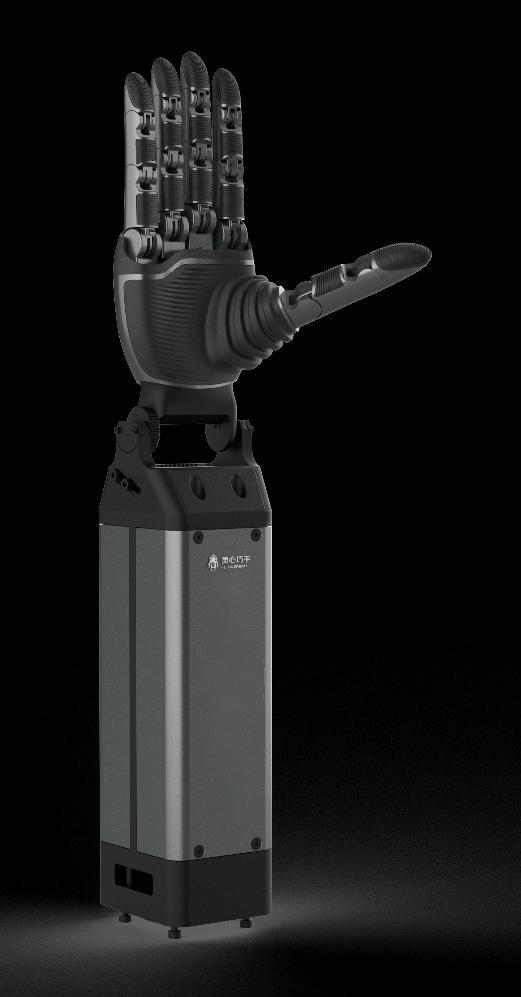

The Linker Hand L30 is a new-generation modular humanoid manipulator developed by Lingxin Qiaoshou. As a tendon-driven robotic end effector, it combines the team's work in motion control, bionic design, and electromechanical integration.

The hand is designed to reproduce the fine motor capabilities of a human hand. Its multi-degree-of-freedom bionic structure follows human-hand movement principles, while high-precision control and real-time sensing combine flexible motion with precise operation. The hand can perform complex actions such as pinching, gripping, and twisting. Its design targets motion flexibility, millimetre-level operating precision, and dependable operation under demanding conditions, providing an adaptable end-effector solution for industrial automation, medical-assistance research, and scientific experimentation.

**Bionic Drive Architecture**

The tendon-driven transmission uses ultra-high-molecular-weight polyethylene tendons and PTFE tubes. A distal motor assembly coordinates five fingers through 17 active degrees of freedom and 21 joints in total, including one wrist degree of freedom. The compact structure is designed around adult palm dimensions and reproduces coordinated multi-joint hand motion while using space efficiently.

**High-Precision Force Control**

A high-resolution encoder, tendon-tension control, and adaptive PID control provide real-time adjustment. Repeatability is specified as ±0.20 mm, supporting precision tasks such as screw tightening and picking thin sheets.

**Load Capacity and Adaptability**

The opposed-thumb layout and independent force control for the four fingers provide up to 10 N of precise gripping force in the product overview. A high-sensitivity tactile array at the fingertips detects contact, allowing the hand to adapt its grasp to irregular objects without manual intervention. The detailed mechanical-performance table later in this manual separately specifies a maximum gripping force of 12 N for each finger.

**Fast Response**

Core motions—including four-finger flexion and lateral thumb motion—can exceed 400°/s. The specified hand opening and closing time is 0.2 seconds, supporting high-speed operations such as industrial assembly.

**Control and Integration**

The hand provides Mini-USB and CAN FD interfaces and supports a communication frequency of 500 Hz. These interfaces allow integration with industrial automation equipment and service-robot platforms while providing millisecond-level control response.

### Product Functions

**Position Control**

Position control manages the overall hand position and individual finger joints so that the hand can follow preset trajectories smoothly. This supports both whole-hand motion and fine joint-level adjustment for tasks such as precision assembly and path-guided operation.

**Speed Control**

Finger speed can be adjusted to suit the task. High-speed operation improves throughput, while low-speed operation supports safer precision work.

**Tactile Feedback and Force Control**

Fingertip sensors detect the force applied by the fingers in real time. The controller can adjust output force to avoid damaging fragile objects or losing an object because of insufficient grip.

**Online Firmware Upgrade**

The dexterous-hand firmware can be updated from the host computer, allowing functional updates and performance-parameter optimization over the service life of the product.

### Dimensions, Joints, and Motion Range

**External Dimensions**

All dimensions in the diagram are in millimetres.

**Degrees of Freedom**

The Linker Hand L30 has 17 active degrees of freedom and 21 joints in total: 17 active joints and 4 passive joints. High-precision actuators control the active joints, while bionic elastic structures in the passive joints adapt to contact forces, cushion impacts, and reduce energy consumption.

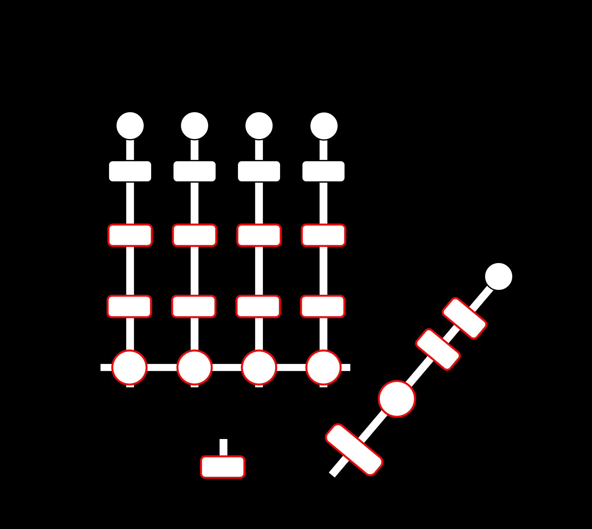

The diagrams below show the maximum mechanical ranges. The actual commanded range may be limited by the controller to prevent structural impact.

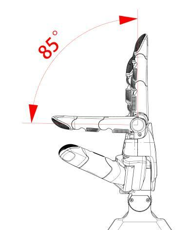

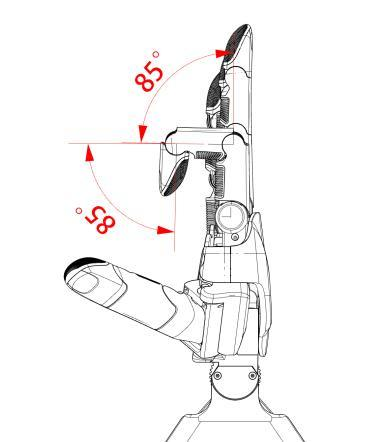

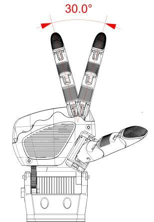

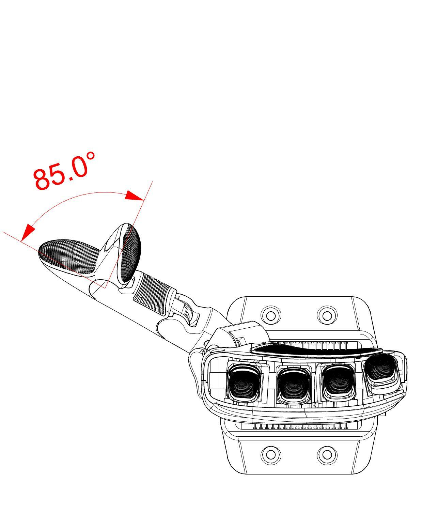

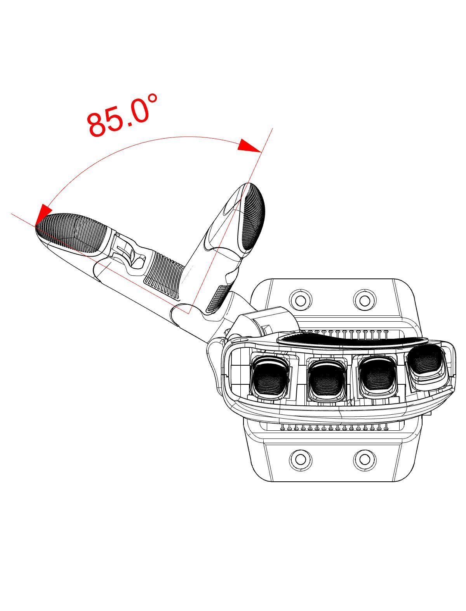

**Controlled Motion Range and Speed**

| Muscle group                                  | Maximum angle range | Maximum speed |
| --------------------------------------------- | ------------------: | ------------: |
| Wrist swing                                   |               44.7° |      171.9°/s |
| Dorsal thumb swing                            |               44.7° |      406.3°/s |
| Thumb rotation                                |               75.8° |      315.8°/s |
| Dorsal thumb base                             |               91.9° |      437.6°/s |
| Thumb tip                                     |               85.4° |      406.6°/s |
| Metacarpal-root flexion of all four fingers   |               84.3° |      443.6°/s |
| Fingertip flexion of all four fingers         |                 90° |        450°/s |
| Passive fingertip flexion of the four fingers |               82.5° |             — |
| Index-finger lateral swing                    |                 21° |      190.9°/s |
| Middle-finger lateral swing                   |               20.6° |      187.2°/s |
| Ring-finger lateral swing                     |               19.3° |      241.2°/s |
| Little-finger lateral swing                   |               15.1° |        302°/s |

### Technical Specifications

**Basic Parameters**

| Parameter                     | Specification                    |
| ----------------------------- | -------------------------------- |
| Model                         | Left-hand L30 (Standard Edition) |
| Active degrees of freedom     | 17                               |
| Joint count                   | 17 active + 4 passive            |
| Drive                         | Tendon-style bionic actuation    |
| Control interface             | CAN FD                           |
| Communication rate            | 500 kbps                         |
| Weight                        | Approximately 1,400 g            |
| Maximum load                  | 5 kg                             |
| Working voltage               | 24 V DC                          |
| Quiescent current             | 0.45 A                           |
| Average no-load motor current | 0.63 A                           |
| Maximum current               | 2.3 A                            |
| Repeatability                 | ±0.20 mm                         |
| Opening and closing time      | 0.2 s                            |

**Mechanical Performance**

| Performance item                                    | Specification |
| --------------------------------------------------- | ------------: |
| Maximum thumb-fingertip force                       |           8 N |
| Maximum fingertip force of each of the four fingers |           7 N |
| Maximum gripping force of each finger               |          12 N |

### Sensor System

The Linker Hand L30 can be equipped with an optional pressure-sensitive sensor.

| Parameter                | Specification  |
| ------------------------ | -------------- |
| Piezoresistive array     | 6 × 12         |
| Force-sensitive area     | 9.6 × 14.4 mm  |
| Touch-force threshold    | 5 g            |
| Measurement range        | 20 N           |
| Service life             | 100,000 cycles |
| Communication frame rate | 200 FPS        |

### Installation and Commissioning

**Accessory List**

Before installing the dexterous hand, confirm that all accessories are present.

| No. | Item                          | Quantity |
| --: | ----------------------------- | -------: |
|   1 | USB-to-CAN FD debugging cable |        1 |
|   2 | USB cable                     |        1 |
|   3 | XT30 (2+2) plug-in cable      |        1 |
|   4 | Power adapter                 |        1 |
|   5 | Power cable                   |        1 |

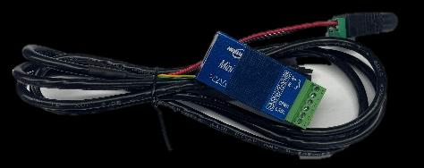

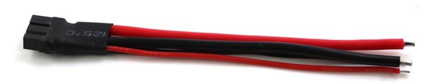

**Mechanical Installation**

Use M4 screws for installation. Select the screw length according to the thickness of the mounting component.

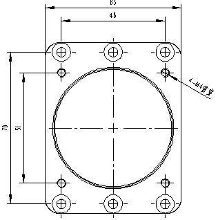

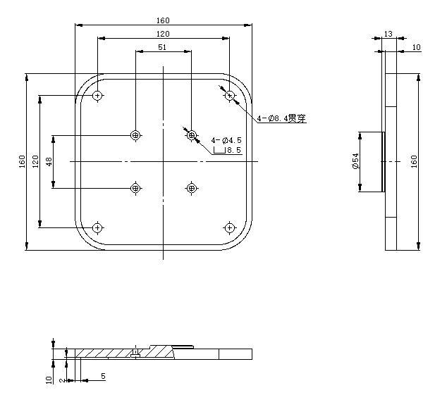

**Electrical Connection**

The dexterous hand uses an XT30 (2+2) connector.

| Pin | Signal |
| --: | ------ |
|   1 | CAN L  |
|   2 | CAN H  |
|   3 | GND    |
|   4 | 24 V   |

### Software Debugging

**Connect the Debugging Cable**

1. Connect the dexterous hand to the debugging computer with the USB-to-CAN FD debugging cable.
2. Connect the power cable to the power adapter.
3. Connect the adapter to the power input of the USB-to-CAN FD debugging cable.
4. Connect the other end of the power cable to a 220 V AC outlet.

**Start the Host-Computer Software**

1. Extract the supplied software archive.
2. Run `dexterous_hand_controller.exe`.
3. In **Device Control**, select **Connect Device**. The software connects automatically and displays the product model and serial number after a successful connection.
4. In **Global Control**, set the global speed and torque as required.

**Control Individual Joints**

In **Joint Status and Control**, move the slider for a joint or enter a target position to rotate that joint.

**Create and Run Action Sequences**

The **Action Sequence Editor** shows the loaded action sequences. Select joint data to edit it.

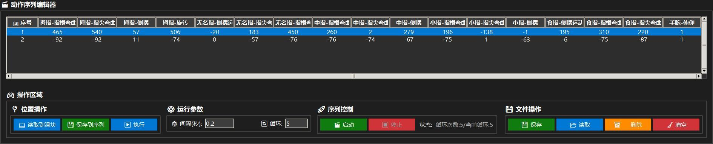

The **Position Operation** controls provide the following functions:

* **Read Slider Values:** Read the current joint-angle data from the device into the sliders.
* **Save to Sequence:** Save the current dexterous-hand joint positions as an action sequence.
* **Execute:** Execute the selected action sequence.

The **Sequence Control** controls provide the following functions:

* **Start:** Run the action-sequence list using the settings in **Operation Parameters**.
* **Stop:** Stop the sequence currently running.

The **File Operations** controls provide the following functions:

* **Save:** Save the current action-sequence list to a file.
* **Read:** Load an action-sequence file into the host-computer software.

The **Operation Parameters** provide the following settings:

* **Interval (seconds):** After the current sequence finishes, wait for this interval before starting the next sequence.
* **Loop:** Set the number of times the complete action-sequence list runs.
* **Delete:** Delete the selected action sequence.
* **Clear:** Remove all action sequences.

To create a two-step repeating motion:

1. Move the joints to the first pose and select **Save to Sequence** to create Sequence 1.
2. Move the joints to the second pose and select **Save to Sequence** to create Sequence 2.
3. Select **Start**. The software executes Sequence 1 and Sequence 2 cyclically according to the configured operation parameters.

### Warranty and Service

1. The product is covered by a 12-month limited warranty from the date of purchase.
2. During the warranty period, failures caused by manufacturing or material defects are eligible for free repair or component replacement.
3. The warranty does not cover:
   * Surface wear caused by normal use.
   * Damage caused by improper operation, accidents, unauthorized disassembly, or failure to follow the manual.
4. Returns or exchanges are not accepted when the issue is not a product-quality problem.
5. If the product malfunctions, contact official after-sales support immediately. Do not disassemble the product yourself.
6. Repair services outside the warranty period are chargeable.

### SDK and Technical Support

* SDK: [Linker Hand ROS SDK](https://github.com/linker-bot/linkerhand-ros-sdk)
* Technical support: [support@linkerbot.cn](mailto:support@linkerbot.cn)
* Official website: [linkerbot.cn](https://linkerbot.cn)


